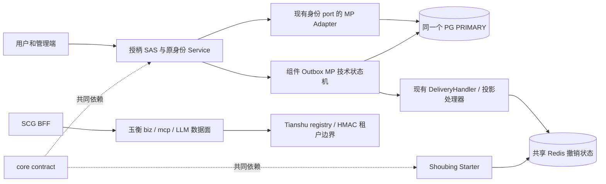
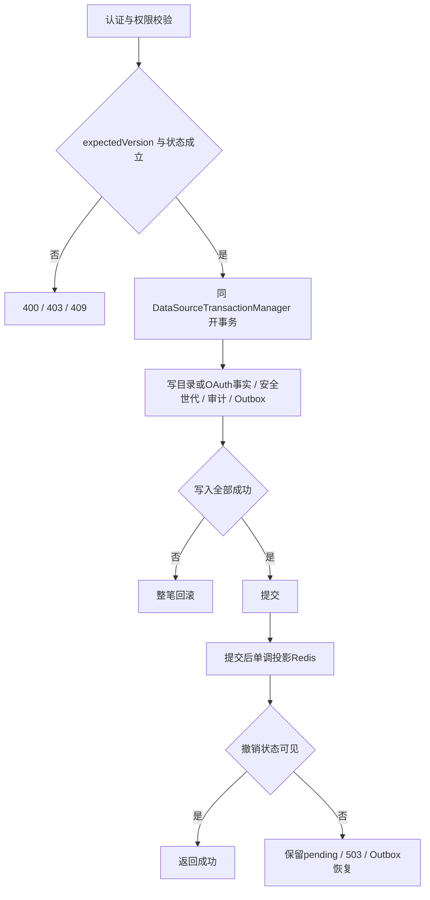
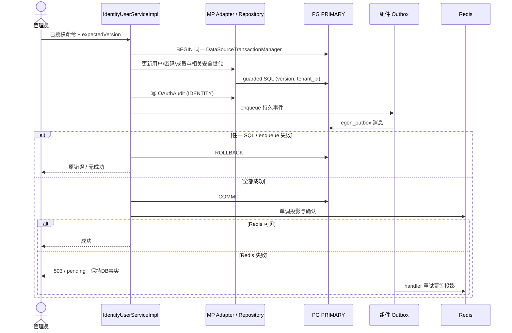
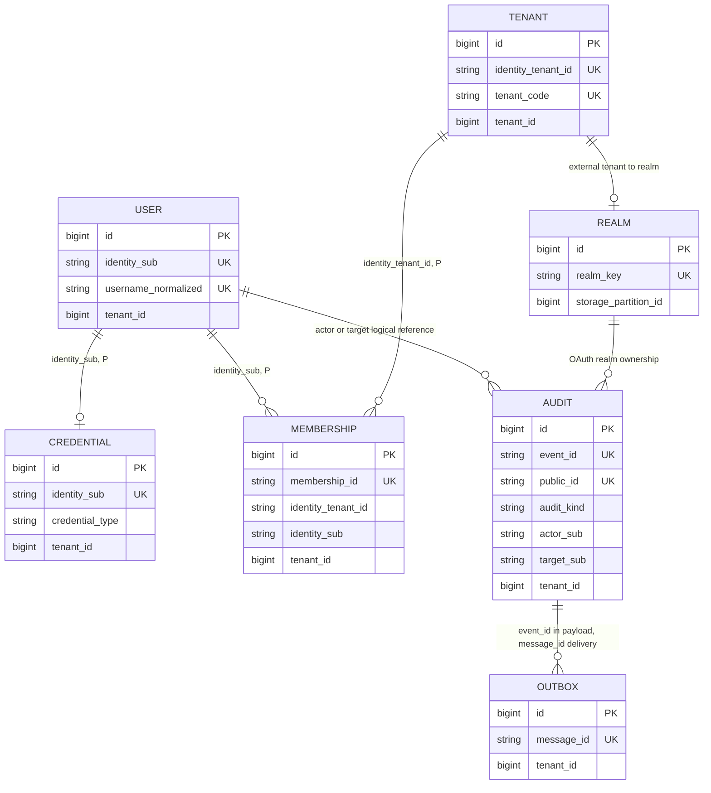

# 天权 OAuth/OIDC 当前代码对齐与认证存储 MP 修订

| Field | Value |
| --- | --- |
| Document | `2026-10-08-10-18-oauth-current-code-alignment.md` |
| Template Version | `7` |
| Status | `Review` |
| Type | `Architecture` |
| Complexity | `Complex` |
| Complexity Drivers | 已批准认证目录迁移、单库事务与Outbox、全局身份和业务租户边界、历史导入、现有Tianshu多租户消费者 |
| Created | `2026-10-08 10:18 Asia/Shanghai` |
| Updated | `2026-10-09 17:37 Asia/Shanghai` |
| Owner | `mario` |
| Repository | `Egon-COLA` |
| Scope | 授柄认证持久化/Outbox与历史迁移；原OAuth/OIDC、SCG、Starter及消费者计划的最新源码对齐 |
| Change Surface | 认证目录四表、OAuth审计兼容列、事务/DDL装配、MP导入、manifest family扩展、Grant列表、BFF前端与强认证回归、管理realm传递、per-realm signing key/撤销/审计/retention、Tianshu/Yuheng适配边界 |
| Affected Chapters | §7, §8, §9, §10, §11, §12, §13, §14, §15, §16 |
| Source Requirement | 2026-10-08“根据当前项目的最新代码，修订一下 spec和plan”；用户选择“认证相关存储统一 MP（推荐）” |
| Baseline Revision | `main@ad60242402eb45a4a801730cf5151119031a98b4`；修订开始时工作树干净 |
| Amends | [已接受主Spec](2026-09-22-17-14-tianquan-multitenant-oauth-oidc-design.md) §3.3、§5/6、§7.3、§8、§10–11、§14–16、§19–20；替换范围详见§5.3 |
| Supersedes | [Grant列表提案](2026-09-23-10-57-oauth-grant-list-contract-amendment.md)：§1–§20，将其API-045原样纳入本次联合Review，尚不代表批准 |
| Depends On | [主Spec未改内容](2026-09-22-17-14-tianquan-multitenant-oauth-oidc-design.md) §1–§20除本修订点名段落；[Outbox当前契约](2026-09-24-12-00-outbox-statemachine-cqe-integration.md) §7/11/16 |
| Related Specs | [Tianshu功能设计](2026-09-21-17-18-tianshu-prompt-skill-management.md) |
| Related Plans | [修订实施Plan](../plan/2026-09-23-10-42-tianquan-oauth-oidc-implementation.md) |

## 1. Summary

OAuth/OIDC主体设计尚未实施，当前授柄仍是JPA/Flyway与自研令牌链。本修订保留已确认的SAS、每租户issuer、独立PLATFORM、SCG/BFF、RS256、即时撤销和强制重新登录，更新已经被最新公共组件改变的实现前提。最关键的是当前Outbox明确要求同一个DataSourceTransactionManager、DataSource和SqlSessionFactory，原“用户目录留JPA、认证MP与Outbox混合事务”的目标不再成立。

用户已选择认证相关存储统一MP：将用户、密码凭据、租户目录、成员关系与原11张OAuth目标表统一到授柄同一PostgreSQL PRIMARY。保留全局用户身份语义及原密码算法；旧Flyway/旧表不改。直接依赖的身份审计与身份事件改接已有OAuth审计/组件Outbox，避免遗留JPA写路径。鉴神业务权限库不在迁移范围。

本次仅形成可审核Spec和Plan。新设计整体为Review；用户对MP方向的选择不是整份Spec/Plan批准。此前API-045缺口随本次共同修订，停止把它作为“不能继续写Plan”的前置卡点；执行前仍须审核本修订。

## 2. Background and Current State

### 2.1 Repository evidence

路径缩写仅用于阅读，精确根如下：`SA=egon-cola-xingyuan/egon-cola-tianquan-shoubing/egon-cola-tianquan-shoubing-admin`；`SJ=SA/src/main/java/top/egon/cola/platform/tianquan/shoubing/admin`；`SC=egon-cola-xingyuan/egon-cola-tianquan-shoubing/egon-cola-tianquan-shoubing-core`；`O=egon-cola-components/egon-cola-component-transactional-outbox-starter`；`MP=egon-cola-components/egon-cola-component-common/egon-cola-component-common-mybatis-plus-sharding-jdbc-ext-spring-boot-starter`。其余沿主Spec缩写。均为2026-10-08源码检查，不是运行证明。

| Evidence ID | Classification | Exact path/symbol/decision/command | Observed fact | Design significance | Verification limit/freshness |
| --- | --- | --- | --- | --- | --- |
| EVD-101 | Static repository | O/src/main/java/top/egon/cola/component/outbox/autoconfigure/OutboxMybatisPlusAutoConfiguration#validateStoreInfrastructure | 只接受DataSourceTransactionManager且DataSource对象相同；SqlSessionFactory必须同源并使用SpringManagedTransactionFactory | 排除JpaTransactionManager混合提交 | 当前源码，未启动上下文 |
| EVD-102 | Static repository | O/.../migration/OutboxManagedDdlInitializer、OutboxLogicalDataSourceFactory；db/egon-outbox-mp/manifest.json | 固定egon_outbox、单PRIMARY/SHARDING/LOCAL、先组件DDL后逻辑库；组件自带manifest | 应用不能复制组件DDL或绕开初始化 | 当前源码 |
| EVD-103 | Static repository | SJ/identity/repo/IdentityPersistenceAdapter；tenant/repo/IdentityTenantRepository、IdentityTenantMembershipRepository | 四种认证事实目前依赖JPA；用户与密码采用expectedVersion；目录为全局 | 扩展迁移四表并保留当前语义 | 未检查生产数据 |
| EVD-104 | User decision | 用户2026-10-08选择“认证相关存储统一 MP（推荐）” | 已确认本修订技术范围 | 可以编制统一事务与迁移Plan | 不授权执行迁移 |
| EVD-105 | Static repository | MP/.../handler/EgonColaMetaObjectHandler#insertFill；extension/EgonColaRepository | 新增填充包含version=0和当前审计时间；无可注入tenantIdProvider/modelValidationUtils属性 | 导入必须使用独立DTO/XML；复用现有校验和MDC provider | 非真实导入证明 |
| EVD-106 | Static repository | SJ/resource/controller/ClientResourceGrantController；admin-web/src/features/resource-grants/ClientResourceGrantPage#grantQuery | 页面调用GET，Controller仅PUT/DELETE/批量POST | API-045仍必要 | 逐路由静态比对 |
| EVD-107 | Static repository | egon-cola-xingyuan/egon-cola-tianshu/egon-cola-tianshu-admin/src/main/java/top/egon/cola/component/tianshu/admin/security/tenancy/DdcTenantContextFilter、DdcTenantRegistry | identity tenant经registry映射存储tenant；AI路径要求X-Egon-Tianshu-Tenant与已验证身份一致 | 原header保留为一致性断言，不充当身份 | 当前源码 |
| EVD-108 | Static repository | egon-cola-components/egon-cola-component-rpc/egon-cola-component-rpc-tianshu-adapter/src/main/java/top/egon/cola/component/rpc/tianshu/security/DdcRpcClientInterceptorFactory；Tianshu security/registration/IdpJwtDdcRegistrationCredentialVerifier | RPC tenant元数据有HMAC绑定；注册仍要求PLATFORM OAuth凭据/source绑定 | 两种信任用途并存 | 当前源码，未连DDC |
| EVD-109 | Static repository | shoubing-gateway-adapter/.../IdpReservedHeaderSanitizer；egon-cola-xingyuan/egon-cola-yuheng | 自研Netty数据面、LLM/SSE/MCP；清理列表未含X-Egon-Tianshu-Tenant | SCG只增加入口，保持流式与身份carrier | 未启动浏览器/网关 |
| EVD-110 | Static repository | SJ/support/outbox/service/IdentityOutboxPublisher；audit/service/impl/IdentityAuditServiceImpl | 自有identity_outbox_event与identity_audit_log为JPA；审计page从0、size≤200、from包含/to不包含 | 关闭直接JPA依赖，同时保持旧审计HTTP兼容 | 当前源码 |
| EVD-111 | Static repository | SC/pom.xml；主Spec§10.1/VerifiedJwtBO | core目前仅JDK生产类型；Starter不能引用admin里的OAuthSecurityVersionBO | 共享安全版本放core/contract；补显式受管依赖 | 不新建contract模块 |
| EVD-112 | Static repository | egon-cola-components/egon-cola-component-common/egon-cola-component-common-mybatis-plus-sharding-jdbc-ext-spring-boot-starter/src/main/java/top/egon/cola/component/common/mybatis/ddl/EgonColaDdlManifestBO.java:18–21；同模块src/test/java/top/egon/cola/component/common/mybatis/ddl/EgonColaDdlManifestFamilyTest.java | 构造器只接受light/light-open/service/service-open/web/web-open/component-outbox/tianshu；tianquan-oauth会抛IllegalArgumentException | 当前runner不能加载计划要求的应用family | 当前源代码与组件合同测试 |
| EVD-113 | Accepted base Spec §11.0/§16.2；V1–V6及现有JPA source | 后续受控导入仍须从13张既有public表读取；通配会暴露/混淆已删除表 | 保留13个精确legacy source节点，明确只读、不计入新15表、拒绝public.* | 原接受设计与当前迁移源 |
| EVD-114 | Static repository | MP/.../business/EgonColaTenantIdProvider.java、EgonColaMdcUserIdProvider.java；EgonColaMybatisPlusProperties | tenant provider只读tenant MDC key；audit user provider在user MDC缺失时拒绝；Shoubing无P source | REQUIRED部署P及内部tenant/user MDC scope；保留可信actor，匿名认证用固定service actor | 源码/配置键检查；未取真实部署值 |
| EVD-115 | Static repository | core/identity/PasswordCredential.java | Java record默认toString包含passwordHash和identitySub | 覆盖toString仅保留非敏感状态；不引入Jackson/MP到core | 当前JDK-only源码 |
| EVD-116 | Static repository | MP common starter；IdentityTenantEntity.settings目前使用Hibernate JSON映射 | 当前MP组件未提供给String/JsonNode的PostgreSQL jsonb handler | 为tenant settings增加基于JDBC OTHER的局部JsonNode handler并校验object根 | 当前依赖/源代码检查；未连接PG |
| EVD-117 | Static repository | OAuthConfig.idpClock是@Primary Clock；MP common clock用@ConditionalOnMissingBean(Clock.class)；新MP repositories及Outbox store按egonColaMybatisPlusClock名称注入 | Shoubing业务Clock会使Common默认bean退让，但新MP写路径仍需要该具名bean | OAuthPersistenceConfiguration导出同一idpClock实例的MP具名别名 | bean装配代码检查；未启动Spring上下文 |
| EVD-118 | Static repository | egon-cola-xingyuan/egon-cola-tianshu/pom.xml管理MapStruct 1.6.3和Lombok绑定处理器；Shoubing parent/admin POM没有MapStruct依赖或processor路径 | Shoubing新四个@Mapper接口可以编译但不会生成实现，IdentityEntityMappingTest运行时ClassNotFound | 在Shoubing parent/admin显式复用仓库已有版本和processor配置 | Maven focused suite；不新增库种类/版本 |
| EVD-119 | Static repository | 新oauth_client.redirect_uris/resource_uris/allowed_scopes三列为JSONB数组；现有Shoubing tenant handler只接受JsonNode对象，其他common可见handler用Object | OAuthClientPO采用typed List<String>，当前无可安全绑定PG jsonb数组的handler | 为client数组增加专用List<String> TypeHandler并用JDBC Types.OTHER | Mock PreparedStatement契约，无PG执行 |
| EVD-120 | Static repository | common-core BaseConverter<S,T> exposes T toTarget(S source) and S toSource(T target); Step 3 IdentityUserConverter uses BaseConverter<IdentityUserPO,IdentityUser> | accepted OAuth table and Step4/5 Plan reverse source/target generic arguments | require every new OAuth persistence converter to use BaseConverter<PO,BO> | API/compiler contract source and generated mapping tests for realm/client/resource/grant |
| EVD-121 | Accepted base Spec §11.2.1/2 and Step 2 V20261008_001 | oauth_realm.trust_version and oauth_client.credential_version are security-relevant monotonic versions | repositories must reject a decreasing value even if row version matches | static table contract plus mocked repository guard |
| EVD-122 | Static current-module search plus accepted base Spec §10.1/§11.2.4–5 | authorization attributes, token value, and token metadata are persisted as ciphertext; no Shoubing AES-GCM payload component exists before planned Step 7 | Step 6 repositories/converters need secure encryption/decryption before these persistence paths can be complete | Add a shared JDK-only AES-256-GCM payload cipher and required mounted-key settings in Step 6, reused by the Step 7 signing-key cipher | JDK crypto tests with temporary key material; no service/database |
| EVD-123 | Static repository | `OAuthClientController`/`OAuthClientService`, `SigningKeyController`/`SigningKeyService`, `ClientResourceGrantController`/`ResourceServerService`, `ResourceServerController` | Admin routes authorize permission but do not carry an optional realm into their service boundary; current service interfaces therefore cannot bind their new MP calls to `TrustedRealmBO` | Implementing the accepted same-realm admin contract requires a shared authenticated-principal resolver and explicit trusted-realm service arguments | Current source inspection; no runtime request |
| EVD-124 | Static repository | `SigningKeyRuntime`/`ExternalPemSigningKeyRuntime`; `TenantJwkSourceComponent`; `OAuthKeyCipherComponent`; `SigningKeyServiceImpl` | Admin key service still uses one globally configured PEM `kid`, while SAS JWK selection reads per-realm MP key records and the existing key cipher validates realm-bound envelopes | New key management must persist per-realm encrypted material through `OAuthSigningKeyRepository`, bind realm state, and stop treating the legacy PEM `kid` as the SAS keyring | Current source inspection; no key loaded or signed at runtime |
| EVD-125 | Static repository | `OAuthClientBO/OAuthClientConverter`, `OAuthResourceBO/OAuthResourceConverter`, `OAuthSigningKeyBO/OAuthSigningKeyConverter`; existing admin VOs | These persistence BOs omit `EgonModel` created/updated timestamps while accepted management VOs expose them | View conversion must preserve existing timestamp/version fields without allowing caller-supplied PO audit fields | Static converter/source inspection; no DB |
| EVD-126 | Static repository | `OAuthResourceRepository`/`OAuthResourceMapper`/`OAuthResourceMapper.xml`; `ResourceServerServiceImpl.list` | The MP resource repository exposes detail/source lookups but no bounded directory query required by the existing collection endpoint | Add one tenant-scoped, deleted-row-filtered, ordered bounded query before migrating list/detail services | XML mapper contract/static SQL test; no PostgreSQL |
| EVD-127 | Static repository | `OAuthGrantRepository.listByClient`; `OAuthGrantMapper.listByClient`; `OAuthGrantMapper.xml`; ClientResourceGrantPage API-045 | Current MP grant list query has no limit, but API-045 accepts at most 64 rows and must detect the 65th row as a consistency/size fault | A service-only list limit would still load an unbounded result; bounded SQL is required | XML mapper contract/static SQL test; no PostgreSQL |
| EVD-128 | Static repository | `ResourceServerServiceImpl#create/enable/disable/batch/putGrant/deleteGrant/batchGrants`; `ResourceServerProjectionService`; `TransactionalOutboxResourceServerEventAdapter`; DDC lifecycle delivery handler | Resource and service-Grant Redis projections are currently invoked inside MP `@Transactional` writes, while the component Outbox carries only the separate Tianshu disabled-admission command | Redis runtime projection must be initiated by a secret-free component Outbox event written with the MP fact and replayed by a handler that reloads authoritative rows after commit | Source/call-chain inspection and mocked DeliveryHandler contract; no PostgreSQL, Redis or Tianshu runtime |
| EVD-129 | Static repository | `IdpDevelopmentClientBootstrap#redirectUri`; local Vite/admin runbooks use exact `http://127.0.0.1:18121/oauth/callback`-style callback URLs; `OAuthClientServiceImpl.putRedirectUri` currently shares the HTTPS resource-URI validator | The opt-in `local` bootstrap registers exact loopback HTTP callback URLs; arbitrary non-HTTPS callbacks remain forbidden by the accepted production/client contract. The non-web migration may explicitly compose `[local, oauth-migration]`, with the migration profile last, solely to preserve that exact callback during local-source import | Validate HTTPS redirects for production and allow only exact IPv4 loopback callbacks while the active profile sequence is exactly `local,oauth-migration`; the runner continues to reject all other profile combinations and requires non-web/RPC-disabled effective config | Source/script/config inspection and runner profile order contract; no browser/login runtime |
| EVD-130 | Static repository | `AuthorizationServerConfiguration`; `TenantAuthorizationServiceImpl#save`; `OAuthSecurityProjectionComponent#snapshotForAuthorization`; Shoubing `application.yml` and `application-local.yml` | SAS token revocation currently persists invalidation metadata only; it does not atomically write the shared deny fact/Outbox event or wait for Redis visibility. The auth app profiles have `revocation.epoch` only and omit accepted primary-endpoint/mode/timeout, audit-spool/HMAC and key-rotation binding keys | The existing SAS revocation provider and accepted nonfunctional configuration contract need explicit production wiring and parity coverage | Pinned SAS API inspection plus source/profile-key inspection; no Spring runtime, PostgreSQL or Redis |
| EVD-131 | Static repository | audit/dao/OAuthAuditMapper#deleteVersionedById; token/dao/OAuthRevocationMapper#deleteVersionedById; OAuthAuditRepository; OAuthRevocationRepository | Mapper SQL already has tenant/id/version-guarded soft-delete operations, but business repository ports do not expose them, so retention cannot retire expired rows | Expose existing MP operations through trusted partition/id/expectedVersion repository contracts | Source/XML inspection; no PostgreSQL |
| EVD-132 | Static repository | OAuthAuditMapper#selectExpired; OAuthAuthorizationMapper#selectExpired; OAuthRevocationMapper#selectExpired; guarded repository soft-deletes | Retention queries already use active-row predicates and stable id ordering, and no existing safe-ops checkpoint store is available in this task's persistence path | Treat committed version-guarded soft-deletes as the durable progress marker; retry from the first remaining active candidate rather than add a new checkpoint table | Source/XML inspection; no PostgreSQL |
| EVD-133 | Static repository | OAuthSecurityStateRepository/Impl; OAuthSecurityProjectionComponent; OAuthClientServiceImpl; IdentityUserServiceImpl | Security-state persistence/read paths exist, but there is no producer that initializes missing REALM/CLIENT/SUBJECT generation rows; snapshotForAuthorization therefore fails closed on a new registration or first user session | Fenced recovery may seed missing REALM/CLIENT state only when no authorization/token/revocation history exists; client create/security changes write CLIENT state with their primary facts; first authenticated USER authorization may seed SUBJECT generation zero only when no prior ACTIVE/REVOKED/EXPIRED authorization exists | Source/caller inspection; no runtime database |
| EVD-134 | Current DDL and static audit path | `oauth_audit.event_id VARCHAR(64)` and OAuthAuditRepository eventId validation; TokenUsageAuditEvent, TokenUsageAuditComponent, OAuthAuditConsumer | The initial audit event value object accepted 128-character event IDs and a nullable issuer, although MP persistence is capped at 64 and the resource-server HMAC requires a trusted issuer | Keep the stream/persistence event ID within the existing 64-character column and require an exact HTTPS issuer before spooling or publishing; authenticate each hashed token reference with HMAC and the complete spool frame with CRC32C plus HMAC | Record/consumer/spool unit contracts; no PostgreSQL or Redis |
| EVD-135 | Static module/build | Shoubing Starter POM, xingyuan parent compiler processor path, current Starter `TokenUsageAuditComponent` | Starter has no direct Lombok API; compiling the required `@Slf4j`/`@RequiredArgsConstructor` contract fails on the package boundary even though the repository already manages the Lombok version and processor | Add repository-managed Lombok as provided/optional to this Starter module and copy `@Qualifier` into generated constructor parameters in its module-local lombok.config; do not upgrade or export a runtime dependency | Starter compile/wiring contract; no package/version upgrade |
| EVD-136 | Static repository | Starter `AccessTokenVerification`; `IdpBearerAuthenticationFilter#reason/unauthorized`; new `OAuthRevocationReader` | Verification outcomes currently encode dependency failure as Invalid and the bearer filter maps every invalid result to HTTP 401, although the accepted revocation contract requires HTTP 503 when shared Redis is unavailable | Add a distinct UNAVAILABLE verification outcome and map it to a redacted 503 response; keep malformed/expired/invalid tokens 401 and RBAC authorization denials 403 | Mock verifier/filter tests; no Redis runtime |
| EVD-137 | Static module/build | Shoubing Starter `pom.xml`, Shoubing parent-managed MapStruct 1.6.3 and Lombok binding 0.2.0 | The accepted `VerifiedPrincipalConverter` contract requires MapStruct/Common BaseForwardConverter, while Starter currently lacks the API and processor | Reuse the managed MapStruct API/processor and existing Lombok binding in Starter; do not add a version or a new library family | Starter compile and generated converter contract; no runtime |
| EVD-138 | Static module boundary | Shoubing Starter owns `VerifiedTenantContextFilter` MDC; `TenantContext` and `TenantContextFilter` live in Jianshen admin and currently only remove ThreadLocal state | A direct Starter import of Jianshen `TenantContext` would reverse the established module dependency direction; unconditional inner clear also loses a valid outer scope | Keep verified tenant/user MDC binding in Shoubing Starter; add a current-scope accessor and restore the prior Jianshen ThreadLocal/request attribute after nested completion while clearing the outer pooled-thread scope | Dependency/source inspection and TenantContextFilter success/error/nested-scope tests; no runtime |
| EVD-139 | Static repository | `AccessTokenVerification.Valid`, `IdpAuthenticationToken`, `Rbac3BearerAuthenticationFilter`, `Rbac3AuthenticationToken` | Step 12 carries validated OAuth scopes as `SCOPE_*` authorities, but the Jianshen bridge replaces the identity token with a token built only from RBAC snapshot permissions, silently dropping scopes at the downstream boundary | Preserve only validated `SCOPE_*` authorities when constructing the final RBAC authentication; keep RBAC roles/permissions and data/field policies independent | Synthetic verifier plus Jianshen filter authority contract; no service |
| EVD-140 | Static repository | `IdpRpcBearerServerInterceptor` and `IdpRpcBearerServerInterceptorTest` | The RPC interceptor currently collapses every non-valid verifier result, including shared revocation dependency failure, to gRPC UNAUTHENTICATED | Map the typed UNAVAILABLE result to gRPC `Status.UNAVAILABLE`; preserve UNAUTHENTICATED for invalid or expired credentials | Mock gRPC ServerCall contract; no service |
| EVD-141 | Static repository | `AuthorizationServerConfiguration#customizeJwt`, `ClientCredentialsIssueContext`, `OAuthClientBO.appId/credentialVersion`, and `ServiceIdentityPrincipal` | New SERVICE access-token customization emits `client_registration_id` but omits required `app_id` and `credential_id`; the verifier/converter requires both and Tianshu persists both in its PLATFORM registration identity | Carry `app_id` from the locked OAuthClientBO and a version-bound `credential_id` (`clientPk:credentialVersion`) in the client-credentials issue context and signed SERVICE JWT | Mock issue-context/claim mapping; no AS runtime |
| EVD-142 | Static repository | `TrustedIssuerRegistry`, `TenantIssuerAuthenticationManagerComponent` manager cache and mutable bound issuer settings | A configured issuer may be added, disabled or removed while decoder managers are cached; stale managers must not remain selectable or survive a lower trustVersion update | Replace the finite issuer snapshot atomically on trusted configuration refresh, key managers by exact issuer/trustVersion and prune inactive entries | MultiIssuerResourceServerTest snapshot replacement/rollback contract; no service/control plane runtime |
| EVD-143 | Static profiles | Current Shoubing local issuer/JWKS settings and existing local Redis addresses use exact `127.0.0.1` HTTP/Redis endpoints; production trust endpoints require TLS | An HTTPS/rediss-only binder would make the checked-in local resource-server profile schema impossible to bind, while allowing arbitrary plaintext endpoints would widen trust | Permit plaintext HTTP/Redis only for exact loopback hosts; all non-loopback issuer/JWKS remains HTTPS and primary Redis remains rediss | URI/property contract tests; no local service |
| EVD-144 | Static property-validation flow | `IdpStarterProperties.validate()` checks the migration issuer/allowlist pair only when the trusted-issuer map is non-empty | Single-issuer transition mode could accept a partial migration config and treat a missing allowlist key as an unrestricted legacy issuer | Validate the migration pair in both single- and multi-issuer modes; absent/partial configuration must not silently widen legacy trust | MultiIssuerResourceServerTest property contract; no service |
| EVD-145 | Static resource-server Starter source | `IdpServiceOAuth2Client`, `ServiceAuthorizationKey`, `IdpStarterProperties.ServiceClient`, and `IdpStarterAutoConfiguration` | The outcall cache key lacks issuer, registered client id, and credential version; the facade cannot derive them from the request/config registry, and the local cache has no TTL/capacity eviction or authorization-store cleanup | Resolve registration identity from `ClientRegistrationRepository` plus the exact trusted issuer snapshot; bind an explicit credential-version map by registration id; use the same complete key for local and `OAuth2AuthorizedClientService` partitions | Focused identity/cache contract tests; no token endpoint |
| EVD-146 | Static outcall composition | Shoubing Starter has no named SERVICE-token `WebClient` configuration or auto-configuration import; importing it from the base configuration evaluates `@ConditionalOnBean` before the client facade is registered. The typed request carries the exact audience Resource URI, and the AS validates it against its configured Resource/Grant catalog; Starter has no separate provider URL directory | Callers must manually obtain/attach Bearer tokens and can accidentally reuse a credential for a different provider or replay a write after authentication failure; an imported filter may silently remain absent | Register a separate WebClient auto-configuration ordered after both Shoubing client beans and Boot's WebClient builder; require a typed request attribute, bind target origin to the exact requested audience Resource URI (which the AS authorizes), and limit recovery to one idempotent GET retry | Mock ExchangeFunction, temporary loopback redirect test, and AutoConfiguration.imports contract; no external HTTP service |
| EVD-147 | Static module dependency and pinned framework versions | Edge POM, `spring-session-data-redis`, Shoubing Starter's Redisson starter, `redisson-spring-data-32`, Boot 3.5.16 / Spring Data Redis 3.5.13 | Edge declares Spring Session Redis but the inherited Redisson starter excludes Lettuce and Jedis; its fallback `RedisConnectionFactory` adapter targets Spring Data 3.2 while the reactor runs 3.5 | Add the Boot-managed `spring-boot-starter-data-redis` to Edge and explicitly provide the compatible Lettuce `RedisConnectionFactory` for Spring Session; keep the named Redisson client for shared revocation and other component operations | POM/dependency and configuration contract; no Redis connection |
| EVD-148 | Pinned Spring Security and Spring Session source | `WebSessionServerOAuth2AuthorizedClientRepository#saveAuthorizedClient`; current empty Edge module; Spring Session Redis serializer configuration | The default authorized-client repository indexes the session map only by `registrationId`, and Edge has no serializer that encrypts OAuth client/session objects before Redis persistence | Use a custom `ServerOAuth2AuthorizedClientRepository` whose session attribute key includes exact issuer, tenant, client, registration and subject; encrypt Redis session attributes with a mounted-key AES-GCM `RedisSerializer` | Focused repository, serializer and profile-key tests; no Redis server |
| EVD-149 | Accepted Spec API-017 and current Edge module inventory | API-017 §9.2.17 requires an authenticated BFF session plus CSRF; original Step 14 omitted a durable intent queue and the initial chain draft allowed unauthenticated `/bff/logout` | A valid same-site POST must not let a missing/expired authentication invalidate another session's pending refresh-token family; durable confirmation still must survive process restart | Require an authenticated OAuth2 session and CSRF, atomically persist all encrypted refresh intents before session invalidation, and retain retry until same-issuer 2xx | In-memory WebTestClient over the real security chains plus mocked Stream/client tests; no Redis or AS runtime |
| EVD-150 | Current Yuheng WebFlux OpenAPI module | `yuheng-starter-openapi-webflux/pom.xml` and `GatewayOpenApiWebFluxSecurityAutoConfiguration` | Edge exposes new BFF session routes but does not depend on the repository's WebFlux OpenAPI adapter or bind a group for those routes | Reuse the existing WebFlux OpenAPI starter; provide an `edge-bff` group and keep publication disabled by default, with opt-in still protected by the starter's read-scope chain | Annotation/property contract and in-memory WebFlux security test; no browser or published docs |
| EVD-151 | Pinned Spring Cloud Gateway 4.3.5 source | `spring-cloud-gateway-server-4.3.5` `GatewayProperties.PREFIX` | The POM uses `spring-cloud-starter-gateway-server-webflux`, whose exact properties prefix is `spring.cloud.gateway.server.webflux`; the legacy `spring.cloud.gateway.routes` tree silently leaves the Edge route table empty | Bind authorization-server, biz and MCP routes under the pinned prefix and assert the bound route keys in the contract test | YAML Binder/property contract; no Gateway runtime |
| EVD-152 | Current Edge module build and sibling module conventions | Edge `pom.xml`, Edge `lombok.config`, Xingyuan compiler annotation processor configuration | Edge has the Qualifier copy rule but no Lombok compile API; the new managed controllers/components also need explicit names and a qualified constructor parameter for each injected dependency | Add repository-managed Lombok as `provided`, explicitly name each Edge Bean and constructor-inject only qualified final dependencies using the module Qualifier-copy rule; do not export Lombok at runtime or add a version family | Exact Edge reactor compile and reflected bean/constructor contract; no runtime |
| EVD-153 | Pinned Gateway 4.3.5 TokenRelay and Spring Security 6.5.11 reactive client flow; accepted main Spec §7.3.4 | `TokenRelayGatewayFilterFactory` calls `ReactiveOAuth2AuthorizedClientManager`; the default manager reloads and saves through the server repository but no Edge refresh lock exists | Two instances can present the same single-use refresh token concurrently; a lock released when the manager returns would still race if persistence happened only during later WebSession commit | Decorate the manager with a Redisson distributed lock keyed by the session binding plus issuer/tenant/client/registration/subject, and write the refreshed encrypted AuthorizedClient to the Redis repository before manager completion releases the lock | Concurrent manager mock plus fake map/lock contract; no Redis or AS |
| EVD-154 | Accepted API-015 §9.2.15 and current Edge/Starter source | API-015 requires current realm/subject/client security validation; Starter exposes `TenantIssuerAuthenticationManagerComponent.authenticate` and `ReactiveOAuthRevocationReader.check`, while Edge owns only the HTTP contract | Returning the session's OIDC identity without verifying the held access token and shared security snapshot can report a disabled/revoked user as authenticated | Verify the session-held current access token locally against the exact configured JWT issuer, registered issuer and Resource audience, and check shared revocation state without refreshing it; map invalid/revoked to 401 and unavailable to 503 | Synthetic JWT/verified identity through typed function adapters; no Redis/AS runtime |
| EVD-155 | Static frontend repository | shared `gatewayAuthClient`; Portal `PortalLayout`; Shoubing/Tianshu/Yuheng `AuthContext` and login pages; Jianshen `LoginPage` and `RoleActivationPage`; affected shared/Yuheng/Tianshu READMEs and Playwright auth fixtures; five frontend Vite auth proxy tables | The shared browser client still POSTs username/password to retired `/oauth2/login` and uses legacy cookie/session endpoints; Portal/Admin forms still collect credentials and role activation calls `stepUp(password)` | Move every Portal/four-Admin caller to the configured Edge OIDC registration; fetch only `/bff/session`, use `/bff/csrf` for `/bff/logout`, never accept or persist AT/RT/password, and preserve pending role activation without credential storage | Shared-client/React contracts and exact frontend package typechecks; no browser or live Edge |
| EVD-156 | Static Edge WebFlux source | Edge `EdgeSecurityConfiguration#edgeBrowserSecurityWebFilterChain` and `EdgeLoginContractTest` | The configured resolver applies PKCE but ignores the frontend high-risk role reauthentication intent; API-013 binds OIDC issuer/client to a registration and the accepted contract reserves `prompt`/`max_age` for step-up | Decorate the existing registration resolver so only the exact `stepUp=true` intent adds fixed `prompt=login` and `max_age=0` to that configured registration while retaining its PKCE/state construction | In-memory WebTestClient on the actual Edge browser chain; no AS/Redis/browser |
| EVD-157 | Static local runtime harness | `scripts/unified-xingyuan/lib/common.sh`, `start-local-stack.sh`, `status-local-stack.sh`, `verify-local-stack.sh`, `test-live-frontend-login.sh` | The launcher still resolves a default tenant through its server-side local seed flow and writes that value into browser `.env.local`, probes `/oauth2/login/csrf`, and has no explicit Edge base URL; the live-login probe still performs password and refresh-token calls | Require an explicit Edge BFF origin for frontends, retain the tenant only for server-side local seed inputs, remove browser-credential settings, route auth/session probes to Edge, preserve unrelated machine/API verification, and keep live browser completion as operator-owned validation | Static shell contract/type syntax plus shellcheck-style review; no stack/browser/Edge/AS/Redis runtime |
| EVD-158 | Static Shoubing migration/runtime source | `IdpPlatformConfiguration` unconditionally enables scheduling and runs projection recovery, tenant bootstrap and user-state reconciliation; the post-Step3 active directory owners are MP repositories, not active legacy JPA readers; the application’s MP tenant-line ignored-table set contains only the component Outbox message; legacy `public` routes are explicitly listed in `oauth-sharding-native.yml` | The current Plan describes an import service but has no runnable offline entrypoint, source snapshot freeze proof or durable checkpoint. The four moved directory tables lack `tenant_id`, so a source query through MP tenant-line would be invalid; widening the global ignored-table list or ordinary application boot would weaken isolation or mutate identity/runtime state | Add a profile-only CLI runner and exact typed migration DAO; scope `@InterceptorIgnore(tenantLine="true")` to this migration mapper only, and require every target read/write to carry an explicit trusted partition parameter. Keep the global ignored-table configuration unchanged, require a freeze marker plus reviewed dry-run digest, checkpoint atomically, and exclude normal bootstrap/scheduling in the migration profile | Runner/profile/service contract tests and XML/source allowlist checks; no database, process, RPC, Edge or Redis runtime |
| EVD-159 | Accepted base Spec §16.2 and old source schema | `identity_client` has no tenant owner; legacy `USER_DELEGATION` grants have no business tenant or scope, and client/resource rows may cross source grant ownership. The new admin service requires one exact `TrustedRealmBO`, explicit scopes, target Resource rows, and separately generated confidential credentials | Deriving client ownership from clientId/appId, assigning a default tenant, or treating an empty legacy scope as all/new scopes can expand authorization | Require a separate snapshot-bound operator ownership/scope map; every legacy client has exactly one realm, purpose and explicit effective scopes, conflicting source grants stop import, and the report never includes old or new secrets | Static legacy column/repository review and mapping-file/service contract; no production client migration |
| EVD-160 | Static CLI output boundary | `OAuthMigrationRunner` receives the structured dry-run/apply result, but without a protected report artifact the operator cannot reliably obtain the approved `reportSha256` or review conflicts/counts separately from application logs | The apply CLI needs the exact report digest while operational logs must not contain a full client mapping report or secrets | Require a new owner-only report path under a protected directory; atomically write the complete redacted JSON with mode `600`, fail if the path already exists, and log only the report digest and path | Runner test reads the generated report and verifies mode, digest, and absence of secret fields; no importer runtime |
| EVD-161 | Accepted client-authentication contract and legacy `identity_client` fields | The source row includes `pkce_required` and `refresh_token_ttl_seconds`; new USER clients require PKCE and SERVICE clients cannot retain refresh tokens | Blindly mapping a USER client without PKCE or silently forcing a SERVICE refresh TTL to zero changes the authenticated client contract | Reject USER source clients without PKCE and SERVICE source clients with nonzero refresh TTL during dry-run before any target write | OAuthMigrationServiceTest reports both incompatibilities; no database or issuer |
| EVD-162 | OAuthMigrationService dry-run fingerprint and migrated source fields | Password hashes and tenant settings are intentionally excluded from readable fingerprints; audit payload and full Resource fields also require exact source binding | If a value can be imported but is omitted from the approved report digest, an apply can accept a changed row under the same reported approval | Include every mapped source value in the report digest; use one-way hashes for credential hashes, tenant settings, audit payload, source IP and user agent; never place raw values in report/logs | Same-version source-field change alters dry-run SHA; report/toString/log contain no raw credential or payload values |
| EVD-163 | `CreateOAuthClientDTO` / `OAuthClientServiceImpl#validateCreate` | A SERVICE client must have an empty `resourceUris` list; its `CLIENT_CREDENTIALS` access is represented by separate `oauth_grant` rows. The legacy source associates resources only through those grants | Copying every legacy grant Resource URI into the client DTO makes an otherwise valid service-client import fail, or changes the target representation | Import user-client resource URIs only for USER clients; keep SERVICE client resource URIs empty and import each approved service Grant separately | Mocked MP service apply contract proves a SERVICE client DTO has empty resourceUris and its Resource/Grant are imported in order; no issuer/database |

### 2.4 Evidence and current-chain map

| Entry/trigger | Current call chain | Data read/written | External dependency | Consumers | Evidence |
| --- | --- | --- | --- | --- | --- |
| 用户状态/密码更新 | IdentityUserServiceImpl → core IdentityFacade → IdentityPersistenceAdapter / IdentityOutboxPublisher | user、credential、identity审计/事件、Redis投影 | PG/Redis | 登录、资源验证 | EVD-103/110 |
| 资源生命周期/运行态投影 | ResourceServerServiceImpl → TransactionalOutboxResourceServerEventAdapter → component Outbox → Tianshu disable handler and ResourceServerProjectionDeliveryHandler | Resource/Grant事实及版本化投影消息；consumer reloads current MP rows | Tianshu DDC and runtime Redis | Resource checks and Tianshu registration | EVD-101/108/128 |
| Tianshu管理/AI | Bearer鉴权 → Rbac3UserDetails → DdcTenantContextFilter → registry | 数字存储分区 | HMAC namespace绑定 | 当前Prompt/Skill/AI功能 | EVD-107/108 |

| EVD-180 | Explicit user approval / source reproduction | 2026-10-09 “继续执行，批准”; current native consent proposal + SAS1.5.8 local source jar | User approves encrypted state/schemaVersion2, CONSENT_STATE, one new managed DDL and native consent page; no runtime permission | C9b may formalize and execute the approved correction, combined with current C8c | No services/PG/Redis/browser execution |
| EVD-181 | Current schema/enum source | V20261008_001 oauth_token.token_type varchar(16); OAuthTokenTypeEnum.CODE code=AUTHORIZATION_CODE | Existing authorization-code persisted value is 18 characters; strict PG cannot store it | New single correction version also widens token_type to varchar(32), preserving values, jti and all other constraints | Static exact bytes only; old migration not edited |

| EVD-182 | Real native validation RED | OAuthConsentRoundTripTest / Boot ValidationAutoConfiguration / SAS registered-client, authorization, consent and Nimbus JWK-source adapters | Real interceptor raises HV000151 when adapters add parameter constraints to unannotated SAS SPI overrides, before native flow can proceed | Remove illegal strengthening, preserve canonical/null/bounds guards and internal BO cascade validation; two additional existing adapter paths in Step19 | /tmp/egon-c9b-native-red3.log; no app or external infrastructure |

| EVD-183 | Native GREEN and adapter source | OAuthConsentRoundTripTest / OAuthAuthorizationConverter / SAS Token.isBeforeUse | The complete native flow exposed dropped pending getters, URI-vs-URL issuer comparison and numeric nbf after JSON metadata reload; native signed USER AT/ID/UserInfo/RT now passes with explicit storage properties, exact issuer string comparison and Instant reconstruction | Preserve ordinary JSON hiding, at+jwt/RS256 bearer validation and SAS Instant metadata; no JWT wire-format change | /tmp/egon-c9b-native-storage-green15.log:18 tests; /tmp/egon-c9b-native-negative2.log:28 tests, exit0; no services |
| EVD-184 | Local native SAS and current core contract source | SAS1.5.8 OAuth2AuthorizationCodeRequestAuthenticationProvider; AuthenticationContext; TenantLoginAuthenticationFilter | Native SAS validates prompt but reuses an authenticated principal for prompt=login and does not enforce max_age; current login emits an ACR absent from the core PASSWORD/MFA/STRONG vocabulary | Existing REQ-043 real reauthentication requires a narrowly scoped request Strategy and current-subject password proof through the existing IdentityFacade; no new login endpoint, authentication authority or dependency | Same Step19 declared provider/config/login/test paths; native RED/GREEN required before claiming closure |

| EVD-185 | Native request/BFF source | Primary API-004 field contract; EdgeSecurityConfiguration#authorizationRequestResolver; current OAuth client Resource policy | The existing BFF resolver adds PKCE and freshness but omits the configured Resource URI; native USER code/token policy requires that exact URI. Native request validation currently checks PKCE but does not fully enforce the already accepted bounded state/nonce/resource query contract | In the same declared Config/Edge/BO/test paths, add the fixed configured Resource URI to normal and fresh requests, reject caller overrides and malformed/duplicate native query, and check requested Resource against the current trusted client before any pending fact; retain original accepted state/nonce maximum512 | No new API/config key/DDL/dependency; real source and targeted RED/GREEN, no network |

| EVD-186 | Native security RED / accepted upper-bound contract | Primary API-025/§10 scope upper bound; native consent/refresh and USER issuer | Native tests reproduce: prior consent silently re-adds an unchecked scope, reduced-refresh AT metadata regains parent openid at UserInfo, and USER business scope signs with an empty current Grant. Resource version is also not fenced. These are issuance/projection defects in already declared native service/converter paths | Store exactly selected per-request scopes plus native openid after consent, restore AT scope from that token's validated claims, and require explicit current per-Resource business scopes/version before consumption/signing. Standard OIDC identity scopes remain separately client/consent bounded; empty business Grant never means all business scopes | /tmp/egon-c9b-native-scope-red.log:24 tests,3 expected failures,0 errors; no external infrastructure |
| EVD-187 | Safe allAdmin regression | OAuthManagedSchemaContractTest / approved managed manifest | 354 tests have one failure: the old fixture asserts one script although DEC-180 adds one new version. The original initial-script assertions remain valid | Add this necessary direct fixture as Step19 File33; assert exactly two ordered versions and both real checksums; no further migration or production path | /tmp/egon-c9b-all-admin-green2.log:1 failure,0 errors/skips |
| EVD-188 | User approved C10 and current source audit | Core ClientResourceGrant, ResourceServerServiceImpl, migration importGrantsForClient and Grant page | USER scopes are forbidden/cleared despite accepted explicit business upper bound; user now approves the concrete twelve-code-path proposal | Preserve API/realm/versions/empty-deny behavior; persist exact reviewed BUSINESS sets across these existing handoffs, no DDL/backfill/dependency/runtime | Current main@9fc41f38f; safe tests only |

## 3. Goals and Non-goals

| EVD-164 | Static dependency audit after Step17 | IdentityConfig#identityFacade; core IdentityFacade#changePassword; IdentityUserServiceImpl; TokenConfig | The core password-change path still calls only RefreshTokenStore.revokeSubject; user management calls both old store and new TokenRevocationService. Removing the old Bean causes wiring failure and blindly forwarding every old call revokes twice | Keep a narrow subject-revocation Adapter for the core port and remove duplicate legacy calls from user management | Source/caller audit at HEAD 1dfd119; no runtime |
| EVD-165 | Static Java/test audit | IdentityAuthenticationTransactionContractTest; InternalRefreshTokenSecurityIT; IdentityProfileControllerIT | An undeclared test imports planned-to-delete JPA types; old HTTP slices still assert 200/RT validation/userinfo for retired routes | Replace obsolete imports and protocol assertions while retaining same-TM, Outbox, me and audit permission/field coverage | Full reference audit, including testCompile callers |
| EVD-166 | Static local-consumer audit | scripts/unified-identity-local.sh; unified-xingyuan/start-local-stack.sh; test-direct-run-contract.sh | The upper stack launches the lower tool, which still posts passwords, extracts token cookies, calls root OAuth URLs and queries/mutates legacy identity tables; static tests positively require old behavior | Migrate the full call chain to explicit issuer and current MP directory prerequisites; require protected operator authorization material and never extract browser tokens or run legacy import at startup | Both script layers and static fixture audit; no script runtime |
| EVD-167 | Exact retirement contract audit | Main Spec API-035–044; six legacy controllers; IdpSecurityConfig; AuthorizationServerConfiguration | SAS already owns its per-issuer chain at Order1; the catch-all legacy security chain still exposes old controllers and private PEM/RT/JPA wiring | Implement exact method/path retirement before credential handling, isolate management/fallback chains, and preserve real SAS client-authentication negative coverage | Source/route/dependency audit only; live cutover unverified |

| EVD-168 | Actual in-memory SAS filter test | OAuthTokenClientCredentialsTest; AuthorizationServerConfiguration; OAuthClientServiceImpl | Real filter testing proves root token is matched by SAS and returns404 before fallback410; SAS default DelegatingPasswordEncoder rejects the current raw BCrypt12 client hash; a conditionally absent custom generator permits a default JWT without SERVICE/security claims | Restrict the SAS matcher to formal issuer prefixes and configure its existing ClientSecretAuthenticationProvider with BCrypt12; add first-converter rejection of duplicate/mixed authentication | /tmp/egon-step18-second-green.log; no database, listener or outgoing request |

| EVD-170 | Direct tenant SERVICE caller audit | HttpTenantServiceTokenSupplier#apply; IdpServiceOAuth2Client#validateTrustedIssuer; IdpStarterProperties.ServiceClient | The production Jianshen caller always passes one configured registrationId for every verified tenant, while the new facade correctly requires that registration issuer tenant to equal the requested tenant. The second business tenant therefore cannot acquire credentials | Add explicit positive-tenant-to-registration mapping to existing service-client properties and select it in the current production caller; preserve the empty-map single-registration mode and fail closed for missing mapped tenants | Source/reference audit during Step18; correction C13 targeted tests, no network |

| EVD-169 | Current local startup/property audit | Lower local script env/property writer; Boot OAuth2 Client mapper; required Admin public-origin/partition/KEK/epoch/audit configuration | The old harness neither writes mandatory new issuer/security settings nor supplies realm-specific registrations; its generated .properties files are not loaded by start_process. Standard issuer-uri discovery also cannot bootstrap the same local AS before its HTTP listener exists | Require a protected bounded operator registry and loaded additive properties; local AS may opt into an explicit endpoint ClientRegistrationRepository constructed from already trusted configuration without discovery | Source/property audit only; local AS bootstrap context test, no listener/network |

| EVD-171 | Direct local MCP consumer/source-role audit | start-local-stack.sh secondary fixture; separate yuheng-biz-gateway/yuheng-mcp-gateway artifacts; existing verify/status PID aliases and ports | The secondary fixture copied the API Engine and launched the API artifact while MCP checks address it; its API internal18185 also collides with the first MCP data listener | Keep established fixture/PID aliases for script compatibility but copy/load MCP registration properties and launch the dedicated MCP artifact; use existing B data18184/management18183 with distinct MCP node/instance IDs | Static role/artifact/port contract; no listener or MCP process started |

| EVD-172 | Full Admin regression audit | TenantLoginController; IdpPublishedOpenApiContractTest; TenantIssuerIsolationTest; DdcPolicyConfigTest | Direct issuer login is a provider page rather than a published Engine catalog handler; its controller lacks the mandated named/Lombok Bean style. Updated SAS requires explicit generator/transaction/Jackson dependencies in the isolation fixture; current DDC requires tenant/Redis ACL configuration | C8 keeps direct provider routing/docs and corrects the controller style plus exact OpenAPI exception assertions. Step18 equips real test fixtures with mandatory Beans/identity, without excluding tests or weakening security | 318-test Admin run: 1 failure/12 errors; targeted RED/GREEN and full safe Admin rerun |

| EVD-173 | Migration recovery source/test audit | OAuthMigrationServiceImpl#readCheckpoint/migrateDirectoryRows/migrateOAuthRows; TEST-151 | Checkpoint only checks nonblank phase/typeIndex; an unknown phase skips directory and OAuth branches and can be replaced by COMPLETE. Existing five service tests omit the required 500/501 and commit/crash outcomes | C17 validates closed phase/realm/index/cursor/complete/count combinations and strict bounded JSON before target effects; adds actual service/transaction/filesystem recovery tests, preserving existing import API and checkpoint format | Clean malformed-phase RED then source correction/recovery GREEN; no PostgreSQL or import CLI |

| EVD-174 | Accepted public protocol path audit | Main Spec API-002/003/009/010; AuthorizationServerSettings and actual SAS1.5.8 metadata matcher; local issuer consumers | Current SAS default jwkSetEndpoint remains /oauth2/jwks while accepted API-003/010 and discovery require /.well-known/jwks.json. The new Step18 canonical-prefix matcher also excludes accepted suffix-style OAuth metadata URI | C8b explicitly configures accepted JWKS settings; Step18 permits the exact accepted metadata suffix paths, keeps old root retirement, updates generated local JWKS consumers and locks actual filter output/cache/auth methods | New settings RED/GREEN plus real SAS metadata/JWKS tests; no external endpoint |

| EVD-175 | Production Yuheng Gateway adapter assembly audit | IdpGatewayAdapterAutoConfiguration#idpGatewayJwtVerifier; IdpGatewayJwtVerifier; cookie/recovery/status factories | Gateway still creates the old IdpJwtVerifier constructor with one decoder, which rejects new USER client_id and omits shared revocation. Old cookie extraction/status Beans remain registered although old RT endpoints retire | C15 wires existing issuer manager/shared reader/generated converter with dynamic trusted route Resource; maps unavailable to existing provider-error503; accepts only explicit Bearer while retaining capability IDs; removes old RT Bean factories and requirements. Keep standalone legacy constructors/types for explicit source compatibility only | New production-factory and two-tenant/USER/SERVICE delegation RED/GREEN; in-memory mocks/short test fixture only, no PG/Redis/project |

| EVD-176 | Edge successful forwarding inspection | TrustedIdentityHeaderFilter and TokenRelay API/MCP routes | The request sanitizer removes spoofed identity headers but still forwards browser Cookie credentials into Engine; error JSON is hand-built | C14 strips all Cookie only on successful API/MCP forwarding after mixed-credential/session validation, preserving resolved WebSession/principal and AS cookies; serialize errors with qualified managed Jackson | Capture actual forwarded exchange for Bearer/BFF/API/MCP/AS and reject branches, no listener/Redis |

| EVD-177 | Executable local consumer defaults | Twelve local/Admin/Engine/test-provider YAMLs listed in Step18 | Retired root issuer/JWKS and RT URI defaults survive despite explicit managed registry override, so manual/default consumers still target retired endpoints | Require existing explicit issuer/JWK environment keys, remove four unused Gateway RT URI settings after C15; retain all other config keys. Generated local JWKS use canonical /.well-known/jwks.json | Static RED/GREEN across exact twelve YAML files, profile key parity and fresh affected module compile |

| EVD-178 | Final source retirement audit | Admin base/local YAML and local environment writer; no Java consumer for old egon.tianquan-shoubing.oauth issuer/login-uri/refresh-cookie-secure/signing-key | Retired global PEM configuration remains in base and local tooling after its Beans/controllers were removed | C18 removes only these dead protocol-owned leaves/emissions, retains active Starter issuer/JWKS, CORS allowed origins, realm key-encryption and independently used RPC keys | YAML leaf assertions and static writer checks first RED/GREEN; no key file/DB/runtime changes |

| EVD-179 | Final actual protocol/schema audit | Signed SAS access-token customizer; OAuthProtocolOpenApiConfiguration; Edge OpenAPI bean | SAS customizer puts a Java Set in scope, producing JSON array instead of accepted space-delimited wire string; only tenant OIDC discovery/login have filter-based OAS, leaving other SAS and Edge native login/callback undocumented | C8c joins granted scopes for USER/SERVICE AT claims and expands only existing OAS configuration for actual SAS operations, exact retired410 and Edge native redirects. No new handler/controller/endpoint | Real signed JWT scope assertion and complete customizer/Edge path/schema RED/GREEN; actual MockMvc generated OAS preserves existing Controller paths |

### 3.1 Goals

使原方案在当前组件合同下可实施；数据迁移可逐字段对账；原用户策略、鉴神授权和Tianshu隔离不退化；计划覆盖API-045和受影响的配置/验证。

### 3.2 Non-goals

不实现业务代码、不运行generator/应用/数据库/浏览器、不提交、不改历史Flyway；不改鉴神业务表、Tianshu HMAC/租户模型、Yuheng LLM/Wiki业务或组件Outbox状态机源码；不新增GraphQL或OAuth端点变体。

### 3.3 Change Surface and Design Depth

| Area/layer | Disposition | Exact repository evidence | Changed or preserved behavior/contract | Required Spec treatment | Chapter(s) |
| --- | --- | --- | --- | --- | --- |
| 授柄认证存储/直接审计事件依赖 | Affected | EVD-101–105/110/113–117 | 四目录表迁移、统一事务、历史字段、组件Outbox装配与legacy source路由 | 完整事务/列/迁移设计 | §7, §8, §10, §11, §13, §14, §15, §16 |
| Grant列表/API文档/页面 | Affected | EVD-106 | 原提案API-045并入；页面realm缓存一致 | 复用已写完整合同 | §8, §9, §12, §14 |
| 共享契约/Consumer适配 | Affected | EVD-107–109/111/112 | 纠正模块依赖、header处理、manifest family及最新回归边界 | 精确字段/路径/校验 | §7, §8, §10, §14, §15, §16 |
| 其余OAuth44接口/十表 | Context-only | 主Spec§9/11、授柄当前旧源码 | 既有已接受业务设计继续有效 | 引用，不重写协议 | §9, §11 |
| Tianshu租户与RPC内部实现 | Unchanged | EVD-107/108 | 只适配已验证principal；registry/HMAC/namespace权威不变 | 兼容断言 | §15 |
| 鉴神业务库、Yuheng LLM/Wiki业务 | Unchanged | EVD-109、现有biz/mcp | 无业务表迁移/路由重构 | 回归边界 | §14 |
| GraphQL/新业务状态机 | Not applicable | 当前只需既有HTTP/RPC与技术Outbox | 不增加协议或业务StateMachine | N/A，有界技术状态机复用 | §13 |
| SAS撤销、审计运行时与生命周期配置 | Affected | EVD-130；主Spec§9.2 EVENT/JOB/§15 | SAS撤销更新、身份安全更改、审计消息及安全Redis必须共用已选DataSource/Outbox和profile契约 | 明确provider装饰、commit后确认、配置注册与base/local同构 | §7, §8, §10, §13, §14, §15 |

## 4. Requirements and Acceptance Criteria

主SpecREQ-001–018继续有效。REQ-019中“仅Spec”被本次明确请求扩展为“仅修订Spec和Plan”；禁generator、禁运行保留。Grant提案局部REQ-001–003统一映射REQ-026，避免同名ID歧义。

| ID | Atomic requirement | Priority | Observable acceptance criteria | Source |
| --- | --- | --- | --- | --- |
| REQ-020 | 认证四种目录事实统一MP | Must | 相同subject、Argon2 hash、锁定/版本/成员状态保留；新认证运行链无JPA写；四目录固定required P、tenant/user scope finally恢复，hash不出JSON/toString；四个BaseConverter映射由现有MapStruct版本按PO source→BO target方向正常生成并通过往返断言 | EVD-103/104/114/115/118/120 |
| REQ-021 | 认证写与组件Outbox同库同事务 | Must | 同DataSource/SqlSessionFactory/DataSourceTransactionManager；enqueue失败全部回滚；Redis失败不误报撤销成功 | EVD-101/102 |
| REQ-022 | 导入保留历史与可恢复性 | Must | 逐字段含version/create/update对账、孤儿/冲突0；停写栅栏；无旧Flyway修改或自动启动导入 | 用户数据约束/EVD-105 |
| REQ-023 | MP装配及manifest family遵当前真实API | Must | NATIVE/LOCAL精确路由15个业务表、13个只读legacy源、2个组件技术表；不使用public.*；组件DDL初始化、DB-shape分组校验、PostgreSQL jsonb object/string-array绑定、BaseConverter PO→BO类型方向、trustedRealm partition的MDC scope finally恢复、trust/credential version不回退、显式导入及tianquan-oauth family正/负例均有测试；任意未注册family仍拒绝；具名MP Clock与idpClock为同一实例 | EVD-102/105/112/113/116/117/119/120/121 |
| REQ-024 | 保留Tianshu两层信任 | Must | PLATFORM注册验证及HMAC tenant绑定均通过；错/缺AI header拒绝；body/header不能给业务SQL选tenant | EVD-107/108 |
| REQ-025 | 保留玉衡实际数据面与流式行为 | Must | 新SCG→biz/mcp/LLM路由，SSE增量/取消、Bearer验证、管理端口约束回归 | EVD-109 |
| REQ-026 | 补齐现有Grant读合同 | Must | API-045同realm有序≤64条，空[]，65条报503；Repository查询最多读取65行以检测溢出；0写入；UI缓存含realm且处理错误 | EVD-106/127/Grant提案 |
| REQ-027 | 文档与依赖方向同步最新基线 | Must | Starter无admin依赖；旧错误前提明确被替换；Spec/Plan验证通过且OAuth persistence converters遵守BaseConverter<S,T>方向 | 本次原请求/EVD-120 |
| REQ-028 | 加密授权/令牌载荷静态存储 | Must | authorization attributes、必要token value、token metadata仅以ENC:v1 AES-256-GCM密文存储；32-byte KEK只从mounted file加载，base/local配置键同构且无明文；AAD绑定canonical issuer、realmKey、purpose与authorization id/tokenDigest；realm通过converter显式传入；缺KEK、错realm/context、坏tag、未知keyId/schemaVersion均fail-closed；明文/KEK不出PO/BO/VO/log | EVD-122/DEC-118/TEST-117 |
| REQ-029 | 管理API把已验证realm显式传至MP服务 | Must | realm缺省为principal tenant；显式tenant必须与principal一致；platform须principal tenant等于部署管理tenant且`AuthenticationContext.satisfies(STRONG, 5m, now)`；controller先授权再解析realm，并把registry解析出的`TrustedRealmBO`传给服务；跨realm拒绝且未知realm不泄露其他realm数据；Client/Resource管理视图保留已有时间和版本字段 | EVD-123/125,DEC-119/121,TEST-118/120 |
| REQ-030 | Signing key管理使用issuer隔离的加密keyring | Must | publish/activate/retire/list均以`TrustedRealmBO`与MP key/realm repository为边界；private key只接受可由当前mounted KEK解密的`ENC:v1` envelope并验证RS256、kid及3072-bit RSA keypair；签名SAS链按该realm的activeKid选key，不再依赖legacy global PEM kid；createdAt/updatedAt仅来自PO映射；wrong realm/version/unready依赖fail-closed | EVD-124/125,DEC-120/121,TEST-119/120；多实例传播按主Spec REQ-013/TEST-008验收 |
| REQ-031 | 保留Resource Server bounded collection/read semantics | Must | list uses only the fixed PLATFORM partition, stable `resourceServerId` order, query limit 10001; more than 10000 entries returns a conflict rather than silently truncating; detail queries stay partition-scoped and status/write behavior is unchanged | EVD-126/DEC-122/TEST-121 |
| REQ-032 | Resource/CLIENT_CREDENTIALS Grant Redis投影通过提交后Outbox交付 | Must | Resource与service-Grant事实及版本化secret-free投影事件写入同一PRIMARY事务；管理Service不直接写Redis；DeliveryHandler只在Outbox消费时重载当前可信realm的MP Resource/Client/Grant并更新projection，重复/乱序消息不会回退到旧版本；Redis故障保留重试事件 | EVD-128,DEC-124,TEST-123 |
| REQ-033 | Production redirect URIs remain exact HTTPS; local bootstrap alone permits exact IPv4 loopback HTTP | Must | `https` callbacks remain exact/no-userinfo/no-fragment/no-query/no-wildcard in all profiles; only active `local` accepts `http` with host `127.0.0.1`, port 1–65535 and a nonempty exact path; all other HTTP/IP/host/query/fragment forms reject in both direct Service entry and HTTP input | EVD-129,DEC-125,TEST-124 |
| REQ-034 | Connect SAS and identity security changes to durable revocation, audit and rotation runtime | Must | SAS token invalidation and identity subject/client/security-state changes write same-transaction security/audit facts plus the component Outbox event; fenced recovery seeds missing REALM/CLIENT generations only without authorization/token/revocation history, Client changes write CLIENT generation in their transaction, and a first authenticated USER authorization seeds SUBJECT generation zero only without any prior authorization history; after commit, same-revision Redis visibility gates success and failure returns unavailable while preserving the durable fact; base/local profiles bind accepted keys with identical structure, mounted files only, and complete consumer/handler registration | EVD-130/133/135; main Spec EVENT-001/002, JOB-001/002, §15.1–15.5; TEST-125/128 |
| REQ-035 | Provide version-guarded repository deletion for policy-expired Audit and Revocation rows | Must | Repository ports expose only existing tenant/id/expectedVersion soft-delete operations; audit purges after 180d and aged Stream events cannot recreate purged rows; revocations purge only after expiresAt+30s, projection APPLIED and component active backlog count is zero; committed row soft-deletes are the durable progress marker and retries begin at the first remaining active candidate; kid tombstones and unexpired RT-family facts remain | EVD-131/132; main Spec JOB-002/§11; TEST-126 |
| REQ-036 | Protect BFF session and AuthorizedClient state at rest | Must | The browser receives only an opaque `__Host` Secure/HttpOnly/SameSite=Lax session cookie; Spring Session identity/state and every AuthorizedClient access/refresh/ID token value in Redis are AES-GCM encrypted with a mounted 32-byte owner-only key; key ids use a restricted form and envelopes use canonical Base64url; the AuthorizedClient map key includes session binding, issuer, tenant, client, registration and subject; entries expire with session idle/absolute lifetime and are removed on logout; missing/wrong key, altered ciphertext, incompatible Redis endpoint or remote plaintext config fails closed; external wait/timeout bounds are validated; base/local configuration leaf sets match | EVD-147/148/150; DEC-143/144/146; TEST-140/141 |
| REQ-037 | Make BFF logout and remote token-family revocation recoverable | Must | API-017 requires an authenticated OAuth2 BFF session and CSRF before work; atomically persists encrypted intents for every session-held authorized-client family before session invalidation; same-origin `client_secret_basic` calls revoke each belonging refresh-token family; only confirmation of all remote revocations yields 204; persisted but unconfirmed intent yields 503 `REMOTE_REVOCATION_PENDING`; failed atomic enqueue still clears the local session and returns 503 with `remoteState=UNKNOWN`; a bounded consumer group retries claimed/unacknowledged entries after restart and ACK/XDEL occurs only after 2xx; token/client secret never appears in logs or Redis plaintext | EVD-149; DEC-145; TEST-142 |
| REQ-038 | Publish the BFF session operations through the existing WebFlux OpenAPI contract | Must | The `edge-bff` group describes GET `/bff/session`, GET `/bff/csrf`, POST `/bff/logout`; 204 has no response body; logout uses BFF session+CSRF and no token fields are exposed; generation is disabled by default and remains protected by the starter's read-scope chain when enabled | EVD-150; DEC-146; TEST-141 |
| REQ-039 | Bind the Edge route table to the pinned Spring Cloud Gateway property prefix | Must | Static authorization-server, biz and MCP route definitions bind under `spring.cloud.gateway.server.webflux.routes`; the wrong/legacy prefix is absent; every registered route preserves its original path and applies TokenRelay only to biz/MCP | EVD-151; DEC-147; TEST-143 |
| REQ-040 | Compile Edge constructor injection with the existing repository Lombok contract | Must | Edge main/test sources compile using managed `${lombok.version}`; Lombok stays provided; every managed Edge Bean has a stable explicit name and each `@RequiredArgsConstructor` dependency has the exact copied `@Qualifier`; no new runtime dependency is introduced | EVD-152; DEC-148; TEST-144 |
| REQ-041 | Serialize BFF refresh-token rotation across Edge instances | Must | Every TokenRelay manager refresh uses a distributed lock keyed by the complete session/client identity; manager reloads the latest encrypted AuthorizedClient after lock acquisition, writes rotated tokens before manager completion, and releases the lock on success/failure/timeout; lock wait and lease are bounded; an unavailable lock fails closed as unavailable and never replays the old refresh token | EVD-153; DEC-149; TEST-145 |
| REQ-042 | Make API-015 report only a currently valid BFF session | Must | The session view never triggers token refresh; it locally verifies the exact held token and requires JWT issuer to match both ClientRegistration and trusted issuer, plus JWT/verified subject, tenant and Edge Resource audience; then checks shared revocation/generation state; invalid, expired or revoked token returns 401; unavailable shared Redis returns 503, not authenticated or 401; response remains token-free | EVD-154; DEC-150; TEST-146 |
| REQ-043 | Migrate Portal/four Admin consumers to passwordless OIDC through the Edge BFF and preserve high-risk role reauthentication | Must | Login navigates only to the configured registration; session reads and CSRF logout use the BFF; browser never accepts or stores username/password/AT/RT; local UI clears on confirmed or pending logout; exact stepUp=true maps only to prompt=login and max_age=0; same-tab role intent stores only role IDs and expectedAuthVersion, validates then retries once after reauthentication; local auth harness routes all five consumers through an explicit Edge origin without browser passwords | EVD-155/156/157; DEC-151/152/153; TEST-147/148/149/150 |
| REQ-044 | Provide an explicitly invoked, offline and restart-safe identity/OAuth data migration | Must | Only the `oauth-migration` profile can expose a one-shot runner; it requires `spring.main.web-application-type=none`, RPC/HTTP registration disabled, an explicit enable flag, exact realm/snapshot, matching operator freeze marker, owner-only checkpoint and snapshot-bound ownership/scope map, secret-output directory, a new owner-only JSON report file, and (for apply) the reviewed dry-run report SHA-256. The typed DAO reads only the accepted static legacy table allowlist and imports in batches of at most 500 while preserving external IDs, hashes, versions and timestamps. The report digest binds every mapped source field without disclosing one-way-hashed sensitive values. OAuth target writes use existing MP administration services/repositories; each confidential client gets a newly generated BCrypt secret written once to a protected file, never copying an old secret hash. USER sources without PKCE and SERVICE sources with refresh TTL are conflicts; SERVICE Resource authorization is imported as Grant rows, not client resourceUris. Ambiguous ownership, empty user scopes, malformed tenants, privilege conflicts or incomplete mappings stop the realm without checkpoint advancement. Ordinary bootstrap/scheduling are excluded from this profile | EVD-158/159/160/161/162/163; DEC-154/155/156/157/158/159/160/161/162; TEST-151/152/153/154/155/156/157 |

### 4.1 Scenario matrix

| Scenario | Actor/trigger | Preconditions | Main path | Alternative/failure path | Data/state change | Observable result | Requirements |
| --- | --- | --- | --- | --- | --- | --- | --- |
| 改密码并撤销 | 用户/安全管理员 | 合法版本/权限 | MP更新凭据、世代、审计、Outbox同事务 | enqueue失败回滚；投影失败pending/503 | DB提交后Redis单调投影 | 成功后旧token拒绝 | REQ-020/021 |
| 历史导入重试 | 运维 | 停写一致快照/审查报告 | 每批500写新表并checkpoint | hash/version冲突停止；未知提交先重读 | 同source主键幂等，无旧表写 | 重跑不丢字段/不重复授权 | REQ-022 |
| 跨租户AI请求 | 已登录用户 | tenantA有效JWT | 原header=A且registry匹配 | header=B/缺失按现有路径规则拒绝，finally清context | 0业务数据写 | 不串租户，不替用户重写header | REQ-024 |
| 双实例投递/崩溃 | Outbox worker | 当前组件表ready | 组件claim→PROCESSING→SUCCEEDED | lease过期组件回收→RETRY_WAIT；DEAD人工恢复 | CAS/revision、幂等业务receipt | 不绕过技术StateMachine | REQ-021 |
| SAS token撤销/身份停用 | 已认证Client或安全管理员 | token与Client归属当前issuer；身份更新有expectedVersion | 事务写token invalidation/deny generation、OAuthAudit与组件Outbox；commit后同revision投影 | enqueue失败回滚；Redis不可见503/pending并由Outbox恢复 | 旧token拒绝；原RT在兼容期也撤销 | 投影不可用不伪报成功，恢复不降版本 | REQ-012/014/021/034 |
| Grant空或依赖失败 | 管理员 | client归属当前realm且权限允许 | []/有序集合 | 404/403/503按合同 | 只读 | 页面独立错误态与重试 | REQ-026 |

### 4.2 Use-case analysis

| Actor ID | Actor/role | Goal and responsibility | Entry/channel | Permission/tenant context | Evidence |
| --- | --- | --- | --- | --- | --- |
| ACTOR-101 | 用户/安全管理员 | 登录、改密码、管理成员 | 现有身份API/SAS | 原鉴神权限、可信身份 | EVD-103 |
| ACTOR-102 | 运维 | 审核导入并切流 | 显式离线命令 | 受控快照/维护窗口 | REQ-022 |
| ACTOR-103 | 管理员/服务消费者 | 查Grant、调用Tianshu/玉衡 | 既有页面/RPC/HTTP | realm授权与现有信任绑定 | EVD-106–109 |

| ID | Use case/goal | Primary actor | Supporting actors/systems | Trigger | Preconditions | Main success outcome | Alternatives/failures | Postconditions | Requirements | Interfaces/pages | Tests |
| --- | --- | --- | --- | --- | --- | --- | --- | --- | --- | --- | --- |
| UC-101 | 安全更新身份事实 | ACTOR-101 | PG/Redis/Outbox | 改密码/停用/改成员 | 权限、expectedVersion成立 | 保存并撤销相关授权 | 版本409；DB回滚；Redis503 | 无半份DB提交/旧token复活 | REQ-020/021 | 原身份接口保持 | TEST-101/102 |
| UC-102 | 保留历史切换认证存储 | ACTOR-102 | MP-DDL runner/迁移服务 | 审核后apply | 停写、hash清单、全局目录一次迁移 | 对账通过再分tenant切新issuer | 任一冲突停止；新写后forward-fix | 旧表/历史仍在，无双写 | REQ-022/023 | OAuthMigrationService离线入口 | TEST-103 |
| UC-103 | 查看Grant并继续现有租户业务 | ACTOR-103 | SCG/Tianshu/Yuheng | 页面/业务请求 | 已验证principal | Grant展示、正确租户流式响应 | header冲突/依赖异常拒绝 | 无权限扩张、无跨租户缓存 | REQ-024/025/026 | API-045/既有管理页 | TEST-104/105/106 |
| UC-104 | 撤销Token、恢复安全投影并保留审计 | ACTOR-101 | SAS Provider/MP/Transactional Outbox/Redis Streams | SAS token revoke、账号停用或密码重置 | issuer/Client/subject已由可信上下文确定；数据库与Outbox可写 | deny事实与审计持久；Redis同revision可见后才返回成功 | enqueue失败DB回滚；投影失败503并保留可重试事件；过期数据不提前清理 | 旧Token失效且审计可查；key tombstone不复活 | REQ-012–015/021/034 | 既有SAS revoke/身份接口 | TEST-102/125 |

| REQ-045 | Complete legacy protocol retirement and direct consumers | Must | New deployment returns safe 410 for API-035–044 before reading credentials or issuing cookies/tokens; old JPA and signing/RT Beans are absent. Core password-change subject revocation delegates to INTERNAL-002 once through an Adapter, and user-management revocation invokes only the existing new service once. Local tooling uses explicit realm issuers/current MP directories and requires operator authorization prerequisites; it never logs in through old password/cookie routes or automatically imports legacy directory facts | EVD-164–167,DEC-163–166,TEST-158–161; Step18 plus operator live acceptance |

| REQ-046 | Production tenant SERVICE registration selection | Must | Existing Jianshen HttpTenantServiceTokenSupplier selects registration from explicit service-client.tenant-registration-ids keyed by canonical positive tenant ID before calling the existing IdpServiceOAuth2Client; mapped entries require configured credential versions and exact trusted issuer/client/tenant checks still apply. An absent entry fails without token issuance; empty map preserves single-registration compatibility | EVD-170/DEC-169/TEST-164; corrective C13 |

| REQ-047 | Complete native SAS consent and personnel OIDC roundtrip | Must | Native pending authorization has a bounded expiry and encrypted original client/server state, original requested scopes and authenticated session binding; state lookup is issuer/client/subject/session bound and cannot replay after approve/deny/expiry. API-005 requires real Spring CSRF, API-046 renders escaped app/tenant/scopes with unchecked optional scopes and independent cancel. Consent+state/code facts commit under the existing local TM; generation/save failure rolls back all writes, deliberate cancellation commits pending invalidation before access_denied. Real SAS filter tests prove code S256 exchange, USER AT, nonce-bearing ID Token, UserInfo, RT rotation/absolute family deadline and negative paths. One new managed DDL extends token type and safely widens its column; old SQL/checksums remain immutable | User explicit approval 2026-10-09; EVD-180/181,DEC-179/180,TEST-173–178 |
| REQ-048 | Preserve explicit USER business Grant scopes through every existing authority handoff | Must | Core accepts bounded explicit BUSINESS scopes for USER while forbidding tenantId/service context; management validates current client scope upper bound and stores exact scopes; empty is deny-business, never all. UI edits/submits/displays exact USER scopes. Offline migration persists only the approved assignment set and reconciles that exact set on replay. Existing realm/Resource/version/permissions, OIDC identity and SERVICE behavior stay; no schema/backfill/runtime action | C10 user approval; EVD-188,DEC-181,TEST-179–181 |

## 5. Constraints, Assumptions, and Decisions

### 5.1 Confirmed constraints

主SpecDEC-001–008及原协议安全参数保留。新增依赖仅复用已同意的SAS/SCG/Session/MP和当前组件版本；不升级根5.4.1、Boot3.5.16、Java21、springdoc2.8.17或Cloud2025.0.3。不得编辑V1–V6，旧DDL checksum/数据是迁移证据。

### 5.2 Small-gap assumptions

| ID | Inference | Repository evidence | Why locally reversible | Impact if wrong |
| --- | --- | --- | --- | --- |
| ASM-101 | 新四表使用oauth_identity_前缀以区别只读legacy源 | 目标已有tianquan_oauth schema且未创建 | 当前仅设计命名，不改外部URL/标识 | 执行前若目标已存在需重新选新版本，不能覆盖 |
| ASM-102 | 目录物理分区复用同一platform storagePartitionId=P | 原全局user/tenant目录，平台分区属于可信内部身份 | 内部存储布局，无外部租户语义 | P必须为稳定正Long并与业务tenant不重合；PLATFORM realm与四目录共用 |

### 5.3 Resolved decisions and exact amendments

| ID | Decision | Decision owner | Evidence and rationale | Requirements |
| --- | --- | --- | --- | --- |
| DEC-101 | 原§3.3/7.3/11/16“目录JPA保留”替换为四表MP；直接审计/身份事件迁出JPA | 用户2026-10-08，直接依赖闭合由本修订细化 | EVD-101/103/110 | REQ-020/021 |
| DEC-102 | 原混合事务段落替换为同逻辑DataSource的DataSourceTransactionManager；Outbox技术状态机必选，业务adapter关闭 | 最新组件既有合同 | EVD-101/102；不引入第二事务机制 | REQ-021/023 |
| DEC-103 | 原11表改为15张业务表；原OAuth审计表扩充身份兼容列；仍仅一个新应用DDL版本 | 本次Review设计，服从既有单版本约束 | §11；无独立新audit/outbox表 | REQ-020/022 |
| DEC-104 | 原NATIVE选型保留，删除“SINGLE不能自定义schema”的过时理由 | EVD-102/105 | 当前SINGLE已读table.schema，Outbox仍要求NATIVE/LOCAL的明确拓扑 | REQ-023 |
| DEC-105 | 原§10.1 OAuthSecurityVersionBO移至SC/contract；内部TrustedRealmBO不下沉；core事件依赖补齐 | EVD-111 | Admin与Starter共同依赖core，不能反向依赖admin | REQ-027 |
| DEC-106 | API-045保持提案全部wire；与本修订共同Review | 用户要求同时修订两文档 | 原主Spec44接口不重编号 | REQ-026 |
| DEC-107 | 原§15/16消费者边界按当前Tianshu registry/HMAC/AI header和Yuheng数据面补强 | EVD-107–109 | 不另造租户上下文或控制面token用途 | REQ-024/025 |
| DEC-108 | 原REQ-019仅Spec扩大为文档Spec+Plan；其他禁运行/generator约束保留 | 用户2026-10-08 | 本轮执行边界 | REQ-027 |
| DEC-109 | 注册准确的tianquan-oauth manifest family，保留未知family拒绝 | 用户已批准组件合同修正 | EVD-112/TEST-107 | REQ-023 |
| DEC-110 | 沿用接受主Spec的13个精确public legacy route，供只读迁移与回退；不新增wildcard，也不把source计入目标表 | 保留原接受兼容/迁移约束 | EVD-113/TEST-108 | REQ-022/023 |
| DEC-111 | P经required deployment property稳定注入，四目录tenant/user MDC scope与PLATFORM realm初始化共用同一值；缺失/非正值fail-fast | MP TenantLine读取tenant MDC、fill要求user MDC；没有trusted scope不能写全局目录 | EVD-114；保留已验证actor，否则用固定service actor；不从request/JWT推导 | REQ-020/023 |
| DEC-112 | 保留PasswordCredential不变核心数据字段，但覆盖record toString防止hash/subject误日志 | core目前无脱敏toString；不新增序列化依赖 | EVD-115 | REQ-020 |
| DEC-113 | IdentityTenantPO.settings使用JsonNode与本模块Types.OTHER handler，保持PostgreSQL jsonb object语义 | 普通String binding可能退化为JSON字符串/driver类型不匹配 | EVD-116/TEST-109 | REQ-020/023 |
| DEC-114 | OAuthPersistenceConfiguration导出名为egonColaMybatisPlusClock的别名，返回同一个idpClock bean | OAuthConfig的@Primary Clock抑制Common默认Clock bean；MP repository与Outbox需具名Clock | EVD-117/TEST-110 | REQ-023 |
| DEC-115 | Shoubing parent集中管理已有MapStruct 1.6.3/Lombok binding版本，admin显式配置API与annotation processor | 四个@Mapper只有接口且当前admin未处理；已存在Tianshu/Yuheng同版本配置 | EVD-118/TEST-111 | REQ-020/027 |
| DEC-116 | OAuthClientPO的redirect/resource/scope集合使用typed List<String>与专用Types.OTHER handler | 普通String/Jackson raw Object绑定JSONB数组会丢PG类型或绕过字段类型约束 | EVD-119/TEST-112 | REQ-023 |
| DEC-117 | 所有本Plan新增OAuth持久化converter统一使用BaseConverter<PO,BO>，包括resource/grant | BaseConverter<S,T>的实际方法签名与Step 3已验证惯例明确第一项为source；不改变数据库或wire contract | EVD-120/TEST-113 | REQ-023/027 |
| DEC-118 | Step 6建立OAuthPayloadCipherComponent与OAuthKeyEncryptionProperties，authorization/token converter使用带显式TrustedRealmBO的具名AES-GCM映射；Step 7 OAuthKeyCipherComponent复用同一envelope实现private-key用途 | Step 6 schema含敏感ciphertext但原Plan仅在后续Step 7创建KEK/cipher，形成不可实现窗口；JDK AES-256-GCM足够，CommonCrypto无AES且不引入第三方库 | EVD-122/TEST-117 | REQ-027/028 |
| DEC-119 | 使用一个无状态OAuthManagementRealmResolver校验`realm` query、principal tenant与platform强认证，并由controller向既有service接口传递解析后的`TrustedRealmBO`；全局Resource Server主数据固定使用PLATFORM realm，Grant仍绑定选定Client realm | 当前管理service没有realm参数，controller无法把管理意图传入MP TenantLine作用域；直接从MDC或SecurityContext静态读取会隐藏依赖并削弱测试 | EVD-123/TEST-118 | REQ-029 |
| DEC-120 | 新SAS keyring只由`OAuthSigningKeyRepository`/`OAuthRealmRepository`和既有`OAuthKeyCipherComponent`管理；保留`ExternalPemSigningKeyRuntime`仅服务legacy令牌链，不把单个全局PEM kid当新issuer的激活限制 | Step 7–8已建立realm-bound加密key与JWKSource；旧管理服务的runtime只有一个全局configuredKid，会拒绝不同realm的新key | EVD-124/TEST-119；所有ready实例传播仍按主Spec TEST-008做运行验收，不以单进程单测宣称通过 | REQ-013/030 |
| DEC-121 | 补充OAuthClient/OAuthResource/OAuthSigningKey BO及PO→BO转换中的createdAt/updatedAt只读字段；BO→PO更新仍由MP fill控制时间 | 旧管理VO需要保留createdAt/updatedAt，但三个MP BO遗漏继承EgonModel审计时间；直接删字段会改变已接受wire | EVD-125/TEST-120 | REQ-029/030 |
| DEC-122 | 为MP OAuthResourceRepository增加有界ordered directory查询，明确tenant_id、deleted_at过滤与resourceServerId升序；service读取10001行用于超限检测 | 当前ResourceServerController仍需集合查询，但新Repository仅有point/source lookups；通用无界BaseMapper查询不适合管理列表 | EVD-126/TEST-121；无PG连接证明 | REQ-031 |
| DEC-123 | 为OAuthGrantRepository.listByClient增加明确limit≤65的同realm查询；API-045对第65行返回503并继续保持只读裸数组/有序≤64响应 | 当前新MP query无上界，service内截断后无法证明是否超出合同 | EVD-127/TEST-122 | REQ-026 |
| DEC-124 | Keep `identity-resource-runtime` for the existing Tianshu disable command; add a separate component-Outbox projection channel for Resource and CLIENT_CREDENTIALS Grant changes. Enqueue projection events in the MP transaction; consumers validate realm/schema and reload latest committed MP rows before calling `ResourceServerProjectionService` | Current transactional writes directly project Redis before commit, so rollback can leave a ghost cache; immutable event snapshots can arrive out of order | EVD-128/TEST-123; no live Outbox/Redis claim | REQ-032 |
| DEC-125 | Keep production redirect policy HTTPS-only; add one deterministic loopback carve-out gated by the active `local` Spring profile for the existing development bootstrap only (`http`, host `127.0.0.1`, port 1–65535, nonempty exact path, no query/fragment/userinfo/wildcard) | The accepted production contract remains strict HTTPS while the opt-in local UI runs exact Vite loopback callback origins; a broad HTTP exception would expose public redirect configuration to open redirect risk | EVD-129/TEST-124; no browser proof | REQ-033 |
| DEC-126 | Decorate the pinned SAS token-revocation provider with the existing transaction and `TokenRevocationService`; persist OAuth token invalidation, revocation deny fact, audit row and component Outbox event together, then apply the same projection script after commit and fail the protocol request closed on projection failure. Register revocation/audit/key-rotation properties and scheduling through existing Shoubing configuration; keep mounted paths as references only. Automatic rotation waits for the configured publication interval and every registered active issuer's shared READY epoch/revision; per-instance JWKS/cache propagation remains the separate user-run TEST-008 gate | The default SAS provider only marks authorization token metadata invalidated; current shared Redis readers remain independent of that database field, and current app profiles do not bind the accepted revocation/audit/rotation keys. This repository does not expose per-instance JWK acknowledgement state, so the scheduler cannot claim a fleet-wide cache proof | EVD-101/102/124/130; no extra transaction framework or dependency | REQ-021/034 |
| DEC-127 | Expose existing Audit/Revocation mapper deleteVersionedById operations through their MP repositories; retention uses expectedVersion soft-delete only after policy and projection-completion cutoffs | Mapper SQL already implements guarded soft-delete; service ports omit it; key tombstones and active RT-family facts stay protected | EVD-131/TEST-126; no DDL change | REQ-035 |
| DEC-128 | Use committed guarded soft-deletes as the retention job durable checkpoint; after restart, re-query from the first active expired row and continue keyset batches without a separate checkpoint table | Existing retention mapper queries exclude deleted rows and order by id; no safe-ops checkpoint store exists, and a separately committed cursor could skip data after batch rollback | EVD-132/TEST-126; reuse the current one-version DDL and do not add checkpoint schema | REQ-035 |
| DEC-129 | Initialize missing security generations from trusted authorities: fenced recovery seeds missing REALM/CLIENT rows only if no authorization/token/revocation history exists; client create/security changes update CLIENT generation with the client fact and Outbox in one primary transaction; a first authenticated USER authorization seeds SUBJECT generation zero only if no prior authorization history exists | Every new authorization requires enabled realm/client/subject rows; missing state with prior facts is corruption and remains fail-closed rather than resetting a generation | EVD-133/TEST-125; no new table or dependency | REQ-012/021/034 |
| DEC-130 | Constrain TokenUsageAuditEvent.eventId to the existing 64-character audit key and require a non-null canonical HTTPS issuer; HMAC issuer plus hashed tokenRef and CRC32C/HMAC-authenticate the forced local spool frame | The database unique key is 64 characters; untrusted or issuer-less events cannot be persisted safely, and direct resource-server audit must survive a transient Stream outage without storing raw tokens | EVD-134/TEST-127; JDK crypto and filesystem only | REQ-014 |
| DEC-131 | Reuse the repository-managed Lombok version and inherited annotation processor for the Shoubing Starter audit component, with provided/optional scope and local Qualifier-copy configuration | The literal Java service/Bean rule requires `@Slf4j`, `@RequiredArgsConstructor`, and copied `@Qualifier`; Starter currently lacks the compile API, while adding it as optional/provided does not add a runtime dependency to consumers | EVD-135/TEST-128; no version upgrade or new library family | REQ-014/034 |
| DEC-132 | Represent shared revocation dependency outage as a distinct verifier UNAVAILABLE result, and have the existing bearer filter emit the established redacted HTTP 503 shape; all other token invalidity stays 401 | Current `AccessTokenVerification` has only Valid/Expired/Invalid and the filter collapses every Invalid result to 401, obscuring the fail-closed dependency contract | EVD-136/TEST-129; no new endpoint or dependency | REQ-012/024 |
| DEC-133 | Reuse the Shoubing parent-managed MapStruct API, processor, and Lombok binding in Starter for `VerifiedPrincipalConverter`; preserve the existing generated Spring bean naming | The accepted resource-server conversion contract uses MapStruct, but the Starter module has no direct compile API or annotation-processor path | EVD-137/TEST-130; no new version or library family | REQ-027 |
| DEC-134 | Bind verified `tenantId` and USER `subject` to scoped MDC in the Shoubing Starter filter; retain Jianshen's `TenantContextFilter` as owner of the ThreadLocal, restoring nested scopes while leaving MDC entirely to the Starter filter | Jianshen's `TenantContext` is application-layer code and cannot be imported by the lower-level shared Starter without reversing module direction; MDC and ThreadLocal have distinct owners | EVD-138/TEST-131; no cross-module dependency | REQ-007/027 |
| DEC-135 | Add validated OAuth scopes to `AccessTokenVerification.Valid`, retain its one-argument compatibility constructor, expose them as `SCOPE_*` authorities through `IdpAuthenticationToken`, and preserve only those scope authorities when the Jianshen RBAC bridge creates its final token; do not fold scopes into RBAC roles/permissions | The accepted §7.3.2 contract requires OAuth scope and fine-grained RBAC checks as separate simultaneous predicates; replacing the authentication token must not discard either predicate | EVD-139/TEST-132; existing `IdpAuthenticationToken` constructor remains compatible | REQ-006 |
| DEC-136 | Preserve the distinction between failed authentication and unavailable shared revocation state on gRPC ingress: map `AccessTokenVerification.Unavailable` to `Status.UNAVAILABLE` with a stable redacted description; keep invalid/expired tokens `UNAUTHENTICATED` | The current RPC bearer interceptor folds all non-valid results into `UNAUTHENTICATED`, hiding the accepted fail-closed dependency contract | EVD-140/TEST-133; no protocol or dependency change | REQ-012/024 |
| DEC-137 | Populate SERVICE `app_id` from the authorized OAuthClient row and set `credential_id` to the internal client PK plus its current credentialVersion; emit both claims only for SERVICE access tokens and preserve `client_registration_id` | The signed SERVICE JWT currently lacks fields required by `ServiceIdentityPrincipal` and Tianshu HMAC namespace binding; the existing Client secret row has a stable PK and monotonic credentialVersion | EVD-141/TEST-134; no new table or claim-driven tenant selection | REQ-006/016/024 |
| DEC-138 | Replace the finite trusted issuer snapshot atomically on authorized configuration refresh; resolve only the current ACTIVE entry, recreate its manager when monotonic trustVersion changes and prune disabled/removed managers | A cached AuthenticationManager outliving a registry removal would preserve trust after deactivation; arbitrary issuer/JWKS discovery remains forbidden | EVD-142/TEST-135; no endpoint or new dependency | REQ-002/006/027 |
| DEC-139 | Permit exact canonical `http://127.0.0.1`/`localhost` (and loopback IPv6) issuer/JWKS/migration endpoints, plus `redis://` only on those loopback hosts; require HTTPS/rediss for every non-loopback endpoint and require JWKS same-origin | Existing local app profiles use loopback HTTP/Redis; unrestricted plaintext would permit remote issuer/JWKS/primary-state injection | EVD-143/TEST-136; no production TLS exception | REQ-002/006/012/027 |
| DEC-140 | Always validate `migration.legacy-issuer` and `migration.legacy-tenant-allowlist-key` as a pair, including while the legacy single-issuer decoder is active; when both are absent, preserve the existing transition behavior | A partial pair could otherwise skip the shared tenant allowlist in single-issuer mode | EVD-144/TEST-137; no new endpoint or dependency | REQ-002/027 |
| DEC-143 | Give Spring Session Redis a Boot-version-matched Lettuce `RedisConnectionFactory`; verify it and the existing Redisson runtime client target the same configured primary endpoint; leave Redisson responsible for Shoubing's shared-state APIs | The Redisson bridge selected by its pinned 3.26.0 starter targets Spring Data 3.2 while this reactor manages 3.5, and both native drivers are excluded from the transitive starter | EVD-147/TEST-141; no Redisson upgrade and no remote endpoint validation claim | REQ-036 |
| DEC-144 | Keep a random AuthorizedClient binding id in the encrypted WebSession, and persist each OAuth2AuthorizedClient as an AES-GCM encrypted entry in a dedicated Redisson RMapCache keyed by that binding id plus issuer, tenant, client, registration and subject; set bounded idle/absolute TTL, require canonical unpadded Base64url envelope fields, and clear the map on logout | The pinned default repository keys only by registration id and Session serialization alone cannot make the rotated client available to a manager after a process-independent refresh; one canonical envelope prevents alternate encoded forms | EVD-148/TEST-140; no token or key in browser/public VO/log | REQ-036 |
| DEC-145 | Require an authenticated OAuth2 BFF session and CSRF before logout reaches the service; atomically XADD encrypted refresh-token intents for the whole session before invalidating WebSession; use the existing Redisson client, max-pending Lua guard, consumer group plus stale-pending claim; ACK and delete each entry only after same-issuer `client_secret_basic` 2xx response | API-017 explicitly requires session+CSRF and separates local logout from remote confirmation; partial intent writes could lose one of several tenant registrations, while anonymous logout must not revoke another session | EVD-149/TEST-142; no database table, outbox, or raw token in Redis; queue-write failure maps to UNKNOWN | REQ-037 |
| DEC-146 | Add the existing `yuheng-starter-openapi-webflux` to Edge, annotate the actual session controllers, configure one `edge-bff` Springdoc group and gate both generator/endpoint enablement on the same `EGON_YUHENG_EDGE_OPENAPI_ENABLED` switch, default false; do not publish this BFF contract to Tianshu DDC | The repository already supplies its versioned WebFlux springdoc adapter and a scope-protected grouped-doc chain; the new Edge module otherwise has no OpenAPI operation source, and broadening DDC would change discovery exposure | EVD-150/TEST-141; no Swagger/Springfox dependency; OAS publication is opt-in and remains scope-protected | REQ-038 |
| DEC-147 | Bind the static Gateway route table under `spring.cloud.gateway.server.webflux`, the exact PREFIX in pinned `GatewayProperties`; assert route ids/URIs/filter ownership from both profile resource trees | The current starter artifact split changed the legacy property prefix; a silently unbound route list would start the BFF without forwarding authorization, biz or MCP traffic | EVD-151/TEST-143; no dynamic routes or route behavior change | REQ-039 |
| DEC-148 | Add the existing managed Lombok API to the Edge application POM with provided scope, explicitly name managed Edge Beans, and preserve its module-local Qualifier copy configuration for `@RequiredArgsConstructor` dependencies | Step 1 already added `lombok.config`, but no Java type previously used Lombok so the missing compile API and Bean wiring contracts had not surfaced | EVD-152/TEST-144; reuse current `${lombok.version}`, no runtime export | REQ-040 |
| DEC-149 | Decorate `DefaultReactiveOAuth2AuthorizedClientManager` with a Redisson reactive lock keyed by session binding id and complete issuer/tenant/client/registration/subject identity; use bounded wait/lease and unlock after the custom repository's encrypted Redis write completes | TokenRelay invokes the reactive client manager, and AS refresh tokens rotate once; manager completion must include persistence so a second instance cannot reload the consumed token | EVD-153/TEST-145; existing Gateway/Redisson clients only, no extra state table | REQ-041 |
| DEC-150 | API-015 reads the encrypted session AuthorizedClient without refreshing it; locally verify the exact held access token with the configured Shoubing `TenantIssuerAuthenticationManagerComponent`, explicitly require JWT token value/subject to match the held access token and verified subject, require JWT issuer to match both exact ClientRegistration issuer and resolved trusted issuer, require tenant and Edge Resource audience, then call `ReactiveOAuthRevocationReader` before returning the identity view | The API contract requires current issuer/subject/client security state, and the Starter already provides local RS256/JWKS verification plus the shared same-slot revocation reader; caller-level comparisons bind verified identity to the exact token in the encrypted session | EVD-154/TEST-146; named function adapters keep the WebFlux controller testable without mocking the Servlet-backed verifier; exact trusted-issuer map, resource URI and revocation epoch are profile-bound; no new endpoint or DDL | REQ-042 |
| DEC-151 | Replace the shared credential POST and all five frontend password-entry screens with same-origin navigation to the single configured OAuth2 client registration; use the existing BFF session view for identity, the CSRF response header for logout, and report only the BFF remote revocation state. No browser API accepts a password, reads token fields, or stores AT/RT | The Edge module is configured with a trusted registration and HttpOnly session; the shared client currently retains the retired password/cookie routes | EVD-155/TEST-147; app-specific bearer bootstrap remains unchanged | REQ-043 |
| DEC-152 | High-risk role reauthentication calls the same configured OIDC registration with the exact `stepUp=true` intent; the Edge resolver translates it to fixed `prompt=login`/`max_age=0`. Keep only the pending role IDs and expectedAuthVersion in same-tab `sessionStorage`, validate before one retry, and clear on completion/failure | The accepted base Spec requires real OIDC reauthentication and retry of the role intent; the current UI still posts a password to a retired endpoint | EVD-155/156; TEST-148/149; the resolver delegates ordinary request creation and PKCE to Spring Security | REQ-043 |
| DEC-153 | Local frontend validation routes `/oauth2`, `/bff`, and `/login/oauth2` through the configured Edge public origin; the auth proxy preserves the caller Host for `{baseUrl}` callbacks; generated browser configuration contains no tenant/password prefilling | The current local harness assumes the retired login-cookie API and defaults the browser to the Engine origin; Edge is an explicit user-run runtime dependency, not started by the coding agent | EVD-157; TEST-150; retain non-browser service-token and topology checks | REQ-043 |
| DEC-154 | Isolate the one-shot importer behind the `oauth-migration` Spring profile. The profile requires `spring.main.web-application-type=none`, RPC and Tianshu HTTP registration disabled, plus an explicit `egon.tianquan-shoubing.oauth.migration.enabled=true`; `IdpPlatformConfiguration` is excluded so ordinary readiness recovery, tenant bootstrap, user reconciliation and `@EnableScheduling` never run | The normal application runner changes state and enables background tasks; a service with no explicit entrypoint cannot be safely reviewed or operator-invoked | EVD-158; TEST-152; default and production profiles do not register the migration runner; successful command completion closes the Spring application context and its managed clients | REQ-044 |
| DEC-155 | Read directory/audit source data through static parameterized `IdentityMigrationDAO` statements for only the accepted legacy tables; use mapper-method-scoped `@InterceptorIgnore(tenantLine="true")` because source tables have no `tenant_id`, and require each target statement to bind the exact P/realm partition in its values or predicate. Do not widen application ignoredTables or accept table names from command input. Keep the source snapshot frozen and version-check each page | Four identity facts now have MP persistence ownership, and the legacy source router is an explicit 13-table allowlist; generic table names or global tenant-line bypass would weaken isolation | EVD-113/158; TEST-151; same datasource and explicit target columns, existing tenant/audit JSONB result maps reused and audit payload cast AS jsonb, no DDL/history changes | REQ-044 |
| DEC-156 | Store `realmKey`, `sourceSnapshotId`, source kind, `lastSourceId`, approved report digest and counts in an owner-only operator checkpoint file. Write a new checkpoint to a same-directory temporary file, fsync, atomically rename, and advance only after a verified target batch commit; on an unknown commit, re-read target rows and compare their canonical source hash before advancing | No migration checkpoint column or safe independent database table exists; the target importer must survive process termination without editing schema | EVD-158; TEST-151; checkpoint has no credentials, hashes, or token values | REQ-044 |
| DEC-157 | Do not add a Strategy registry for legacy row conversion: the source table set and transformations are closed and explicitly allowlisted. Keep one ordered orchestration with small, named per-source mapping methods and a shared bounded page/checkpoint helper | A runtime handler registry would add an unused extension point and hide the reviewed source-to-target allowlist | EVD-158; TEST-151; manual code review | REQ-044 |
| DEC-158 | Require a protected JSON ownership map bound to the same `sourceSnapshotId`; each legacy client must map exactly once to `platform` or one canonical `tenant:<id>`, an explicit USER/SERVICE purpose, and an approved scope set. Cross-check the map against every old grant/resource owner; reject disagreement, missing/duplicate map rows, invalid numeric tenant, mixed purpose, or privilege expansion. Import active targets through the existing MP service boundaries so security generations and projection Outbox events remain in the same database transaction. Confidential secrets are newly generated, bcrypt-hashed, and written only to protected one-time output files | Legacy `identity_client` has no tenant owner, USER grants can have an empty scope list, and old secret hashes cannot be adopted by the new issuer; direct mapper writes would bypass current security/outbox behavior | EVD-159; TEST-153; no default tenant, no copied secret hash, no report/console secret | REQ-044 |
| DEC-159 | Require a unique `reportFile` in an owner-only evidence directory for every CLI invocation. Serialize the full secret-free `OAuthMigrationReportResult` to a same-directory temporary file, set mode `600`, fsync, atomically create the report without replacing prior evidence, and log only its digest/path. The report artifact supplies the exact digest for apply approval; a missing/unwritable output path fails closed | ApplicationRunner output is mixed with framework logs; summary-only logs omit the conflict and mapping details needed for review, while full report logging would expose unnecessary identifiers and create unbounded log lines | EVD-160; TEST-154; no report path is reused or overwritten | REQ-044 |
| DEC-160 | Reject legacy USER clients unless `pkce_required=true` and reject SERVICE clients unless `refresh_token_ttl_seconds=0` before constructing any target CreateOAuthClientDTO | The new authorization-code flow requires PKCE while client-credentials never receives refresh tokens; the imported service DTO derives authentication behavior from purpose instead of copying every legacy column | EVD-161; TEST-155; conflicts are visible in the dry-run and block that realm | REQ-044 |
| DEC-161 | Make the reviewed report digest cover every field that can affect target mapping. For source password hash, tenant settings, identity audit payload, source IP and user agent, add only a one-way SHA-256 input; include every Resource field and exact client authentication configuration in the source fingerprint | A row version is not the sole source of truth during a frozen snapshot, and omitting a mapped field could let apply accept data that the operator did not review. Readable report output must still exclude sensitive values | EVD-162; TEST-151/156; source fingerprint and report digest change when any such value changes, while raw values stay absent | REQ-044 |
| DEC-162 | For `SERVICE` clients, set target client `resourceUris=[]`; migrate each approved `CLIENT_CREDENTIALS` association only through `OAuthGrantRepository` after its platform Resource exists. For `USER` clients, keep exact resource URIs in the client and let the existing service build user-delegation Grants | The current client service contract rejects SERVICE DTOs with any client resource URI, while service authorization is stored independently in `oauth_grant` | EVD-163; TEST-157; no resource or scope is inferred from a default | REQ-044 |
| DEC-163 | Preserve the core RefreshTokenStore signature with a named SubjectRevocationRefreshTokenStoreAdapter used only for IdentityFacade subject revocation. Validate subject/reason/current time, delegate once to TokenRevocationService.revokeSubject, and reject create/findValid/revokeToken/expire explicitly. Remove old store dependencies/calls from IdentityUserServiceImpl, which already calls the new service. TokenConfig wires no old signer, PEM key runtime or Redis RT store | This is the smallest source-compatible bridge for the remaining password-change caller; deleting the dependency loses revocation, while a broad no-op or dual forwarding can silently weaken or duplicate the security boundary | EVD-164; TEST-158; Adapter participants and real core integration tested | REQ-012/045 |
| DEC-164 | Delete the six legacy Controller sources only after all Java/test consumers migrate; match the exact method/path API-035–044 in a named OncePerRequestFilter on the fallback chain before security authentication/CSRF handling. SAS stays Order1, management is a stateless Order2 chain for /api/**, and fallback Order3 exposes health and otherwise denies. Disable outer Servlet registration of the retirement filter so ordering is owned by the chain | A broad prefix match can capture new issuer endpoints, and leaving old Controller/Bean wiring retains two issuance paths or missing dependencies | EVD-167; TEST-159/160; no redirect or credential parsing on retirement | REQ-001/017/045 |
| DEC-165 | Replace positive old-cookie/password/script assertions with explicit protected operator USER authorization-material prerequisites and exact configured PLATFORM/tenant issuer inputs. Missing prerequisites fail before dependent startup or fixture requests. No headless password login, BFF token extraction or SERVICE-as-USER shortcut is introduced; USER and real Edge/OIDC browser evidence are separately performed by the operator | Existing automatic local bootstrapping relies on root endpoints that now retire. Keeping it would prevent new deployment startup and invalidate the all-consumers-migrated requirement | EVD-166; TEST-161; official authorization and grant scope remain prerequisites | REQ-017/024/043/045 |
| DEC-166 | Read the current MP identity directory for local subject/tenant resolution and require reviewed realm/key/client/resource/grant provisioning/import before new stack startup. Stop legacy identity table writes and startup tenant-authority imports; keep historical SQL/source tables and separate migration commands unchanged | Current identity writes and OAuth target facts are MP; old public.identity_* lookup or mutation is no longer authoritative after cutover and startup must not silently run migration | EVD-166; TEST-161; Step17 report/reconciliation evidence remains operator responsibility | REQ-020/022/044/045 |

| DEC-167 | Restrict the existing SAS chain to canonical platform/tenant issuer prefixes so legacy root operations reach the retirement chain. Configure the pinned SAS ClientSecretAuthenticationProvider with the existing BCryptPasswordEncoder(12) for raw persisted hashes; add a first converter that only rejects duplicate Authorization, any body client_secret or simultaneous Authorization/body client_id before default SAS parsing. Preserve standard providers and persist no transformed/double-hashed secret | Actual SAS filter tests reveal routing/encoder mismatch and a conditional token-generator fallback that emits tokens without required SERVICE/security claims. The configured generator and transaction/issue service are mandatory; missing dependencies fail chain construction. Default SAS remains responsible for Basic parsing, credential comparison and protocol authentication | EVD-168; TEST-160/162; no new library/abstract auth stack | REQ-001/017/045 |

| DEC-169 | Extend existing ServiceClient configuration with bounded tenant-registration-ids and registrationIdForTenant; current HttpTenantServiceTokenSupplier passes that explicit registration. Validate canonical positive Long tenant keys, bounded ASCII registration IDs and configured credential versions. Empty mapping preserves existing single-registration behavior, whose facade still enforces exact issuer/tenant. A non-empty mapping never guesses or falls back for an unknown tenant | Registration issuer identity is fixed by Spring; cache partitioning alone cannot turn one issuer registration into credentials for another business tenant. This closes the actual production caller using existing configuration and facade, with no new resolver layer or implicit authorization | EVD-170; TEST-164 and existing IdpServiceOAuth2Client two-issuer cache tests | REQ-009/016/046 |

| DEC-168 | Use one owner-only bounded JSON local OAuth registry containing exact publicOrigin, positive platform partition/management tenant, identitySub, revocationEpoch, KEK/audit key file references, finite issuer/tenant entries and explicit platform/tenant client registrations. All values are operator configuration, never token-derived trust. Load its generated additive .properties files with Spring; default registration is PLATFORM and C13 selects explicit tenant registrations. Require protected formally obtained USER files and current MP realm/key/client/grant/directory evidence before dependent startup. Only local AS can explicitly opt into a named standard ClientRegistrationRepository built from configured trusted endpoints, preventing self-discovery; default environments remain on standard Boot configuration | New startup must use current security contracts rather than retired implicit bootstrap assumptions; a typed bounded operator registry keeps realm/credential generation explicit and avoids arbitrary per-script guesses or secret issuance | EVD-166/169/170; TEST-161/163; no token extraction from BFF, no startup import, no new dependency/framework | REQ-017/020/022/043/044/045/046 |

| DEC-170 | The secondary local MCP fixture retains its established `yuheng-biz-gateway-b` PID/env alias used by verify/status/stop, but runs the dedicated MCP artifact and copies that role’s loaded properties. Set MCP node/instance identities separately and keep B data18184/management18183, avoiding A data18185. Do not rename unrelated API modules or invent another runtime role | Current process separation is authoritative; preserving the existing alias avoids unrelated command/fixture churn while correcting the actual data-plane artifact and port collision | EVD-171; static test-direct-run contract; runtime cross-node MCP evidence remains operator-run | REQ-025/045 |

| DEC-141 | Build the complete machine-token cache/principal key from `(exact trusted issuer, registrationId, ClientRegistration.clientId, configured credentialVersion, audience, scopeContext, tenant-or-PLATFORM, sorted scopes)`; derive issuer/client id from the configured Spring registration, require a matching active `TrustedIssuerRegistry` entry, and require `service-client.credential-versions.<registrationId>`. Use the same tuple in the underlying AuthorizedClientService principal; cap both stores at 10,000 entries, evict expired/removed entries, renew with 60s skew and jitter only for recently active keys; preserve old constructor signatures but fail closed when they lack these identity inputs | The facade currently accepts only a registration label and request dimensions; the shared AuthorizedClientService would otherwise reuse a token after issuer, client-secret version, audience, tenant, or scope changes, and stale entries can grow without bound | EVD-145/TEST-138; no secret is included in the key or logs, and per-key single-flight remains in the existing facade | REQ-005/009/011/016 |
| DEC-142 | Register a separate `ServiceTokenWebClientConfiguration` auto-configuration after the Shoubing OAuth2 client and Boot WebClient auto-configurations. Its named filter requires a typed `IdpServiceTokenRequest` request attribute, sends a token only when request origin matches the exact AS-registered audience Resource URI, rejects caller-supplied Authorization/cross-origin targets, preserves Boot's default no-follow-redirect connector, and invalidates/reacquires once for GET 401 only | A global implicit authorized client can send a machine credential to an unrelated host; Starter has no independent provider URL directory, so the registered Resource URI and Client/Grant authorization are authoritative; importing the filter before its facade can silently omit it; replaying POST after 401 can duplicate a business command | EVD-146/TEST-139; no token exchange, new transport dependency, or POST retry | REQ-009/011/016 |

| DEC-171 | The tenant issuer login page remains a direct AS provider endpoint documented by its existing annotations/customizer; it must not be published as an Engine operation. Use the existing named Controller/Lombok/Qualifier conventions and explicitly distinguish this exact controller in catalog coverage tests. Required SAS and DDC test Beans/config are supplied in test fixtures; production fail-closed behavior stays mandatory | Full Admin regression exposes missing provider-page classification and stale mandatory-dependency fixtures | EVD-172; TEST-165 and existing tenant-isolation/DDC tests; C8 controller correction and Step18 regression closure | REQ-001/018/024/027/045 |

| DEC-172 | Validate the existing checkpoint as a closed state-machine value: phase agrees with command realm, typeIndex, cursor and complete flag; counts are nonnegative; unknown JSON fields or oversized files fail before any target writes. Keep checkpoint wire format and existing transaction/checkpoint ordering; only reject invalid states. Exercise 500/501 batches, missing/stale checkpoint, commit-before-checkpoint failure and unknown commit with staged/committed DAO fixtures and a real temporary filesystem | Unknown phase currently skips work and may be mislabeled complete; the accepted restart-safe import contract requires these tests independently of successful OAuth provisioning | EVD-173; TEST-151/166; dedicated Step17 correction C17, JDK/Jackson/Mockito only | REQ-022/044 |

| DEC-173 | Explicitly configure SAS jwkSetEndpoint as /.well-known/jwks.json, preserving accepted API-003/010 and discovery jwks_uri. Permit exact /.well-known/oauth-authorization-server/platform and /tenants/positive-id suffix metadata paths in the Step18 protocol matcher; root legacy metadata/JWKS stays410. Local generated trusted JWKS references follow the configured canonical path. Metadata must not advertise body client-secret methods rejected by the actual authentication chain; PLATFORM does not advertise USER grants | Accepted primary Spec paths are explicit user contracts, not interchangeable SAS defaults. Reuse existing SAS settings/configurers/matchers; no alias Controller or new protocol layer | EVD-174; TEST-167 plus TenantIssuerIsolationTest; C8b settings correction and Step18 cutover | REQ-002/004/005/006/016/027/045 |

| DEC-174 | Managed Gateway verification uses the existing createConfigured/verifyAny path with trusted issuer manager, shared revocation reader and generated VerifiedPrincipalConverter, per-request trusted Resource and shared UTC Clock. Require configured issuer manager at managed factory construction; no implicit legacy-mode downgrade. Stateless Bearer verification already checks shared state before the runtime chain online hook; never call old RT validation. Retain stable extractor/recovery capability IDs and source-compatible legacy constructors but registered beans accept only Bearer and recovery only expires old cookies | Actual production auto-configuration must exercise the new verifier; tests of unused/new helper types alone do not prove the data plane. Reuse the existing Adapter/Facade and error boundary; no duplicate verifier, cache or provider registry | EVD-175; TEST-168; dedicated C15. Existing managed Lombok provided API/copyable Qualifier config is a mandatory compile dependency, not a new runtime/framework | REQ-006/007/012/024/025/027/045 |

| DEC-175 | Edge must remove Cookie on every forwarded API/MCP exchange after checking Bearer/BFF conflict and authenticated session. Preserve Authorization for explicit SERVICE and resolved session/principal for TokenRelay; AS routes keep login cookies. Use qualified managed Jackson with Lombok constructor for existing error wire | Cookie is browser-to-Edge credential; Engine receives TokenRelay/Bearer only. Extend the current filter instead of adding another security chain or adapter | EVD-176; TEST-169; dedicated two-path C14 | REQ-010/018/025/027 |

| DEC-176 | Retire implicit root issuer/JWKS defaults in twelve executable consumer profiles, retaining existing environment key names as mandatory operator inputs; remove retired Gateway RT URI leaf in both base/operations profiles. Managed per-realm registration remains authoritative; generated JWKS addresses use accepted canonical settings | Default executable config must not silently resurrect retired protocol. No version, dependency, identity/authorization fallback or DDL change | EVD-177; TEST-170; Step18 exact70 scope | REQ-002/006/007/018/024/027/045/046 |

| DEC-177 | Remove dead Admin oauth.issuer/login-uri/refresh-cookie-secure/signing-key leaves and old signing/login/cookie environment emissions after source consumer count reaches zero. Keep trusted-issuer registry, existing Starter issuer/JWKS inputs, CORS origins and non-OAuth RPC signing settings/files | Primary Spec §15.5 explicitly retires old binding; obsolete placeholders must not remain operator prerequisites or imply active PEM issuance. No general environment cleanup or key deletion | EVD-178; TEST-171; C18 final dedicated correction | REQ-018/027/030/045 |

| DEC-178 | Emit standard space-delimited scope strings from the existing AT customizer; internal BO scope sets remain typed sets and no authorization expands. Document every native SAS protocol/filter endpoint and ten retired operations in the existing Admin customizer, plus Edge login/callback in existing OpenAPI bean. Edge callback errors use the existing OAuth2 login failure-handler extension with qualified Boot Jackson, constant 400/503 JSON/no-store and no error redirect; preserve success303. Reuse OAS3 builders/security models and existing annotated Controller docs, do not add public handlers | Primary Spec §9.0/§9.3/§10 require real generated contracts and string scope; framework defaults do not satisfy this explicit accepted wire. Simple emission normalization and existing Builder extension are sufficient | EVD-179; TEST-172; dedicated C8c final corrective gate | REQ-003/004/005/010/018/027/045 |

### 5.4 Open major decisions

None。技术方向已有用户选择；本修订的整体Review待用户审核，不等于实施Ready。生产数据规模、停写窗口、真实服务地址属于切流验收输入，不能伪称已核实。

| DEC-179 | State may be retained only in the existing AES-GCM encrypted payload/token storage, never ordinary JSON/toString/log/report; password is never persisted. Authorization attributes v2 adds typed pending state/request-scope/session binding, v1 remains readable and unknown versions fail closed. Pending TTL is 300s, family absolute deadline is initialized once from the registered confidential USER RT lifetime (or the bounded pending + registered code + access windows when no RT) and never extended by refresh | Explicit user-approved correction supersedes primary §10 OAuthAuthorizationAttributesBO no-raw-state/schema1 restriction only; no new state store, protocol, dependency or identity authority | User approval/EVD-180; TEST-173/174/175/177 | REQ-002/003/004/010/028/043/047 |
| DEC-180 | Reuse SAS auth request/consent providers and existing transactional Decorator; cancellation uses the native exception/response boundary after committed pending invalidation, without accidentally rolling it back or changing prior consent. API-046 direct issuer page requires current native SAS session and transaction; issuer-bound redirect Adapter only rewrites the internal consent target. Protect POST authorize CSRF but leave non-browser token/revoke protocol CSRF exemptions. One new V20261009_001 migration widens type and extends CHECK; no original SQL/manifest entry changed | State+version guards/Provider Strategy/Adapter fit the real native lifecycle; preserve the native login flow and apply only the existing REQ-043 freshness contract: current-subject password reauthentication, request-bound one-use proof and canonical PASSWORD/STRONG ACR; no alternate protocol | EVD-180/181; TEST-173–178; C9b exact33 delivery paths | REQ-018/021/027/043/047 |
| DEC-181 | USER Grant is an explicit BUSINESS scope upper bound; allow up to64 ASCII tokens of1–128 chars with `[A-Za-z0-9._:-]`, excluding openid/profile/email/address/phone/offline_access. Keep Core USER tenant/context mutual exclusion, existing empty rows deny-business, and automatic Resource association grants no business rights. Management stores exact client-bounded set, migration stores reviewed assignment, UI sends that same set | Approved C10 restores original explicit scope contract without new API/DDL or scope inference; simple set validation extends existing service/value object, existing native Strategy/Decorator unchanged | EVD-188; TEST-179–181 | REQ-005/017/026/027/044/048 |

## 6. Project Technology Context

### 6.1 Java architecture profile and capability baseline

| Architecture profile | Archetype/template or base package | Exact evidence and verifier | Existing deviations | Design action |
| --- | --- | --- | --- | --- |
| Traditional Three-Layer | admin.<domain>.controller/service/service.impl/repo或repository/dao/domain | SJ当前tree，主SpecDEC-003 | 旧JPA Entity/Repository属于本次迁移边界 | 保留域分包，不建立COLA七层；传统profile不运行generator |

| Need | Spring/JDK candidate | Spring Boot Starter candidate | Egon-COLA/module candidate | Proven gap | Decision/dependency impact |
| --- | --- | --- | --- | --- | --- |
| 同库事务 | DataSourceTransactionManager/TransactionTemplate | Boot JDBC/MP装配 | 当前OutboxMpStorage与MP SqlSessionFactory | JpaTransactionManager被明确拒绝 | 复用，不写新事务协调器 |
| 数据/DDL | MyBatis具名SQL | 已批准MP-SDJ | EgonColaRepository/DDL runner/Outbox initializer | 四种目录当前只有JPA；manifest BO尚不接受tianquan-oauth | 新PO/DAO/转换；扩展现有manifest family校验，复用runner |
| 导入历史字段 | JDBC读取、参数化XML写 | 同上 | Outbox迁移显式DTO/XML范例 | save自动fill不保留历史 | 仅迁移入口显式写，不全局关闭fill |
| 技术投递 | Spring Statemachine | 单Outbox starter | 技术claim/retry/CAS现成 | 无OAuth业务状态机需求 | 不增business adapter或依赖 |
| 共享BO/Events | JDK类型+现有Lombok/Jakarta Validation | 不向core引入Boot starter | parent已有同版本库；core当前只JDK | 新class注解需显式compile依赖 | core复用Lombok(provided)、jakarta.validation-api受管版本；不引入新库种类/新module |
| 密钥加密 | JDK AES/GCM | None | CommonCrypto只有Digest/Hmac/Codec | 无现成AES | 保留原OAuthKeyCipherComponent/JCA设计 |
| 类型映射 | MapStruct 1.6.3 | Tianshu已有API/processor配置 | Shoubing admin缺少processor | @Mapper接口没有生成实现 | 复用已使用版本及Lombok binding，限定Shoubing admin |

### 6.2 User-mandated Java rule compliance

| Literal rule | Affected? | Repository evidence | Exact design decision | Files/types/interfaces | Validation/test evidence | Status/blocker |
| --- | --- | --- | --- | --- | --- | --- |
| Rule 1 | Yes | 当前identity/tenant与§8 | 新PO/BO/DTO/DAO语义后缀，旧Facade/port保持 | 四PO、四DAO、ImportDTO | TEST-101/103命名与编译 | PASS |
| Rule 2 | Yes | 当前MP DB-shape拦截器 | Service/Repository代理校验与组；Mapper fill后校验；import显式校验 | §10每层交接 | TEST-101/103负例 | PASS |
| Rule 3 | Yes | EgonModel/BaseConverter | PO四Lombok注解+SuperBuilder/callSuper；BO class+Builder；映射用BaseConverter/Forward | §8转换器 | 映射与敏感字段测试 | PASS |
| Rule 4 | Yes | lombok.config qualifier复制 | 业务类@Slf4j、具名Bean、RequiredArgsConstructor、final字段Qualifier | Adapter/Repository/配置 | 装配测试 | PASS |
| Rule 5 | Yes | CommonCrypto与JDK | 仅JDK/现有允许Commons/Guava，不新工具库 | Import/AES-GCM | import/dependency复核 | PASS |
| Rule 6 | Yes | Boot Jackson/既有API | 显式enum code用EnumValue/JsonValue；默认Jackson，不序列化密码字段 | PO/VO/事件 | TEST-101/106 JSON | PASS |
| Rule 7 | Yes | base/local两个profile | §15完整键在各profile同构；值只引用安全配置 | YAML/Properties | 配置键集测试 | PASS |
| Rule 9 | Yes | 已有ports/DeliveryHandler | Adapter用于身份持久化，Decorator组合DDL；技术State复用组件 | §13 | TEST-102/104 | PASS |
| Rule 10 | Yes | 当前Instant/Clock | Instant→UTC timestamptz(6)，无java.util.Date | PO/ImportDTO | TEST-103时间精度 | PASS |
| Rule 11 | Yes | 当前三层域分包/MP | 维持结构、MP-SDJ受管DDL、deleted_at复合唯一，CQE经Outbox | §7–11 | TEST-101–106 | PASS |

## 7. Architecture Design

### 7.0 Minimum-design baseline and element-necessity audit

| Proposed element | Change | Requirements | Existing/direct alternative | Concrete inadequacy of alternative | Added calls/state/coupling/failures/migration/operations | Verdict |
| --- | --- | --- | --- | --- | --- | --- |
| 四目录PO/DAO与旧port Adapter | New | REQ-020 | 继续JPA | 无法与当前Outbox同TM原子提交 | 四表迁移、0网络跳转，沿旧port隔离core | Add |
| OAuthAudit兼容列 | Expand | REQ-020/022 | 保留JPA audit或另建第二张 | 前者留下JPA写，后者重复事件存储 | 5列/兼容查询/index，无新外部接口 | Merge |
| 应用DDL factory组合 | Expand | REQ-021/023 | 直接Yaml factory | 会绕过组件DDL/readiness | 单hook内顺序调用两个initializer | Add |
| 独立业务StateMachine | New candidate | REQ-021 | 保留原业务版本/状态守卫+DeliveryHandler | 原方案足够 | 不增加状态机表或业务receipt体系 | Remove |
| Grant Query | New | REQ-026 | 从写响应推导列表 | 无法展示既有全部Grant | 复用当前一次GET，0新表 | Add |
| tianquan-oauth manifest family | Expand | REQ-023 | 使用任意现有family值 | component BO拒绝本应用准确family，改用service会误标部署profile | 一项allowlist值和正向合同测试，不增加迁移/外部API | Add |

| Path | Network calls | Client states | Server contracts/state | Failure and TOCTOU points | Additional user/business value |
| --- | --- | --- | --- | --- | --- |
| 当前身份管理 | 原HTTP调用+Redis投影 | 原管理页状态 | JPA事实/自有事件 | PG与Redis投影间失败 | 既有功能 |
| 修订身份管理 | HTTP数量不变；成功确认前按既有撤销合同查Redis | 不增参数预取 | MP事实+组件Outbox | DB原子、Redis显式pending恢复 | 能满足当前组件和即时撤销 |

### 7.1 System Architecture Design



`P`是授柄可信platform存储分区，不是业务tenant、不是Outbox技术0。四目录表与身份审计固定P；OAuth TENANT表继续使用相应业务partition；Outbox技术0仅组件内部。MP TenantLine不能全局关闭，只对组件指定的egon_cola_outbox_message忽略。目录查询的目标业务tenant用`identity_tenant_id`列，必须从已认证权限/成员请求完成授权后传入；P不允许从HTTP/JWT字段选择。

### 7.2 High-Level Design



#### 7.2.2 High-level decision and quality matrix

| Concern/use case | Required behavior | Selected mechanism | Failure/degradation behavior | Trade-off | Verification | Requirements |
| --- | --- | --- | --- | --- | --- | --- |
| 事务 | 一个PG连接与事务 | 同逻辑DataSource+DataSourceTransactionManager | Outbox/审计失败全回滚 | 单PRIMARY限制 | TEST-102 | REQ-021 |
| 身份目录 | 全局subject与成员列表语义不变 | 固定P+明确业务tenant列 | 权限不成立不进DAO | 内部特权context有界 | TEST-101 | REQ-020 |
| 迁移 | 不重置version/time或hash | 显式ImportDTO/XML+对账 | 冲突停止、checkpoint不推进 | 维护窗口 | TEST-103 | REQ-022 |
| 消费者隔离 | OAuth身份和HMAC namespace绑定均成立 | 保留现有filter/registry/interceptor | fail-closed、不猜tenant | 用户切tenant必须更新意图header | TEST-104 | REQ-024 |

### 7.3 Detailed Design

当前`EgonColaDdlManifestBO`只接受既有profile及`component-outbox`/`tianshu`；本应用manifest使用`tianquan-oauth`，因此先在组件中注册该family并用正向合同测试覆盖，同时保留任意未知family拒绝，避免用错误的`service` profile标签。用户已批准此共享组件合同扩展。

统一认证运行目标只装配MP写链，不通过两个TM或REQUIRES_NEW拆开业务与Outbox。`OAuthPersistenceConfiguration`提供唯一业务transactionManager（DataSourceTransactionManager），DataSource与MP/Outbox对象身份一致。`OAuthPersistenceConfiguration#egonColaShardingLogicalDataSourceFactory`先运行应用15表manifest，再委派`OutboxLogicalDataSourceFactory#create`使组件initializer完成DDL/readiness后创建logical DS；若先验证到缺组件schema则按组件标准预置schema再执行，不能吞掉初始化失败。应用DDL使用OAuthManagedDdlComponent内部SchemaScopedDataSource包装同一physical pool：借连接时记录原schema并setSchema(tianquan_oauth)，close时先恢复再归还，异常也关闭且传播，禁止unwrap泄漏。EgonColaPostgreDdlRunner先检查current_schema再SET LOCAL search_path，不能直接传默认public连接；组件Outbox已有自己的私有包装，两者各自作用域而不另建池。应用manifest只管tianquan_oauth，ddl_history由其physical schema runner使用、不注册同名逻辑业务表节点；组件manifest仍来自依赖jar且classpath只一份。

OAuthConfig.idpClock由Shoubing以@Primary提供，Common的egonColaMybatisPlusClock因@ConditionalOnMissingBean(Clock.class)不再生成；MP repository及Outbox仍按该具名bean注入。OAuthPersistenceConfiguration因此把同一个idpClock实例以egonColaMybatisPlusClock名称暴露，合同测试核对别名回传原实例，避免第二个时间源。

BaseConverter<S,T>的实际合同是T toTarget(S source)、S toSource(T target)，现行IdentityUserConverter以PO为S、core domain为T；本修订明确OAuthRealmConverter/OAuthClientConverter采用BaseConverter<PO,BO>，纠正旧表的反向泛型而不改变wire或存储字段。

`IdentityPersistenceAdapter`继续实现IdentityUserStore/PasswordCredentialStore；通过四个现有EgonColaRepository实现访问DAO，保留旧方法返回类型及expectedVersion规则：create仅old=0/new=0；update必须new=old+1且SQL旧version匹配，0行抛原OptimisticLockingFailureException。`IdentityUserDirectory`实现改MP，list继续按normalizedUsername、外部subject排序。tenant/membership原生命周期守卫迁至BO，Controller和Service不再依赖JPA Entity枚举；wire枚举值保持原值。

可信目录上下文只在授柄内部Adapter/Repository入口设P，并finally恢复；P来自required配置`egon.tianquan-shoubing.identity-directory.platform-storage-partition-id`，由部署环境提供稳定正Long（按common ID来源分配并保留的platform partition），缺失/非正值fail-fast；Step 8的PLATFORM realm必须复用该值。应用不从已验证principal、请求、JWT或当前业务MDC选择P，也不允许P用于业务tenant。上下文读取MP实际配置的tenant MDC key与audit user MDC key，保存并恢复两者；已有user actor保持原值，缺失时临时使用固定`service:tianquan-shoubing` actor供未认证登录状态写入。异常/嵌套路径必须恢复进入前的两个值。user/credential/tenant/membership目录操作彼此同P；涉及多个OAuth realm撤销时在同库事务中按P目录→realm键升序→client→authorization→token锁顺序操作，不能把不同MDC分区的操作并发派发到异步线程。



`IdentityOutboxPublisher#append`改写OAuthAuditRepository（auditKind=IDENTITY）和TransactionalOutbox，不再写identity_audit_log/identity_outbox_event；`publish/project`不在未提交事务内直接覆写Redis，接原安全版本投影入口，保留IdentityUserState旧DTO形状，版本从服务端可信快照取得。用于ACCOUNT/PASSWORD等失败事件的独立审计事务遵当前核心port调用时机；不得让一次失败审计提交同线程未完成的成功业务事务。

Outbox技术状态严格复用PENDING→PROCESSING→SUCCEEDED / RETRY_WAIT / DEAD；claim/reclaim遵组件Spring Statemachine、PG advisory lock、version CAS与lease，不再描述成旧JDBC存储或自行SKIP LOCKED。现有`DdcResourceServerLifecycleDeliveryHandler`继续实现投递；业务adapter关闭，认证业务状态保持原Spec§10.3的守卫。技术tenant=0只用于组件存储；业务payload的issuer/realm/tenant必须重校验。receipt使用已有eventId+revision或已存在业务幂等键，不新增“exactly-once”承诺。

#### 7.3.6 Conclusion evidence chain

| Conclusion | Constraint | Decision | Rejected alternative | Verification |
| --- | --- | --- | --- | --- |
| EVD-101/103/104 | 当前组件拒绝JpaTM，用户选MP | DEC-101/102，同库MP认证链 | 同URL但不同TM | TEST-102 |
| EVD-107/108 | registry与HMAC绑定各有权威 | DEC-107，保留双层信任和意图header | 由PLATFORM token建立tenant | TEST-104 |

## 8. Package Structure and Code File Tree

主Spec文件树不变部分继续有效。新增四表沿既有identity/tenant域，复用原core ports；API-045采用原Grant提案§8文件。本次确切增量及所有受影响调用者统一列于Plan§5；下表限定设计职责，Plan必须据此展开成单文件。

| Operation | Exact path / symbol | Responsibility | Requirements |
| --- | --- | --- | --- |
| MODIFY | egon-cola-xingyuan/egon-cola-tianquan-shoubing/pom.xml；egon-cola-xingyuan/egon-cola-tianquan-shoubing/egon-cola-tianquan-shoubing-admin/pom.xml | 管理仓库已有MapStruct/Lombok binding版本；为admin显式配置API与annotation processor | REQ-020/027 |
| CREATE | SJ/oauth/dao/OAuthStringListJsonbTypeHandler.java | 严格读写List<String> JSON数组，JDBC Types.OTHER；拒绝非数组/非字符串元素 | REQ-023 |
| CREATE / MODIFY | SJ/oauth/domain/command/OAuthMigrationCommand.java、oauth/domain/result/OAuthMigrationReportResult.java、oauth/service/OAuthMigrationService.java、oauth/service/impl/OAuthMigrationServiceImpl.java、oauth/domain/dto/IdentityMigrationRowDTO.java、oauth/dao/IdentityMigrationDAO.java、SA/src/main/resources/mapper/oauth/IdentityMigrationDAO.xml | Exact legacy-table reads, explicit historical-value writes, bounded batches, source-version checks and redacted reports | REQ-044 |
| MODIFY | SJ/support/migration/OAuthMigrationRunner.java and `OAuthMigrationRunnerTest`; SA/src/main/resources/application-oauth-migration.yml | Require an owner-only snapshot-bound client ownership/scope map, protected output directory for newly generated confidential secrets, and a unique owner-only JSON report path | REQ-044 |
| CREATE / MODIFY | SJ/support/migration/OAuthMigrationRunner.java and `OAuthMigrationRunnerTest`; SA/src/main/resources/application-oauth-migration.yml; SJ/support/runtime/IdpPlatformConfiguration.java | One-shot non-web operator profile; prevent normal bootstrap/scheduler work and disable RPC/provider registration | REQ-044 |
| CREATE | SJ/oauth/domain/converter/OAuthRealmConverter.java、OAuthClientConverter.java | BaseConverter<PO,BO>；MapStruct生成实现；显式字段方向与round-trip合同 | REQ-023/027 |
| CREATE | SJ/token/config/OAuthKeyEncryptionProperties.java；SJ/token/service/impl/OAuthPayloadCipherComponent.java | mounted 32-byte KEK与keyId；JDK AES-256-GCM ENC:v1；AAD按issuer/realm/purpose/record绑定；Step 7 signing-key wrapper复用 | REQ-028 |
| MODIFY | SA/src/main/resources/application.yml、application-local.yml | base/local同构required `EGON_TIANQUAN_SHOUBING_OAUTH_KEK_ID` / `..._KEK_FILE`引用；不存key material | REQ-028 |
| MODIFY | SJ/oauth/domain/converter/OAuthAuthorizationConverter.java、SJ/token/domain/converter/OAuthTokenConverter.java | 显式TrustedRealmBO上下文的具名cipher映射；无realm BaseConverter入口fail-closed | REQ-027/028 |
| CREATE | SJ/identity/domain/po/IdentityUserPO.java、IdentityCredentialPO.java；identity/domain/converter/IdentityUserConverter.java、IdentityCredentialConverter.java；identity/dao/IdentityUserDAO.java、IdentityCredentialDAO.java；SA/src/main/resources/mapper/identity/IdentityUserDAO.xml、IdentityCredentialDAO.xml | user/credential字段与SQL；Converter继承BaseConverter | REQ-020 |
| CREATE | SJ/identity/repository/IdentityUserRepository.java、IdentityCredentialRepository.java；identity/repo/MpIdentityUserDirectory.java | EgonColaRepository与旧目录port实现 | REQ-020 |
| MODIFY / DELETE | SJ/identity/repo/IdentityPersistenceAdapter.java；删除JpaIdentityUserDirectory.java和两个旧Identity Entity | 旧port→MP；删除仅在引用迁完后 | REQ-020 |
| CREATE | SJ/identity/repo/IdentityDirectoryContext.java | 配置提供P；按MP tenant/user MDC key建立嵌套scope，保留actor或使用service fallback并finally恢复 | REQ-020/023 |
| MODIFY | SC/identity/PasswordCredential.java | 自定义record toString屏蔽passwordHash/subject，不引入core依赖 | REQ-020 |
| CREATE | SJ/tenant/domain/po/IdentityTenantPO.java、IdentityTenantMembershipPO.java；domain/bo/IdentityTenantBO.java、IdentityTenantMembershipBO.java；domain/converter/IdentityTenantConverter.java、IdentityTenantMembershipConverter.java；dao/IdentityTenantDAO.java、IdentityTenantMembershipDAO.java、IdentityTenantSettingsJsonbTypeHandler.java；SA/src/main/resources/mapper/tenant/同名DAO.xml | 从旧Entity保留状态守卫、外部ID与版本语义；settings由JsonNode/Types.OTHER映射jsonb | REQ-020/023 |
| MODIFY | SJ/tenant/repo/IdentityTenantRepository.java、IdentityTenantMembershipRepository.java；service/impl/TenantServiceImpl.java、TenantMembershipServiceImpl.java；controller/TenantController.java | repo改为EgonColaRepository实现；Entity到BO调用替换、HTTP形状保持 | REQ-020 |
| MODIFY | SA/src/main/resources/application.yml、application-local.yml | REQUIRED `egon.tianquan-shoubing.identity-directory.platform-storage-partition-id`；与PLATFORM realm共用、无默认值 | REQ-020/023 |
| MODIFY | SJ/support/runtime/IdpPlatformConfiguration.java；identity/service/impl/IdentityUserServiceImpl.java、IdentityUserStateServiceImpl.java；audit/service/impl/IdentityAuditServiceImpl.java；support/outbox/service/IdentityOutboxPublisher.java | 具名MP装配、统一TM、审计兼容、提交后投影 | REQ-020/021 |
| CREATE | SJ/audit/domain/converter/IdentityAuditViewConverter.java；oauth/domain/dto/IdentityMigrationRowDTO.java；oauth/dao/IdentityMigrationDAO.java；SA/src/main/resources/mapper/oauth/IdentityMigrationDAO.xml | 旧audit DTO projection与显式历史导入 | REQ-022 |
| MODIFY | 原计划OAuthAuditPO/BO/Converter/Mapper/XML/Repository；OAuthMigrationServiceImpl；OAuthManagedDdlComponent；OAuthPersistenceConfiguration；oauth-sharding-native.yml、db/egon-mp/repository-manifest.json与单新SQL | 五列审计扩充、15表、组件factory委派、导入与装配 | REQ-021/022/023 |
| CREATE / MODIFY | SC/src/main/java/top/egon/cola/platform/tianquan/shoubing/contract/OAuthSecurityVersionBO.java；SC/pom.xml、lombok.config | 共享BO从admin移至已有core合同包；Lombok/Jakarta受管依赖 | REQ-027 |
| MODIFY | egon-cola-components/egon-cola-component-common/egon-cola-component-common-mybatis-plus-sharding-jdbc-ext-spring-boot-starter/src/main/java/top/egon/cola/component/common/mybatis/ddl/EgonColaDdlManifestBO.java；同模块src/test/java/top/egon/cola/component/common/mybatis/ddl/EgonColaDdlManifestFamilyTest.java | 注册tianquan-oauth并保留拒绝任意family的组件合同 | REQ-023 |
| MODIFY | 原SCG TrustedIdentityHeaderFilter、授柄Starter验证/Principal转换及Tianshu registration verifier适配 | 保留原意图header、真实Rbac3UserDetails、PLATFORM/HMAC双边界 | REQ-024/025 |
| CREATE | SJ/oauth/service/impl/OAuthManagementRealmResolver.java；对应OAuthManagementRealmResolverTest.java | tenant/platform选择只由已验principal、query意图、部署管理tenant与STRONG且≤5分钟AuthenticationContext派生；通过TenantIssuerService注册表解析可信realm | REQ-029 |
| MODIFY | SJ/oauth/service/OAuthClientService.java、token/service/SigningKeyService.java、resource/service/ResourceServerService.java及对应实现/Controller | 显式传递TrustedRealmBO；Client、Grant、SigningKey按请求issuer持久化，Resource主目录固定PLATFORM分区 | REQ-029/030 |
| MODIFY | SJ/oauth/service/impl/OAuthClientServiceImpl.java、对应直接Service测试及`IdpDevelopmentClientBootstrap`调用验证 | direct Service与HTTP入口都执行exact redirect/scope/TTL validation；仅local profile允许既有精确127.0.0.1 callback | Base redirect contract / REQ-033 |
| MODIFY | SJ/resource/controller/ResourceServerController.java；CREATE `src/test/.../SigningKeyControllerTest.java`；MODIFY现有Client/Grant/Resource Controller tests | 原管理URL和permission不变；realm边界及拒绝路径由MockMvc验证 | REQ-029/030 |
| MODIFY | SJ/oauth/domain/bo/OAuthClientBO.java、oauth/domain/converter/OAuthClientConverter.java；resource/domain/bo/OAuthResourceBO.java、resource/domain/converter/OAuthResourceConverter.java；token/domain/bo/OAuthSigningKeyBO.java、token/domain/converter/OAuthSigningKeyConverter.java | createdAt/updatedAt从PO映射为只读BO/view值；写方向不覆盖MP fill | REQ-029/030 |
| MODIFY | SJ/resource/repository/OAuthResourceRepository.java/impl/OAuthResourceRepositoryImpl.java、resource/dao/OAuthResourceMapper.java、SA/src/main/resources/mapper/resource/OAuthResourceMapper.xml、`OAuthResourcePersistenceContractTest` | bounded PLATFORM directory select：tenant_id、deleted_at、resourceServerId升序、limit=10001；10001结果显式冲突 | REQ-031 |
| MODIFY | SJ/resource/repository/OAuthGrantRepository.java/impl/OAuthGrantRepositoryImpl.java、resource/dao/OAuthGrantMapper.java、SA/src/main/resources/mapper/resource/OAuthGrantMapper.xml、`OAuthResourcePersistenceContractTest` | same-realm/clientId bounded Grant query limit 65; stable Resource/grant ordering; 65th row is explicit 503 | REQ-026 |
| CREATE / MODIFY | SA/resource/support/outbox/ResourceServerProjectionDeliveryHandler.java and test; modify `TransactionalOutboxResourceServerEventAdapter`, `ResourceServerServiceImpl`, and `ResourceServerConfig` | versioned Resource/CC Grant projection messages commit with MP facts; handler reloads authoritative MP rows before Redis writes; Tianshu disabled-admission delivery remains separate | REQ-032 |
| CREATE / MODIFY | SA/token/service/TokenRevocationService.java, TokenRevocationServiceImpl.java and OAuthClientRevokeCommand.java; modify OAuthClientServiceImpl; SA/oauth/support/TransactionalOAuthRevocationAuthenticationProvider.java; `AuthorizationServerConfiguration`; `OAuthSecurityProjectionComponent`; `OAuthSecurityDeliveryHandler`; `OAuthRevocationProperties`; `OAuthKeyRotationProperties`; `OAuthAuditProperties` and `TokenUsageAuditComponent`; `OAuthAuditConsumer`; `IdentityOutboxPublisher`; `IdentityUserServiceImpl`; `IdpPlatformConfiguration`; auth `application.yml` and `application-local.yml` | Default SAS token metadata invalidation and client/identity generation changes are joined to durable OAuthRevocation/security-state/audit/Outbox facts; trusted realm recovery/create paths initialize missing generation rows; after-commit Redis visibility gates success; existing identity and audit HTTP contracts remain; scheduler, consumer, revocation, spool/HMAC and key-rotation properties use matched profiles | REQ-012–015/021/034 |
| MODIFY | SC/security/AccessTokenVerification.java, IdpBearerAuthenticationFilter.java | Preserve a distinct revocation dependency-unavailable outcome through the existing bearer filter and return a redacted 503; invalid tokens remain 401 | REQ-012/024 |
| MODIFY | SC/security/AccessTokenVerification.java, IdpAuthenticationToken.java, IdpBearerAuthenticationFilter.java | Carry validated OAuth scopes to Spring `SCOPE_*` authorities; keep RBAC3 permission decisions separate | REQ-006 |
| MODIFY | J/security/Rbac3BearerAuthenticationFilter.java, Rbac3AuthenticationToken.java and `Rbac3BearerAuthenticationFilterTest` | Preserve only verified `SCOPE_*` authorities alongside, and independently from, the existing tenant RBAC snapshot authorities | REQ-006 |
| MODIFY | J/admin/shared/tenant/domain/TenantContext.java, TenantContextFilter.java and `TenantContextFilterTest` | Add a current ThreadLocal scope accessor and restore nested Jianshen TenantContext/request attributes; Shoubing Starter remains the sole MDC owner | REQ-007/027 |
| MODIFY | SC/security/rpc/IdpRpcBearerServerInterceptor.java | Map only shared-state `Unavailable` to gRPC `UNAVAILABLE`; malformed/expired/invalid tokens keep `UNAUTHENTICATED` | REQ-012/024 |
| MODIFY | SA/oauth/service/OAuthTokenIssueService.java, OAuthTokenIssueServiceImpl.java, AuthorizationServerConfiguration.java; `OAuthOidcProtocolContractTest` | Add signed SERVICE `app_id` and version-bound `credential_id` from the trusted client issue context | REQ-006/016/024 |
| MODIFY / CREATE | `egon-cola-tianquan-shoubing-starter/pom.xml`, `egon-cola-tianquan-shoubing-starter/lombok.config` | Use repository-managed Lombok as optional/provided for the Starter audit component and copy `@Qualifier` into generated constructor parameters | REQ-014/034 |
| MODIFY / CREATE | SC/security/IdpStarterProperties.java, SC/security/TrustedIssuerRegistry.java, SC/security/TenantIssuerAuthenticationManagerComponent.java, SC/oauth2 converter contracts, Starter POM | Bind an exact, bounded trusted-issuer map with issuer/JWKS/realm/tenant/trust-version metadata; instantiate only local RS256 managers for configured entries; reuse the managed MapStruct API and processor | REQ-002/006/027 |
| MODIFY | SC/security/VerifiedTenantContextFilter.java, IdpBearerAuthenticationFilter.java; preserve Jianshen `TenantContextFilter` | Verified Starter scope binds/restores tenant/user MDC around the authenticated downstream chain; existing Jianshen filter remains the only owner of its ThreadLocal context | REQ-007/027 |
| CREATE / MODIFY | Edge `EdgeAuthorizedClientRepository`, `EdgeSingleFlightAuthorizedClientManager`, `EdgeTokenCipher`, `EdgeSessionRedisSerializer`, `EdgeSessionRedisConfiguration`; Edge POM adds Boot-managed Redis starter, provided managed Lombok and existing `yuheng-starter-openapi-webflux` | Session-bound issuer/tenant/client/subject RMapCache repository; AES-GCM session and AuthorizedClient serialization; distributed refresh lock; Boot 3.5-compatible Lettuce connection factory shares the Shoubing primary endpoint; reuse existing OpenAPI adapter | REQ-036/038/040/041 |
| CREATE | Edge `EdgeLogoutRevocationIntent`, `EdgeLogoutIntentStore`, `RedissonEdgeLogoutIntentStore`, `EdgeOAuthTokenRevocationClient`, `EdgeLogoutService`, `EdgeLogoutRevocationWorker` | Encrypted, bounded Redis Stream intent before local logout; exact issuer/client revocation; consumer-group recovery and ACK/XDEL only after remote success | REQ-037 |
| MODIFY | Edge `EdgeSecurityConfiguration` and `EdgeSessionController` | Bind the existing Shoubing trusted issuer/JWKS map, local issuer manager and same-slot reactive revocation reader; API-015 verifies the currently held access token and never invokes refresh | REQ-042 |
| MODIFY | shared `gatewayAuthClient`, shared `index.ts`, Portal/four Admin auth contexts and login pages; Jianshen RoleActivationPage, `egon-cola-xingyuan/egon-cola-xingyuan-admin-portal/src/app/PortalLayout.test.tsx`, `egon-cola-xingyuan/egon-cola-tianshu/egon-cola-tianshu-admin-web/src/pages/LoginPage.test.tsx`, `egon-cola-xingyuan/egon-cola-yuheng/yuheng-admin-web/src/auth/LoginPage.test.tsx`, `egon-cola-xingyuan/egon-cola-tianquan-shoubing/egon-cola-tianquan-shoubing-admin-web/src/auth/CentralLoginPage.test.tsx`; `egon-cola-xingyuan/egon-cola-xingyuan-admin-web-shared/README.md`; `egon-cola-xingyuan/egon-cola-yuheng/yuheng-admin-web/README.md`; `egon-cola-xingyuan/egon-cola-yuheng/yuheng-admin-web/README.zh-CN.md`; `egon-cola-xingyuan/egon-cola-tianshu/egon-cola-tianshu-admin-web/README.md`; `egon-cola-xingyuan/egon-cola-tianshu/egon-cola-tianshu-admin-web/README.zh-CN.md`; `egon-cola-xingyuan/egon-cola-yuheng/yuheng-admin-web/e2e/yuheng-admin.spec.ts`; `egon-cola-xingyuan/egon-cola-yuheng/yuheng-admin-web/e2e/mcp-control-plane.spec.ts`; `egon-cola-xingyuan/egon-cola-tianquan-jianshen/egon-cola-tianquan-jianshen-admin-web/e2e/auth-role-activation.spec.ts`; `egon-cola-xingyuan/egon-cola-tianquan-jianshen/egon-cola-tianquan-jianshen-admin-web/e2e/authorization-version-recovery.spec.ts`; `egon-cola-xingyuan/egon-cola-tianshu/egon-cola-tianshu-admin-web/e2e/tianshu-admin.spec.ts`; `egon-cola-xingyuan/egon-cola-xingyuan-admin-portal/vite.config.ts`; `egon-cola-xingyuan/egon-cola-tianquan-shoubing/egon-cola-tianquan-shoubing-admin-web/vite.config.ts`; `egon-cola-xingyuan/egon-cola-tianshu/egon-cola-tianshu-admin-web/vite.config.ts`; `egon-cola-xingyuan/egon-cola-tianquan-jianshen/egon-cola-tianquan-jianshen-admin-web/vite.config.ts`; `egon-cola-xingyuan/egon-cola-yuheng/yuheng-admin-web/vite.config.ts` | Remove credential login/legacy cookie routes; use the configured OIDC registration, BFF session/CSRF/logout and fixed OIDC step-up with a one-shot role intent | REQ-043 |
| MODIFY | `scripts/unified-xingyuan/lib/common.sh`; `scripts/unified-xingyuan/start-local-stack.sh`; `scripts/unified-xingyuan/status-local-stack.sh`; `scripts/unified-xingyuan/verify-local-stack.sh`; `scripts/unified-xingyuan/prepare-local-stack.sh`; `scripts/unified-xingyuan/test-direct-run-contract.sh`; `scripts/unified-xingyuan/test-live-frontend-login.sh`; `docs/runbooks/unified-identity-oauth-client-tenant-cutover.md` | Align the user-run local stack and cutover checks with the configured Edge OIDC/BFF origin; retain non-browser machine-token setup and require no service invocation by Codex | REQ-022,REQ-043 |
| MODIFY | docs/egon/spec/2026-10-08-10-18-oauth-current-code-alignment.md | Record EVD/DEC/TEST/REQ for passwordless frontend OIDC and fixed Edge step-up; status remains Review | REQ-043 |
| MODIFY | docs/egon/plan/2026-09-23-10-42-tianquan-oauth-oidc-implementation.md | Record direct Portal/Jianshen/Edge callers, current auth docs/E2E fixtures, caller-host-preserving Vite proxies, and Step16/17 local BFF verification scope | REQ-043,REQ-022 |
| CREATE / MODIFY | SA/token/repo/SubjectRevocationRefreshTokenStoreAdapter.java and test; TokenConfig; IdentityUserServiceImpl and test; IdentityAuthenticationTransactionContractTest; InternalRefreshTokenSecurityIT; IdentityProfileControllerIT | Compatibility subject revocation only; no duplicate new-service call; replace JPA/type/legacy HTTP test fixtures | REQ-012,REQ-045 |
| DELETE / MODIFY | Six legacy OAuth Controller sources; IdpSecurityConfig; existing Step18 JPA deletion and POM removal scope | Exact retired method/path responses, three ordered chains, no old signer/RT/JPA Bean | REQ-001,REQ-017,REQ-045 |
| MODIFY | scripts/unified-identity-local.sh; scripts/unified-xingyuan/start-local-stack.sh; test-direct-run-contract.sh; docs/runbooks/unified-identity-local.md; docs/operations/unified-identity-mcp-local-runbook.md; docs/runbooks/unified-identity-oauth-client-tenant-cutover.md; current Spec and Plan | Complete lower/upper local consumer migration; explicit formal authorization and current directory prerequisite; no automatic legacy import/login | REQ-022,REQ-024,REQ-043,REQ-044,REQ-045 |

| MODIFY | Edge base/local `application.yml` | Configure static authorization-server, biz and MCP routes under pinned `GatewayProperties.PREFIX=spring.cloud.gateway.server.webflux`; preserve auth route pass-through and TokenRelay on only the two business routes | REQ-025/039 |
| MODIFY | SJ/audit/repository/OAuthAuditRepository.java/impl/OAuthAuditRepositoryImpl.java and token/repository/OAuthRevocationRepository.java/impl/OAuthRevocationRepositoryImpl.java plus SA/src/main/resources/mapper/token/OAuthRevocationMapper.xml | Expose existing tenant/id/version guarded mapper soft-delete; retention selects APPLIED revocations only, requires zero active component Outbox backlog, restarts from remaining active rows, and prevents aged audit Stream re-persistence; do not delete JTI/family/kid facts early | REQ-035 |

直接编译依赖同属增量：SJ/tenant/domain/dto/UpdateTenantDTO.java、UpsertTenantMembershipDTO.java，domain/vo/TenantVO.java、TenantMembershipVO.java，tenant/service/TenantService.java、TenantMembershipService.java，identity/support/rpc/IdentityDirectoryRpcProvider.java，support/bootstrap/IdpDevelopmentTenantBootstrap.java。它们把旧Entity.Status改引用新IdentityTenantBO/IdentityTenantMembershipBO的同名状态，字段/枚举JSON值不变。对应既有测试fixture一并更新；IdentityEntityMappingTest改验证MP PO与domain映射，不能删除业务断言来消除编译依赖。


原OAuth/资源迁移的直接依赖也必须闭合：ResourceServerConfig、ResourceServerProjectionService、TransactionalOutboxResourceServerEventAdapter、IdpDevelopmentClientBootstrap改接OAuth BO/MP stores；资源ID、biz/app/env、disabled目的地与eventId算法不变。资源目录仍全局且managementClient只解析PLATFORM registration；Grant仍带其真实realm。Redis投影只能来自已提交事实，不能沿用“Redis写后DB回滚就能撤回投影”的旧假设；失败保留Outbox恢复并按原安全合同拒绝成功。Step 18明确删除已无引用的旧client/secret/redirect/grant/resource/signing JPA Entity、Repository、Jpa stores与旧ClientSecretBasicAuthenticator；相应配置/DTO/测试先迁完，原SQL保留。Plan列出确切删除路径，不通过删除断言假装兼容。

新增测试类：IdentityMpPersistenceContractTest、IdentityAuthenticationTransactionContractTest、IdentityMigrationContractTest、ClientResourceGrantControllerTest；扩展现有IdentityPersistenceAdapterTest、IdentityOutboxPublisherTest、IdentityAuditServiceImplTest、租户服务测试与当前Tianshu/Yuheng回归。不得为计划测试而另造假项目或长期harness。

## 9. Interface Definitions

原API-001–044未改变wire；内部实现替换不新增HTTP方法。原身份/tenant/audit Controller路由与DTO/VO保持现状，特别审计GET的page、size、from/to、FAILURE拼写和字符串id；它们属于Context-only合同。

### 9.0 API protocol and documentation governance

| Concern | Decision/evidence |
| --- | --- |
| Protocol selection | REST资源Query；现有UI已消费准确方法/路径；不增加GraphQL |
| CQE application level | L0只读Query，现有Service/DB，不发Event |
| REST source of truth | Code-first Controller Spring mapping+VO/Jackson/Validation+`io.swagger.v3.oas.annotations.*` |
| GraphQL source of truth | N/A：无GraphQL |
| Springdoc/OpenAPI compatibility | Boot3.5.16/springdoc2.8.17/OAS3.1，沿主Spec springdoc组 |
| Legacy Swagger/Springfox status | 当前Controller已用OpenAPI3，不引入Springfox |
| Security and documentation exposure | bearerAuth+现有Grant管理权限，realm guard；遵主Spec生产docs限制 |
| Contract publication and drift gate | OAuthOpenApiContractTest断言method/path/operationId/parameters/200数组及400/401/403/404/503；合同测试对真实Controller响应字段 |

### 9.1 Interface Inventory

| ID | Change/necessity verdict | Name/purpose | Kind | API style/CQE role | Consumer | Owner | Method + URL / GraphQL field / symbol / topic | Operation ID/schema source | Input | Output | Auth/tenant | Error model | Idempotency/version | Requirements |
| --- | --- | --- | --- | --- | --- | --- | --- | --- | --- | --- | --- | --- | --- | --- |
| API-045 | New/Add：既有页面独立展示目的 | List client grants | HTTP | REST Query | ClientResourceGrantPage | ClientResourceGrantController | GET /api/v1/tianquan-shoubing/clients/{clientId}/resources | tianquan-shoubing-client-resource-grant-list-v1 | clientId path + realm query | 裸ClientResourceGrantVO数组 | Bearer USER，grant权限+realm核验 | code/message错误；200空数组 | 读幂等，按资源稳定排序 | REQ-026 |

### 9.2 Per-interface Detailed Contracts

#### 9.2.1 API-045 — List client grants

##### Necessity and interaction-cost decision

| Concern | Decision |
| --- | --- |
| Change classification | New GET；页面现有调用的目标路由缺失 |
| Independent consumer goal | 管理员核对已授资源、scope、status，并决定追加/停用；写后重读刷新 |
| Parameter ownership and derivation | clientId来自当前路由；realm来自已验Principal或管理员显式选择并后端授权，不从头部采信身份 |
| Direct/no-new-interface alternative | 已有PUT/DELETE/批量POST只返回单次命令结果，不能重建全部已有Grant；不可能由Client/资源目录推导实际Grant集合 |
| Caller use of result | 直接展示、按resourceServerId关联资源、批量变更前核对版本；没有复制原样给另一个命令 |
| Round trips and failure points | 页面已经发起此GET，本修订不加额外请求；DB查询/权限失败进入独立可恢复状态，写后仍须重新查询 |
| Verdict | Add，REQ-026/主Spec REQ-005；不加selector/prefetch |

##### API style and CQE semantics

| Concern | Decision/evidence |
| --- | --- |
| Protocol style | REST Query |
| CQE role | L0 Query，只读当前Grant，不提交业务命令/事件 |
| Resource/task semantics | GET现有Client的resources子集合；空集合仍为200 |
| Read/write and side effects | 读Client存在性与Grant集合；可记安全访问审计/指标，无业务表写 |
| Consistency and idempotency | 单次PRIMARY READ COMMITTED快照；写后invalidate再读，不承诺跨请求长事务快照 |
| Why this style | 现有页面代码已调用相同REST URL且需要授权集合，返回当前VO数组即可 |

##### Identity and purpose

| Concern | Definition |
| --- | --- |
| Purpose/owner/consumer | 客户端Grant列表；授柄Controller；现有ClientResourceGrantPage |
| Protocol and endpoint | GET /api/v1/tianquan-shoubing/clients/{clientId}/resources |
| Content type/version | application/json，原`api/v1`管理接口 |
| Auth/permission/tenant | USER Bearer经本地JWT和撤销校验；`tianquan-shoubing:resource-server:grant`；realm按主Spec §9.0缺省当前租户，platform仅平台管理员强认证 |
| Timeout/retry/rate limit | 管理查询默认网络10秒，单主体每分钟120次；503可由用户刷新一次，不自动无限重试 |
| Idempotency/concurrency | GET读幂等；Grant写入与此GET并发时取本次READ COMMITTED提交点的结果，按resourceServerId/grantType/id稳定排序 |

##### Request parameters

| Name | Location | Type/format | Required/null | Default | Validation/range/enum | Meaning | Example | Source |
| --- | --- | --- | --- | --- | --- | --- | --- | --- |
| clientId | Path | string | 必填，非null非空 | None | 1–128 ASCII `[A-Za-z0-9._-]+`；精确大小写 | 已选择Client的外部ID | `orders-service` | 页面route |
| realm | Query | string | 可省；若存在不可null/空 | 已验Principal当前TENANT | `tenant:<正Long>`或`platform`，≤64字符；platform需强认证 | 实际管理的issuer/realm意图 | `tenant:1001` | 页面已选realm；后端重校验 |
| Authorization | Header | Bearer | 必填 | None | Spring Security verified USER AT，aud应包含本管理Resource | 身份与权限 | `Bearer synthetic` | SCG TokenRelay/外部客户端 |
| Body | None | None | 无 | None | GET不接受请求体 | 无 | 无 | 无 |

##### Success response

HTTP 200；`application/json`，`Cache-Control: no-store`。裸数组0–64项，空为`[]`且非null；按resourceServerId、grantType、内部id升序，不暴露内部id。各元素字段完全沿用已存在ClientResourceGrantVO，不新增issuer字段；当前选realm来自页面/session。单项完整JSONC：

```jsonc
[
  {
    "clientId": "orders-service", // 已选Client外部ID，精确字符串。
    "resourceServerId": "orders-resource", // 目标ResourceServer稳定外部ID。
    "grantType": "CLIENT_CREDENTIALS", // CLIENT_CREDENTIALS或USER_DELEGATION；与Client purpose一致。
    "tenantId": "1001", // TENANT grant的业务租户；USER_DELEGATION/PLATFORM时null。
    "allowedScopes": ["orders:read"], // 明确获准scope数组，0–64项、去重排序；无scope为[]。
    "status": "ACTIVE", // ACTIVE或DISABLED；不把已禁用Grant当有效授权。
    "version": 0 // 非负乐观锁版本，供现有编辑流程使用。
  }
]
```

##### Error responses

| Condition | HTTP/protocol status | Business code | Response shape | Retryable | Frontend handling |
| --- | --- | --- | --- | --- | --- |
| 缺/非法clientId或realm | 400 | OAUTH_REQUEST_INVALID | 下列管理错误JSON | 修正输入后 | 保留页面选择，不发查询 |
| Bearer缺失/无效 | 401 | INVALID_TOKEN | 管理错误JSON与WWW-Authenticate | 新登录后 | 转入登录，不无限跳转 |
| Grant权限不足/tenant或platform越权 | 403 | ACCESS_DENIED | 同形，不能透露其他realm客户端存在 | No | 显示无权限 |
| 此授权可见realm不存在Client | 404 | CLIENT_NOT_FOUND | 同形 | No | 返回Client列表或展示当前选择无效 |
| DB/撤销依赖不可用、存量超过64违约 | 503 | TEMPORARILY_UNAVAILABLE / GRANT_LIST_LIMIT_EXCEEDED | 同形，脱敏 | 依赖恢复后一次 | 显示错误，不把失败误成空列表 |

```jsonc
{
  "code": "CLIENT_NOT_FOUND", // 稳定错误码，实际状态由条件决定，不泄露跨租户对象。
  "message": "Client not available" // 可显示安全说明；不包含其他realm、SQL或secret。
}
```

##### Interface logic for frontend and consumers

1. 页面从当前已选择的clientId/realm发一个GET；UI queryKey包含realm，不能沿用另一个tenant的缓存。
2. Controller验证`@PathVariable`、可选realm、已验principal及`resource-server:grant`权限，拒绝任意身份头的租户覆盖。
3. Service从trusted realm读取Client；客户端缺失404；Repository以storagePartitionId/clientPK/activeRow查询0–65条，发现第65条报配置一致性故障而不截断。
4. Mapper用主Spec已定`ix_grant_access`；查询只读不持久化/不投Event；MapStruct已有ViewConverter输出原VO。
5. 空200[]；非空排序后返回，前端按resourceServerId关联资源，并只显示此realm的授权和版本。
6. 401转登录、403权限态、404当前client无效、503保留可重试数据/提示；写后invalidate该realm的Grant query。
7. 前端在loading/empty/error/denied状态间保持过滤/已选realm，不把另一realm数据当兜底。

##### Documentation contract

| Concern | Decision/evidence |
| --- | --- |
| Documentation authority | 原`ClientResourceGrantController`拥有Spring GET/@Operation/@ApiResponses，VO及Bean Validation/Jackson为真实wire权威 |
| REST OpenAPI operation / GraphQL SDL operation | `operationId=tianquan-shoubing-client-resource-grant-list-v1`，`GET /api/v1/tianquan-shoubing/clients/{clientId}/resources` |
| Annotation/mapping ownership | 原Controller加`@Operation`、`@Parameter`、`@ApiResponses`与现有`bearerAuth` SecurityRequirement；不建注解接口 |
| Generated schema elements | clientId Path必需、realm Query可选、200 ClientResourceGrantVO数组及空集合、400/401/403/404/503裸管理错误、no-store与bearerAuth |
| Compatibility and drift proof | MockMvc校验JSON字段/空集合/状态，OAuthOpenApiContractTest解析`/v3/api-docs`断言本route/唯一operationId/schema/security；前端Vitest核对queryKey |

| Target | Required annotation/configuration | Exact values/source | Generated OAS effect | Verification |
| --- | --- | --- | --- | --- |
| ClientResourceGrantController#list | `@GetMapping`, `@Operation`, `@ApiResponses`, `@Parameter`, `@SecurityRequirement` | 上述method/path/operationId/权限与错误状态 | 同一路由一个GET，不与PUT/DELETE冲突 | MockMvc OAS断言 |
| ClientResourceGrantVO | 现有Jackson字段规则及`@Schema`仅补非显然null/enum | 7个现有字段，上述完整JSONC | 数组item schema一致 | JSON/OAS字段比对 |

##### Compatibility and verification

新增GET仅填补已有前端的404，原PUT/DELETE/批量POST方法/URI/body/VO/权限不变。现有JS `normalizePage`可处理裸数组；当前404被页面当作“读取不可用”，新增合同后404只表示client当前realm不存在，须校正页面提示。测试覆盖空/单条/64条/第65条异常、两个tenant同clientId不同grant、PLATFORM管理员与普通tenant用户、禁用Grant状态、错误/JSON/OAS、前端realm query key/写后刷新。

### 9.3 OpenAPI 3 and springdoc annotation plan

| Target | Required annotation/configuration | Exact values/source | Generated OAS effect | Verification |
| --- | --- | --- | --- | --- |
| ClientResourceGrantController#list | `io.swagger.v3.oas.annotations.@Operation/@ApiResponses/@Parameter/@SecurityRequirement` | `operationId=tianquan-shoubing-client-resource-grant-list-v1`；bearerAuth；200/400/401/403/404/503 | GET集合与VO数组schema | OAuthOpenApiContractTest |
| ClientResourceGrantVO | 既有Jackson/Validation，必要`@Schema`说明nullable tenantId/enum | 7字段 | 真实字段名与required一致 | VO序列化+OAS校验 |

### 9.4 API contract generation and blocking gate

| Gate ID | Applicability | Status | Evidence | Finding | Required action/exception |
| --- | --- | --- | --- | --- | --- |
| API-GATE-001 | Applicable | PASS | §7.0/9.2/EVD-001 | 既有前端独立展示已授Grant，不是参数预取 | None |
| API-GATE-002 | Applicable | PASS | §9.0/9.2 | 单REST Query/L0，无GraphQL或Bus | None |
| API-GATE-003 | Applicable | PASS | §9.2 | GET/200空数组/no-store/具体400–503/排序与兼容 | None |
| API-GATE-004 | Not applicable | N/A | EVD-001/§9.0 | 无GraphQL操作/SDL/Resolver | None |
| API-GATE-005 | Applicable | PASS | EVD-003/§9.2/§10 | 现有VO 7字段/可空tenantId与JSONC/TS一致 | None |
| API-GATE-006 | Applicable | PASS | 主Spec §9.0、§9.2 | 权限/realm/敏感字段/限流/错误披露明确 | None |
| API-GATE-007 | Applicable | PASS | 当前Controller及§9.3 | springdoc2.8.17/OpenAPI3.1注解在原Controller | None |
| API-GATE-008 | Applicable | PASS | §14 TEST-001–003 | MockMvc OAS/Bean校验/前端Vitest有准确验证对象 | None |
| API-GATE-009 | Applicable | PASS | §4/9/10/11/12/14 | Client外部ID、tenant存储分区、VO与UI状态一致 | None |


### 9.4 API-046 — Native tenant consent page (approved correction)

| ID | Change/necessity verdict | Name/purpose | Kind | API style/CQE role | Consumer | Owner | Method + URL | Operation ID | Input | Output | Auth/tenant | Error model | Idempotency/version | Requirements |
| --- | --- | --- | --- | --- | --- | --- | --- | --- | --- | --- | --- | --- | --- | --- |
| API-046 | New/Add | Native consent page | HTTP | REST Query / HTML view | Browser in SAS authorization | OAuthConsentController | GET /tenants/{tenantId}/consent | oauthSasConsentPage | Canonical tenant path; bounded single client_id/state plus optional scope query from SAS | HTML string, never token or secret | Authenticated SAS session; exact registered issuer/client/pending state/subject/session | 400 invalid input, 401 no session, 404 unknown/expired/wrong transaction, 503 unavailable | Read only, no Consent write on page view; approve/cancel use API-005 | REQ-003/004/010/047 |

| Contract | Effective value |
| --- | --- |
| Provider | Direct AS issuer path, not Engine catalog/DDC; preserve existing management endpoints |
| Request | No body. tenantId canonical positive Long string; client_id single nonblank max128; state single base64url max256; total query max16KiB; optional scope is a bounded <=64 space-delimited registered scope subset exactly matching the stored request; unknown/duplicate fields rejected |
| Authorization | Resolve TrustedRealmBO from exact issuer; session principal subject, state digest, client and session-id digest all match the encrypted stored native transaction; expired/invalidated/consumed state is invisible |
| Response 200 | text/html UTF-8; application name, tenant and requested scope text HTML-escaped; optional scope checkboxes start unchecked; allow and cancel are independent POST forms to same issuer oauth2/authorize, each with current masked Spring _csrf, client_id and server consent state. Cancel carries consent_action=deny; no raw client secret/password/AT/RT/ID fields |
| Cache/security headers | Cache-Control:no-store, Referrer-Policy:no-referrer, X-Content-Type-Options:nosniff, restrictive CSP/frame guard; no arbitrary Host-generated link or script |
| Errors | Constant bounded HTML messages with the statuses above; no transaction/subject/token disclosure. Invalid POST CSRF is 403 before Provider; dependency failure is503, no false successful authorization |
| Cancellation | Native API-005 server extension accepts only consent_action=deny, validates the same pending transaction and commits its invalidation/removal, then returns native access_denied to the exact registered callback with the original client state. Previous unrelated consent/facts are preserved |
| Accessibility/state | Semantic labels/fieldset/legend and independent cancel; application/scopes can wrap on narrow screens; native HTML requires no JavaScript. Page rendering grants no scope; expired/replayed submission cannot issue code. Browser keyboard/visual proof remains user-run |
| Validation | TEST-173–178; true MockMvc SAS filter roundtrip plus storage/Jackson/CAS/DDL contract; no application or DB startup |


Existing API-004/REQ-043 freshness is enforced inside the native request Provider Strategy. Canonical prompt and bounded max_age are validated. A trusted SAS session may resume prompt=login/max_age=0 only after the existing password boundary proves the same subject; no username supplied by the caller selects the subject for step-up. The successful event records canonical STRONG/auth_time and a short-lived, one-use digest of the exact issuer and native authorize parameters. Ordinary login records PASSWORD. A request requiring freshness is validated by native SAS with an anonymous principal before the ordinary login entry point saves it; it cannot create pending/code facts first. Missing/expired proof with prompt=none returns login_required. A new digest or consumed proof requires a fresh password event. This closes the existing accepted contract using the same declared Step19 paths and IdentityFacade.authenticateCurrent; no new public API, session store, library or Plan Step is added.

Authorization attributes schemaVersion2 adds a typed OAuthPendingConsentBO containing original clientState (32–512), server consentState (native Base64url including optional padding, maximum256), requestedScopes, issuedAt/expiresAt and sessionBindingDigest. Every sensitive getter is excluded from ordinary Jackson/toString; the existing encrypted codec alone uses explicit storage Jackson mixins to encode/decode. Unknown properties/versions and wrong AAD reject. On approval, the saved pending payload is removed after the native Provider captures the original client state for its response; the STATE token is invalidated in the same transaction. SignedTokenClaimsBO uses explicit ACCESS/ID validation groups and a persisted internal token-use discriminator; metadata reconstruction strips that internal discriminator from JWT claims. ID Token preserves nonce/azp/sid/auth_time without requiring AT-only scope/client/security fields, and both token kinds retain numeric jti compatible with existing PO checks.

The new SQL uses the existing schema search_path/MP-SDJ runner: ALTER oauth_token.token_type TYPE varchar(32), then replace ck_oauth_token_type with the original allowed codes plus CONSENT_STATE. The original jti/digest/expiry/unique constraints and version20261008_001 remain unchanged. This is one logical migration and one manifest append, never Flyway repair or old checksum replacement.

### 9.5 C10 existing USER Grant scope clarification (approved)

API-028/030 allowedScopes remains a non-null set, max64, each ASCII `[A-Za-z0-9._:-]{1,128}`; USER BUSINESS excludes standard OIDC identity scopes and requires subset of current client.allowedScopes. Empty explicitly clears business authority; never means all. No request/response field/path/status/security changes. Validate Upsert DTO with Jakarta constraints at Controller and existing Service schema handoff; business state checks stay in Service. Delete/disable can carry no scopes and preserves stored scope facts. API-045 returns exact stored USER scopes without inventing tenant/context. SERVICE behavior stays unchanged.

Core immutable ClientResourceGrant keeps old constructor signature and collection defensive-copy behavior; only USER-specific allowed set is enabled/bounded. Management writes remain existing optimistic version transactions; batch reuses the same upsert check. Offline USER import stores approvedGrantScopesByResource exactly, includes it in existing digest/recovery reconciliation, and never performs automatic legacy empty-to-all conversion. A new client’s ACTIVE version0 empty association created in the same import transaction may be initialized to the reviewed set; an already existing client/Grant is never expanded by this exception. Existing Resource/version/content and TENANT_CLIENTS cursor recovery checks remain mandatory. UI shows USER scope editor and sends/display exact values while retaining realm cache, stale versions and error states. No new DDL, dependency, migration execution or automatic data repair.

## 10. POJO and Data Model Design

四个PO继承EgonModel，仅声明业务列；业务对象不重复继承数据库审计字段。`IdentityUser`/`PasswordCredential`继续复用现有core不可变值对象，Adapter转换由BaseConverter显式处理；tenant两个新BO承接旧Entity的create/update/状态转移规则，采用普通class与原规则Lombok，不把BO暴露给Controller。Controller使用原DTO/VO和字符串ID。

目录PO的内部id为新common Long；external subject、credential legacyId、identityTenantId、membership externalId均为独立字符串列，不能把新PK回写成JWT sub或API id。PO `tenantId`专指固定P；membership业务所属租户叫identityTenantId。语义不同，Converter必须显式映射并由双租户fixture验证。

`OAuthSecurityVersionBO`迁至core/contract，字段realm:long、client:long、subject:Long?保持原合同；USER要求subject非空、SERVICE省略由调用层语义校验。普通class+Lombok/Builder+Jakarta非负约束，core补已在工程使用的受管Lombok与jakarta.validation-api，不引入Spring/MP依赖。`SignedTokenClaimsBO`与`TrustedRealmBO`仍是admin内部；Starter里的VerifiedJwtBO仅引用共享OAuthSecurityVersionBO，不能import admin。Events仍按原Spec放core/audit，新增class同样使用这些依赖。

| Boundary | Validation / conversion | Null/default/time behavior | Failure / proof |
| --- | --- | --- | --- |
| Controller→Service | 原DTO @Valid、方法@Validated、组Create/Update/Query | 密码不trim；tenant code沿原lowercase；查询无默认租户 | 400与原错误shape不变 |
| Service→Adapter/Repository | BO/command分组、version非负、可信目录context | 非HTTP调用同样拒绝错误输入 | TEST-101无Controller负例 |
| Repository→DAO | 当前MP fill后DB-shape校验；Insert/Update/Delete/Query分别使用，Persisted只完整持久态 | 不把DB NOT NULL误作NotBlank；部分Update/Delete不强加Persisted | TEST-101部分对象与空串语义 |
| ImportDTO→专用DAO | 强制校验完整字段/expected source hash/P/来源白名单后参数化XML | 显式version与UTC原timestamp，禁止save触发insertFill | TEST-103非0version/历史时间 |
| PO/BO→VO | MapStruct BaseForwardConverter；id取external/publicId、audit结果保留FAILURE | 秘密/hash不进toString/JSON | TEST-101/106契约快照 |

## 11. Database Design

### 11.0 Common rules and topology

目标15张认证业务表都在`tianquan_oauth`，SINGLE/NATIVE精确节点绑定一个`oauth_primary`；组件自有`egon_outbox.egon_cola_outbox_message`与`egon_outbox.ddl_history`由组件manifest管理。四目录`tenant_id=P`的P为上述required stable deployment configuration；所有目录操作必须在内部MDC scope绑定P。为了兼容已接受的迁移/回退源，再精确路由13张既有`public`表（identity_user、identity_user_credential、identity_tenant、identity_tenant_membership、identity_client、identity_client_secret、identity_client_redirect_uri、identity_client_resource_grant、identity_signing_key、identity_resource_server、identity_audit_log、identity_outbox_event、egon_cola_outbox_message）；这些只作为受控legacy source，不计入15张目标表，禁止`public.*`。三组节点共用一个物理PRIMARY与LOCAL事务；不能误算新表或复制组件DDL。原OAuth十张未改表和oauth_audit原列以主Spec§11为基线。

一个新应用SQL版本定为`db/egon-mp/V20261008_001__initialize_oauth_tenant_schema.sql`，manifest family沿原计划，SHA-256由实际落盘文件计算，不能写虚构hash。原计划V20260922_001未实施，不创建旧计划脚本再追加第二版本。当前组件版本`20260924_001`、family=`component-outbox`由jar提供；若实施前组件版本改变须复核真实manifest，不复制/改写已发布hash。旧Flyway V1–V6完全不变。

四新表通用列与EgonModel对齐：id bigint PK common生成；tenant_id bigint NOT NULL固定P；version bigint NOT NULL默认0且≥0；create_time/update_time timestamptz(6) NOT NULL（Instant）；create_user_id/update_user_id varchar(128) NOT NULL；deleted_at timestamp(6) NULL（UTC LocalDateTime）。正常创建由fill补审计，历史导入明确赋值。每个业务唯一键定义`(tenant_id,业务列,deleted_at)`生命周期UK，加`WHERE deleted_at IS NULL`活跃UK防NULL重复；重复软删除同微秒冲突返回409/导入冲突报告，不能覆盖历史。外部subject/identityTenantId永久不能分配给另一身份；新建原ID冲突拒绝，即使旧行软删除也不复活已撤销身份。无跨schema级联FK，外部引用由服务守卫与离线孤儿校验保障。

### 11.1 Table Inventory

| Table | Existing/new | Purpose and owner | Read/write paths | Change | DDL script | Requirements |
| --- | --- | --- | --- | --- | --- | --- |
| tianquan_oauth.oauth_identity_user | New | 全局用户目录/授柄 | IdentityUserStore/Directory | 原identity_user显式迁移 | V20261008_001__initialize_oauth_tenant_schema.sql | REQ-020/022 |
| tianquan_oauth.oauth_identity_credential | New | 密码事实/授柄 | PasswordCredentialStore | 原identity_user_credential显式迁移 | 同一V20261008_001 | REQ-020/022 |
| tianquan_oauth.oauth_identity_tenant | New | 业务tenant目录/授柄 | TenantService | 原identity_tenant显式迁移 | 同一V20261008_001 | REQ-020/022 |
| tianquan_oauth.oauth_identity_membership | New | 成员关系/授柄 | TenantMembershipService | 原identity_tenant_membership迁移 | 同一V20261008_001 | REQ-020/022 |
| tianquan_oauth.oauth_audit | New, amended design | OAuth+身份审计/授柄 | OAuthAuditRepository、旧IdentityAuditService | 原计划表加5列与身份查询索引 | 同一V20261008_001 | REQ-020/021/022 |

其余十张OAuth目标表为Context-only（主Spec§11.2.1–9及§11.2.11）；组件表为Context-only（组件Spec/manifest），本修订不复制其列设计。

### 11.2 Per-table Detailed Design

#### 11.2.1 tianquan_oauth.oauth_identity_user

##### Purpose, ownership, and lifecycle

授柄IdentityUserPO唯一持久化owner；源为public.identity_user。全局目录固定P，状态与业务归属独立；正常不硬删除，旧subject不重新分配。各表外部身份键另加永久UK(tenant_id,identity_sub/legacy_id/identity_tenant_id/membership_id中本表对应键)，不能软删后分给新身份；username/code仍按生命周期业务唯一处理。服务负责事务与权限，DAO只执行具名SQL。

##### Complete column design

完整列为§11.0八个通用列加下表；字段按snake_case→camelCase，导入逐字段映射，不遗漏默认/NULL。

| Column | Native type | Length/precision | Null | Default | Generated | PK/FK/unique/check | Meaning | Source/mapping | Example |
| --- | --- | --- | --- | --- | --- | --- | --- | --- | --- |
| identity_sub | varchar(64) | varchar(64) | No | none | 源保留或Service赋值 | 下节UK/CHECK；无隐式级联 | 旧id，永久外部subject | identity_user.原外部键，见列含义 → IdentityUserPO.identity_sub | 合成值见TEST-103 fixture |
| username | varchar(128) | varchar(128) | No | none | 源保留或Service赋值 | 下节UK/CHECK；无隐式级联 | 原username | identity_user.username → IdentityUserPO.username | 合成值见TEST-103 fixture |
| username_normalized | varchar(128) | varchar(128) | No | none | 源保留或Service赋值 | 下节UK/CHECK；无隐式级联 | 原normalizedUsername，保持原归一化算法 | identity_user.username_normalized → IdentityUserPO.username_normalized | 合成值见TEST-103 fixture |
| display_name | varchar(200) | varchar(200) | No | none | 源保留或Service赋值 | 下节UK/CHECK；无隐式级联 | 原displayName | identity_user.display_name → IdentityUserPO.display_name | 合成值见TEST-103 fixture |
| status | varchar(32) | varchar(32) | No | ACTIVE | 源保留或Service赋值 | 下节UK/CHECK；无隐式级联 | ACTIVE/DISABLED/LOCKED | identity_user.status → IdentityUserPO.status | 合成值见TEST-103 fixture |
| failed_login_count | integer | integer | No | 0 | 源保留或Service赋值 | 下节UK/CHECK；无隐式级联 | ≥0，原失败计数 | identity_user.failed_login_count → IdentityUserPO.failed_login_count | 合成值见TEST-103 fixture |
| locked_until | timestamptz(6) | timestamptz(6) | Yes | NULL | 源保留或Service赋值 | 下节UK/CHECK；无隐式级联 | 原锁定截止Instant | identity_user.locked_until → IdentityUserPO.locked_until | 合成值见TEST-103 fixture |
| last_login_at | timestamptz(6) | timestamptz(6) | Yes | NULL | 源保留或Service赋值 | 下节UK/CHECK；无隐式级联 | 原最后登录Instant | identity_user.last_login_at → IdentityUserPO.last_login_at | 合成值见TEST-103 fixture |

##### Keys, relationships, and constraints

PK=id。业务唯一组分别为 `identity_sub；username_normalized`，每组按§11.0加tenant_id/deleted_at生命周期UK和活跃guard。status按列枚举CHECK；version/failedCount非负；空白业务标识在Service拒绝。credential、membership的subject必须存在且不跨P；membership业务tenant必须存在，CLOSED不能激活成员。物理FK不指向旧public表；这些关系由同事务读取/守卫写与迁移孤儿检查维护。

##### Index inventory and per-index justification

| Index | Type/unique | Ordered columns/expressions | Predicate/include | Query and operation | Cardinality/selectivity | Sort/coverage role | Write/storage cost | Decision |
| --- | --- | --- | --- | --- | --- | --- | --- | --- |
| pk_oauth_identity_user | btree unique | id | None | 内部点查/更新 | 0/1 | PK | 每写一项 | Add |
| uk_oauth_identity_user_life / active（每个上述业务键各一对） | btree unique | tenant_id,业务键,deleted_at / tenant_id,业务键 | active为deleted_at IS NULL | 唯一与点查 | 每键0/1 | 复用前缀不再加单列索引 | 每业务键2项，保证NULL语义 | Add |
| ix_oauth_identity_user_lookup（多组分开建立） | btree | tenant_id,username_normalized,identity_sub | deleted_at IS NULL | normalizedUsername精确查；identitySub精确查；按username_normalized,identity_sub稳定list | 实际基数上线前EXPLAIN确认 | 对应列表排序；只对非UK已覆盖的排序建索引 | 新表随同一DDL建立 | Add |

##### Access patterns and SQL shape

| Operation | Caller | Predicate/join/order | Expected rows | Index/constraint | Lock/isolation | Failure/idempotency |
| --- | --- | --- | --- | --- | --- | --- |
| read/list | 本表Repository | tenant_id=P、active、下述业务键/稳定排序 | 点查0/1；列表保留现有语义 | 本表UK或lookup索引 | READ COMMITTED / PRIMARY | 不放宽权限，缺失沿原Optional/404 |
| update | 本表Repository | id+P+version+active | 必须1 | PK/UK | 同事务；必要FOR UPDATE | 0行version冲突；无部分成功 |
| import | IdentityMigrationDAO | source key/fingerprint、P、显式历史列 | 每批≤500 | 源键幂等与UK | 每批事务 | 不一致停止；unknown commit重查 |

normalizedUsername精确查；identitySub精确查；按username_normalized,identity_sub稳定list。全部WHERE tenant_id=:trustedP AND deleted_at IS NULL；命令相关读取PRIMARY，FOR UPDATE只在外层业务事务。INSERT正常由MP fill；UPDATE WHERE id=:pk AND tenant_id=:P AND version=:expected AND deleted_at IS NULL SET version=:expected+1；必须影响1行，禁止无版本覆盖。

##### Migration and historical-data handling

受控停写快照identity_user→本表；external键/状态/密码hash/业务时间不改，新内部PK独立生成并记录映射。源created_at/updated_at/version分别映射create_time/update_time/version，由IdentityMigrationDAO显式写；源created_by/updated_by映射create_user_id/update_user_id，源缺少actor列时固定migration:<snapshotId>且不伪称原操作者。源NULL继续NULL；无效枚举、溢出tenant、重复活跃键、孤儿进入阻断报告，不自动合并/截断。仅同一V20261008_001应用DDL，不动旧SQL；更多恢复语义见§16。

##### Transaction, consistency, and recovery

同PG PRIMARY、READ COMMITTED、同DataSourceTransactionManager；实体expectedVersion+UK约束处理并发。审计/Outbox enqueue失败回滚；Redis不属于该事务。导入每批≤500，checkpoint在确认目标内容与source fingerprint一致后推进，重试先查目标键与版本，旧表只读。TEST-101/102/103覆盖空/重复/并发/错误上下文/恢复。

#### 11.2.2 tianquan_oauth.oauth_identity_credential

##### Purpose, ownership, and lifecycle

授柄IdentityCredentialPO唯一持久化owner；源为public.identity_user_credential。全局目录固定P，状态与业务归属独立；正常不硬删除，旧subject不重新分配。各表外部身份键另加永久UK(tenant_id,identity_sub/legacy_id/identity_tenant_id/membership_id中本表对应键)，不能软删后分给新身份；username/code仍按生命周期业务唯一处理。服务负责事务与权限，DAO只执行具名SQL。

##### Complete column design

完整列为§11.0八个通用列加下表；字段按snake_case→camelCase，导入逐字段映射，不遗漏默认/NULL。

| Column | Native type | Length/precision | Null | Default | Generated | PK/FK/unique/check | Meaning | Source/mapping | Example |
| --- | --- | --- | --- | --- | --- | --- | --- | --- | --- |
| legacy_id | varchar(64) | varchar(64) | No | none | 源保留或Service赋值 | 下节UK/CHECK；无隐式级联 | 原credential.id，不能假设所有历史行均等于subject | identity_user_credential.原外部键，见列含义 → IdentityCredentialPO.legacy_id | 合成值见TEST-103 fixture |
| identity_sub | varchar(64) | varchar(64) | No | none | 源保留或Service赋值 | 下节UK/CHECK；无隐式级联 | 指向全局user external subject | identity_user_credential.原外部键，见列含义 → IdentityCredentialPO.identity_sub | 合成值见TEST-103 fixture |
| credential_type | varchar(32) | varchar(32) | No | PASSWORD | 源保留或Service赋值 | 下节UK/CHECK；无隐式级联 | 只允许PASSWORD | identity_user_credential.credential_type → IdentityCredentialPO.credential_type | 合成值见TEST-103 fixture |
| password_hash | varchar(512) | varchar(512) | No | none | 源保留或Service赋值 | 下节UK/CHECK；无隐式级联 | 原Argon2编码不变；不可日志/JSON输出 | identity_user_credential.password_hash → IdentityCredentialPO.password_hash | 合成值见TEST-103 fixture |
| password_changed_at | timestamptz(6) | timestamptz(6) | No | none | 源保留或Service赋值 | 下节UK/CHECK；无隐式级联 | 原密码变更Instant | identity_user_credential.password_changed_at → IdentityCredentialPO.password_changed_at | 合成值见TEST-103 fixture |
| must_change_password | boolean | boolean | No | false | 源保留或Service赋值 | 下节UK/CHECK；无隐式级联 | 原强制改密标志 | identity_user_credential.must_change_password → IdentityCredentialPO.must_change_password | 合成值见TEST-103 fixture |
| status | varchar(32) | varchar(32) | No | ACTIVE | 源保留或Service赋值 | 下节UK/CHECK；无隐式级联 | ACTIVE/REVOKED | identity_user_credential.status → IdentityCredentialPO.status | 合成值见TEST-103 fixture |

##### Keys, relationships, and constraints

PK=id。业务唯一组分别为 `legacy_id；identity_sub,credential_type`，每组按§11.0加tenant_id/deleted_at生命周期UK和活跃guard。status按列枚举CHECK；version/failedCount非负；空白业务标识在Service拒绝。credential、membership的subject必须存在且不跨P；membership业务tenant必须存在，CLOSED不能激活成员。物理FK不指向旧public表；这些关系由同事务读取/守卫写与迁移孤儿检查维护。

##### Index inventory and per-index justification

| Index | Type/unique | Ordered columns/expressions | Predicate/include | Query and operation | Cardinality/selectivity | Sort/coverage role | Write/storage cost | Decision |
| --- | --- | --- | --- | --- | --- | --- | --- | --- |
| pk_oauth_identity_credential | btree unique | id | None | 内部点查/更新 | 0/1 | PK | 每写一项 | Add |
| uk_oauth_identity_credential_life / active（每个上述业务键各一对） | btree unique | tenant_id,业务键,deleted_at / tenant_id,业务键 | active为deleted_at IS NULL | 唯一与点查 | 每键0/1 | 复用前缀不再加单列索引 | 每业务键2项，保证NULL语义 | Add |
| ix_oauth_identity_credential_lookup（多组分开建立） | btree | tenant_id,identity_sub,credential_type | deleted_at IS NULL | identitySub+PASSWORD读取ACTIVE；expectedVersion守卫保存 | 实际基数上线前EXPLAIN确认 | 对应列表排序；只对非UK已覆盖的排序建索引 | 新表随同一DDL建立 | Add |

##### Access patterns and SQL shape

| Operation | Caller | Predicate/join/order | Expected rows | Index/constraint | Lock/isolation | Failure/idempotency |
| --- | --- | --- | --- | --- | --- | --- |
| read/list | 本表Repository | tenant_id=P、active、下述业务键/稳定排序 | 点查0/1；列表保留现有语义 | 本表UK或lookup索引 | READ COMMITTED / PRIMARY | 不放宽权限，缺失沿原Optional/404 |
| update | 本表Repository | id+P+version+active | 必须1 | PK/UK | 同事务；必要FOR UPDATE | 0行version冲突；无部分成功 |
| import | IdentityMigrationDAO | source key/fingerprint、P、显式历史列 | 每批≤500 | 源键幂等与UK | 每批事务 | 不一致停止；unknown commit重查 |

identitySub+PASSWORD读取ACTIVE；expectedVersion守卫保存。全部WHERE tenant_id=:trustedP AND deleted_at IS NULL；命令相关读取PRIMARY，FOR UPDATE只在外层业务事务。INSERT正常由MP fill；UPDATE WHERE id=:pk AND tenant_id=:P AND version=:expected AND deleted_at IS NULL SET version=:expected+1；必须影响1行，禁止无版本覆盖。

##### Migration and historical-data handling

受控停写快照identity_user_credential→本表；external键/状态/密码hash/业务时间不改，新内部PK独立生成并记录映射。源created_at/updated_at/version分别映射create_time/update_time/version，由IdentityMigrationDAO显式写；源created_by/updated_by映射create_user_id/update_user_id，源缺少actor列时固定migration:<snapshotId>且不伪称原操作者。源NULL继续NULL；无效枚举、溢出tenant、重复活跃键、孤儿进入阻断报告，不自动合并/截断。仅同一V20261008_001应用DDL，不动旧SQL；更多恢复语义见§16。

##### Transaction, consistency, and recovery

同PG PRIMARY、READ COMMITTED、同DataSourceTransactionManager；实体expectedVersion+UK约束处理并发。审计/Outbox enqueue失败回滚；Redis不属于该事务。导入每批≤500，checkpoint在确认目标内容与source fingerprint一致后推进，重试先查目标键与版本，旧表只读。TEST-101/102/103覆盖空/重复/并发/错误上下文/恢复。

#### 11.2.3 tianquan_oauth.oauth_identity_tenant

##### Purpose, ownership, and lifecycle

授柄IdentityTenantPO唯一持久化owner；源为public.identity_tenant。全局目录固定P，状态与业务归属独立；正常不硬删除，旧subject不重新分配。各表外部身份键另加永久UK(tenant_id,identity_sub/legacy_id/identity_tenant_id/membership_id中本表对应键)，不能软删后分给新身份；username/code仍按生命周期业务唯一处理。服务负责事务与权限，DAO只执行具名SQL。

##### Complete column design

完整列为§11.0八个通用列加下表；字段按snake_case→camelCase，导入逐字段映射，不遗漏默认/NULL。

| Column | Native type | Length/precision | Null | Default | Generated | PK/FK/unique/check | Meaning | Source/mapping | Example |
| --- | --- | --- | --- | --- | --- | --- | --- | --- | --- |
| identity_tenant_id | varchar(64) | varchar(64) | No | none | 源保留或Service赋值 | 下节UK/CHECK；无隐式级联 | 原id；必须为正Long canonical十进制，导入超范围停止 | identity_tenant.原外部键，见列含义 → IdentityTenantPO.identity_tenant_id | 合成值见TEST-103 fixture |
| tenant_code | varchar(64) | varchar(64) | No | none | 源保留或Service赋值 | 下节UK/CHECK；无隐式级联 | 原lowercase code，正则^[a-z][a-z0-9-]{2,63}$ | identity_tenant.tenant_code → IdentityTenantPO.tenant_code | 合成值见TEST-103 fixture |
| tenant_name | varchar(200) | varchar(200) | No | none | 源保留或Service赋值 | 下节UK/CHECK；无隐式级联 | 原tenantName | identity_tenant.tenant_name → IdentityTenantPO.tenant_name | 合成值见TEST-103 fixture |
| status | varchar(32) | varchar(32) | No | INITIALIZING | 源保留或Service赋值 | 下节UK/CHECK；无隐式级联 | INITIALIZING/ACTIVE/SUSPENDED/CLOSED | identity_tenant.status → IdentityTenantPO.status | 合成值见TEST-103 fixture |
| settings | jsonb | jsonb | No | {} | 源保留或Service赋值 | 下节UK/CHECK；无隐式级联 | 原对象，≤65536 UTF-8字节及DB大小约束 | identity_tenant.settings → IdentityTenantPO.settings (JsonNode, IdentityTenantSettingsJsonbTypeHandler) | 合成值见TEST-103 fixture |

##### Keys, relationships, and constraints

PK=id。业务唯一组分别为 `identity_tenant_id；lower(tenant_code)`，每组按§11.0加tenant_id/deleted_at生命周期UK和活跃guard。status按列枚举CHECK；version/failedCount非负；空白业务标识在Service拒绝。credential、membership的subject必须存在且不跨P；membership业务tenant必须存在，CLOSED不能激活成员。物理FK不指向旧public表；这些关系由同事务读取/守卫写与迁移孤儿检查维护。

##### Index inventory and per-index justification

| Index | Type/unique | Ordered columns/expressions | Predicate/include | Query and operation | Cardinality/selectivity | Sort/coverage role | Write/storage cost | Decision |
| --- | --- | --- | --- | --- | --- | --- | --- | --- |
| pk_oauth_identity_tenant | btree unique | id | None | 内部点查/更新 | 0/1 | PK | 每写一项 | Add |
| uk_oauth_identity_tenant_life / active（每个上述业务键各一对） | btree unique | tenant_id,业务键,deleted_at / tenant_id,业务键 | active为deleted_at IS NULL | 唯一与点查 | 每键0/1 | 复用前缀不再加单列索引 | 每业务键2项，保证NULL语义 | Add |
| ix_oauth_identity_tenant_lookup（多组分开建立） | btree | tenant_id,status,update_time DESC,identity_tenant_id | deleted_at IS NULL | id/code精确查询与FOR UPDATE；update_time DESC,identity_tenant_id ASC列表 | 实际基数上线前EXPLAIN确认 | 对应列表排序；只对非UK已覆盖的排序建索引 | 新表随同一DDL建立 | Add |

##### Access patterns and SQL shape

| Operation | Caller | Predicate/join/order | Expected rows | Index/constraint | Lock/isolation | Failure/idempotency |
| --- | --- | --- | --- | --- | --- | --- |
| read/list | 本表Repository | tenant_id=P、active、下述业务键/稳定排序 | 点查0/1；列表保留现有语义 | 本表UK或lookup索引 | READ COMMITTED / PRIMARY | 不放宽权限，缺失沿原Optional/404 |
| update | 本表Repository | id+P+version+active | 必须1 | PK/UK | 同事务；必要FOR UPDATE | 0行version冲突；无部分成功 |
| import | IdentityMigrationDAO | source key/fingerprint、P、显式历史列 | 每批≤500 | 源键幂等与UK | 每批事务 | 不一致停止；unknown commit重查 |

id/code精确查询与FOR UPDATE；update_time DESC,identity_tenant_id ASC列表。全部WHERE tenant_id=:trustedP AND deleted_at IS NULL；命令相关读取PRIMARY，FOR UPDATE只在外层业务事务。INSERT正常由MP fill；UPDATE WHERE id=:pk AND tenant_id=:P AND version=:expected AND deleted_at IS NULL SET version=:expected+1；必须影响1行，禁止无版本覆盖。

##### Migration and historical-data handling

受控停写快照identity_tenant→本表；external键/状态/密码hash/业务时间不改，新内部PK独立生成并记录映射。源created_at/updated_at/version分别映射create_time/update_time/version，由IdentityMigrationDAO显式写；源created_by/updated_by映射create_user_id/update_user_id，源缺少actor列时固定migration:<snapshotId>且不伪称原操作者。源NULL继续NULL；无效枚举、溢出tenant、重复活跃键、孤儿进入阻断报告，不自动合并/截断。仅同一V20261008_001应用DDL，不动旧SQL；更多恢复语义见§16。

##### Transaction, consistency, and recovery

同PG PRIMARY、READ COMMITTED、同DataSourceTransactionManager；实体expectedVersion+UK约束处理并发。审计/Outbox enqueue失败回滚；Redis不属于该事务。导入每批≤500，checkpoint在确认目标内容与source fingerprint一致后推进，重试先查目标键与版本，旧表只读。TEST-101/102/103覆盖空/重复/并发/错误上下文/恢复。

#### 11.2.4 tianquan_oauth.oauth_identity_membership

##### Purpose, ownership, and lifecycle

授柄IdentityTenantMembershipPO唯一持久化owner；源为public.identity_tenant_membership。全局目录固定P，状态与业务归属独立；正常不硬删除，旧subject不重新分配。各表外部身份键另加永久UK(tenant_id,identity_sub/legacy_id/identity_tenant_id/membership_id中本表对应键)，不能软删后分给新身份；username/code仍按生命周期业务唯一处理。服务负责事务与权限，DAO只执行具名SQL。

##### Complete column design

完整列为§11.0八个通用列加下表；字段按snake_case→camelCase，导入逐字段映射，不遗漏默认/NULL。

| Column | Native type | Length/precision | Null | Default | Generated | PK/FK/unique/check | Meaning | Source/mapping | Example |
| --- | --- | --- | --- | --- | --- | --- | --- | --- | --- |
| membership_id | varchar(64) | varchar(64) | No | none | 源保留或Service赋值 | 下节UK/CHECK；无隐式级联 | 原id，HTTP输出保持此值 | identity_tenant_membership.原外部键，见列含义 → IdentityTenantMembershipPO.membership_id | 合成值见TEST-103 fixture |
| identity_tenant_id | varchar(64) | varchar(64) | No | none | 源保留或Service赋值 | 下节UK/CHECK；无隐式级联 | 原业务tenant_id；不是通用tenant_id=P | identity_tenant_membership.原外部键，见列含义 → IdentityTenantMembershipPO.identity_tenant_id | 合成值见TEST-103 fixture |
| identity_sub | varchar(64) | varchar(64) | No | none | 源保留或Service赋值 | 下节UK/CHECK；无隐式级联 | 原subject | identity_tenant_membership.原外部键，见列含义 → IdentityTenantMembershipPO.identity_sub | 合成值见TEST-103 fixture |
| status | varchar(32) | varchar(32) | No | ACTIVE | 源保留或Service赋值 | 下节UK/CHECK；无隐式级联 | ACTIVE/DISABLED | identity_tenant_membership.status → IdentityTenantMembershipPO.status | 合成值见TEST-103 fixture |

##### Keys, relationships, and constraints

PK=id。业务唯一组分别为 `membership_id；identity_tenant_id,identity_sub`，每组按§11.0加tenant_id/deleted_at生命周期UK和活跃guard。status按列枚举CHECK；version/failedCount非负；空白业务标识在Service拒绝。credential、membership的subject必须存在且不跨P；membership业务tenant必须存在，CLOSED不能激活成员。物理FK不指向旧public表；这些关系由同事务读取/守卫写与迁移孤儿检查维护。

##### Index inventory and per-index justification

| Index | Type/unique | Ordered columns/expressions | Predicate/include | Query and operation | Cardinality/selectivity | Sort/coverage role | Write/storage cost | Decision |
| --- | --- | --- | --- | --- | --- | --- | --- | --- |
| pk_oauth_identity_membership | btree unique | id | None | 内部点查/更新 | 0/1 | PK | 每写一项 | Add |
| uk_oauth_identity_membership_life / active（每个上述业务键各一对） | btree unique | tenant_id,业务键,deleted_at / tenant_id,业务键 | active为deleted_at IS NULL | 唯一与点查 | 每键0/1 | 复用前缀不再加单列索引 | 每业务键2项，保证NULL语义 | Add |
| ix_oauth_identity_membership_lookup（多组分开建立） | btree | tenant_id,identity_sub,update_time DESC,identity_tenant_id；tenant_id,identity_tenant_id,update_time DESC,identity_sub | deleted_at IS NULL | tenant+subject点查/行锁；按subject列出所属tenant；按tenant列成员 | 实际基数上线前EXPLAIN确认 | 对应列表排序；只对非UK已覆盖的排序建索引 | 新表随同一DDL建立 | Add |

##### Access patterns and SQL shape

| Operation | Caller | Predicate/join/order | Expected rows | Index/constraint | Lock/isolation | Failure/idempotency |
| --- | --- | --- | --- | --- | --- | --- |
| read/list | 本表Repository | tenant_id=P、active、下述业务键/稳定排序 | 点查0/1；列表保留现有语义 | 本表UK或lookup索引 | READ COMMITTED / PRIMARY | 不放宽权限，缺失沿原Optional/404 |
| update | 本表Repository | id+P+version+active | 必须1 | PK/UK | 同事务；必要FOR UPDATE | 0行version冲突；无部分成功 |
| import | IdentityMigrationDAO | source key/fingerprint、P、显式历史列 | 每批≤500 | 源键幂等与UK | 每批事务 | 不一致停止；unknown commit重查 |

tenant+subject点查/行锁；按subject列出所属tenant；按tenant列成员。全部WHERE tenant_id=:trustedP AND deleted_at IS NULL；命令相关读取PRIMARY，FOR UPDATE只在外层业务事务。INSERT正常由MP fill；UPDATE WHERE id=:pk AND tenant_id=:P AND version=:expected AND deleted_at IS NULL SET version=:expected+1；必须影响1行，禁止无版本覆盖。

##### Migration and historical-data handling

受控停写快照identity_tenant_membership→本表；external键/状态/密码hash/业务时间不改，新内部PK独立生成并记录映射。源created_at/updated_at/version分别映射create_time/update_time/version，由IdentityMigrationDAO显式写；源created_by/updated_by映射create_user_id/update_user_id，源缺少actor列时固定migration:<snapshotId>且不伪称原操作者。源NULL继续NULL；无效枚举、溢出tenant、重复活跃键、孤儿进入阻断报告，不自动合并/截断。仅同一V20261008_001应用DDL，不动旧SQL；更多恢复语义见§16。

##### Transaction, consistency, and recovery

同PG PRIMARY、READ COMMITTED、同DataSourceTransactionManager；实体expectedVersion+UK约束处理并发。审计/Outbox enqueue失败回滚；Redis不属于该事务。导入每批≤500，checkpoint在确认目标内容与source fingerprint一致后推进，重试先查目标键与版本，旧表只读。TEST-101/102/103覆盖空/重复/并发/错误上下文/恢复。

#### 11.2.5 tianquan_oauth.oauth_audit

##### Purpose, ownership, and lifecycle

归属授柄 `audit` 域，唯一写入者 `OAuthAuditRepository`，Service拥有事务。初始保留180天，可延长不可自动缩短；记录失败不将敏感payload拼入异常 逻辑表类型 **SINGLE（NATIVE显式节点）**；按tenant_id=storagePartitionId做MP SQL隔离；数据库×物理表数固定1×1，不承诺多库分布式事务。敏感字段仅授权服务器读取；生命周期及有效期驱动保留，当前行数/增长仅估计模型不冒充生产统计。

##### Complete column design

完整列=本修订§11.0八个通用列 **加** 下表全部列。没有未列的隐式业务列；字段snake_case→OAuthAuditPO camelCase。null只有表中允许处，空字符串不代替null，JSON集合非null且去重；示例为合成值。

| Column | Native type | Length/precision | Null | Default | Generated | PK/FK/unique/check | Meaning | Source/mapping | Example |
| --- | --- | --- | --- | --- | --- | --- | --- | --- | --- |
| event_id | varchar(64) | 64 | No | none | Service/既有标识 | 依本节Keys和Java约束；日期/enum有CHECK | common ID字符串，永久幂等键 | OAuthAuditPO.eventId | 910001 |
| event_type | varchar(128) | 128 | No | none | Service/既有标识 | 依本节Keys和Java约束；日期/enum有CHECK | TOKEN_REQUEST/TOKEN_ISSUED/TOKEN_USED/TOKEN_REVOKED/KEY_CHANGED等 | OAuthAuditPO.eventType | TOKEN_USED |
| subject_ref | varchar(128) | 128 | Yes | null | Service/既有标识 | 依本节Keys和Java约束；日期/enum有CHECK | 受控subject或不可逆审计引用 | OAuthAuditPO.subjectRef | subject-audit-ref |
| client_ref | varchar(128) | 128 | Yes | null | Service/既有标识 | 依本节Keys和Java约束；日期/enum有CHECK | client或受控引用 | OAuthAuditPO.clientRef | orders-service |
| token_ref | char(64) | 64 | Yes | null | Service/既有标识 | 依本节Keys和Java约束；日期/enum有CHECK | issuer+jti的审计HMAC，不是原token | OAuthAuditPO.tokenRef | bbbbbbbbbbbbbbbbbbbbbbbbbbbbbbbbbbbbbbbbbbbbbbbbbbbbbbbbbbbbbbbb |
| resource_ref | varchar(2048) | 2048 | Yes | null | Service/既有标识 | 依本节Keys和Java约束；日期/enum有CHECK | 目标资源标识 | OAuthAuditPO.resourceRef | https://api.example/orders |
| result | varchar(16) | 16 | No | none | Service/既有标识 | 依本节Keys和Java约束；日期/enum有CHECK | SUCCESS/DENIED/FAILED/FAILURE（原身份审计FAILURE保留） | OAuthAuditPO.result | SUCCESS |
| reason_code | varchar(128) | 128 | No | none | Service/既有标识 | 依本节Keys和Java约束；日期/enum有CHECK | 稳定脱敏原因 | OAuthAuditPO.reasonCode | ADMIN_REVOKE |
| trace_id | varchar(128) | 128 | Yes | null | Service/既有标识 | 依本节Keys和Java约束；日期/enum有CHECK | 已有trace传播 | OAuthAuditPO.traceId | synthetic-trace |
| occurred_at | timestamptz(6) | 6 | No | none | Service/既有标识 | 依本节Keys和Java约束；日期/enum有CHECK | 生产者UTC事件时间 | OAuthAuditPO.occurredAt | 2026-09-22T09:00:00Z |
| payload | jsonb | native | No | {} | Service/既有标识 | 依本节Keys和Java约束；日期/enum有CHECK | 白名单schemaVersion=1的脱敏附加字段，≤16KiB | OAuthAuditPO.payload | {} |

| audit_kind | varchar(16) | 16 | No | OAUTH | Service | CHECK OAUTH/IDENTITY | 区分既有身份审计查询 | OAuthAuditPO.auditKind | IDENTITY |
| public_id | varchar(64) | 64 | No | none | Service/源ID | tenant_id,public_id业务唯一+deleted_at | 对外字符串审计ID；旧值保留 | OAuthAuditPO.publicId | legacy-audit-id |
| actor_sub | varchar(64) | 64 | Yes | NULL | event/source | 无跨schema FK | 原查询actorSub | OAuthAuditPO.actorSub | user-1 |
| target_sub | varchar(64) | 64 | Yes | NULL | event/source | 无跨schema FK | 原输出targetSub | OAuthAuditPO.targetSub | user-2 |
| identity_tenant_id | varchar(64) | 64 | Yes | NULL | event/source | 不替代存储tenant_id | 历史审计可空业务tenant | OAuthAuditPO.identityTenantId | 1001 |

##### Keys, relationships, and constraints

PK id为内部common ID；tenant_id不可更新；同名client/key/subject不能跨realm关联。业务键为 `event_id`，所有业务键复合deleted_at并配活跃guard，技术永久键另防复活（§11.0）。非空enum用CHECK限定；expires_at>issued_at、TTL范围及JSON根形状用CHECK；元素格式由Service和校验器负责。client/authorization关联使用应用侧 tenant+parent_pk 读取与行锁，禁止跨schema级联FK；删除父身份仅停用且撤销子授权，不能孤儿授权继续有效。ER实线表示逻辑关系，数据库不擅自添加跨分区FK。

##### Index inventory and per-index justification

| Index | Type/unique | Ordered columns/expressions | Predicate/include | Query and operation | Cardinality/selectivity | Sort/coverage role | Write/storage cost | Decision |
| --- | --- | --- | --- | --- | --- | --- | --- | --- |
| pk_audit | btree unique | id | None | OAuthAuditMapper.selectActiveById | PK高选择性；tenant仍校验 | 单行查写 | 一次插入维护 | Add |
| uk_audit_1_life | btree unique | tenant_id,event_id,deleted_at | None | 业务生命周期/重复创建 | 按组合唯一；null另guard | 无排序要求 | 2个UK带写成本 | Add |
| uk_audit_1_active | btree unique | tenant_id,event_id | deleted_at IS NULL | 活跃唯一/精确查找 | 最多1行 | 同上 | 新schema普通CREATE INDEX，不用CONCURRENTLY | Add |
| ix_audit_access | btree | tenant_id,occurred_at DESC,id DESC | deleted_at IS NULL | 事件幂等写；tenant+occurred_at+id分页，31日查询窗；保留清理 | 租户内选择性；实际统计需EXPLAIN | 按上述查询排序/关联 | 仅有查询需要的索引；重叠前缀不再新增 | Add |
| ix_audit_retention | btree | tenant_id,occurred_at,id | None | 按realm批次500清理过期数据 | 按时间窗口，实际增长未知 | keyset清理，避免全表锁 | 额外索引只服务保留任务 | Add |

命中复合唯一前缀的点查优先复用，不额外建同前缀单列索引。主键/业务唯一对应精确0/1查询；非唯一访问由上列过滤/排序决定。所有index在空新schema随同一DDL创建，无线上CONCURRENTLY与受管事务冲突；迁移后在代表规模上EXPLAIN(ANALYZE,BUFFERS)验证，不能用H2证明访问计划。

##### Access patterns and SQL shape

| Operation | Caller | Predicate/join/order | Expected rows | Index/constraint | Lock/isolation | Failure/idempotency |
| --- | --- | --- | --- | --- | --- | --- |
| query | OAuthAuditRepository | 事件幂等写；tenant+occurred_at+id分页，31日查询窗；保留清理；全部tenant_id=:trusted AND deleted_at IS NULL | 0/1或有界集合 | 上述UK/access | READ COMMITTED；命令相关读PRIMARY | 缺失返回Optional/业务404；不跨tenant探测 |
| guarded write | OAuthAuditServiceImpl/Repository | id+tenant+version+active+预期状态；SET version=version+1 | 严格1 | PK/UK/状态CHECK | 同PRIMARY LOCAL事务；安全对象锁顺序realm→client→authorization→token | 0行冲突；唯一失败按约束名409；不吞异常 |
| recovery/retention | OAuthAuditRepository | 按realm分区、id或时间游标，批次≤500 | 0–500 | access/retention索引 | 每批事务，不锁全表；技术tombstone不可早删 | checkpoint可重入；失败暂停不破坏有效状态 |


##### Migration and historical-data handling

与其他14张认证表共用本修订§11.0的 **一个** V20261008_001 SQL及manifest条目，不每表创建一个版本。物理PRIMARY/schema先为空且权限符合；runner获取schema advisory锁，SQL/history同事务，unknown commit先新连接核查。旧source到本表的映射见§16.2；无历史对象（authorization/token/consent/revocation/security新世代）从空开始，明确不迁移旧登录。只有可验证source记录导入；分批checkpoint/条数/标识/scopes对账，不任意合并冲突。切流前旧库是可恢复源，新安全状态产生后只能按§16 forward-fix；不DROP旧表或编辑旧Flyway。

##### Transaction, consistency, and recovery

Service负责本表与相关OAuth表/既有Outbox共同物理PRIMARY事务，Repository只做具名查询和守卫写。管理expectedVersion和技术幂等键防丢更新；权限或tenant错在SQL前拒绝。 Redis投影不在DB事务内；commit之后按单调revision更新，确认之前不返回撤销成功。Outbox重放使用eventId+revision去重，恢复reader栅栏确认后再ready。业务签发/管理审计enqueue失败令DB事务回滚；不能声称跨Redis/DB原子或消息exactly-once。相关TEST-002/006/007/008/009逐表覆盖正常、null、重复、并发、回滚、恢复。Stream消费者还必须将occurred_at已达到180日保留截止的迟到事件确认但不重新写入，避免延迟Outbox在清理后复活审计行。

身份兼容差异是本表规范的一部分：IDENTITY行固定tenant_id=P，旧IdentityAuditService只查audit_kind=IDENTITY；page从0、size=1..200，actor_sub/event_type/result/trace_id可选精确过滤，occurred_at >= from AND occurred_at < to，按occurred_at DESC,public_id DESC，count同条件。旧VO id取public_id，result不把FAILURE转换成FAILED。OAUTH行仍按各realm分区，遵主Spec31日窗；身份旧查询不新增31日限制。

新增索引`ix_audit_identity_page(tenant_id,occurred_at DESC,public_id DESC) WHERE audit_kind='IDENTITY' AND deleted_at IS NULL`和`ix_audit_identity_actor(tenant_id,actor_sub,occurred_at DESC,public_id DESC)`同predicate；原OAuth索引继续有效。public_id生命周期/active两种UK按§11.0构造。历史event_type长度扩大到128；legacy session_id/source_ip/user_agent等只在受限payload白名单legacy子对象保存，敏感值不进报告/日志；超16KiB源payload阻断导入而不截断。迁移身份审计public_id沿原id，event_id作为幂等键保留或通过固定映射生成；冲突报告阻断，不覆盖同名新事件。

### 11.3 Entity-relationship diagram



USER=`tianquan_oauth.oauth_identity_user`，CREDENTIAL=`tianquan_oauth.oauth_identity_credential`，TENANT=`tianquan_oauth.oauth_identity_tenant`，MEMBERSHIP=`tianquan_oauth.oauth_identity_membership`，AUDIT=`tianquan_oauth.oauth_audit`；REALM=`tianquan_oauth.oauth_realm`，OUTBOX=`egon_outbox.egon_cola_outbox_message`。线表示业务逻辑关联，不是新跨schema FK。P目录内的tenant记录映射TENANT realm；PLATFORM realm不要求目录tenant，Outbox可投非审计事件不强制FK。

## 12. Frontend Page Design

API-045页面完全沿用Grant提案§12及主Spec§12：queryKey包含realm/clientId，切realm取消并清除旧视图，loading/empty/403/404/503/重试分别展示，写后刷新同一realm。五端BFF切换仍按原Plan。Tianshu已有AI请求header表示用户意图，前端切租户后必须与会话tenant一致，后端不可悄然纠正旧header；不新增realm预取页或身份状态库。

## 13. Design Patterns and Architecture Principles

选择Adapter（IdentityPersistenceAdapter保留core ports，隔离JPA→MP），Decorator/组合（应用DDL factory委派组件factory，保持组件readiness扩展点），以及组件既有技术State（Outbox投递生命周期）。复杂流程沿原Strategy/Provider/Chain设计；目录简单查询直接Repository方法足够，不增加新Service层、工厂注册表或业务StateMachine。各模式解决明确变化点，不能为四张表造四套事件框架。

## 14. Test Design

| ID | Level | Target | Inputs/scenarios | Assertions | Fixture/environment | Owner/symbol | Requirements |
| --- | --- | --- | --- | --- | --- | --- | --- |
| TEST-101 | Unit/contract + PG gate | identity/tenant MP迁移 | 双租户、同username、旧锁定/版本、部分Update/Delete、P伪造 | ports/DTO兼容、SQL隔离、0行版本冲突、MDC嵌套恢复、密码hash/subject不出toString或JSON | 合成数据；PG用户环境 | IdentityMpPersistenceContractTest / 现有服务测试 | REQ-020/023 |
| TEST-102 | Context + PG/Redis gate | 同事务/DDL/Outbox | 故意JpaTM、错DS、错factory、enqueue失败、Redis失败、重复event | 启动拒错；业务+审计+消息同提交或回滚；Redis未确认不得成功 | Spring真实配置；PG连接门禁用户运行 | IdentityAuthenticationTransactionContractTest / OAuthManagedSchemaContractTest | REQ-021/023 |
| TEST-103 | Unit + PG migration gate | 导入/旧历史 | version=7、历史timestamp、非numeric subject、孤儿、payload超限、重复批次、unknown commit | 字段相等/checkpoint/hash守卫；新PK不污染外部ID；旧SQL hash不变 | 固定快照fixture；用户受控停写环境 | IdentityMigrationContractTest / OAuthMigrationServiceTest | REQ-022 |
| TEST-104 | Security-chain/RPC contract | Tianshu边界 | TENANT A/B、错/缺AI header、PLATFORM注册token、缺HMAC/错namespace | 真实filter顺序、Rbac3UserDetails、registry与HMAC各自拒绝；线程清理 | 当前Tianshu测试，不起服务 | DdcTenantIsolationTest / IdpJwtDdcRegistrationCredentialVerifierTest / DdcRpcClientInterceptorFactoryTest | REQ-024 |
| TEST-105 | Reactor/Netty contract | SCG/Yuheng | SSE分块、取消、慢消费者、错误aud、management端口 | 原流式时间/取消链不缓冲，不对API返login302，Bearer正确传递 | 原biz/mcp/LLM测试 | EdgeLoginContractTest / 原数据面suite | REQ-025 |
| TEST-106 | MockMvc/DAO/Vitest/OAS | API-045 | []、64、65、403、404、503、切realm | 原VO字段、no-store、只读SQL、稳定顺序、页面缓存、OpenAPI operationId | MockMvc/前端fixtures | ClientResourceGrantControllerTest / ClientResourceGrantPage.test.tsx | REQ-026 |
| TEST-107 | Unit/contract | MP DDL manifest family | Existing families; tianquan-oauth; arbitrary unknown | 新family被接受，既有family仍接受，未知family继续IllegalArgumentException | 纯构造器测试，无数据库 | EgonColaDdlManifestFamilyTest | REQ-023 |
| TEST-108 | Unit/contract | NATIVE physical source map | 15 target + 13 exact public legacy + 2 component nodes | 精确route存在；public.*、旧V2已删除表不出现 | YAML parse/static route assertions，无数据库 | OAuthManagedSchemaContractTest.nativeRoutesCoverBusinessTechnicalAndExactLegacyTables | REQ-022/023 |
| TEST-109 | Unit/contract | Identity tenant settings jsonb | valid JSON object, scalar/null/invalid text, UTF-8 size | Pg handler uses JDBC OTHER and round-trips an object without double-encoding | mocked PreparedStatement + pure mapper, no database | IdentityMpPersistenceContractTest | REQ-020/023 |
| TEST-110 | Unit/contract | Named MP Clock alias | idpClock为Primary；常规MP clock按Clock type退让；repository/Outbox使用具名Clock | egonColaMybatisPlusClock alias返回原idpClock实例，不产生独立Clock | 配置源码合同，无Spring运行上下文 | IdentityMpPersistenceContractTest | REQ-023 |
| TEST-111 | Unit | Generated identity/tenant converters | PO/domain fixture values with sensitive password hash | MapStruct implementations are present and round-trip identity, version, flags, settings and statuses | focused Maven compilation/test; no database | IdentityEntityMappingTest | REQ-020 |
| TEST-112 | Unit/contract | oauth_client JSONB string arrays | empty/non-empty string list, wrong root or non-string element | TypeHandler binds compact JSON using Types.OTHER and restores the typed list | mocked PreparedStatement/ResultSet; no database | OAuthRealmPersistenceContractTest | REQ-023 |
| TEST-113 | Unit/contract | OAuth persistence converter generic direction | PO/BO fixtures for realm, client, resource, grant, authorization, token, consent, signing key, security state, revocation, and audit | Every BaseConverter source is PO and target is BO; generated converters preserve mapped identity/security fields | MapStruct generated mapping tests in OAuthRealmPersistenceContractTest, OAuthResourcePersistenceContractTest, OAuthAuthorizationPersistenceContractTest, and OAuthSigningKeyPersistenceContractTest; no database | All four focused suites | REQ-023/027 |
| TEST-114 | Unit/contract | Trusted realm persistence MDC scope | TENANT partition=1001, PLATFORM partition=P, prior MDC actor, absent actor, mapper exception | Mapper sees only TrustedRealmBO.storagePartitionId and trusted/fallback actor; both MDC values restore after success/failure | mapper mocks; no database | OAuthRealmPersistenceContractTest | REQ-023/024 |
| TEST-115 | Unit/contract | Realm/client version monotonicity | matching expected row version, lower trustVersion or credentialVersion | exact stale expectedVersion and security-version regression fail before UPDATE; no row is changed | mocked mappers; no database | OAuthRealmPersistenceContractTest | REQ-023 |
| TEST-125 | Unit/contract + conditional PG/Redis gate | SAS token revoke, client/subject security-generation initialization/change, projection/recovery, audit and key rotation | valid/invalid client, ACCESS/REFRESH revoke, new realm/client/subject state, missing state with/without prior authorization, status/scope/secret change, duplicate/older revision, Outbox enqueue failure, Redis unavailable/recovery, expired retention and late key instance | database facts and Outbox share one transaction; missing generations initialize only from trusted create/recovery paths with history checks; same-revision projection is idempotent and non-decreasing; pre-projection failure is 503/pending; expired rows do not delete active revocations/kid tombstones; no raw token/key in payload/log | pure fakes by default; real PG/Redis only when the user-provided integration environment is explicitly enabled | TokenRevocationServiceTest / IdentityAuthenticationTransactionContractTest / OAuthClientServiceImplTest / OAuthRetentionServiceTest / OAuthOidcProtocolContractTest | REQ-012–015/021/034 |
| TEST-126 | Unit/mapper contract | Retention soft-delete, restart/resume and delayed audit delivery | audit cutoff, revocation expiry+30s, PENDING vs APPLIED, stale version, permanent kid tombstone, restart after a committed batch, late audit event at/past cutoff | only expired and projection-complete rows soft-delete with exact tenant/id/version guard; restart re-queries remaining active rows without skipping; an aged Stream event is ACKed without recreating its audit row; active RT family and key tombstones remain | mock repository plus mapper XML contract; no PostgreSQL | OAuthRetentionServiceTest / OAuthSigningKeyPersistenceContractTest / OAuthAuditConsumerTest | REQ-035 |
| TEST-127 | Unit/contract | secret-free token-usage audit event, durable spool and Stream verification | missing/non-HTTPS issuer, eventId over 64 characters, missing/bad HMAC, corrupt CRC/HMAC frame, owner-only file permissions, spool quota, Redis outage and replay | only validated schema-v1 events are written; full local frame is recoverable after restart; token-reference signature verifies issuer+digest; spool segment is removed only after consumer ACK; raw token is never serialized | temporary POSIX files, JDK crypto and mocked Redisson; no PostgreSQL or Redis | TokenUsageAuditComponentTest / OAuthAuditConsumerTest | REQ-014 |
| TEST-128 | Compile/config contract | Starter Lombok API and Qualifier constructor propagation | starter module dependency visibility and module-local `lombok.config` | `@Slf4j` and `@RequiredArgsConstructor` compile in Starter, and generated injection constructor retains exact qualifiers; Lombok stays optional/provided with existing processor version | exact Starter test-compile and focused Bean contract; no transitive runtime dependency claim | TokenUsageAuditComponentTest | REQ-014/034 |
| TEST-129 | Unit/contract | resource-server verification outcome to HTTP mapping | valid multiissuer USER/SERVICE, invalid issuer/audience/tenant, expired/ID Token, Redis UNAVAILABLE, pooled-thread reuse | valid tokens authenticate only for matching issuer/audience/tenant; invalid tokens stay 401; shared revocation dependency outage is 503; tenant/MDC/request carrier is cleared on success/error | synthetic signed JWT/JWTDecoder and MockFilterChain; no Redis/PG | MultiIssuerResourceServerTest | REQ-012/024 |
| TEST-130 | Compile/mapper contract | Starter MapStruct API and generated verified-principal conversion | valid USER and SERVICE claim fixtures; forbidden/unknown claim; converter source/target direction and generated Spring name | BaseForwardConverter<Jwt, IdentityPrincipal> and SERVICE projection compile through the existing managed MapStruct processor; no hand-written field copying or new library version | generated converter test and exact Starter reactor compile; no external service | MultiIssuerResourceServerTest | REQ-006/027 |
| TEST-131 | Unit/filter contract | verified tenant/user request scope and module boundary | USER tenant A, PLATFORM service, preexisting MDC values, downstream success and exception, pooled-thread reuse, nested Jianshen scope | verified tenant/user MDC is available downstream then restored/removed; nested Jianshen context restores its parent; outer Jianshen request clears ThreadLocal and request attribute; Starter has no Jianshen dependency | synthetic principal and MockFilterChain; no Redis/PG | MultiIssuerResourceServerTest / TenantContextFilterTest | REQ-007/027 |
| TEST-132 | Unit/filter contract | validated OAuth scope projection through the final Jianshen authentication | USER and SERVICE scope claims, blank/duplicate/oversized scope, RBAC3 permission independence, attempted non-scope authorities | only validated scopes become `SCOPE_*` authorities and survive RBAC token replacement; no role, permission, data-scope or field-policy authority is invented; identity-only constructor remains compatible | synthetic verifier result and MockFilterChain; no Redis/PG | MultiIssuerResourceServerTest / IdpBearerAuthenticationFilterTest / Rbac3BearerAuthenticationFilterTest | REQ-006 |
| TEST-133 | Unit/gRPC contract | resource-server revocation dependency outcome mapping | valid, invalid, expired and shared-state unavailable verifier outcomes | unavailable closes with gRPC `UNAVAILABLE` and a stable non-sensitive description; invalid/expired remain `UNAUTHENTICATED`; handler is not invoked | mocked UserAccessTokenVerifier and RecordingServerCall; no Redis/PG | IdpRpcBearerServerInterceptorTest | REQ-012/024 |
| TEST-134 | Unit/claim contract | machine-token identity claim propagation | source client appId, client PK and credentialVersion, target resource and scopes | issued SERVICE claim map contains app_id and version-bound credential_id; CLIENT_CREDENTIALS is the only grant receiving these claims; no tenant is inferred from a header | pure OAuthTokenIssueService context and JwtClaimsSet claim mapper; no AS/Redis | OAuthOidcProtocolContractTest | REQ-006/016/024 |
| TEST-135 | Unit/registry contract | issuer registration refresh and manager-cache fencing | add issuer, higher trustVersion/JWKS replacement, deactivate/remove issuer and attempted rollback | current snapshot is exact; active entry resolves; inactive/removed issuer never resolves or fetches; version decrease rejects; manager cache stays bounded | immutable settings and synthetic manager state; no HTTP/Redis runtime | MultiIssuerResourceServerTest | REQ-002/006/027 |
| TEST-136 | Unit/config contract | loopback local URL carveout | canonical `127.0.0.1`/localhost HTTP and redis, non-loopback HTTP/redis, mixed-origin JWKS, HTTPS/rediss production endpoints | exact loopback is accepted; remote plaintext/mixed origin rejects; non-loopback endpoints require TLS | IdpStarterProperties/TrustedIssuerRegistry only; no endpoint contact | MultiIssuerResourceServerTest | REQ-002/006/012/027 |
| TEST-137 | Unit/config contract | legacy cutover property pairing in both verifier modes | legacy single issuer with neither field, issuer only, allowlist key only, and valid complete pair; multi-issuer with a partial pair | absent or complete pairs validate; either partial pair is rejected before token verification in single- and multi-issuer mode | IdpStarterProperties only; no Redis/HTTP contact | MultiIssuerResourceServerTest | REQ-002/027 |
| TEST-138 | Unit/cache contract | full machine-token identity key and bounded renewals | two trusted issuer registrations, different client ids and credential versions, tenant/PLATFORM, audience, exact/overbroad scope responses, remote plaintext audience, 100 concurrent same-key calls, near-expiry/expired tokens, 10,001 distinct keys, incomplete identity configuration and legacy constructor without trust inputs | every dimension partitions both caches/principal; only exact requested scopes are accepted; same-key requests use one authorization; hot keys refresh before expiry; cache stays ≤10,000 and eviction removes the authorized-client entry; missing/untrusted/unsafe registration or incomplete constructor fails before manager call | synthetic ClientRegistrationRepository, TrustedIssuerRegistry, Clock and mocked OAuth2AuthorizedClientService/manager; no token endpoint | IdpServiceOAuth2ClientTest | REQ-005/009/011/016 |
| TEST-139 | Unit/WebClient contract | scoped Bearer injection and safe authentication retry | missing/invalid typed request, pre-existing Authorization, matching/mismatching audience origin, GET 401 once then success/401, POST 401, 403 and a loopback cross-origin 302 | only matching provider requests receive the requested SERVICE token; one GET 401 invalidates both caches and retries once; second 401/403/POST are never replayed and a redirect never forwards Bearer to another origin | mock ExchangeFunction, synthetic access tokens, and temporary loopback JDK HttpServer; no external HTTP/AS service | IdpServiceOAuth2ClientTest / IdpStarterAutoConfigurationTest | REQ-009/011/016 |
| TEST-117 | Unit/contract | OAuthPayloadCipherComponent AES-GCM envelope | temporary 32-byte KEK; missing/invalid key file; wrong keyId/issuer/realm/purpose/context; nonce/tag tamper; malformed envelope and schemaVersion != 1 | exact bound context round-trips; all altered/unknown cases fail closed; key/plain payload absent from JSON/toString/logs | JDK crypto with temporary file and mapper mocks; no database/service | OAuthAuthorizationPersistenceContractTest | REQ-028 |
| TEST-118 | Unit/contract + MockMvc | OAuth management realm resolver and explicit service propagation | tenant default; matching and mismatching tenant query; platform management tenant with strong/fresh and weak/stale auth context; unknown issuer | only a registry-resolved TrustedRealmBO reaches the target service; mismatched/cross-realm rejects before target lookup; platform requires deployment guard and strong context | fixed Clock, mocked TenantIssuerService, controller service mocks; no DB | OAuthManagementRealmResolverTest and existing client/grant/key/resource controller tests | REQ-029 |
| TEST-119 | Unit/contract | per-realm signing key management | two issuer keyrings, wrong AAD/keyId, invalid public/private pair, premature activation, stale key/realm version, active-key retire | MP repository calls remain realm-scoped; only matching encrypted keypair can publish; activate updates that realm activeKid and status versions; legacy global PEM key is not consulted by SAS key management | mocked MP repositories + JDK key fixtures; no service/database | SigningKeyServiceImplTest | REQ-013/030 |
| TEST-120 | Unit/contract | Admin view timestamp fidelity | synthetic PO created/updated timestamps and changed BO payload | PO→BO and management view conversion preserves timestamps/UTC values; BO→PO writes do not copy caller timestamps over MP fill | generated mapping fixtures; no database | OAuthRealmPersistenceContractTest / OAuthResourcePersistenceContractTest / OAuthSigningKeyPersistenceContractTest | REQ-023/029/030 |
| TEST-121 | Unit/contract | OAuthResource bounded directory query | tenant id, deleted row, ordered ids, result counts 0, 10000 and 10001 | SQL includes exact tenant/deleted predicates, deterministic order and bounded limit; service fails on row 10001 instead of silent truncation | XML parser/static SQL contract and mocked Mapper; no PostgreSQL | OAuthResourcePersistenceContractTest / ResourceServerServiceImplTest | REQ-031 |
| TEST-122 | Unit/contract | API-045 bounded grant query | result counts 0, 1, 64, 65; two realms with same clientId | mapper binds tenantId/clientPk and limit 65; service returns ordered empty/list ≤64, raises 503 on row 65, and never writes or invokes Outbox | XML mapper parser/static SQL contract plus mocked Mapper/service; no PostgreSQL | OAuthResourcePersistenceContractTest / ResourceServerServiceImplTest / ClientResourceGrantControllerTest | REQ-026 |
| TEST-123 | Unit/contract | committed Resource/Grant projection delivery | create/status and CC Grant upsert/disable versions; same client IDs across realms; duplicate/older events; malformed destination/schema/realm; Redis failure | management services enqueue stable secret-free events with their MP fact and never call Redis; delivery reloads current MP Resource/Client/Grant using resolved PLATFORM or tenant realm; stale events project current state, malformed contracts fail permanently and dependency failures retry | mocked repositories, TransactionalOutbox and projection port with synthetic DeliveryContext; no PostgreSQL, Redis or live Outbox | ResourceServerServiceImplTest / TransactionalOutboxResourceServerEventAdapterTest / ResourceServerProjectionDeliveryHandlerTest | REQ-032 |
| TEST-124 | Unit/contract | profile-gated exact redirect validation | valid HTTPS; exact loopback HTTP under local; same HTTP under nonlocal; malformed host/port/path; userinfo/query/fragment/wildcard; duplicate URI | only `local` permits `http` with host `127.0.0.1`, valid port and exact path; service direct calls reject invalid callbacks and Controller JSON remains unchanged | pure URI/service tests with fixed profile strings and mocked repositories; no database or browser | OAuthClientServiceImplTest | REQ-033 |
| TEST-140 | Unit/serialization contract | issuer-bound Edge AuthorizedClient and encrypted Spring Session state | same session across issuers/tenants/clients/subjects; OIDC identity and OAuth state; valid/wrong/missing 32-byte key; noncanonical envelope; nonce/tag corruption; owner-only key permissions; map idle and absolute expiry | WebSession serializer encrypts OIDC session values; custom repository encrypts every token value in RMapCache and separates all trusted dimensions; expiration and removal clear entry; altered/noncanonical/unknown envelopes reject; auth cookies remain opaque | temporary POSIX key file, JDK serializer, Redisson map mock and WebSession fake; no Redis or HTTP server | EdgeLoginContractTest | REQ-036 |
| TEST-141 | WebFlux/config/OpenAPI annotation contract | tenant/platform registrations; invalid origin/key id/unbounded timeout config; session cookie config; anonymous API/session/logout; missing logout CSRF; operation/security/response annotations; opt-in grouped-doc config; Lettuce/Redisson mismatch or remote plaintext | browser chain rejects anonymous session/logout, requires logout CSRF, and API chain never redirects; session cookie rotates after login; `edge-bff` docs stay disabled by default and bind exact paths when enabled; routes have one operation id/status/security, logout 204 has no content; invalid config fails before serving | verifier init contract, in-memory WebTestClient over actual chains, parsed base/local YAML and reflected OpenAPI annotations; no app server, Redis, AS, browser or published docs | EdgeLoginContractTest | REQ-036/038 |
| TEST-142 | Unit/WebFlux + queue contract | authenticated session; missing CSRF; one or more registrations; atomic batch capacity failure; remote 2xx/timeout/4xx; duplicate delivery; restart/stale claim; wrong issuer/client/endpoint and ciphertext tamper | anonymous logout returns 401/403 before revocation; an authenticated logout requires CSRF; all session refresh intents persist atomically before invalidation; remote success is 204 and only then ACK/XDEL; persisted remote failure is 503/PENDING; failed batch enqueue still expires the local session/cookie and is 503/UNKNOWN; same-origin client_secret_basic only; token never appears in Stream fields/log | mocked Redisson Stream/WebClient ExchangeFunction plus in-memory WebFlux security chain and fixed clock; no Redis or AS runtime | EdgeLoginContractTest | REQ-037 |
| TEST-143 | Unit/config contract | pinned Spring Cloud Gateway static route binding | application/base and local route trees, authorization-server route, biz and MCP route filter lists | GatewayProperties.PREFIX resolves to `spring.cloud.gateway.server.webflux`; all three routes bind with unchanged paths; TokenRelay appears only on biz/MCP | source-bound property assertion plus parsed YAML; no Gateway or upstream runtime | EdgeLoginContractTest | REQ-025/039 |
| TEST-144 | Compile/dependency/bean contract | Edge Lombok constructor and dependency boundary | required-args services/configuration; every constructor parameter's copied @Qualifier; stable component/controller/config bean names; provided managed Lombok scope | exact Edge reactor compiles; every dependency parameter is qualified and all managed Edge types have explicit names; Lombok is provided and parent-managed | Maven test-compile, bean-name/constructor reflection and POM contract; no runtime | EdgeLoginContractTest | REQ-040 |
| TEST-145 | Unit/concurrency contract | distributed BFF refresh-token single-flight | two manager calls for same session/client; different tenant/client/session; refresh success/error/timeout; lock wait timeout; encrypted repository save before release | same identity performs one refresh and the second call reloads rotated state; different identities never share lock; every completion/failure releases lock; timeout/error never reuses a consumed refresh token | mocked ReactiveOAuth2AuthorizedClientManager, RedissonReactiveClient and encrypted repository; no Redis or AS | EdgeLoginContractTest | REQ-041 |
| TEST-146 | Unit/WebFlux contract | valid tenant USER token; JWT issuer/token/subject differs from held client or registration; wrong tenant/audience; expired token; revoked subject/JTI; shared Redis unavailable; refresh token present | valid current identity returns 200 without manager/refresh invocation; any token, issuer, subject, tenant, expired, wrong-audience or revoked mismatch returns 401; shared-state outage returns 503; all responses remain token-free/no-store | synthetic JWT/verified identity through verifier and revocation function adapters; no Redis/AS/browser | EdgeLoginContractTest | REQ-042 |
| TEST-147 | Vitest/shared auth contract | login navigation, BFF session, CSRF logout, pending revocation and safe errors | ordinary login, `stepUp=true` redirect, 204/503 logout, 401/403/503 BFF reads, malformed CSRF response, no username/password/token fields or persistence | Browser calls only configured `/oauth2/authorization/{registrationId}` and BFF session operations; logout sends the response-specified CSRF header and exposes only CONFIRMED/PENDING/UNKNOWN state; the five Vite proxy tables route `/oauth2`, `/bff` and `/login/oauth2` to the same Edge auth upstream without rewriting the caller Host, so `{baseUrl}` callbacks return to the frontend origin; error text never echoes response data | injected fetch/navigation, package typechecks and static proxy review; no browser/Edge/AS/Redis runtime | gatewayAuthClient.test.ts and five affected Vite configs | REQ-043 |
| TEST-148 | WebFlux authorization-request contract | configured registration; ordinary login; exact and invalid step-up flag; issuer/client binding; PKCE | ordinary authorization retains existing PKCE and omits step-up parameters; exact `stepUp=true` includes `prompt=login`/`max_age=0`; malformed flag is rejected; authorization URI remains the registered issuer | in-memory WebTestClient through both actual Edge security chains and synthetic ClientRegistration; no AS/Redis/server | EdgeLoginContractTest | REQ-043 |
| TEST-149 | React authentication/role activation contract | login screens; step-up-required API; callback remount; mismatched/expired expectedAuthVersion; network failure | Portal/four-Admin login views render no username/password input; high-risk activation stores only the role intent, begins OIDC step-up, retries once after a valid return and clears intent; stale intent is discarded; no password/token is retained | Vitest React Testing Library, mocked client and API; Playwright fixture source is statically reviewed but browser execution is not performed | AuthenticationShell.test.tsx / RoleActivationPage.test.tsx / Shoubing CentralLoginPage.test.tsx / Tianshu AuthContext.test.ts / PortalLayout.test.tsx / Tianshu LoginPage.test.tsx / Yuheng LoginPage.test.tsx / Yuheng, Tianshu and Jianshen E2E auth fixtures; all affected package typechecks | REQ-043 |
| TEST-150 | Local shell/config contract | generated frontend origin; Vite auth/callback route ownership; Edge OIDC entry; BFF CSRF/session; no legacy password probes | `YUHENG_EDGE_BASE_URL` is the explicit public Edge origin persisted as `VITE_YUHENG_ORIGIN`; no `VITE_DEFAULT_TENANT_ID` is generated; `/oauth2`, `/bff`, and `/login/oauth2` auth proxies use Edge; `/api` remains separately routed to Yuheng Engine; live probe does not post password or persist USER AT/RT/cookies | Static `test-direct-run-contract.sh` plus `bash -n`; live Edge/BFF/browser verification is operator-run and not executed here | `scripts/unified-xingyuan/test-direct-run-contract.sh`; local shell files | REQ-043,REQ-022 |
| TEST-151 | Unit/mapper/file contract | exact source allowlist; frozen source versions; batches 500/501; dry-run/apply digest; stale/missing checkpoint; commit-before-checkpoint crash; unknown commit; duplicate/malformed/orphan rows; password hash and history fields | Only parameterized, fixed legacy-source SQL is accepted; valid apply preserves external identity, source hash/version/timestamps; changing a same-version password hash/settings/audit payload/resource field changes the approved SHA; conflict stops the realm; replay reconciles the canonical row hash; output/toString/logs never disclose credential/client secrets | Mock DAO/transaction boundary, XML parser and temporary owner-only filesystem with injected commit/crash outcomes; no PostgreSQL | OAuthMigrationServiceTest / IdentityMigrationContractTest | REQ-044 |
| TEST-152 | Profile/runner contract | default profile, explicit migration profile, false/missing enable flag, web mode, RPC/registration enabled, missing/mismatched freeze marker, incomplete command | Normal startup has no migration runner; migration profile rejects unsafe web/RPC/registration configuration; only an explicit safe command invokes one dry-run or reviewed apply and exits without starting service endpoints | Spring context/property tests and runner invocation mock; no application server, database, RPC, Edge or Redis | OAuthMigrationRunnerTest / IdentityMigrationContractTest | REQ-044 |
| TEST-153 | OAuth legacy mapping/import contract | duplicate/missing map row, sourceSnapshotId mismatch, cross-tenant grant/resource, source owner disagreement, PUBLIC/CONFIDENTIAL type, mixed purposes, empty USER scopes, malformed scope, missing target Resource, disabled facts, prior/unknown secret file and fresh secret delivery | Each imported client resolves to exactly one target realm and no more than its mapped/verified scopes; old secret hash and private-key ciphertext are never selected or copied; PUBLIC has no secret; CONFIDENTIAL gets a fresh BCrypt hash and owner-only file; unknown or conflicting input stops before checkpoint advancement; report includes file references only | Typed DAO/repository fixtures, mocked MP administration services and temporary owner-only files; no database, key service or live issuer | OAuthMigrationServiceTest / IdentityMigrationContractTest | REQ-044 |
| TEST-154 | CLI report artifact contract | missing report path, pre-existing report, non-owner-only parent, serialization, full digest, secret field exclusion | Runner refuses unsafe/reused report paths; successful dry-run writes one owner-only JSON report containing `reportSha256` and conflicts/counts, while logs contain only the digest/path summary | Mock migration service and temporary owner-only filesystem; no application server/import | OAuthMigrationRunnerTest | REQ-044 |
| TEST-155 | Legacy OAuth client authentication compatibility | USER client with PKCE true/false; SERVICE client with refresh TTL zero/nonzero | A USER client without legacy PKCE and a SERVICE client with a refresh TTL are explicit conflicts before apply; accepted USER clients remain PKCE-required and SERVICE clients have no refresh-token grant | Typed source fixtures/dry-run conflict assertions; no issuer, secret issuance, or database | OAuthMigrationServiceTest | REQ-044 |
| TEST-156 | Approved source fingerprint contract | same legacy row IDs/versions with changed password hash, tenant settings, audit payload, source IP/user agent, or Resource mapping field | Each changed mapped field changes the dry-run report digest using a one-way fingerprint; raw source password hashes and payload data never appear in the report or command output | Mock typed DAO with same-version row variants; no database | OAuthMigrationServiceTest | REQ-044 |
| TEST-157 | Purpose-specific service-client import | platform SERVICE client with a valid management Resource and CLIENT_CREDENTIALS grant | SERVICE client creation receives no client-level resourceUris; the Resource is imported under platform and the exact Grant is persisted/projected in the same target transaction | Mock repositories/management services, temporary secret output and transaction manager; no DB/Redis/issuer | OAuthMigrationServiceTest | REQ-044 |

| TEST-158 | Unit / mocked wiring / core integration | Subject revocation Adapter and single invocation | Core password change, malformed/null subject/reason/time, old token lifecycle entry, user disable/reset/revoke-all and projection failure | Core password-change commits only with one new-service subject revoke; user management has no duplicate adapter/store call; invalid input/unsupported lifecycle rejects and downstream failure propagates; no legacy RT/signing Bean exists | Mock TokenRevocationService and existing in-memory core fixtures; no Redis/PG/server | SubjectRevocationRefreshTokenStoreAdapterTest / IdentityUserServiceImplTest / SpringConstructorResolutionTest | REQ-012/045 |
| TEST-159 | MockMvc / security chain | Exact legacy root retirement | API-035–044 methods/paths; malformed Basic/body/cookie; authenticated and anonymous requests; context path; wrong method and tenant/platform SAS paths | Exact routes return safe410/no token/identity/cookie/Location without reading credential parameters; unrelated issuer paths are not intercepted; management/health/fallback boundaries retain the intended three-chain order | Actual chain and mocks, no listener or outgoing request | LegacyOAuthRetirementTest / InternalRefreshTokenSecurityIT / IdentityProfileControllerIT | REQ-017/045 |
| TEST-160 | Real SAS filter / persistence / dependency contract | Client auth security and JPA retirement | Valid Basic client, malformed/duplicate headers, wrong secret, disallowed post/body auth, no matching client; immutable SQL; Java/pom references | SAS Basic verification rejects invalid requests without leaking secrets; root token cannot sign; MP equivalent fields/version/time and primary TM/Outbox remain tested; no JPA production imports or automatic old Bean | Real security filters with mocked repositories and test token generator; XML/reflection/source tests only | OAuthTokenClientCredentialsTest / OAuthConfigTest / IdpPersistenceEntityContractTest / IdentityAuthenticationTransactionContractTest | REQ-001/020/021/045 |
| TEST-161 | Static shell / mocked pure function | Complete local consumer migration | Upper/lower startup, service issuer/JWK dimensions, missing protected USER materials and current MP prerequisite, legacy import/SQL/cookie/password paths | No root protocol request, guessed tenant, legacy directory mutation or automatic import; explicit prerequisites fail before starting/requesting dependencies; HMAC/registry/MCP/real USER distinction is retained | bash -n and extracted pure functions with fake commands in test-direct-run-contract; no application, DB, Redis, Edge or browser | scripts/unified-xingyuan/test-direct-run-contract.sh | REQ-017/024/043/044/045 |

| TEST-162 | Actual SAS filter / local RSA fixture | Formal issuer matcher and raw BCrypt compatibility | Raw persisted BCrypt12 secret, correctly signed SERVICE token, root token404 regression, malformed/duplicate/mixed auth | Formal configured issuer token endpoint uses the stored hash, returns a locally verified RS256 SERVICE access token with PLATFORM/audience claims and no RT/ID Token; root returns410 before SAS and invalid auth cannot issue; a TENANT SERVICE token must carry its exact trusted business tenant_id, while PLATFORM carries none and grant/realm context disagreement rejects | Mock repositories and in-memory security context, locally generated RSA fixture; no network/DB/application listener | OAuthTokenClientCredentialsTest | REQ-001/017/045 |

| TEST-164 | Production caller / binding contract | Explicit tenant registration selection | Two verified tenant IDs with distinct registrations/credential generations, missing map entry, malformed/overflow tenant key, absent version, empty-map mode | Production supplier sends each exact configured registration and tenant to the existing facade; missing/invalid mapping rejects before facade interaction; existing facade validates trusted issuer and partitions credential cache | Mock facade/BeanWrapper property binding plus existing two-issuer facade tests; no service/network | HttpTenantServiceTokenSupplierTest / IdpServiceOAuth2ClientTest / IdpStarterAutoConfigurationTest | REQ-009/016/046 |
| TEST-165 | Unit/contract | Direct provider login and published catalog separation | Named Controller and exact tenant/login GET/Operation | Published management handlers retain catalog/group assertions; the direct provider page cannot become a Gateway operation | Scanner/reflection and module compile; no application listener | IdpPublishedOpenApiContractTest / TenantIssuerIsolationTest | REQ-001/018/027/045 |
| TEST-166 | Unit/transaction/file recovery | Closed checkpoint state and 500/501 restart boundaries | Unknown/mismatched phase, completion/count/cursor state, unknown JSON field, stale digest; commit-before-checkpoint exception and unknown commit | Invalid states fail before target write/recovery; each transaction has at most500 source rows; replay verifies target rows without duplicate inserts; checkpoint advances only after known commit and completed replay is stable | Real importRealm with staged DAO/TM fixtures and temporary owner-only files; no live import/DB/Redis | OAuthMigrationServiceTest | REQ-022/044 |
| TEST-167 | Settings/actual SAS filter contract | Accepted canonical metadata/JWKS routes | Canonical per-tenant/platform JWKS and exact OAuth metadata suffix routes; legacy root; unsupported auth advertisement | JWKS setting and discovery agree with accepted /.well-known/jwks.json; both metadata issuers are exact, root410 retained, public key/cache contract unchanged, rejected client_secret_post is not advertised | New settings test plus actual mocked SAS chain; no listener/outbound call | OAuthPublicEndpointSettingsTest / TenantIssuerIsolationTest | REQ-002/004/005/006/016/027/045 |
| TEST-168 | Gateway production factory/Adapter contract | Actual new verifier and old RT retirement | Two tenant USER tokens carrying client_id; PLATFORM/TENANT SERVICE; wrong audience/issuer, revoked/expired/unavailable; cookie-only and mixed legacy-cookie/Bearer; managed factory without old refresh URI | Each token delegates once to trusted issuer manager and shared reader for its route Resource; wrong/revoked/expired rejects, unavailable maps provider error503; no old refresh/status/online Bean or cookie-derived token; names/IDs and explicit legacy constructor compatibility remain | Mock shared ports plus real generated converter and actual auto-configuration; existing short loopback JWK unit fixture stops in finally; no external infra/project listener | IdpGatewayJwtVerifierTest / IdpGatewayAdapterAutoConfigurationTest / IdpGatewaySecurityProviderTest / MultiIssuerResourceServerTest | REQ-006/012/025/045 |
| TEST-169 | Edge forwarding contract | Browser credential boundary | Authenticated BFF and explicit Bearer API/MCP forwards; AS route; mixed and anonymous errors | Cookie absent at Engine chain, session/principal and Authorization retained, reserved headers removed; AS Cookie retained; rejected requests never forward; stable JSON/no-store | MockServerWebExchange and actual GlobalFilter with managed mapper fixture, no server | EdgeLoginContractTest | REQ-010/018/025/027 |
| TEST-170 | Static consumer configuration | Retired root defaults removed | Exact twelve YAML profiles plus generated local trusted JWKS | Existing issuer/JWK variables required, no root defaults or retired refresh URI; base/operations identical key sets preserved; generated canonical JWKS | Existing static shell contract, no start/config load/outbound call | test-direct-run-contract.sh | REQ-002/006/018/024/027/045/046 |
| TEST-171 | YAML/static retirement contract | Dead protocol configuration removal | Base/local parsed leaves and script emissions | No egon.tianquan-shoubing.oauth issuer/login-uri/refresh-cookie-secure/signing-key leaves; realm encryption/public origin and active Starter issuer settings remain; no old protocol env writes | YamlPropertiesFactoryBean and static shell source, no infra | OAuthPublicEndpointSettingsTest / test-direct-run-contract.sh | REQ-018/027/030/045 |
| TEST-172 | Actual signed JWT/OAS contract | Protocol wire/documentation closure | USER/SERVICE scope normalization, SAS metadata/JWKS/authorize/token/revoke/userinfo and root410, native Edge login/callback | Granted scope wire is string without expansion; every actual operation has stable unique ID, correct security/form/redirect/error/cache contract, no password grant or secret-body fields; existing Controller annotations remain authoritative | Actual mocked SAS token/MockMvc OAS plus customizer/Edge builder assertions, no server/infra | OAuthProtocolOpenApiContractTest / OAuthTokenClientCredentialsTest / TenantIssuerIsolationTest / EdgeLoginContractTest | REQ-003/004/005/010/018/027/045 |

| TEST-163 | Mocked Boot config / shell pure functions | Explicit local AS registrations and protected local registry | Missing/unknown issuer, wrong token endpoint/method/grant, absent secret/version, wrong owner/mode, incomplete/duplicate registry, missing protected USER input; default/local activation | Local opt-in builds standard service ClientRegistration objects with exact issuer/token/JWKS and no discovery; invalid values fail safely; protected registry and command prerequisites are validated before dependent effects; default profile has no extra registration Bean | ApplicationContextRunner/pure factory with unreachable loopback fixture; mocked/extracted shell functions only | OAuthConfigTest / test-direct-run-contract.sh | REQ-045/046 |

### 15.1 OAuth payload encryption for persisted protocol state

Step 6 adds one `OAuthPayloadCipherComponent` backed by JDK `AES/GCM/NoPadding`; Step 7 `OAuthKeyCipherComponent` delegates to the same envelope for signing private keys. The envelope is `ENC:v1:<keyId>:<base64url nonce>:<base64url ciphertext+tag>`, with a fresh 96-bit nonce, 128-bit GCM tag, 32-byte KEK read from a mounted file, and a configured non-secret keyId. AAD is an unambiguous length-prefixed UTF-8 tuple of canonical issuer, realmKey, purpose, and stable record key: authorization primary id for attributes, token digest for token value/metadata, and signing `kid` for a private key. New authorization ids are assigned before encrypting attributes. Realm must be passed explicitly to every converter mapping that encrypts/decrypts; inherited BaseConverter methods without a trusted realm fail closed. Key bytes, raw opaque token values and key-file contents never appear in logs, public serialization or exceptions; decrypted plaintext exists only in memory inside the named converter/cipher boundary. Missing/unreadable/non-32-byte/over-permissive KEK, unknown keyId/envelope/schemaVersion, malformed envelope, wrong AAD or GCM tag fails closed. Token metadata and signing envelopes retain schemaVersion1; authorization attributes alone permit schemaVersion1/2 under DEC-179, and parsing never enables polymorphic/default typing. Base and local profiles expose the same required `${EGON_TIANQUAN_SHOUBING_OAUTH_KEK_ID}` and `${EGON_TIANQUAN_SHOUBING_OAUTH_KEK_FILE}` references; no key is stored in YAML or source.

原TEST-001–014等主Spec安全矩阵继续执行；本次只静态设计，不报告这些未来测试已通过。真PG/Redis/HMAC/TLS和浏览器/E2E由用户启动环境后验收；H2或mock不能证明物理同事务/SQL执行计划。

| TEST-173 | Real SAS/MockMvc roundtrip | Native consent and personnel token chain | Authenticated native USER request with S256/nonce/clientState/resource, rendered CSRF, approved selected scope then code exchange; signed AT/ID, UserInfo and RT refresh | Native save/load works, state callback exact, no overgrant; AT scope string/RS256/aud/type, ID client aud/nonce/azp, refresh rotates and does not extend absolute family | Actual Config/SAS/Service/generated converters, mocked MP repo and owner-only temporary crypto files | OAuthConsentRoundTripTest / TenantIssuerIsolationTest | REQ-002/003/004/010/043/047 |
| TEST-174 | Storage/schema contract | Encrypted pending state and compatibility | v1/v2/unknown version, wrong issuer/AAD/tag, pending request scope/client/server state and session binding, ordinary JSON/toString | Ciphertext only, native state rebuilt from decrypted payload; ordinary serialization hides state; unknown/version/tag errors fail closed; expiry bounded | Actual generated converter/cipher, no PG | OAuthAuthorizationPersistenceContractTest | REQ-028/047 |
| TEST-175 | Real filter/security contract | Consent page and CSRF boundary | Missing/wrong CSRF, wrong realm/client/subject/session, Host spoof, expired/replayed/cancel, unknown/duplicate query/form | Before signing rejects, only internal consent URI rewritten; page text escaped/unchecked; cancel commits invalidation then access_denied, prior consent preserved | MockMvc/actual filter chain, no browser | OAuthConsentRoundTripTest / TenantIssuerIsolationTest | REQ-003/004/010/047 |
| TEST-176 | Managed DDL/static contract | Single next version and token type storage | Existing AUTHORIZATION_CODE length18 and CONSENT_STATE, immutable old SQL/manifest entry, checksum/version order | New migration varchar32+CHECK includes all five codes, jti/unique constraints retained; old bytes/hash identical and manifest appended once | Source/manifest parser, no database | OAuthAuthorizationPersistenceContractTest | REQ-018/023/047 |
| TEST-177 | Actual token/Jackson validation | Distinct AT/ID payload contracts | Missing AT scope/client/security, ID nonce/azp/sid and absent AT fields, payload reload through encryption | AT validation remains strict, ID metadata lossless and validated as ID, internal use marker never exposed in JWT; numeric jti persists | Real SAS token issuance and generated mapping | OAuthConsentRoundTripTest / OAuthOidcProtocolContractTest | REQ-004/006/018/047 |
| TEST-178 | Transaction/failure contract | Native consent state/code atomicity | Code generation/save/ConsentRepository or Outbox failure, repeated approval, denial, absolute family cap | Failure rolls back consent+auth+state+code, no partial issuance; deliberate access_denied commits pending cancellation then errors; replay/refresh past cap reject | Controlled transaction manager/repo snapshots and native providers | OAuthConsentRoundTripTest / OAuthOidcProtocolContractTest | REQ-021/034/047 |
| TEST-179 | Core/management contract | Explicit USER BUSINESS scope | Positive bounded set, empty denies business, immutable collection, OIDC/wildcard/oversize/client expansion/tenant/context/Resource version and update/disable/batch/list cases | Exact approved subset saved/read; malformed or overbroad input no writes; versions and empty-deny remain | Existing value object and real Service, controlled ports | ResourceServerPolicyTest / ResourceServerServiceImplTest / ClientResourceGrantControllerTest / OAuthClientServiceImplTest | REQ-005/026/048 |
| TEST-180 | Offline import contract | Approved USER scope preservation/replay | Explicit reviewed assignment, source empty with approval, exact target replay, mismatching scopes, rejected unapproved/expanded source | Only approved set persists; exact comparison during resume; conflict before checkpoint; SERVICE import unchanged | Existing migration Service/DAO port fixture, owner-only temp files | OAuthMigrationServiceTest | REQ-017/044/048 |
| TEST-181 | Native and UI contract | Management USER Grant reaches token issuance and UI | USER edit/nonempty/empty/out-of-bound input and realm/error states; managed scope then actual native exchange; narrowed/disabled/stale grant | UI sends exact set; actual managed explicit Grant permits scoped code exchange, revoked or out-of-bound does not consume/sign | Actual Service/SAS/Converter with controlled ports; Vitest jsdom, no browser | OAuthConsentRoundTripTest / ClientResourceGrantPage.test.tsx | REQ-003/004/010/048 |

## 15. Non-functional and Cross-cutting Design

Tianshu `/platform` token只用于注册控制面，仍验证aud、scope、source_biz/app/env与登记来源；不能从它生成业务tenant或替换DDC credentialId+signedTenantId的HMAC绑定。当前`egon.cola.component.tianshu.tenant-id`、Redis username、v4 namespace键保持。Servlet principal转换必须保留Tianshu期待的Rbac3UserDetails；storage tenant以DdcTenantRegistry为准，不能直接把JWT中的数字覆盖registry映射。

SCG/玉衡清理伪造身份头的列表保持显式；保留`X-Egon-Tianshu-Tenant`原值作为意图断言，不把它当身份，也不自动重写成JWT tenant。原Bearer只经专用已验证carrier转发，不能让Identity mapper从未验证header构造USER。Yuheng管理Spring端口原deny-all/health例外保持；数据请求走真实Netty端口，LLM/SSE/MCP的背压、取消、流式超时继续受原测试保护。

新增/修订配置在base/local同构：required `egon.tianquan-shoubing.identity-directory.platform-storage-partition-id=${EGON_TIANQUAN_SHOUBING_PLATFORM_STORAGE_PARTITION_ID}`且无默认值；P来自运维保留的正Long、不得与任何业务tenant重合，并供PLATFORM realm复用；目录上下文还要按MP属性恢复tenant MDC与audit user MDC，缺actor时使用固定service actor；MP mode=SHARDING，config-style=NATIVE，transaction-default-type=LOCAL，单PRIMARY；Outbox的egon.cola.component.transactional-outbox.storage.mp前缀下，sql-session-factory-bean-name=sqlSessionFactory、manifest-resource=db/egon-outbox-mp/manifest.json、auto-initialize-ddl=true（预执行DDL时false且只读验证）、migration-mode=false、migration-lock-timeout=30s；egon.cola.component.transactional-outbox.state-machine.business.enabled=false；tenant ignore-list仅加入egon_cola_outbox_message（不放行目录/OAuth表）；directory partition复用现有platform-storage-partition-id。实现以源码属性真实前缀和类型逐键生成，不保留旧不存在的JDBC store配置。切流目标移除JPA/Flyway自动运行配置，保留旧migration资源只读；不启动时自动读旧库/导入。

Edge base/local还需同构声明：`spring.data.redis.url`只允许`rediss`非loopback主PRIMARY，或local的精确`redis://127.0.0.1`；其host/port/TLS必须与`egon.cola.platform.tianquan.shoubing.revocation.primary-endpoint`相同，认证凭据只由外部安全配置提供。`egon.yuheng.edge.default-registration-id`是已配置OAuth2 client registration的选择键，不是请求身份。`egon.yuheng.edge.session.encryption.key-id`与`key-file`均required；文件是mounted 32-byte AES key，owner read/write only。`egon.yuheng.edge.logout.stream=egon:bff:logout-revocation:v1`、`consumer-group=bff-revocation-v1`、`max-pending=10000`、`poll-interval=5s`、`claim-idle=30s`；stream只存包含token ciphertext的限界message，队列满/写失败时不丢弃旧pending entry。本节仅列secret/key引用，不列值；Spring Session Redis value通过同key AES-GCM serializer加密，原子Stream写入达到configured max前才接受新intent，旧pending只在远端2xx后ACK并删除。`EdgeSessionRedisConfiguration`使用Boot管理的Lettuce连接工厂，启动时验证和Shoubing Redisson client的确切PRIMARY endpoint相同；二者共享Redis但各使用其匹配的Spring Data/Redisson client。Edge复用现有`yuheng-starter-openapi-webflux`，base/local声明唯一`edge-bff` group与三个真实Controller路径；默认由`EGON_YUHENG_EDGE_OPENAPI_ENABLED=false`同时关闭springdoc端点及starter治理，运维只有在为该switch和OpenAPI业务码、Resource URI、版本/build配置完整值后才可启用。启用后的group仍由starter的`yuheng.openapi.read` scope chain保护，且不向Tianshu DDC发布。

`egon.yuheng.edge.refresh.lock-wait=5s`、`lock-lease=15s`与`token-timeout=5s`在base/local一致；TokenRelay的authorized-client refresh manager通过Redisson分布式锁串行化同一session binding/issuer/tenant/client/registration/subject，锁内Custom Repository先完成密文RMapCache写再释放，超时/异常必释放lock。

Edge base/local还需绑定同一个`egon.cola.platform.tianquan.shoubing.trusted-issuers` map、`jwks-cache`与`revocation.mode=STRICT_SHARED`/`timeout`/`epoch`，issuer/JWKS/realm/tenant/trustVersion与OAuth2 registration一致；同时提供required `resource-server-id`及`resource-uri`供API-015执行audience检查。Edge不启用Starter的Servlet resource-server自动装配；`EdgeSecurityConfiguration`把现有`TenantIssuerAuthenticationManagerComponent`与`ReactiveOAuthRevocationReader`适配为具名typed `Function` bean，Controller仅依赖这两个WebFlux友好的边界。API-015将JWT自身`iss`与registration issuer和resolved trusted issuer作精确规范化比较，并检查audience/subject/client和共享generation，又不引入第二个HTTP验证链。底层Redisson client来自现有Starter自动配置，所有验证按该单一PRIMARY key/epoch执行。

静态SCG路由在base/local均使用当前`GatewayProperties.PREFIX=spring.cloud.gateway.server.webflux`。授权服务器路由保留`/tenants/{id}`与`/platform` issuer path；现有Yuheng biz/MCP路径不被改写，TokenRelay只应用于这两个下游route。该属性前缀来自当前Spring Cloud Gateway 4.3.5源码，不能沿用旧`spring.cloud.gateway.routes`路径。

源代码配置存在本地敏感值，本修订不复制值；secret/key/密码hash不进入日志、报告、页面、git。导入报告只记录count、external ID受控映射、SHA-256指纹与冲突类别，原始password_hash仅内存/目标字段必要流转。延迟、投影pending、Outbox DEAD/lease、迁移checkpoint指标复用已有监控；不重复添加独立dispatcher。

## 16. Compatibility, Migration, Rollout, and Rollback

1. PREPARED：以新单版本应用manifest建立15表；组件manifest独立建egon_outbox；验证物理节点/TM/Factory对象身份。源V1–V6 hash与快照留存，旧表不写。
2. DIRECTORY-FROZEN：全局user/credential/tenant/membership需要一次统一停写窗口，不能按realm复制多份。暂停旧身份写、登录产生的计数/密码更新时间、旧publisher与所有新写者；组件maintenance gate只约束本进程，不是全fleet fencing。记录snapshot ID和来源高水位。
3. DIRECTORY-VERIFIED：IdentityMigrationDAO每批≤500显式导入四表/身份审计，外部ID到新PK映射对账，版本和审计时间保留。前两表源无actor时使用migration:snapshot；多次重跑只有内容相等才跳过，冲突拒绝。目录权威在本步骤全局切到新MP；未切OAuth issuer的legacy部署如仍使用同一目录，必须先部署兼容MP目录Adapter并关闭旧JPA写。否则保持全局维护直到旧issuer全部退役，禁止两份目录同时可写。
4. OUTBOX-VERIFIED：已有组件旧`public.egon_cola_outbox_message`只通过OutboxLegacyMigrationService.migrate(sourceSchema,batchSize,verifyOnly)迁移，先verifyOnly再经停写授权apply。旧自有identity_outbox_event不是该服务的输入：IDENTITY_USER_STATE_CHANGED以已导入身份/新security generation重建投影；其余安全审计已迁入OAuthAudit后按eventId验证持久记录。未识别/未完成事件阻止切流，禁止把旧自有表伪装成组件消息表或盲重放旧Redis状态。
5. REALM-VERIFIED/CUTOVER：按原Spec导入client/grant/resource，独立bcrypt新secret，初始化新realm/key/安全世代；保留旧目录external keys。原token/RT/Cookie不迁移，重新登录。各RS allowlist/projection ACK后切单个realm入口。所有写者已使用同一MP目录是前置。
6. RETIRED：所有旧消费者迁出后仅退役Java JPA装配与依赖/旧协议；旧SQL/旧表保留。旧mapper/Entity引用必须为0且原回归通过，才删除无用Java路径。

Step 17唯一可启动的数据导入入口位于`oauth-migration` profile。操作者先停写并在受保护目录创建仅含`realmKey`和`sourceSnapshotId`的freeze marker，准备同一快照绑定、逐client明确归属/purpose/scopes的owner-only JSON map，运行`--dry-run=true`获得新建的owner-only canonical JSON报告，再独立审核其中的`reportSha256`；apply必须使用新report-file路径并显式提供同一snapshot、freeze marker、ownership map、secret-output目录、批准digest与owner-only checkpoint路径。报告路径必须位于owner-only目录、不得预先存在，Runner写入mode 600并原子保留以前报告不覆盖，应用日志仅记录report digest和路径。每个source type按主键稳定分页，每批至多500行；target batch已提交但进度文件尚未推进时，只能读取并核对目标source字段后恢复，不得盲目重做或跳过冲突。checkpoint采用同目录临时文件、owner-only权限、fsync和原子rename；只保存source cursor/count/hash，不保存密码、client secret或token。confidential client的新secret由现有OAuthClientService生成，旧hash永不复制，原文仅写owner-only一次性输出目录。`application-oauth-migration.yml`强制非Web、RPC关闭、Tianshu HTTP注册关闭；正常`IdpPlatformConfiguration`在该profile不加载，因此bootstrap、投影恢复、reconcile和scheduler不会运行。`OAuthMigrationRunner`缺少profile、显式enable、快照/ownership/report路径标记、应用类型或批准参数时失败退出，不静默成功或自动写数据。测试只用mock/临时文件，生产freeze、报告审核、PG导入及切流由操作者另行执行。

运行命令必须由用户明确授权/启动环境后执行。导入不走MP `save`，不关闭全局fill；new OAuth表和identity数据共用同一应用schema变更，不因四表另造第二Flyway版本。组件manifest已由其独立逻辑变更提供，不算本次新增应用版本。

回退界限：切目录之前可停新部署回旧只读快照状态；目录首次新写或新realm安全状态提交后，禁止只回滚二进制改回旧JPA库。先冻结签发/写入，对账并forward-fix或经审核逆向同步；不能降低generation、复活旧secret/key/token。组件pending消息、identity事件分类报告和未确认checkpoint同时作为回退证据，不能只比总行数。

Step18 retirement consumes the complete local script call graph, including `scripts/unified-identity-local.sh`. New startup is gated by current MP identity directory and provisioned/migrated realm/client/key/grant facts; the coding agent does not execute startup or imports. Protected operator USER authorization material is an explicit prerequisite for local USER-dependent control-plane fixtures; it is obtained through a formal authorization flow outside this script and is never extracted from a BFF session/cookie. Missing material pauses that phase before dependent processes or calls. PLATFORM/tenant SERVICE clients must retain their exact configured issuer and resource/grant constraints; a SERVICE token cannot substitute for a USER token. Password-change compatibility follows DEC-163, not a dormant legacy issuer. External client cutover and real multi-system regressions remain runtime unverified.

### 16.1 Explicit local OAuth registry (Step18, DEC-168)

`UNIFIED_IDENTITY_OAUTH_REGISTRY_FILE` is an absolute, regular, non-symlink operator file owned by the invoking user, mode400/600 and ≤128KiB. It contains no raw passwords, tokens, private keys or client secrets. Reject unknown object fields, duplicate issuer URIs/tenant IDs, missing references and limits before any dependent process starts. Decimal IDs/versions are canonical strings to avoid jq numeric rounding; all fit nonnegative/positive Java Long as applicable. Default and tenant-b are the existing two local test tenants; additional configured entries are bounded and never guessed.

| Field | Shape / bound | Meaning and source |
| --- | --- | --- |
| schemaVersion | Number1 | Exact local registry schema |
| publicOrigin | Canonical HTTPS or exact loopback HTTP origin, no path/query/user-info, equals explicitly configured local IdP origin | Operator trusted origin, not JWT-derived |
| platformStoragePartitionId / platformManagementTenantId | Positive Long decimal strings | Directory P partition and existing management tenant |
| identitySub | Exact ASCII `[A-Za-z0-9._~-]{1,64}` | Existing operator identity in current MP directory |
| revocationEpoch | Exact ASCII1–128 | Previously established strict shared projection fence |
| kekId / kekFile / auditHmacKeyFile | Bounded key ID / absolute protected owner-only existing files | Previously mounted OAuth KEK and audit HMAC; no generation by startup |
| issuers | Finite1–16 map keyed stable lowercase labels; exact fields `issuer,realmKey,realmType,trustVersion,tenantId?` | One PLATFORM issuer and configured TENANT issuers; URI/root/path/type/tenant/key agree; versions canonical nonnegative strings |
| tenants | Finite2–8 map including `default,tenant-b`; exact fields `tenantId,issuerRef,accessTokenFile,revokedAccessTokenFile?` | Current MP tenant IDs and matching trusted TENANT issuer; protected formally obtained USER input; optional separately revoked token evidence for user-run revocation test |
| clients | Finite1–32 map keyed the explicitly provisioned local client ID; exact fields `appId,platform,tenants` | Stable application identity and same explicit client ID registered separately in the configured realms; no client ID inferred from token or hostname |
| client platform / tenants[positive tenantId] | Exact fields `issuerRef,credentialVersion,secretFile`; protected owner-only secret file | Each named client has its configured PLATFORM registration and one matching TENANT registration per local tenant; exact current credential generation and one-time provisioned secret delivery reference |

The same raw client ID can be independently registered in separate issuer namespaces; issuer/credential version/secret references stay separate. Generated Spring registration `egon-tianquan-shoubing` is the client’s explicit PLATFORM slot; `egon-tianquan-shoubing-tenant-<id>` is its explicit TENANT slot. C13’s tenant-registration-ids maps the verified tenant to that slot. Write each exact provider issuer/token/JWK URI, credential generation and bounded trusted-issuer entries into protected generated `.properties`; load the file with Spring additional-location. The local AS opt-in factory creates only standard client-credentials/basic registrations from these trusted endpoints without metadata discovery; no extra OAuth client library or global override is introduced.

Read-only startup prerequisites must verify `tianquan_oauth.oauth_identity_user/tenant/membership` under P, each configured realm/key under its own storage partition, each client’s ACTIVE SERVICE state and credential generation, and existing active Resource/Grant facts. No startup SQL changes old identity tables or imports tenant authority. The operator provisions/imports/reconciles those facts separately.

Protected USER input is a formal CLI authorization artifact, never an extracted BFF cookie/token. Presence/type/expiry/issuer/tenant/subject metadata is checked for early rejection, then the configured formal issuer UserInfo endpoint verifies the active token before a USER-dependent API call. Local parsing alone is not signature or authorization proof. Failure does not print the token or response body. Expired or missing inputs stop the relevant phase. BFF rotation/logout and external cutover still require separate operator browser evidence; a protected revoked-token input can drive existing backend revocation checks without handling browser RT cookies.

## 17. Alternatives and Decisions

| Alternative | Evidence → constraint → decision | Reason |
| --- | --- | --- |
| 保留JPA目录与JpaTM | EVD-101 → 当前组件显式拒绝 → DEC-101/102 | 用户已选择统一MP；不能靠同一个物理URL假装同事务 |
| 自写JDBC Outbox/双写补偿 | EVD-102 → 组件已有MP技术状态机 → DEC-102 | 增加第二实现、破坏原子性，无必要 |
| 禁用fill后save导入 | EVD-105 → 影响所有正常写 → DEC-103 | 使用专用ImportDTO/XML才有局部边界 |
| 复用service manifest family | EVD-112 → 与传统三层实际profile不符 → DEC-109 | 扩展现有family白名单并保留未知family拒绝 |
| 重写Tianshu/强制OAuth代替HMAC | EVD-107/108 → 两种信任解决不同边界 → DEC-107 | 保持registry/HMAC与OAuth共同成立 |

## 18. Risks and Open Questions

| Risk | Impact | Owner/action | Current status |
| --- | --- | --- | --- |
| 真实全局身份目录量/历史脏数据未知 | 停写时长、canonical tenant或payload不满足 | 用户运行dryRun审报告，冲突0才切流 | Runtime unverified，不影响文档Review |
| 真实PG跨schema同事务与logical DS行为 | 静态对象相同不足证明连接复用 | TEST-102真实故障注入门禁 | 未执行 |
| 旧legacy部署不能接MP目录 | 不能平滑逐realm切流 | 先兼容Adapter，否则全局维护窗口 | §16明确禁止双权威 |
| 完整修订尚未批准 | 不能实施/Ready | 用户审核本Spec和Plan | Review；MP方向已确认 |

## 19. Traceability Matrix

| Requirement | Use cases | Design | Preserved context | Interfaces/pages | Tests | Acceptance evidence |
| --- | --- | --- | --- | --- | --- | --- |
| REQ-010 | UC-003 | 主Spec §7/12；本修订DEC-175 | Browser opaque session/TokenRelay | Existing Edge API/MCP GlobalFilter | TEST-169 / EdgeLoginContractTest | Engine forwarding removes Cookie after credential validation, preserves resolved session/principal; AS cookies remain |
| REQ-018 | UC-005 | 主Spec§6.2/20及本修订规范 | Existing layered/module conventions | Manual/Literal matrices | Step gates / strict validators | Qualified Lombok/Jackson and scope/dependency/config checks remain blocking |
| REQ-020 | UC-101/102 | §7/8/10/11/16 | 原身份API/core ports | 原登录/tenant页 | TEST-101/103/111 | 字段、状态、外部ID保留 |
| REQ-021 | UC-101 | §7/11/13/15 | 原撤销成功语义 | 原命令 | TEST-102 | 同库回滚/投影确认 |
| REQ-022 | UC-102 | §10/11/16 | 旧Flyway与数据 | 离线迁移 | TEST-103 | 对账与checkpoint |
| REQ-023 | UC-101/102 | §6/7/10/11 | 当前组件拓扑/校验、family allowlist及精确legacy sources | 内部装配 | TEST-101/102/107–110/112–115 | 无过时API/错误TM；family/路由边界受支持 |
| REQ-002 | UC-101/103 | 主Spec §7.2/§7.3.2 | exact trusted issuer/JWKS/realm registry and paired legacy cutover configuration | `TrustedIssuerRegistry` atomic snapshot, bounded per-issuer local manager, and fail-closed migration property validation | TEST-129/130/135–137 | unknown issuer causes no outbound discovery; cross-tenant issuer/audience mismatch is rejected; partial legacy allowlist config is rejected |
| REQ-006 | UC-103 | 主Spec §7.3.2/§10 | local RS256, `at+jwt`, exact resource audience, typed USER/SERVICE principal and scope plus RBAC | `TenantIssuerAuthenticationManagerComponent`, `VerifiedPrincipalConverter`, `IdpJwtVerifier`, `IdpAuthenticationToken`, final `Rbac3AuthenticationToken` bridge | TEST-129/130/132/134 | no ID Token or wrong audience/tenant accepted; validated scope remains `SCOPE_*` beside the separate RBAC snapshot authorities; service resource/client checks remain |
| REQ-007 | UC-103 | 主Spec §7.3.2 | verified tenant/principal request scope | `VerifiedTenantContextFilter`, existing Jianshen `TenantContextFilter` and `TenantContext` | TEST-131 | Starter MDC restores after downstream success/failure; nested Jianshen ThreadLocal restores its parent and outer request clears both ThreadLocal and request attribute |
| REQ-024 | UC-103 | §7/15/16 | DdcTenantRegistry/HMAC | 原Tianshu入口与SERVICE credential identity claims | TEST-104/133/134 | 多层负例均拒绝；signed app_id/credential_id remain bound to the authenticated client |
| REQ-025 | UC-103 | §7/15 | Yuheng Netty数据面 | SSE/MCP/LLM | TEST-105 | 增量/取消/身份回归 |
| REQ-005 | UC-103 | 主Spec§4及本修订§9 | 最小授权范围和已授权SERVICE Scope | API-045 / `IdpServiceOAuth2Client.authorize` | TEST-106/138/139 | Grant展示不扩权；outcall请求只缓存并发送已授权Scope |
| REQ-026 | UC-103 | §8/9/12/Grant提案 | 原Grant写接口/VO | API-045 | TEST-106/122 | same-realm ordered []/≤64; 65th row yields explicit 503 without writes |
| REQ-027 | UC-102 | §5/6/8/20 | 已接受wire设计与BaseConverter实际API | 修订文档与Step 4/5/6 persistence converters; Step12 legacy cutover property contract | TEST-113/137及静态validator | source-target方向正确且依赖方向明确; partial legacy allowlist config is rejected |
| REQ-009 | UC-103 | 主Spec §7.3.3 | complete issuer/client/credential-version/audience/context/tenant/scope key; bounded renewal, expiry cleanup and idempotent retry boundary | `IdpServiceOAuth2Client`, `ServiceAuthorizationKey`, named `serviceTokenWebClient` | TEST-138/139 | same-key single-flight; issuer/credential rotation cannot reuse old manager cache; no expired token or unsafe write replay |
| REQ-011 | UC-103 | 主Spec §7.3.3/§15 | configured confidential client registration and issuer-bound token endpoint | typed credential-version map and same-origin SERVICE WebClient filter | TEST-138/139 | token credentials remain in Spring registration; remote HTTP, unknown issuer, and cross-origin credential forwarding reject |
| REQ-028 | UC-102 | §8/10/11/15 | authorization/token ciphertext columns | OAuthPayloadCipherComponent; realm-aware authorization/token converter mappings | TEST-117 plus mapping suites | AES-GCM ciphertext at rest, mounted KEK profiles, issuer/realm/record AAD, no plaintext persistence/log/output |
| REQ-029 | UC-101/103 | 主Spec§9.0/本修订§7–9 | existing admin routes and authenticated IdentityPrincipal | OAuthManagementRealmResolver; explicit TrustedRealmBO service arguments; timestamp-complete Client/Resource views | TEST-118/120 | same-realm isolation; platform requires configured admin tenant and fresh STRONG authentication |
| REQ-030 | UC-004 | 主Spec§9.2.31–34/§15.2 | per-realm OAuthSigningKeyRepository/JWKSource and existing AES-GCM key cipher | realm-bound key services and issuer.activeKid; PO timestamps map only to read views | TEST-119/120 plus TEST-008 runtime gate | no cross-issuer key use; deployment-wide propagation remains unverified until real multi-instance check |
| REQ-031 | UC-103 | 主Spec§9.0/现有Resource Server collection | global Resource catalog in PLATFORM partition | OAuthResourceRepository.listDirectory with exact SQL scope/order/limit | TEST-121 | collection remains bounded and tenant-scoped; overflow is explicit, not silent |
| REQ-032 | UC-103 | 主Spec§9.0/11.2.11/15.1 | committed Resource and CLIENT_CREDENTIALS Grant facts | separate component Outbox projection channel and MP-reloading DeliveryHandler | TEST-123 | service transaction never writes Redis; replay/out-of-order delivery uses latest authoritative partition state |
| REQ-033 | UC-101 | 主Spec§9.2.20–25/现有local bootstrap | exact HTTPS registered redirect; exact local loopback callback in `local` profile only | `OAuthClientServiceImpl` profile-gated URI validator and existing local bootstrap | TEST-124 | production/nonlocal HTTP and open redirects remain rejected; local callback remains `127.0.0.1`-only |
| REQ-034 | UC-101, UC-104 | 主Spec EVENT-001/002, JOB-001/002, §15.1–15.5 | Existing SAS revocation endpoint and identity security ports | transactional revocation provider/decorator; SecurityChanged Outbox handler; usage audit consumer; audit/rotation configuration | TEST-125/128 plus TEST-102 | persisted deny/audit facts survive Redis failure; successful response follows visible same-revision projection; required audit component and message registrations are complete |
| REQ-013 | UC-004 | 主Spec§9.2.31–34/§15.2 | per-issuer key publication/activation/retirement | SigningKeyController and tenant JWKS | TEST-119 unit contract plus TEST-008 user-run multi-instance gate | key overlap, issuer isolation, stale/unready activation rejection; runtime propagation remains unverified |
| REQ-012 | UC-104 | 主Spec §15.1 | token/JTI/authorization deny and all-subject generation | TokenRevocationService, OAuthRevocationReader and HTTP/gRPC failure mapping | TEST-007/125/129/133 | post-response requests reject; Redis unavailable fails closed as HTTP 503 or gRPC UNAVAILABLE, not as an invalid-token 401 |
| REQ-014 | UC-104 | 主Spec §15.3 | durable audit of issue/use/revoke | OAuthAudit Outbox and Streams consumer plus the Starter resource-server spool | TEST-102/125/127/128 | no raw credential/token; issuer-bound digest HMAC; event ID fits the persisted key; commit-before-ACK |
| REQ-015 | UC-104 | 主Spec §15.4 | revocation/audit/key backlog signals | existing MeterRegistry/config paths | TEST-125 | metrics do not use high-cardinality sensitive labels; thresholds remain runtime-unverified |
| REQ-016 | UC-104 | 主Spec §7/15 | PLATFORM control-plane realm boundary | issuer registry, platform security state and PLATFORM-scoped machine-token key | TEST-001/125/138/139 | no business tenant claim is inferred for platform realm; PLATFORM token cache has an explicit PLATFORM tenant slot |
| REQ-035 | UC-104 | 主Spec JOB-002/§11 | OAuthAudit/OAuthRevocation lifecycle rows | repository deleteVersionedById ports, APPLIED-only revocation retention SQL and component backlog gate; stale audit Stream events cannot recreate retained rows | TEST-126 | only expired projection-complete rows soft-delete under expectedVersion after active Outbox backlog clears; retries re-query the first remaining active candidate; late events past audit retention ACK without persistence; active RT family and kid tombstones remain |
| REQ-036 | UC-103 | 主Spec §7.3.4/§15.5 | opaque BFF cookie and issuer-bound AuthorizedClient/session | AES-GCM Spring Session serializer plus encrypted session-binding RMapCache and matched Lettuce/Redisson primary endpoint | TEST-140/141 | session and all OAuth token values remain encrypted server-side; same session cannot reuse another issuer/tenant/client/subject registration; entries expire and logout removes them |
| REQ-037 | UC-104 | 主Spec API-017 §9.2.17 | authenticated local logout plus CSRF, then remote refresh-token family revocation | atomic encrypted Redis Stream batch for all authorized clients in the session | TEST-142 | anonymous/CSRF-invalid request is rejected; 204 only after all remote acknowledgements; durable pending is 503/PENDING; atomic enqueue failure is local logout with 503/UNKNOWN; each retry ACKs only after same-issuer success |
| REQ-038 | UC-103 | 主Spec §13 and API-015–017 | BFF session REST operations | existing Yuheng WebFlux OpenAPI starter, one `edge-bff` group and real annotated Edge controllers | TEST-141 | exactly one annotated operation per route with accurate CSRF/session/status metadata and empty 204 body; grouped docs stay disabled by default and scope-protected when enabled; no token fields |
| REQ-039 | UC-103 | 主Spec §7.3.4/§15 | pinned Spring Cloud Gateway 4.3.5 route property contract | static authorization-server and existing biz/MCP routes under GatewayProperties.PREFIX | TEST-143 | all routes bind from the correct property tree; business Bearer relay and issuer path forwarding remain intact |
| REQ-040 | UC-103 | Main Spec §6.1 and current Edge module | Edge source uses named managed Beans and managed Lombok/Qualifier convention | provided Lombok compile API, module-local qualifier copy rule and explicit Bean names | TEST-144 | Edge compiles with every injected constructor parameter qualified and no Lombok runtime export or invented version |
| REQ-041 | UC-103 | 主Spec §7.3.4 | TokenRelay machine/user client refresh after expiring access token | Redisson `EdgeSingleFlightAuthorizedClientManager` around the default reactive manager and encrypted repository | TEST-145 | concurrent same-session/client requests use one refresh; follower reads rotated token only after it is persisted; timeout fails closed and releases the lock |
| REQ-042 | UC-103 | 主Spec API-015 §9.2.15/§15.1 | exact held token identity and active subject/client/security generation | local Shoubing issuer manager plus same-slot reactive revocation reader; no token refresh | TEST-146 | token/issuer/subject/tenant/audience/expiry/revoked mismatch returns 401; shared-state outage returns 503; current identity only is returned without token fields |
| REQ-043 | UC-103/104 | 主Spec API-013/API-017/§16 | Passwordless OIDC entry and real step-up reauthentication for Portal/four Admin consumers; session/CSRF/logout through the Edge BFF; original high-risk role intent is retried only after validated OIDC reauthentication | Shared `gatewayAuthClient`, all five auth contexts/pages, Edge registration resolver, and Jianshen role activation continuation ; `egon-cola-xingyuan/egon-cola-tianshu/egon-cola-tianshu-admin-web/src/auth/AuthContext.test.ts`; `egon-cola-xingyuan/egon-cola-xingyuan-admin-portal/src/app/PortalLayout.test.tsx`; `egon-cola-xingyuan/egon-cola-tianshu/egon-cola-tianshu-admin-web/src/pages/LoginPage.test.tsx`; `scripts/unified-xingyuan/lib/common.sh` ; `scripts/unified-xingyuan/start-local-stack.sh` ; `scripts/unified-xingyuan/status-local-stack.sh` ; `scripts/unified-xingyuan/verify-local-stack.sh`  ; `scripts/unified-xingyuan/prepare-local-stack.sh` ; `scripts/unified-xingyuan/test-direct-run-contract.sh` ; `scripts/unified-xingyuan/test-live-frontend-login.sh` | TEST-147/148/149/150 | No browser password/token handling; remote logout state is explicit; step-up cannot be replaced by a client-supplied issuer or prompt |
| REQ-044 | UC-105 / 主Spec§16.2 | Controlled identity/OAuth import after Step 16 | Data import is an explicit operator CLI, never an application-startup side effect; source table access is static and bounded; a new owner-only report JSON with reviewed SHA-256, explicit freeze, ownership map, secret directory, and atomic owner-only checkpoint control apply/restart; the digest binds sensitive source values with one-way hashes; legacy authentication settings that conflict with accepted PKCE/service-token rules stop during dry-run; SERVICE Resource authorization remains in Grant rows; normal bootstrap/scheduling are disabled only in the migration profile | OAuthMigrationCommand/OAuthMigrationService/OAuthMigrationRunner; IdentityMigrationDAO; `application-oauth-migration.yml`; IdpPlatformConfiguration profile boundary; operator cutover runbook | TEST-151/152/153/154/155/156/157 plus Step17 test command | Static/unit proof only; production source freeze, report review, target reconciliation and cutover remain operator-run |

| REQ-045 | Main Spec migration/retirement acceptance | API-035–044 / INTERNAL-002 | Subject-only Adapter; single user-management revoke; exact filter/chains; JPA retirement; full lower/upper local consumer prerequisites | TEST-158/159/160/161 and Step18 full Admin reactor plus approved static checks | All repository consumers migrated; runtime external cutover/PG/Redis/Edge/browser remain operator-run |

| REQ-001 | Accepted base ownership | Main Spec §7/9 and amendment DEC-164 | Existing per-issuer SAS chain plus Step18 old-controller/Bean retirement | TEST-159/160 | Shoubing alone issues new tokens; legacy path cannot issue |
| REQ-017 | Accepted base migration | Main Spec §16 and amendment DEC-164–166 | Exact410 plus complete local caller migration and Step17 operator evidence | TEST-159/161 plus user-run cutover gate | Old data preserved; repository callers migrate; external cutover runtime unverified |

| REQ-046 | Actual Jianshen tenant SERVICE caller | Existing service-client configuration and typed request | IdpStarterProperties.ServiceClient / HttpTenantServiceTokenSupplier | TEST-164 plus existing multi-issuer facade tests; correction C13 | Explicit registration per tenant; no unknown-tenant fallback, runtime service integration unverified |

| REQ-003 | Native protocol contract | Main Spec §9.2.4–6 and DEC-178 | Existing SAS filter endpoints and signed scope wire | OAuthProtocolOpenApiConfiguration / SasAuthorizationConverter | TEST-172; final consent audit | C8c documents the accepted protocol; pending consent/state/CSRF closure requires the separately reviewed correction proposal |

| REQ-047 | UC-103/104 | §9.4/DEC-179/180 | Native SAS authorization/consent/token/UserInfo contracts | OAuthPendingConsentBO / existing converters, Provider transaction, issuer consent Controller and one new managed SQL | TEST-173–178 / C9b | Whole native USER roundtrip implemented before corrective commit; runtime PG/Redis/browser remains separately unverified |
| REQ-048 | UC-103/104 | §9.5/DEC-181 | Existing USER Grant upsert/batch/list/UI/import | Existing immutable Core grant, Admin service/DTO, reviewed migration and Grant UI | TEST-179–181 / C10 | Exact BUSINESS set preserved; empty never all; runtime separately user controlled |

| REQ-004 | UC-103 | Primary OIDC contracts / §9.4 | Native ID Token/UserInfo/refresh with nonce and exact issuer/client | Existing SAS token customizer / SignedTokenClaimsBO use groups | TEST-173/177 / Step19 | Native roundtrip must prove ID payload reconstruction; runtime remains separate |

## 20. Review and Acceptance

### 20.1 Original-request fidelity

本次同时修订Spec/Plan，采纳用户MP决定；未重定义OAuth业务参数。原主Spec保持Accepted历史，未被本修订点名的内容仍有效；本修订未获整体Accepted之前，实施Plan只能Review。

### 20.2 Repository and technical fidelity

当前源码证据固定HEAD；现有Outbox与Tianshu变化已设计为真实约束。MP manifest family扩展只增加tianquan-oauth一个受支持值，并保留未知值负例。源码/文档结构核验不代表SQL、SAS、Redis、TLS、HMAC或浏览器已运行。

### 20.3 Cross-section consistency

目标应用表数15；组件schema单独管理；固定P目录、业务tenant、技术0三者明确。新增API只API-045，原身份audit兼容的存储变更未擅自改变wire；共享BO放core。

### 20.4 Relationship and effective-design review

主Spec正文不改，只加本修订关系回链。Grant Review提案内容并入本次Review而非暗自Accepted；Plan消费主Spec未改段落+本修订，执行前一起审核。

### 20.5 Blocking Manual Check

| Check ID | Applicability | Status | Evidence | Finding | Required action/exception |
| --- | --- | --- | --- | --- | --- |
| MC-ARCH-001 | Applicable | PASS | §6.1/8；现有admin域分包 | 本项设计与当前证据一致；执行验证在Plan门禁 | None |
| MC-REUSE-001 | Applicable | PASS | §6.1/7.0；Outbox与MP能力复用 | 本项设计与当前证据一致；执行验证在Plan门禁 | None |
| MC-DEP-001 | Applicable | PASS | §6.1；已有库版本复用及core显式依赖 | 本项设计与当前证据一致；执行验证在Plan门禁 | None |
| MC-NAME-001 | Applicable | PASS | §8/10；PO/BO/DAO/DTO用途 | 本项设计与当前证据一致；执行验证在Plan门禁 | None |
| MC-VALID-001 | Applicable | PASS | §10；逐层组与fill后验证 | 本项设计与当前证据一致；执行验证在Plan门禁 | None |
| MC-MODEL-001 | Applicable | PASS | §10；class/Lombok与既有不可变domain | 本项设计与当前证据一致；执行验证在Plan门禁 | None |
| MC-CONVERT-001 | Applicable | PASS | §8/10；BaseConverter/Forward映射 | 本项设计与当前证据一致；执行验证在Plan门禁 | None |
| MC-LOG-001 | Applicable | PASS | §15；敏感数据不进日志或报告 | 本项设计与当前证据一致；执行验证在Plan门禁 | None |
| MC-BEAN-001 | Applicable | PASS | §6.2/7.3；具名Bean与Qualifier | 本项设计与当前证据一致；执行验证在Plan门禁 | None |
| MC-UTIL-001 | Applicable | PASS | §6.1；JCA/现有工具 | 本项设计与当前证据一致；执行验证在Plan门禁 | None |
| MC-JSON-001 | Applicable | PASS | §9/10/11；Jackson与FAILURE兼容 | 本项设计与当前证据一致；执行验证在Plan门禁 | None |
| MC-TIME-001 | Applicable | PASS | §10/11；Instant与历史UTC精度 | 本项设计与当前证据一致；执行验证在Plan门禁 | None |
| MC-CONFIG-001 | Applicable | PASS | §15；base/local同构及当前属性绑定 | 本项设计与当前证据一致；执行验证在Plan门禁 | None |
| MC-PATTERN-001 | Applicable | PASS | §13；Adapter/Decorator与技术State复用 | 本项设计与当前证据一致；执行验证在Plan门禁 | None |
| MC-SCOPE-001 | Applicable | PASS | §3/5；仅文档且鉴神业务不搬 | 本项设计与当前证据一致；执行验证在Plan门禁 | None |
| MC-TEST-001 | Applicable | PASS | §14；具体回归与runtime界限 | 本项设计与当前证据一致；执行验证在Plan门禁 | None |
| MC-BLOCKER-001 | Applicable | PASS | §5.4/18；方向已决、整份待审核 | 本项设计与当前证据一致；执行验证在Plan门禁 | None |

### 20.6 Final verdict

PASS — Ready for user review

这里只表示设计内部检查完成；未自动启动、迁移、写生产代码或宣称运行通过。
