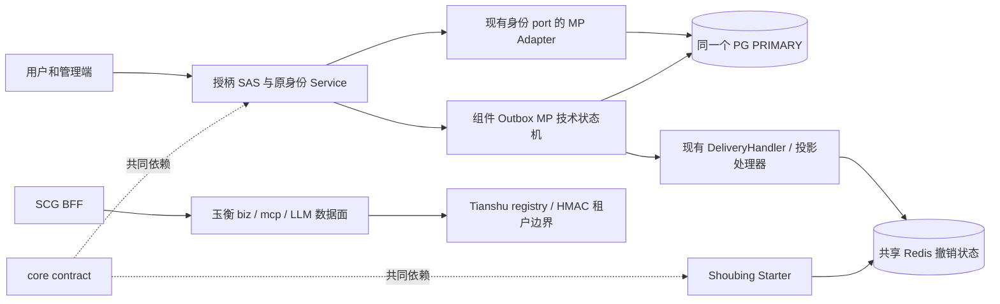
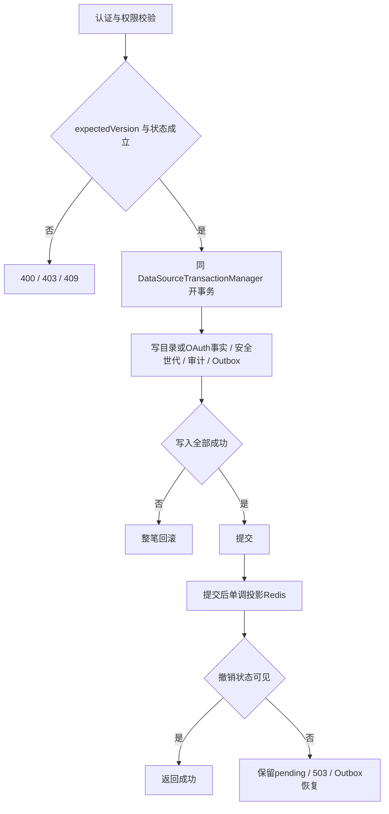
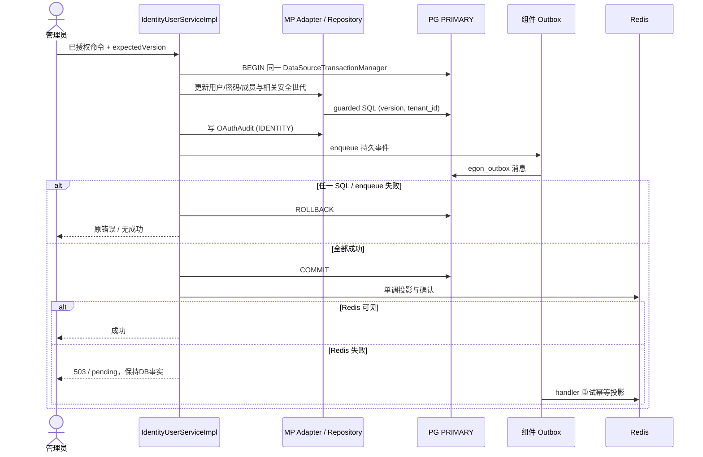
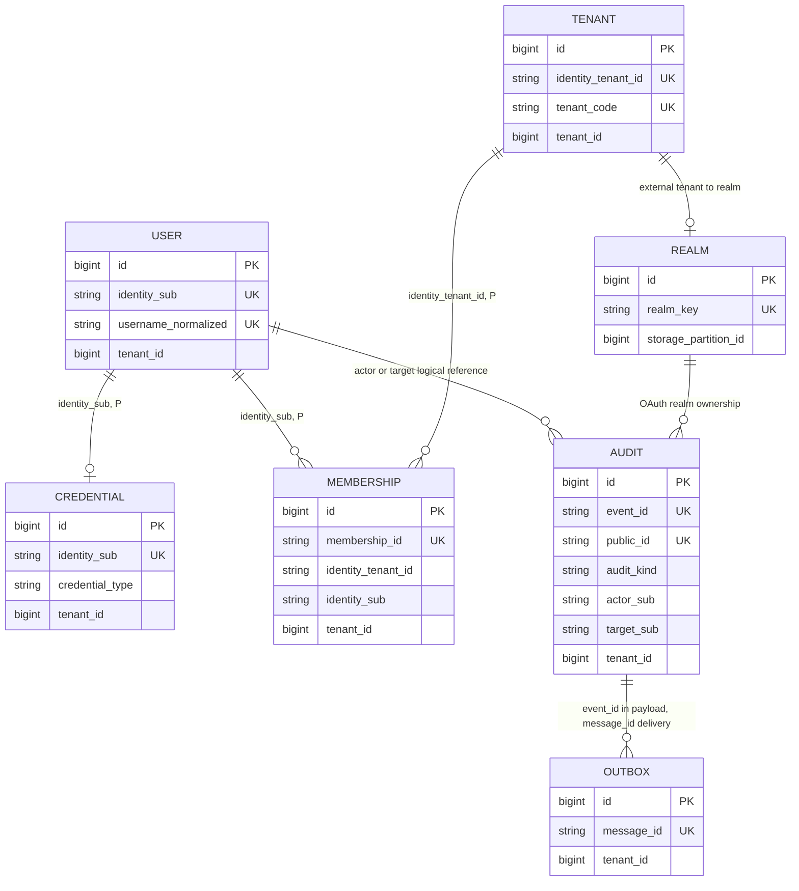

# 天权 OAuth/OIDC 当前代码对齐与认证存储 MP 修订

| Field | Value |
| --- | --- |
| Document | `2026-10-08-10-18-oauth-current-code-alignment.md` |
| Template Version | `7` |
| Status | `Review` |
| Type | `Architecture` |
| Complexity | `Complex` |
| Complexity Drivers | 已批准认证目录迁移、单库事务与Outbox、全局身份和业务租户边界、历史导入、现有Tianshu多租户消费者 |
| Created | `2026-10-08 10:18 Asia/Shanghai` |
| Updated | `2026-10-08 11:22 Asia/Shanghai` |
| Owner | `mario` |
| Repository | `Egon-COLA` |
| Scope | 授柄认证持久化/Outbox与历史迁移；原OAuth/OIDC、SCG、Starter及消费者计划的最新源码对齐 |
| Change Surface | 认证目录四表、OAuth审计兼容列、事务/DDL装配、MP导入、manifest family扩展、Grant列表、Tianshu/Yuheng适配边界 |
| Affected Chapters | §7, §8, §9, §10, §11, §12, §13, §14, §15, §16 |
| Source Requirement | 2026-10-08“根据当前项目的最新代码，修订一下 spec和plan”；用户选择“认证相关存储统一 MP（推荐）” |
| Baseline Revision | `main@ad60242402eb45a4a801730cf5151119031a98b4`；修订开始时工作树干净 |
| Amends | [已接受主Spec](2026-09-22-17-14-tianquan-multitenant-oauth-oidc-design.md) §3.3、§5/6、§7.3、§8、§10–11、§14–16、§19–20；替换范围详见§5.3 |
| Supersedes | [Grant列表提案](2026-09-23-10-57-oauth-grant-list-contract-amendment.md)：§1–§20，将其API-045原样纳入本次联合Review，尚不代表批准 |
| Depends On | [主Spec未改内容](2026-09-22-17-14-tianquan-multitenant-oauth-oidc-design.md) §1–§20除本修订点名段落；[Outbox当前契约](2026-09-24-12-00-outbox-statemachine-cqe-integration.md) §7/11/16 |
| Related Specs | [Tianshu功能设计](2026-09-21-17-18-tianshu-prompt-skill-management.md) |
| Related Plans | [修订实施Plan](../plan/2026-09-23-10-42-tianquan-oauth-oidc-implementation.md) |

## 1. Summary

OAuth/OIDC主体设计尚未实施，当前授柄仍是JPA/Flyway与自研令牌链。本修订保留已确认的SAS、每租户issuer、独立PLATFORM、SCG/BFF、RS256、即时撤销和强制重新登录，更新已经被最新公共组件改变的实现前提。最关键的是当前Outbox明确要求同一个DataSourceTransactionManager、DataSource和SqlSessionFactory，原“用户目录留JPA、认证MP与Outbox混合事务”的目标不再成立。

用户已选择认证相关存储统一MP：将用户、密码凭据、租户目录、成员关系与原11张OAuth目标表统一到授柄同一PostgreSQL PRIMARY。保留全局用户身份语义及原密码算法；旧Flyway/旧表不改。直接依赖的身份审计与身份事件改接已有OAuth审计/组件Outbox，避免遗留JPA写路径。鉴神业务权限库不在迁移范围。

本次仅形成可审核Spec和Plan。新设计整体为Review；用户对MP方向的选择不是整份Spec/Plan批准。此前API-045缺口随本次共同修订，停止把它作为“不能继续写Plan”的前置卡点；执行前仍须审核本修订。

## 2. Background and Current State

### 2.1 Repository evidence

路径缩写仅用于阅读，精确根如下：`SA=egon-cola-xingyuan/egon-cola-tianquan-shoubing/egon-cola-tianquan-shoubing-admin`；`SJ=SA/src/main/java/top/egon/cola/platform/tianquan/shoubing/admin`；`SC=egon-cola-xingyuan/egon-cola-tianquan-shoubing/egon-cola-tianquan-shoubing-core`；`O=egon-cola-components/egon-cola-component-transactional-outbox-starter`；`MP=egon-cola-components/egon-cola-component-common/egon-cola-component-common-mybatis-plus-sharding-jdbc-ext-spring-boot-starter`。其余沿主Spec缩写。均为2026-10-08源码检查，不是运行证明。

| Evidence ID | Classification | Exact path/symbol/decision/command | Observed fact | Design significance | Verification limit/freshness |
| --- | --- | --- | --- | --- | --- |
| EVD-101 | Static repository | O/src/main/java/top/egon/cola/component/outbox/autoconfigure/OutboxMybatisPlusAutoConfiguration#validateStoreInfrastructure | 只接受DataSourceTransactionManager且DataSource对象相同；SqlSessionFactory必须同源并使用SpringManagedTransactionFactory | 排除JpaTransactionManager混合提交 | 当前源码，未启动上下文 |
| EVD-102 | Static repository | O/.../migration/OutboxManagedDdlInitializer、OutboxLogicalDataSourceFactory；db/egon-outbox-mp/manifest.json | 固定egon_outbox、单PRIMARY/SHARDING/LOCAL、先组件DDL后逻辑库；组件自带manifest | 应用不能复制组件DDL或绕开初始化 | 当前源码 |
| EVD-103 | Static repository | SJ/identity/repo/IdentityPersistenceAdapter；tenant/repo/IdentityTenantRepository、IdentityTenantMembershipRepository | 四种认证事实目前依赖JPA；用户与密码采用expectedVersion；目录为全局 | 扩展迁移四表并保留当前语义 | 未检查生产数据 |
| EVD-104 | User decision | 用户2026-10-08选择“认证相关存储统一 MP（推荐）” | 已确认本修订技术范围 | 可以编制统一事务与迁移Plan | 不授权执行迁移 |
| EVD-105 | Static repository | MP/.../handler/EgonColaMetaObjectHandler#insertFill；extension/EgonColaRepository | 新增填充包含version=0和当前审计时间；无可注入tenantIdProvider/modelValidationUtils属性 | 导入必须使用独立DTO/XML；复用现有校验和MDC provider | 非真实导入证明 |
| EVD-106 | Static repository | SJ/resource/controller/ClientResourceGrantController；admin-web/src/features/resource-grants/ClientResourceGrantPage#grantQuery | 页面调用GET，Controller仅PUT/DELETE/批量POST | API-045仍必要 | 逐路由静态比对 |
| EVD-107 | Static repository | egon-cola-xingyuan/egon-cola-tianshu/egon-cola-tianshu-admin/src/main/java/top/egon/cola/component/tianshu/admin/security/tenancy/DdcTenantContextFilter、DdcTenantRegistry | identity tenant经registry映射存储tenant；AI路径要求X-Egon-Tianshu-Tenant与已验证身份一致 | 原header保留为一致性断言，不充当身份 | 当前源码 |
| EVD-108 | Static repository | egon-cola-components/egon-cola-component-rpc/egon-cola-component-rpc-tianshu-adapter/src/main/java/top/egon/cola/component/rpc/tianshu/security/DdcRpcClientInterceptorFactory；Tianshu security/registration/IdpJwtDdcRegistrationCredentialVerifier | RPC tenant元数据有HMAC绑定；注册仍要求PLATFORM OAuth凭据/source绑定 | 两种信任用途并存 | 当前源码，未连DDC |
| EVD-109 | Static repository | shoubing-gateway-adapter/.../IdpReservedHeaderSanitizer；egon-cola-xingyuan/egon-cola-yuheng | 自研Netty数据面、LLM/SSE/MCP；清理列表未含X-Egon-Tianshu-Tenant | SCG只增加入口，保持流式与身份carrier | 未启动浏览器/网关 |
| EVD-110 | Static repository | SJ/support/outbox/service/IdentityOutboxPublisher；audit/service/impl/IdentityAuditServiceImpl | 自有identity_outbox_event与identity_audit_log为JPA；审计page从0、size≤200、from包含/to不包含 | 关闭直接JPA依赖，同时保持旧审计HTTP兼容 | 当前源码 |
| EVD-111 | Static repository | SC/pom.xml；主Spec§10.1/VerifiedJwtBO | core目前仅JDK生产类型；Starter不能引用admin里的OAuthSecurityVersionBO | 共享安全版本放core/contract；补显式受管依赖 | 不新建contract模块 |
| EVD-112 | Static repository | egon-cola-components/egon-cola-component-common/egon-cola-component-common-mybatis-plus-sharding-jdbc-ext-spring-boot-starter/src/main/java/top/egon/cola/component/common/mybatis/ddl/EgonColaDdlManifestBO.java:18–21；同模块src/test/java/top/egon/cola/component/common/mybatis/ddl/EgonColaDdlManifestFamilyTest.java | 构造器只接受light/light-open/service/service-open/web/web-open/component-outbox/tianshu；tianquan-oauth会抛IllegalArgumentException | 当前runner不能加载计划要求的应用family | 当前源代码与组件合同测试 |
| EVD-113 | Accepted base Spec §11.0/§16.2；V1–V6及现有JPA source | 后续受控导入仍须从13张既有public表读取；通配会暴露/混淆已删除表 | 保留13个精确legacy source节点，明确只读、不计入新15表、拒绝public.* | 原接受设计与当前迁移源 |
| EVD-114 | Static repository | MP/.../business/EgonColaTenantIdProvider.java、EgonColaMdcUserIdProvider.java；EgonColaMybatisPlusProperties | tenant provider只读tenant MDC key；audit user provider在user MDC缺失时拒绝；Shoubing无P source | REQUIRED部署P及内部tenant/user MDC scope；保留可信actor，匿名认证用固定service actor | 源码/配置键检查；未取真实部署值 |
| EVD-115 | Static repository | core/identity/PasswordCredential.java | Java record默认toString包含passwordHash和identitySub | 覆盖toString仅保留非敏感状态；不引入Jackson/MP到core | 当前JDK-only源码 |
| EVD-116 | Static repository | MP common starter；IdentityTenantEntity.settings目前使用Hibernate JSON映射 | 当前MP组件未提供给String/JsonNode的PostgreSQL jsonb handler | 为tenant settings增加基于JDBC OTHER的局部JsonNode handler并校验object根 | 当前依赖/源代码检查；未连接PG |
| EVD-117 | Static repository | OAuthConfig.idpClock是@Primary Clock；MP common clock用@ConditionalOnMissingBean(Clock.class)；新MP repositories及Outbox store按egonColaMybatisPlusClock名称注入 | Shoubing业务Clock会使Common默认bean退让，但新MP写路径仍需要该具名bean | OAuthPersistenceConfiguration导出同一idpClock实例的MP具名别名 | bean装配代码检查；未启动Spring上下文 |
| EVD-118 | Static repository | egon-cola-xingyuan/egon-cola-tianshu/pom.xml管理MapStruct 1.6.3和Lombok绑定处理器；Shoubing parent/admin POM没有MapStruct依赖或processor路径 | Shoubing新四个@Mapper接口可以编译但不会生成实现，IdentityEntityMappingTest运行时ClassNotFound | 在Shoubing parent/admin显式复用仓库已有版本和processor配置 | Maven focused suite；不新增库种类/版本 |
| EVD-119 | Static repository | 新oauth_client.redirect_uris/resource_uris/allowed_scopes三列为JSONB数组；现有Shoubing tenant handler只接受JsonNode对象，其他common可见handler用Object | OAuthClientPO采用typed List<String>，当前无可安全绑定PG jsonb数组的handler | 为client数组增加专用List<String> TypeHandler并用JDBC Types.OTHER | Mock PreparedStatement契约，无PG执行 |
| EVD-120 | Static repository | common-core BaseConverter<S,T> exposes T toTarget(S source) and S toSource(T target); Step 3 IdentityUserConverter uses BaseConverter<IdentityUserPO,IdentityUser> | accepted OAuth table and Step4 Plan reverse source/target generic arguments | amend only OAuthRealmConverter/OAuthClientConverter to BaseConverter<PO,BO> | API/compiler contract source and generated mapping test |
| EVD-121 | Accepted base Spec §11.2.1/2 and Step 2 V20261008_001 | oauth_realm.trust_version and oauth_client.credential_version are security-relevant monotonic versions | repositories must reject a decreasing value even if row version matches | static table contract plus mocked repository guard |

### 2.4 Evidence and current-chain map

| Entry/trigger | Current call chain | Data read/written | External dependency | Consumers | Evidence |
| --- | --- | --- | --- | --- | --- |
| 用户状态/密码更新 | IdentityUserServiceImpl → core IdentityFacade → IdentityPersistenceAdapter / IdentityOutboxPublisher | user、credential、identity审计/事件、Redis投影 | PG/Redis | 登录、资源验证 | EVD-103/110 |
| 资源生命周期 | ResourceServerServiceImpl → TransactionalOutboxResourceServerEventAdapter → Outbox | Resource事实+组件消息 | DDC | Tianshu注册 | EVD-101/108 |
| Tianshu管理/AI | Bearer鉴权 → Rbac3UserDetails → DdcTenantContextFilter → registry | 数字存储分区 | HMAC namespace绑定 | 当前Prompt/Skill/AI功能 | EVD-107/108 |

## 3. Goals and Non-goals

### 3.1 Goals

使原方案在当前组件合同下可实施；数据迁移可逐字段对账；原用户策略、鉴神授权和Tianshu隔离不退化；计划覆盖API-045和受影响的配置/验证。

### 3.2 Non-goals

不实现业务代码、不运行generator/应用/数据库/浏览器、不提交、不改历史Flyway；不改鉴神业务表、Tianshu HMAC/租户模型、Yuheng LLM/Wiki业务或组件Outbox状态机源码；不新增GraphQL或OAuth端点变体。

### 3.3 Change Surface and Design Depth

| Area/layer | Disposition | Exact repository evidence | Changed or preserved behavior/contract | Required Spec treatment | Chapter(s) |
| --- | --- | --- | --- | --- | --- |
| 授柄认证存储/直接审计事件依赖 | Affected | EVD-101–105/110/113–117 | 四目录表迁移、统一事务、历史字段、组件Outbox装配与legacy source路由 | 完整事务/列/迁移设计 | §7, §8, §10, §11, §13, §14, §15, §16 |
| Grant列表/API文档/页面 | Affected | EVD-106 | 原提案API-045并入；页面realm缓存一致 | 复用已写完整合同 | §8, §9, §12, §14 |
| 共享契约/Consumer适配 | Affected | EVD-107–109/111/112 | 纠正模块依赖、header处理、manifest family及最新回归边界 | 精确字段/路径/校验 | §7, §8, §10, §14, §15, §16 |
| 其余OAuth44接口/十表 | Context-only | 主Spec§9/11、授柄当前旧源码 | 既有已接受业务设计继续有效 | 引用，不重写协议 | §9, §11 |
| Tianshu租户与RPC内部实现 | Unchanged | EVD-107/108 | 只适配已验证principal；registry/HMAC/namespace权威不变 | 兼容断言 | §15 |
| 鉴神业务库、Yuheng LLM/Wiki业务 | Unchanged | EVD-109、现有biz/mcp | 无业务表迁移/路由重构 | 回归边界 | §14 |
| GraphQL/新业务状态机 | Not applicable | 当前只需既有HTTP/RPC与技术Outbox | 不增加协议或业务StateMachine | N/A，有界技术状态机复用 | §13 |

## 4. Requirements and Acceptance Criteria

主SpecREQ-001–018继续有效。REQ-019中“仅Spec”被本次明确请求扩展为“仅修订Spec和Plan”；禁generator、禁运行保留。Grant提案局部REQ-001–003统一映射REQ-026，避免同名ID歧义。

| ID | Atomic requirement | Priority | Observable acceptance criteria | Source |
| --- | --- | --- | --- | --- |
| REQ-020 | 认证四种目录事实统一MP | Must | 相同subject、Argon2 hash、锁定/版本/成员状态保留；新认证运行链无JPA写；四目录固定required P、tenant/user scope finally恢复，hash不出JSON/toString；四个BaseConverter映射由现有MapStruct版本按PO source→BO target方向正常生成并通过往返断言 | EVD-103/104/114/115/118/120 |
| REQ-021 | 认证写与组件Outbox同库同事务 | Must | 同DataSource/SqlSessionFactory/DataSourceTransactionManager；enqueue失败全部回滚；Redis失败不误报撤销成功 | EVD-101/102 |
| REQ-022 | 导入保留历史与可恢复性 | Must | 逐字段含version/create/update对账、孤儿/冲突0；停写栅栏；无旧Flyway修改或自动启动导入 | 用户数据约束/EVD-105 |
| REQ-023 | MP装配及manifest family遵当前真实API | Must | NATIVE/LOCAL精确路由15个业务表、13个只读legacy源、2个组件技术表；不使用public.*；组件DDL初始化、DB-shape分组校验、PostgreSQL jsonb object/string-array绑定、BaseConverter PO→BO类型方向、trustedRealm partition的MDC scope finally恢复、trust/credential version不回退、显式导入及tianquan-oauth family正/负例均有测试；任意未注册family仍拒绝；具名MP Clock与idpClock为同一实例 | EVD-102/105/112/113/116/117/119/120/121 |
| REQ-024 | 保留Tianshu两层信任 | Must | PLATFORM注册验证及HMAC tenant绑定均通过；错/缺AI header拒绝；body/header不能给业务SQL选tenant | EVD-107/108 |
| REQ-025 | 保留玉衡实际数据面与流式行为 | Must | 新SCG→biz/mcp/LLM路由，SSE增量/取消、Bearer验证、管理端口约束回归 | EVD-109 |
| REQ-026 | 补齐现有Grant读合同 | Must | API-045同realm有序≤64条，空[]，65条报503；0写入；UI缓存含realm且处理错误 | EVD-106/Grant提案 |
| REQ-027 | 文档与依赖方向同步最新基线 | Must | Starter无admin依赖；旧错误前提明确被替换；Spec/Plan验证通过且OAuth converters遵守BaseConverter<S,T>方向 | 本次原请求/EVD-120 |

### 4.1 Scenario matrix

| Scenario | Actor/trigger | Preconditions | Main path | Alternative/failure path | Data/state change | Observable result | Requirements |
| --- | --- | --- | --- | --- | --- | --- | --- |
| 改密码并撤销 | 用户/安全管理员 | 合法版本/权限 | MP更新凭据、世代、审计、Outbox同事务 | enqueue失败回滚；投影失败pending/503 | DB提交后Redis单调投影 | 成功后旧token拒绝 | REQ-020/021 |
| 历史导入重试 | 运维 | 停写一致快照/审查报告 | 每批500写新表并checkpoint | hash/version冲突停止；未知提交先重读 | 同source主键幂等，无旧表写 | 重跑不丢字段/不重复授权 | REQ-022 |
| 跨租户AI请求 | 已登录用户 | tenantA有效JWT | 原header=A且registry匹配 | header=B/缺失按现有路径规则拒绝，finally清context | 0业务数据写 | 不串租户，不替用户重写header | REQ-024 |
| 双实例投递/崩溃 | Outbox worker | 当前组件表ready | 组件claim→PROCESSING→SUCCEEDED | lease过期组件回收→RETRY_WAIT；DEAD人工恢复 | CAS/revision、幂等业务receipt | 不绕过技术StateMachine | REQ-021 |
| Grant空或依赖失败 | 管理员 | client归属当前realm且权限允许 | []/有序集合 | 404/403/503按合同 | 只读 | 页面独立错误态与重试 | REQ-026 |

### 4.2 Use-case analysis

| Actor ID | Actor/role | Goal and responsibility | Entry/channel | Permission/tenant context | Evidence |
| --- | --- | --- | --- | --- | --- |
| ACTOR-101 | 用户/安全管理员 | 登录、改密码、管理成员 | 现有身份API/SAS | 原鉴神权限、可信身份 | EVD-103 |
| ACTOR-102 | 运维 | 审核导入并切流 | 显式离线命令 | 受控快照/维护窗口 | REQ-022 |
| ACTOR-103 | 管理员/服务消费者 | 查Grant、调用Tianshu/玉衡 | 既有页面/RPC/HTTP | realm授权与现有信任绑定 | EVD-106–109 |

| ID | Use case/goal | Primary actor | Supporting actors/systems | Trigger | Preconditions | Main success outcome | Alternatives/failures | Postconditions | Requirements | Interfaces/pages | Tests |
| --- | --- | --- | --- | --- | --- | --- | --- | --- | --- | --- | --- |
| UC-101 | 安全更新身份事实 | ACTOR-101 | PG/Redis/Outbox | 改密码/停用/改成员 | 权限、expectedVersion成立 | 保存并撤销相关授权 | 版本409；DB回滚；Redis503 | 无半份DB提交/旧token复活 | REQ-020/021 | 原身份接口保持 | TEST-101/102 |
| UC-102 | 保留历史切换认证存储 | ACTOR-102 | MP-DDL runner/迁移服务 | 审核后apply | 停写、hash清单、全局目录一次迁移 | 对账通过再分tenant切新issuer | 任一冲突停止；新写后forward-fix | 旧表/历史仍在，无双写 | REQ-022/023 | OAuthMigrationService离线入口 | TEST-103 |
| UC-103 | 查看Grant并继续现有租户业务 | ACTOR-103 | SCG/Tianshu/Yuheng | 页面/业务请求 | 已验证principal | Grant展示、正确租户流式响应 | header冲突/依赖异常拒绝 | 无权限扩张、无跨租户缓存 | REQ-024/025/026 | API-045/既有管理页 | TEST-104/105/106 |

## 5. Constraints, Assumptions, and Decisions

### 5.1 Confirmed constraints

主SpecDEC-001–008及原协议安全参数保留。新增依赖仅复用已同意的SAS/SCG/Session/MP和当前组件版本；不升级根5.4.1、Boot3.5.16、Java21、springdoc2.8.17或Cloud2025.0.3。不得编辑V1–V6，旧DDL checksum/数据是迁移证据。

### 5.2 Small-gap assumptions

| ID | Inference | Repository evidence | Why locally reversible | Impact if wrong |
| --- | --- | --- | --- | --- |
| ASM-101 | 新四表使用oauth_identity_前缀以区别只读legacy源 | 目标已有tianquan_oauth schema且未创建 | 当前仅设计命名，不改外部URL/标识 | 执行前若目标已存在需重新选新版本，不能覆盖 |
| ASM-102 | 目录物理分区复用同一platform storagePartitionId=P | 原全局user/tenant目录，平台分区属于可信内部身份 | 内部存储布局，无外部租户语义 | P必须为稳定正Long并与业务tenant不重合；PLATFORM realm与四目录共用 |

### 5.3 Resolved decisions and exact amendments

| ID | Decision | Decision owner | Evidence and rationale | Requirements |
| --- | --- | --- | --- | --- |
| DEC-101 | 原§3.3/7.3/11/16“目录JPA保留”替换为四表MP；直接审计/身份事件迁出JPA | 用户2026-10-08，直接依赖闭合由本修订细化 | EVD-101/103/110 | REQ-020/021 |
| DEC-102 | 原混合事务段落替换为同逻辑DataSource的DataSourceTransactionManager；Outbox技术状态机必选，业务adapter关闭 | 最新组件既有合同 | EVD-101/102；不引入第二事务机制 | REQ-021/023 |
| DEC-103 | 原11表改为15张业务表；原OAuth审计表扩充身份兼容列；仍仅一个新应用DDL版本 | 本次Review设计，服从既有单版本约束 | §11；无独立新audit/outbox表 | REQ-020/022 |
| DEC-104 | 原NATIVE选型保留，删除“SINGLE不能自定义schema”的过时理由 | EVD-102/105 | 当前SINGLE已读table.schema，Outbox仍要求NATIVE/LOCAL的明确拓扑 | REQ-023 |
| DEC-105 | 原§10.1 OAuthSecurityVersionBO移至SC/contract；内部TrustedRealmBO不下沉；core事件依赖补齐 | EVD-111 | Admin与Starter共同依赖core，不能反向依赖admin | REQ-027 |
| DEC-106 | API-045保持提案全部wire；与本修订共同Review | 用户要求同时修订两文档 | 原主Spec44接口不重编号 | REQ-026 |
| DEC-107 | 原§15/16消费者边界按当前Tianshu registry/HMAC/AI header和Yuheng数据面补强 | EVD-107–109 | 不另造租户上下文或控制面token用途 | REQ-024/025 |
| DEC-108 | 原REQ-019仅Spec扩大为文档Spec+Plan；其他禁运行/generator约束保留 | 用户2026-10-08 | 本轮执行边界 | REQ-027 |
| DEC-109 | 注册准确的tianquan-oauth manifest family，保留未知family拒绝 | 用户已批准组件合同修正 | EVD-112/TEST-107 | REQ-023 |
| DEC-110 | 沿用接受主Spec的13个精确public legacy route，供只读迁移与回退；不新增wildcard，也不把source计入目标表 | 保留原接受兼容/迁移约束 | EVD-113/TEST-108 | REQ-022/023 |
| DEC-111 | P经required deployment property稳定注入，四目录tenant/user MDC scope与PLATFORM realm初始化共用同一值；缺失/非正值fail-fast | MP TenantLine读取tenant MDC、fill要求user MDC；没有trusted scope不能写全局目录 | EVD-114；保留已验证actor，否则用固定service actor；不从request/JWT推导 | REQ-020/023 |
| DEC-112 | 保留PasswordCredential不变核心数据字段，但覆盖record toString防止hash/subject误日志 | core目前无脱敏toString；不新增序列化依赖 | EVD-115 | REQ-020 |
| DEC-113 | IdentityTenantPO.settings使用JsonNode与本模块Types.OTHER handler，保持PostgreSQL jsonb object语义 | 普通String binding可能退化为JSON字符串/driver类型不匹配 | EVD-116/TEST-109 | REQ-020/023 |
| DEC-114 | OAuthPersistenceConfiguration导出名为egonColaMybatisPlusClock的别名，返回同一个idpClock bean | OAuthConfig的@Primary Clock抑制Common默认Clock bean；MP repository与Outbox需具名Clock | EVD-117/TEST-110 | REQ-023 |
| DEC-115 | Shoubing parent集中管理已有MapStruct 1.6.3/Lombok binding版本，admin显式配置API与annotation processor | 四个@Mapper只有接口且当前admin未处理；已存在Tianshu/Yuheng同版本配置 | EVD-118/TEST-111 | REQ-020/027 |
| DEC-116 | OAuthClientPO的redirect/resource/scope集合使用typed List<String>与专用Types.OTHER handler | 普通String/Jackson raw Object绑定JSONB数组会丢PG类型或绕过字段类型约束 | EVD-119/TEST-112 | REQ-023 |
| DEC-117 | 只修正OAuthRealmConverter/OAuthClientConverter的BaseConverter泛型方向为PO源、BO目标 | BaseConverter<S,T>的实际方法签名与Step 3已验证惯例明确第一项为source；不改变数据库或wire contract | EVD-120/TEST-113 | REQ-023/027 |

### 5.4 Open major decisions

None。技术方向已有用户选择；本修订的整体Review待用户审核，不等于实施Ready。生产数据规模、停写窗口、真实服务地址属于切流验收输入，不能伪称已核实。

## 6. Project Technology Context

### 6.1 Java architecture profile and capability baseline

| Architecture profile | Archetype/template or base package | Exact evidence and verifier | Existing deviations | Design action |
| --- | --- | --- | --- | --- |
| Traditional Three-Layer | admin.<domain>.controller/service/service.impl/repo或repository/dao/domain | SJ当前tree，主SpecDEC-003 | 旧JPA Entity/Repository属于本次迁移边界 | 保留域分包，不建立COLA七层；传统profile不运行generator |

| Need | Spring/JDK candidate | Spring Boot Starter candidate | Egon-COLA/module candidate | Proven gap | Decision/dependency impact |
| --- | --- | --- | --- | --- | --- |
| 同库事务 | DataSourceTransactionManager/TransactionTemplate | Boot JDBC/MP装配 | 当前OutboxMpStorage与MP SqlSessionFactory | JpaTransactionManager被明确拒绝 | 复用，不写新事务协调器 |
| 数据/DDL | MyBatis具名SQL | 已批准MP-SDJ | EgonColaRepository/DDL runner/Outbox initializer | 四种目录当前只有JPA；manifest BO尚不接受tianquan-oauth | 新PO/DAO/转换；扩展现有manifest family校验，复用runner |
| 导入历史字段 | JDBC读取、参数化XML写 | 同上 | Outbox迁移显式DTO/XML范例 | save自动fill不保留历史 | 仅迁移入口显式写，不全局关闭fill |
| 技术投递 | Spring Statemachine | 单Outbox starter | 技术claim/retry/CAS现成 | 无OAuth业务状态机需求 | 不增business adapter或依赖 |
| 共享BO/Events | JDK类型+现有Lombok/Jakarta Validation | 不向core引入Boot starter | parent已有同版本库；core当前只JDK | 新class注解需显式compile依赖 | core复用Lombok(provided)、jakarta.validation-api受管版本；不引入新库种类/新module |
| 密钥加密 | JDK AES/GCM | None | CommonCrypto只有Digest/Hmac/Codec | 无现成AES | 保留原OAuthKeyCipherComponent/JCA设计 |
| 类型映射 | MapStruct 1.6.3 | Tianshu已有API/processor配置 | Shoubing admin缺少processor | @Mapper接口没有生成实现 | 复用已使用版本及Lombok binding，限定Shoubing admin |

### 6.2 User-mandated Java rule compliance

| Literal rule | Affected? | Repository evidence | Exact design decision | Files/types/interfaces | Validation/test evidence | Status/blocker |
| --- | --- | --- | --- | --- | --- | --- |
| Rule 1 | Yes | 当前identity/tenant与§8 | 新PO/BO/DTO/DAO语义后缀，旧Facade/port保持 | 四PO、四DAO、ImportDTO | TEST-101/103命名与编译 | PASS |
| Rule 2 | Yes | 当前MP DB-shape拦截器 | Service/Repository代理校验与组；Mapper fill后校验；import显式校验 | §10每层交接 | TEST-101/103负例 | PASS |
| Rule 3 | Yes | EgonModel/BaseConverter | PO四Lombok注解+SuperBuilder/callSuper；BO class+Builder；映射用BaseConverter/Forward | §8转换器 | 映射与敏感字段测试 | PASS |
| Rule 4 | Yes | lombok.config qualifier复制 | 业务类@Slf4j、具名Bean、RequiredArgsConstructor、final字段Qualifier | Adapter/Repository/配置 | 装配测试 | PASS |
| Rule 5 | Yes | CommonCrypto与JDK | 仅JDK/现有允许Commons/Guava，不新工具库 | Import/AES-GCM | import/dependency复核 | PASS |
| Rule 6 | Yes | Boot Jackson/既有API | 显式enum code用EnumValue/JsonValue；默认Jackson，不序列化密码字段 | PO/VO/事件 | TEST-101/106 JSON | PASS |
| Rule 7 | Yes | base/local两个profile | §15完整键在各profile同构；值只引用安全配置 | YAML/Properties | 配置键集测试 | PASS |
| Rule 9 | Yes | 已有ports/DeliveryHandler | Adapter用于身份持久化，Decorator组合DDL；技术State复用组件 | §13 | TEST-102/104 | PASS |
| Rule 10 | Yes | 当前Instant/Clock | Instant→UTC timestamptz(6)，无java.util.Date | PO/ImportDTO | TEST-103时间精度 | PASS |
| Rule 11 | Yes | 当前三层域分包/MP | 维持结构、MP-SDJ受管DDL、deleted_at复合唯一，CQE经Outbox | §7–11 | TEST-101–106 | PASS |

## 7. Architecture Design

### 7.0 Minimum-design baseline and element-necessity audit

| Proposed element | Change | Requirements | Existing/direct alternative | Concrete inadequacy of alternative | Added calls/state/coupling/failures/migration/operations | Verdict |
| --- | --- | --- | --- | --- | --- | --- |
| 四目录PO/DAO与旧port Adapter | New | REQ-020 | 继续JPA | 无法与当前Outbox同TM原子提交 | 四表迁移、0网络跳转，沿旧port隔离core | Add |
| OAuthAudit兼容列 | Expand | REQ-020/022 | 保留JPA audit或另建第二张 | 前者留下JPA写，后者重复事件存储 | 5列/兼容查询/index，无新外部接口 | Merge |
| 应用DDL factory组合 | Expand | REQ-021/023 | 直接Yaml factory | 会绕过组件DDL/readiness | 单hook内顺序调用两个initializer | Add |
| 独立业务StateMachine | New candidate | REQ-021 | 保留原业务版本/状态守卫+DeliveryHandler | 原方案足够 | 不增加状态机表或业务receipt体系 | Remove |
| Grant Query | New | REQ-026 | 从写响应推导列表 | 无法展示既有全部Grant | 复用当前一次GET，0新表 | Add |
| tianquan-oauth manifest family | Expand | REQ-023 | 使用任意现有family值 | component BO拒绝本应用准确family，改用service会误标部署profile | 一项allowlist值和正向合同测试，不增加迁移/外部API | Add |

| Path | Network calls | Client states | Server contracts/state | Failure and TOCTOU points | Additional user/business value |
| --- | --- | --- | --- | --- | --- |
| 当前身份管理 | 原HTTP调用+Redis投影 | 原管理页状态 | JPA事实/自有事件 | PG与Redis投影间失败 | 既有功能 |
| 修订身份管理 | HTTP数量不变；成功确认前按既有撤销合同查Redis | 不增参数预取 | MP事实+组件Outbox | DB原子、Redis显式pending恢复 | 能满足当前组件和即时撤销 |

### 7.1 System Architecture Design



`P`是授柄可信platform存储分区，不是业务tenant、不是Outbox技术0。四目录表与身份审计固定P；OAuth TENANT表继续使用相应业务partition；Outbox技术0仅组件内部。MP TenantLine不能全局关闭，只对组件指定的egon_cola_outbox_message忽略。目录查询的目标业务tenant用`identity_tenant_id`列，必须从已认证权限/成员请求完成授权后传入；P不允许从HTTP/JWT字段选择。

### 7.2 High-Level Design



#### 7.2.2 High-level decision and quality matrix

| Concern/use case | Required behavior | Selected mechanism | Failure/degradation behavior | Trade-off | Verification | Requirements |
| --- | --- | --- | --- | --- | --- | --- |
| 事务 | 一个PG连接与事务 | 同逻辑DataSource+DataSourceTransactionManager | Outbox/审计失败全回滚 | 单PRIMARY限制 | TEST-102 | REQ-021 |
| 身份目录 | 全局subject与成员列表语义不变 | 固定P+明确业务tenant列 | 权限不成立不进DAO | 内部特权context有界 | TEST-101 | REQ-020 |
| 迁移 | 不重置version/time或hash | 显式ImportDTO/XML+对账 | 冲突停止、checkpoint不推进 | 维护窗口 | TEST-103 | REQ-022 |
| 消费者隔离 | OAuth身份和HMAC namespace绑定均成立 | 保留现有filter/registry/interceptor | fail-closed、不猜tenant | 用户切tenant必须更新意图header | TEST-104 | REQ-024 |

### 7.3 Detailed Design

当前`EgonColaDdlManifestBO`只接受既有profile及`component-outbox`/`tianshu`；本应用manifest使用`tianquan-oauth`，因此先在组件中注册该family并用正向合同测试覆盖，同时保留任意未知family拒绝，避免用错误的`service` profile标签。用户已批准此共享组件合同扩展。

统一认证运行目标只装配MP写链，不通过两个TM或REQUIRES_NEW拆开业务与Outbox。`OAuthPersistenceConfiguration`提供唯一业务transactionManager（DataSourceTransactionManager），DataSource与MP/Outbox对象身份一致。`OAuthPersistenceConfiguration#egonColaShardingLogicalDataSourceFactory`先运行应用15表manifest，再委派`OutboxLogicalDataSourceFactory#create`使组件initializer完成DDL/readiness后创建logical DS；若先验证到缺组件schema则按组件标准预置schema再执行，不能吞掉初始化失败。应用DDL使用OAuthManagedDdlComponent内部SchemaScopedDataSource包装同一physical pool：借连接时记录原schema并setSchema(tianquan_oauth)，close时先恢复再归还，异常也关闭且传播，禁止unwrap泄漏。EgonColaPostgreDdlRunner先检查current_schema再SET LOCAL search_path，不能直接传默认public连接；组件Outbox已有自己的私有包装，两者各自作用域而不另建池。应用manifest只管tianquan_oauth，ddl_history由其physical schema runner使用、不注册同名逻辑业务表节点；组件manifest仍来自依赖jar且classpath只一份。

OAuthConfig.idpClock由Shoubing以@Primary提供，Common的egonColaMybatisPlusClock因@ConditionalOnMissingBean(Clock.class)不再生成；MP repository及Outbox仍按该具名bean注入。OAuthPersistenceConfiguration因此把同一个idpClock实例以egonColaMybatisPlusClock名称暴露，合同测试核对别名回传原实例，避免第二个时间源。

BaseConverter<S,T>的实际合同是T toTarget(S source)、S toSource(T target)，现行IdentityUserConverter以PO为S、core domain为T；本修订明确OAuthRealmConverter/OAuthClientConverter采用BaseConverter<PO,BO>，纠正旧表的反向泛型而不改变wire或存储字段。

`IdentityPersistenceAdapter`继续实现IdentityUserStore/PasswordCredentialStore；通过四个现有EgonColaRepository实现访问DAO，保留旧方法返回类型及expectedVersion规则：create仅old=0/new=0；update必须new=old+1且SQL旧version匹配，0行抛原OptimisticLockingFailureException。`IdentityUserDirectory`实现改MP，list继续按normalizedUsername、外部subject排序。tenant/membership原生命周期守卫迁至BO，Controller和Service不再依赖JPA Entity枚举；wire枚举值保持原值。

可信目录上下文只在授柄内部Adapter/Repository入口设P，并finally恢复；P来自required配置`egon.tianquan-shoubing.identity-directory.platform-storage-partition-id`，由部署环境提供稳定正Long（按common ID来源分配并保留的platform partition），缺失/非正值fail-fast；Step 8的PLATFORM realm必须复用该值。应用不从已验证principal、请求、JWT或当前业务MDC选择P，也不允许P用于业务tenant。上下文读取MP实际配置的tenant MDC key与audit user MDC key，保存并恢复两者；已有user actor保持原值，缺失时临时使用固定`service:tianquan-shoubing` actor供未认证登录状态写入。异常/嵌套路径必须恢复进入前的两个值。user/credential/tenant/membership目录操作彼此同P；涉及多个OAuth realm撤销时在同库事务中按P目录→realm键升序→client→authorization→token锁顺序操作，不能把不同MDC分区的操作并发派发到异步线程。



`IdentityOutboxPublisher#append`改写OAuthAuditRepository（auditKind=IDENTITY）和TransactionalOutbox，不再写identity_audit_log/identity_outbox_event；`publish/project`不在未提交事务内直接覆写Redis，接原安全版本投影入口，保留IdentityUserState旧DTO形状，版本从服务端可信快照取得。用于ACCOUNT/PASSWORD等失败事件的独立审计事务遵当前核心port调用时机；不得让一次失败审计提交同线程未完成的成功业务事务。

Outbox技术状态严格复用PENDING→PROCESSING→SUCCEEDED / RETRY_WAIT / DEAD；claim/reclaim遵组件Spring Statemachine、PG advisory lock、version CAS与lease，不再描述成旧JDBC存储或自行SKIP LOCKED。现有`DdcResourceServerLifecycleDeliveryHandler`继续实现投递；业务adapter关闭，认证业务状态保持原Spec§10.3的守卫。技术tenant=0只用于组件存储；业务payload的issuer/realm/tenant必须重校验。receipt使用已有eventId+revision或已存在业务幂等键，不新增“exactly-once”承诺。

#### 7.3.6 Conclusion evidence chain

| Conclusion | Constraint | Decision | Rejected alternative | Verification |
| --- | --- | --- | --- | --- |
| EVD-101/103/104 | 当前组件拒绝JpaTM，用户选MP | DEC-101/102，同库MP认证链 | 同URL但不同TM | TEST-102 |
| EVD-107/108 | registry与HMAC绑定各有权威 | DEC-107，保留双层信任和意图header | 由PLATFORM token建立tenant | TEST-104 |

## 8. Package Structure and Code File Tree

主Spec文件树不变部分继续有效。新增四表沿既有identity/tenant域，复用原core ports；API-045采用原Grant提案§8文件。本次确切增量及所有受影响调用者统一列于Plan§5；下表限定设计职责，Plan必须据此展开成单文件。

| Operation | Exact path / symbol | Responsibility | Requirements |
| --- | --- | --- | --- |
| MODIFY | egon-cola-xingyuan/egon-cola-tianquan-shoubing/pom.xml；egon-cola-xingyuan/egon-cola-tianquan-shoubing/egon-cola-tianquan-shoubing-admin/pom.xml | 管理仓库已有MapStruct/Lombok binding版本；为admin显式配置API与annotation processor | REQ-020/027 |
| CREATE | SJ/oauth/dao/OAuthStringListJsonbTypeHandler.java | 严格读写List<String> JSON数组，JDBC Types.OTHER；拒绝非数组/非字符串元素 | REQ-023 |
| CREATE | SJ/oauth/domain/converter/OAuthRealmConverter.java、OAuthClientConverter.java | BaseConverter<PO,BO>；MapStruct生成实现；显式字段方向与round-trip合同 | REQ-023/027 |
| CREATE | SJ/identity/domain/po/IdentityUserPO.java、IdentityCredentialPO.java；identity/domain/converter/IdentityUserConverter.java、IdentityCredentialConverter.java；identity/dao/IdentityUserDAO.java、IdentityCredentialDAO.java；SA/src/main/resources/mapper/identity/IdentityUserDAO.xml、IdentityCredentialDAO.xml | user/credential字段与SQL；Converter继承BaseConverter | REQ-020 |
| CREATE | SJ/identity/repository/IdentityUserRepository.java、IdentityCredentialRepository.java；identity/repo/MpIdentityUserDirectory.java | EgonColaRepository与旧目录port实现 | REQ-020 |
| MODIFY / DELETE | SJ/identity/repo/IdentityPersistenceAdapter.java；删除JpaIdentityUserDirectory.java和两个旧Identity Entity | 旧port→MP；删除仅在引用迁完后 | REQ-020 |
| CREATE | SJ/identity/repo/IdentityDirectoryContext.java | 配置提供P；按MP tenant/user MDC key建立嵌套scope，保留actor或使用service fallback并finally恢复 | REQ-020/023 |
| MODIFY | SC/identity/PasswordCredential.java | 自定义record toString屏蔽passwordHash/subject，不引入core依赖 | REQ-020 |
| CREATE | SJ/tenant/domain/po/IdentityTenantPO.java、IdentityTenantMembershipPO.java；domain/bo/IdentityTenantBO.java、IdentityTenantMembershipBO.java；domain/converter/IdentityTenantConverter.java、IdentityTenantMembershipConverter.java；dao/IdentityTenantDAO.java、IdentityTenantMembershipDAO.java、IdentityTenantSettingsJsonbTypeHandler.java；SA/src/main/resources/mapper/tenant/同名DAO.xml | 从旧Entity保留状态守卫、外部ID与版本语义；settings由JsonNode/Types.OTHER映射jsonb | REQ-020/023 |
| MODIFY | SJ/tenant/repo/IdentityTenantRepository.java、IdentityTenantMembershipRepository.java；service/impl/TenantServiceImpl.java、TenantMembershipServiceImpl.java；controller/TenantController.java | repo改为EgonColaRepository实现；Entity到BO调用替换、HTTP形状保持 | REQ-020 |
| MODIFY | SA/src/main/resources/application.yml、application-local.yml | REQUIRED `egon.tianquan-shoubing.identity-directory.platform-storage-partition-id`；与PLATFORM realm共用、无默认值 | REQ-020/023 |
| MODIFY | SJ/support/runtime/IdpPlatformConfiguration.java；identity/service/impl/IdentityUserServiceImpl.java、IdentityUserStateServiceImpl.java；audit/service/impl/IdentityAuditServiceImpl.java；support/outbox/service/IdentityOutboxPublisher.java | 具名MP装配、统一TM、审计兼容、提交后投影 | REQ-020/021 |
| CREATE | SJ/audit/domain/converter/IdentityAuditViewConverter.java；oauth/domain/dto/IdentityMigrationRowDTO.java；oauth/dao/IdentityMigrationDAO.java；SA/src/main/resources/mapper/oauth/IdentityMigrationDAO.xml | 旧audit DTO projection与显式历史导入 | REQ-022 |
| MODIFY | 原计划OAuthAuditPO/BO/Converter/Mapper/XML/Repository；OAuthMigrationServiceImpl；OAuthManagedDdlComponent；OAuthPersistenceConfiguration；oauth-sharding-native.yml、db/egon-mp/repository-manifest.json与单新SQL | 五列审计扩充、15表、组件factory委派、导入与装配 | REQ-021/022/023 |
| CREATE / MODIFY | SC/src/main/java/top/egon/cola/platform/tianquan/shoubing/contract/OAuthSecurityVersionBO.java；SC/pom.xml、lombok.config | 共享BO从admin移至已有core合同包；Lombok/Jakarta受管依赖 | REQ-027 |
| MODIFY | egon-cola-components/egon-cola-component-common/egon-cola-component-common-mybatis-plus-sharding-jdbc-ext-spring-boot-starter/src/main/java/top/egon/cola/component/common/mybatis/ddl/EgonColaDdlManifestBO.java；同模块src/test/java/top/egon/cola/component/common/mybatis/ddl/EgonColaDdlManifestFamilyTest.java | 注册tianquan-oauth并保留拒绝任意family的组件合同 | REQ-023 |
| MODIFY | 原SCG TrustedIdentityHeaderFilter、授柄Starter验证/Principal转换及Tianshu registration verifier适配 | 保留原意图header、真实Rbac3UserDetails、PLATFORM/HMAC双边界 | REQ-024/025 |

直接编译依赖同属增量：SJ/tenant/domain/dto/UpdateTenantDTO.java、UpsertTenantMembershipDTO.java，domain/vo/TenantVO.java、TenantMembershipVO.java，tenant/service/TenantService.java、TenantMembershipService.java，identity/support/rpc/IdentityDirectoryRpcProvider.java，support/bootstrap/IdpDevelopmentTenantBootstrap.java。它们把旧Entity.Status改引用新IdentityTenantBO/IdentityTenantMembershipBO的同名状态，字段/枚举JSON值不变。对应既有测试fixture一并更新；IdentityEntityMappingTest改验证MP PO与domain映射，不能删除业务断言来消除编译依赖。


原OAuth/资源迁移的直接依赖也必须闭合：ResourceServerConfig、ResourceServerProjectionService、TransactionalOutboxResourceServerEventAdapter、IdpDevelopmentClientBootstrap改接OAuth BO/MP stores；资源ID、biz/app/env、disabled目的地与eventId算法不变。资源目录仍全局且managementClient只解析PLATFORM registration；Grant仍带其真实realm。Redis投影只能来自已提交事实，不能沿用“Redis写后DB回滚就能撤回投影”的旧假设；失败保留Outbox恢复并按原安全合同拒绝成功。Step 18明确删除已无引用的旧client/secret/redirect/grant/resource/signing JPA Entity、Repository、Jpa stores与旧ClientSecretBasicAuthenticator；相应配置/DTO/测试先迁完，原SQL保留。Plan列出确切删除路径，不通过删除断言假装兼容。

新增测试类：IdentityMpPersistenceContractTest、IdentityAuthenticationTransactionContractTest、IdentityMigrationContractTest、ClientResourceGrantControllerTest；扩展现有IdentityPersistenceAdapterTest、IdentityOutboxPublisherTest、IdentityAuditServiceImplTest、租户服务测试与当前Tianshu/Yuheng回归。不得为计划测试而另造假项目或长期harness。

## 9. Interface Definitions

原API-001–044未改变wire；内部实现替换不新增HTTP方法。原身份/tenant/audit Controller路由与DTO/VO保持现状，特别审计GET的page、size、from/to、FAILURE拼写和字符串id；它们属于Context-only合同。

### 9.0 API protocol and documentation governance

| Concern | Decision/evidence |
| --- | --- |
| Protocol selection | REST资源Query；现有UI已消费准确方法/路径；不增加GraphQL |
| CQE application level | L0只读Query，现有Service/DB，不发Event |
| REST source of truth | Code-first Controller Spring mapping+VO/Jackson/Validation+`io.swagger.v3.oas.annotations.*` |
| GraphQL source of truth | N/A：无GraphQL |
| Springdoc/OpenAPI compatibility | Boot3.5.16/springdoc2.8.17/OAS3.1，沿主Spec springdoc组 |
| Legacy Swagger/Springfox status | 当前Controller已用OpenAPI3，不引入Springfox |
| Security and documentation exposure | bearerAuth+现有Grant管理权限，realm guard；遵主Spec生产docs限制 |
| Contract publication and drift gate | OAuthOpenApiContractTest断言method/path/operationId/parameters/200数组及400/401/403/404/503；合同测试对真实Controller响应字段 |

### 9.1 Interface Inventory

| ID | Change/necessity verdict | Name/purpose | Kind | API style/CQE role | Consumer | Owner | Method + URL / GraphQL field / symbol / topic | Operation ID/schema source | Input | Output | Auth/tenant | Error model | Idempotency/version | Requirements |
| --- | --- | --- | --- | --- | --- | --- | --- | --- | --- | --- | --- | --- | --- | --- |
| API-045 | New/Add：既有页面独立展示目的 | List client grants | HTTP | REST Query | ClientResourceGrantPage | ClientResourceGrantController | GET /api/v1/tianquan-shoubing/clients/{clientId}/resources | tianquan-shoubing-client-resource-grant-list-v1 | clientId path + realm query | 裸ClientResourceGrantVO数组 | Bearer USER，grant权限+realm核验 | code/message错误；200空数组 | 读幂等，按资源稳定排序 | REQ-026 |

### 9.2 Per-interface Detailed Contracts

#### 9.2.1 API-045 — List client grants

##### Necessity and interaction-cost decision

| Concern | Decision |
| --- | --- |
| Change classification | New GET；页面现有调用的目标路由缺失 |
| Independent consumer goal | 管理员核对已授资源、scope、status，并决定追加/停用；写后重读刷新 |
| Parameter ownership and derivation | clientId来自当前路由；realm来自已验Principal或管理员显式选择并后端授权，不从头部采信身份 |
| Direct/no-new-interface alternative | 已有PUT/DELETE/批量POST只返回单次命令结果，不能重建全部已有Grant；不可能由Client/资源目录推导实际Grant集合 |
| Caller use of result | 直接展示、按resourceServerId关联资源、批量变更前核对版本；没有复制原样给另一个命令 |
| Round trips and failure points | 页面已经发起此GET，本修订不加额外请求；DB查询/权限失败进入独立可恢复状态，写后仍须重新查询 |
| Verdict | Add，REQ-026/主Spec REQ-005；不加selector/prefetch |

##### API style and CQE semantics

| Concern | Decision/evidence |
| --- | --- |
| Protocol style | REST Query |
| CQE role | L0 Query，只读当前Grant，不提交业务命令/事件 |
| Resource/task semantics | GET现有Client的resources子集合；空集合仍为200 |
| Read/write and side effects | 读Client存在性与Grant集合；可记安全访问审计/指标，无业务表写 |
| Consistency and idempotency | 单次PRIMARY READ COMMITTED快照；写后invalidate再读，不承诺跨请求长事务快照 |
| Why this style | 现有页面代码已调用相同REST URL且需要授权集合，返回当前VO数组即可 |

##### Identity and purpose

| Concern | Definition |
| --- | --- |
| Purpose/owner/consumer | 客户端Grant列表；授柄Controller；现有ClientResourceGrantPage |
| Protocol and endpoint | GET /api/v1/tianquan-shoubing/clients/{clientId}/resources |
| Content type/version | application/json，原`api/v1`管理接口 |
| Auth/permission/tenant | USER Bearer经本地JWT和撤销校验；`tianquan-shoubing:resource-server:grant`；realm按主Spec §9.0缺省当前租户，platform仅平台管理员强认证 |
| Timeout/retry/rate limit | 管理查询默认网络10秒，单主体每分钟120次；503可由用户刷新一次，不自动无限重试 |
| Idempotency/concurrency | GET读幂等；Grant写入与此GET并发时取本次READ COMMITTED提交点的结果，按resourceServerId/grantType/id稳定排序 |

##### Request parameters

| Name | Location | Type/format | Required/null | Default | Validation/range/enum | Meaning | Example | Source |
| --- | --- | --- | --- | --- | --- | --- | --- | --- |
| clientId | Path | string | 必填，非null非空 | None | 1–128 ASCII `[A-Za-z0-9._-]+`；精确大小写 | 已选择Client的外部ID | `orders-service` | 页面route |
| realm | Query | string | 可省；若存在不可null/空 | 已验Principal当前TENANT | `tenant:<正Long>`或`platform`，≤64字符；platform需强认证 | 实际管理的issuer/realm意图 | `tenant:1001` | 页面已选realm；后端重校验 |
| Authorization | Header | Bearer | 必填 | None | Spring Security verified USER AT，aud应包含本管理Resource | 身份与权限 | `Bearer synthetic` | SCG TokenRelay/外部客户端 |
| Body | None | None | 无 | None | GET不接受请求体 | 无 | 无 | 无 |

##### Success response

HTTP 200；`application/json`，`Cache-Control: no-store`。裸数组0–64项，空为`[]`且非null；按resourceServerId、grantType、内部id升序，不暴露内部id。各元素字段完全沿用已存在ClientResourceGrantVO，不新增issuer字段；当前选realm来自页面/session。单项完整JSONC：

```jsonc
[
  {
    "clientId": "orders-service", // 已选Client外部ID，精确字符串。
    "resourceServerId": "orders-resource", // 目标ResourceServer稳定外部ID。
    "grantType": "CLIENT_CREDENTIALS", // CLIENT_CREDENTIALS或USER_DELEGATION；与Client purpose一致。
    "tenantId": "1001", // TENANT grant的业务租户；USER_DELEGATION/PLATFORM时null。
    "allowedScopes": ["orders:read"], // 明确获准scope数组，0–64项、去重排序；无scope为[]。
    "status": "ACTIVE", // ACTIVE或DISABLED；不把已禁用Grant当有效授权。
    "version": 0 // 非负乐观锁版本，供现有编辑流程使用。
  }
]
```

##### Error responses

| Condition | HTTP/protocol status | Business code | Response shape | Retryable | Frontend handling |
| --- | --- | --- | --- | --- | --- |
| 缺/非法clientId或realm | 400 | OAUTH_REQUEST_INVALID | 下列管理错误JSON | 修正输入后 | 保留页面选择，不发查询 |
| Bearer缺失/无效 | 401 | INVALID_TOKEN | 管理错误JSON与WWW-Authenticate | 新登录后 | 转入登录，不无限跳转 |
| Grant权限不足/tenant或platform越权 | 403 | ACCESS_DENIED | 同形，不能透露其他realm客户端存在 | No | 显示无权限 |
| 此授权可见realm不存在Client | 404 | CLIENT_NOT_FOUND | 同形 | No | 返回Client列表或展示当前选择无效 |
| DB/撤销依赖不可用、存量超过64违约 | 503 | TEMPORARILY_UNAVAILABLE / GRANT_LIST_LIMIT_EXCEEDED | 同形，脱敏 | 依赖恢复后一次 | 显示错误，不把失败误成空列表 |

```jsonc
{
  "code": "CLIENT_NOT_FOUND", // 稳定错误码，实际状态由条件决定，不泄露跨租户对象。
  "message": "Client not available" // 可显示安全说明；不包含其他realm、SQL或secret。
}
```

##### Interface logic for frontend and consumers

1. 页面从当前已选择的clientId/realm发一个GET；UI queryKey包含realm，不能沿用另一个tenant的缓存。
2. Controller验证`@PathVariable`、可选realm、已验principal及`resource-server:grant`权限，拒绝任意身份头的租户覆盖。
3. Service从trusted realm读取Client；客户端缺失404；Repository以storagePartitionId/clientPK/activeRow查询0–65条，发现第65条报配置一致性故障而不截断。
4. Mapper用主Spec已定`ix_grant_access`；查询只读不持久化/不投Event；MapStruct已有ViewConverter输出原VO。
5. 空200[]；非空排序后返回，前端按resourceServerId关联资源，并只显示此realm的授权和版本。
6. 401转登录、403权限态、404当前client无效、503保留可重试数据/提示；写后invalidate该realm的Grant query。
7. 前端在loading/empty/error/denied状态间保持过滤/已选realm，不把另一realm数据当兜底。

##### Documentation contract

| Concern | Decision/evidence |
| --- | --- |
| Documentation authority | 原`ClientResourceGrantController`拥有Spring GET/@Operation/@ApiResponses，VO及Bean Validation/Jackson为真实wire权威 |
| REST OpenAPI operation / GraphQL SDL operation | `operationId=tianquan-shoubing-client-resource-grant-list-v1`，`GET /api/v1/tianquan-shoubing/clients/{clientId}/resources` |
| Annotation/mapping ownership | 原Controller加`@Operation`、`@Parameter`、`@ApiResponses`与现有`bearerAuth` SecurityRequirement；不建注解接口 |
| Generated schema elements | clientId Path必需、realm Query可选、200 ClientResourceGrantVO数组及空集合、400/401/403/404/503裸管理错误、no-store与bearerAuth |
| Compatibility and drift proof | MockMvc校验JSON字段/空集合/状态，OAuthOpenApiContractTest解析`/v3/api-docs`断言本route/唯一operationId/schema/security；前端Vitest核对queryKey |

| Target | Required annotation/configuration | Exact values/source | Generated OAS effect | Verification |
| --- | --- | --- | --- | --- |
| ClientResourceGrantController#list | `@GetMapping`, `@Operation`, `@ApiResponses`, `@Parameter`, `@SecurityRequirement` | 上述method/path/operationId/权限与错误状态 | 同一路由一个GET，不与PUT/DELETE冲突 | MockMvc OAS断言 |
| ClientResourceGrantVO | 现有Jackson字段规则及`@Schema`仅补非显然null/enum | 7个现有字段，上述完整JSONC | 数组item schema一致 | JSON/OAS字段比对 |

##### Compatibility and verification

新增GET仅填补已有前端的404，原PUT/DELETE/批量POST方法/URI/body/VO/权限不变。现有JS `normalizePage`可处理裸数组；当前404被页面当作“读取不可用”，新增合同后404只表示client当前realm不存在，须校正页面提示。测试覆盖空/单条/64条/第65条异常、两个tenant同clientId不同grant、PLATFORM管理员与普通tenant用户、禁用Grant状态、错误/JSON/OAS、前端realm query key/写后刷新。

### 9.3 OpenAPI 3 and springdoc annotation plan

| Target | Required annotation/configuration | Exact values/source | Generated OAS effect | Verification |
| --- | --- | --- | --- | --- |
| ClientResourceGrantController#list | `io.swagger.v3.oas.annotations.@Operation/@ApiResponses/@Parameter/@SecurityRequirement` | `operationId=tianquan-shoubing-client-resource-grant-list-v1`；bearerAuth；200/400/401/403/404/503 | GET集合与VO数组schema | OAuthOpenApiContractTest |
| ClientResourceGrantVO | 既有Jackson/Validation，必要`@Schema`说明nullable tenantId/enum | 7字段 | 真实字段名与required一致 | VO序列化+OAS校验 |

### 9.4 API contract generation and blocking gate

| Gate ID | Applicability | Status | Evidence | Finding | Required action/exception |
| --- | --- | --- | --- | --- | --- |
| API-GATE-001 | Applicable | PASS | §7.0/9.2/EVD-001 | 既有前端独立展示已授Grant，不是参数预取 | None |
| API-GATE-002 | Applicable | PASS | §9.0/9.2 | 单REST Query/L0，无GraphQL或Bus | None |
| API-GATE-003 | Applicable | PASS | §9.2 | GET/200空数组/no-store/具体400–503/排序与兼容 | None |
| API-GATE-004 | Not applicable | N/A | EVD-001/§9.0 | 无GraphQL操作/SDL/Resolver | None |
| API-GATE-005 | Applicable | PASS | EVD-003/§9.2/§10 | 现有VO 7字段/可空tenantId与JSONC/TS一致 | None |
| API-GATE-006 | Applicable | PASS | 主Spec §9.0、§9.2 | 权限/realm/敏感字段/限流/错误披露明确 | None |
| API-GATE-007 | Applicable | PASS | 当前Controller及§9.3 | springdoc2.8.17/OpenAPI3.1注解在原Controller | None |
| API-GATE-008 | Applicable | PASS | §14 TEST-001–003 | MockMvc OAS/Bean校验/前端Vitest有准确验证对象 | None |
| API-GATE-009 | Applicable | PASS | §4/9/10/11/12/14 | Client外部ID、tenant存储分区、VO与UI状态一致 | None |


## 10. POJO and Data Model Design

四个PO继承EgonModel，仅声明业务列；业务对象不重复继承数据库审计字段。`IdentityUser`/`PasswordCredential`继续复用现有core不可变值对象，Adapter转换由BaseConverter显式处理；tenant两个新BO承接旧Entity的create/update/状态转移规则，采用普通class与原规则Lombok，不把BO暴露给Controller。Controller使用原DTO/VO和字符串ID。

目录PO的内部id为新common Long；external subject、credential legacyId、identityTenantId、membership externalId均为独立字符串列，不能把新PK回写成JWT sub或API id。PO `tenantId`专指固定P；membership业务所属租户叫identityTenantId。语义不同，Converter必须显式映射并由双租户fixture验证。

`OAuthSecurityVersionBO`迁至core/contract，字段realm:long、client:long、subject:Long?保持原合同；USER要求subject非空、SERVICE省略由调用层语义校验。普通class+Lombok/Builder+Jakarta非负约束，core补已在工程使用的受管Lombok与jakarta.validation-api，不引入Spring/MP依赖。`SignedTokenClaimsBO`与`TrustedRealmBO`仍是admin内部；Starter里的VerifiedJwtBO仅引用共享OAuthSecurityVersionBO，不能import admin。Events仍按原Spec放core/audit，新增class同样使用这些依赖。

| Boundary | Validation / conversion | Null/default/time behavior | Failure / proof |
| --- | --- | --- | --- |
| Controller→Service | 原DTO @Valid、方法@Validated、组Create/Update/Query | 密码不trim；tenant code沿原lowercase；查询无默认租户 | 400与原错误shape不变 |
| Service→Adapter/Repository | BO/command分组、version非负、可信目录context | 非HTTP调用同样拒绝错误输入 | TEST-101无Controller负例 |
| Repository→DAO | 当前MP fill后DB-shape校验；Insert/Update/Delete/Query分别使用，Persisted只完整持久态 | 不把DB NOT NULL误作NotBlank；部分Update/Delete不强加Persisted | TEST-101部分对象与空串语义 |
| ImportDTO→专用DAO | 强制校验完整字段/expected source hash/P/来源白名单后参数化XML | 显式version与UTC原timestamp，禁止save触发insertFill | TEST-103非0version/历史时间 |
| PO/BO→VO | MapStruct BaseForwardConverter；id取external/publicId、audit结果保留FAILURE | 秘密/hash不进toString/JSON | TEST-101/106契约快照 |

## 11. Database Design

### 11.0 Common rules and topology

目标15张认证业务表都在`tianquan_oauth`，SINGLE/NATIVE精确节点绑定一个`oauth_primary`；组件自有`egon_outbox.egon_cola_outbox_message`与`egon_outbox.ddl_history`由组件manifest管理。四目录`tenant_id=P`的P为上述required stable deployment configuration；所有目录操作必须在内部MDC scope绑定P。为了兼容已接受的迁移/回退源，再精确路由13张既有`public`表（identity_user、identity_user_credential、identity_tenant、identity_tenant_membership、identity_client、identity_client_secret、identity_client_redirect_uri、identity_client_resource_grant、identity_signing_key、identity_resource_server、identity_audit_log、identity_outbox_event、egon_cola_outbox_message）；这些只作为受控legacy source，不计入15张目标表，禁止`public.*`。三组节点共用一个物理PRIMARY与LOCAL事务；不能误算新表或复制组件DDL。原OAuth十张未改表和oauth_audit原列以主Spec§11为基线。

一个新应用SQL版本定为`db/egon-mp/V20261008_001__initialize_oauth_tenant_schema.sql`，manifest family沿原计划，SHA-256由实际落盘文件计算，不能写虚构hash。原计划V20260922_001未实施，不创建旧计划脚本再追加第二版本。当前组件版本`20260924_001`、family=`component-outbox`由jar提供；若实施前组件版本改变须复核真实manifest，不复制/改写已发布hash。旧Flyway V1–V6完全不变。

四新表通用列与EgonModel对齐：id bigint PK common生成；tenant_id bigint NOT NULL固定P；version bigint NOT NULL默认0且≥0；create_time/update_time timestamptz(6) NOT NULL（Instant）；create_user_id/update_user_id varchar(128) NOT NULL；deleted_at timestamp(6) NULL（UTC LocalDateTime）。正常创建由fill补审计，历史导入明确赋值。每个业务唯一键定义`(tenant_id,业务列,deleted_at)`生命周期UK，加`WHERE deleted_at IS NULL`活跃UK防NULL重复；重复软删除同微秒冲突返回409/导入冲突报告，不能覆盖历史。外部subject/identityTenantId永久不能分配给另一身份；新建原ID冲突拒绝，即使旧行软删除也不复活已撤销身份。无跨schema级联FK，外部引用由服务守卫与离线孤儿校验保障。

### 11.1 Table Inventory

| Table | Existing/new | Purpose and owner | Read/write paths | Change | DDL script | Requirements |
| --- | --- | --- | --- | --- | --- | --- |
| tianquan_oauth.oauth_identity_user | New | 全局用户目录/授柄 | IdentityUserStore/Directory | 原identity_user显式迁移 | V20261008_001__initialize_oauth_tenant_schema.sql | REQ-020/022 |
| tianquan_oauth.oauth_identity_credential | New | 密码事实/授柄 | PasswordCredentialStore | 原identity_user_credential显式迁移 | 同一V20261008_001 | REQ-020/022 |
| tianquan_oauth.oauth_identity_tenant | New | 业务tenant目录/授柄 | TenantService | 原identity_tenant显式迁移 | 同一V20261008_001 | REQ-020/022 |
| tianquan_oauth.oauth_identity_membership | New | 成员关系/授柄 | TenantMembershipService | 原identity_tenant_membership迁移 | 同一V20261008_001 | REQ-020/022 |
| tianquan_oauth.oauth_audit | New, amended design | OAuth+身份审计/授柄 | OAuthAuditRepository、旧IdentityAuditService | 原计划表加5列与身份查询索引 | 同一V20261008_001 | REQ-020/021/022 |

其余十张OAuth目标表为Context-only（主Spec§11.2.1–9及§11.2.11）；组件表为Context-only（组件Spec/manifest），本修订不复制其列设计。

### 11.2 Per-table Detailed Design

#### 11.2.1 tianquan_oauth.oauth_identity_user

##### Purpose, ownership, and lifecycle

授柄IdentityUserPO唯一持久化owner；源为public.identity_user。全局目录固定P，状态与业务归属独立；正常不硬删除，旧subject不重新分配。各表外部身份键另加永久UK(tenant_id,identity_sub/legacy_id/identity_tenant_id/membership_id中本表对应键)，不能软删后分给新身份；username/code仍按生命周期业务唯一处理。服务负责事务与权限，DAO只执行具名SQL。

##### Complete column design

完整列为§11.0八个通用列加下表；字段按snake_case→camelCase，导入逐字段映射，不遗漏默认/NULL。

| Column | Native type | Length/precision | Null | Default | Generated | PK/FK/unique/check | Meaning | Source/mapping | Example |
| --- | --- | --- | --- | --- | --- | --- | --- | --- | --- |
| identity_sub | varchar(64) | varchar(64) | No | none | 源保留或Service赋值 | 下节UK/CHECK；无隐式级联 | 旧id，永久外部subject | identity_user.原外部键，见列含义 → IdentityUserPO.identity_sub | 合成值见TEST-103 fixture |
| username | varchar(128) | varchar(128) | No | none | 源保留或Service赋值 | 下节UK/CHECK；无隐式级联 | 原username | identity_user.username → IdentityUserPO.username | 合成值见TEST-103 fixture |
| username_normalized | varchar(128) | varchar(128) | No | none | 源保留或Service赋值 | 下节UK/CHECK；无隐式级联 | 原normalizedUsername，保持原归一化算法 | identity_user.username_normalized → IdentityUserPO.username_normalized | 合成值见TEST-103 fixture |
| display_name | varchar(200) | varchar(200) | No | none | 源保留或Service赋值 | 下节UK/CHECK；无隐式级联 | 原displayName | identity_user.display_name → IdentityUserPO.display_name | 合成值见TEST-103 fixture |
| status | varchar(32) | varchar(32) | No | ACTIVE | 源保留或Service赋值 | 下节UK/CHECK；无隐式级联 | ACTIVE/DISABLED/LOCKED | identity_user.status → IdentityUserPO.status | 合成值见TEST-103 fixture |
| failed_login_count | integer | integer | No | 0 | 源保留或Service赋值 | 下节UK/CHECK；无隐式级联 | ≥0，原失败计数 | identity_user.failed_login_count → IdentityUserPO.failed_login_count | 合成值见TEST-103 fixture |
| locked_until | timestamptz(6) | timestamptz(6) | Yes | NULL | 源保留或Service赋值 | 下节UK/CHECK；无隐式级联 | 原锁定截止Instant | identity_user.locked_until → IdentityUserPO.locked_until | 合成值见TEST-103 fixture |
| last_login_at | timestamptz(6) | timestamptz(6) | Yes | NULL | 源保留或Service赋值 | 下节UK/CHECK；无隐式级联 | 原最后登录Instant | identity_user.last_login_at → IdentityUserPO.last_login_at | 合成值见TEST-103 fixture |

##### Keys, relationships, and constraints

PK=id。业务唯一组分别为 `identity_sub；username_normalized`，每组按§11.0加tenant_id/deleted_at生命周期UK和活跃guard。status按列枚举CHECK；version/failedCount非负；空白业务标识在Service拒绝。credential、membership的subject必须存在且不跨P；membership业务tenant必须存在，CLOSED不能激活成员。物理FK不指向旧public表；这些关系由同事务读取/守卫写与迁移孤儿检查维护。

##### Index inventory and per-index justification

| Index | Type/unique | Ordered columns/expressions | Predicate/include | Query and operation | Cardinality/selectivity | Sort/coverage role | Write/storage cost | Decision |
| --- | --- | --- | --- | --- | --- | --- | --- | --- |
| pk_oauth_identity_user | btree unique | id | None | 内部点查/更新 | 0/1 | PK | 每写一项 | Add |
| uk_oauth_identity_user_life / active（每个上述业务键各一对） | btree unique | tenant_id,业务键,deleted_at / tenant_id,业务键 | active为deleted_at IS NULL | 唯一与点查 | 每键0/1 | 复用前缀不再加单列索引 | 每业务键2项，保证NULL语义 | Add |
| ix_oauth_identity_user_lookup（多组分开建立） | btree | tenant_id,username_normalized,identity_sub | deleted_at IS NULL | normalizedUsername精确查；identitySub精确查；按username_normalized,identity_sub稳定list | 实际基数上线前EXPLAIN确认 | 对应列表排序；只对非UK已覆盖的排序建索引 | 新表随同一DDL建立 | Add |

##### Access patterns and SQL shape

| Operation | Caller | Predicate/join/order | Expected rows | Index/constraint | Lock/isolation | Failure/idempotency |
| --- | --- | --- | --- | --- | --- | --- |
| read/list | 本表Repository | tenant_id=P、active、下述业务键/稳定排序 | 点查0/1；列表保留现有语义 | 本表UK或lookup索引 | READ COMMITTED / PRIMARY | 不放宽权限，缺失沿原Optional/404 |
| update | 本表Repository | id+P+version+active | 必须1 | PK/UK | 同事务；必要FOR UPDATE | 0行version冲突；无部分成功 |
| import | IdentityMigrationDAO | source key/fingerprint、P、显式历史列 | 每批≤500 | 源键幂等与UK | 每批事务 | 不一致停止；unknown commit重查 |

normalizedUsername精确查；identitySub精确查；按username_normalized,identity_sub稳定list。全部WHERE tenant_id=:trustedP AND deleted_at IS NULL；命令相关读取PRIMARY，FOR UPDATE只在外层业务事务。INSERT正常由MP fill；UPDATE WHERE id=:pk AND tenant_id=:P AND version=:expected AND deleted_at IS NULL SET version=:expected+1；必须影响1行，禁止无版本覆盖。

##### Migration and historical-data handling

受控停写快照identity_user→本表；external键/状态/密码hash/业务时间不改，新内部PK独立生成并记录映射。源created_at/updated_at/version分别映射create_time/update_time/version，由IdentityMigrationDAO显式写；源created_by/updated_by映射create_user_id/update_user_id，源缺少actor列时固定migration:<snapshotId>且不伪称原操作者。源NULL继续NULL；无效枚举、溢出tenant、重复活跃键、孤儿进入阻断报告，不自动合并/截断。仅同一V20261008_001应用DDL，不动旧SQL；更多恢复语义见§16。

##### Transaction, consistency, and recovery

同PG PRIMARY、READ COMMITTED、同DataSourceTransactionManager；实体expectedVersion+UK约束处理并发。审计/Outbox enqueue失败回滚；Redis不属于该事务。导入每批≤500，checkpoint在确认目标内容与source fingerprint一致后推进，重试先查目标键与版本，旧表只读。TEST-101/102/103覆盖空/重复/并发/错误上下文/恢复。

#### 11.2.2 tianquan_oauth.oauth_identity_credential

##### Purpose, ownership, and lifecycle

授柄IdentityCredentialPO唯一持久化owner；源为public.identity_user_credential。全局目录固定P，状态与业务归属独立；正常不硬删除，旧subject不重新分配。各表外部身份键另加永久UK(tenant_id,identity_sub/legacy_id/identity_tenant_id/membership_id中本表对应键)，不能软删后分给新身份；username/code仍按生命周期业务唯一处理。服务负责事务与权限，DAO只执行具名SQL。

##### Complete column design

完整列为§11.0八个通用列加下表；字段按snake_case→camelCase，导入逐字段映射，不遗漏默认/NULL。

| Column | Native type | Length/precision | Null | Default | Generated | PK/FK/unique/check | Meaning | Source/mapping | Example |
| --- | --- | --- | --- | --- | --- | --- | --- | --- | --- |
| legacy_id | varchar(64) | varchar(64) | No | none | 源保留或Service赋值 | 下节UK/CHECK；无隐式级联 | 原credential.id，不能假设所有历史行均等于subject | identity_user_credential.原外部键，见列含义 → IdentityCredentialPO.legacy_id | 合成值见TEST-103 fixture |
| identity_sub | varchar(64) | varchar(64) | No | none | 源保留或Service赋值 | 下节UK/CHECK；无隐式级联 | 指向全局user external subject | identity_user_credential.原外部键，见列含义 → IdentityCredentialPO.identity_sub | 合成值见TEST-103 fixture |
| credential_type | varchar(32) | varchar(32) | No | PASSWORD | 源保留或Service赋值 | 下节UK/CHECK；无隐式级联 | 只允许PASSWORD | identity_user_credential.credential_type → IdentityCredentialPO.credential_type | 合成值见TEST-103 fixture |
| password_hash | varchar(512) | varchar(512) | No | none | 源保留或Service赋值 | 下节UK/CHECK；无隐式级联 | 原Argon2编码不变；不可日志/JSON输出 | identity_user_credential.password_hash → IdentityCredentialPO.password_hash | 合成值见TEST-103 fixture |
| password_changed_at | timestamptz(6) | timestamptz(6) | No | none | 源保留或Service赋值 | 下节UK/CHECK；无隐式级联 | 原密码变更Instant | identity_user_credential.password_changed_at → IdentityCredentialPO.password_changed_at | 合成值见TEST-103 fixture |
| must_change_password | boolean | boolean | No | false | 源保留或Service赋值 | 下节UK/CHECK；无隐式级联 | 原强制改密标志 | identity_user_credential.must_change_password → IdentityCredentialPO.must_change_password | 合成值见TEST-103 fixture |
| status | varchar(32) | varchar(32) | No | ACTIVE | 源保留或Service赋值 | 下节UK/CHECK；无隐式级联 | ACTIVE/REVOKED | identity_user_credential.status → IdentityCredentialPO.status | 合成值见TEST-103 fixture |

##### Keys, relationships, and constraints

PK=id。业务唯一组分别为 `legacy_id；identity_sub,credential_type`，每组按§11.0加tenant_id/deleted_at生命周期UK和活跃guard。status按列枚举CHECK；version/failedCount非负；空白业务标识在Service拒绝。credential、membership的subject必须存在且不跨P；membership业务tenant必须存在，CLOSED不能激活成员。物理FK不指向旧public表；这些关系由同事务读取/守卫写与迁移孤儿检查维护。

##### Index inventory and per-index justification

| Index | Type/unique | Ordered columns/expressions | Predicate/include | Query and operation | Cardinality/selectivity | Sort/coverage role | Write/storage cost | Decision |
| --- | --- | --- | --- | --- | --- | --- | --- | --- |
| pk_oauth_identity_credential | btree unique | id | None | 内部点查/更新 | 0/1 | PK | 每写一项 | Add |
| uk_oauth_identity_credential_life / active（每个上述业务键各一对） | btree unique | tenant_id,业务键,deleted_at / tenant_id,业务键 | active为deleted_at IS NULL | 唯一与点查 | 每键0/1 | 复用前缀不再加单列索引 | 每业务键2项，保证NULL语义 | Add |
| ix_oauth_identity_credential_lookup（多组分开建立） | btree | tenant_id,identity_sub,credential_type | deleted_at IS NULL | identitySub+PASSWORD读取ACTIVE；expectedVersion守卫保存 | 实际基数上线前EXPLAIN确认 | 对应列表排序；只对非UK已覆盖的排序建索引 | 新表随同一DDL建立 | Add |

##### Access patterns and SQL shape

| Operation | Caller | Predicate/join/order | Expected rows | Index/constraint | Lock/isolation | Failure/idempotency |
| --- | --- | --- | --- | --- | --- | --- |
| read/list | 本表Repository | tenant_id=P、active、下述业务键/稳定排序 | 点查0/1；列表保留现有语义 | 本表UK或lookup索引 | READ COMMITTED / PRIMARY | 不放宽权限，缺失沿原Optional/404 |
| update | 本表Repository | id+P+version+active | 必须1 | PK/UK | 同事务；必要FOR UPDATE | 0行version冲突；无部分成功 |
| import | IdentityMigrationDAO | source key/fingerprint、P、显式历史列 | 每批≤500 | 源键幂等与UK | 每批事务 | 不一致停止；unknown commit重查 |

identitySub+PASSWORD读取ACTIVE；expectedVersion守卫保存。全部WHERE tenant_id=:trustedP AND deleted_at IS NULL；命令相关读取PRIMARY，FOR UPDATE只在外层业务事务。INSERT正常由MP fill；UPDATE WHERE id=:pk AND tenant_id=:P AND version=:expected AND deleted_at IS NULL SET version=:expected+1；必须影响1行，禁止无版本覆盖。

##### Migration and historical-data handling

受控停写快照identity_user_credential→本表；external键/状态/密码hash/业务时间不改，新内部PK独立生成并记录映射。源created_at/updated_at/version分别映射create_time/update_time/version，由IdentityMigrationDAO显式写；源created_by/updated_by映射create_user_id/update_user_id，源缺少actor列时固定migration:<snapshotId>且不伪称原操作者。源NULL继续NULL；无效枚举、溢出tenant、重复活跃键、孤儿进入阻断报告，不自动合并/截断。仅同一V20261008_001应用DDL，不动旧SQL；更多恢复语义见§16。

##### Transaction, consistency, and recovery

同PG PRIMARY、READ COMMITTED、同DataSourceTransactionManager；实体expectedVersion+UK约束处理并发。审计/Outbox enqueue失败回滚；Redis不属于该事务。导入每批≤500，checkpoint在确认目标内容与source fingerprint一致后推进，重试先查目标键与版本，旧表只读。TEST-101/102/103覆盖空/重复/并发/错误上下文/恢复。

#### 11.2.3 tianquan_oauth.oauth_identity_tenant

##### Purpose, ownership, and lifecycle

授柄IdentityTenantPO唯一持久化owner；源为public.identity_tenant。全局目录固定P，状态与业务归属独立；正常不硬删除，旧subject不重新分配。各表外部身份键另加永久UK(tenant_id,identity_sub/legacy_id/identity_tenant_id/membership_id中本表对应键)，不能软删后分给新身份；username/code仍按生命周期业务唯一处理。服务负责事务与权限，DAO只执行具名SQL。

##### Complete column design

完整列为§11.0八个通用列加下表；字段按snake_case→camelCase，导入逐字段映射，不遗漏默认/NULL。

| Column | Native type | Length/precision | Null | Default | Generated | PK/FK/unique/check | Meaning | Source/mapping | Example |
| --- | --- | --- | --- | --- | --- | --- | --- | --- | --- |
| identity_tenant_id | varchar(64) | varchar(64) | No | none | 源保留或Service赋值 | 下节UK/CHECK；无隐式级联 | 原id；必须为正Long canonical十进制，导入超范围停止 | identity_tenant.原外部键，见列含义 → IdentityTenantPO.identity_tenant_id | 合成值见TEST-103 fixture |
| tenant_code | varchar(64) | varchar(64) | No | none | 源保留或Service赋值 | 下节UK/CHECK；无隐式级联 | 原lowercase code，正则^[a-z][a-z0-9-]{2,63}$ | identity_tenant.tenant_code → IdentityTenantPO.tenant_code | 合成值见TEST-103 fixture |
| tenant_name | varchar(200) | varchar(200) | No | none | 源保留或Service赋值 | 下节UK/CHECK；无隐式级联 | 原tenantName | identity_tenant.tenant_name → IdentityTenantPO.tenant_name | 合成值见TEST-103 fixture |
| status | varchar(32) | varchar(32) | No | INITIALIZING | 源保留或Service赋值 | 下节UK/CHECK；无隐式级联 | INITIALIZING/ACTIVE/SUSPENDED/CLOSED | identity_tenant.status → IdentityTenantPO.status | 合成值见TEST-103 fixture |
| settings | jsonb | jsonb | No | {} | 源保留或Service赋值 | 下节UK/CHECK；无隐式级联 | 原对象，≤65536 UTF-8字节及DB大小约束 | identity_tenant.settings → IdentityTenantPO.settings (JsonNode, IdentityTenantSettingsJsonbTypeHandler) | 合成值见TEST-103 fixture |

##### Keys, relationships, and constraints

PK=id。业务唯一组分别为 `identity_tenant_id；lower(tenant_code)`，每组按§11.0加tenant_id/deleted_at生命周期UK和活跃guard。status按列枚举CHECK；version/failedCount非负；空白业务标识在Service拒绝。credential、membership的subject必须存在且不跨P；membership业务tenant必须存在，CLOSED不能激活成员。物理FK不指向旧public表；这些关系由同事务读取/守卫写与迁移孤儿检查维护。

##### Index inventory and per-index justification

| Index | Type/unique | Ordered columns/expressions | Predicate/include | Query and operation | Cardinality/selectivity | Sort/coverage role | Write/storage cost | Decision |
| --- | --- | --- | --- | --- | --- | --- | --- | --- |
| pk_oauth_identity_tenant | btree unique | id | None | 内部点查/更新 | 0/1 | PK | 每写一项 | Add |
| uk_oauth_identity_tenant_life / active（每个上述业务键各一对） | btree unique | tenant_id,业务键,deleted_at / tenant_id,业务键 | active为deleted_at IS NULL | 唯一与点查 | 每键0/1 | 复用前缀不再加单列索引 | 每业务键2项，保证NULL语义 | Add |
| ix_oauth_identity_tenant_lookup（多组分开建立） | btree | tenant_id,status,update_time DESC,identity_tenant_id | deleted_at IS NULL | id/code精确查询与FOR UPDATE；update_time DESC,identity_tenant_id ASC列表 | 实际基数上线前EXPLAIN确认 | 对应列表排序；只对非UK已覆盖的排序建索引 | 新表随同一DDL建立 | Add |

##### Access patterns and SQL shape

| Operation | Caller | Predicate/join/order | Expected rows | Index/constraint | Lock/isolation | Failure/idempotency |
| --- | --- | --- | --- | --- | --- | --- |
| read/list | 本表Repository | tenant_id=P、active、下述业务键/稳定排序 | 点查0/1；列表保留现有语义 | 本表UK或lookup索引 | READ COMMITTED / PRIMARY | 不放宽权限，缺失沿原Optional/404 |
| update | 本表Repository | id+P+version+active | 必须1 | PK/UK | 同事务；必要FOR UPDATE | 0行version冲突；无部分成功 |
| import | IdentityMigrationDAO | source key/fingerprint、P、显式历史列 | 每批≤500 | 源键幂等与UK | 每批事务 | 不一致停止；unknown commit重查 |

id/code精确查询与FOR UPDATE；update_time DESC,identity_tenant_id ASC列表。全部WHERE tenant_id=:trustedP AND deleted_at IS NULL；命令相关读取PRIMARY，FOR UPDATE只在外层业务事务。INSERT正常由MP fill；UPDATE WHERE id=:pk AND tenant_id=:P AND version=:expected AND deleted_at IS NULL SET version=:expected+1；必须影响1行，禁止无版本覆盖。

##### Migration and historical-data handling

受控停写快照identity_tenant→本表；external键/状态/密码hash/业务时间不改，新内部PK独立生成并记录映射。源created_at/updated_at/version分别映射create_time/update_time/version，由IdentityMigrationDAO显式写；源created_by/updated_by映射create_user_id/update_user_id，源缺少actor列时固定migration:<snapshotId>且不伪称原操作者。源NULL继续NULL；无效枚举、溢出tenant、重复活跃键、孤儿进入阻断报告，不自动合并/截断。仅同一V20261008_001应用DDL，不动旧SQL；更多恢复语义见§16。

##### Transaction, consistency, and recovery

同PG PRIMARY、READ COMMITTED、同DataSourceTransactionManager；实体expectedVersion+UK约束处理并发。审计/Outbox enqueue失败回滚；Redis不属于该事务。导入每批≤500，checkpoint在确认目标内容与source fingerprint一致后推进，重试先查目标键与版本，旧表只读。TEST-101/102/103覆盖空/重复/并发/错误上下文/恢复。

#### 11.2.4 tianquan_oauth.oauth_identity_membership

##### Purpose, ownership, and lifecycle

授柄IdentityTenantMembershipPO唯一持久化owner；源为public.identity_tenant_membership。全局目录固定P，状态与业务归属独立；正常不硬删除，旧subject不重新分配。各表外部身份键另加永久UK(tenant_id,identity_sub/legacy_id/identity_tenant_id/membership_id中本表对应键)，不能软删后分给新身份；username/code仍按生命周期业务唯一处理。服务负责事务与权限，DAO只执行具名SQL。

##### Complete column design

完整列为§11.0八个通用列加下表；字段按snake_case→camelCase，导入逐字段映射，不遗漏默认/NULL。

| Column | Native type | Length/precision | Null | Default | Generated | PK/FK/unique/check | Meaning | Source/mapping | Example |
| --- | --- | --- | --- | --- | --- | --- | --- | --- | --- |
| membership_id | varchar(64) | varchar(64) | No | none | 源保留或Service赋值 | 下节UK/CHECK；无隐式级联 | 原id，HTTP输出保持此值 | identity_tenant_membership.原外部键，见列含义 → IdentityTenantMembershipPO.membership_id | 合成值见TEST-103 fixture |
| identity_tenant_id | varchar(64) | varchar(64) | No | none | 源保留或Service赋值 | 下节UK/CHECK；无隐式级联 | 原业务tenant_id；不是通用tenant_id=P | identity_tenant_membership.原外部键，见列含义 → IdentityTenantMembershipPO.identity_tenant_id | 合成值见TEST-103 fixture |
| identity_sub | varchar(64) | varchar(64) | No | none | 源保留或Service赋值 | 下节UK/CHECK；无隐式级联 | 原subject | identity_tenant_membership.原外部键，见列含义 → IdentityTenantMembershipPO.identity_sub | 合成值见TEST-103 fixture |
| status | varchar(32) | varchar(32) | No | ACTIVE | 源保留或Service赋值 | 下节UK/CHECK；无隐式级联 | ACTIVE/DISABLED | identity_tenant_membership.status → IdentityTenantMembershipPO.status | 合成值见TEST-103 fixture |

##### Keys, relationships, and constraints

PK=id。业务唯一组分别为 `membership_id；identity_tenant_id,identity_sub`，每组按§11.0加tenant_id/deleted_at生命周期UK和活跃guard。status按列枚举CHECK；version/failedCount非负；空白业务标识在Service拒绝。credential、membership的subject必须存在且不跨P；membership业务tenant必须存在，CLOSED不能激活成员。物理FK不指向旧public表；这些关系由同事务读取/守卫写与迁移孤儿检查维护。

##### Index inventory and per-index justification

| Index | Type/unique | Ordered columns/expressions | Predicate/include | Query and operation | Cardinality/selectivity | Sort/coverage role | Write/storage cost | Decision |
| --- | --- | --- | --- | --- | --- | --- | --- | --- |
| pk_oauth_identity_membership | btree unique | id | None | 内部点查/更新 | 0/1 | PK | 每写一项 | Add |
| uk_oauth_identity_membership_life / active（每个上述业务键各一对） | btree unique | tenant_id,业务键,deleted_at / tenant_id,业务键 | active为deleted_at IS NULL | 唯一与点查 | 每键0/1 | 复用前缀不再加单列索引 | 每业务键2项，保证NULL语义 | Add |
| ix_oauth_identity_membership_lookup（多组分开建立） | btree | tenant_id,identity_sub,update_time DESC,identity_tenant_id；tenant_id,identity_tenant_id,update_time DESC,identity_sub | deleted_at IS NULL | tenant+subject点查/行锁；按subject列出所属tenant；按tenant列成员 | 实际基数上线前EXPLAIN确认 | 对应列表排序；只对非UK已覆盖的排序建索引 | 新表随同一DDL建立 | Add |

##### Access patterns and SQL shape

| Operation | Caller | Predicate/join/order | Expected rows | Index/constraint | Lock/isolation | Failure/idempotency |
| --- | --- | --- | --- | --- | --- | --- |
| read/list | 本表Repository | tenant_id=P、active、下述业务键/稳定排序 | 点查0/1；列表保留现有语义 | 本表UK或lookup索引 | READ COMMITTED / PRIMARY | 不放宽权限，缺失沿原Optional/404 |
| update | 本表Repository | id+P+version+active | 必须1 | PK/UK | 同事务；必要FOR UPDATE | 0行version冲突；无部分成功 |
| import | IdentityMigrationDAO | source key/fingerprint、P、显式历史列 | 每批≤500 | 源键幂等与UK | 每批事务 | 不一致停止；unknown commit重查 |

tenant+subject点查/行锁；按subject列出所属tenant；按tenant列成员。全部WHERE tenant_id=:trustedP AND deleted_at IS NULL；命令相关读取PRIMARY，FOR UPDATE只在外层业务事务。INSERT正常由MP fill；UPDATE WHERE id=:pk AND tenant_id=:P AND version=:expected AND deleted_at IS NULL SET version=:expected+1；必须影响1行，禁止无版本覆盖。

##### Migration and historical-data handling

受控停写快照identity_tenant_membership→本表；external键/状态/密码hash/业务时间不改，新内部PK独立生成并记录映射。源created_at/updated_at/version分别映射create_time/update_time/version，由IdentityMigrationDAO显式写；源created_by/updated_by映射create_user_id/update_user_id，源缺少actor列时固定migration:<snapshotId>且不伪称原操作者。源NULL继续NULL；无效枚举、溢出tenant、重复活跃键、孤儿进入阻断报告，不自动合并/截断。仅同一V20261008_001应用DDL，不动旧SQL；更多恢复语义见§16。

##### Transaction, consistency, and recovery

同PG PRIMARY、READ COMMITTED、同DataSourceTransactionManager；实体expectedVersion+UK约束处理并发。审计/Outbox enqueue失败回滚；Redis不属于该事务。导入每批≤500，checkpoint在确认目标内容与source fingerprint一致后推进，重试先查目标键与版本，旧表只读。TEST-101/102/103覆盖空/重复/并发/错误上下文/恢复。

#### 11.2.5 tianquan_oauth.oauth_audit

##### Purpose, ownership, and lifecycle

归属授柄 `audit` 域，唯一写入者 `OAuthAuditRepository`，Service拥有事务。初始保留180天，可延长不可自动缩短；记录失败不将敏感payload拼入异常 逻辑表类型 **SINGLE（NATIVE显式节点）**；按tenant_id=storagePartitionId做MP SQL隔离；数据库×物理表数固定1×1，不承诺多库分布式事务。敏感字段仅授权服务器读取；生命周期及有效期驱动保留，当前行数/增长仅估计模型不冒充生产统计。

##### Complete column design

完整列=本修订§11.0八个通用列 **加** 下表全部列。没有未列的隐式业务列；字段snake_case→OAuthAuditPO camelCase。null只有表中允许处，空字符串不代替null，JSON集合非null且去重；示例为合成值。

| Column | Native type | Length/precision | Null | Default | Generated | PK/FK/unique/check | Meaning | Source/mapping | Example |
| --- | --- | --- | --- | --- | --- | --- | --- | --- | --- |
| event_id | varchar(64) | 64 | No | none | Service/既有标识 | 依本节Keys和Java约束；日期/enum有CHECK | common ID字符串，永久幂等键 | OAuthAuditPO.eventId | 910001 |
| event_type | varchar(128) | 128 | No | none | Service/既有标识 | 依本节Keys和Java约束；日期/enum有CHECK | TOKEN_REQUEST/TOKEN_ISSUED/TOKEN_USED/TOKEN_REVOKED/KEY_CHANGED等 | OAuthAuditPO.eventType | TOKEN_USED |
| subject_ref | varchar(128) | 128 | Yes | null | Service/既有标识 | 依本节Keys和Java约束；日期/enum有CHECK | 受控subject或不可逆审计引用 | OAuthAuditPO.subjectRef | subject-audit-ref |
| client_ref | varchar(128) | 128 | Yes | null | Service/既有标识 | 依本节Keys和Java约束；日期/enum有CHECK | client或受控引用 | OAuthAuditPO.clientRef | orders-service |
| token_ref | char(64) | 64 | Yes | null | Service/既有标识 | 依本节Keys和Java约束；日期/enum有CHECK | issuer+jti的审计HMAC，不是原token | OAuthAuditPO.tokenRef | bbbbbbbbbbbbbbbbbbbbbbbbbbbbbbbbbbbbbbbbbbbbbbbbbbbbbbbbbbbbbbbb |
| resource_ref | varchar(2048) | 2048 | Yes | null | Service/既有标识 | 依本节Keys和Java约束；日期/enum有CHECK | 目标资源标识 | OAuthAuditPO.resourceRef | https://api.example/orders |
| result | varchar(16) | 16 | No | none | Service/既有标识 | 依本节Keys和Java约束；日期/enum有CHECK | SUCCESS/DENIED/FAILED/FAILURE（原身份审计FAILURE保留） | OAuthAuditPO.result | SUCCESS |
| reason_code | varchar(128) | 128 | No | none | Service/既有标识 | 依本节Keys和Java约束；日期/enum有CHECK | 稳定脱敏原因 | OAuthAuditPO.reasonCode | ADMIN_REVOKE |
| trace_id | varchar(128) | 128 | Yes | null | Service/既有标识 | 依本节Keys和Java约束；日期/enum有CHECK | 已有trace传播 | OAuthAuditPO.traceId | synthetic-trace |
| occurred_at | timestamptz(6) | 6 | No | none | Service/既有标识 | 依本节Keys和Java约束；日期/enum有CHECK | 生产者UTC事件时间 | OAuthAuditPO.occurredAt | 2026-09-22T09:00:00Z |
| payload | jsonb | native | No | {} | Service/既有标识 | 依本节Keys和Java约束；日期/enum有CHECK | 白名单schemaVersion=1的脱敏附加字段，≤16KiB | OAuthAuditPO.payload | {} |

| audit_kind | varchar(16) | 16 | No | OAUTH | Service | CHECK OAUTH/IDENTITY | 区分既有身份审计查询 | OAuthAuditPO.auditKind | IDENTITY |
| public_id | varchar(64) | 64 | No | none | Service/源ID | tenant_id,public_id业务唯一+deleted_at | 对外字符串审计ID；旧值保留 | OAuthAuditPO.publicId | legacy-audit-id |
| actor_sub | varchar(64) | 64 | Yes | NULL | event/source | 无跨schema FK | 原查询actorSub | OAuthAuditPO.actorSub | user-1 |
| target_sub | varchar(64) | 64 | Yes | NULL | event/source | 无跨schema FK | 原输出targetSub | OAuthAuditPO.targetSub | user-2 |
| identity_tenant_id | varchar(64) | 64 | Yes | NULL | event/source | 不替代存储tenant_id | 历史审计可空业务tenant | OAuthAuditPO.identityTenantId | 1001 |

##### Keys, relationships, and constraints

PK id为内部common ID；tenant_id不可更新；同名client/key/subject不能跨realm关联。业务键为 `event_id`，所有业务键复合deleted_at并配活跃guard，技术永久键另防复活（§11.0）。非空enum用CHECK限定；expires_at>issued_at、TTL范围及JSON根形状用CHECK；元素格式由Service和校验器负责。client/authorization关联使用应用侧 tenant+parent_pk 读取与行锁，禁止跨schema级联FK；删除父身份仅停用且撤销子授权，不能孤儿授权继续有效。ER实线表示逻辑关系，数据库不擅自添加跨分区FK。

##### Index inventory and per-index justification

| Index | Type/unique | Ordered columns/expressions | Predicate/include | Query and operation | Cardinality/selectivity | Sort/coverage role | Write/storage cost | Decision |
| --- | --- | --- | --- | --- | --- | --- | --- | --- |
| pk_audit | btree unique | id | None | OAuthAuditMapper.selectActiveById | PK高选择性；tenant仍校验 | 单行查写 | 一次插入维护 | Add |
| uk_audit_1_life | btree unique | tenant_id,event_id,deleted_at | None | 业务生命周期/重复创建 | 按组合唯一；null另guard | 无排序要求 | 2个UK带写成本 | Add |
| uk_audit_1_active | btree unique | tenant_id,event_id | deleted_at IS NULL | 活跃唯一/精确查找 | 最多1行 | 同上 | 新schema普通CREATE INDEX，不用CONCURRENTLY | Add |
| ix_audit_access | btree | tenant_id,occurred_at DESC,id DESC | deleted_at IS NULL | 事件幂等写；tenant+occurred_at+id分页，31日查询窗；保留清理 | 租户内选择性；实际统计需EXPLAIN | 按上述查询排序/关联 | 仅有查询需要的索引；重叠前缀不再新增 | Add |
| ix_audit_retention | btree | tenant_id,occurred_at,id | None | 按realm批次500清理过期数据 | 按时间窗口，实际增长未知 | keyset清理，避免全表锁 | 额外索引只服务保留任务 | Add |

命中复合唯一前缀的点查优先复用，不额外建同前缀单列索引。主键/业务唯一对应精确0/1查询；非唯一访问由上列过滤/排序决定。所有index在空新schema随同一DDL创建，无线上CONCURRENTLY与受管事务冲突；迁移后在代表规模上EXPLAIN(ANALYZE,BUFFERS)验证，不能用H2证明访问计划。

##### Access patterns and SQL shape

| Operation | Caller | Predicate/join/order | Expected rows | Index/constraint | Lock/isolation | Failure/idempotency |
| --- | --- | --- | --- | --- | --- | --- |
| query | OAuthAuditRepository | 事件幂等写；tenant+occurred_at+id分页，31日查询窗；保留清理；全部tenant_id=:trusted AND deleted_at IS NULL | 0/1或有界集合 | 上述UK/access | READ COMMITTED；命令相关读PRIMARY | 缺失返回Optional/业务404；不跨tenant探测 |
| guarded write | OAuthAuditServiceImpl/Repository | id+tenant+version+active+预期状态；SET version=version+1 | 严格1 | PK/UK/状态CHECK | 同PRIMARY LOCAL事务；安全对象锁顺序realm→client→authorization→token | 0行冲突；唯一失败按约束名409；不吞异常 |
| recovery/retention | OAuthAuditRepository | 按realm分区、id或时间游标，批次≤500 | 0–500 | access/retention索引 | 每批事务，不锁全表；技术tombstone不可早删 | checkpoint可重入；失败暂停不破坏有效状态 |


##### Migration and historical-data handling

与其他14张认证表共用本修订§11.0的 **一个** V20261008_001 SQL及manifest条目，不每表创建一个版本。物理PRIMARY/schema先为空且权限符合；runner获取schema advisory锁，SQL/history同事务，unknown commit先新连接核查。旧source到本表的映射见§16.2；无历史对象（authorization/token/consent/revocation/security新世代）从空开始，明确不迁移旧登录。只有可验证source记录导入；分批checkpoint/条数/标识/scopes对账，不任意合并冲突。切流前旧库是可恢复源，新安全状态产生后只能按§16 forward-fix；不DROP旧表或编辑旧Flyway。

##### Transaction, consistency, and recovery

Service负责本表与相关OAuth表/既有Outbox共同物理PRIMARY事务，Repository只做具名查询和守卫写。管理expectedVersion和技术幂等键防丢更新；权限或tenant错在SQL前拒绝。 Redis投影不在DB事务内；commit之后按单调revision更新，确认之前不返回撤销成功。Outbox重放使用eventId+revision去重，恢复reader栅栏确认后再ready。业务签发/管理审计enqueue失败令DB事务回滚；不能声称跨Redis/DB原子或消息exactly-once。相关TEST-002/006/007/008/009逐表覆盖正常、null、重复、并发、回滚、恢复。

身份兼容差异是本表规范的一部分：IDENTITY行固定tenant_id=P，旧IdentityAuditService只查audit_kind=IDENTITY；page从0、size=1..200，actor_sub/event_type/result/trace_id可选精确过滤，occurred_at >= from AND occurred_at < to，按occurred_at DESC,public_id DESC，count同条件。旧VO id取public_id，result不把FAILURE转换成FAILED。OAUTH行仍按各realm分区，遵主Spec31日窗；身份旧查询不新增31日限制。

新增索引`ix_audit_identity_page(tenant_id,occurred_at DESC,public_id DESC) WHERE audit_kind='IDENTITY' AND deleted_at IS NULL`和`ix_audit_identity_actor(tenant_id,actor_sub,occurred_at DESC,public_id DESC)`同predicate；原OAuth索引继续有效。public_id生命周期/active两种UK按§11.0构造。历史event_type长度扩大到128；legacy session_id/source_ip/user_agent等只在受限payload白名单legacy子对象保存，敏感值不进报告/日志；超16KiB源payload阻断导入而不截断。迁移身份审计public_id沿原id，event_id作为幂等键保留或通过固定映射生成；冲突报告阻断，不覆盖同名新事件。

### 11.3 Entity-relationship diagram



USER=`tianquan_oauth.oauth_identity_user`，CREDENTIAL=`tianquan_oauth.oauth_identity_credential`，TENANT=`tianquan_oauth.oauth_identity_tenant`，MEMBERSHIP=`tianquan_oauth.oauth_identity_membership`，AUDIT=`tianquan_oauth.oauth_audit`；REALM=`tianquan_oauth.oauth_realm`，OUTBOX=`egon_outbox.egon_cola_outbox_message`。线表示业务逻辑关联，不是新跨schema FK。P目录内的tenant记录映射TENANT realm；PLATFORM realm不要求目录tenant，Outbox可投非审计事件不强制FK。

## 12. Frontend Page Design

API-045页面完全沿用Grant提案§12及主Spec§12：queryKey包含realm/clientId，切realm取消并清除旧视图，loading/empty/403/404/503/重试分别展示，写后刷新同一realm。五端BFF切换仍按原Plan。Tianshu已有AI请求header表示用户意图，前端切租户后必须与会话tenant一致，后端不可悄然纠正旧header；不新增realm预取页或身份状态库。

## 13. Design Patterns and Architecture Principles

选择Adapter（IdentityPersistenceAdapter保留core ports，隔离JPA→MP），Decorator/组合（应用DDL factory委派组件factory，保持组件readiness扩展点），以及组件既有技术State（Outbox投递生命周期）。复杂流程沿原Strategy/Provider/Chain设计；目录简单查询直接Repository方法足够，不增加新Service层、工厂注册表或业务StateMachine。各模式解决明确变化点，不能为四张表造四套事件框架。

## 14. Test Design

| ID | Level | Target | Inputs/scenarios | Assertions | Fixture/environment | Owner/symbol | Requirements |
| --- | --- | --- | --- | --- | --- | --- | --- |
| TEST-101 | Unit/contract + PG gate | identity/tenant MP迁移 | 双租户、同username、旧锁定/版本、部分Update/Delete、P伪造 | ports/DTO兼容、SQL隔离、0行版本冲突、MDC嵌套恢复、密码hash/subject不出toString或JSON | 合成数据；PG用户环境 | IdentityMpPersistenceContractTest / 现有服务测试 | REQ-020/023 |
| TEST-102 | Context + PG/Redis gate | 同事务/DDL/Outbox | 故意JpaTM、错DS、错factory、enqueue失败、Redis失败、重复event | 启动拒错；业务+审计+消息同提交或回滚；Redis未确认不得成功 | Spring真实配置；PG连接门禁用户运行 | IdentityAuthenticationTransactionContractTest / OAuthManagedSchemaContractTest | REQ-021/023 |
| TEST-103 | Unit + PG migration gate | 导入/旧历史 | version=7、历史timestamp、非numeric subject、孤儿、payload超限、重复批次、unknown commit | 字段相等/checkpoint/hash守卫；新PK不污染外部ID；旧SQL hash不变 | 固定快照fixture；用户受控停写环境 | IdentityMigrationContractTest / OAuthMigrationServiceTest | REQ-022 |
| TEST-104 | Security-chain/RPC contract | Tianshu边界 | TENANT A/B、错/缺AI header、PLATFORM注册token、缺HMAC/错namespace | 真实filter顺序、Rbac3UserDetails、registry与HMAC各自拒绝；线程清理 | 当前Tianshu测试，不起服务 | DdcTenantIsolationTest / IdpJwtDdcRegistrationCredentialVerifierTest / DdcRpcClientInterceptorFactoryTest | REQ-024 |
| TEST-105 | Reactor/Netty contract | SCG/Yuheng | SSE分块、取消、慢消费者、错误aud、management端口 | 原流式时间/取消链不缓冲，不对API返login302，Bearer正确传递 | 原biz/mcp/LLM测试 | EdgeLoginContractTest / 原数据面suite | REQ-025 |
| TEST-106 | MockMvc/DAO/Vitest/OAS | API-045 | []、64、65、403、404、503、切realm | 原VO字段、no-store、只读SQL、稳定顺序、页面缓存、OpenAPI operationId | MockMvc/前端fixtures | ClientResourceGrantControllerTest / ClientResourceGrantPage.test.tsx | REQ-026 |
| TEST-107 | Unit/contract | MP DDL manifest family | Existing families; tianquan-oauth; arbitrary unknown | 新family被接受，既有family仍接受，未知family继续IllegalArgumentException | 纯构造器测试，无数据库 | EgonColaDdlManifestFamilyTest | REQ-023 |
| TEST-108 | Unit/contract | NATIVE physical source map | 15 target + 13 exact public legacy + 2 component nodes | 精确route存在；public.*、旧V2已删除表不出现 | YAML parse/static route assertions，无数据库 | OAuthManagedSchemaContractTest.nativeRoutesCoverBusinessTechnicalAndExactLegacyTables | REQ-022/023 |
| TEST-109 | Unit/contract | Identity tenant settings jsonb | valid JSON object, scalar/null/invalid text, UTF-8 size | Pg handler uses JDBC OTHER and round-trips an object without double-encoding | mocked PreparedStatement + pure mapper, no database | IdentityMpPersistenceContractTest | REQ-020/023 |
| TEST-110 | Unit/contract | Named MP Clock alias | idpClock为Primary；常规MP clock按Clock type退让；repository/Outbox使用具名Clock | egonColaMybatisPlusClock alias返回原idpClock实例，不产生独立Clock | 配置源码合同，无Spring运行上下文 | IdentityMpPersistenceContractTest | REQ-023 |
| TEST-111 | Unit | Generated identity/tenant converters | PO/domain fixture values with sensitive password hash | MapStruct implementations are present and round-trip identity, version, flags, settings and statuses | focused Maven compilation/test; no database | IdentityEntityMappingTest | REQ-020 |
| TEST-112 | Unit/contract | oauth_client JSONB string arrays | empty/non-empty string list, wrong root or non-string element | TypeHandler binds compact JSON using Types.OTHER and restores the typed list | mocked PreparedStatement/ResultSet; no database | OAuthRealmPersistenceContractTest | REQ-023 |
| TEST-113 | Unit/contract | OAuth persistence converter generic direction | PO and BO fixtures for realm/client | BaseConverter source is PO and target is BO; generated converter implementations preserve mapped identity/security fields | MapStruct generated mapping test; no database | OAuthRealmPersistenceContractTest | REQ-023/027 |
| TEST-114 | Unit/contract | Trusted realm persistence MDC scope | TENANT partition=1001, PLATFORM partition=P, prior MDC actor, absent actor, mapper exception | Mapper sees only TrustedRealmBO.storagePartitionId and trusted/fallback actor; both MDC values restore after success/failure | mapper mocks; no database | OAuthRealmPersistenceContractTest | REQ-023/024 |
| TEST-115 | Unit/contract | Realm/client version monotonicity | matching expected row version, lower trustVersion or credentialVersion | exact stale expectedVersion and security-version regression fail before UPDATE; no row is changed | mocked mappers; no database | OAuthRealmPersistenceContractTest | REQ-023 |

原TEST-001–014等主Spec安全矩阵继续执行；本次只静态设计，不报告这些未来测试已通过。真PG/Redis/HMAC/TLS和浏览器/E2E由用户启动环境后验收；H2或mock不能证明物理同事务/SQL执行计划。

## 15. Non-functional and Cross-cutting Design

Tianshu `/platform` token只用于注册控制面，仍验证aud、scope、source_biz/app/env与登记来源；不能从它生成业务tenant或替换DDC credentialId+signedTenantId的HMAC绑定。当前`egon.cola.component.tianshu.tenant-id`、Redis username、v4 namespace键保持。Servlet principal转换必须保留Tianshu期待的Rbac3UserDetails；storage tenant以DdcTenantRegistry为准，不能直接把JWT中的数字覆盖registry映射。

SCG/玉衡清理伪造身份头的列表保持显式；保留`X-Egon-Tianshu-Tenant`原值作为意图断言，不把它当身份，也不自动重写成JWT tenant。原Bearer只经专用已验证carrier转发，不能让Identity mapper从未验证header构造USER。Yuheng管理Spring端口原deny-all/health例外保持；数据请求走真实Netty端口，LLM/SSE/MCP的背压、取消、流式超时继续受原测试保护。

新增/修订配置在base/local同构：required `egon.tianquan-shoubing.identity-directory.platform-storage-partition-id=${EGON_TIANQUAN_SHOUBING_PLATFORM_STORAGE_PARTITION_ID}`且无默认值；P来自运维保留的正Long、不得与任何业务tenant重合，并供PLATFORM realm复用；目录上下文还要按MP属性恢复tenant MDC与audit user MDC，缺actor时使用固定service actor；MP mode=SHARDING，config-style=NATIVE，transaction-default-type=LOCAL，单PRIMARY；Outbox的egon.cola.component.transactional-outbox.storage.mp前缀下，sql-session-factory-bean-name=sqlSessionFactory、manifest-resource=db/egon-outbox-mp/manifest.json、auto-initialize-ddl=true（预执行DDL时false且只读验证）、migration-mode=false、migration-lock-timeout=30s；egon.cola.component.transactional-outbox.state-machine.business.enabled=false；tenant ignore-list仅加入egon_cola_outbox_message（不放行目录/OAuth表）；directory partition复用现有platform-storage-partition-id。实现以源码属性真实前缀和类型逐键生成，不保留旧不存在的JDBC store配置。切流目标移除JPA/Flyway自动运行配置，保留旧migration资源只读；不启动时自动读旧库/导入。

源代码配置存在本地敏感值，本修订不复制值；secret/key/密码hash不进入日志、报告、页面、git。导入报告只记录count、external ID受控映射、SHA-256指纹与冲突类别，原始password_hash仅内存/目标字段必要流转。延迟、投影pending、Outbox DEAD/lease、迁移checkpoint指标复用已有监控；不重复添加独立dispatcher。

## 16. Compatibility, Migration, Rollout, and Rollback

1. PREPARED：以新单版本应用manifest建立15表；组件manifest独立建egon_outbox；验证物理节点/TM/Factory对象身份。源V1–V6 hash与快照留存，旧表不写。
2. DIRECTORY-FROZEN：全局user/credential/tenant/membership需要一次统一停写窗口，不能按realm复制多份。暂停旧身份写、登录产生的计数/密码更新时间、旧publisher与所有新写者；组件maintenance gate只约束本进程，不是全fleet fencing。记录snapshot ID和来源高水位。
3. DIRECTORY-VERIFIED：IdentityMigrationDAO每批≤500显式导入四表/身份审计，外部ID到新PK映射对账，版本和审计时间保留。前两表源无actor时使用migration:snapshot；多次重跑只有内容相等才跳过，冲突拒绝。目录权威在本步骤全局切到新MP；未切OAuth issuer的legacy部署如仍使用同一目录，必须先部署兼容MP目录Adapter并关闭旧JPA写。否则保持全局维护直到旧issuer全部退役，禁止两份目录同时可写。
4. OUTBOX-VERIFIED：已有组件旧`public.egon_cola_outbox_message`只通过OutboxLegacyMigrationService.migrate(sourceSchema,batchSize,verifyOnly)迁移，先verifyOnly再经停写授权apply。旧自有identity_outbox_event不是该服务的输入：IDENTITY_USER_STATE_CHANGED以已导入身份/新security generation重建投影；其余安全审计已迁入OAuthAudit后按eventId验证持久记录。未识别/未完成事件阻止切流，禁止把旧自有表伪装成组件消息表或盲重放旧Redis状态。
5. REALM-VERIFIED/CUTOVER：按原Spec导入client/grant/resource，独立bcrypt新secret，初始化新realm/key/安全世代；保留旧目录external keys。原token/RT/Cookie不迁移，重新登录。各RS allowlist/projection ACK后切单个realm入口。所有写者已使用同一MP目录是前置。
6. RETIRED：所有旧消费者迁出后仅退役Java JPA装配与依赖/旧协议；旧SQL/旧表保留。旧mapper/Entity引用必须为0且原回归通过，才删除无用Java路径。

运行命令必须由用户明确授权/启动环境后执行。导入不走MP `save`，不关闭全局fill；new OAuth表和identity数据共用同一应用schema变更，不因四表另造第二Flyway版本。组件manifest已由其独立逻辑变更提供，不算本次新增应用版本。

回退界限：切目录之前可停新部署回旧只读快照状态；目录首次新写或新realm安全状态提交后，禁止只回滚二进制改回旧JPA库。先冻结签发/写入，对账并forward-fix或经审核逆向同步；不能降低generation、复活旧secret/key/token。组件pending消息、identity事件分类报告和未确认checkpoint同时作为回退证据，不能只比总行数。

## 17. Alternatives and Decisions

| Alternative | Evidence → constraint → decision | Reason |
| --- | --- | --- |
| 保留JPA目录与JpaTM | EVD-101 → 当前组件显式拒绝 → DEC-101/102 | 用户已选择统一MP；不能靠同一个物理URL假装同事务 |
| 自写JDBC Outbox/双写补偿 | EVD-102 → 组件已有MP技术状态机 → DEC-102 | 增加第二实现、破坏原子性，无必要 |
| 禁用fill后save导入 | EVD-105 → 影响所有正常写 → DEC-103 | 使用专用ImportDTO/XML才有局部边界 |
| 复用service manifest family | EVD-112 → 与传统三层实际profile不符 → DEC-109 | 扩展现有family白名单并保留未知family拒绝 |
| 重写Tianshu/强制OAuth代替HMAC | EVD-107/108 → 两种信任解决不同边界 → DEC-107 | 保持registry/HMAC与OAuth共同成立 |

## 18. Risks and Open Questions

| Risk | Impact | Owner/action | Current status |
| --- | --- | --- | --- |
| 真实全局身份目录量/历史脏数据未知 | 停写时长、canonical tenant或payload不满足 | 用户运行dryRun审报告，冲突0才切流 | Runtime unverified，不影响文档Review |
| 真实PG跨schema同事务与logical DS行为 | 静态对象相同不足证明连接复用 | TEST-102真实故障注入门禁 | 未执行 |
| 旧legacy部署不能接MP目录 | 不能平滑逐realm切流 | 先兼容Adapter，否则全局维护窗口 | §16明确禁止双权威 |
| 完整修订尚未批准 | 不能实施/Ready | 用户审核本Spec和Plan | Review；MP方向已确认 |

## 19. Traceability Matrix

| Requirement | Use cases | Design | Preserved context | Interfaces/pages | Tests | Acceptance evidence |
| --- | --- | --- | --- | --- | --- | --- |
| REQ-020 | UC-101/102 | §7/8/10/11/16 | 原身份API/core ports | 原登录/tenant页 | TEST-101/103/111 | 字段、状态、外部ID保留 |
| REQ-021 | UC-101 | §7/11/13/15 | 原撤销成功语义 | 原命令 | TEST-102 | 同库回滚/投影确认 |
| REQ-022 | UC-102 | §10/11/16 | 旧Flyway与数据 | 离线迁移 | TEST-103 | 对账与checkpoint |
| REQ-023 | UC-101/102 | §6/7/10/11 | 当前组件拓扑/校验、family allowlist及精确legacy sources | 内部装配 | TEST-101/102/107–110/112–115 | 无过时API/错误TM；family/路由边界受支持 |
| REQ-024 | UC-103 | §7/15/16 | DdcTenantRegistry/HMAC | 原Tianshu入口 | TEST-104 | 多层负例均拒绝 |
| REQ-025 | UC-103 | §7/15 | Yuheng Netty数据面 | SSE/MCP/LLM | TEST-105 | 增量/取消/身份回归 |
| REQ-005 | UC-103 | 主Spec§4及本修订§9 | 最小授权范围 | API-045 | TEST-106 | Grant展示不扩权 |
| REQ-026 | UC-103 | §8/9/12 | 原Grant写接口/VO | API-045 | TEST-106 | 查询/缓存/OpenAPI闭合 |
| REQ-027 | UC-102 | §5/6/8/20 | 已接受wire设计与BaseConverter实际API | 修订文档与Step 4 converter | TEST-113及静态validator | source-target方向正确且依赖方向明确 |

## 20. Review and Acceptance

### 20.1 Original-request fidelity

本次同时修订Spec/Plan，采纳用户MP决定；未重定义OAuth业务参数。原主Spec保持Accepted历史，未被本修订点名的内容仍有效；本修订未获整体Accepted之前，实施Plan只能Review。

### 20.2 Repository and technical fidelity

当前源码证据固定HEAD；现有Outbox与Tianshu变化已设计为真实约束。MP manifest family扩展只增加tianquan-oauth一个受支持值，并保留未知值负例。源码/文档结构核验不代表SQL、SAS、Redis、TLS、HMAC或浏览器已运行。

### 20.3 Cross-section consistency

目标应用表数15；组件schema单独管理；固定P目录、业务tenant、技术0三者明确。新增API只API-045，原身份audit兼容的存储变更未擅自改变wire；共享BO放core。

### 20.4 Relationship and effective-design review

主Spec正文不改，只加本修订关系回链。Grant Review提案内容并入本次Review而非暗自Accepted；Plan消费主Spec未改段落+本修订，执行前一起审核。

### 20.5 Blocking Manual Check

| Check ID | Applicability | Status | Evidence | Finding | Required action/exception |
| --- | --- | --- | --- | --- | --- |
| MC-ARCH-001 | Applicable | PASS | §6.1/8；现有admin域分包 | 本项设计与当前证据一致；执行验证在Plan门禁 | None |
| MC-REUSE-001 | Applicable | PASS | §6.1/7.0；Outbox与MP能力复用 | 本项设计与当前证据一致；执行验证在Plan门禁 | None |
| MC-DEP-001 | Applicable | PASS | §6.1；已有库版本复用及core显式依赖 | 本项设计与当前证据一致；执行验证在Plan门禁 | None |
| MC-NAME-001 | Applicable | PASS | §8/10；PO/BO/DAO/DTO用途 | 本项设计与当前证据一致；执行验证在Plan门禁 | None |
| MC-VALID-001 | Applicable | PASS | §10；逐层组与fill后验证 | 本项设计与当前证据一致；执行验证在Plan门禁 | None |
| MC-MODEL-001 | Applicable | PASS | §10；class/Lombok与既有不可变domain | 本项设计与当前证据一致；执行验证在Plan门禁 | None |
| MC-CONVERT-001 | Applicable | PASS | §8/10；BaseConverter/Forward映射 | 本项设计与当前证据一致；执行验证在Plan门禁 | None |
| MC-LOG-001 | Applicable | PASS | §15；敏感数据不进日志或报告 | 本项设计与当前证据一致；执行验证在Plan门禁 | None |
| MC-BEAN-001 | Applicable | PASS | §6.2/7.3；具名Bean与Qualifier | 本项设计与当前证据一致；执行验证在Plan门禁 | None |
| MC-UTIL-001 | Applicable | PASS | §6.1；JCA/现有工具 | 本项设计与当前证据一致；执行验证在Plan门禁 | None |
| MC-JSON-001 | Applicable | PASS | §9/10/11；Jackson与FAILURE兼容 | 本项设计与当前证据一致；执行验证在Plan门禁 | None |
| MC-TIME-001 | Applicable | PASS | §10/11；Instant与历史UTC精度 | 本项设计与当前证据一致；执行验证在Plan门禁 | None |
| MC-CONFIG-001 | Applicable | PASS | §15；base/local同构及当前属性绑定 | 本项设计与当前证据一致；执行验证在Plan门禁 | None |
| MC-PATTERN-001 | Applicable | PASS | §13；Adapter/Decorator与技术State复用 | 本项设计与当前证据一致；执行验证在Plan门禁 | None |
| MC-SCOPE-001 | Applicable | PASS | §3/5；仅文档且鉴神业务不搬 | 本项设计与当前证据一致；执行验证在Plan门禁 | None |
| MC-TEST-001 | Applicable | PASS | §14；具体回归与runtime界限 | 本项设计与当前证据一致；执行验证在Plan门禁 | None |
| MC-BLOCKER-001 | Applicable | PASS | §5.4/18；方向已决、整份待审核 | 本项设计与当前证据一致；执行验证在Plan门禁 | None |

### 20.6 Final verdict

PASS — Ready for user review

这里只表示设计内部检查完成；未自动启动、迁移、写生产代码或宣称运行通过。
