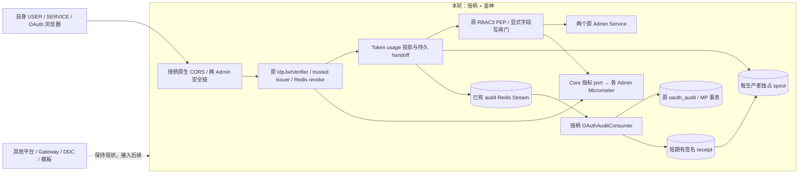
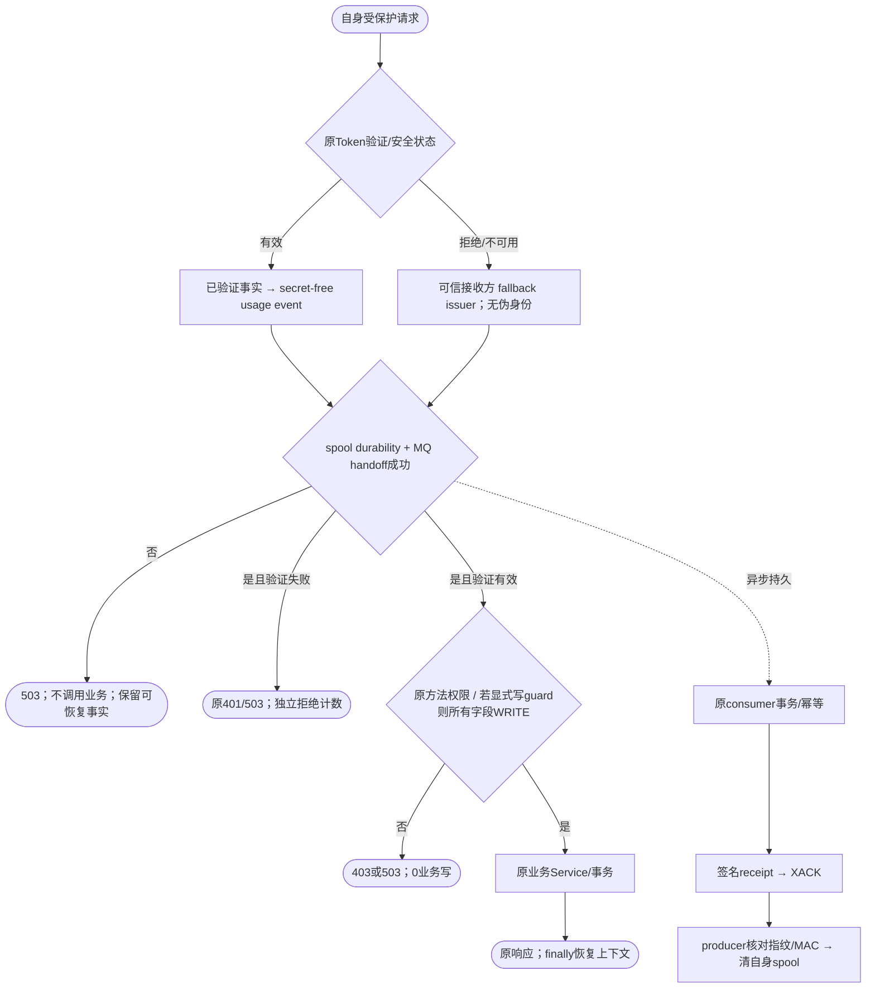
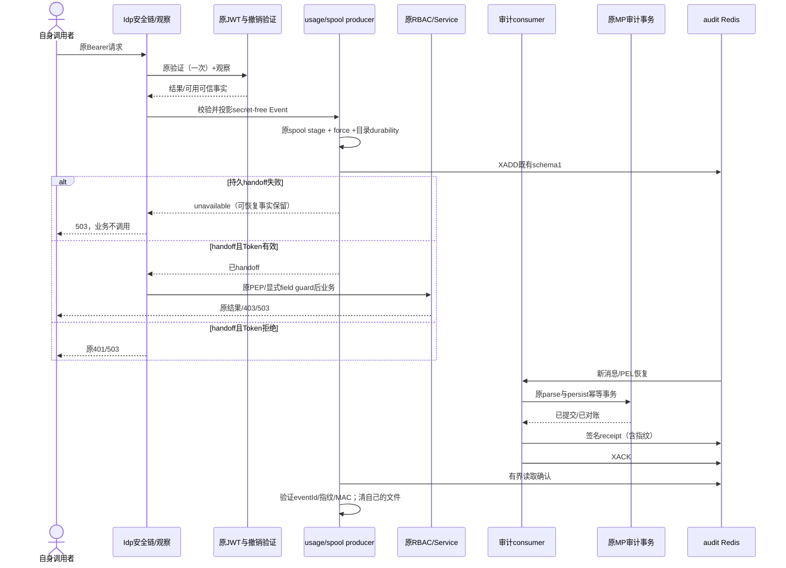

# 天权授柄与鉴神自身安全收敛规格

| Field | Value |
| --- | --- |
| Document | `2026-10-10-12-36-tianquan-security-self-hardening.md` |
| Template Version | `7` |
| Status | `Accepted` |
| Type | `Bugfix` |
| Complexity | `Complex` |
| Complexity Drivers | 两个子平台、自有Starter/Admin协作；认证与授权边界、审计持久确认/重放、字段写权限、跨域与可观测性、兼容部署 |
| Created | `2026-10-10 12:36 Asia/Shanghai` |
| Updated | `2026-10-11 09:58 Asia/Shanghai` |
| Owner | `mario` |
| Repository | `Egon-COLA` |
| Scope | 授柄/鉴神自身及PC-014用户批准的共享包0.2.5发布元数据、构建发布与两host安装；其他平台和archetype本轮不接入 |
| Change Surface | 本平台CORS/安全异常执行点、Servlet Token使用审计、spool跨进程持久确认、低基数安全指标、显式字段写权限闸门、自有配置/测试与已有前端依赖产物校准 |
| Affected Chapters | §7, §8, §9, §10, §11, §13, §14, §15, §16, §17, §18 |
| Source Requirement | 2026-10-10：先修复天权两个子平台自身问题，修完再让其他平台接入；按推荐方案修差异，当前合理的方案可保留；只写Spec。用户另明确选择纳入显式字段写权限闸门 |
| Baseline Revision | `main@3a82ea27652232c741b3366e94da8b3b36ea03bd`；本轮开始工作树干净 |
| Amends | [OAuth/OIDC主Spec](2026-09-22-17-14-tianquan-multitenant-oauth-oidc-design.md) §9仅本平台CORS执行、§15.3仅Token使用/spool确认、§15.4指标执行点；[当前代码修订](2026-10-08-10-18-oauth-current-code-alignment.md) §9仅上述技术执行点、§15；[鉴神字段Spec](2026-08-17-09-37-rbac3-annotation-userdetails-field-authorization.md) §3.2仅“写字段校验”排除项、§9/10/14仅本轮显式Starter闸门；其余内容保持有效 |
| Supersedes | `None` |
| Depends On | [OAuth/OIDC主Spec](2026-09-22-17-14-tianquan-multitenant-oauth-oidc-design.md) §7/9/15.1/15.2/16未改合同；[当前代码修订](2026-10-08-10-18-oauth-current-code-alignment.md) §6/9.4/9.5/11；[鉴神字段Spec](2026-08-17-09-37-rbac3-annotation-userdetails-field-authorization.md) §7/9/10未改读权限与前端本地registry合同；[Outbox/CQE Spec](2026-09-24-12-00-outbox-statemachine-cqe-integration.md) 技术生命周期/同源事务合同 |
| Related Specs | [资源授权分层](2026-08-24-17-30-rbac3-resource-grants-layering.md)；[Gateway资源启动](2026-09-05-16-00-gateway-oauth-resource-bootstrap.md)；[上轮执行审计](../reports/2026-10-09-tianquan-oauth-oidc-execution-audit.md)仅历史证据 |
| Related Plans | [自身安全收敛实施Plan](../plan/2026-10-10-13-45-tianquan-self-security-hardening-plan.md) |

## 1. Summary

本轮先使授柄和鉴神自身的安全执行链与已接受合同一致，再讨论其他平台/模板接入。授柄继续拥有身份、SAS/OIDC、Token、密钥和撤销；鉴神继续拥有RBAC3决策、激活角色、权限/字段策略。修复的是已有能力没有接上真实入口、确认边界不闭合或运行信号缺失的问题，不重建协议、安全框架、权限模型或业务分包。

保留当前合理方案：人员密码DelegatingPasswordEncoder/Argon2与bcrypt兼容、client_secret bcrypt、SAS issuer路径隔离、RS256与可信issuer列表、本地JWT验证、S256 PKCE/精确redirect、SERVICE临期重新申请AT、Servlet finally清理、Bearer API无CSRF、Cookie登录/同意有CSRF、RBAC3方法AuthorizationManager、响应字段隐藏/脱敏、Gateway删除不可信身份头并TokenRelay、MP/Outbox原有事务与DDL。不得为了形式上使用某个类或满足抽象层数量而重写它们。

目标修复：限定OAuth浏览器端点的CORS；本平台安全链401/403/503处理；真实认证/授权入口的全量Token使用审计；生产者独占spool与中心消费者间可验证确认；既有验证/缓存/拒绝路径的安全指标；鉴神显式字段写闸门；两个自身前端以相同已提交共享认证产物完成常规typecheck。设计完成不代表实施、SQL、真实PG/Redis、TLS或浏览器验收完成。

## 2. Background and Current State

### 2.1 Business and user context

原问题集3覆盖密码、CSRF、CORS、HTTPS、安全异常、日志、AuthorizationManager和API/method/权限字符/page/router/button/field。问题集4覆盖OAuth2/OIDC、多issuer、第三方Code/PKCE、内部SERVICE、JWT/tenant/SQL、WebClient、Gateway、撤销/密钥和生产可观测性。本次只取两子平台自身拥有的变更面；其他平台的配置/代码、DDC/Gateway改造和archetype示例留到后续。

### 2.2 Repository evidence

下文定义路径别名，均是**完整仓库相对路径的确定性前缀**，不是新的模块或待确定路径：

| Alias | Exact repository root / Java root |
| --- | --- |
| SC | `egon-cola-xingyuan/egon-cola-tianquan-shoubing/egon-cola-tianquan-shoubing-core`；`src/main/java/top/egon/cola/platform/tianquan/shoubing` |
| SS | `egon-cola-xingyuan/egon-cola-tianquan-shoubing/egon-cola-tianquan-shoubing-starter`；`src/main/java/top/egon/cola/platform/tianquan/shoubing/starter` |
| SA | `egon-cola-xingyuan/egon-cola-tianquan-shoubing/egon-cola-tianquan-shoubing-admin`；`src/main/java/top/egon/cola/platform/tianquan/shoubing/admin` |
| JC | `egon-cola-xingyuan/egon-cola-tianquan-jianshen/egon-cola-tianquan-jianshen-contract`；`src/main/java/top/egon/cola/platform/tianquan/jianshen/contract` |
| JS | `egon-cola-xingyuan/egon-cola-tianquan-jianshen/egon-cola-tianquan-jianshen-starter`；`src/main/java/top/egon/cola/platform/tianquan/jianshen/starter` |
| JA | `egon-cola-xingyuan/egon-cola-tianquan-jianshen/egon-cola-tianquan-jianshen-admin`；`src/main/java/top/egon/cola/platform/tianquan/jianshen/admin` |
| SW/JW | 两子平台下的`egon-cola-tianquan-shoubing-admin-web`/`egon-cola-tianquan-jianshen-admin-web` |

`SA/java/...`表示上表SA Java root拼接该后缀；resources/tests均明确使用模块root下的`src/main/resources`/`src/test/java`。实施Plan必须展开这些精确前缀，不把它们作为shell路径。

| Evidence ID | Classification | Exact path/symbol/decision/command | Observed fact | Design significance | Verification limit/freshness |
| --- | --- | --- | --- | --- | --- |
| EVD-001 | User decision | 最新用户请求 | 两子平台自身先闭合；合理既有方案保留 | 阻止提前改其他平台/模板 | 只授权写Spec |
| EVD-002 | Static repository | SA/java/oauth/config/AuthorizationServerConfiguration.java | multipleIssuersAllowed、S256、SAS原生CSRF/OIDC、RS256已在真实执行链 | 保留协议栈 | 不证明生产运行 |
| EVD-003 | Static repository | SA/java/support/security/IdpSecurityConfig.java#idpCorsConfigurationSource | 仅注册`/oauth2/**`；原生租户协议在`/tenants/{tenantId}/...` | 修正限定CORS执行点 | 不是开放全部API跨域的理由 |
| EVD-004 | Static repository | JA/java/config/security/Rbac3AdminSecurityConfiguration.java | Stateless/Bearer/RBAC/tenant顺序已有；未显式配置统一entry point/denied handler | 补齐安全链错误响应而非修改成功业务合同 | 默认链最终状态需测试复现，不预称全部403 |
| EVD-005 | Static repository | SS/java/security/IdpBearerAuthenticationFilter.java；SS/java/audit/TokenUsageAuditComponent.java | 身份/租户finally清理已有；生产验签路径未调用usage append | 新增真实请求审计执行点 | 此前静态搜索，不代表环境日志已采集 |
| EVD-006 | Static repository | TokenUsageAuditComponent#append/replayPending/acknowledge；SA/java/audit/service/impl/OAuthAuditConsumer.java#process | `.sent`跳过重放；消费者只删除自身目录，不是远端生产者独占目录 | 补跨进程确认，不能把XADD/XACK混作DB持久确认 | 无真实多进程试验 |
| EVD-007 | Static repository | SC/java/core/audit/TokenUsageAuditEvent.java；OAuthAuditConsumer#parse/persist | schemaVersion1、脱敏refs、已有Streams/幂等持久化与180天规则 | 复用原事件/关系库；不新建审计库 | schema/查询执行未在PG证明 |
| EVD-008 | Static repository | SS/java/security/TenantIssuerAuthenticationManagerComponent.java；SS/java/client/IdpServiceOAuth2Client.java | 可信issuer、本地验签/JWKS和SERVICE授权键缓存/单飞已有 | 不重建cache/token客户端；补真实缓存/验证指标 | 不将manager-cache命中冒充JWKS命中 |
| EVD-009 | Static repository | Shoubing生产Java的MeterRegistry/Metrics/Timer.builder/Counter.builder搜索；两个Admin POM | 无上述专用埋点；两Admin已有Actuator；SS无直接micrometer-core依赖 | 指标SPI留在Core，Micrometer适配留在已有Admin依赖内 | 默认框架指标不是目标专用指标 |
| EVD-010 | Static repository | JS/java/security/Rbac3MethodAuthorizationManager.java；JS/java/field/Rbac3FieldPropertyWriter.java | 方法PEP、NONE/MASKED_READ/READ/WRITE输出处理已实现 | 保留读权限/方法PEP，不用前端隐藏替代服务端 | 写权限不是输出serializer责任 |
| EVD-011 | User decision | 本轮问答；旧字段Spec§3.2 | 用户选择“纳入显式字段写权限闸门” | 只扩展显式服务端入口，不引入全局RequestBodyAdvice | 其他业务接口接入仍后续 |
| EVD-012 | Static repository | JS/java/authorization/AuthorizationService.java#FieldPolicyRequest/decideFields；FieldPolicyDecision | 现有request只有permission/application/resource三个维度；结果含字段级别、tenant、版本 | 新Command携带提交字段集合；复用现有PDP/结果 | 不能臆造旧request.fieldCodes |
| EVD-013 | Static repository | SW/node_modules共享包package.json；共享源码package.json | 授柄本机逻辑包路径对应实际admin-web-shared@0.2.3，与源码0.2.4接口不一致；鉴神alias声明^0.2.4但本机尚未安装，不能推断它也是旧包 | 修自身产物解析，不用source-map检查代替普通构建 | 源码未修改；安装状态会漂移 |
| EVD-014 | Static repository | SA/JA基础包、lombok.config、POM、已有MP/Outbox；JA architecture/AdminLayerBoundaryTest | 传统分包与现有技术SDK扩展，非COLA archetype业务项目 | 保留结构，无全平台JPA→MP迁移 | 不把规范升级当广泛重构授权 |

### 2.3 Problem statement and gap

| 差异 | Verdict | 原因/边界 |
| --- | --- | --- |
| 密码、issuer、PKCE、JWT、tenant finally、方法PEP、C10 USER scope | Keep | 已匹配合同；新增回归即可，不写第二实现 |
| Bearer API关闭CSRF | Keep | 不消费Cookie作为认证；Cookie登录/同意保持现有保护 |
| Gateway身份头/TokenRelay | Keep / Unchanged | 比信任普通透传头更安全；Gateway不在本轮改动范围 |
| 全平台默认跨域 | Remove（不采用） | 本平台Admin继续同源BFF；仅明确OAuth资源端点允许白名单 |
| 使用事件没有真实producer、远端spool无法收到确认 | Modify | 有明确源码缺口与审计验收合同 |
| 三类专用指标没有发出点 | Modify | 不能用“存在Actuator”代替可观察的指标 |
| 通用自动反序列化字段拦截 | Remove（不采用） | 存在PATCH presence/DTO映射/业务事务歧义；显式闸门更小且用户已选 |
| 字段写闸门 | Add（平台能力） | 复用WRITE语义，执行点显式，不改资源/角色/目录模型 |
| 共享包旧产物 | Modify（PC-014构建发布及自身解析产物） | 仅已批准publisher元数据/文档及既有流程；不改认证源、不更换依赖框架 |

### 2.4 Evidence and current-chain map

| Entry/trigger | Current call chain | Data read/written | External dependency | Consumers | Evidence |
| --- | --- | --- | --- | --- | --- |
| 本平台HTTP资源请求/受保护RPC verifier入口 | IdpBearer→IdpJwtVerifier→trusted manager/JWKS→Redis撤销→RBAC→Controller/Service | 验证/缓存与可信上下文，缺usage事实投递 | 已有Redis PRIMARY | SA/JA自有API | EVD-004/005/008 |
| 审计消息 | Streams→OAuthAuditConsumer→已有persist事务→XACK→消费者自己的spool删除 | oauth_audit、PEL、消费者目录 | 原MP/Redis | SA审计查询 | EVD-006/007 |
| 字段输出 | Rbac3UserDetails.fieldPolicies→Jackson PropertyWriter | 只读快照；隐藏/脱敏/原值 | 现有PDP快照 | 自有/未来业务View | EVD-010/012 |
| SERVICE互调 | WebClient→IdpServiceOAuth2Client→精确key缓存/单飞/重获 | 本地Token授权缓存 | 原OAuth2 Client Manager | 自有RPC/HTTP client | EVD-008 |

## 3. Goals and Non-goals

### 3.1 Goals

只补执行缺口与明确兼容问题；每个“保留”项也有源码依据与回归边界。让两子平台自身达到源代码、受控测试和明确运行验收的可交付状态，再开放后续接入工作。

### 3.2 Non-goals

不改玉衡Edge/biz/MCP、天枢/DDC、Portal、其他业务服务、archetype/source-projects/.generated或共享前端源码。不新建AS/Gateway/数据库/队列框架，不改Token claims、OAuth grant types、角色授权语义、目录/租户所有权、旧SQL、任何已存在Flyway文件。不做Jianshen全域JPA持久化迁移，不实现DataScope、通用DTO反序列化过滤、行写过滤、导出授权。不自动打开浏览器，不自动启动服务、PG/Redis或迁移；仅发布PC-014明确授权的admin-web-shared0.2.5，不push、PR或部署。

### 3.3 Change Surface and Design Depth

| Area/layer | Disposition | Exact repository evidence | Changed or preserved behavior/contract | Required Spec treatment | Chapter(s) |
| --- | --- | --- | --- | --- | --- |
| 本平台安全配置/协议CORS | Affected | EVD-002/003/004 | 原生协议白名单、既有安全错误执行点/链顺序 | 限定HTTP协商合同、无新业务API | §7, §8, §9, §10, §13, §14, §15, §16, §17, §18 |
| usage producer、spool/receipt/consumer | Affected | EVD-005/006/007 | 新真实调用与跨进程持久确认；schema1保留 | producer/consumer/failure/重放/Redis与文件生命周期 | §7, §8, §9, §10, §11, §13, §14, §15, §16, §17, §18 |
| 专用指标/SDK观察点 | Affected | EVD-008/009 | 真实验证/JWKS/SERVICE缓存/授权拒绝埋点 | host适配、低基数/SLO/失败规则 | §7, §8, §9, §13, §14, §15, §16, §17, §18 |
| 显式字段写闸门 | Affected | EVD-010/011/012 | 添加命令/闸门，旧PDP/读行为不变 | 内部契约、字段完整性与fail-closed | §7, §8, §9, §10, §13, §14, §15, §16, §17, §18 |
| 自身配置、测试、前端锁定产物 | Affected | EVD-013/014 | opt-in只开启两自身Admin，普通包检查使用一致产物 | key parity/构建门禁，不改页面 | §8, §14, §15, §16, §18 |
| oauth_audit与其他关系表/DDL/事务 | Context-only | OAuthAuditConsumer#persist及原MP schema | 原幂等persist事务/唯一键/保留期不变 | §11给出确定SQL/提交边界，无新表/ER | §11 |
| SAS/密码/nonce/UserInfo/refresh/密钥/严格撤销/C10 | Unchanged | EVD-002；联合修订§9.4/9.5 | 原协议、状态与安全边界保持 | 聚焦协议回归，不重设计 | §7, §14 |
| 自有Admin页面与成功业务API | Unchanged | SW/JW src、各Controller/原OAS | route、form、success body/权限/缓存相同 | §12只给保留记录 | §12 |
| 其他平台/DDC/Gateway/archetype | Unchanged | 前轮发现的源码；EVD-001 | 暂不接入、不修改配置 | 后续必须经过本轮exit gate | §16 |
| 新SQL/GraphQL/业务状态机 | Not applicable | 无新增关系模型/GraphQL/业务状态对象 | N/A | 不制造表/SDL/第二状态机 | §11, §13 |

## 4. Requirements and Acceptance Criteria

| ID | Atomic requirement | Priority | Observable acceptance criteria | Source |
| --- | --- | --- | --- | --- |
| REQ-001 | 两子平台自身先闭合 | Must | 变更只在§8清单；其他平台/模板不改；未通过exit gate不得宣称后续接入完成 | 用户最新请求 |
| REQ-002 | 保留已有合理安全机制 | Must | 原协议/claims/PKCE/redirect/密码/撤销/tenant/方法PEP/C10回归不退化 | 用户“最优可不修复” |
| REQ-003 | OAuth CORS仅明确白名单与四原生资源 | Must | 合法preflight成功；非法origin/方法/header无允许头；login/consent/authorize/Admin不因此开放跨域 | 问题集3 CORS/EVD-003 |
| REQ-004 | 自身安全异常按既有族处理 | Must | 缺认证401、授权拒绝403、必需状态/审计不可用503；过滤器错误不依赖ControllerAdvice；OAuth协议错误不换业务wrapper | 问题集3异常/EVD-004 |
| REQ-005 | 每次自身受保护Token使用决策有审计（按决策阶段唯一） | Must | 允许、拒绝、依赖失败都有唯一usage event；未知JWT不伪造issuer/subject；public health/preflight不计使用 | 问题集4全量审计 |
| REQ-006 | 审计durability是业务放行前置 | Must | 本地force/目录持久性与MQ确认成功后才能进入业务；仅XADD或失败双介质不能放行；返回503且业务零调用 | 主Spec§15.3 |
| REQ-007 | 生产者只按可验证持久确认清理 | Must | 远端consumer DB提交→receipt→XACK；producer验证eventId/fingerprint/MAC后删除自身文件；错误/缺失/DEAD确认不删除 | EVD-006/推荐闭合 |
| REQ-008 | 重放、崩溃、重复、过期有可判定行为 | Must | 同eventId同内容幂等；ACK失效重新投递；不重建180天前已清理审计；DEAD本地隔离保留；有界扫描不饥饿 | 原审计合同 |
| REQ-009 | JWT验证耗时来自真实验签 | Must | 成功/失败真实密码学路径都有timer；不含Redis/业务耗时；预检未验签不冒充timer样本 | 问题集4监控 |
| REQ-010 | JWKS与SERVICE Token缓存指标准确 | Must | 分别记录实际HIT/MISS/EXPIRED及Token acquire duration；不将manager map命中当JWK命中；不改变授权key | 问题集4缓存 |
| REQ-011 | 授权拒绝/不可用可观察 | Must | 认证和RBAC结果分开计数，有限reason category，无tenant/user/client/jti/scope/URL标签 | 问题集3日志/问题集4监控 |
| REQ-012 | 显式字段写闸门复用既有PDP | Must | 对服务器确定的提交字段集合，overall ALLOW且每项WRITE才通过；READ/MASKED_READ/NONE/缺字段拒绝；旧读决策不变 | 用户本轮明确回答 |
| REQ-013 | 写闸门不信任前端/不自动改业务输入 | Must | 无caller tenant/subject/role字段；null也视为写；无通用反序列化/自动DTO丢字段/隐式授权接口；其他平台接口暂不接入 | 用户阶段边界 |
| REQ-014 | 全层约束与已有Java/组件规范 | Must | §6.2/10/20逐项满足；手工验证只补非代理schema；MapStruct/Egon转换、具名qualified Lombok注入 | 用户AGENTS/技能 |
| REQ-015 | 配置和可选能力隔离 | Must | base/local核心键同构，offline profile显式关闭web observation；只有自身Admin启用；缺安全依赖启动失败，其他host默认不新增审计副作用 | 用户自身先修 |
| REQ-016 | HTTPS可信边界保持且可验证 | Must | public issuer/资源/service endpoints/Redis PRIMARY按原HTTPS/TLS合同校验；Cookie原CSRF不关；不采信任意Forwarded身份头 | 问题集3 HTTPS/保留最优 |
| REQ-017 | 自身前端使用一致的共享产物 | Must | 按PC-014授权解析与当前源码一致的admin-web-shared0.2.5产物，两个自身package常规typecheck/test通过；不以临时路径别名替代 | EVD-013 |
| REQ-018 | 无关系模型/历史DDL改动 | Must | 原SQL/manifest/业务表/唯一键/tenant事务字节与语义不变；无新migration/DDL/generator动作 | 用户AGENTS/最小方案 |
| REQ-019 | “可供接入”有明确门禁 | Must | §16逐项证明本平台source、受控行为、真实部署验收或明确Runtime unverified；不能把Spec/Mock检查判生产Ready | 用户先修后接入 |

### 4.1 Scenario matrix

| Scenario | Actor/trigger | Preconditions | Main path | Alternative/failure path | Data/state change | Observable result | Requirements |
| --- | --- | --- | --- | --- | --- | --- | --- |
| 合法OAuth跨域协商 | 第三方浏览器OPTIONS | 精确白名单origin/原生资源 | CorsFilter→200允许头 | 非名单403，无CORS允许头 | 无身份/业务状态 | 不需AT/CSRF，后续真实请求仍完整认证 | REQ-003 |
| 正常Token访问自身API | USER/SERVICE | issuer/signature/aud/type/tenant/撤销有效 | 验证→usage持久handoff→RBAC/业务 | 任意前置失败不进业务 | usage事件；业务只由原Service拥有 | 原响应；安全上下文finally恢复 | REQ-002/005/006 |
| 未可信JWT或无认证 | 攻击/遗漏AT | 受保护API，issuer/sub未验证 | fallback接收方issuer、匿名FAILED审计 | audit不可用返回503 | 不写伪租户身份；零业务调用 | 原401族或503，不泄漏细节 | REQ-004/005 |
| 权限拒绝 | USER | JWT有效，RBAC DENY/INDETERMINATE | usage允许鉴权事实与独立授权结果计数 | 403/503；不记录业务成功 | 不产生业务变更 | 当前前端拒绝/不可用行为 | REQ-004/011 |
| broker中断 | USER/producer | 可写spool，Redis超时 | 留`.evt`并拒绝业务 | 不声称落spool即MQ成功 | 可重放的拒绝事实 | 503；恢复重放同eventId | REQ-006/008 |
| spool满/fsync失败 | producer | 达上限/不支持持久性 | 不允许未经持久审计的放行 | 指标、readiness失败 | 不删除未确认数据 | 503、零业务调用 | REQ-006 |
| 中心DB提交后进程崩溃 | consumer | 相同event已提交 | redelivery核对已有事实后补receipt | DB回滚则不receipt/XACK | 至少一次；DB幂等 | sender最终可安全清理 | REQ-007/008 |
| receipt过期/丢失 | producer | `.sent`在，confirmation timeout过 | 同eventId/fingerprint重新投递 | 伪receipt不删除 | 重放不扩大审计事实 | 无重复业务处理 | REQ-007/008 |
| DEAD/180天过期事件 | consumer | 结构错误或超保留期 | DEAD隔离/EXPIRED明示 | DEAD不伪称STORED、不删spool | retained `.dead`或按既有到期策略清理 | 人工可查，不自动修改payload | REQ-008 |
| 允许字段写 | 自身SDK调用者 | 同用户可信快照；字段均WRITE | explicit guard→返回既有decision | 一项READ/null未知字段则拒绝 | guard本身0写 | 不依赖UI禁用按钮 | REQ-012/013 |
| 字段策略不可用/版本栅栏 | SDK调用者 | provider不可用/快照fenced | 不以空map当允许 | 503/RuntimeUnavailable | 0写 | 业务调用者不能继续落库 | REQ-012 |
| 热缓存与并发续取 | 自身SERVICE client | 精确授权key | 原single-flight；观察实际cache分支 | expired触发原重获 | 不加cache、不改key | 计数准确、无secret标签 | REQ-010 |
| 旧host未开启能力 | 后续平台（回归） | observation=false | 旧public factory/port行为 | 不需新spool/Micrometer依赖 | 不新增副作用 | 不提前接入其他平台 | REQ-001/015 |

### 4.2 Use-case analysis

#### 4.2.1 Actor inventory

| Actor ID | Actor/role | Goal and responsibility | Entry/channel | Permission/tenant context | Evidence |
| --- | --- | --- | --- | --- | --- |
| ACTOR-001 | OAuth第三方浏览器 | 使用既有Code/PKCE与用户资源 | 四资源preflight/原协议 | origin不是身份；真实请求按原协议 | EVD-002/003 |
| ACTOR-002 | 天权USER/SERVICE调用者 | 安全访问两个自身子平台 | 原API/Bearer | JWT可信身份；USER RBAC/SERVICE scope | EVD-004/005 |
| ACTOR-003 | 审计consumer/运维 | 确认事实持久、恢复失败、不误删 | Streams/spool/receipt | 原audit ACL/挂载密钥 | EVD-006/007 |
| ACTOR-004 | 自身应用Service | 在业务写前执行字段写PEP | 本地显式Component调用 | 当前USER/PDP快照；没有caller tenant | EVD-011/012 |
| ACTOR-005 | 维护者 | 核对安全信号/产物和接入门禁 | metrics/测试/构建 | 原Actuator生产暴露策略 | EVD-009/013/014 |

#### 4.2.2 Use-case artifact

| ID | Use case/goal | Primary actor | Supporting actors/systems | Trigger | Preconditions | Main success outcome | Alternatives/failures | Postconditions | Requirements | Interfaces/pages | Tests |
| --- | --- | --- | --- | --- | --- | --- | --- | --- | --- | --- | --- |
| UC-001 | 使用已有OAuth浏览器协议 | ACTOR-001 | 授柄SAS | preflight | origin/方法/header符合白名单 | 协商允许，业务协议不改 | 跨域拒绝不放宽登录Cookie | 无状态变更 | REQ-002/003/016 | API-001–004；原协议页面Unchanged | TEST-001–004 |
| UC-002 | 访问自身受保护API并留可信使用事实 | ACTOR-002 | 验签/撤销/RBAC/usage producer | Bearer请求 | 同原信任链 | 持久审计后继续原业务 | 未认证/拒绝/审计不可用 | 无未审计允许请求；finally清理 | REQ-004–006/011/015 | INTERNAL-001/007；原API/页面Unchanged | TEST-005–010 |
| UC-003 | 从故障恢复审计且正确清理生产者文件 | ACTOR-003 | MP persist/Redis | 重放或确认到达 | 原事件及既有幂等身份 | 事实确认可查、sender本地安全清理 | commit unknown/伪ACK/DEAD/expired | 无误删、无重复业务状态 | REQ-007/008/018 | EVENT-001/INTERNAL-002/003/JOB-001 | TEST-011–016 |
| UC-004 | 显式验证本次提交字段可写 | ACTOR-004 | 既有AuthorizationService | Service调用guard | schema有效、真实提交字段集合 | 所有字段WRITE才返回 | missing/READ/MASKED/NONE/fenced/unavailable | guard零业务写，拒绝后不落库 | REQ-012/013/014 | INTERNAL-004 | TEST-017–021 |
| UC-005 | 核对两平台安全交付并决定后续接入 | ACTOR-005 | 真实测试/包产物/运维 | 交付审查 | 同一baseline和明确环境 | 信号和证明对应真实执行点 | 源码检查/Mock不能假冒runtime | 通过明确exit gate才扩展接入 | REQ-001/009/010/014–019 | INTERNAL-005；Actuator/页面Unchanged | TEST-022–028 |

## 5. Constraints, Assumptions, and Decisions

### 5.1 Confirmed constraints

只写本Spec；不实施、不生成Plan。当前传统业务域分包和技术Starter扩展保持。身份/tenant/权限均由服务端信任链决定。schemaVersion1事件、旧OAuth/RBAC成功响应、既有业务权限字符及180天审计保留规则不被此技术收敛改变。历史DDL不可变；新增组件不引入后台服务或运行框架；仅按§8用户批准的三个自身POM补齐既有版本的编译API/处理器，不下载新制品。监控不是授权依据，字段读WRITE也不等于省略方法权限。

### 5.2 Small-gap assumptions

| ID | Inference | Repository evidence | Why locally reversible | Impact if wrong |
| --- | --- | --- | --- | --- |
| ASM-001 | 指标SPI放SC，适配留两Admin | 两Admin有Actuator，SDK已有SC依赖；RAG指标SPI不可作为OAuth域契约 | 只增技术port；无新依赖/网络 | 发现compile依赖缺口需回Spec，不自行加POM |
| ASM-002 | 保留普通factory/port；基础设施DI只用具名Bean与Lombok | 现有factory/RequiredArgsConstructor/lombok.config | 只更新本平台实际装配/直接构造测试 | 若发现其他平台直接构造基础设施类，停止并报告消费者兼容边界 |
| ASM-003 | request trace非法/缺失时服务器生成受限traceId | 已有trace/MDC约束，event max128 ASCII | 不改业务字段，不信任身份header | 与当前trace桥不匹配时在自身入口适配，不改其他平台 |

### 5.3 Resolved decisions

| ID | Decision | Decision owner | Evidence and rationale | Requirements |
| --- | --- | --- | --- | --- |
| DEC-001 | 只修两个自身子平台，后续接入独立 | 用户 | EVD-001 | REQ-001/019 |
| DEC-002 | 保留协议/密码/CSRF分界/JWT/RBAC/TokenRelay/MP/C10 | 用户推荐授权下按源码保留 | EVD-002/008/010；主Spec既定安全所有权 | REQ-002/016/018 |
| DEC-003 | 同源Admin不新开放跨域；原生OAuth四资源使用显式白名单、credentials=false | 主协议用途+最小修复 | Cookie登录/同意不由XHR跨域完成；CORS不是授权 | REQ-003 |
| DEC-004 | 全量usage沿现有MQ/spool，不用本地事件替代投递 | 原已接受主Spec§15.3 | EVD-005–007；严格审计不能靠普通日志 | REQ-005–008 |
| DEC-005 | receipt只确认已提交/已按既有规则过期；DEAD保留本地隔离 | 原持久确认要求的具体落点 | 消费者不能跨主机删目录；不用新表/回调HTTP | REQ-007/008 |
| DEC-006 | Core指标SPI+Admin Micrometer，指标失败不改变授权结果 | EVD-009及既有依赖 | 不给SDK新增micrometer依赖，不用RAG接口跨域复用 | REQ-009–011 |
| DEC-007 | 显式写权限Component，overall ALLOW且每项WRITE；拒绝全局DTO自动过滤 | 用户已明确选择 | 保留旧只读serializer，避免PATCH presence和越权静默丢字段 | REQ-012/013 |
| DEC-008 | PC-014共享0.2.5制品校准只针对自身前端 | EVD-013及用户发布授权 | 保持认证源；仅指定publisher元数据/文档、构建发布与自身安装 | REQ-017 |

### 5.4 Open major decisions

无未回答的架构/权限语义决策。字段写范围已由用户明确选择。真实证书/Redis PRIMARY/持久卷/已提交共享产物位置是执行与部署输入，不用假造值补全；未具备时实施或生产验收保持Blocked/Runtime unverified，不能削弱要求。

## 6. Project Technology Context

| Concern | Current choice | Repository evidence | Constraint on design |
| --- | --- | --- | --- |
| Java/Boot | Java21、Boot3.5.16、现有SAS/Security | 根POM和SA POM | 不升级框架/依赖；§8批准的同版本编译能力补齐例外 |
| Security | SAS MVC；SDK/Jianshen Servlet；现有Redis强撤销 | EVD-002/004/008 | 不把Reactor/Edge搬进两个Admin |
| Persistence | SA MP/NATIVE同PRIMARY与Outbox；JA既有JPA目录/事务 | 原修订§6/11，现有代码 | 原持久化不改；新技术receipt为Redis短期副本 |
| JSON/mapper | Boot Jackson、MapStruct/Egon BaseForwardConverter | Common core/各POM/生成Mapper | 只有真实跨层投影新增converter |
| Observability | 两Admin Actuator，SDK无需Micrometer类型 | POM已有依赖 | 不新增SDK依赖，SDKport用JDK类型 |
| Frontend | 既有React/AntD/Vitest/npm/tsc | SW/JW package.json | 只校准已有产物，不新页面/provider |
| Tests | JUnit/Mockito/MockMvc、SDK单元、既有隔离PG/Redis gates | 原测试路径 | Spec只执行结构检查；runtime需另授权 |

### 6.1 Java architecture profile and capability baseline

| Architecture profile | Archetype/template or base package | Exact evidence and verifier | Existing deviations | Design action |
| --- | --- | --- | --- | --- |
| Traditional Three-Layer | 两个Admin现有按业务域的controller→service→repository→dao结构，技术SDK为starter/core扩展 | SA/JA实际树、JA AdminLayerBoundaryTest、现有lombok.config；未选择任何archetype | JA历史JPA和部分技术类公开构造不因此迁全域 | 保留结构/包名；不加COLA层、bus或公共security平台 |

| Need | Spring/JDK candidate | Spring Boot Starter candidate | Egon-COLA/module candidate | Proven gap | Decision/dependency impact |
| --- | --- | --- | --- | --- | --- |
| CORS | Spring CorsConfigurationSource/CorsFilter | 现有Security/Web | IdpSecurityConfig | 路径/链不匹配 | 复用，无新库 |
| schema校验 | Jakarta Validator/Groups | 已有Validation | Common ValidationUtils | 非代理factory需显式schema触发 | 复用；不把状态规则放Utils |
| 审计投递/安全spool | JDK FileChannel/Mac、现有Redisson | 既有Redis | TokenUsageAuditComponent/OAuthAuditConsumer/原Outbox | usage入口/远端receipt未接上 | 扩现有组件，不引入MQ/DB |
| 指标 | JDK Duration；host MeterRegistry | 两Admin已有Actuator | RAG recorder领域不匹配；OutboxMetrics只属于Outbox生命周期 | SDK没有通用OAuth指标port | 增SC小port+host adapter，依赖零新增 |
| 字段写 | 现有Spring授权/PDP | 已有RBAC3 Starter | AuthorizationService.decideFields/FieldPolicyDecision | 未检查提交字段集合WRITE | 增显式Component；不造规则引擎 |
| Event投影 | MapStruct | 现有processor | Common BaseForwardConverter | verified事实→secret-free事件 | 一个真实投影converter，禁止手写业务映射 |

### 6.2 User-mandated Java rule compliance

| Literal rule | Affected? | Repository evidence | Exact design decision | Files/types/interfaces | Validation/test evidence | Status/blocker |
| --- | --- | --- | --- | --- | --- | --- |
| Rule 1 | Yes | §8新Command/BO/DTO/Component/Converter/port及原SDK类型 | 语义suffix与真实owner；不建Data/Info/Param/Bean；Proof值对象BO | §8/10全类型 | 类型库存/静态check/compile | PASS（设计，不是实施证据） |
| Rule 2 | Yes | 原Jakarta/Common Validator与PDP/parse | §10手交接逐项default/WriteFields/Valid/Validated；manual仅补schema，状态在owner | Context/Event/Receipt/Command | TEST-008/014/017/026 | PASS（设计，不是实施证据） |
| Rule 3 | Yes | 原MapStruct/BaseForwardConverter、immutable decision/event | 新class完整Data/NoArgs/AllArgs/Accessors/Builder，集合防御复制；仅真正immutable proof/Event record；generated converters | §10 carrier/converter | 真实generated Mapper/JSON/immutability | PASS（设计，不是实施证据） |
| Rule 4 | Yes | 现有factory与lombok.config | 新增/改业务类Slf4j、显式Bean名、RequiredArgsConstructor final qualified fields；不手写Spring注入Ctor；保留旧factory/技术Adapter入口 | §8组件/host配置/JS lombok.config | TEST-026真实注入/日志敏感搜索 | PASS（设计，不是实施证据） |
| Rule 5 | Yes | JDK FileChannel/Mac/URI/集合及已有Common | 只用JDK/已准Commons/Guava，复用代码；不添通用Utils/新库 | receipt/guard/codec | imports/POM scope检查 | PASS（设计，不是实施证据） |
| Rule 6 | Yes | Boot Jackson，原Event1/typed protocols | 明确JsonIgnore proof/raw context、strict receipt、原wire fields，不引入JSON库/ordinal编码 | §9完整消息与§10 | TEST-014/025序列化/OAS | PASS（设计，不是实施证据） |
| Rule 7 | Yes | SA/JA base/local/非web/testprofile | §15全核心键同构，值可不同；typed Properties、disabled不要求部署secrets | §8所有config文件 | TEST-026 parity/binding | PASS（设计，不是实施证据） |
| Rule 9 | Yes | audited verification/跨进程State/host signal变体 | 真实Decorator/Observer Adapter/固定Strategy表，原State；写集合为Simple直接检查，不造规则Registry | §7/13参与者 | TEST-005/011/022/024 | PASS（设计，不是实施证据） |
| Rule 10 | Yes | 原Clock/Instant/Duration | 所有event/receipt/timeout UTC Instant/Duration；持续时间用monotonic elapsed，不用旧Date | §10/11/15 | Clock boundary/JSON tests | PASS（设计，不是实施证据） |
| Rule 11 | Yes | 两Admin传统分包、既有SDK，SA MP/Outbox | 保留结构，无新COLA层/迁移框架；关系PO/DDL/唯一键不变；MQ是真实Redis Streams；business SSM opt-out | §6.1/8/11 | 架构gate/SQL字节/receipt组件证明 | PASS（设计，不是实施证据） |


## 7. Architecture Design

### 7.0 Minimum-design baseline and element-necessity audit

| Proposed element | Change | Requirements | Existing/direct alternative | Concrete inadequacy of alternative | Added calls/state/coupling/failures/migration/operations | Verdict |
| --- | --- | --- | --- | --- | --- | --- |
| 原SAS/JWT/RBAC/读serializer | Keep | REQ-002 | 原入口与状态 | None | 无新调用/库 | Keep |
| 四资源CORS策略 | Expand existing | REQ-003 | 原root CORS | 不作用于原生tenant路径 | 只有浏览器协商；无DB/新Controller | Keep/Modify |
| usage入口/上下文投影 | Expand + new converter/BO | REQ-005/006 | 普通log或现有未调用组件 | 无持久事件、无可用验证事实 | 每次受保护请求一次MQ；复用既有fsync/Redis | Add（必要入口） |
| TokenUsageAuditComponent receipt能力 | Expand | REQ-007/008 | consumer删自身目录/XACK | 跨进程不能确认生产者目录 | Redis短期key/有界确认与重放，无业务表 | Add（确认合同） |
| Core metrics port/Admin adapter | New | REQ-009–011 | 通用Actuator/Security观察 | 无精确cache分支/单独JWT时间，SDK无Micrometer依赖 | 本地回调、有限计数；0网络/0cache | Add |
| 字段写Component/Command | New | REQ-012/013 | 旧decideFields/读serializer | 没有提交字段集合检查；serializer太晚且只管输出 | 一次现有PDP本地调用、0DB写/0新HTTP | Add |
| 自动RequestBodyAdvice/新预检API/第二审计库 | New candidate | REQ-013/018 | 显式guard/原MQ+store | 无必要性；增加payload/事务/DTO语义 | 增新状态/调用/迁移而无当前收益 | Remove |
| 修改其他平台/模板 | Candidate | REQ-001 | 先自身验证 | 用户明确先后边界 | 扩散依赖与故障 | Remove from this scope |

| Path | Network calls | Client states | Server contracts/state | Failure and TOCTOU points | Additional user/business value |
| --- | --- | --- | --- | --- | --- |
| 原自身API | 原JWKS冷取/Redis撤销/原业务；无usage handoff | 原页面状态 | 原协议/业务状态 | 缺usage及跨节点确认 | 原业务结果 |
| 本轮选择 | 不增加HTTP回源；每决策一次Streams及本地durability；确认批处理Redis | 原页面状态 | 新技术receipt副本，旧业务模型不变 | 受控503/重放；PDP在写前重校 | 可证明审计/拒绝/字段写；没有fetch-then-forward |

### 7.1 System Architecture Design

#### 7.1.1 Architecture Mermaid view



#### 7.1.2 Boundary and responsibility table

| Module/component | Capability and data owned | Inputs/outputs | Allowed dependencies | Forbidden responsibility | Requirements |
| --- | --- | --- | --- | --- | --- |
| 授柄AS | 原身份/OAuth/issuer/key/revoke/audit事实 | 原协议、usage持久确认 | 原MP/Outbox/Redis/JDK | 不接管RBAC授权策略/其他业务库 | REQ-002/007 |
| 授柄SDK | Token验证、可信事实投影、usage producer、确认/重放 | 原verifier ports与新观察上下文 | SC/Common/原Redis | 不信任未验证claims；不逐请求调AS | REQ-005–010 |
| 鉴神SDK | 原PDP/方法PEP/输出字段、显式写字段检查 | 原decideFields与新Command | 原AuthorizationService、SC指标port | 不自动过滤DTO或改变role grants | REQ-012/013 |
| 各Admin metrics adapter | 进程内观测映射 | 有限分类+Duration | 已有Actuator/MeterRegistry | 不决定认证；不以身份做labels | REQ-009–011 |
| 短期receipt | 已持久/已过期/DEAD处理结果副本 | eventId+指纹+MAC | 现有audit Redis ACL | 不替代DB事实、不凭TTL确认成功 | REQ-007/008 |

### 7.2 High-Level Design

#### 7.2.1 Critical business/control flowchart



#### 7.2.2 High-level decision and quality matrix

| Concern/use case | Required behavior | Selected mechanism | Failure/degradation behavior | Trade-off | Verification | Requirements |
| --- | --- | --- | --- | --- | --- | --- |
| 安全/tenant | 原严格认证与清理不变 | 原resolver/revoke/PEP，observer只读事实 | 未可信JWT匿名记录，fail-closed | 额外审计I/O不等于修改身份模型 | TEST-005/008/025 | REQ-002/005 |
| 审计RPO | 零“已放行但无durable usage” | 既有spool/MQ与确定receipt | 存储失败503，不隐藏未ACK文件 | 必需I/O牺牲可用性，符合原合同 | TEST-009–016 | REQ-006–008 |
| 可观测性 | timer/count来自真实分支 | Core Observer port/host Adapter | metric异常有限日志，授权结果不变 | SDK不依赖Micrometer；验收仍需信号真实存在 | TEST-022–024 | REQ-009–011 |
| 写字段 | 服务端所有提交字段WRITE | 单次PDP+显式Component | 缺策略/字段拒绝，不静默丢字段 | 业务调用者后续接入必须确定presence | TEST-017–021 | REQ-012/013 |
| 兼容/阶段 | 原调用者协议和未启用host不变 | opt-in +既有factory/port | 缺依赖不能 silently noop 自身开启模式 | 其他平台默认不新增副作用 | TEST-026–028 | REQ-001/015/019 |

### 7.3 Detailed Design

#### 7.3.1 Detailed component collaboration

| Step | Caller -> callee | Contract/symbol | Input/output mapping | State/data effect | Failure behavior | Requirements |
| --- | --- | --- | --- | --- | --- | --- |
| 1 | 自身安全配置→CorsFilter/错误handler | API-001–004与原Chain | 原固定publicOrigin+白名单，不用Host推origin | preflight只读 | 未列资源仍原策略 | REQ-003/004 |
| 2 | IdpBearer→IdpJwtVerifier→manager | 原verify方法+可选观察overload | 验证成功/可信签名事实在本请求捕获；不再decode一次 | 原JWT/JWK/revoke流程 | 未获得VerifiedJwtBO不取不可信claims | REQ-005/009 |
| 3 | 请求观察→generated event converter→append | INTERNAL-001/002 | TokenAuditContextBO→TokenUsageAuditEvent；tokenRef按key/issuer/jti HMAC | 一次真实usage Event handoff | 503前置业务；拒绝使用匿名fallback | REQ-005/006 |
| 4 | 原RBAC/显式field guard→delegate PDP | INTERNAL-004 | Command三维key→原FieldPolicyRequest；集合逐项检查WRITE | 只读授权，不改DTO/DB | DENY403、INDETERMINATE503 | REQ-012/013 |
| 5 | consumer→原persist→receipt→XACK | EVENT-001/INTERNAL-003 | 同原事件schema1；规范指纹与MAC匹配 | 已有DB事实+临时receipt | persist/receipt失败留PEL，重试同eventId | REQ-007/008 |
| 6 | 既有replay job→确认/cleanup/redelivery | JOB-001 | `.evt/.sent/.dead`与短期receipt | 只删自身已确认文件 | 缺/伪receipt重放；DEAD保留 | REQ-007/008 |
| 7 | SDK观察→各Admin metrics | INTERNAL-005 | 只传Duration和有限分类 | 本地Timer/Counter | 不改授权结果/缓存key | REQ-009–011 |

新增observer entry必须保留原verifier/factory/authorize签名；观察能力通过新overload/组合delegate接入，禁止第二次JWT解析、把原token保存到全局或以Servlet ThreadLocal传入异步任务。`VerifiedJwtBO`只存本请求内，用后清除。cache instrument发生于实际BoundedJwkSetCache.get和SERVICE cache get/expired/acquire分支；不能用外层WebClient总耗时替代JWT密码学耗时。

自身managed USER/SERVICE verifier由`IdpObservedVerificationComponent`以Decorator包装，提供单一原验证Function调用；HTTP、受保护RPC都在返回有效验证结果给业务之前完成TOKEN_USE_VERIFIED handoff。只有真实验证callback产生可信事实；成功但缺proof的custom verifier在自身enabled模式拒绝配置，不从raw token再解码补证。`AccessTokenVerification.Valid`追加@JsonIgnore的immutable `TokenAuditProofBO`并保留原一参/两参构造；已有principal/scopes普通JSON形状不变。proof含精确issuer/resource与subject/client/token refs，无raw JWT、jti或subject。IdpBearer将proof放入本次Authentication.details；RBAC桥替换authentication必须复制该proof；RPC沿现有gRPC Context可选overload传递，callback finally恢复，不新增独立ThreadLocal。未获得proof的失败用server fallback，不能从tenant反推issuer。

方法/RBAC拒绝与TOKEN_USE_VERIFIED是不同安全事实：现有授权异常render前（含RBAC filter拒绝）完成DENIED Event；每个阶段使用不同eventId、同trace关联。有效Token后业务500不记成认证失败。RPC调用的PDP拒绝由ObservedAuthorizationService在返回/抛出前沿当前proof记录同一阶段；没有鉴权上下文的非Token本地调用只做原PDP/metrics，不伪造Token使用。自身SAS UserInfo是另一个真实使用入口：在原UserInfo Strategy完成原JWT/authorization/revoke守卫后、生成响应前使用同一secret-free producer；其原issuer/JWK/RSA验证不重复。Token签发/撤销等已存在的DB+Outbox事实保持，不用usage Event替代。

自身Bean装配开启时必须有真实审计producer、有效fallback issuer、Validator与host metrics recorder；不是“缺依赖则当成功”。未启用host使用原入口与no-op观测，不新增审计强依赖。新增业务Bean全部`@Slf4j`、具名、`@RequiredArgsConstructor`、final qualified fields；Lombok负责Spring注入，技术兼容factory保留旧签名。

#### 7.3.2 Critical-path Mermaid swimlane



#### 7.3.3 Transactions, consistency, concurrency, and idempotency

| Concern/state change | Owner and boundary | Mechanism/isolation/lock | Concurrent or duplicate behavior | Commit/visibility point | Failure result | Requirements/tests |
| --- | --- | --- | --- | --- | --- | --- |
| 原业务命令 | 原Service/原LOCAL事务 | 原版本与授权 | 原合同不变 | 原业务commit | 原错误；不新增补偿 | REQ-002/018 |
| usage spool | 每producer自己的volume/component | 原进程锁、原子move、文件force与目录force | 同eventId同规范内容重复可重用，内容不同冲突 | durability确认才进入handoff后业务 | 503，不用内存XADD冒充持久 | REQ-006/TEST-009 |
| audit persist | 原OAuthAuditConsumer#persist事务 | 原eventId/tenant幂等、原MP方法 | 同identity同内容幂等；不跨租户合并 | persist事务commit已完成后才receipt | commit unknown留PEL并对账 | REQ-007/TEST-012 |
| receipt | Redis短期技术副本 | exact key+原子SET TTL；producer验证MAC/指纹 | 同事实重复可刷新TTL；不同指纹冲突 | 不把receipt作为DB事实来源 | 不删文件、重新投递/隔离 | REQ-007/TEST-013 |
| 字段写guard | 调用方Service决定调用时点，Component不写DB | 当前同一PDP快照/fence，集合全满足 | 延续原“鉴权已通过的在途请求不追溯取消”规则 | guard返回后调用方原事务；未来接入须在实际写前调用 | 不自动补写/过滤请求字段 | REQ-012/TEST-019 |

#### 7.3.4 Failure semantics, recovery, and reconciliation

| Failure point | Detection | Immediate control flow | Data/transaction state | Retry and idempotency | Caller/frontend result | Recovery/reconciliation owner | Verification |
| --- | --- | --- | --- | --- | --- | --- | --- |
| 验签/tenant/revoke拒绝 | 原typed verification | 匿名或可信fact usage失败审计，原状态 | 原业务未开始 | 不自动重试非法AT | 401或原503 | 原登录/凭据恢复 | TEST-008 |
| spool fsync/容量 | IOException/明确能力检查 | strict模式拒绝handoff/放行业务 | 不删除已有未确认事件 | 运维恢复卷后重放；禁止fallback内存确认 | 503 | producer readiness/运维 | TEST-009 |
| broker timeout | 现有Redis异常/未确认 | 保存`.evt`、拒绝业务 | 业务0调用；消息是否入broker可能未知 | 原eventId重新投递，不换id | 503 | 原replay job | TEST-010 |
| DB commit unknown | 原MP事务/异常 | 不发布STORED、不XACK | 对账前未知 | 原idempotent persist重新查询/核对 | 原请求不假报DB已持久 | consumer | TEST-012 |
| receipt写或XACK失败 | Redis异常 | 保留PEL或允许redelivery | DB可能已提交 | 同eventId补receipt；不重复业务事实 | sender保留文件 | consumer/job | TEST-013 |
| receipt伪造/错误指纹 | 长度/schema/MAC/内容校验 | 不删除/不相信签名之外身份 | 原spool完整 | 重新读/超timeout重放；异常告警 | 无假成功 | producer/operator | TEST-014 |
| DEAD | 原dead stream确认+signed DEAD receipt | sender标记本地`.dead`，停止自动重放 | 不按STORED清理；计入容量 | 人工按原维护合同核查；不改原事件内容 | readiness/告警明确 | 审计运维 | TEST-015 |
| metrics recorder异常 | 观察port限定捕获 | 只安全日志，不吞业务exception | 认证/业务结果不变 | export/配置恢复；不能以此判信号验收通过 | 原业务响应 | host metrics | TEST-024 |
| 字段缺策略/不可用 | PDP DENY/INDETERMINATE | 原授权异常/RuntimeUnavailable | 0业务写 | 不以empty map允许 | 403/503 | 原RBAC恢复 | TEST-018/020 |

#### 7.3.5 Observability and operational boundaries

| Signal/runbook | Emitting owner and point | Fields/dimensions | Sensitive-data rule | Success/failure threshold | Alert/dashboard/operator action | Verification boundary |
| --- | --- | --- | --- | --- | --- | --- |
| jwt.verify.duration | trusted manager实际密码学验证前后 | result/固定receiver角色 | 不含issuer全文/tenant/jti/kid | 原目标p95≤5ms，不含Redis与audit | 压测后核验，不假称达到 | 单元只证明timer；负载需授权 |
| jwks.cache.access | 真正JWK cache get/expiry | result=HIT/MISS/EXPIRED | 不含key/URI | 热场景趋势；不硬造总体命中目标 | 检查TTL/rotation | 真实cache fixture与运行负载 |
| token.cache.access / token.acquire.duration | 原SERVICE authorize/renew | result和固定SERVICE角色 | 不含授权key、clientId、scope | 原≥99%目标仅在定义热点负载下验收 | 排查expiry/key隔离 | controlled+真实负载 |
| oauth.authentication / rbac.authorization | 验证结束/原PDP结果 | stage/result/有限reason分类 | 未可信身份不写入labels | 5分钟异常比例需基线后报警 | 区分无认证/非法/权限拒绝/不可用 | self API/方法测试 |
| oauth.audit.delivery / receipt.age / spool.bytes | stage/handoff/confirm/replay | result/固定receiver角色 | 不记录payload/key/token | spool≥80%警告，满/DEAD/readiness失败立即告警 | 不删除失败日志使指标变绿 | 多进程与故障验证 |
| 安全log/trace | 真实failure boundary | 有限stage/result、合法traceId、受控eventId | 不记录AT/RT/code/verifier/password/secret/raw claims | 重复broker错误按既有有限节奏 | 原运维owner，按eventId查审计 | 日志脱敏测试；非全量普通访问log |

#### 7.3.6 Conclusion evidence chain

| Conclusion | Repository/user evidence | Constraint or requirement | Design decision | Consequence and trade-off | Verification and acceptance evidence |
| --- | --- | --- | --- | --- | --- |
| 不重建协议 | EVD-002/008/010 + 用户保留合理方案 | REQ-002 | 原SAS/JWT/PEP保持，仅观察/校验接入 | 最小变更、无新AS/framework | 原protocol/native/C10 regression |
| audit需要远端receipt | EVD-006独占目录/XACK语义 | REQ-006–008 | 原DBcommit后signed receipt，producer本地清理 | 新短期Rediskey/重放成本，避免错删/永久积压 | TEST-011–016跨节点owner fixture |
| metrics不塞新SDK依赖 | EVD-009 Actuator已在host | REQ-009–011 | SC port +host Adapter | 多一个小port但0新依赖/网络/缓存 | TEST-022–024，SDK依赖方向检查 |
| 显式写guard | EVD-011用户选择 +旧§3.2排除 | REQ-012/013 | 单次现有PDP+提交field set，读serializer不变 | 接入责任明确，不改DTO/前端/SQL | TEST-017–021；后续业务适配独立 |

## 8. Package Structure and Code File Tree

### 8.1 Current relevant tree

传统Admin域分包与`core/starter`技术扩展保持。相关现有树：SA `oauth/config`、`support/security`、`audit/service/impl`；SS `security`、`security/domain/converter`、`audit`、`client`、`autoconfigure`；JS `authorization`、`security`、`field`、`autoconfigure`；JA `config/security`、`shared/controller`。不引入新DDD/module。

### 8.2 Target tree

用户于2026-10-10批准本Spec，并在Plan复核时明确批准补齐已有RPC interceptor调用点；此次修订只补该现有文件的proof传递，其他平台和模板范围不变。

只以§8.3清单作为target tree；Alias展开方式见§2.2。每条均是确定的模块/源码根/相对文件组合，清单不表示实施先后或Plan Step。

### 8.3 Package and file responsibilities

用户于执行Step2复核时批准下列三个鉴神自身POM的编译依赖/处理器补齐；这是原零POM假设的窄幅例外，不是框架升级/运行库引入。

| Operation | Path/package | Symbols | Responsibility | Dependencies | Requirements |
| --- | --- | --- | --- | --- | --- |
| MODIFY | `JC/pom.xml` | `Validation API compile dependency` | 用户明确批准的最小编译补齐：仅现Boot管理jakarta.validation-api 3.0.2，Contract不引入Spring/运行Starter | 现Boot BOM | REQ-012/014 |
| MODIFY | `JS/pom.xml` | `provided Lombok / MapStruct processors` | 用户明确批准Lombok1.18.46 provided/optional、复用MapStruct processor1.6.3/binding0.2.0；现API沿已有传递依赖，不升级/下载 | 现根版本/授柄既有构建配置 | REQ-012/014 |
| MODIFY | `JA/pom.xml` | `provided Lombok` | 用户明确批准仅Lombok provided/optional，以支持本轮host adapter生成注入；无新运行框架 | 现根版本 | REQ-014 |
| CREATE | `SC/java/core/observability/IdpSecurityMetricsRecorder.java` | `record` | 纯JDK指标port，无Micrometer/HTTP/身份标签 | 既有模块/§6.1 | REQ-009/010/011 |
| CREATE | `SC/java/core/observability/SecurityMetricObservationBO.java` | `signal/result/duration/value` | 有界技术观测值，默认组校验 | 既有模块/§6.1 | REQ-009/010/011/014 |
| MODIFY | `SS/java/security/IdpJwtVerifier.java` | `verifyAny/verifyMultiIssuer观察overload` | 原流程一次verify；将真实可信事实与stage计时交观察者 | 既有模块/§6.1 | REQ-005/009 |
| MODIFY | `SS/java/security/TenantIssuerAuthenticationManagerComponent.java` | `authenticate观察overload/BoundedJwkSetCache` | 真实JWT/JWK分支观察，保留2/3参构造和旧resolver接口（Edge调用保持） | 既有模块/§6.1 | REQ-002/009/010 |
| MODIFY | `SS/java/security/IdpBearerAuthenticationFilter.java` | `create/请求观察回调` | 原身份安装/清理保留；按opt-in把本请求可信事实交usage filter | 既有模块/§6.1 | REQ-004/005/015 |
| CREATE | `SS/java/security/IdpSecurityObservationFilter.java` | `doFilterInternal` | 使用审计/拒绝观察的真实Servlet执行点；只在自身enabled链接入 | 既有模块/§6.1 | REQ-004/005/006 |
| CREATE | `SS/java/security/IdpObservedVerificationComponent.java` | `observe` | 包装自身managed USER/SERVICE verifier与RPC返回前审计；复用原验证，不新decode | 原verifier/producer/metrics/Converter | REQ-005/006/014 |
| CREATE | `SS/java/security/domain/TokenAuditProofBO.java` | immutable verified proof | 可信issuer/resource及脱敏refs，允许跨SecurityContext/gRPC当前调用保留；不含JWT | 原验证生成投影 | REQ-005/014 |
| MODIFY | `SS/java/security/AccessTokenVerification.java` | Valid可选proof | 保留原一参/两参构造/字段；新proof为JsonIgnore immutable metadata，legacy/disabled可为null | 原typed result | REQ-002/005 |
| MODIFY | `SS/java/security/rpc/IdpRpcSecurityContext.java` | 可选proof overload | 保留原with/run方法；当前gRPC Context持有secret-free proof并finally恢复，不新增ThreadLocal | 原gRPC/Spring Context | REQ-005/014 |
| MODIFY | `SS/java/security/rpc/IdpRpcBearerServerInterceptor.java` | `interceptCall/run callbacks` | 将已验证Valid.proof传入既有Context的可选overload；旧调用签名/身份/状态映射不改；用户在Plan复核时明确批准补齐此调用点 | 原USER verifier/IdpRpcSecurityContext | REQ-005/014 |
| MODIFY | `JS/java/security/Rbac3BearerAuthenticationFilter.java` | bridge/拒绝render前callback | 在替换Authentication时保留已验证audit proof；RBAC拒绝先记录再写response | 原Idp/RBAC链 | REQ-004/005 |
| MODIFY | `SA/java/oauth/service/impl/TransactionalOAuthAuthenticationProvider.java` | 原UserInfo Strategy/Decorator观察点 | 原签名/授权/撤销成功后，返回UserInfo之前记录Token使用；不重复JWT验证或改业务结果 | 原SAS provider/usage producer | REQ-002/005/006 |
| CREATE | `SS/java/security/domain/TokenAuditContextBO.java` | `request context` | 经验证BO+server-owned fallback/resource/result/clock，禁止JSON输出raw JWT | 既有模块/§6.1 | REQ-005/014 |
| CREATE | `SS/java/security/domain/converter/TokenUsageAuditEventConverter.java` | `toTarget` | MapStruct+BaseForwardConverter投影到原11字段Event | 既有模块/§6.1 | REQ-005/014 |
| MODIFY | `SS/java/audit/TokenUsageAuditComponent.java` | `appendStrict/reference/confirm/replayPending` | 原spool/Streams增强strict持久/receipt/有界重放，不删远端目录 | 既有模块/§6.1 | REQ-006/007/008 |
| CREATE | `SS/java/audit/domain/dto/TokenUsageAuditReceiptDTO.java` | `receipt schema1` | eventId/指纹/outcome/时间/MAC的严格技术确认 | 既有模块/§6.1 | REQ-007/008 |
| CREATE | `SS/java/audit/OAuthUsageObservationProperties.java` | `enabled/fallbackIssuer` | opt-in与接收方匿名失败审计authority | 既有模块/§6.1 | REQ-005/015 |
| CREATE | `SS/java/audit/AuditDeliveryProperties.java` | `TTL/timeout/batch` | 有界确认/重放参数；原OAuthAuditProperties四字段不改 | 既有模块/§6.1 | REQ-007/008/015 |
| MODIFY | `SS/java/client/IdpServiceOAuth2Client.java` | `authorize/renew观察overload` | 真实SERVICE缓存/重获计时，原cache key/single-flight/factory不变 | 既有模块/§6.1 | REQ-002/010 |
| MODIFY | `SS/java/autoconfigure/IdpStarterAutoConfiguration.java` | `观察/producer组件Beans` | 显式named/qualified装配，disabled不增加依赖；自身开启缺能力失败 | 既有模块/§6.1 | REQ-005/014/015 |
| MODIFY | `SA/java/audit/service/impl/OAuthAuditConsumer.java` | `process/parse/receipt` | persist返回后签名receipt再XACK；DEAD/EXPIRED区别；停止消费者代删sender目录 | 既有模块/§6.1 | REQ-007/008 |
| MODIFY | `SS/test/autoconfigure/IdpStarterAutoConfigurationTest.java` | `ApplicationContextRunner bean name` | 仅按最新用户必要依赖修复授权校正Boot具名jacksonObjectMapper的测试fixture，不放宽原断言 | 既有Starter测试 | REQ-001/002/014/015/018 |
| MODIFY | `SA/test/oauth/controller/OAuthTokenClientCredentialsTest.java` | `SecurityConfiguration imports` | 必要前置fixture校正：复用既有Boot ValidationAutoConfiguration提供defaultValidator，不改断言/生产代码 | existing self SAS fixture | REQ-002/014/018 |
| MODIFY | `SA/java/support/security/IdpSecurityConfig.java` | `CORS/自有观察filter/错误族` | 保留自身Bearer链，复用错误响应；CORS不开放Admin | 既有模块/§6.1 | REQ-003/004/005 |
| MODIFY | `SA/java/oauth/config/AuthorizationServerConfiguration.java` | `protocol matcher/cors object processor` | 将四技术preflight纳入同原生链，Cookie CSRF及协议Provider保持 | 既有模块/§6.1 | REQ-002/003 |
| CREATE | `SA/java/oauth/config/OAuthCorsProperties.java` | `allowedOrigins` | 校验已有白名单key，不创造自动反射/通配符 | 既有模块/§6.1 | REQ-003/014/015 |
| CREATE | `SA/java/oauth/config/OAuthNativeCorsProcessor.java` | `processRequest` | Decorator复用DefaultCorsProcessor，仅限制四资源preflight单值header/方法 | 既有模块/§6.1 | REQ-003 |
| MODIFY | `SA/java/oauth/config/OAuthProtocolOpenApiConfiguration.java` | `四options operations` | 现有Customizer记录200/403/no body；原协议schema保留 | 既有模块/§6.1 | REQ-003/014 |
| CREATE | `SA/java/support/security/TianquanSecurityMetricsComponent.java` | `record` | Core port→现有Micrometer，固定SHOUBING角色 | 既有模块/§6.1 | REQ-009/010/011 |
| CREATE | `SA/java/support/security/TianquanSecurityObservationConfiguration.java` | `metrics/observer/readiness Beans` | 复用Boot primary/unique registry，具名Supplier解决qualified依赖 | 既有模块/§6.1 | REQ-014/015/016 |
| MODIFY | `JS/java/authorization/AuthorizationService.java` | nested FieldPolicyRequest schema annotations | 只为已有required三维字段补同语义NotBlank；request构造/方法签名/旧读行为不变，不给override强化SPI参数 | 原PDP边界 | REQ-012/014 |
| MODIFY | `JC/java/authorization/FieldPolicyDecision.java` | generic schema/cascade annotations | 原required字段NotNull/NotBlank、版本PositiveOrZero、Map键/FieldAccess cascade；同原ctor不新增权限规则/集合上限/JSON字段 | 原immutable decision | REQ-012/014 |
| CREATE | `JS/java/field/FieldWriteAuthorizationCommand.java` | `三个key/submittedFields` | class+WriteFields组、集合presence契约，不含caller tenant/subject | 既有模块/§6.1 | REQ-012/013/014 |
| CREATE | `JS/java/field/FieldWriteAuthorizationConverter.java` | `toTarget` | BaseForwardConverter映射到真实三维FieldPolicyRequest | 既有模块/§6.1 | REQ-012/014 |
| CREATE | `JS/java/field/Rbac3FieldWriteAuthorizationComponent.java` | `requireWritableFields` | schema→单次PDP→逐项WRITE，拒绝/不可用不执行业务 | 既有模块/§6.1 | REQ-012/013 |
| CREATE | `JS/java/authorization/Rbac3ObservedAuthorizationService.java` | `原五个AuthorizationService方法` | Decorator保留delegate权限/异常，记录实际结果；Token上下文DENY沿既有usage MQ，0新HTTP | 既有模块/§6.1 | REQ-011 |
| MODIFY | `JS/java/autoconfigure/Rbac3StarterAutoConfiguration.java` | `authorizationService/guard注册` | 原authorizationService Bean名保留，named delegate/observer/field converter | 既有模块/§6.1 | REQ-011/012/014 |
| MODIFY | `JS/java/web/Rbac3AuthorizationExceptionHandler.java` | `denied/unavailable` | 原两字段异常族，增加正确field guard异常映射/安全no-store；不重包正常响应 | 既有模块/§6.1 | REQ-004/012 |
| MODIFY | `JA/java/config/security/Rbac3AdminSecurityConfiguration.java` | `两个原SecurityFilterChain` | 明确entry point/denied handler、自身observer、原Idp→RBAC→tenant顺序 | 既有模块/§6.1 | REQ-004/005/015 |
| CREATE | `JA/java/config/security/TianquanSecurityMetricsComponent.java` | `record` | 同Core port→本host Micrometer，固定JIANSHEN角色 | 既有模块/§6.1 | REQ-009/010/011 |
| CREATE | `JA/java/config/security/TianquanSecurityObservationConfiguration.java` | `metrics/observer/readiness Beans` | 同安全schema/依赖标准，绝不创建第二MeterRegistry | 既有模块/§6.1 | REQ-014/015/016 |
| CREATE | `egon-cola-xingyuan/egon-cola-tianquan-jianshen/lombok.config` | `copyable Qualifier` | 仅新/改业务Bean注入规范；不重构既有全域 | 既有模块/§6.1 | REQ-014 |
| MODIFY | `SA/src/main/resources/application.yml` | `配置核心叶子键` | §15同构；自身web启用，offline关闭 | 既有模块/§6.1 | REQ-015/016 |
| MODIFY | `SA/src/main/resources/application-local.yml` | `配置核心叶子键` | §15同构；自身web启用，offline关闭 | 既有模块/§6.1 | REQ-015/016 |
| MODIFY | `SA/src/main/resources/application-oauth-migration.yml` | `配置核心叶子键` | §15同构；自身web启用，offline关闭 | 既有模块/§6.1 | REQ-015/016 |
| MODIFY | `JA/src/main/resources/application.yml` | `配置核心叶子键` | §15同构；自身web启用，offline关闭 | 既有模块/§6.1 | REQ-015/016 |
| MODIFY | `JA/src/main/resources/application-local.yml` | `配置核心叶子键` | §15同构；自身web启用，offline关闭 | 既有模块/§6.1 | REQ-015/016 |
| MODIFY | `JA/src/test/resources/application-local-it.yml` | `测试profile核心键` | 继承/显式override parity，不隐启服务 | 既有模块/§6.1 | REQ-015 |
| CREATE | `JW/src/features/auth/AuthArtifactContract.test.ts` | `现有npm alias真实接口检查` | 保留声明/不制造新lock，只验证实际包无密码login/logout remoteState/stepUp | 现有gatewayAuth/shared接口 | REQ-017 |
| CREATE | `SW/src/auth/AuthArtifactContract.test.ts` | `实际installed接口检查` | 校准旧产物后用真实包验证接口，非mock共享SDK | 原依赖range | REQ-017 |
| MODIFY | `SW/package-lock.json` | `已声明共享包解析` | 匹配PC-014当前0.2.5制品；仅已批准发布与两个host安装，无认证源修改 | 既有模块/§6.1 | REQ-017 |
| CREATE | `SA/test/oauth/config/OAuthNativeCorsContractTest.java` | `OAuthNativeCorsContractTest` | §14对应真实行为/范围回归，默认不启动外部设施 | 既有模块/§6.1 | REQ-001/002/003/004/005/006/007/008/009/010/011/012/013/014/015/016/017/018/019 |
| MODIFY | `SA/test/oauth/config/OAuthProtocolOpenApiContractTest.java` | `OAuthProtocolOpenApiContractTest` | §14对应真实行为/范围回归，默认不启动外部设施 | 既有模块/§6.1 | REQ-001/002/003/004/005/006/007/008/009/010/011/012/013/014/015/016/017/018/019 |
| CREATE | `SS/test/security/IdpSecurityObservationFilterTest.java` | `IdpSecurityObservationFilterTest` | §14对应真实行为/范围回归，默认不启动外部设施 | 既有模块/§6.1 | REQ-001/002/003/004/005/006/007/008/009/010/011/012/013/014/015/016/017/018/019 |
| MODIFY | `SS/test/audit/TokenUsageAuditComponentTest.java` | `TokenUsageAuditComponentTest` | §14对应真实行为/范围回归，默认不启动外部设施 | 既有模块/§6.1 | REQ-001/002/003/004/005/006/007/008/009/010/011/012/013/014/015/016/017/018/019 |
| MODIFY | `SA/test/audit/service/impl/OAuthAuditConsumerTest.java` | `OAuthAuditConsumerTest` | §14对应真实行为/范围回归，默认不启动外部设施 | 既有模块/§6.1 | REQ-001/002/003/004/005/006/007/008/009/010/011/012/013/014/015/016/017/018/019 |
| CREATE | `SA/test/audit/TokenUsageAuditReceiptContractTest.java` | `TokenUsageAuditReceiptContractTest` | §14对应真实行为/范围回归，默认不启动外部设施 | 既有模块/§6.1 | REQ-001/002/003/004/005/006/007/008/009/010/011/012/013/014/015/016/017/018/019 |
| CREATE | `JS/test/field/Rbac3FieldWriteAuthorizationComponentTest.java` | `Rbac3FieldWriteAuthorizationComponentTest` | §14对应真实行为/范围回归，默认不启动外部设施 | 既有模块/§6.1 | REQ-001/002/003/004/005/006/007/008/009/010/011/012/013/014/015/016/017/018/019 |
| CREATE | `JA/test/config/security/Rbac3AdminSecurityChainTest.java` | `Rbac3AdminSecurityChainTest` | §14对应真实行为/范围回归，默认不启动外部设施 | 既有模块/§6.1 | REQ-001/002/003/004/005/006/007/008/009/010/011/012/013/014/015/016/017/018/019 |
| CREATE | `SA/test/support/security/TianquanSecurityMetricsContractTest.java` | `TianquanSecurityMetricsContractTest` | §14对应真实行为/范围回归，默认不启动外部设施 | 既有模块/§6.1 | REQ-001/002/003/004/005/006/007/008/009/010/011/012/013/014/015/016/017/018/019 |
| CREATE | `JA/test/config/security/TianquanSecurityMetricsContractTest.java` | `TianquanSecurityMetricsContractTest` | §14对应真实行为/范围回归，默认不启动外部设施 | 既有模块/§6.1 | REQ-001/002/003/004/005/006/007/008/009/010/011/012/013/014/015/016/017/018/019 |
| MODIFY | `SS/test/security/MultiIssuerResourceServerTest.java` | `MultiIssuerResourceServerTest` | §14对应真实行为/范围回归，默认不启动外部设施 | 既有模块/§6.1 | REQ-001/002/003/004/005/006/007/008/009/010/011/012/013/014/015/016/017/018/019 |
| MODIFY | `SS/test/client/IdpServiceOAuth2ClientTest.java` | `IdpServiceOAuth2ClientTest` | §14对应真实行为/范围回归，默认不启动外部设施 | 既有模块/§6.1 | REQ-001/002/003/004/005/006/007/008/009/010/011/012/013/014/015/016/017/018/019 |


所有源码操作均为设计，尚未发生。新文件必须遵循自身模块完整Lombok/Validation/MapStruct/日志规范。旧Controller不触碰DAO/实现类；新field Component依赖现有AuthorizationService接口。没有新的PO/Mapper/表/迁移或codegen产物。

## 9. Interface Definitions

### 9.0 API protocol and documentation governance

| Concern | Decision/evidence |
| --- | --- |
| Protocol selection | 复用OAuth HTTP协议；只补四个技术OPTIONS Query，非新业务API。无GraphQL |
| CQE application level | L0；原业务C/Q模型保持；usage为已发生安全决策Event经真实MQ；无新bus/read-store |
| REST source of truth | 原Spring/SAS mappings+Security/CorsFilter、既有DTO/Jackson；OPTIONS无Controller伪实现 |
| GraphQL source of truth | N/A，无SDL/resolver变更 |
| Springdoc/OpenAPI compatibility | 复用SA现有OAuthProtocolOpenApiConfiguration和已受管springdoc MVC；不新增版本/Starter |
| Legacy Swagger/Springfox status | 不引入Swagger2/Springfox或注解-only接口 |
| Security and documentation exposure | 原OAS受SERVICE/read scope控制，未因OPTIONS开放docs或业务API |
| Contract publication and drift gate | OAuthProtocolOpenApiContractTest/IdpPublishedOpenApiContractTest生成解析OAS并比对真实preflight；原POST/GET协议schema/status保持 |

### 9.1 Interface Inventory

| ID | Change/necessity verdict | Name/purpose | Kind | API style/CQE role | Consumer | Owner | Method + URL / GraphQL field / symbol / topic | Operation ID/schema source | Input | Output | Auth/tenant | Error model | Idempotency/version | Requirements |
| --- | --- | --- | --- | --- | --- | --- | --- | --- | --- | --- | --- | --- | --- | --- |
| API-001 | Existing transport/Modify | 限定原生浏览器协商 | HTTP | REST Query | 第三方浏览器 | SA Security/CORS | `OPTIONS /tenants/{tenantId}/oauth2/token` | `oauthTenantTokenCorsPreflight` | Origin/ACR headers | 200 headers/no body | 不认证；不赋权，实际请求原认证 | 403 text/no allow | 无写，重复协商同配置结果 | REQ-003/014 |
| API-002 | Existing transport/Modify | 限定原生浏览器协商 | HTTP | REST Query | 第三方浏览器 | SA Security/CORS | `OPTIONS /tenants/{tenantId}/userinfo` | `oauthTenantUserInfoCorsPreflight` | Origin/ACR headers | 200 headers/no body | 不认证；不赋权，实际请求原认证 | 403 text/no allow | 无写，重复协商同配置结果 | REQ-003/014 |
| API-003 | Existing transport/Modify | 限定原生浏览器协商 | HTTP | REST Query | 第三方浏览器 | SA Security/CORS | `OPTIONS /tenants/{tenantId}/.well-known/openid-configuration` | `oauthTenantDiscoveryCorsPreflight` | Origin/ACR headers | 200 headers/no body | 不认证；不赋权，实际请求原认证 | 403 text/no allow | 无写，重复协商同配置结果 | REQ-003/014 |
| API-004 | Existing transport/Modify | 限定原生浏览器协商 | HTTP | REST Query | 第三方浏览器 | SA Security/CORS | `OPTIONS /tenants/{tenantId}/.well-known/jwks.json` | `oauthTenantJwksCorsPreflight` | Origin/ACR headers | 200 headers/no body | 不认证；不赋权，实际请求原认证 | 403 text/no allow | 无写，重复协商同配置结果 | REQ-003/014 |
| INTERNAL-001 | New/Add | IdpSecurityObservationFilter#doFilterInternal / 真实受保护请求观察 | Internal | 安全技术观察/Event或显式校验（非业务mutation） | §7.3实际caller | §8组件 | `IdpSecurityObservationFilter#doFilterInternal / 真实受保护请求观察` | 原schema1/本Spec技术receipt1 | Servlet request / FilterChain /可信verification | 原chain结果或原错误族 | 可信配置/已验证事实/当前PDP | §9.2 typed failures | 原eventId/指纹；guard无写 | REQ-004/005/006 |
| INTERNAL-002 | Expand/Keep | TokenUsageAuditComponent#appendStrict(TokenUsageAuditEvent) | Internal | 安全技术观察/Event或显式校验（非业务mutation） | §7.3实际caller | §8组件 | `TokenUsageAuditComponent#appendStrict(TokenUsageAuditEvent)` | 原schema1/本Spec技术receipt1 | 原schema1 Event | StreamMessageId或durable failure | 可信配置/已验证事实/当前PDP | §9.2 typed failures | 原eventId/指纹；guard无写 | REQ-005/006 |
| INTERNAL-003 | New/Add | OAuthAuditConsumer#publishReceipt(TokenUsageAuditReceiptDTO) | Internal | 安全技术观察/Event或显式校验（非业务mutation） | §7.3实际caller | §8组件 | `OAuthAuditConsumer#publishReceipt(TokenUsageAuditReceiptDTO)` | 原schema1/本Spec技术receipt1 | 已处理事件的规范receipt | Redis确认；失败不XACK | 可信配置/已验证事实/当前PDP | §9.2 typed failures | 原eventId/指纹；guard无写 | REQ-007/008 |
| INTERNAL-004 | New/Add | Rbac3FieldWriteAuthorizationComponent#requireWritableFields(FieldWriteAuthorizationCommand) | Internal | 安全技术观察/Event或显式校验（非业务mutation） | §7.3实际caller | §8组件 | `Rbac3FieldWriteAuthorizationComponent#requireWritableFields(FieldWriteAuthorizationCommand)` | 原schema1/本Spec技术receipt1 | 服务器submittedFields+三维key | 原FieldPolicyDecision或拒绝/不可用 | 可信配置/已验证事实/当前PDP | §9.2 typed failures | 原eventId/指纹；guard无写 | REQ-012/013 |
| INTERNAL-005 | New/Add | IdpSecurityMetricsRecorder#record(SecurityMetricObservationBO) | Internal | 安全技术观察/Event或显式校验（非业务mutation） | §7.3实际caller | §8组件 | `IdpSecurityMetricsRecorder#record(SecurityMetricObservationBO)` | 原schema1/本Spec技术receipt1 | 有限signal/result/duration/value | void；不改变权限结果 | 可信配置/已验证事实/当前PDP | §9.2 typed failures | 原eventId/指纹；guard无写 | REQ-009/010/011 |
| INTERNAL-006 | Expand/Keep | TokenUsageAuditComponent#acknowledge(String eventId) | Internal | 安全技术观察/Event或显式校验（非业务mutation） | §7.3实际caller | §8组件 | `TokenUsageAuditComponent#acknowledge(String eventId)` | 原schema1/本Spec技术receipt1 | 自身eventId及独占spool/receipt | 安全清理或保留/隔离 | 可信配置/已验证事实/当前PDP | §9.2 typed failures | 原eventId/指纹；guard无写 | REQ-007/008 |
| INTERNAL-007 | New/Add | managed USER/SERVICE verification观察Decorator | Internal | 技术安全决策 | 自身HTTP/RPC verifier factory | SS | `IdpObservedVerificationComponent#observe` | 本Spec；原typed ports保持 | 原验证Function+受控capture | 原typed result，Valid可选JsonIgnore proof | 原可信验证+server context | 原Invalid/Expired/Unavailable与strict audit failure | 每次决策独立eventId；delegate只调用一次 | REQ-005/006/014 |
| EVENT-001 | Existing/Keep | Redis Streams egon:oauth:audit:v1 :: signed usage schemaVersion1 | Event | 安全技术观察/Event或显式校验（非业务mutation） | §7.3实际caller | §8组件 | `Redis Streams egon:oauth:audit:v1 :: signed usage schemaVersion1` | 原schema1/本Spec技术receipt1 | 原11字段+原transport派生fields | 原consumer持久/重放/receipt | 可信配置/已验证事实/当前PDP | §9.2 typed failures | 原eventId/指纹；guard无写 | REQ-005/007/008 |
| JOB-001 | Expand/Keep | TokenUsageAuditComponent#replayPendingScheduled/replayPending | Job | 安全技术观察/Event或显式校验（非业务mutation） | §7.3实际caller | §8组件 | `TokenUsageAuditComponent#replayPendingScheduled/replayPending` | 原schema1/本Spec技术receipt1 | 原spool+delivery properties | 有界scan/confirm/replay结果 | 可信配置/已验证事实/当前PDP | §9.2 typed failures | 原eventId/指纹；guard无写 | REQ-007/008 |


### 9.2 Per-interface Detailed Contracts

#### 9.2.1 API-001 — 原生OAuth资源协商

##### Necessity and interaction-cost decision

| Concern | Decision |
| --- | --- |
| Change classification | 修复原协议CORS执行；不增加业务操作/Controller |
| Independent consumer goal | 浏览器明确协商能否调用原资源；origin从已部署应用提供 |
| Parameter ownership and derivation | tenant路径由原协议URL；白名单/publicOrigin由server配置，不从Host/未验证JWT导出 |
| Direct/no-new-interface alternative | 原CorsFilter/DefaultCorsProcessor直接复用；只补原生matcher与限定processor |
| Caller use of result | 浏览器检查允许头后发原请求；不是给业务Command转发opaque参数 |
| Round trips and failure points | 只有浏览器必要preflight；无新增DB/Redis/权限预检 |
| Verdict | Modify/Keep；REQ-003，避免新增跨域管理或伪REST Controller |

##### API style and CQE semantics

| Concern | Decision/evidence |
| --- | --- |
| Protocol style | REST Query |
| CQE role | 只读配置/请求header，0业务写/0Event；使用事件审计不对preflight产生 |
| Resource/task semantics | `OPTIONS /tenants/{tenantId}/oauth2/token`；实际资源的`POST` operation/body/安全合同保持 |
| Read/write and side effects | 读取白名单/route constraints；只有CORS协商headers |
| Consistency and idempotency | 同配置重复相同协商结果；无transaction/idempotency key |
| Why this style | 浏览器规范需要OPTIONS；直接复用Spring CORS，不创建业务接口 |

##### Identity and purpose

| Concern | Definition |
| --- | --- |
| Purpose/owner/consumer | SA原CorsFilter/协议安全配置；第三方浏览器协商，不新建业务Controller |
| Protocol and endpoint | 本小节Request path中的唯一OPTIONS operation；§9.1给定精确URL |
| Content type/version | 请求无body，成功无content，技术拒绝text/plain；OAuth业务版本不改 |
| Auth/permission/tenant | preflight不认证、不赋权；实际请求原认证/租户隔离保持 |
| Timeout/retry/rate limit | 浏览器协商600秒cache；不自动重试非法origin；无业务polling |
| Idempotency/concurrency | 只读配置、0业务状态/事务；重复同配置同结果 |

Owner为SA现有安全配置、CorsFilter与`OAuthNativeCorsProcessor`，不是SAS业务Controller。无request/response JSON body；成功HTTP200；拒绝HTTP403 text/plain。用于`/tenants/{tenantId}/oauth2/token`；本轮不开放/platform、旧根/oauth2、login/consent/authorize或Admin跨域。实际请求继续既有JWT/Basic/PKCE/nonce/resource/CSRF边界。没有协商轮询、缓存业务结果或自动凭据重试。

##### Request parameters

| Name | Location | Type/format | Required/null | Default | Validation/range/enum | Meaning | Example | Source |
| --- | --- | --- | --- | --- | --- | --- | --- | --- |
| tenantId | Path | canonical positive Long string | required | None | `[1-9][0-9]{0,18}`且≤Long.MAX_VALUE；无编码slash/符号/前导0 | 原issuer路径组件；不是身份授权 | 1001 | 原资源URL |
| Origin | Header | complete origin ASCII/URI | required single | None | ≤2048；与0–64个配置白名单exact匹配；无path/query/fragment/userinfo/null/wildcard；仅local明确loopback HTTP例外 | 浏览器源；不赋权 | https://third-party.example | Browser |
| Access-Control-Request-Method | Header | HTTP method | required single | None | exact `POST`，不能用OPTIONS代替真实方法 | 计划调用原资源 | POST | Browser |
| Access-Control-Request-Headers | Header | comma-separated token names | optional single | empty | case-insensitive subset Authorization, Content-Type；每项≤64、最多16项；重复/非法token拒绝 | 将使用的有限header | authorization,content-type | Browser |
| Query/Body/Multipart | transport | None | 不接收新参数/body | None | 无新增业务参数；不创建tenant/operator payload | N/A | 无 | None |
| Authorization/Cookie/CSRF | Header/Cookie | None for preflight | 不作为协商认证 | None | 不读取Cookie/token作为身份；credentials=false | 协商不是授权 | 无 | None |

缺少必要preflight header的OPTIONS也由同限定processor明确403，不进入重定向/credential flow；正常同源实际请求没有Origin时沿原协议，不被当作跨域错误。preflight不查询caller指定tenant身份，不证明该tenant存在；真实请求仍按原TrustedIssuer resolver拒绝未知issuer。

##### Success response

Non-JSON response — Spring CORS明确bodyless HTTP200，无Content，不是JSON DTO。

HTTP200，无body、无JSON/schema/content。具体响应：`Access-Control-Allow-Origin`等于已校验Origin；`Access-Control-Allow-Methods: POST`；Allow-Headers仅回已校验子集；`Access-Control-Max-Age: 600`；`Vary: Origin, Access-Control-Request-Method, Access-Control-Request-Headers`。不发Access-Control-Allow-Credentials；不发Token/Set-Cookie。cache只属于浏览器CORS600秒，不缓存原业务响应。

##### Error responses

Non-JSON error — 真实Spring CorsProcessor技术403 text/plain `Invalid CORS request`，不使用业务JSON wrapper；不满足preflight的四资源OPTIONS由限定processor同样拒绝。

| Condition | HTTP/protocol status | Business code | Response shape | Retryable | Frontend handling |
| --- | --- | --- | --- | --- | --- |
| 非白名单/重复或缺必要header/错误方法/非法tenant path | 403 | N/A，技术CORS拒绝 | text/plain `Invalid CORS request`；无任何Allow头 | 不自动重试，修配置/请求 | 浏览器阻止原跨域调用，不登录循环 |
| 已不属于四资源的路径 | 原fallback拒绝/旧路由合同 | 原代码 | 保持原路由错误，无跨域允许 | 按原合同 | 不把缺失路由误作协商成功 |

无错误JSON body，此为现有Spring CorsProcessor技术响应；禁止为它引入新的业务wrapper。非法请求细节/Origin/token不在响应或高基数labels暴露。

##### Interface logic for frontend and consumers

1. 浏览器使用原issuer URL；不调用额外context API。
2. 新matcher只把四原生路径的OPTIONS纳入已有协议链；processor校验路径/header单值、origin白名单和真实method。
3. 通过后交DefaultCorsProcessor形成以上允许头；实际请求不在此操作执行。
4. 无DB/Redis/业务事务，不读取用户身份。
5. 只技术计数；preflight不生成usage audit或权限结果。
6. 重复协商只读；非法请求403且无允许头；无隐藏fallback登录重定向。
7. 浏览器随后发原请求，原客户端继续原401/403/503/PKCE流程；UI route/form/cache保持。

##### Documentation contract

OpenAPI 3 annotations的适用边界：原mapped业务Controller已有的`@Operation`/`@ApiResponses`保持；框架owned OPTIONS没有可合法附加注解的用户Controller方法，因此不新增伪Controller或注解-only接口。复用当前SAS `OAuthProtocolOpenApiConfiguration` 的OpenApiCustomizer/Swagger3 model，按下表显式写operationId。Generated OAS effect：该path.options含parameters、responses、headers、security=[]；requestBody/response.content均不存在，原GET/POST schemas和operationId保持。TEST-004同时检查真实filter与生成文档；这里不是新增Contract-first平行文档。

| Concern | Decision/evidence |
| --- | --- |
| Documentation authority | 原Security/SAS/CORS执行+既有OAuthProtocolOpenApiConfiguration |
| REST OpenAPI operation / GraphQL SDL operation | operationId=`oauthTenantTokenCorsPreflight`，exact `OPTIONS /tenants/{tenantId}/oauth2/token` |
| Annotation/mapping ownership | 既有SAS文档Customizer增加options，不建Controller/注解接口 |
| Generated schema elements | tenantId/Origin/ACR参数、200/403/header/no body、security=[]；原POST未改 |
| Compatibility and drift proof | OAuthNativeCorsContractTest真实filter与OAuthProtocolOpenApiContractTest生成OAS比对 |

##### Compatibility and verification

旧同源/token/userinfo/metadata schema和OAuth error保持；新增允许来自白名单，不把Origin当权限。TEST-001–004：真实processor/header、非法/缺值/重复、Cookie CSRF不变、OPTIONS no content与operationId唯一；不依赖浏览器启动。

#### 9.2.2 API-002 — 原生OAuth资源协商

##### Necessity and interaction-cost decision

| Concern | Decision |
| --- | --- |
| Change classification | 修复原协议CORS执行；不增加业务操作/Controller |
| Independent consumer goal | 浏览器明确协商能否调用原资源；origin从已部署应用提供 |
| Parameter ownership and derivation | tenant路径由原协议URL；白名单/publicOrigin由server配置，不从Host/未验证JWT导出 |
| Direct/no-new-interface alternative | 原CorsFilter/DefaultCorsProcessor直接复用；只补原生matcher与限定processor |
| Caller use of result | 浏览器检查允许头后发原请求；不是给业务Command转发opaque参数 |
| Round trips and failure points | 只有浏览器必要preflight；无新增DB/Redis/权限预检 |
| Verdict | Modify/Keep；REQ-003，避免新增跨域管理或伪REST Controller |

##### API style and CQE semantics

| Concern | Decision/evidence |
| --- | --- |
| Protocol style | REST Query |
| CQE role | 只读配置/请求header，0业务写/0Event；使用事件审计不对preflight产生 |
| Resource/task semantics | `OPTIONS /tenants/{tenantId}/userinfo`；实际资源的`GET` operation/body/安全合同保持 |
| Read/write and side effects | 读取白名单/route constraints；只有CORS协商headers |
| Consistency and idempotency | 同配置重复相同协商结果；无transaction/idempotency key |
| Why this style | 浏览器规范需要OPTIONS；直接复用Spring CORS，不创建业务接口 |

##### Identity and purpose

| Concern | Definition |
| --- | --- |
| Purpose/owner/consumer | SA原CorsFilter/协议安全配置；第三方浏览器协商，不新建业务Controller |
| Protocol and endpoint | 本小节Request path中的唯一OPTIONS operation；§9.1给定精确URL |
| Content type/version | 请求无body，成功无content，技术拒绝text/plain；OAuth业务版本不改 |
| Auth/permission/tenant | preflight不认证、不赋权；实际请求原认证/租户隔离保持 |
| Timeout/retry/rate limit | 浏览器协商600秒cache；不自动重试非法origin；无业务polling |
| Idempotency/concurrency | 只读配置、0业务状态/事务；重复同配置同结果 |

Owner为SA现有安全配置、CorsFilter与`OAuthNativeCorsProcessor`，不是SAS业务Controller。无request/response JSON body；成功HTTP200；拒绝HTTP403 text/plain。用于`/tenants/{tenantId}/userinfo`；本轮不开放/platform、旧根/oauth2、login/consent/authorize或Admin跨域。实际请求继续既有JWT/Basic/PKCE/nonce/resource/CSRF边界。没有协商轮询、缓存业务结果或自动凭据重试。

##### Request parameters

| Name | Location | Type/format | Required/null | Default | Validation/range/enum | Meaning | Example | Source |
| --- | --- | --- | --- | --- | --- | --- | --- | --- |
| tenantId | Path | canonical positive Long string | required | None | `[1-9][0-9]{0,18}`且≤Long.MAX_VALUE；无编码slash/符号/前导0 | 原issuer路径组件；不是身份授权 | 1001 | 原资源URL |
| Origin | Header | complete origin ASCII/URI | required single | None | ≤2048；与0–64个配置白名单exact匹配；无path/query/fragment/userinfo/null/wildcard；仅local明确loopback HTTP例外 | 浏览器源；不赋权 | https://third-party.example | Browser |
| Access-Control-Request-Method | Header | HTTP method | required single | None | exact `GET`，不能用OPTIONS代替真实方法 | 计划调用原资源 | GET | Browser |
| Access-Control-Request-Headers | Header | comma-separated token names | optional single | empty | case-insensitive subset Authorization, Content-Type；每项≤64、最多16项；重复/非法token拒绝 | 将使用的有限header | authorization,content-type | Browser |
| Query/Body/Multipart | transport | None | 不接收新参数/body | None | 无新增业务参数；不创建tenant/operator payload | N/A | 无 | None |
| Authorization/Cookie/CSRF | Header/Cookie | None for preflight | 不作为协商认证 | None | 不读取Cookie/token作为身份；credentials=false | 协商不是授权 | 无 | None |

缺少必要preflight header的OPTIONS也由同限定processor明确403，不进入重定向/credential flow；正常同源实际请求没有Origin时沿原协议，不被当作跨域错误。preflight不查询caller指定tenant身份，不证明该tenant存在；真实请求仍按原TrustedIssuer resolver拒绝未知issuer。

##### Success response

Non-JSON response — Spring CORS明确bodyless HTTP200，无Content，不是JSON DTO。

HTTP200，无body、无JSON/schema/content。具体响应：`Access-Control-Allow-Origin`等于已校验Origin；`Access-Control-Allow-Methods: GET`；Allow-Headers仅回已校验子集；`Access-Control-Max-Age: 600`；`Vary: Origin, Access-Control-Request-Method, Access-Control-Request-Headers`。不发Access-Control-Allow-Credentials；不发Token/Set-Cookie。cache只属于浏览器CORS600秒，不缓存原业务响应。

##### Error responses

Non-JSON error — 真实Spring CorsProcessor技术403 text/plain `Invalid CORS request`，不使用业务JSON wrapper；不满足preflight的四资源OPTIONS由限定processor同样拒绝。

| Condition | HTTP/protocol status | Business code | Response shape | Retryable | Frontend handling |
| --- | --- | --- | --- | --- | --- |
| 非白名单/重复或缺必要header/错误方法/非法tenant path | 403 | N/A，技术CORS拒绝 | text/plain `Invalid CORS request`；无任何Allow头 | 不自动重试，修配置/请求 | 浏览器阻止原跨域调用，不登录循环 |
| 已不属于四资源的路径 | 原fallback拒绝/旧路由合同 | 原代码 | 保持原路由错误，无跨域允许 | 按原合同 | 不把缺失路由误作协商成功 |

无错误JSON body，此为现有Spring CorsProcessor技术响应；禁止为它引入新的业务wrapper。非法请求细节/Origin/token不在响应或高基数labels暴露。

##### Interface logic for frontend and consumers

1. 浏览器使用原issuer URL；不调用额外context API。
2. 新matcher只把四原生路径的OPTIONS纳入已有协议链；processor校验路径/header单值、origin白名单和真实method。
3. 通过后交DefaultCorsProcessor形成以上允许头；实际请求不在此操作执行。
4. 无DB/Redis/业务事务，不读取用户身份。
5. 只技术计数；preflight不生成usage audit或权限结果。
6. 重复协商只读；非法请求403且无允许头；无隐藏fallback登录重定向。
7. 浏览器随后发原请求，原客户端继续原401/403/503/PKCE流程；UI route/form/cache保持。

##### Documentation contract

OpenAPI 3 annotations的适用边界：原mapped业务Controller已有的`@Operation`/`@ApiResponses`保持；框架owned OPTIONS没有可合法附加注解的用户Controller方法，因此不新增伪Controller或注解-only接口。复用当前SAS `OAuthProtocolOpenApiConfiguration` 的OpenApiCustomizer/Swagger3 model，按下表显式写operationId。Generated OAS effect：该path.options含parameters、responses、headers、security=[]；requestBody/response.content均不存在，原GET/POST schemas和operationId保持。TEST-004同时检查真实filter与生成文档；这里不是新增Contract-first平行文档。

| Concern | Decision/evidence |
| --- | --- |
| Documentation authority | 原Security/SAS/CORS执行+既有OAuthProtocolOpenApiConfiguration |
| REST OpenAPI operation / GraphQL SDL operation | operationId=`oauthTenantUserInfoCorsPreflight`，exact `OPTIONS /tenants/{tenantId}/userinfo` |
| Annotation/mapping ownership | 既有SAS文档Customizer增加options，不建Controller/注解接口 |
| Generated schema elements | tenantId/Origin/ACR参数、200/403/header/no body、security=[]；原GET未改 |
| Compatibility and drift proof | OAuthNativeCorsContractTest真实filter与OAuthProtocolOpenApiContractTest生成OAS比对 |

##### Compatibility and verification

旧同源/token/userinfo/metadata schema和OAuth error保持；新增允许来自白名单，不把Origin当权限。TEST-001–004：真实processor/header、非法/缺值/重复、Cookie CSRF不变、OPTIONS no content与operationId唯一；不依赖浏览器启动。

#### 9.2.3 API-003 — 原生OAuth资源协商

##### Necessity and interaction-cost decision

| Concern | Decision |
| --- | --- |
| Change classification | 修复原协议CORS执行；不增加业务操作/Controller |
| Independent consumer goal | 浏览器明确协商能否调用原资源；origin从已部署应用提供 |
| Parameter ownership and derivation | tenant路径由原协议URL；白名单/publicOrigin由server配置，不从Host/未验证JWT导出 |
| Direct/no-new-interface alternative | 原CorsFilter/DefaultCorsProcessor直接复用；只补原生matcher与限定processor |
| Caller use of result | 浏览器检查允许头后发原请求；不是给业务Command转发opaque参数 |
| Round trips and failure points | 只有浏览器必要preflight；无新增DB/Redis/权限预检 |
| Verdict | Modify/Keep；REQ-003，避免新增跨域管理或伪REST Controller |

##### API style and CQE semantics

| Concern | Decision/evidence |
| --- | --- |
| Protocol style | REST Query |
| CQE role | 只读配置/请求header，0业务写/0Event；使用事件审计不对preflight产生 |
| Resource/task semantics | `OPTIONS /tenants/{tenantId}/.well-known/openid-configuration`；实际资源的`GET` operation/body/安全合同保持 |
| Read/write and side effects | 读取白名单/route constraints；只有CORS协商headers |
| Consistency and idempotency | 同配置重复相同协商结果；无transaction/idempotency key |
| Why this style | 浏览器规范需要OPTIONS；直接复用Spring CORS，不创建业务接口 |

##### Identity and purpose

| Concern | Definition |
| --- | --- |
| Purpose/owner/consumer | SA原CorsFilter/协议安全配置；第三方浏览器协商，不新建业务Controller |
| Protocol and endpoint | 本小节Request path中的唯一OPTIONS operation；§9.1给定精确URL |
| Content type/version | 请求无body，成功无content，技术拒绝text/plain；OAuth业务版本不改 |
| Auth/permission/tenant | preflight不认证、不赋权；实际请求原认证/租户隔离保持 |
| Timeout/retry/rate limit | 浏览器协商600秒cache；不自动重试非法origin；无业务polling |
| Idempotency/concurrency | 只读配置、0业务状态/事务；重复同配置同结果 |

Owner为SA现有安全配置、CorsFilter与`OAuthNativeCorsProcessor`，不是SAS业务Controller。无request/response JSON body；成功HTTP200；拒绝HTTP403 text/plain。用于`/tenants/{tenantId}/.well-known/openid-configuration`；本轮不开放/platform、旧根/oauth2、login/consent/authorize或Admin跨域。实际请求继续既有JWT/Basic/PKCE/nonce/resource/CSRF边界。没有协商轮询、缓存业务结果或自动凭据重试。

##### Request parameters

| Name | Location | Type/format | Required/null | Default | Validation/range/enum | Meaning | Example | Source |
| --- | --- | --- | --- | --- | --- | --- | --- | --- |
| tenantId | Path | canonical positive Long string | required | None | `[1-9][0-9]{0,18}`且≤Long.MAX_VALUE；无编码slash/符号/前导0 | 原issuer路径组件；不是身份授权 | 1001 | 原资源URL |
| Origin | Header | complete origin ASCII/URI | required single | None | ≤2048；与0–64个配置白名单exact匹配；无path/query/fragment/userinfo/null/wildcard；仅local明确loopback HTTP例外 | 浏览器源；不赋权 | https://third-party.example | Browser |
| Access-Control-Request-Method | Header | HTTP method | required single | None | exact `GET`，不能用OPTIONS代替真实方法 | 计划调用原资源 | GET | Browser |
| Access-Control-Request-Headers | Header | comma-separated token names | optional single | empty | case-insensitive subset Authorization, Content-Type；每项≤64、最多16项；重复/非法token拒绝 | 将使用的有限header | authorization,content-type | Browser |
| Query/Body/Multipart | transport | None | 不接收新参数/body | None | 无新增业务参数；不创建tenant/operator payload | N/A | 无 | None |
| Authorization/Cookie/CSRF | Header/Cookie | None for preflight | 不作为协商认证 | None | 不读取Cookie/token作为身份；credentials=false | 协商不是授权 | 无 | None |

缺少必要preflight header的OPTIONS也由同限定processor明确403，不进入重定向/credential flow；正常同源实际请求没有Origin时沿原协议，不被当作跨域错误。preflight不查询caller指定tenant身份，不证明该tenant存在；真实请求仍按原TrustedIssuer resolver拒绝未知issuer。

##### Success response

Non-JSON response — Spring CORS明确bodyless HTTP200，无Content，不是JSON DTO。

HTTP200，无body、无JSON/schema/content。具体响应：`Access-Control-Allow-Origin`等于已校验Origin；`Access-Control-Allow-Methods: GET`；Allow-Headers仅回已校验子集；`Access-Control-Max-Age: 600`；`Vary: Origin, Access-Control-Request-Method, Access-Control-Request-Headers`。不发Access-Control-Allow-Credentials；不发Token/Set-Cookie。cache只属于浏览器CORS600秒，不缓存原业务响应。

##### Error responses

Non-JSON error — 真实Spring CorsProcessor技术403 text/plain `Invalid CORS request`，不使用业务JSON wrapper；不满足preflight的四资源OPTIONS由限定processor同样拒绝。

| Condition | HTTP/protocol status | Business code | Response shape | Retryable | Frontend handling |
| --- | --- | --- | --- | --- | --- |
| 非白名单/重复或缺必要header/错误方法/非法tenant path | 403 | N/A，技术CORS拒绝 | text/plain `Invalid CORS request`；无任何Allow头 | 不自动重试，修配置/请求 | 浏览器阻止原跨域调用，不登录循环 |
| 已不属于四资源的路径 | 原fallback拒绝/旧路由合同 | 原代码 | 保持原路由错误，无跨域允许 | 按原合同 | 不把缺失路由误作协商成功 |

无错误JSON body，此为现有Spring CorsProcessor技术响应；禁止为它引入新的业务wrapper。非法请求细节/Origin/token不在响应或高基数labels暴露。

##### Interface logic for frontend and consumers

1. 浏览器使用原issuer URL；不调用额外context API。
2. 新matcher只把四原生路径的OPTIONS纳入已有协议链；processor校验路径/header单值、origin白名单和真实method。
3. 通过后交DefaultCorsProcessor形成以上允许头；实际请求不在此操作执行。
4. 无DB/Redis/业务事务，不读取用户身份。
5. 只技术计数；preflight不生成usage audit或权限结果。
6. 重复协商只读；非法请求403且无允许头；无隐藏fallback登录重定向。
7. 浏览器随后发原请求，原客户端继续原401/403/503/PKCE流程；UI route/form/cache保持。

##### Documentation contract

OpenAPI 3 annotations的适用边界：原mapped业务Controller已有的`@Operation`/`@ApiResponses`保持；框架owned OPTIONS没有可合法附加注解的用户Controller方法，因此不新增伪Controller或注解-only接口。复用当前SAS `OAuthProtocolOpenApiConfiguration` 的OpenApiCustomizer/Swagger3 model，按下表显式写operationId。Generated OAS effect：该path.options含parameters、responses、headers、security=[]；requestBody/response.content均不存在，原GET/POST schemas和operationId保持。TEST-004同时检查真实filter与生成文档；这里不是新增Contract-first平行文档。

| Concern | Decision/evidence |
| --- | --- |
| Documentation authority | 原Security/SAS/CORS执行+既有OAuthProtocolOpenApiConfiguration |
| REST OpenAPI operation / GraphQL SDL operation | operationId=`oauthTenantDiscoveryCorsPreflight`，exact `OPTIONS /tenants/{tenantId}/.well-known/openid-configuration` |
| Annotation/mapping ownership | 既有SAS文档Customizer增加options，不建Controller/注解接口 |
| Generated schema elements | tenantId/Origin/ACR参数、200/403/header/no body、security=[]；原GET未改 |
| Compatibility and drift proof | OAuthNativeCorsContractTest真实filter与OAuthProtocolOpenApiContractTest生成OAS比对 |

##### Compatibility and verification

旧同源/token/userinfo/metadata schema和OAuth error保持；新增允许来自白名单，不把Origin当权限。TEST-001–004：真实processor/header、非法/缺值/重复、Cookie CSRF不变、OPTIONS no content与operationId唯一；不依赖浏览器启动。

#### 9.2.4 API-004 — 原生OAuth资源协商

##### Necessity and interaction-cost decision

| Concern | Decision |
| --- | --- |
| Change classification | 修复原协议CORS执行；不增加业务操作/Controller |
| Independent consumer goal | 浏览器明确协商能否调用原资源；origin从已部署应用提供 |
| Parameter ownership and derivation | tenant路径由原协议URL；白名单/publicOrigin由server配置，不从Host/未验证JWT导出 |
| Direct/no-new-interface alternative | 原CorsFilter/DefaultCorsProcessor直接复用；只补原生matcher与限定processor |
| Caller use of result | 浏览器检查允许头后发原请求；不是给业务Command转发opaque参数 |
| Round trips and failure points | 只有浏览器必要preflight；无新增DB/Redis/权限预检 |
| Verdict | Modify/Keep；REQ-003，避免新增跨域管理或伪REST Controller |

##### API style and CQE semantics

| Concern | Decision/evidence |
| --- | --- |
| Protocol style | REST Query |
| CQE role | 只读配置/请求header，0业务写/0Event；使用事件审计不对preflight产生 |
| Resource/task semantics | `OPTIONS /tenants/{tenantId}/.well-known/jwks.json`；实际资源的`GET` operation/body/安全合同保持 |
| Read/write and side effects | 读取白名单/route constraints；只有CORS协商headers |
| Consistency and idempotency | 同配置重复相同协商结果；无transaction/idempotency key |
| Why this style | 浏览器规范需要OPTIONS；直接复用Spring CORS，不创建业务接口 |

##### Identity and purpose

| Concern | Definition |
| --- | --- |
| Purpose/owner/consumer | SA原CorsFilter/协议安全配置；第三方浏览器协商，不新建业务Controller |
| Protocol and endpoint | 本小节Request path中的唯一OPTIONS operation；§9.1给定精确URL |
| Content type/version | 请求无body，成功无content，技术拒绝text/plain；OAuth业务版本不改 |
| Auth/permission/tenant | preflight不认证、不赋权；实际请求原认证/租户隔离保持 |
| Timeout/retry/rate limit | 浏览器协商600秒cache；不自动重试非法origin；无业务polling |
| Idempotency/concurrency | 只读配置、0业务状态/事务；重复同配置同结果 |

Owner为SA现有安全配置、CorsFilter与`OAuthNativeCorsProcessor`，不是SAS业务Controller。无request/response JSON body；成功HTTP200；拒绝HTTP403 text/plain。用于`/tenants/{tenantId}/.well-known/jwks.json`；本轮不开放/platform、旧根/oauth2、login/consent/authorize或Admin跨域。实际请求继续既有JWT/Basic/PKCE/nonce/resource/CSRF边界。没有协商轮询、缓存业务结果或自动凭据重试。

##### Request parameters

| Name | Location | Type/format | Required/null | Default | Validation/range/enum | Meaning | Example | Source |
| --- | --- | --- | --- | --- | --- | --- | --- | --- |
| tenantId | Path | canonical positive Long string | required | None | `[1-9][0-9]{0,18}`且≤Long.MAX_VALUE；无编码slash/符号/前导0 | 原issuer路径组件；不是身份授权 | 1001 | 原资源URL |
| Origin | Header | complete origin ASCII/URI | required single | None | ≤2048；与0–64个配置白名单exact匹配；无path/query/fragment/userinfo/null/wildcard；仅local明确loopback HTTP例外 | 浏览器源；不赋权 | https://third-party.example | Browser |
| Access-Control-Request-Method | Header | HTTP method | required single | None | exact `GET`，不能用OPTIONS代替真实方法 | 计划调用原资源 | GET | Browser |
| Access-Control-Request-Headers | Header | comma-separated token names | optional single | empty | case-insensitive subset Authorization, Content-Type；每项≤64、最多16项；重复/非法token拒绝 | 将使用的有限header | authorization,content-type | Browser |
| Query/Body/Multipart | transport | None | 不接收新参数/body | None | 无新增业务参数；不创建tenant/operator payload | N/A | 无 | None |
| Authorization/Cookie/CSRF | Header/Cookie | None for preflight | 不作为协商认证 | None | 不读取Cookie/token作为身份；credentials=false | 协商不是授权 | 无 | None |

缺少必要preflight header的OPTIONS也由同限定processor明确403，不进入重定向/credential flow；正常同源实际请求没有Origin时沿原协议，不被当作跨域错误。preflight不查询caller指定tenant身份，不证明该tenant存在；真实请求仍按原TrustedIssuer resolver拒绝未知issuer。

##### Success response

Non-JSON response — Spring CORS明确bodyless HTTP200，无Content，不是JSON DTO。

HTTP200，无body、无JSON/schema/content。具体响应：`Access-Control-Allow-Origin`等于已校验Origin；`Access-Control-Allow-Methods: GET`；Allow-Headers仅回已校验子集；`Access-Control-Max-Age: 600`；`Vary: Origin, Access-Control-Request-Method, Access-Control-Request-Headers`。不发Access-Control-Allow-Credentials；不发Token/Set-Cookie。cache只属于浏览器CORS600秒，不缓存原业务响应。

##### Error responses

Non-JSON error — 真实Spring CorsProcessor技术403 text/plain `Invalid CORS request`，不使用业务JSON wrapper；不满足preflight的四资源OPTIONS由限定processor同样拒绝。

| Condition | HTTP/protocol status | Business code | Response shape | Retryable | Frontend handling |
| --- | --- | --- | --- | --- | --- |
| 非白名单/重复或缺必要header/错误方法/非法tenant path | 403 | N/A，技术CORS拒绝 | text/plain `Invalid CORS request`；无任何Allow头 | 不自动重试，修配置/请求 | 浏览器阻止原跨域调用，不登录循环 |
| 已不属于四资源的路径 | 原fallback拒绝/旧路由合同 | 原代码 | 保持原路由错误，无跨域允许 | 按原合同 | 不把缺失路由误作协商成功 |

无错误JSON body，此为现有Spring CorsProcessor技术响应；禁止为它引入新的业务wrapper。非法请求细节/Origin/token不在响应或高基数labels暴露。

##### Interface logic for frontend and consumers

1. 浏览器使用原issuer URL；不调用额外context API。
2. 新matcher只把四原生路径的OPTIONS纳入已有协议链；processor校验路径/header单值、origin白名单和真实method。
3. 通过后交DefaultCorsProcessor形成以上允许头；实际请求不在此操作执行。
4. 无DB/Redis/业务事务，不读取用户身份。
5. 只技术计数；preflight不生成usage audit或权限结果。
6. 重复协商只读；非法请求403且无允许头；无隐藏fallback登录重定向。
7. 浏览器随后发原请求，原客户端继续原401/403/503/PKCE流程；UI route/form/cache保持。

##### Documentation contract

OpenAPI 3 annotations的适用边界：原mapped业务Controller已有的`@Operation`/`@ApiResponses`保持；框架owned OPTIONS没有可合法附加注解的用户Controller方法，因此不新增伪Controller或注解-only接口。复用当前SAS `OAuthProtocolOpenApiConfiguration` 的OpenApiCustomizer/Swagger3 model，按下表显式写operationId。Generated OAS effect：该path.options含parameters、responses、headers、security=[]；requestBody/response.content均不存在，原GET/POST schemas和operationId保持。TEST-004同时检查真实filter与生成文档；这里不是新增Contract-first平行文档。

| Concern | Decision/evidence |
| --- | --- |
| Documentation authority | 原Security/SAS/CORS执行+既有OAuthProtocolOpenApiConfiguration |
| REST OpenAPI operation / GraphQL SDL operation | operationId=`oauthTenantJwksCorsPreflight`，exact `OPTIONS /tenants/{tenantId}/.well-known/jwks.json` |
| Annotation/mapping ownership | 既有SAS文档Customizer增加options，不建Controller/注解接口 |
| Generated schema elements | tenantId/Origin/ACR参数、200/403/header/no body、security=[]；原GET未改 |
| Compatibility and drift proof | OAuthNativeCorsContractTest真实filter与OAuthProtocolOpenApiContractTest生成OAS比对 |

##### Compatibility and verification

旧同源/token/userinfo/metadata schema和OAuth error保持；新增允许来自白名单，不把Origin当权限。TEST-001–004：真实processor/header、非法/缺值/重复、Cookie CSRF不变、OPTIONS no content与operationId唯一；不依赖浏览器启动。

#### 9.2.5 INTERNAL-001 — IdpSecurityObservationFilter#doFilterInternal / 真实受保护请求观察

##### Necessity and interaction-cost decision

| Concern | Decision |
| --- | --- |
| Change classification | New/Add；本操作为真实§7.3链路之一，不增加另一个业务接口 |
| Independent consumer goal | 捕获真实使用决策，不以存在一个audit类假报接入 |
| Parameter ownership and derivation | server可信context/配置/原事实拥有值；无caller主体/权限选择 |
| Direct/no-new-interface alternative | 复用§6.1现有能力，只有不能完成当前验收的差异扩展 |
| Caller use of result | 直接决定handoff/guard/确认/信号；不fetch-then-forward |
| Round trips and failure points | §7.0/§11明确；field/metrics无新网络；audit用既有MQ+技术receipt |
| Verdict | New/Add，REQ-004/005/006；无新HTTP callback/DB/cache |

##### Identity and purpose

精确符号/topic：`IdpSecurityObservationFilter#doFilterInternal / 真实受保护请求观察`。Caller/owner按§7.3.1与§8；无虚构HTTP URL。作用是技术观察/审计或显式校验，不拥有原业务Command事务；版本与权限来源按输入合同。REQ-004/005/006。

##### Request parameters

HTTP request仅服务器执行context；Bearer只在原验证期间使用；原FilterChain；私有请求context用后清理，不持久raw token

字段/格式/必需/null/default及owner均以§10/15为完整约束；collector/receipt/field的server-owned数据不可作为未验证HTTP JSON扩展输入。没有新的Cookie/header/body或前端预检参数。

##### Success response

原response/exception，成功先完成strict usage handoff；invalid/unavailable仍原401/503族；PDP403/503在写响应前记录独立授权拒绝事实

##### Error responses

authn验证/资源拒绝/审计不可用不进业务；业务异常不误记Token验证失败；两stage Event各自唯一id、同trace关联

##### Interface logic for frontend and consumers

1. 确定本操作的原caller和可信server context，未开启host按原路径。
2. 按上述schema及permission/owner顺序验证，不由serializer/metrics决定授权。
3. 原verify一次→capture可信事实→TOKEN_USE_VERIFIED或拒绝Event持久→原PEP/业务；授权拒绝由原异常渲染前callback留DENIED Event。TOKEN_USE_VERIFIED明确不是业务授权/交易成功
4. 本操作的DB/Redis/本地状态与提交点以§7.3.3/§11为权威，不声称跨介质事务。
5. side effects只为本操作明示的Event/技术receipt/本地观察；敏感字段不发出。
6. 重复/未知提交/timeout/失败/恢复按以上独立结果，不更换已发生fact的eventId或静默放行。
7. 没有新前端状态/provider；已有HTTP错误族/本平台运维信号保留，非HTTP调用方必须处理拒绝/不可用，不能继续业务写。

##### Compatibility and verification

只自身开启；rawverifier public入口/factory和其他host保持；TEST-005–010/025/026

#### 9.2.6 INTERNAL-002 — TokenUsageAuditComponent#appendStrict(TokenUsageAuditEvent)

##### Necessity and interaction-cost decision

| Concern | Decision |
| --- | --- |
| Change classification | Expand/Keep；本操作为真实§7.3链路之一，不增加另一个业务接口 |
| Independent consumer goal | 复用现有组件且补严格durability，不新增队列/DB |
| Parameter ownership and derivation | server可信context/配置/原事实拥有值；无caller主体/权限选择 |
| Direct/no-new-interface alternative | 复用§6.1现有能力，只有不能完成当前验收的差异扩展 |
| Caller use of result | 直接决定handoff/guard/确认/信号；不fetch-then-forward |
| Round trips and failure points | §7.0/§11明确；field/metrics无新网络；audit用既有MQ+技术receipt |
| Verdict | Expand/Keep，REQ-005/006；无新HTTP callback/DB/cache |

##### Identity and purpose

精确符号/topic：`TokenUsageAuditComponent#appendStrict(TokenUsageAuditEvent)`。Caller/owner按§7.3.1与§8；无虚构HTTP URL。作用是技术观察/审计或显式校验，不拥有原业务Command事务；版本与权限来源按输入合同。REQ-005/006。

##### Request parameters

TokenUsageAuditEvent原11字段；schema1；issuer/resource来自可信验证/接收方配置；refs为允许hash/HMAC，null语义见§10；append入口@Valid/default或手工Validator

字段/格式/必需/null/default及owner均以§10/15为完整约束；collector/receipt/field的server-owned数据不可作为未验证HTTP JSON扩展输入。没有新的Cookie/header/body或前端预检参数。

##### Success response

先force文件/目录，再XADD+markSent；返回原StreamMessageId只表示handoff，不表示DB持久；0业务写

##### Error responses

schema错误IllegalArgument/ConstraintViolation；durability/MQ/mark unavailable按原OAUTH_AUDIT_*失败，不用内存broker fallback；请求503

##### Interface logic for frontend and consumers

1. 确定本操作的原caller和可信server context，未开启host按原路径。
2. 按上述schema及permission/owner顺序验证，不由serializer/metrics决定授权。
3. 验证→原规范payload/同id冲突检查→strict stage/atomic/force→publish→mark SENT；失败保留原帧，由JOB-001恢复；metrics/audit不得输出payload
4. 本操作的DB/Redis/本地状态与提交点以§7.3.3/§11为权威，不声称跨介质事务。
5. side effects只为本操作明示的Event/技术receipt/本地观察；敏感字段不发出。
6. 重复/未知提交/timeout/失败/恢复按以上独立结果，不更换已发生fact的eventId或静默放行。
7. 没有新前端状态/provider；已有HTTP错误族/本平台运维信号保留，非HTTP调用方必须处理拒绝/不可用，不能继续业务写。

##### Compatibility and verification

原append/factory调用签名保持，strict是自身开启的新入口；TEST-009/010/016

#### 9.2.7 INTERNAL-003 — OAuthAuditConsumer#publishReceipt(TokenUsageAuditReceiptDTO)

##### Necessity and interaction-cost decision

| Concern | Decision |
| --- | --- |
| Change classification | New/Add；本操作为真实§7.3链路之一，不增加另一个业务接口 |
| Independent consumer goal | 消费者必须把真实persist结果返回producer，而不是删自己目录 |
| Parameter ownership and derivation | server可信context/配置/原事实拥有值；无caller主体/权限选择 |
| Direct/no-new-interface alternative | 复用§6.1现有能力，只有不能完成当前验收的差异扩展 |
| Caller use of result | 直接决定handoff/guard/确认/信号；不fetch-then-forward |
| Round trips and failure points | §7.0/§11明确；field/metrics无新网络；audit用既有MQ+技术receipt |
| Verdict | New/Add，REQ-007/008；无新HTTP callback/DB/cache |

##### Identity and purpose

精确符号/topic：`OAuthAuditConsumer#publishReceipt(TokenUsageAuditReceiptDTO)`。Caller/owner按§7.3.1与§8；无虚构HTTP URL。作用是技术观察/审计或显式校验，不拥有原业务Command事务；版本与权限来源按输入合同。REQ-007/008。

##### Request parameters

已验证事件的TokenUsageAuditReceiptDTO：schema1,eventId,fingerprint64,outcome STORED/EXPIRED/DEAD,confirmedAt UTC,signature64。事实由原consumer处理决定，不从任意caller声明

字段/格式/必需/null/default及owner均以§10/15为完整约束；collector/receipt/field的server-owned数据不可作为未验证HTTP JSON扩展输入。没有新的Cookie/header/body或前端预检参数。

##### Success response

exact `<stream>:receipt:<eventId>`原子SET+TTL确认；STORED仅在原persist成功返回/内容对账后；EXPIRED仅原180天规则；DEAD仅原deadstream确认

##### Error responses

DB/receipt失败不XACK；同id不同fingerprint拒绝/隔离；无伪STORED；redis commit unknown可再次发布同receipt。DTO/MAC错误拒绝

##### Interface logic for frontend and consumers

1. 确定本操作的原caller和可信server context，未开启host按原路径。
2. 按上述schema及permission/owner顺序验证，不由serializer/metrics决定授权。
3. parse原schema→原幂等persist/到期/dead处理→计算规范指纹→签名receipt→Redis确认→XACK。不得跨进程删producer目录；无新DB事务/HTTP callback
4. 本操作的DB/Redis/本地状态与提交点以§7.3.3/§11为权威，不声称跨介质事务。
5. side effects只为本操作明示的Event/技术receipt/本地观察；敏感字段不发出。
6. 重复/未知提交/timeout/失败/恢复按以上独立结果，不更换已发生fact的eventId或静默放行。
7. 没有新前端状态/provider；已有HTTP错误族/本平台运维信号保留，非HTTP调用方必须处理拒绝/不可用，不能继续业务写。

##### Compatibility and verification

原Outbox unsigned事件与业务schema不变；只signed usage有此receipt。TEST-011–015

#### 9.2.8 INTERNAL-004 — Rbac3FieldWriteAuthorizationComponent#requireWritableFields(FieldWriteAuthorizationCommand)

##### Necessity and interaction-cost decision

| Concern | Decision |
| --- | --- |
| Change classification | New/Add；本操作为真实§7.3链路之一，不增加另一个业务接口 |
| Independent consumer goal | 旧decideFields不检查提交field set，需要一个显式PEP；没有额外预检HTTP |
| Parameter ownership and derivation | server可信context/配置/原事实拥有值；无caller主体/权限选择 |
| Direct/no-new-interface alternative | 复用§6.1现有能力，只有不能完成当前验收的差异扩展 |
| Caller use of result | 直接决定handoff/guard/确认/信号；不fetch-then-forward |
| Round trips and failure points | §7.0/§11明确；field/metrics无新网络；audit用既有MQ+技术receipt |
| Verdict | New/Add，REQ-012/013；无新HTTP callback/DB/cache |

##### Identity and purpose

精确符号/topic：`Rbac3FieldWriteAuthorizationComponent#requireWritableFields(FieldWriteAuthorizationCommand)`。Caller/owner按§7.3.1与§8；无虚构HTTP URL。作用是技术观察/审计或显式校验，不拥有原业务Command事务；版本与权限来源按输入合同。REQ-012/013。

##### Request parameters

FieldWriteAuthorizationCommand三个server key+submittedFields，constraints见§10；不含subject/tenant/roles。服务器必须把explicit null列入set，不能直接信浏览器报的fieldNames

字段/格式/必需/null/default及owner均以§10/15为完整约束；collector/receipt/field的server-owned数据不可作为未验证HTTP JSON扩展输入。没有新的Cookie/header/body或前端预检参数。

##### Success response

所有field WRITE且overall ALLOW则返回原FieldPolicyDecision；guard只读，绝不执行DB写；同一次PDP快照/版本

##### Error responses

null/empty/oversize/schema→ConstraintViolationException或既有无效输入；missing/READ/MASKED/NONE/overall DENY→原AuthorizationDeniedException FIELD_ACCESS_DENIED；INDETERMINATE→原RuntimeUnavailableException；Service不得继续写

##### Interface logic for frontend and consumers

1. 确定本操作的原caller和可信server context，未开启host按原路径。
2. 按上述schema及permission/owner顺序验证，不由serializer/metrics决定授权。
3. WriteFields schema→生成converter三维key并default schema验证→单次decideFields并验证decision default/cascade schema→检查当前USER/fence/overall→逐项map存在且WRITE→返回原decision。后续业务接入须在实际原事务写前调用；无自动DTO过滤
4. 本操作的DB/Redis/本地状态与提交点以§7.3.3/§11为权威，不声称跨介质事务。
5. side effects只为本操作明示的Event/技术receipt/本地观察；敏感字段不发出。
6. 重复/未知提交/timeout/失败/恢复按以上独立结果，不更换已发生fact的eventId或静默放行。
7. 没有新前端状态/provider；已有HTTP错误族/本平台运维信号保留，非HTTP调用方必须处理拒绝/不可用，不能继续业务写。

##### Compatibility and verification

旧FieldPolicyRequest三字段、decideFields/serializer和资源/role模型不改；本轮仅平台能力/自测，其他业务接口不冒称已拦写。TEST-017–021

#### 9.2.9 INTERNAL-005 — IdpSecurityMetricsRecorder#record(SecurityMetricObservationBO)

##### Necessity and interaction-cost decision

| Concern | Decision |
| --- | --- |
| Change classification | New/Add；本操作为真实§7.3链路之一，不增加另一个业务接口 |
| Independent consumer goal | 现有host有Micrometer但SDK不能增加依赖；仅一条技术port record操作 |
| Parameter ownership and derivation | server可信context/配置/原事实拥有值；无caller主体/权限选择 |
| Direct/no-new-interface alternative | 复用§6.1现有能力，只有不能完成当前验收的差异扩展 |
| Caller use of result | 直接决定handoff/guard/确认/信号；不fetch-then-forward |
| Round trips and failure points | §7.0/§11明确；field/metrics无新网络；audit用既有MQ+技术receipt |
| Verdict | New/Add，REQ-009/010/011；无新HTTP callback/DB/cache |

##### Identity and purpose

精确符号/topic：`IdpSecurityMetricsRecorder#record(SecurityMetricObservationBO)`。Caller/owner按§7.3.1与§8；无虚构HTTP URL。作用是技术观察/审计或显式校验，不拥有原业务Command事务；版本与权限来源按输入合同。REQ-009/010/011。

##### Request parameters

SecurityMetricObservationBO signal/result有限分类、非负Duration（timer）、value≥0（gauge），固定receiver由host提供（不在caller payload）；禁止caller tags/identity/URI。host receiver固定，不可来自JWT

字段/格式/必需/null/default及owner均以§10/15为完整约束；collector/receipt/field的server-owned数据不可作为未验证HTTP JSON扩展输入。没有新的Cookie/header/body或前端预检参数。

##### Success response

void；Adapter用固定Strategy表记录真实Timer/Counter/Gauge，0网络/DB/授权状态；default no-op仅未开启host

##### Error responses

schema/unsupported signal在测试/启动闭合；运行观察异常有限安全日志、不得吞原业务错误或改ALLOW/DENY；不能因此把metrics验收判通过

##### Interface logic for frontend and consumers

1. 确定本操作的原caller和可信server context，未开启host按原路径。
2. 按上述schema及permission/owner顺序验证，不由serializer/metrics决定授权。
3. 源码真实branch构造受限observation→port→host已受管primary/unique registry supplier→固定signal策略；duration以JDK monotonic clock测量后传Duration；不误计manager cache或整个HTTP耗时
4. 本操作的DB/Redis/本地状态与提交点以§7.3.3/§11为权威，不声称跨介质事务。
5. side effects只为本操作明示的Event/技术receipt/本地观察；敏感字段不发出。
6. 重复/未知提交/timeout/失败/恢复按以上独立结果，不更换已发生fact的eventId或静默放行。
7. 没有新前端状态/provider；已有HTTP错误族/本平台运维信号保留，非HTTP调用方必须处理拒绝/不可用，不能继续业务写。

##### Compatibility and verification

Core无Micrometer依赖，两个已有Actuator adapter；原缓存key/单飞/令牌不变；TEST-022–024/026

#### 9.2.10 INTERNAL-006 — TokenUsageAuditComponent#acknowledge(String eventId)

##### Necessity and interaction-cost decision

| Concern | Decision |
| --- | --- |
| Change classification | Expand/Keep；本操作为真实§7.3链路之一，不增加另一个业务接口 |
| Independent consumer goal | 不能凭opaque eventId就删文件；确认要来自原事实持久后 |
| Parameter ownership and derivation | server可信context/配置/原事实拥有值；无caller主体/权限选择 |
| Direct/no-new-interface alternative | 复用§6.1现有能力，只有不能完成当前验收的差异扩展 |
| Caller use of result | 直接决定handoff/guard/确认/信号；不fetch-then-forward |
| Round trips and failure points | §7.0/§11明确；field/metrics无新网络；audit用既有MQ+技术receipt |
| Verdict | Expand/Keep，REQ-007/008；无新HTTP callback/DB/cache |

##### Identity and purpose

精确符号/topic：`TokenUsageAuditComponent#acknowledge(String eventId)`。Caller/owner按§7.3.1与§8；无虚构HTTP URL。作用是技术观察/审计或显式校验，不拥有原业务Command事务；版本与权限来源按输入合同。REQ-007/008。

##### Request parameters

eventId同原格式且为本目录已拥有帧；读取receipt严格DTO/schema/11-field规范fingerprint/完整MAC；无caller tenant或任意path

字段/格式/必需/null/default及owner均以§10/15为完整约束；collector/receipt/field的server-owned数据不可作为未验证HTTP JSON扩展输入。没有新的Cookie/header/body或前端预检参数。

##### Success response

仅STORED/EXPIRED匹配后删除自己的evt/sent并force目录；DEAD标记隔离保留；无确认时0删除

##### Error responses

unknown/mismatched id/fingerprint/signature/receipt缺失→不删除；timeout重投；I/O失败保留可判定残留/告警；绝不delete其他节点路径

##### Interface logic for frontend and consumers

1. 确定本操作的原caller和可信server context，未开启host按原路径。
2. 按上述schema及permission/owner顺序验证，不由serializer/metrics决定授权。
3. 有界read exact receipt→验证owner/id/schema/指纹/MAC→outcome策略→STORED/EXPIRED cleanup或DEAD隔离→安全目录force→可清短期key；receipt TTL不证明结果
4. 本操作的DB/Redis/本地状态与提交点以§7.3.3/§11为权威，不声称跨介质事务。
5. side effects只为本操作明示的Event/技术receipt/本地观察；敏感字段不发出。
6. 重复/未知提交/timeout/失败/恢复按以上独立结果，不更换已发生fact的eventId或静默放行。
7. 没有新前端状态/provider；已有HTTP错误族/本平台运维信号保留，非HTTP调用方必须处理拒绝/不可用，不能继续业务写。

##### Compatibility and verification

原方法名可保留但消费者不再代删sender；本平台直接调用/测试一起适配。旧未确认文件保留。TEST-011/013–016

#### 9.2.11 EVENT-001 — Redis Streams egon:oauth:audit:v1 :: signed usage schemaVersion1

##### Necessity and interaction-cost decision

| Concern | Decision |
| --- | --- |
| Change classification | Existing/Keep；本操作为真实§7.3链路之一，不增加另一个业务接口 |
| Independent consumer goal | 真实安全决策Event必须经已有MQ，不用ApplicationEventPublisher替代 |
| Parameter ownership and derivation | server可信context/配置/原事实拥有值；无caller主体/权限选择 |
| Direct/no-new-interface alternative | 复用§6.1现有能力，只有不能完成当前验收的差异扩展 |
| Caller use of result | 直接决定handoff/guard/确认/信号；不fetch-then-forward |
| Round trips and failure points | §7.0/§11明确；field/metrics无新网络；audit用既有MQ+技术receipt |
| Verdict | Existing/Keep，REQ-005/007/008；无新HTTP callback/DB/cache |

##### Identity and purpose

精确符号/topic：`Redis Streams egon:oauth:audit:v1 :: signed usage schemaVersion1`。Caller/owner按§7.3.1与§8；无虚构HTTP URL。作用是技术观察/审计或显式校验，不拥有原业务Command事务；版本与权限来源按输入合同。REQ-005/007/008。

##### Request parameters

原TokenUsageAuditEvent11字段，schemaVersion1；transport增加原派生eventType/auditKind=OAUTH/signature；完整示例见下；message key为原Redis Stream ID，业务eventId独立且稳定

字段/格式/必需/null/default及owner均以§10/15为完整约束；collector/receipt/field的server-owned数据不可作为未验证HTTP JSON扩展输入。没有新的Cookie/header/body或前端预检参数。

##### Success response

既有group消费/原幂等persist；只在STORED/EXPIRED或已确认DEAD按各自receipt/XACK规则处理；不是exactly once

##### Error responses

signature-present usage包括null tokenRef都验证签名；untrusted issuer/sub不当真身份。DB/Redis transient原同id重试；schema无效按原DEAD规则，不伪持久成功

##### Interface logic for frontend and consumers

1. 确定本操作的原caller和可信server context，未开启host按原路径。
2. 按上述schema及permission/owner顺序验证，不由serializer/metrics决定授权。
3. producer由可信事实/接收方fallback投影→strict spool/MQ→consumer原parse/persist→本Specreceipt。Producer重新投递同id同内容；旧于180天明确EXPIRED，禁止重建purged
4. 本操作的DB/Redis/本地状态与提交点以§7.3.3/§11为权威，不声称跨介质事务。
5. side effects只为本操作明示的Event/技术receipt/本地观察；敏感字段不发出。
6. 重复/未知提交/timeout/失败/恢复按以上独立结果，不更换已发生fact的eventId或静默放行。
7. 没有新前端状态/provider；已有HTTP错误族/本平台运维信号保留，非HTTP调用方必须处理拒绝/不可用，不能继续业务写。

##### Compatibility and verification

Topic/group/schema1/11字段保留；原身份/Outbox事件不变。消费者先升级，再仅自身开启producer。TEST-005/008/011–016

#### 9.2.12 JOB-001 — TokenUsageAuditComponent#replayPendingScheduled/replayPending

##### Necessity and interaction-cost decision

| Concern | Decision |
| --- | --- |
| Change classification | Expand/Keep；本操作为真实§7.3链路之一，不增加另一个业务接口 |
| Independent consumer goal | 原job已有，无需第二scheduler/通用状态框架 |
| Parameter ownership and derivation | server可信context/配置/原事实拥有值；无caller主体/权限选择 |
| Direct/no-new-interface alternative | 复用§6.1现有能力，只有不能完成当前验收的差异扩展 |
| Caller use of result | 直接决定handoff/guard/确认/信号；不fetch-then-forward |
| Round trips and failure points | §7.0/§11明确；field/metrics无新网络；audit用既有MQ+技术receipt |
| Verdict | Expand/Keep，REQ-007/008；无新HTTP callback/DB/cache |

##### Identity and purpose

精确符号/topic：`TokenUsageAuditComponent#replayPendingScheduled/replayPending`。Caller/owner按§7.3.1与§8；无虚构HTTP URL。作用是技术观察/审计或显式校验，不拥有原业务Command事务；版本与权限来源按输入合同。REQ-007/008。

##### Request parameters

原每节点spool、Clock与AuditDeliveryProperties：receiptTTL PT1H、timeout PT30S、batch100（范围见§15）。原schedule默认5000ms保持，可部署调整

字段/格式/必需/null/default及owner均以§10/15为完整约束；collector/receipt/field的server-owned数据不可作为未验证HTTP JSON扩展输入。没有新的Cookie/header/body或前端预检参数。

##### Success response

有界确认/cleanup/redelivery count；只作用本节点文件，0业务Command；保留状态可恢复

##### Error responses

corrupt帧/DEAD不自动删除，state/full失效告警；网络失败原id后退重试；不把未ACK evt当可清理；没有阻塞sleep

##### Interface logic for frontend and consumers

1. 确定本操作的原caller和可信server context，未开启host按原路径。
2. 按上述schema及permission/owner顺序验证，不由serializer/metrics决定授权。
3. 用确定cursor循环扫描batch→处理receipt→STORED/EXPIRED cleanup→缺receipt且SENT过timeout同id重投→STAGED重放；不会前100项阻塞全部后项；restart重新核对
4. 本操作的DB/Redis/本地状态与提交点以§7.3.3/§11为权威，不声称跨介质事务。
5. side effects只为本操作明示的Event/技术receipt/本地观察；敏感字段不发出。
6. 重复/未知提交/timeout/失败/恢复按以上独立结果，不更换已发生fact的eventId或静默放行。
7. 没有新前端状态/provider；已有HTTP错误族/本平台运维信号保留，非HTTP调用方必须处理拒绝/不可用，不能继续业务写。

##### Compatibility and verification

原job符号与schedule保留；追加状态处理、无额外常驻进程。旧帧schema1读兼容。TEST-010/013–016/028

#### 9.2.13 INTERNAL-007 — managed验证观察Decorator

##### Necessity and interaction-cost decision

| Concern | Decision |
| --- | --- |
| Change classification | Add，HTTP/RPC共同真实producer入口，不建第二verifier |
| Independent consumer goal | 受保护RPC与HTTP收到有效Token结果前都有durable使用事实 |
| Parameter ownership and derivation | 原配置factory选择USER/SERVICE/combined原验证Function；callback只接收原可信VerifiedJwtBO |
| Direct/no-new-interface alternative | 仅Servlet filter不能覆盖RPC；不能重新decode原token或按tenant猜issuer |
| Caller use of result | 返回原AccessTokenVerification，业务继续原auth/scope逻辑；proof只是不可用作认证的secret-free观察信息 |
| Round trips and failure points | 一次原verify+一次原usage MQ；不增加JWT decode/HTTP AS回源 |
| Verdict | Add，REQ-005/006；managed port签名不变，组合既有delegate |

##### Identity and purpose

`IdpObservedVerificationComponent#observe`是SDK内部泛型观察入口：`<P extends IdpPrincipal> AccessTokenVerification<P> observe(Function<Consumer<VerifiedJwtBO>, AccessTokenVerification<P>> originalVerification)`。Function是factory绑定的服务器函数，不是远端输入；原User/Service delegate观察overload把真实verify事实交Consumer，不能callback重新decode。现有factory以真实verifier Function/类型安全callback包原UserAccessTokenVerifier/ServiceAccessTokenVerifier；原HTTP/RPC public typed port方法不改。SA自身UserInfo的已有Strategy验证路径也是usage入口，但不绕到SDK再次验签。其他host disabled继续原delegate。

##### Request parameters

服务器创建的原验证Function、受限TokenAuditContextBO/Clock/resource/fallback issuer与回调capture；原token只在原函数闭包调用期间存在，不作为持久Command/field传入Event。`observe`同步执行一次Function，不在公共HTTP接收该函数/BO。若delegate返回Valid但enabled观测未捕获真实可信事实，不能把自定义stub当验证通过；拒绝配置/运行并保持业务0调用。只有完整AccessTokenVerification.Valid及真实可信callback可以投影proof；Invalid/Expired/Unavailable的局部capture不能作为身份，统一refs null/fallback。后续PDP拒绝可以沿当前既有Valid proof记录独立授权事实。

##### Success response

返回原typed verification。真实有效result携带新增@JsonIgnore immutable proof，保留Valid(principal)和Valid(principal,scopes)两个旧构造及ordinary JSON的principal/scopes，不把proof塞进JWT或Event外部schema。typed result之前必须严格完成TOKEN_USE_VERIFIED MQ/spool handoff；proof用于当前调用的独立授权拒绝事实，不决定权限。观察不返回新HTTP body/SDK授权凭据。

##### Error responses

原Expired/Invalid/Unavailable保留；拒绝/不可用usage事实由固定接收方或已得到的可信信息产生，raw claims不冒身份。审计双介质/未确认/缺collector模式不得返回Valid给业务，使用既有Unavailable/原503或RPC不可用映射。业务/权限错误不会改写成密码学JWT失败。metric exporter异常不吞原verify异常/改变允许结果。

##### Interface logic for frontend and consumers

1. factory在self enabled绑定真实delegate/producer/collector，旧host按原路径。
2. schema与可信捕获规则验证；不信任HTTP body或外部proof。
3. 执行一次原verify，得到typed结果与可用可信capture。
4. 由generated mapper构造immutable proof、server context和secret-free Event，strict handoff在return之前。
5. Valid的proof只在当前Authentication/gRPC scope传播；RBAC bridge保留它，finally清理/恢复，异步操作仅能复制已脱敏proof而不复制raw JWT。
6. 同一次安全决策的unknown handoff outcome重放固定eventId；同一token另一个请求是另一个使用事实。
7. HTTP/受保护RPC调用者按原状态处理，后续PDP拒绝在render/throw之前留下独立DENIED事实；没有当前Token context的本地PDP调用不伪造Token使用。

##### Compatibility and verification

原typed verifier/factory/public manager构造保留；不修改Edge或其他RPC客户端。TEST-005/008/025扩充HTTP+RPC+SAS UserInfo真实delegate一次、anonymous failure、JsonIgnore proof/旧构造、RBAC bridge和gRPC finally清理；TEST-006/026验证未启用不新增副作用。新增proof只有不可变URI/hash，不会把AT/subject/jti持久化或日志输出。

#### 9.2.14 消息与安全错误的完整字段示例（对应以上操作，非独立接口）

EVENT-001原Stream string字段示例；主体/Token不是明文，下面hex仅合成占位值，实际必须计算并验证：

```jsonc
{
  "eventId": "usage-1001", // required，服务器决策ID，重复投递保持。
  "schemaVersion": "1", // required，既有usage版本，不升级原消息。
  "issuer": "https://idp.example.test/tenants/1001", // required，只来自可信验证或固定接收方fallback。
  "resource": "https://api.example.test/tianquan-shoubing", // required，已配置资源URI，无raw request query。
  "subjectRef": "aaaaaaaaaaaaaaaaaaaaaaaaaaaaaaaaaaaaaaaaaaaaaaaaaaaaaaaaaaaaaaaa", // optional，合法主体受控hash；未可信时省略。
  "clientRef": "bbbbbbbbbbbbbbbbbbbbbbbbbbbbbbbbbbbbbbbbbbbbbbbbbbbbbbbbbbbbbbbb", // optional，合法client受控hash；未可信时省略。
  "tokenRef": "cccccccccccccccccccccccccccccccccccccccccccccccccccccccccccccccc", // optional，可信issuer/jti HMAC；不是原token或可逆ID。
  "result": "SUCCESS", // required，Token验证事实成功，不声明业务操作成功。
  "reasonCode": "TOKEN_USE_VERIFIED", // required，有限大写安全阶段结果。
  "eventType": "TOKEN_USE_VERIFIED", // required，原transport由reasonCode派生。
  "occurredAt": "2026-10-10T04:00:00Z", // required，server Clock UTC。
  "traceId": "trace-1001", // optional，受限server correlation；不是身份。
  "auditKind": "OAUTH", // required，原consumer分类。
  "signature": "dddddddddddddddddddddddddddddddddddddddddddddddddddddddddddddddd" // required for signed usage，原挂载key的producer签名。
}
```

失败匿名消息的subjectRef/clientRef/tokenRef省略；issuer为部署固定可信接收方issuer，result=FAILED、reasonCode=AUTHENTICATION_FAILED。未知JWT中的iss/sub/jti不进入这些字段。TOKEN_USE_VERIFIED和后续AUTHORIZATION_DENIED是不同安全决策，使用不同服务器eventId、同trace关联；不误记业务成功。

INTERNAL-003技术receipt的完整Redis JSON：

```jsonc
{
  "schemaVersion": 1, // required，技术receipt版本。
  "eventId": "usage-1001", // required，与sender已有事件匹配。
  "eventFingerprint": "eeeeeeeeeeeeeeeeeeeeeeeeeeeeeeeeeeeeeeeeeeeeeeeeeeeeeeeeeeeeeeee", // required，规范11-field SHA256。
  "outcome": "STORED", // required，STORED/EXPIRED/DEAD；只有前两种可清理原帧。
  "confirmedAt": "2026-10-10T04:00:01Z", // required，处理确认Clock UTC。
  "signature": "ffffffffffffffffffffffffffffffffffffffffffffffffffffffffffffffff" // required，完整receipt字段的域分隔HMAC。
}
```

安全异常沿**现有不同协议族**，不统一成第三个新wrapper。SAS Token/UserInfo保留原OAuth错误对象；Bearer过滤器/SDK拒绝保留code/message；业务Controller保持原ResultRecord合同。以下例子只说明既有族字段：

```jsonc
{
  "error": "invalid_token", // 原OAuth协议代码；401身份失效。
  "error_description": "Request rejected" // 原安全通用消息，不显示内部故障/claims。
}
```

```jsonc
{
  "code": "AUTHORIZATION_HEADER_INVALID", // 原Bearer过滤器已存在代码；缺/非法认证输入。
  "message": "Tianquan-Shoubing authentication failed" // 原通用消息，按HTTP401处理。
}
```

```jsonc
{
  "code": "FIELD_ACCESS_DENIED", // field guard用原AuthorizationDeniedException reason；HTTP403。
  "message": "Tianquan-Jianshen authorization denied" // 原SDK handler安全消息，字段细节不泄漏。
}
```

```jsonc
{
  "code": "OAUTH_AUDIT_DELIVERY_UNAVAILABLE", // 必需审计不可用；HTTP503，不进业务。
  "message": "Tianquan-Shoubing authentication state is temporarily unavailable" // 原不可用族消息，不显示卷/Redis/key。
}
```

JA两个现有SecurityFilterChain必须明确AuthenticationEntryPoint/AccessDeniedHandler：401用已有认证族，403用已有授权拒绝族，503保留状态不可用族；先记录该决策再写response，并设置no-store/适当Bearer challenge。不依赖ControllerAdvice捕获早期filter异常。已存在Controller/SDK异常渲染保留其wrapper，不重写所有API、业务operationId或成功schema。


### 9.3 OpenAPI 3 and springdoc annotation plan

沿用原mapped业务方法的`@Operation`/`@ApiResponses`（`io.swagger.v3.oas.annotations.*`）；它们没有本轮字段/业务变更。OPTIONS只由CorsFilter处理，无业务method annotation target，现有SAS Customizer明确作为其生成OAS所有者，不制造注解目标。以下既有框架适配例外有实际Customizer源文件与drift测试依据。

`OAuthProtocolOpenApiConfiguration`是已存在的SAS文档适配边界，原`oauthTenantOidcDiscovery`、token/UserInfo/JWK operationId与schema保留。本轮只有四个OPTIONS技术操作，以§9.2给定operationId/public security=[]/无body/status/header加入同一Customizer；禁止虚构Controller让Swagger生成OPTIONS。

| Target | Required annotation/configuration | Exact values/source | Generated OAS effect | Verification |
| --- | --- | --- | --- | --- |
| 原SAS文档Customizer | 既有OpenApiCustomizer，OAS3 model；无需新增注解API interface | API-001–004 exact path/options/operationId/200/403，Origin与ACR参数 | 原path保留GET/POST并增加唯一OPTIONS；response.content为空 | 真实CorsFilter+生成OAS parse/assert |
| 原业务Controller | Unchanged | 现有mapping/operationId/DTO/权限/成功wrapper | 不复制全部业务API合同 | 原contract tests与安全异常族回归 |
| 新内部Command/receipt | Jakarta/Jackson定义字段；不暴露为新REST schema | §10，receipt严格unknown fields | 不进入公开业务OAS components | 序列化/消息负例 |

### 9.4 API contract generation and blocking gate

| Gate ID | Applicability | Status | Evidence | Finding | Required action/exception |
| --- | --- | --- | --- | --- | --- |
| API-GATE-001 | Applicable | PASS | §7.0/9.1 | 四atomic技术preflight/既有协议复用，无fetch-then-forward | None；未来实施执行§14 |
| API-GATE-002 | Applicable | PASS | §9.0/各detail | 技术Query L0、原业务不改、真实usage Event | None；未来实施执行§14 |
| API-GATE-003 | Applicable | PASS | API-001–004完整参数/status/header | OPTIONS无body且GET/POST实际协议保持 | None；未来实施执行§14 |
| API-GATE-004 | Not applicable | N/A | §3.3/9.0无GraphQL | N/A，无SDL或operation改动 | None；未来实施执行§14 |
| API-GATE-005 | Applicable | PASS | §9消息示例/10 schema | Validation/Jackson/refs/receipt/Command一致 | None；未来实施执行§14 |
| API-GATE-006 | Applicable | PASS | §7/9/15 | CORS不赋权、Cookie保护保持、可信fallback/匿名失败与秘密排除 | None；未来实施执行§14 |
| API-GATE-007 | Applicable | PASS | SA现有OAS Customizer/§9.3 | 无新springdoc/Swagger2/Controller假路由 | None；未来实施执行§14 |
| API-GATE-008 | Applicable | PASS | TEST-003/004/025/026 | 真实filter+生成OAS parse/drift/原operationId兼容 | None；未来实施执行§14 |
| API-GATE-009 | Applicable | PASS | §4/8/9/10/14/19 | 字段、outcome、state、失败与阶段边界已对齐 | None；未来实施执行§14 |


## 10. POJO and Data Model Design

### 10.1 POJO role classification and class necessity

| Object/path | Selected role | Owner/boundary and consumers | Why a distinct class is necessary or reuse is safe | Mapping owner | Requirements |
| --- | --- | --- | --- | --- | --- |
| SecurityMetricObservationBO（SC/core/observability） | BO，技术观察值 | SDK真实分支→host recorder | 只有有限signal/result/Duration/gauge，不复制JWT/授权对象；Core只依赖JDK/已有validation | 无业务模型转换 | REQ-009/010/011/014 |
| TokenAuditProofBO（SS/security/domain） | immutable BO/value object record | 完整Valid结果→当前Authentication/gRPC→Event | 原principal不含issuer；保留确切issuer来源且不泄漏raw JWT，不可按tenant猜来源 | 同event Mapper的toProof投影 | REQ-005/014 |
| SS/security/domain/TokenAuditContextBO.java | BO，请求内观察上下文 | filter→generated event projection | 含验证事实、接收方fallback和本请求结果；与MQ事件的暴露/生命周期不同 | TokenUsageAuditEventConverter | REQ-005/014 |
| SS/audit/domain/dto/TokenUsageAuditReceiptDTO.java | DTO，技术确认 | consumer→Redis→producer | 与usage event不同：证明sink状态和规范内容fingerprint，非业务结果 | 原Jackson technical codec | REQ-007 |
| JS/field/FieldWriteAuthorizationCommand.java | Command，显式写意图 | 自身Service/SDK→field guard | 原FieldPolicyRequest只有三维key，不携带提交field set | FieldWriteAuthorizationConverter | REQ-012/013 |
| SS/audit/OAuthUsageObservationProperties.java；AuditDeliveryProperties.java；SA/oauth/config/OAuthCorsProperties.java | 验证后的配置class | Boot binding→组件/factory | 新opt-in/确认参数不污染旧immutable OAuthAuditProperties四参contract | Boot binder，不是业务转换 | REQ-003/015 |
| TokenUsageAuditEvent；VerifiedJwtBO；FieldPolicyDecision | 原Event/BO/immutable decision | 原MQ/JWT/PDP边界 | 字段/协议保持；不建平行PO/Event/Response | 原+上文真实投影 | REQ-002/018 |

### 10.2 Persistence objects, ORM entities, and business data objects

没有新PO/Entity/关系状态。`oauth_audit`、身份/OAuth/RBAC原PO、soft-delete唯一键、原事务保持。receipt是短期Redis副本，不是DB业务唯一键，不给它伪造EgonModel或业务deleted_at。新增普通BO/Command/DTO用class；TokenAuditProofBO为只有URI/受控hash的immutable value object record，compact constructor与原两参Valid适配不属于Spring注入构造；既有immutable record Event/decision依原值语义保留。

### 10.3 Field design

| Model.field | Type | Required/null/default | Validation and semantics | Source/mapping | Requirements |
| --- | --- | --- | --- | --- | --- |
| SecurityMetricObservationBO.signal/result/duration/value | String/String/Duration/long | signal/result required；duration仅timer required；value仅gauge且≥0 | signal只限§7.3.5九种稳定名称；result为固定分类；不允许自带tags，receiver由host Bean固定 | SDK真实分支→Core record port | REQ-009/010/011/014 |
| TokenAuditProofBO.issuer/resource | URI/URI | required on Valid observed result | 原真实验证/receiver configured resource；不是tenant反查或raw iss | generated proof投影 | REQ-005/014 |
| .subjectRef/clientRef/tokenRef | String×3 | 按主体类型受控nullable | 64hex，tokenRef HMAC；无JWT/jti/subject；record组件不可变 | 原可信事实/安全key | REQ-005/014 |
| AccessTokenVerification.Valid.proof | TokenAuditProofBO | nullable仅legacy/disabled；自身observed成功required | @JsonIgnore，原一参/两参构造兼容；不增加HTTP/Event字段 | managed observed verifier | REQ-002/005 |
| TokenAuditContextBO.proof | TokenAuditProofBO | nullable，只有valid authentication沿用 | @Valid；failed verification为空，授权拒绝可沿原valid proof；没有新身份授权权力 | observed verifier/Authentication details | REQ-005/014 |
| TokenAuditContextBO.eventId | String | required | 1–64 `[A-Za-z0-9._~-]`，服务器生成，一次decision固定 | 原LongIdGenerator可用时复用；无caller控制 | REQ-005 |
| .verifiedJwt | VerifiedJwtBO | nullable | 只允许原验签回调提供，不从request body/claims自行重建；@JsonIgnore/@ToString.Exclude | verified callback，本请求生命周期 | REQ-005 |
| .fallbackIssuer/.resource | URI | required | 配置接收方可信HTTPS issuer与既有resource URI；无userinfo/query/fragment | startup验证/已有properties | REQ-005/016 |
| .result/.reasonCode | String | required | result SUCCESS/DENIED/FAILED；reason大写受限max128；不得记录业务成功 | 原验证结果+有限分类 | REQ-005 |
| .occurredAt/.traceId | Instant/String | time required；trace optional | Clock UTC；trace≤128受限ASCII，非法调用值不回显 | server clock/trace | REQ-005/014 |
| TokenUsageAuditReceiptDTO.schemaVersion | int | required=1 | exact1；不重定义usage schemaVersion | technical receipt schema | REQ-007 |
| .eventId/.eventFingerprint | String/String | required | eventId同原event；SHA256 lowercase hex64，规范11字段内容 | receiver已验证事件；不得基于raw Stream任意字段 | REQ-007 |
| .outcome | String | required | STORED/EXPIRED/DEAD；DEAD不是持久成功，可本地隔离不可删除原帧 | consumer实际处理结果 | REQ-007/008 |
| .confirmedAt/.signature | Instant/String | required | UTC；HMAC64完整receipt字段，使用域分隔`audit-receipt-v1` | 原挂载audit key；不暴露key | REQ-007 |
| FieldWriteAuthorizationCommand.permissionCode/applicationCode/resourceCode | String×3 | required | 1–128 ASCII code `[A-Za-z0-9._:-]`，无自动trim/case改变；服务器资源定义 | 原PDP key mapping | REQ-012 |
| .submittedFields | Set<String> | required，1–100 | 每项同受限code max128；真实提交属性含显式null，省略属性不算写；不得仅用DTO非null值推断 | 服务器确定的请求presence/业务命令 | REQ-013 |

`TokenUsageAuditEvent`全部11字段与既有schema1保持：eventId、schemaVersion、issuer、resource、subjectRef、clientRef、tokenRef、result、reasonCode、occurredAt、traceId。生成Converter只把经验证jti做HMAC-SHA256(key,canonicalIssuer+明确分隔+jti)；subject/client ref按既有受限隐私规则哈希；没有验证事实时这三个ref均null且issuer使用可信接收方fallback。原HMAC stream signature仍由既有producer codec拥有；新usage无tokenRef时也必须验证present signature，原合法unsigned Outbox事件不被误判成usage。

### 10.3.1 Representation, construction, and validation

SecurityMetricObservationBO为普通class（四个技术字段signal/result/duration/value），完整Lombok；不携带tags/issuer/主体。IdpSecurityMetricsRecorder只有`void record(@Valid SecurityMetricObservationBO observation)`一个操作。Timer信号要求duration非null且非负；Counter不接受任意value；Gauge value≥0。host Adapter的固定Strategy表绑定§7.3.5九个名称与Timer/Counter/Gauge，不允许运行时注册任意signal。

所有新普通载体/配置class：`@Data @NoArgsConstructor @AllArgsConstructor @Accessors(chain=true)`；按已有构造factory采用`@Builder`，集合builder/getter/setter防御复制，根class不加无意义callSuper。敏感验证上下文不可普通JSON/toString输出。receipt采用Jackson明确字段顺序、严格unknown-field解析；Instant按ISO-8601 UTC。新field Command选择`WriteFields`组，`@NotBlank/@Size/@Pattern`与Set `@NotEmpty/@Valid`；group marker定义在Command内，旧FieldPolicyRequest语义不变。

| Handoff | Schema activation | Stateful guard / error | Verification |
| --- | --- | --- | --- |
| 配置→Bean/factory | @ConfigurationProperties/@Validated、开关条件验证 | enabled=true缺collector/issuer/卷/key/Redis立即拒绝启动 | TEST-026 |
| filter→event projection→append | ContextBO/proof @Valid/default，非proxy路径Common ValidationUtils+已有Validator；Event原约束 | verified事实来源与fallback守卫在producer | TEST-005/008 |
| Stream→consumer→receipt | 原parse白名单+schema/refs校验；新DTO @Valid/default；producer反序列化严格 | signature/指纹/owner与DB commit guard | TEST-011–016 |
| service→field guard→PDP | Component @Validated、Command WriteFields+@Valid；converter后通过Common Validator default验证原三维值对象；PDP结果也default/cascade schema验证，随后检查状态 | 当前身份/fence/overall/每field WRITE；不可用不是允许 | TEST-017–021 |
| metrics callback→host | 有限分类/非负Duration，传输不含身份 | 禁止作为授权依据 | TEST-022–024 |

### 10.4 Object flow and mapping relationships

`VerifiedJwtBO + server context → immutable TokenAuditProofBO → TokenAuditContextBO → TokenUsageAuditEvent → 原Stream codec → 原consumer/MP audit`。同一新增MapStruct Converter还声明`toProof(VerifiedJwtBO, resource/key context)`投影方法；proof只用于当前调用传递，Event的refs复用该proof。新的event Converter使用MapStruct+`BaseForwardConverter<TokenAuditContextBO,TokenUsageAuditEvent>`，ignoreByDefault，仅映射§10.3字段；无可信source使用fallback。新field Converter使用`BaseForwardConverter<FieldWriteAuthorizationCommand,AuthorizationService.FieldPolicyRequest>`，只映射三个key、明确忽略submittedFields（集合仍由guard检查）；generated bean名分别`tokenUsageAuditEventConverterImpl`、`fieldWriteAuthorizationConverterImpl`。技术Stream/receipt编码不是业务对象转换，不用JSON往返做Mapper。

### 10.5 Reuse, inheritance, and composition decisions

不新增PO继承、Service基类或平行数据对象。新field guard组合原AuthorizationService；RBAC观测Decorator组合原delegate，原方法PEP/serializer不重写。没有去修改现有不可变API对象来塞入无关观察字段。

### 10.6 State transitions and lifecycle

| Source | Signal | Target / guard |
| --- | --- | --- |
| 本请求未记录 | 生成server eventId并schema通过 | 事件准备；无身份来自未验证JWT |
| 无本地帧 | stage/force/原子发布及目录force | STAGED；持久性失败不能改称成功 |
| STAGED | XADD确认 | SENT；不等于DB STORED |
| SENT/STAGED | 可信STORED或EXPIRED receipt匹配fingerprint | ACKED→删除自身帧/标记并force目录 |
| SENT | timeout/receipt缺失 | 同id重新投递；不改事件内容 |
| STAGED/SENT | 可信DEAD receipt | 本地隔离保留；停止自动重放，不释放容量冒充成功 |
| 任意状态 | schema/MAC/CRC冲突 | 隔离/告警/fail-closed；不静默删除 |

### 10.7 Relational model consistency

Relational model change: No。既有audit表、MP映射、retention与幂等SQL保持；本轮只改变技术handoff/receipt，不增加FK/UK/column。Redis receipt模型见§11，不画伪关系ER。

## 11. Database Design

### 11.1 Table Inventory

Relational model change: No — `SA/java/audit/service/impl/OAuthAuditConsumer.java#persist`、`SA/java/audit/repository/OAuthAuditRepository.java`、原`mapper/audit/OAuthAuditMapper.xml`及`db/egon-mp/V20261008_001__initialize_oauth_tenant_schema.sql`证明原持久化入口/模型。保持schema `tianquan_oauth.oauth_audit`及既有eventId/租户幂等约束、180天保留与soft-delete唯一键。未添加新query、锁、DataSource、transaction manager或业务receipt表，不变更JA的JPA事实模型。所有已存在SQL/manifest/Flyway文件不修改。

`persist(event)`仍拥有原事务；consumer只在该事务成功返回/已存在事实一致后发STORED。commit unknown按原幂等方法重试对账，不能依据Redis key构造DB成功事实。MQ/receipt与DB不是同一事务，不宣称分布式exactly once。原业务Outbox技术State/同源事务不修改；不启用可选business Statemachine adapter。

### 11.2 Per-table Detailed Design

本轮无新增或改变的关系表；以下为受影响Redis/file技术状态设计，不是关系表inventory。

-  原Stream/PEL；`egon:oauth:audit:v1`；`oauth-audit-persist-v1`；原MQ/consumer；DB审计为权威；原batch100/attempt30/180天规则保持；原pending/dead恢复；不删除失败记录
-  新receipt key；`<configured audit stream>:receipt:<eventId>`；严格JSON DTO；只有consumer写，producer只读；是已处理事实短期副本；TTL默认PT1H，范围PT1M–PT24H；批量读取≤1000；missing/expiry不能证明失败或成功；原id重投可再生成
-  `.evt`；原eventId文件+schema1帧/CRC/MAC；对应producer独占目录；原spool上限1GiB；单event≤16KiB；fsync/atomic rename/目录durability；不支持即不放行
-  `.sent`；原event与StreamMessageId+sent time；仅本地handoff marker；confirmation-timeout默认PT30S；无receipt且过期重投；不是cleanup依据
-  `.dead`；有验证签名的DEAD receipt及原帧；本地隔离事实，不是STORED；计入spool限额，人工处理；不自动编辑payload或改id，不凭DEAD删事件


跨进程ACK追加能力通过TokenUsageAuditComponent的新strict/helper入口及既有job拥有，不新增业务API；其基础设施Lombok构造的必要参数由本平台factory/已定位直接构造测试一起适配。TenantIssuerAuthenticationManagerComponent的既有2/3参数构造、Edge既有调用必须保持；新增观察采用方法overload/组合上下文，不强迫修改Edge。

receipt规范指纹固定对原Event的11个字段按§10列出顺序进行**UTF-8长度前缀编码**；null使用独立标记，Instant统一`toString()`，URI canonical ASCII；再SHA256。不得直接哈希任意JSON空白/字段顺序或包含transport signature/eventType派生字段。consumer只对parse校验后的已知字段计算，producer从自身已验证帧重建同一字段，未知字段不能参与或被静默忽略。

receipt signature=HMAC-SHA256(原安全挂载audit key, `audit-receipt-v1` +长度前缀编码schemaVersion/eventId/eventFingerprint/outcome/confirmedAt)。固定时间比较，未知schema/非hex/字段不匹配拒绝。没有新的密钥服务或密钥分发合同；沿用已有ACL/挂载密钥，部署前必须验证两自身节点一致的key引用。

确认与清理顺序：原DB事务完成→写同fingerprint receipt→XACK；生产者读receipt→校验→删自己的`.evt/.sent`→force目录→可删receipt key。consumer不可删远程volume。DEAD在原dead stream确认后发布DEAD receipt但不声称STORED；sender保留原帧并隔离。旧于180天事件只发布EXPIRED且不得重新建已purge审计。

既有replayScheduled复用，不添加第二通用后台框架：每轮扫描/确认/重放均≤配置batch，按确定cursor循环扫描以避免前100个长期等待项阻塞后续；restart可从头扫描；同eventId重复投递按原事实幂等。TTL/cleanup掉电不造成事实丢失：receipt过期则重投，删除未完成只产生可判定残留，原`.evt`清理仅凭完整确认；孤立标记在检查对应帧缺失后可清理。真实Redis持久性、磁盘卷和多实例压测由用户授权环境验证。

### 11.3 Entity-relationship diagram

Relational model change: No — 原oauth_audit/RBAC/身份表的列、PK/FK/UK和关系均未改；新增短期Redis receipt与spool状态已经在§7/10/11.2展开，不能误画成新关系表。ER diagram为N/A（无受影响关系模型），原关系模型以已接受Spec§11和上述实际DDL为权威。该No-change处理不豁免现有MP/tenant/soft-delete规则；如果实施发现必须改旧唯一键/查询/事务拓扑，停止本轮scope而不是自动迁移JA全域。

## 12. Frontend Page Design

Scope disposition: Unchanged。两个自身Admin Web的既有routes/forms/auth contexts、401/403/503用户状态、按钮/字段和缓存保持；本轮不新增页面、provider、registry或字段输入控件。只校准其既有共享认证包产物（§8/16）并用普通typecheck/test验证，不以路径别名的source检查替代。原FieldGuard控制显示不能作为服务端写闸门；其他前端接入后续。

## 13. Design Patterns and Architecture Principles

### 13.1 Selected patterns

| Pattern/principle | Concrete variation point or problem | Placement | Why direct code is insufficient | Repository alignment |
| --- | --- | --- | --- | --- |
| Decorator | 原验证/PDP需要观察但不能混入新的权限规则 | SDK观察overload/JS ObservedAuthorizationService与原delegate | 保留原接口、避免在所有返回分支重写逻辑/重复验签 | 原SAS事务Decorator已存在，组合优于继承 |
| Adapter / Observer port | host有Micrometer，SDK不能添加框架依赖 | SC IdpSecurityMetricsRecorder→各Admin adapter | 直接在SDK引用MeterRegistry将带新依赖/耦合 | 复用当前Actuator，RAG domain recorder不错误复用 |
| State（既有技术生命周期） | spool STAGED/SENT/ACKED/DEAD恢复 | 原TokenUsageAuditComponent/receipt codec | XADD/XACK/DB持久是不同事实，不可混作boolean成功 | 原文件/消费状态显式展开，无第二业务状态机 |
| Simple direct set guard | 固定WRITE集合检查，无新规则选择维度 | Rbac3FieldWriteAuthorizationComponent | 不需要新Strategy/Registry；PDP本身已有复杂授权能力 | 复用单次decideFields，YAGNI |

### 13.2 Rejected patterns and simpler alternative

不增加规则引擎、字段Advice、bus、第二audit DB、callback HTTP、通用metric registry或Service基类。原缓存/nonce/issuer/role模型不改。显式guard比自动改写DTO更容易证明null/presence/失败后的0写；receipt复用现有MQ/数据库比创建跨平台确认API更小。

### 13.3 Architecture principles

保持传统Controller→Service→Repository→DAO；技术SDK只增强既有边界。Core纯port不依赖Admin/Starter/Micrometer；host adapter依赖Core和自身已有Actuator。Guard不依赖Controller/DAO，不查业务表、不自动改变输入；对原FieldPolicyRequest/FieldPolicyDecision只补与原ctor等价的generic Jakarta metadata，由新guard显式触发，不给旧SPI override增加参数约束，不修改原读路径的proxy/异常语义；只有调用方原Service拥有事务。仅两个真实跨层投影使用MapStruct+BaseForwardConverter，没有carrier链或JSON映射替代。

## 14. Test Design

### 14.1 Unit tests

新/改测试必须先复现真实缺口，再最小实现；编译/fixture/旧产物问题不能算业务RED。无需真实服务/DB/Redis的单元fixture优先；必须覆盖真实生成Converter、Bean注入、Clock、metric Timer/Counter和schema负例。

### 14.2 Integration, contract, persistence, component, and end-to-end tests

使用两个不同temp directories/真实Component的producer与consumer模拟不同节点，证明确认不会删错目录。与真实PG/Redis/进程重启/网络故障的证据分开；后者需用户另授权且不得在默认mvn test隐式启动。HTTP使用MockMvc原安全链/真实CorsFilter；不能只mock授权service证明method/field执行。SDK写guard测试用同一可信快照和真实Component，未接入的其他业务接口不宣称防写。

### 14.3 Test cases and data

| ID | Level | Target | Scenario/input | Expected assertion | Test double/data | Tool/path | Requirements |
| --- | --- | --- | --- | --- | --- | --- | --- |
| TEST-001 | Unit | SA OAuthNativeCorsContractTest | 精确origin/POST token preflight | 200正确CORS头；无auth/写 | 真实CorsProcessor | §8测试文件/JUnit-MockMvc或既有npm | REQ-003 |
| TEST-002 | Unit | SA OAuthNativeCorsContractTest | origin null/wildcard/重复header/超长/错误方法 | 403无允许头，不进入协议 | 真实CorsProcessor | §8测试文件/JUnit-MockMvc或既有npm | REQ-003 |
| TEST-003 | Security contract | SA OAuthNativeCorsContractTest | 四资源跨域/同源/login/consent/Admin | 只有四资源开放；原Cookie CSRF仍403 | 原SecurityFilterChain | §8测试文件/JUnit-MockMvc或既有npm | REQ-002/003/016 |
| TEST-004 | OpenAPI contract | SA OAuthProtocolOpenApiContractTest | 真实生成四OPTIONS/原GET POST | 唯一operationId/200403/无content/公开security；原schema不变 | Jackson parse OAS | §8测试文件/JUnit-MockMvc或既有npm | REQ-003/014 |
| TEST-005 | Unit/真实filter | SS IdpSecurityObservationFilterTest | USER/SERVICE有效请求 | 一次verify/usage、真实业务调用顺序、schema1脱敏事件 | 真实filter+Clock+generated Mapper | §8测试文件/JUnit-MockMvc或既有npm | REQ-005/006 |
| TEST-006 | Unit | SS IdpSecurityObservationFilterTest | public health/preflight/disabled host | 不当作Token使用、不新增副作用 | 真实Matcher/Properties | §8测试文件/JUnit-MockMvc或既有npm | REQ-001/015 |
| TEST-007 | Security contract | JA Rbac3AdminSecurityChainTest | 无AT/非法AT/RBAC拒绝/状态不可用 | 401/403/503族正确，无成功业务/堆栈泄露 | 原Idp/RBAC/tenant chain | §8测试文件/JUnit-MockMvc或既有npm | REQ-004 |
| TEST-008 | Security contract | SS IdpSecurityObservationFilterTest | 未可信issuer/sub/错aud/expired/revoked/平台tenant混用 | 无伪tenant/ref；fallback issuer固定，原fail-closed不变 | 真实验证/RSA fixtures | §8测试文件/JUnit-MockMvc或既有npm | REQ-002/005/016 |
| TEST-009 | Unit/文件 | SS TokenUsageAuditComponentTest | fsync/目录force/不支持atomic/满容量 | strict无内存broker fallback，无允许未durable业务 | 独占temp directory/FileChannel故障 | §8测试文件/JUnit-MockMvc或既有npm | REQ-006 |
| TEST-010 | Unit/文件 | SS TokenUsageAuditComponentTest | XADD timeout/markSent失败/恢复 | 503前置业务，保留同id帧并重放 | 受控RStream | §8测试文件/JUnit-MockMvc或既有npm | REQ-006/008 |
| TEST-011 | Component | SA TokenUsageAuditReceiptContractTest | 两个独立producer/consumer目录 | 只删除正确sender已确认帧，不代删其他目录 | 真实codec/组件，两目录 | §8测试文件/JUnit-MockMvc或既有npm | REQ-007 |
| TEST-012 | Contract/事务 | SA OAuthAuditConsumerTest | DBrollback/commit unknown/成功后receipt前崩溃 | 无假STORED，原idempotent persist对账后才receipt/XACK | 真实消费逻辑、事务受控 | §8测试文件/JUnit-MockMvc或既有npm | REQ-007/018 |
| TEST-013 | Component | SA TokenUsageAuditReceiptContractTest | receipt写失败/TTL丢失/XACK失败 | PEL/帧保留、同id重投、无重复事实 | Clock/原stream fixture | §8测试文件/JUnit-MockMvc或既有npm | REQ-007/008 |
| TEST-014 | Unit | SA TokenUsageAuditReceiptContractTest | eventId/指纹/MAC/schema/unknown字段冲突 | 拒绝删除，固定时间比较，null refs签名校验 | 真实DTO/Jackson/HMAC | §8测试文件/JUnit-MockMvc或既有npm | REQ-007/014 |
| TEST-015 | Component | SA OAuthAuditConsumerTest | DEAD/180天前event | DEAD原帧隔离不清理；EXPIRED不重建purged事实 | 真实consumer/Clock | §8测试文件/JUnit-MockMvc或既有npm | REQ-008 |
| TEST-016 | Unit/文件 | SS TokenUsageAuditComponentTest | restart/残留sent/batch100/cursor/并发 | 有界扫描不饥饿、同id不同内容拒绝、无误删 | 两个组件/同规范payload | §8测试文件/JUnit-MockMvc或既有npm | REQ-008 |
| TEST-017 | Unit | JS Rbac3FieldWriteAuthorizationComponentTest | 三维key+所有字段WRITE | 一次decideFields，返回原decision，guard零DB写 | 真实Component/Converter/Validator | §8测试文件/JUnit-MockMvc或既有npm | REQ-012/014 |
| TEST-018 | Unit | JS Rbac3FieldWriteAuthorizationComponentTest | READ/MASKED/NONE/missing/overall DENY | 任何一项拒绝，业务spy未调用，不静默丢字段 | FieldPolicyDecision fixtures | §8测试文件/JUnit-MockMvc或既有npm | REQ-012/013 |
| TEST-019 | Unit | JS Rbac3FieldWriteAuthorizationComponentTest | explicit null/省略/presence集合边界 | null属性在集合内要验证；不凭DTO非null推断 | 服务器构造Command | §8测试文件/JUnit-MockMvc或既有npm | REQ-013 |
| TEST-020 | Unit | JS Rbac3FieldWriteAuthorizationComponentTest | fenced/INDETERMINATE/无身份/SERVICE | 不允许继续写，原503/拒绝区分 | 真实PDP当前上下文 | §8测试文件/JUnit-MockMvc或既有npm | REQ-012 |
| TEST-021 | Unit/兼容 | JS Rbac3FieldWriteAuthorizationComponentTest | 旧FieldPolicyRequest/读serializer/method PEP | 旧三维request/读输出、方法权限结果不变 | 原field/method tests | §8测试文件/JUnit-MockMvc或既有npm | REQ-002/012 |
| TEST-022 | Unit | SA/JA TianquanSecurityMetricsContractTest | 真实验签成功/失败、Redis延迟增加 | jwt timer只计真实密码学；原结果一致 | 真实SimpleMeterRegistry+RSA | §8测试文件/JUnit-MockMvc或既有npm | REQ-009 |
| TEST-023 | Unit | SA/JA TianquanSecurityMetricsContractTest | JWK get hit/miss/expire，SERVICE cache/renew单飞 | 正确不同cache分支计数/重获timer；key隔离不变 | Clock/真实cache+recording port | §8测试文件/JUnit-MockMvc或既有npm | REQ-010 |
| TEST-024 | Unit | SA/JA TianquanSecurityMetricsContractTest | DENY/unavailable/metric recorder异常/恶意label值 | 有限标签、未改变业务结果/异常、无PII/secret | 真实registry/delegate spies | §8测试文件/JUnit-MockMvc或既有npm | REQ-011 |
| TEST-025 | 回归 | SA native/C10/JS method-field tests | 原PKCE/issuer/UserInfo/RT/USER scopes/tenant finally | 原机制保持，无第二次verify或权限JWT | 现有真实native/Bean fixtures | §8测试文件/JUnit-MockMvc或既有npm | REQ-002 |
| TEST-026 | 配置/Bean | SA/JA TianquanSecurityMetricsContractTest | base/local/offline/local-it，enabled缺producer/key/registry | core key parity/qualified Lombok注入/明确启动拒绝，未开启保持 | ApplicationContextRunner/绑定 | §8测试文件/JUnit-MockMvc或既有npm | REQ-014/015 |
| TEST-027 | Frontend artifact | SW/JW普通typecheck/test | PC-014 shared0.2.5真实制品解析 | 普通tsc/suite通过，无temp alias/shared源修改 | 真实包解析；不自动获取新依赖 | §8测试文件/JUnit-MockMvc或既有npm | REQ-017 |
| TEST-028 | 静态/授权运行 | 自身交付exit gate | 范围/SQL字节/真实PG Redis重启TLS浏览器负载 | 没有未验证即声称Ready；其他平台/模板未改 | 运行仅用户另授权 | §8测试文件/JUnit-MockMvc或既有npm | REQ-001/016/018/019 |


可执行门禁（实施后，不在本Spec任务运行）：

```bash
mvn -o -pl egon-cola-xingyuan/egon-cola-tianquan-shoubing/egon-cola-tianquan-shoubing-admin,egon-cola-xingyuan/egon-cola-tianquan-jianshen/egon-cola-tianquan-jianshen-admin -am -Dtest=OAuthNativeCorsContractTest,IdpSecurityObservationFilterTest,TokenUsageAuditComponentTest,OAuthAuditConsumerTest,TokenUsageAuditReceiptContractTest,Rbac3FieldWriteAuthorizationComponentTest,TianquanSecurityMetricsContractTest,Rbac3AdminSecurityChainTest -Dsurefire.failIfNoSpecifiedTests=false test
npm --prefix egon-cola-xingyuan/egon-cola-tianquan-shoubing/egon-cola-tianquan-shoubing-admin-web run typecheck
npm --prefix egon-cola-xingyuan/egon-cola-tianquan-jianshen/egon-cola-tianquan-jianshen-admin-web run typecheck
```

原SAS native、C10、issuer/revocation、方法PEP、field read、SERVICE单飞/授权key、配置/OAS与两个自身前端既有suite作为最小边界回归。全reactor、真实PG/Redis、browser/SLO另列，不能以focused绿色代替。本轮只运行Spec validator与diff/path检查。

## 15. Non-functional and Cross-cutting Design

安全/隐私：原身份/tenant/issuer/resource/aud/type/revoke边界不变；原始AT/RT/password/client_secret/code/verifier/私钥、未可信claims不得日志/metrics/receipt持久化。issuer/jti仅用于受控HMAC，未验证身份ref为null。MAC key安全挂载、keyfile owner-only、节点独占持久spool、producer/consumer独立ACL；新receipt写权限仅consumer、读仅自身producer，scope不放宽至普通应用配置目录。

HTTPS：保持主Spec §15.5已有publicOrigin/issuer/resource/Redis PRIMARY/service endpoint的HTTPS/TLS合同和既有可信代理处理。自身`TianquanSecurityObservationConfiguration`在开启时校验当前已绑定的public/fallback issuer、resource、OAuth client provider token/JWKS endpoints、Jianshen client.endpoint均为HTTPS，安全Redis PRIMARY为rediss，并在自有RPC/天枢client启用时要求其现有TLS flags；不新增传输框架或证书服务。开发plaintext必须同时是active local、既有DEPLOYMENT_ENV/Tianshu env明确为local/dev（不是prod）、allow-local-plaintext=true与原明确开发例外/受限目标，不能靠profile之外的任意hostname绕过；issuer仍HTTPS。base里本平台已存在RPC/Tianshu client TLS默认值按原生产合同修正为true，local可明确开发override，所涉旧键在同构profile保留；不去修改天枢服务端。不能为了本轮默认便利允许任意Forwarded/Host或关闭证书验证；loopback HTTP开发origin仅在明确local例外下、严格白名单；这不改变issuer仍HTTPS。内部RPC/TLS的实际部署值未验证，不在本轮改天枢/Gateway来冒充全链路验收。字段写能力不把roles/fieldPolicies放入JWT。

性能：JWT timer不含Redis/audit/业务；必需审计force/I/O成本必须另测整体请求p95，不以密码学5ms承诺全请求5ms。metric维度有限、不得高基数标签；可观测性失败不放宽权限。spool容量上限、batch/timeout/TTL需在两自身平台负载下校核；没有当前QPS证据，不给虚构“生产已经足够”的结论。保留SOURCE已有strict撤销零negative cache策略。

配置键矩阵：每个新key在host base/local具有同构值位置，offline/test例外明确继承/override，不隐藏profile漂移。SDK默认disabled，自身enabled=true。所有新Properties用class完整Lombok+typed Duration/URI/集合约束；不得取env secret明文打印。

| Key | SDK default / validation | SA base/local/offline | JA base/local/local-it | Meaning / compatibility |
| --- | --- | --- | --- | --- |
| egon.cola.platform.tianquan.shoubing.usage-observation.enabled | false | true/true/false | true/true/继承或显式测试关闭 | 只有自身新行为开启 |
| egon.cola.platform.tianquan.shoubing.usage-observation.allow-local-plaintext | false；只有active local+部署env=local/dev+明确true才允许原开发例外 | false/明确开发值/false | false/明确开发值/测试明确override | 不影响HTTPS issuer；只约束本平台既有outbound HTTP/Redis/RPC开发例外 |
| egon.cola.platform.tianquan.shoubing.usage-observation.fallback-issuer | nullable when disabled；enabled必需、可信HTTPS registry receiver issuer | 必需/必需/disabled | 必需/必需/测试明确URI | 未可信Token不能自己选issuer |
| egon.cola.platform.tianquan.shoubing.audit.delivery.receipt-ttl | PT1H；PT1M–PT24H | 同核心键 | 同核心键 | 短期确认副本；不是DB保留期 |
| egon.cola.platform.tianquan.shoubing.audit.delivery.confirmation-timeout | PT30S；PT5S–PT5M | 同核心键 | 同核心键 | 缺receipt重投，Event身份不变 |
| egon.cola.platform.tianquan.shoubing.audit.delivery.batch-size | 100；1–1000 | 同核心键 | 同核心键 | 有界确认/重放，不饥饿 |
| egon.tianquan-shoubing.oauth.allowed-origins | 复用；0–64个完整origin≤2048，无path/query/fragment/userinfo/wildcard | 精确部署值/local受限loopback/disabled | 不新增此Shoubing协议key | 原root策略收敛为四原生资源；Admin仍同源 |

旧OAuthAuditProperties四字段、stream/replay schedule/spool/key配置保留。Micrometer适配只有两Admin拥有；技术配置以具名`idpMeterRegistrySupplier`（JDK Supplier）闭包持有Spring提供的primary/unique ObjectProvider<MeterRegistry>，业务adapter注入该qualified Supplier并在enabled startup检查可用。该Bean不是第二MeterRegistry，不猜测simple/composite/exporter Bean名，不在业务路径查BeanFactory。signal到Timer/Counter/Gauge用不可变method-reference Strategy表，不用反射/任意label dispatch。双介质失败、unsupported atomic/directory durability、DEAD或容量满触发自身readiness不可供接入；恢复只在确认可安全持久handoff后解除。readiness与原密钥/撤销readiness是组合guard，不能覆盖其他失败条件。

## 16. Compatibility, Migration, Rollout, and Rollback

无新DB版本/DDL/数据回填或codegen。仅本轮Spec形成文档；旧前驱规范正文不重写，以Header精确amend范围叠加。旧OAuth/RBAC成功合同、schemaVersion1 usage及未开启host保持；基础设施注入/新增factory参数与本平台直接构造测试必须一起验证，发现未知平台caller时停止扩大改动。

部署兼容：先使本平台consumer支持receipt且保留旧Outbox/usage读取，再在两个自身producer开启observation；旧producer没有receipt等待时仍按旧合同运行，不把新功能默认开启到其他平台。新consumer只为签名usage发布receipt，不给原unsigned身份/Outbox消息误发usage确认。切换前检查audit ACL/key一致、持久卷与事件规范指纹、OAS/CORS/原拒绝行为；旧未确认spool不得删除或改schema来“清理”。回退producer仅在停止新流量并保留/恢复全部未确认文件后进行；consumer可继续处理已产生schema1消息，receipt key可自然过期，不执行DROP/repair。

共享包校准：按PC-012/013/014，实际publisher为admin-web-shared0.2.5，复用原共享认证源码和既有构建发布流程，publisher只改name/version及必要文档。授柄在既有^0.2.0范围以npm alias解析、现有lock据registry可信metadata锁0.2.5；鉴神shared alias明确^0.2.5，既有React SDK alias固定rbac3-react-sdk0.1.1，不引入JW lock。源码logical imports不变，不使用临时source alias；只有两个自身host安装。必须以真实installed无密码login()/stepUp()、CSRF logout/remoteState、普通typecheck/fullsuite证明，不凭版本号；publication/签名/字节核验未完成则不完成Step11。其他平台/模板接入另行安排。

| Gate | Required evidence / exit criterion | Failure behavior |
| --- | --- | --- |
| SELF-SOURCE | §8只两自身平台；所有保留机制与受影响接口/模型/key一致 | 不进入其他平台/模板改造 |
| SELF-CONTROLLED | 新单元/真实链/dual-directory receipt/metrics/field guard、原native/C10/RBAC regressions、普通两个前端typecheck/test成功 | 不把Spec结构/源码映射当实现通过 |
| SELF-RUNTIME | 经用户授权的PG commit/重复/180天、Redis ACK/failover/多节点、持久卷掉电/容量、TLS、真实自身浏览器与负载 | Runtime unverified；不能宣称生产Ready |
| OTHER-INTEGRATION | 用户审核自身交付及上述门禁后另行确定消费者/模板范围、Spec/Plan和兼容输入 | 本Spec不启动该阶段、也不为其预生成代码 |

## 17. Alternatives and Decisions

| Option | New elements and interactions | Advantages | Disadvantages/risks | Repository fit | Decision and rationale |
| --- | --- | --- | --- | --- | --- |
| A 复用现有安全链/MQ/PDP，补明确入口/确认/观察/guard | 小port/真实投影/短期receipt；无新HTTP callback/库/DB | 对应现有问题，source可回归 | audit I/O/确认恢复需真实运行 | 与当前所有权/组件一致 | Selected；用户推荐修差异、最优保留 |
| B 全部改成通用安全平台/自动DTO字段拦截/新审计库 | 新层/库/契约/迁移/运行成本 | 将来可能更多复用 | 破坏当前角色、presence、业务事务与阶段边界 | 缺当前必要性 | Rejected；更大方案不带来本轮必要收益 |
| C 只声明能力存在，日志/采样代替使用审计 | 无入口/无持久确认 | 改动少 | 不满足已有全量/严格持久合同 | 与主Spec§15.3矛盾 | Rejected；不能以缺口当最优 |

## 18. Risks and Open Questions

| ID | Risk/question | Probability | Impact | Mitigation or decision owner | Status |
| --- | --- | --- | --- | --- | --- |
| RISK-001 | 真实卷不支持原子发布/目录force/持久性 | Medium | 不能证明已允许有durable审计 | 自身readiness fail-closed；运维提供可验证卷 | Runtime input required |
| RISK-002 | audit Redis receipt写/读取ACL或挂载key不一致 | Medium | spool积压/拒绝 | 双节点确认/伪造测试、stage部署 | Runtime input required |
| RISK-003 | fsync/receipt存储在高QPS下成本 | Medium | 性能/容量，不能虚构p95 | 有界batch/低基数指标+授权负载测试 | Runtime unverified |
| RISK-004 | 未知平台直接构造SDK基础设施/自定义verifier | Low | 兼容范围超出自身 | 原factory/port保留；发现外部caller返回Spec，不静默改 | Implementation preflight |
| RISK-005 | DTO省略/null presence未被未来调用者正确提供 | Medium | 少校验或误拒绝 | 显式服务器submittedFields；本轮无自动反序列化；后续业务逐接口设计 | 后续接入边界 |
| RISK-006 | 自身前端正确共享产物不可用 | Medium | 普通typecheck/登录合同失败 | 既有可信产物校准，未获取不宣称通过 | Execution artifact input |
| RISK-007 | 旧audit确认和保留期消息 | Medium | 误删/重建purged记录 | schema1保留、EXPIRED/DEAD区分、相同ID/指纹幂等 | Tests designed |

## 19. Traceability Matrix

| Requirement | Use case | Affected area/chapter | Context-only or unchanged boundary | Interface/model/database/frontend | Tests | Acceptance evidence |
| --- | --- | --- | --- | --- | --- | --- |
| REQ-001 | UC-005 | §8/14/16/18（按§3.3具体owner） | 原业务API/协议/关系模型与其他平台保持 | 对应§8文件、§9契约/§10模型；无新业务DB/页面 | TEST-006, TEST-028 | §4同编号可观察条件；未来实际结果记录，不拿本Spec当运行证明 |
| REQ-002 | UC-001, UC-002, UC-004 | §7/8/9/10/14/15/16（按§3.3具体owner） | 原业务API/协议/关系模型与其他平台保持 | 对应§8文件、§9契约/§10模型；无新业务DB/页面 | TEST-003, TEST-021, TEST-025 | §4同编号可观察条件；未来实际结果记录，不拿本Spec当运行证明 |
| REQ-003 | UC-001 | §7/8/9/10/14/15/16（按§3.3具体owner） | 原业务API/协议/关系模型与其他平台保持 | 对应§8文件、§9契约/§10模型；无新业务DB/页面 | TEST-001, TEST-002, TEST-003, TEST-004 | §4同编号可观察条件；未来实际结果记录，不拿本Spec当运行证明 |
| REQ-004 | UC-002 | §7/8/9/10/14/15/16（按§3.3具体owner） | 原业务API/协议/关系模型与其他平台保持 | 对应§8文件、§9契约/§10模型；无新业务DB/页面 | TEST-007, TEST-008 | §4同编号可观察条件；未来实际结果记录，不拿本Spec当运行证明 |
| REQ-005 | UC-002 | §7/8/9/10/14/15/16（按§3.3具体owner） | 原业务API/协议/关系模型与其他平台保持 | 对应§8文件、§9契约/§10模型；无新业务DB/页面 | TEST-005, TEST-008 | §4同编号可观察条件；未来实际结果记录，不拿本Spec当运行证明 |
| REQ-006 | UC-002 | §7/8/9/10/14/15/16（按§3.3具体owner） | 原业务API/协议/关系模型与其他平台保持 | 对应§8文件、§9契约/§10模型；无新业务DB/页面 | TEST-005, TEST-009, TEST-010 | §4同编号可观察条件；未来实际结果记录，不拿本Spec当运行证明 |
| REQ-007 | UC-003 | §7/8/9/10/14/15/16（按§3.3具体owner） | 原业务API/协议/关系模型与其他平台保持 | 对应§8文件、§9契约/§10模型；无新业务DB/页面 | TEST-011, TEST-012, TEST-013, TEST-014 | §4同编号可观察条件；未来实际结果记录，不拿本Spec当运行证明 |
| REQ-008 | UC-003 | §7/8/9/10/14/15/16（按§3.3具体owner） | 原业务API/协议/关系模型与其他平台保持 | 对应§8文件、§9契约/§10模型；无新业务DB/页面 | TEST-010, TEST-013, TEST-015, TEST-016 | §4同编号可观察条件；未来实际结果记录，不拿本Spec当运行证明 |
| REQ-009 | UC-005 | §7/8/9/10/14/15/16（按§3.3具体owner） | 原业务API/协议/关系模型与其他平台保持 | 对应§8文件、§9契约/§10模型；无新业务DB/页面 | TEST-022 | §4同编号可观察条件；未来实际结果记录，不拿本Spec当运行证明 |
| REQ-010 | UC-005 | §7/8/9/10/14/15/16（按§3.3具体owner） | 原业务API/协议/关系模型与其他平台保持 | 对应§8文件、§9契约/§10模型；无新业务DB/页面 | TEST-023 | §4同编号可观察条件；未来实际结果记录，不拿本Spec当运行证明 |
| REQ-011 | UC-002, UC-005 | §7/8/9/10/14/15/16（按§3.3具体owner） | 原业务API/协议/关系模型与其他平台保持 | 对应§8文件、§9契约/§10模型；无新业务DB/页面 | TEST-024 | §4同编号可观察条件；未来实际结果记录，不拿本Spec当运行证明 |
| REQ-012 | UC-004 | §7/8/9/10/14/15/16（按§3.3具体owner） | 原业务API/协议/关系模型与其他平台保持 | 对应§8文件、§9契约/§10模型；无新业务DB/页面 | TEST-017, TEST-018, TEST-020, TEST-021 | §4同编号可观察条件；未来实际结果记录，不拿本Spec当运行证明 |
| REQ-013 | UC-004 | §7/8/9/10/14/15/16（按§3.3具体owner） | 原业务API/协议/关系模型与其他平台保持 | 对应§8文件、§9契约/§10模型；无新业务DB/页面 | TEST-018, TEST-019 | §4同编号可观察条件；未来实际结果记录，不拿本Spec当运行证明 |
| REQ-014 | UC-001, UC-002, UC-003, UC-004, UC-005 | §7/8/9/10/14/15/16（按§3.3具体owner） | 原业务API/协议/关系模型与其他平台保持 | 对应§8文件、§9契约/§10模型；无新业务DB/页面 | TEST-004, TEST-014, TEST-017, TEST-026 | §4同编号可观察条件；未来实际结果记录，不拿本Spec当运行证明 |
| REQ-015 | UC-002, UC-005 | §7/8/9/10/14/15/16（按§3.3具体owner） | 原业务API/协议/关系模型与其他平台保持 | 对应§8文件、§9契约/§10模型；无新业务DB/页面 | TEST-006, TEST-026 | §4同编号可观察条件；未来实际结果记录，不拿本Spec当运行证明 |
| REQ-016 | UC-001, UC-002, UC-005 | §7/8/9/10/14/15/16（按§3.3具体owner） | 原业务API/协议/关系模型与其他平台保持 | 对应§8文件、§9契约/§10模型；无新业务DB/页面 | TEST-003, TEST-008, TEST-028 | §4同编号可观察条件；未来实际结果记录，不拿本Spec当运行证明 |
| REQ-017 | UC-005 | §8/14/16/18（按§3.3具体owner） | 原业务API/协议/关系模型与其他平台保持 | 对应§8文件、§9契约/§10模型；无新业务DB/页面 | TEST-027 | §4同编号可观察条件；未来实际结果记录，不拿本Spec当运行证明 |
| REQ-018 | UC-003, UC-005 | §8/14/16/18（按§3.3具体owner） | 原业务API/协议/关系模型与其他平台保持 | 对应§8文件、§9契约/§10模型；无新业务DB/页面 | TEST-012, TEST-028 | §4同编号可观察条件；未来实际结果记录，不拿本Spec当运行证明 |
| REQ-019 | UC-005 | §8/14/16/18（按§3.3具体owner） | 原业务API/协议/关系模型与其他平台保持 | 对应§8文件、§9契约/§10模型；无新业务DB/页面 | TEST-028 | §4同编号可观察条件；未来实际结果记录，不拿本Spec当运行证明 |


## 20. Review and Acceptance

### 20.1 Original-request fidelity

问题集3/4中已有最优实现以REQ-002/016/018保留并回归；本轮源码缺口以REQ-003–017设计；两个自身优先与后续门禁为REQ-001/019。用户已明确同意显式字段写能力；未将该同意扩大成其他平台DTO改写或权限模型修改。无Plan/代码/运行副作用。

### 20.2 Repository and technical fidelity

基线、源码事实、POM能力、factory、profiles、前驱§3.2与§15.3均已核对；事件字段与真正FieldPolicyRequest三维结构已从源码读取。未把旧审计报告的“metrics代码存在”当当前事实。保留未验证的runtime/部署/产物风险，不给预期实现做既成通过结论。

### 20.3 Cross-section consistency

§3.3/Header覆盖同一受影响章节；§8/9/10中只有两自身文件/port/技术receipt；架构/关键流程/sequence均使用同一producer/consumer/确认规则；API OPTIONS无body，field Command无tenant/subject，receipt不等于DB事务。关系模型不变所以无伪ER。§14覆盖许可/拒绝/双介质/跨节点/重放/field WRITE/高基数/旧host与产物边界。

### 20.4 Relationship and effective-design review

Header只amend本平台技术执行及用户选择的显式写入口；现有SAS/密码/PKCE/C10、读serializer/local registry、严格撤销和数据所有权仍有效。不同前驱status不由本Spec自动转Accepted；用户审核本Spec后方可请求Plan。forward links为权威，本轮不编辑任何前驱规范或历史迁移。

### 20.5 Blocking Manual Check

| Check ID | Applicability | Status | Evidence | Finding | Required action/exception |
| --- | --- | --- | --- | --- | --- |
| MC-ARCH-001 | Applicable | PASS | §6.1/8；现有SA/JA树与JA AdminLayerBoundaryTest | 传统分包及Core/Starter扩展不变，不引入第三结构 | None（设计门禁）；实施须执行对应§14/16证明 |
| MC-REUSE-001 | Applicable | PASS | §6.1；原SAS/CORS/Validator/MP/Outbox/MQ/cache/PDP；已检查RAG/Outbox指标适配 | 直接复用满足需求，新小port只补领域边界，不添加库 | None（设计门禁）；实施须执行对应§14/16证明 |
| MC-DEP-001 | Applicable | PASS | 两个Admin已有Actuator；SDK port仅JDK；现有共享依赖范围与0.2.4源码 | JVM无新依赖；自身产物校准须执行前可信可用，不自动下载/发布 | None（设计门禁）；实施须执行对应§14/16证明 |
| MC-NAME-001 | Applicable | PASS | §8/10全新类型与语义 | 所有新carrier BO/DTO/Command；行为Component/Converter/Recorder，没有模糊包装类 | None（设计门禁）；实施须执行对应§14/16证明 |
| MC-VALID-001 | Applicable | PASS | §10.3.1每handoff/default/WriteFields/group/parse表 | producer/consumer/guard/config均有schema及owner状态守卫 | None（设计门禁）；实施须执行对应§14/16证明 |
| MC-MODEL-001 | Applicable | PASS | §10不可变Proof/Event与普通class及完整Lombok；没有新PO | 集合防御复制，raw verified context隐藏，无短DTO滥用record | None（设计门禁）；实施须执行对应§14/16证明 |
| MC-CONVERT-001 | Applicable | PASS | §10.4两个真实边界BaseForwardConverter与generated Bean | 不手写业务映射，不用JSON/reflection拷贝；技术编码与业务mapper分开 | None（设计门禁）；实施须执行对应§14/16证明 |
| MC-LOG-001 | Applicable | PASS | §7.3.5/15；新增业务Slf4j、有限stage/result、禁止敏感信息 | 全量安全Event与普通log/metrics区别，无原token/key/高频噪声 | None（设计门禁）；实施须执行对应§14/16证明 |
| MC-BEAN-001 | Applicable | PASS | §7.3.1/8/10；具名Bean、qualified final fields、RequiredArgsConstructor、lombok复制 | managed装配不手写注入Ctor；原manager Edge构造不破坏 | None（设计门禁）；实施须执行对应§14/16证明 |
| MC-UTIL-001 | Applicable | PASS | §6.1/10/11 imports选择：JDK URI/Mac/FileChannel/集合+已有Common | 没有新Utils/工具/解析库 | None（设计门禁）；实施须执行对应§14/16证明 |
| MC-JSON-001 | Applicable | PASS | §9完整jsonc与§10字段/JsonIgnore/strict receipt/schema1 | Boot Jackson唯一；bodyless OPTIONS不伪JSON；旧业务wrapper保留 | None（设计门禁）；实施须执行对应§14/16证明 |
| MC-TIME-001 | Applicable | PASS | §10/11/15 UTC Instant/Clock/Duration与monotonic duration | 无Date/Calendar；expiry/TTL/retention明确 | None（设计门禁）；实施须执行对应§14/16证明 |
| MC-CONFIG-001 | Applicable | PASS | §15完整core叶子及§8profiles；offline关闭、未启用host无副作用 | typed验证/parity/readiness与部署输入明确 | None（设计门禁）；实施须执行对应§14/16证明 |
| MC-PATTERN-001 | Applicable | PASS | §7.0/13 Decorator/Observer Adapter/State/固定metric Strategy | 复杂协作有具体参与者，Simple WRITE集合直接，不引入无价值层 | None（设计门禁）；实施须执行对应§14/16证明 |
| MC-SCOPE-001 | Applicable | PASS | §1/3/8/16；用户明确field write选择；只一个新Spec文件 | 保留最优机制；不编辑其他平台/模板/前驱/SQL/Plan/运行 | None（设计门禁）；实施须执行对应§14/16证明 |
| MC-TEST-001 | Applicable | PASS | §14 28项真实行为/fixture、OAS/配置/mapper/receiver目录/正常包门禁 | 明确unit/controlled/runtime边界；缺外部输入不能宣称通过 | None（设计门禁）；实施须执行对应§14/16证明 |
| MC-BLOCKER-001 | Applicable | PASS | §5.4/9.4/本表；field write已回答、关系/接口/状态已对齐 | 无未回答major设计；运行/可信产物是执行输入，Spec不假称实现 | None（设计门禁）；实施须执行对应§14/16证明 |


### 20.6 Final verdict

PASS — Ready for user review

本结论仅指设计内部一致、当前证据与验证方案完整；Status仍Review，不代表用户Accepted、实现完成或真实环境验收。唯一允许本轮执行的验证是skill resource preflight、Spec strict validator与文档scope/link/diff检查。
### 执行阶段必要fixture澄清（PC-009）

原Plan将reference误记为既有API，现按已批准HMAC合同在原producer中补入口（无新模块/依赖/协议）。具名factory回归发现现有IdpStarterAutoConfigurationTest的按类型Mapper注册与Boot稳定bean名不一致；按用户最新AGENTS必要依赖文件修复规则仅校正该fixture，并补入源码库存。主目标、权限/认证语义、非目标及其他平台/模板边界不变。


### PC-011 — 启用时必须消费审计就绪事实（执行必要依赖补齐）

依据最新用户 AGENTS 的必要正确性授权，补齐两个自身既有配置文件，不改其他平台：

| Operation | File | Symbol | Behavior |
| --- | --- | --- | --- |
| MODIFY | `SA/java/support/runtime/IdpPlatformConfiguration.java` | `idpRuntimeReadiness` | qualified optional BooleanSupplier与原guard AND，disabled回原逻辑 |
| MODIFY | `JA/java/config/runtime/Rbac3PlatformIntegrationConfiguration.java` | `rbac3ReadinessIndicator` | qualified optional BooleanSupplier与原guard AND，disabled回原逻辑 |

本host观察配置复用JDK FileChannel独占 lease 与原 audit key/spool，初始化验证 atomic move/force 能力；既有 Actuator readiness group组合 `tianquanAuditReadiness`，DEAD、未完成严格双介质投递、容量满/key不可用都不可供接入。该technical guard不新建HTTP服务、不代替真正持久卷掉电、RPC/TLS和远端ACL验收。两host base/local/offline同列usage/delivery及RPC/Tianshu TLS核心键，默认production TLS true；local绑定loopback并显式开发例外。原权限/tenant/schema/迁移均不改变。


### PC-012 — 2026-10-11 已发布共享认证制品输入授权

用户授权按现有npmjs流程获取安装可信0.2.4，原本“不在本轮下载”输入限制解除；仍不发布共享包、不改共享源码、不启动服务或部署、不接入其他平台/模板。npmjs实际name为@egon-cola/admin-web-shared，复用鉴神已有npm alias机制于授柄；授柄package.json仅一个dependency值改为npm:@egon-cola/admin-web-shared@^0.2.0，logical key/import与原semver范围不变。新增文件清单：`SW/package.json` MODIFY（REQ-017/019）；SW lock据可信metadata更新，JW保留原alias且不引入lock。全局源库存70 unique，Step11四路径。完整性、真实无密码导航/logout remoteState/stepUp契约及普通typecheck/fullsuite全部要通过，不能只验证版本号。


### PC-013 — 鉴神既有 React SDK实际制品身份

用户确认实际npm包名@egon-cola/rbac3-react-sdk@0.1.1；将`JW/package.json`（MODIFY）补入必要直接依赖清单，仅把原逻辑依赖tianquan-jianshen-react-sdk改用npm alias，版本0.1.1及源码import保持。未升级SDK、改共享源、发布或接入其他平台；71 unique源路径。共享认证0.2.4仍需真实符合REQ-017合同，包名确认不豁免该条件。


### PC-014 — 用户批准正确0.2.5构建发布（2026-10-11）

REQ-017当前有效制品版本从历史0.2.4修订为用户精确批准的 @egon-cola/admin-web-shared@0.2.5，认证行为合同不变：无密码OIDC导航、CSRF logout及remoteState。授权范围增加当前共享包publisher package.json/package-lock.json/README.md三项必要元数据/流程文档与既有build/pack/publish流程，不修改共享认证源，不接入其他平台/模板，不启动服务或部署。原其余依赖节点/版本保持；两hostlogical imports/names沿npm alias，不新设源码alias。仅registry真实发布与可信字节安装、两host常规typecheck/fullsuite通过后可完成Step11；本地候选pack只作预发布验证。全局源库存74 unique，Step11八路径。身份不可用不得宣称发布成功或索取token。发布精确0.2.5已有用户明确批准，身份恢复后直接执行，不重复请求批准。


### Implementation/audit disposition — 2026-10-11

批准的11个实施Step均已验证并提交，源冻结基线为 `920e7099be6d0411cc58639dbede5d278ec04c7e`；当前共享制品为真实npmjs @egon-cola/admin-web-shared@0.2.5，已验签/完整性/字节安装到两自身host。正式独立审计与每REQ/10 Literal Rules/17 Manual Checks、测试义务、runtime缺口和精确commit/路径证据见对应Plan§13。

源码及受控门禁通过（正式后端255、授柄前端55、鉴神前端64；publisher源14/构建/三typecheck及实际artifact验证），本Spec仍保留Accepted与全部运行验收约束，不因代码提交就假称生产验收。最终审计 verdict **PARTIAL**：实际PG/Redis/持久卷/多节点/TLS/浏览器/负载/JWK与撤销恢复/监控告警未运行，其他平台与模板接入仍后续。没有未批准的关系模型/SQL/架构变更或已知本轮源码未实现项；未自动启动服务或部署。
