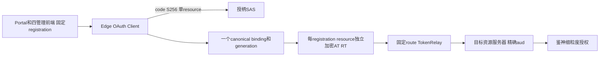
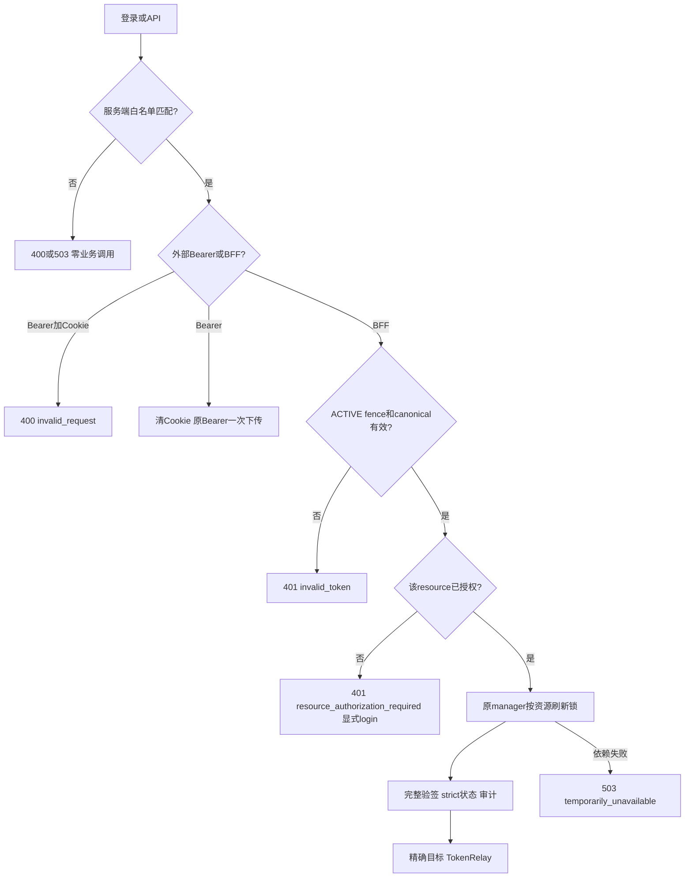
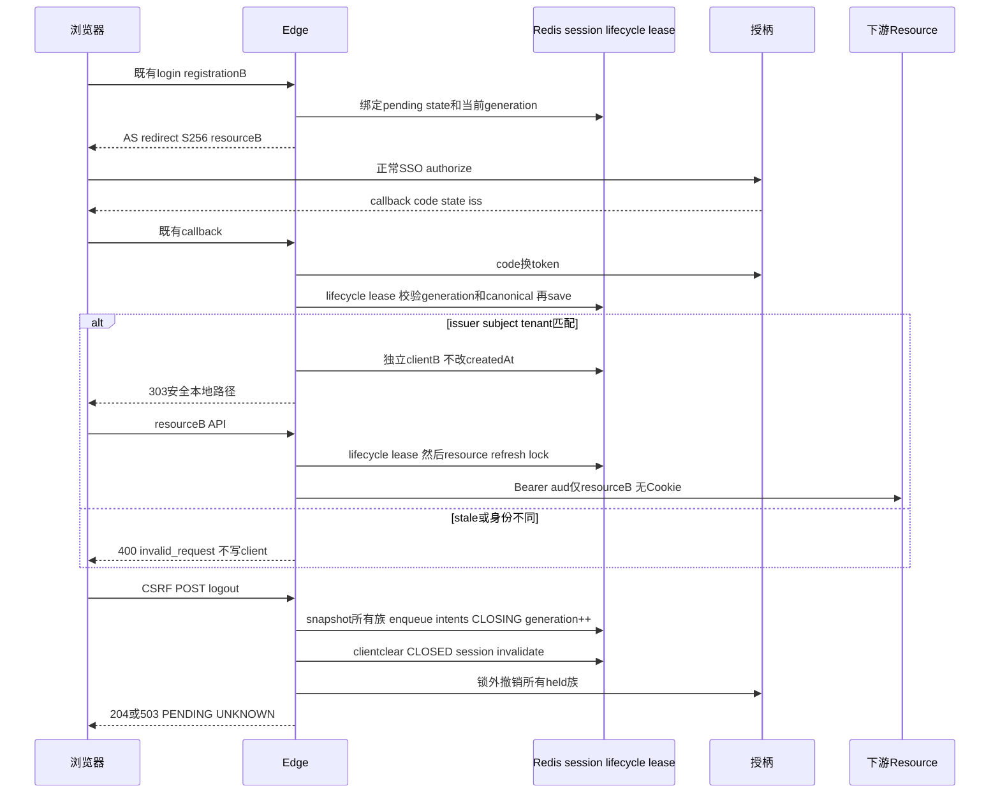

# 星垣完整接入附录：Edge 单身份、多资源认证会话

| Field | Value |
| --- | --- |
| Document | `2026-10-11-10-26-xingyuan-native-full-integration-edge.md` |
| Template Version | `7` |
| Status | `Accepted` |
| Type | `Architecture / Bugfix / Integration` |
| Complexity | `Complex` |
| Complexity Drivers | 同会话多个授权码事务、精确资源令牌、跨节点状态/刷新/退出竞态、Servlet与Reactor消费方、旧会话兼容 |
| Created | `2026-10-11 10:26 Asia/Shanghai` |
| Updated | `2026-10-16 11:52 Asia/Shanghai` |
| Owner | mario |
| Repository | Egon-COLA |
| Scope | 主Spec的Edge、五管理前端与公共SDK消费装配；本附录不扩大native业务模型 |
| Change Surface | Edge resource白名单、canonical身份、加密authorized-client/fence、固定TokenRelay、既有五端点安全delta、宿主接入定位 |
| Affected Chapters | §7, §8, §9, §10, §11, §12, §13, §14, §15, §16, §17, §18 |
| Source Requirement | 用户已明确批准“按资源独立token+同一BFF会话”，所有held token退出/切租户；无Docker，设计阶段不运行服务 |
| Baseline Revision | `main @ b074c6673`；主Spec与并行附录为本轮未提交设计文档 |
| Amends | [OAuth/OIDC基础设计](2026-09-22-17-14-tianquan-multitenant-oauth-oidc-design.md) §7.3.1第一方多aud替代选项、API-013–017及BFF会话隔离；仅本附录定义的接入范围 |
| Supersedes | None |
| Depends On | [主Spec](2026-10-11-10-26-xingyuan-native-full-integration.md) §4、§5、§7、§9的REQ-001–012与DEC-001–006；[自身加固](2026-10-10-12-36-tianquan-security-self-hardening.md) §7–§10的strict审计/proof；[OAuth代码修订](2026-10-08-10-18-oauth-current-code-alignment.md) §7–§10已批准部分 |
| Related Specs | [主Spec原生接口设计](2026-10-11-10-26-xingyuan-native-full-integration.md#9-interface-definitions)；[隔离运行附录](2026-10-11-10-26-xingyuan-native-full-integration-runtime.md) |
| Related Plans | None |

## 1. Summary

采用用户批准的按服务端资源白名单分离授权码注册、access token和refresh token，同时保留一个可信的BFF身份/租户。每个资源令牌的`aud`必须是其配置资源的精确单元素集合；不能扩大SAS audience，也不能从浏览器传入resource/issuer/scope决定权限。

复用Spring OAuth2 Client、现有加密多client仓库、分布式刷新锁、TokenRelay和已发布共享包0.2.5。五个既有BFF端点的路径、查询字段和公共Result形状保持；不增加resource预取、token-exchange或代理取token HTTP接口。每个资源第一次授权由现有显式login动作发起，API缺授权返回401、不302、不无限跳转。此文为设计，未实施或验证运行态。

## 2. Background and Current State

### 2.1 Repository evidence

以下缩写均为精确路径展开规则，§8列实际文件：`E=egon-cola-xingyuan/egon-cola-yuheng/yuheng-edge-gateway`；`EJ=E/src/main/java/top/egon/cola/component/yuheng/edge`；`ET=E/src/test/java/top/egon/cola/component/yuheng/edge`；`S=egon-cola-xingyuan/egon-cola-tianquan-shoubing`；`SJ=S/egon-cola-tianquan-shoubing-starter/src/main/java/top/egon/cola/platform/tianquan/shoubing/starter`。

| Evidence ID | Classification | Exact path/symbol/decision/command | Observed fact | Design significance | Verification limit/freshness |
| --- | --- | --- | --- | --- | --- |
| EVD-201 | Static repository | `EJ/config/EdgeSecurityConfiguration.java#authorizationRequestResolver` | 每个registration统一使用`IdpStarterProperties.resourceUri`，withPkce已有 | 改为registration白名单派生单resource | 2026-10-11源码，非SSO证据 |
| EVD-202 | Static repository | `EJ/service/impl/EdgeAuthorizedClientRepository.java#attributeKey/loadAll` | 加密RMapCache可存多个client，key包含issuer/tenant/client/registration/sub，但无resource | 扩展现有partition与校验，不另建token缓存 | 源码，非真实Redis持久性证据 |
| EVD-203 | Static repository | `EJ/config/EdgeSecurityConfiguration.java` success handler | 每次回调重写CREATED_AT与REGISTRATION属性；bare TokenRelay使用最后登录注册 | 固定canonical与首次生命周期，按route指定注册 | 源码 |
| EVD-204 | Resolved dependency | 本地Security6.5.11 `OAuth2LoginAuthenticationWebFilter` javap | repository.saveAuthorizedClient在AuthenticationWebFilter.onAuthenticationSuccess之前 | 必须在保存前校验身份，successhandler不能单独防串号 | 本地JAR字节码，未运行OAuthflow |
| EVD-205 | Resolved dependency | 本地SCG4.3.5 `TokenRelayGatewayFilterFactory` javap | NameConfig可显式选registration，空值才用OAuth2AuthenticationToken.registrationId | 复用`TokenRelay=<id>`，不自造token relay框架 | 本地JAR字节码 |
| EVD-206 | Static/JAR | `EdgeSessionController#session`；Security的WebSessionOAuth2ServerAuthorizationRequestRepository | session只验证已持有AT，不refresh；原生仓库只有一个pendingrequest属性 | 保持只读，单个pending事务有界替换 | 源码与类字段 |
| EVD-207 | Static repository | `EdgeLogoutService#persistInvalidateAndRevoke` | loadAll、加密durable intents、localclear、remote revoke/ACK及三态已有 | 扩展全部资源生命周期，保留remoteState | 源码，尚未证明轮换RT族撤销 |
| EVD-208 | Static repository | `egon-cola-xingyuan/egon-cola-xingyuan-admin-web-shared/src/auth/gatewayAuthClient.ts` | 0.2.5 API已有registrationId、无参login/stepUp、logout.remoteState | 各宿主固定options；不再发布包 | 源码；真实制品由实施门禁核验 |
| EVD-209 | User decision | 2026-10-11主任务明确批准DEC-004 | 每资源独立token、同一BFF会话；退出/切租户处理全部held token | 不再把该选择列为未决 | 获准方向不等同已批准全文/已实现 |
| EVD-210 | Static repository | `SJ/security/IdpSecurityObservationFilter.java#doFilterInternal` | 原finally无条件删除四callback/done attrs，即使asyncStarted | GraphQLworker/mapper无法共享请求交付状态 | 当前源码真实缺口，未运行liveasync |
| EVD-211 | Static repository | 鉴神Starter `Rbac3ObservedAuthorizationService#deniedHandoff` | 每次拒绝先直接authorizationDenied，再标Boolean；无并发singlehandoff | 并发aliases/字段拒绝与mapper可重复append | 当前源码，新增一次状态BO必要 |
| EVD-212 | User decision | 主任务DEC-006答复 | scopeAND发布兼容项已批准 | Review/PASS设计门禁可闭合 | 不代替实现/真实门禁 |

### 2.2 Current chain and gap

浏览器→单resource resolver→SAS真实code/S256→多client仓库→最后registration的bare TokenRelay→玉衡/资源服务器。资源服务器正确校验自己的aud，却收到另一资源令牌，四平台无法以一个最后登录token正常打通。repository原key尚不能隔离相同registration映射变更；successhandler太晚且延长绝对会话时间；回调、刷新与退出缺统一session fence。

### 2.4 Evidence and current-chain map

| Entry/trigger | Current call chain | Data read/written | External dependency | Consumers | Evidence |
| --- | --- | --- | --- | --- | --- |
| browserlogin | fixedregistration resolver→nativeAScode→repository save→successhandler | pendingOAuthrequest、encryptedclient/session | AS/JWK/Redis | 五前端 | EVD-201–204 |
| APIrelay | session/Bearer清洗→bareTokenRelay→targetJWT | heldclient/refreshlock | ASrefresh/strictRedis/目标 | 管理API/MCP | EVD-205 |
| sessionview | 最后registration→heldATfullcheck→strictrevocation | client/session | JWKS/Redis | Portal/userInfo | EVD-206 |
| logout | loadAll→encrypteddurableintents→localclear→remote/ACK | client/Stream/session | AS/Redis | Portal/children | EVD-207 |

## 3. Goals and Non-goals

### 3.1 Goals

用户已批准一个可信BFF身份/tenant访问其有权多个独立resource；精确aud、scope与PDP均生效；退出/切租户真实覆盖全部族。保持既有端点及真实0.2.5，不用aud宽化掩盖接入缺口。

### 3.2 Non-goals

不写生产代码/Plan、不新endpoint/query、tokenexchange、共享包发布、业务表/层/SQL；不启动服务、写库、部署或Docker。

### 3.3 Change Surface and Design Depth

| Area/layer | Disposition | Exact repository evidence | Changed or preserved behavior/contract | Required Spec treatment | Chapter(s) |
| --- | --- | --- | --- | --- | --- |
| Edge登录/仓库/刷新/退出/路由 | Affected | EVD-201–207 | 单canonical、多精确resource、fence、全部撤销 | 完整协议/状态/模型/并发 | §7,§8,§9,§10,§11,§13,§14,§15,§16,§17,§18 |
| 五前端认证options | Affected | EVD-208；现有AuthContext/portalAuth | 固定registrationId、401后显式login、旧权限清理 | 页面状态/接口映射 | §8,§12 |
| SDK/宿主观测接入 | Affected | 主Spec§7.3.1–3 | 既有完整verification/proof用于实际receiver | 精确路径/Bean定位，契约引用主Spec | §8,§10,§14 |
| SAS授权/同意/JWK/资源grant数据模型 | Unchanged | `SasAuthorizationConverter.requestedAudiences`将resource投影为单元素List | PKCE、一次code、精确redirect/issuer/resource保留 | 配置/provision与真实回归 | §14,§16 |
| 业务SQL/关系schema、原生业务层 | Unchanged | 主Spec§11及native附录 | MP与业务事务不重构；无新表/DDL | 停止边界证据 | §11 |
| 新HTTP/GraphQL endpoint | Not applicable | 0.2.5 options及EVD-205足够 | 不新接口/query，不增加共享包发布 | 五原子协议完整说明 | §9 |

不新增认证框架、token缓存、RPC transport、关系表、Outbox业务状态机、全局ThreadLocal；不自动取得全部用户资源、默认超管或把一次step-up当所有token的强认证。不启动进程、写库或发布制品。

## 4. Requirements and Acceptance Criteria

沿主SpecREQ，不另造冲突编号。

### 4.1 Scenario matrix

| Scenario | Inputs/context | Expected outcome | State/consistency | Tests |
| --- | --- | --- | --- | --- |
| 单identity多resource | 两alias、同issuer/tenant/sub | 独立singleton aud各自成功 | originalCreatedAt不变 | TEST-202/205 |
| 同session异账号/tenant | nativecallback有效但canonical不同 | 拒绝保存，不替换原身份 | canonicalCAS保持 | TEST-203/211 |
| 资源不存在或scope不足 | session存在、目标token缺/受限 | 缺token401、scope/PDP403，业务0 | 无fallback另resource | TEST-205/207/217 |
| refresh与logout重叠 | 同binding、不同lease/owner | 最新held族被snapshot或晚族被撤销 | terminalgeneration禁止复活 | TEST-209/211/213 |
| 旧schema及依赖失败 | oldnamespace/Redis或audit失效 | 401或503，非假成功 | 无旧state导入 | TEST-206/212 |


| ID | Source wording / Requirement | Priority | Observable acceptance criteria |
| --- | --- | --- | --- |
| REQ-002 | 重用完整验签、strict审计与proof | Must | 每receiver完整local验证一次；审计失败503；不暴露原token；指标有界 |
| REQ-004 | 可信租户全链路 | Must | canonical issuer/tenant/sub一致；跨tenant回调不写client；finally/cancel无上下文遗留 |
| REQ-005 | 每资源token同一BFF身份 | Must | 每AT aud精确singleton；route只选自己的registration；另一资源token401；并发不改createdAt |
| REQ-008 | 正确制品与依赖 | Must | 各宿主真实0.2.5 options生效；仅获准optional micrometer-core，已有MapStruct处理器复用 |
| REQ-010 | 真实隔离联调 | Must | Portal与四平台nativeSSO、两tenant、scope/撤销/step-up/全部logout通过；不Docker |
| REQ-012 | 可核实最终结论 | Must | 文档、源码、受控与真实证据分列；未运行验收不得PASS为完成 |

### 4.2 Use-case analysis

`ACTOR-201` 为使用现Portal/四管理Web的用户；`ACTOR-202` 为正常第三方Bearer调用者；`ACTOR-203` 为获准隔离验收执行者。权限来自完整JWT/PDP，不从WujieProps或浏览器header自证。

| ID | Use case/goal | Actor | Trigger/preconditions | Main outcome | Alternatives/failures | Postconditions | Requirements | Interfaces/pages | Tests |
| --- | --- | --- | --- | --- | --- | --- | --- | --- | --- |
| UC-201 | 登录第一个平台 | 平台用户 | 固定registration、真实client/grant/realm准备 | code/S256设定canonical并保存目标client | 缺grant/nonce错误/依赖故障拒绝 | token仅服务端，首次createdAt固定 | REQ-002,004,005 | API-013/014，现有LoginPage | TEST-201–204 |
| UC-202 | 同身份打开第二个平台 | 同一用户 | canonical ACTIVE、该平台bootstrap401 | 显式login经AS已有SSO授权目标resource | 登录成另一身份/tenant拒绝，无自动循环 | 不替换身份，两个token分离 | REQ-004,005 | API-013/014，四AuthContext | TEST-202/205 |
| UC-203 | 查看会话/访问资源 | 已认证用户或第三方 | 已存精确resource AT或外部Bearer | session只读验证/固定route relay | 缺resource401、PDP403、Unavailable503 | 不把API请求302，不发送Cookie下游 | REQ-002,005 | API-015，既有业务routes | TEST-206/207 |
| UC-204 | 强认证/刷新 | 同一用户 | 固定app registration/持有RT | 真实step-up或分区singleflight刷新 | 超时、RT消费未知不盲重试 | 不抬升别的token，不延长绝对期限 | REQ-004,005 | API-013/014、现有TokenRelay | TEST-208/209 |
| UC-205 | 退出及新tenant登录 | 用户 | 自己BFF会话+CSRF | 全部token族intent、localclear、确认三态；新session登录 | 旧callback/refresh不可复活；PENDING可恢复 | 旧权限/缓存清理，新canonical重新建立 | REQ-004,005,010 | API-016/017，Portal/children | TEST-210–214 |

## 5. Constraints, Assumptions, and Decisions

| ID | Decision | Owner | Evidence and rationale | Requirements |
| --- | --- | --- | --- | --- |
| DEC-004 | 每资源独立授权码注册/AT/RT，同一canonical BFF会话 | 用户 | EVD-209；保持SAS精确单resource与下游aud guard | REQ-005 |
| DEC-003 | SDK仅optional Micrometer core1.15.12，readiness为JDK BooleanSupplier | 用户 | 主Spec已批准；不新增Actuator API依赖 | REQ-002,008 |
| DEC-006 | 全USER scope ∧原细权限、signed requiredOAuthScopes、missing拒绝和旧定义显式补发布 | 用户 | 主任务已收到明确批准；保留原fine/allowedSubjects/installation、不SQL/框架/autoExpand | REQ-001,003,005,007 |
| ASM-201 | 一个tenant的每resource使用独立confidential clientId及相同受信issuer/provider，分别code/RT族 | 设计推导 | Shoubing21/Jianshen52/Yuheng17/Tianshu6加OIDC3的总集合99>64，不能合并到一个allowedScopes≤64的client；各自24/55/20/9可满足当前约束。当前统一USER sub必须通过native多client真实测试证同一subject；若pairwise不同则拒绝合并，不降低canonical比较 | REQ-003,005 |
| ASM-202 | 保留一个pending OAuth事务，新显式发起替换旧pending，旧callback400 | 设计推导 | EVD-206原生request repo；无需无界并发state map | REQ-004,005 |
| DEC-008 | 服务端按逻辑resource alias与可信canonical issuer唯一解析真实registration；NEW默认部署issuer，显式tenant切换先全logout | 待整文审批 | DEC004多租户意图的具体缺失合同；当前固定realreg使tenantB同route/跨平台append不可用。无新端点/query/0.2.5/依赖/sourcefile | Resolved：用户于2026-10-11 15:17 Asia/Shanghai明确回复confirmed，批准本行具体修订与整份Spec/Plan |

切租户不合并旧session：先API-017对全部held授权族作durable撤销及localclear，再新session选择部署白名单中的tenant registration，AS验证会员。不能只换header、前端tenant或client key。PENDING/UNKNOWN提示与localclear事实继续准确。

## 6. Project Technology Context

Java21、Boot3.5.16、Security6.5.11、SAS1.5.8、SCG4.3.5来自当前POM/JAR；不升级。Edge是既有独立技术模块`config/filter/controller/service/service.impl`，采用传统技术分包，保持和玉衡业务引擎分进程；本附录不引入COLA业务层。

现SDK的MapStruct/Common BaseForwardConverter继续负责VerifiedJwtBO→proof及现跨层模型转换；Edge本owner技术状态初建直接形成状态，非DTO/PO跨层投影，不为初始化字段新增Mapper或处理器/POM改动。receiver配置沿主Spec扩展`OAuthUsageObservationProperties.receiver`，key为`egon.cola.platform.tianquan.shoubing.usage-observation.receiver`，不另放`IdpStarterProperties`。

### 6.2 User-mandated Java rule compliance

```text
1 类名规范，必须以 java的pojo规范命名。以dao po bo vo dto query command event等结尾
2 每层之间必须被 springboot-validation 校验，复用对象使用分组校验；基于原生和自定义约束注解、@Valid、@Validated 及 ConstraintValidator 扩展实现。ValidationUtils 只承担通用手工校验，不承载全部业务校验；电话号码复用 libphonenumber。
3 Java POJO 默认使用 class，注解为 @Data @NoArgsConstructor @AllArgsConstructor @Accessors(chain = true)，按构造目标选择 @Builder 或 @SuperBuilder；父类状态参与相等性时使用 @EqualsAndHashCode(callSuper = true)。只有不可变 value object 可以使用 record，并豁免 class 的 Lombok 规范；普通实体不能因简单而使用 record。使用 MapStruct、MapStructPlus 和 egon-cola-component-common-core 的 BaseConverter（双向）或 BaseForwardConverter（不可逆投影）进行转换。
4业务类必须使用@Slf4j注解注入log对象。如果业务类被spring管理，必须指定名称，如果是单例的情况下，参考@Service("userService")。如果需要依赖注入，必须@RequiredArgsConstructor进行修饰，不要代码中写。且属性必须被@qualify修饰。
5 工具类只允许使用jdk原生、Apache Commons(commons-lang3、commons-collections4、commons-io、commons-text、commons-codec、commons-beanutils)、Guava。针对Tika按需引入。
6 JSON 使用 Spring Boot Jackson；持久化枚举值使用 @EnumValue，向前端输出的枚举值使用 @JsonValue，禁止 ordinal 作为业务编码。
7 springboot 多环境配置文件，必须保持配置一致，但值不一定一致。
9 复杂业务必须引入设计模式，不允许硬编码
10 日期相关的必须使用java.time下的实体类，不允许使用java.util下的
11 只允许现有三层结构或当前 egon-cola-archetypes 的 DDD 结构，三层结构保持现状。必须尽量复用 egon-cola-components；持久化模块必须使用 Egon COLA MP Starter，DDL 统一由 egon-mp-sdj-ext-starter 分布式管理。业务唯一键必须组合业务列与 deletedAt（数据库 deleted_at），并验证 NULL、租户及重复软删除语义。采用 CQE（Command Query Event）；Event 必须经 egon-cola-component-transactional-outbox-starter 或 MQ 中间件投递。
```

| Literal rule | Affected? | Repository evidence | Exact design decision | Files/types/interfaces | Validation/test evidence | Status/blocker |
| --- | --- | --- | --- | --- | --- | --- |
| Rule 1 | Yes | 现BO/技术类 | BO/Enum/Component/Factory明确suffix | §8/§10 | inventory/compile | PASS |
| Rule 2 | Yes | nativeValidator+typedproperties | 每边界Valid及解密校验，非手工规则替约束 | §9/§10 | TEST-201/211 | PASS |
| Rule 3 | Yes | 现record/MapStruct/BaseForwardConverter | 普通stateclass标准Lombok；同ownerstate初始化非新Mapper；现跨层converterKeep | §10 | construction/mapping | PASS |
| Rule 4 | Yes | E/lombok.config | Slf4j、RequiredArgsConstructor、finalQualifier、具名Beans | §8.4 | wiring/no secretlog | PASS |
| Rule 5 | Yes | JDK/既有cipher | 不新Utils/工具dependency | §7/§15 | imports | PASS |
| Rule 6 | Yes | BootJackson/现Result | JSON形状不另wrap；internalproof忽略 | §9/§10 | OAS/serialization | PASS |
| Rule 7 | Yes | E base/local | 全新增key同结构 | §8.3 | Binder/YAMLparity | PASS |
| Rule 9 | Yes | 原Decorator/SCGFactory | variation与State锁有实际用途，无大stringif | §13 | race/selector | PASS |
| Rule 10 | Yes | Clock/Instant/Duration | 原始绝对期限不重置 | §7.3/§10 | fakeClock | PASS |
| Rule 11 | Yes | 既有Edge技术传统分包 | 不新模块/层/表；只配置访问现业务owner | §3/§6/§11 | architecture/diff | PASS |

## 7. Architecture Design

### 7.0 Minimum-design baseline and element-necessity audit

| Proposed element | Change | Requirements | Existing/direct alternative | Concrete inadequacy of alternative | Added costs and failure modes | Verdict |
| --- | --- | --- | --- | --- | --- | --- |
| registration-resource配置 | Expand EdgeOAuthProperties | REQ-005 | 一个resource+bare relay | 错aud无法打通 | 有界map/profile/provision；未知binding拒绝 | Add |
| EdgeSessionBindingComponent | New，单一技术生命周期owner | REQ-004/005 | WebSession属性+各token锁 | 跨节点firstlogin/logout/late-write没有线性化点 | 一把session lease+加密binding/fence、TTL恢复 | Add |
| EdgeResourceAuthorizationGatewayFilterFactory | New，SCG路由admission extension | REQ-002/005 | 只有TrustedIdentityHeaderFilter | 其只知session存在，不知选中route/resourceclient | 每route本地映射/一次已有client读取；无额外AS calls | Add |
| 新resource HTTP/查询 | Remove | REQ-005/008 | 0.2.5固定registrationId与已有login | 无独立消费者价值 | 避免一RTT及兼容面 | Remove |

| Path | Network calls | Client states | Server state | Error/coupling |
| --- | --- | --- | --- | --- |
| 新resource预取+自制tokenAPI（Reject） | 额外preflight+tokenrelayAPI+ASflow | 查询/校验/重试三层 | 新API及重复scope/issuerDTO | 无独立结果且TOCTOU |
| 已选fixedregistration+nativecode | 初次每resource原OAuthflow，sessionGET零AS | 现loading/login/authorized/unavailable | 原clientmap+必要canonicalfence | 无新HTTP；分区与strict状态 |

### 7.1 System Architecture Design



### 7.2 High-Level Design

#### 7.2.1 Critical control flow





#### 7.2.2 High-level decision and quality matrix

| Concern/use case | Evidence/constraint | Decision | Failure/cost | Verification |
| --- | --- | --- | --- | --- |
| 身份/tenant | save先于successhandler | save前canonical原子compare | 不同账号回调400、不得混族 | TEST-202/203/211 |
| 精确resource | 原bareTokenRelay错误aud | servermap与explicitregistration | 各资源首次codeflow | TEST-205/216 |
| 有界性能 | 现maxclient/单pending | map≤64、候选排序、zeroASsession | 本地crypto/strictstate次数可测 | TEST-206 |
| 一致性 | refresh/logout多节点 | lifecycle→resourcelease+CAsfence | contention503，network有界 | TEST-209/211 |
| 可恢复退出 | 原Stream三态 | 所有族durableintent/localclose | remote不可原子，全确认才204 | TEST-213 |

### 7.3 Detailed Design: canonical、状态、锁及刷新

#### 7.3.1 Canonical identity and bounded storage

1. `EdgeSessionBindingComponent`拥有binding/fence与shared lifecycle lease。binding状态`NEW→ACTIVE→CLOSING→CLOSED`；绝对超时等同terminal关闭，禁止CLOSED→ACTIVE。新登录另建binding。canonical首次成功AT完整验证后由`NEW`原子设定，其他回调严格比较issuer、tenant、sub，不能用displayName/sessionId相等替代。
2. 存储使用新命名空间`egon:bff:binding:v2:{bindingId}`（一个加密binding对象）和`egon:bff:authorized-client:v2:{bindingId}`（原加密RMapCache）。hash字段为length-prefixed UTF-8的resourceAlias、resolvedRealRegistrationId、issuer、tenant、clientId、resourceUri、sub；AAD含bindingId/resourceAlias/resolvedRealRegistrationId/issuer/field/schemaVersion。Map最大条数保持现有maxAuthorizedClients；逻辑alias及真实registration引用总数各最多64。WebSession只携opaque bindingId/expectedGeneration，不能替代Redis canonical权威；lookup不得把alias作为native client缓存key。
3. 初始bindingId在原生OAuthrequest创建时建立并记录，不能等callback才随机创建而失去跨节点一致性。跨节点对同一preauth WebSession的get-or-create使用Redis原子唯一映射`egon:bff:session-binding:v2:{SHA256(serverSessionId)}`，TTL≤原绝对期限；不信任浏览器自行提供bindingId。sessionId轮换只更新指针，canonical bindingId不变。
4. 原生OAuth request内部attributes保存`bindingId/generation/resourceAlias/resolvedRealRegistrationId/resourceUri/issuer/intent`，无新增外部query。intent为INITIAL或APPEND或STEP_UP；每session最多一个pending request；state由原生resolver随机生成并在request repo一次消费。alias解析先于native request生成，原native callback URI/registrationId始终是真实registration。callback只消费原pending解析tuple，不能在返回时按默认issuer/当前alias重解析；repository.save之前校验path realreg、pending alias/realreg/issuer/resource/generation、provider/code/AT一致。重复/旧/被替换state、错误nonce/iss/code/PKCE/redirect或mapping变化均失败，不清除已成功canonical身份。
#### 7.3.2 Lifecycle lease and fence

5. 锁顺序固定：session lifecycle lease（`egon:bff:lifecycle:v2:{bindingId}`）→resource refresh lock（`egon:bff:oauth-refresh:v2:{digest(bindingId,issuer,tenant,clientId,registrationId,resource,sub)}`）→repository/CAS写。callback保存只需lifecycle；logout只需lifecycle；不得在持resource lock后等待lifecycle。原manager的usingWhen释放全部正常/异常/取消路径；context只Reactor传递，FS/JWK/阻塞操作仍boundedElastic。
6. acquire成功须获得同lease的单调fencingToken与expectedGeneration；每次写使用Redis原子脚本比较epoch、状态、generation、fencingToken，不能用GET后SET模拟CAS。租约到期后旧owner无写权，即便仍持Java引用。generation只在terminal关闭增加；resource追加/refresh不变。closing/tombstone TTL至少覆盖剩余绝对期限和最长pending/token请求，旧请求不能因map不存在就重新create。
#### 7.3.3 Refresh and cancellation

7. refresh在lifecycle→resource锁内调用原manager、保存新client后释放。OAuth network token-timeout有界，wait/lease沿现属性，lease需大于token-timeout与有界Redis写budget；跨节点锁获取失败/依赖超时503，不重试可能已消费RT。请求取消释放锁；若AS提交已发生而结果未知，不继续用原RT盲重试，客户端进入显式重新授权。晚到响应受generation/fence拒绝。
#### 7.3.4 Callback and logout boundary

8. callback OAuth换code可在锁外完成；写之前重新校验request的generation/fence及完整AT。若logout期间已有code换出新token却无法save，按该registration生成已有加密撤销intent并清理，该token不得成为孤立可用held族；durable handoff失败标UNKNOWN并保持terminal，不重建身份。它不伪造授权成功。
9. logout先lifecycle锁下读所有clients/检查族，持久enqueue所有intents后CAS进入CLOSING、generation++，removeAll、invalidate、CLOSED；enqueue失败仍terminal localclear，UNKNOWN。远端撤销与ACK在锁外，避免network阻塞其他已关闭请求。任一已开始refresh受同lifecycle排他序列，snapshot不会漏掉它成功写入的最新族。consumer的ACK只发生在对应remote确认后。
10. Spring Security context/session保存可能晚于repository callback：successhandler和所有后续session/API guard必须比较authoritative ACTIVE generation；不能只凭一个OAuth2AuthenticationToken已authenticated。late旧response不能恢复业务访问；失效cookie安全清除。所有原生cookie/sessionId rotation继续，追加资源/step-up不重置originalCreatedAt/absoluteExpiresAt。repository、controller、manager统一同一个Clock与binding期限，解决WebSession.creationTime与callback时间漂移。
#### 7.3.5 Read-only session query

11. `/bff/session`先核binding ACTIVE、deadline，再按注册ID排序有界扫描已存clients，逐个按server mapping对held AT作完整本地RS256、精确singleton aud、iss/type/time/sub/tenant及strict state；至少一个有效方可返回原Result。可继续扫描INVALID/EXPIRED；任一依赖Unavailable立即503，不能借另一个token隐藏状态故障。每个实际验证仅一次且使用strict usage proof；不refresh、不回AS、不以ID Token直接授权。

#### 7.3.6 Conclusion evidence chain

| Conclusion | Evidence | Constraint | Decision | Consequence | Verification |
| --- | --- | --- | --- | --- | --- |
| 不扩大aud | EVD-201/205，DEC-004 | 每RS精确资源 | fixedregistration资源token | client/codeflow分区 | TEST-205/216 |
| canonical校验前置 | EVD-204 | save之前阻止串号 | repository underlifecycle | 不靠after-success补偿授权 | TEST-203/211 |
| session不能隐藏refresh | EVD-206 | acceptedread-only | 有界validheldcandidate | 全expired401/显式login | TEST-206 |
| 不建新接口/Mapper | EVD-208/§7.1 | smallestreuse | 0.2.5options/ownerstate初始化 | 无额外HTTP/processor | TEST-215/compile |

#### 7.3.7 Standard async observation lifecycle and request-local denyOnce

真实缺口为EVD-210/211，复用同Starter/原filter/PDP观察，不另造GraphQL或平台marker。marker与immutable身份快照分开；native GraphQLContext可保存原ServletRequestAttributes作为服务器框架scope，worker恢复当前请求的合法短作用域，不把completed attrs当活动request。每physicalreceiver自己的request拥有marker，不跨HTTP/RPC hop共享完成结果冒充各接收方审计。

1. 原IdpSecurityObservationFilter在受保护request最早建立一个 `IdpAuthorizationObservationContextBO`，attribute key固定为filter.class.getName()+`.authorizationObservationContext`；AUTH/DENIED callbacks及原compatdone字段与它同生命周期。一个request所有PDP、field、scopePreAuth和renderer共用这个对象，不新ThreadLocal。原public/disabled/preflightskip保持，不造伪usage。
2. `doFilterInternal`每dispatch仍在finally恢复原MDC/TL/SecurityContext短作用域；**请求attrs与marker**区分生命周期。sync结束立即close并按原finallycleanup；如果isAsyncStarted，不删除callbacks/marker而挂标准AsyncListener。原OncePerRequestFilter默认skipasyncdispatch可保持；worker/框架scope显式restore，从同request获得marker，不能再次新建独立marker。
3. Listener为原filter内部私有 `AuthorizationObservationAsyncListener`，不是Spring Bean、不新增源文件。onComplete/onError/onTimeout调用幂等close与删除本filter拥有的attrs；onStartAsync重新把自己附着event.getAsyncContext。`isAsyncStarted`检查与addListener之间完成race可能IllegalStateException，只在重新核实标准async已terminal时同步cleanup；不能把真的运行async当结束。listener注册失败且无法确认terminal时安全FAIL/503，不能丢marker仍允许business。每终止cleanup幂等，绝不清理别的request/provider属性。
4. marker `denyOnce(BooleanSupplier strictHandoff)`采用JDK同对象受控同步：NEW的第一个调用执行**直接strict handoff一次**，true→CONFIRMED，false/exception→FAILED。其他并发调用等待这个同步完成，只读取已确定true/false，不以NEW/in-progress当已成功。CONFIRMED/FAILED不可重新变NEW、不可重append；已closed的未交付调用返回false，不能从attrs缺失或PENDING猜true。getter观察不触发副作用；close不会重试或附加DENY事件。
5. 回调是直接 `observations.authorizationDenied(proof,trace)`→现strict producer，禁止它再调用beforeAuthorizationDenied/denyOnce造成递归。marker额外受控handoffInProgress防同线程重入：reentrant尝试立即固定FAILED并抛安全exception；外层不得把已经FAILED覆写CONFIRMED。交付开始后的RuntimeException/Error通过finally释放guard并固定FAILED，再按原边界保留primary exception或收敛Unavailable，不能假成功。blockinghandoff只在MVC/worker/boundedElastic，不在Reactor eventloop。
6. `Rbac3ObservedAuthorizationService.deniedHandoff`先从当前恢复的RequestContextHolder.ServletRequestAttributes拿同request marker，调用它的denyOnce(directstrictsupplier)；false/FAILED变原RuntimeUnavailable("OAUTH_AUDIT_DELIVERY_UNAVAILABLE", trustedIdentity)。不用“先append后mark”的两步竞态。没有Servletscope的RPC/Reactive receiver通过现gRPC Context或Reactor/ServerWebExchange requestscope承载同一通用BO；每receiver同请求共享，Identity/proof immutable snapshot另传，不能创并行global缓存。RPC不借用别人的HTTPmarker；其listener onComplete/onCancel、reactive terminal/cancel均幂等close，handoff只worker，框架context不得publicJSON。相应现IdpRpcSecurityContext/IdpRpcBearerServerInterceptor与gatewayadapter/Edge filter文件已经在§8列为Affected，不新增parallelmarker。
7. `IdpSecurityObservationFilter.beforeAuthorizationDenied(HttpServletRequest)`读取已装marker并经denyOnce执行直接callback；CONFIRMED只读true、FAILED只读false，NEW不得被renderer作成功。新增typed accessor `authorizationObservationContext(HttpServletRequest)`返回当前BO或null供内部框架接入，不能从publicJSON创建BO。旧 `authorizationDeniedRecorded(HttpServletRequest)`保留签名，只镜像已CONFIRMED状态到compatdone；它不能把NEW/FAILED强改true，也不能被renderer用来跳过真正交付。
8. GraphQL error mapper只渲染**已有**观察结果：PDP/field已CONFIRMED不再调用append；FAILED/active状态关闭后没有confirmed结果按503/对应GraphQL不可用错误族，不产生第二event。scopePreAuth或其他授权DENY都先看同request marker的NEW/CONFIRMED/FAILED：NEW才显式denyOnce directhandoff，CONFIRMED/FAILED只渲染已知结果。PDP已执行且ALLOW并不等于已有DENY交付；后续scope失败若仍NEW必须交付，不能以“PDP从未执行”作唯一once条件。每DataFetcher恢复RequestContextHolder/安全/MDC/frameworkscope再finally恢复，actor/proof仍可信，marker不放SDL/data/clientextensions。没有scope或未装requestmarker的本轮strictprotected调用不能以missingcallback=true当交付成功；应按已有不可用边界failclosed。
9. 原authenticationFailure callback保持单次认证失败语义，不能混用其结果当authorization delivery confirmed。已有false done字段必须保留false；asyncscope生命周期所有done/callback受同request终止cleanup管理。NEW无拒绝地正常complete允许closed+NEW（没有可渲染DENY事实）；lateDENY不能因为“正常结束”变CONFIRMED。

#### 7.3.8 DEC-008: logical resource alias and exact issuer selection

此为待整文审批的必要具体配置合同，不能以CLI mint tenantB令牌替代真实BFF切租户。`EdgeOAuthProperties.resources`改为由五个稳定逻辑入口alias索引；每个既有`EdgeRegistrationResourceBindingBO`增加`defaultRegistrationId`与`issuerRegistrationIds`，不新增生产类型/endpoint/query/包。`EdgeSessionBindingComponent.resolveRegistration(String resourceAlias, URI canonicalIssuer)`返回唯一真实registrationId：canonicalIssuer为null仅可在NEW取该alias的明确default；ACTIVE必须exact匹配该可信issuer的map项，missing/unknown不得回落default。CLOSING/CLOSED沿原terminal拒绝。default必须存在于该alias map的value中。

API-013的现Path registrationId可以是逻辑alias或已配置的真实registrationId。alias语义优先；alias与真实ID同名只在该真实ID恰为同alias.defaultRegistrationId且同resource/issuer tuple时允许兼容，其他碰撞startup拒绝。非alias真实ID由有界inverse-map确定唯一alias：NEW可显式选择其白名单tenant issuer来建立新身份；ACTIVE仅同canonical issuer可APPEND/STEP_UP，显式另一issuer400 invalid_request、零AS请求。切tenantB必须API-017全族退出/localclear后NEW显式真实B registration；随后各前端继续原固定alias，服务器全部解析到B。API-014 path永远是native pending真实registration，绝不把callback path当alias重选。五HTTP路径/query/成功/错误shape与0.2.5保持；不新增tenant/resource/issuer selector输入。

同资源的route/path只归唯一alias，可以为该alias配置多个issuer。所有配置(alias,issuer)唯一且exacttrusted TENANT，真实registration仅归一个alias、各(resource,issuer)独立CONFIDENTIAL clientId（全引用集合不共用clientId），S256/redirect白名单/scope/grant现约束不变。`resourceUri`由alias固定且每AT aud仍精确singleton。ACTIVE可信canonical→唯一realreg的解析在原lifecycle fence下进行，originalCreatedAt/绝对期限不变。

route.metadata.edge-registration-id与`EdgeResourceAuthorization` NameConfig保留名字，但值是固定逻辑alias。factory从authoritative ACTIVE binding解析实际realreg，private exchange attributes同时保存alias/realreg/issuer/resource/generation/fence；TrustedIdentityHeaderFilter必须复用该同一次选择及已验证proof，不能重选default/最后登录reg。BFF guard检查对应actualclient后，用现`TokenRelayGatewayFilterFactory.apply(NameConfig)`显式设置resolved realreg并调用其filter；route不再另配`TokenRelay=<alias>`，不得使用bare TokenRelay。external Bearer分支沿原sanitize/原Bearer，只按固定route resource验证，不触发BFF注册选择。

仓库的native OAuth2AuthorizedClient.registrationId、缓存/刷新key、PKCE callback、refresh/revoke client credentials都用真实ID；encrypted field/AAD同时绑定alias/真实ID/issuer。save/refresh再次验证tuple及canonical/fence，mapping缺失/变化不得读取另一族；session只枚举held actualregs并按原alias map fullverify，仍zeroAS/no-refresh；logout/补偿枚举实际held realreg族，不能按alias默认issuer重造intent。既有17条Step7文件/两测试owner全部复用，没有新生产文件/Bean/helper层。

缺binding/heldtoken仍401 resource_authorization_required；已配置alias下canonical issuer无map项、配置缺失/ambiguous属于503 temporarily_unavailable且零TokenRelay/业务/默认fallback；非法/跨issuer显式login或callback tuple错误400 invalid_request，原revocation/strictaudit503不降403。测试必须在真正native codeflow建立A→全部logout→explicitB→相同route成功、另一平台alias追加仍B、A令牌不能使用、unknownissuer无fallback；真实browser两tenantgate由主任务运行附录闭合，不将fixture计livePASS。

## 8. Package Structure and Code File Tree

### 8.1 Edge精确清单

所有路径按§2精确展开；每新增helper和监听器owner已选定，无条件文件清单。行为类均`@Slf4j`、具名Spring Bean、final qualified依赖、`@RequiredArgsConstructor`，现有技术对象构造兼容接口保留；`E/lombok.config`已存在Qualifier copy约束，继续核验。

| Operation | Exact path | Symbol / bean name | Responsibility | Requirements |
| --- | --- | --- | --- | --- |
| MODIFY | `EJ/config/EdgeOAuthProperties.java` | `edgeOAuthProperties` | resources的嵌套Valid、bounded map/returnpath/lease一致性 | REQ-005 |
| CREATE | `EJ/config/domain/bo/EdgeRegistrationResourceBindingBO.java` | 无独立Spring Bean | 服务端resource/route/scopes/returnPath配置值 | REQ-005 |
| CREATE | `EJ/service/domain/bo/EdgeSessionBindingBO.java` | 无独立Spring Bean | schema/canonical/generation/fence/createdAt/state | REQ-004/005 |
| CREATE | `EJ/service/domain/enums/EdgeSessionBindingStateEnum.java` | NEW/ACTIVE/CLOSING/CLOSED | 稳定字符串状态，非ordinal | REQ-005 |
| CREATE | `EJ/service/impl/EdgeSessionBindingComponent.java` | `edgeSessionBindingComponent` | 唯一canonical/fence/lifecycle/closing存储owner；有界CAS | REQ-004/005 |
| CREATE | `EJ/filter/EdgeResourceAuthorizationGatewayFilterFactory.java` | `edgeResourceAuthorizationGatewayFilterFactory` | fixedalias NameConfig，canonical issuer解析realreg；委托现TokenRelay显式realreg，route/client/generation guard | REQ-005 |
| MODIFY | `EJ/config/EdgeSecurityConfiguration.java` | `edgeSecurityConfiguration`及既有chain/resolver Beans | map派生resource；保存request internalattributes；callback边界；准确OAS | REQ-002/005 |
| MODIFY | `EJ/controller/EdgeSessionController.java` | `edgeSessionController` | 有界read-only multi-client session，Result不变 | REQ-005 |
| MODIFY | `EJ/filter/TrustedIdentityHeaderFilter.java` | `trustedIdentityHeaderFilter` | 保留原Bearer/Cookie清洗；仅可信ACTIVE binding可认为BFF已登录 | REQ-004/005 |
| MODIFY | `EJ/service/impl/EdgeAuthorizedClientRepository.java` | `edgeAuthorizedClientRepository` | 先identity/resource/proof校验再v2写；新字段/AAD/TTL | REQ-002/004/005 |
| MODIFY | `EJ/service/impl/EdgeSingleFlightAuthorizedClientManager.java` | `reactiveOAuth2AuthorizedClientManager` | lifecycle→resource锁、完整验证、fenced rotated save | REQ-002/005 |
| MODIFY | `EJ/service/EdgeLogoutService.java` | `edgeLogoutService` | lock内全部snapshot/intents/fence/localclose，锁外revoke | REQ-005 |
| MODIFY | `EJ/service/impl/EdgeOAuthTokenRevocationClient.java` | `edgeOAuthTokenRevocationClient` | issuer exactpath/registration/client信任；覆盖完整授权族验收 | REQ-005 |
| MODIFY | `E/src/main/resources/application.yml`、`E/src/main/resources/application-local.yml` | §8.3 keys | 同结构resource/route/session namespaces，值按profile | REQ-005/008 |
| MODIFY | `ET/EdgeLoginContractTest.java` | 既有fixture | native登录/错误/OAS保持 | REQ-005/012 |
| CREATE | `ET/EdgeResourceAuthorizationContractTest.java` | 有界多资源fixture | full RSA/state/aud/refresh/close竞态、严格拒绝 | REQ-004/005 |

新helper必要性已由§7.1逐项证明。EdgeTokenCipher、EdgeSessionRedisSerializer、EdgeLogoutRevocationIntent与worker现public数据契约Keep：新对象继续通过同加密组件，intent已有registration可定位族，不为resource增加另一secret字段。任务相关旧session迁移边界见§16，不新增生产migration worker/HTTP。

### 8.2 公共SDK/各宿主精确装配定位表

此表闭合主Spec§8的实际定位与Bean，公共内部契约以主Spec§7.3.1–3为权威；不另外复制RPC授权协议。

| Operation | Exact repository path | Component/bean names | Intended delta / preserved boundary |
| --- | --- | --- | --- |
| MODIFY | `S/egon-cola-tianquan-shoubing-starter/pom.xml` | 无Bean | 用户已批准optional micrometer-core1.15.12；不加Actuator |
| MODIFY | `SJ/audit/OAuthUsageObservationProperties.java` | `oauthUsageObservationProperties` | 新receiver enum配置；fallbackIssuer/allowLocalPlaintext兼容 |
| CREATE | `SJ/observability/IdpSecurityObservationReceiverEnum.java` | 无Bean | 固定receiver集合含SHOUBING/JIANSHEN/TIANSHU/YUHENG_ADMIN/BIZ/MCP/LLM/EDGE/APPLICATION |
| CREATE | `SJ/observability/IdpSecurityMetricsComponent.java` | `idpSecurityMetricsRecorder` | 实现既有Core port与九个固定signal，无动态身份tag |
| CREATE | `SJ/observability/IdpSecurityObservationReadinessComponent.java` | `idpSecurityObservationReadinessComponent` | 现两host的spool lease/HMAC/DEAD/容量逻辑共用；JDK BooleanSupplier |
| CREATE | `SJ/autoconfigure/IdpSecurityObservationAutoConfiguration.java` | `idpMeterRegistrySupplier`、`idpSecurityMetricsRecorder`、`idpAuditSpoolLease`、`idpSecurityAuditReady` | independent opt-in；unique/Primary host registry；不建新MeterRegistry/Redis |
| MODIFY | `S/egon-cola-tianquan-shoubing-starter/src/main/resources/META-INF/spring/org.springframework.boot.autoconfigure.AutoConfiguration.imports` | IdpSecurityObservationAutoConfiguration登记 | 新autoconfiguration必须被发现；保留原imports |
| MODIFY | `SJ/autoconfigure/IdpStarterAutoConfiguration.java` | `idpObservedVerificationComponent`、`idpSecurityObservationFilter`、`idpJwtVerifier`、`tenantIssuerAuthenticationManagerComponent`、两RPC interceptor Beans | real observer+proof接所有factory；Servlet装配受栈限制；producer换`idpAuditRedissonClient`明确alias |
| MODIFY | `SJ/security/IdpObservedVerificationComponent.java` | `idpObservedVerificationComponent` | explicit trace与fullyvalidated completion overload；旧observe/DENY签名不变 |
| CREATE | `SJ/security/domain/IdpAuthorizationObservationContextBO.java` | 非Spring Bean，request-owned mutableBO；nested DeliveryStateEnum | shared active/closed、NEW/CONFIRMED/FAILED、guardeddenyOnce/close，无publicJSON、新TL |
| MODIFY | `SJ/security/IdpSecurityObservationFilter.java` | `idpSecurityObservationFilter`；private standard AsyncListener、typedaccessor | asyncStarted保留callbacks，complete/error/timeout关闭；onStartAsync重新附着；syncfinally不变 |
| MODIFY | `egon-cola-xingyuan/egon-cola-tianquan-jianshen/egon-cola-tianquan-jianshen-starter/src/main/java/top/egon/cola/platform/tianquan/jianshen/starter/authorization/Rbac3ObservedAuthorizationService.java` | `authorizationService`现Decorator | sharedmarker一次directappend；failed503；不先append再mark |
| MODIFY | `S/egon-cola-tianquan-shoubing-starter/src/test/java/top/egon/cola/platform/tianquan/shoubing/starter/security/IdpSecurityObservationFilterTest.java` | 现observer/filterfixture | sync/async/finishrace/MDCrestore、onceproof、false状态不假确认 |
| CREATE | `S/egon-cola-tianquan-shoubing-starter/src/test/java/top/egon/cola/platform/tianquan/shoubing/starter/security/domain/IdpAuthorizationObservationContextBOTest.java` | marker直接并发fixture | 两calleronehandoff、true/false/exception、close/重入/no publicJSON |
| CREATE | `egon-cola-xingyuan/egon-cola-tianquan-jianshen/egon-cola-tianquan-jianshen-starter/src/test/java/top/egon/cola/platform/tianquan/jianshen/starter/authorization/Rbac3ObservedAuthorizationServiceTest.java` | 现真实PDP与共享requestscope组合 | concurrentDENY+mapper不重复、FAILED503、scope前置handoff、上下文恢复 |

| MODIFY | `SJ/security/IdpJwtVerifier.java` | `idpJwtVerifier` | 单验证、capture proof，无第二decode；旧constructors保留 |
| MODIFY | `SJ/audit/TokenUsageAuditComponent.java` | `tokenUsageAuditComponent` | 接通固定recorder/实际host Redis；strict spool/receipt原契约保持 |
| MODIFY | `SJ/security/rpc/IdpRpcClientCredentialInterceptorFactory.java` | `idpRpcClientCredentialInterceptorFactory` | 本地consumer binding、CallCredentials；旧USER relay保持 |
| MODIFY | `SJ/security/rpc/IdpRpcBearerServerInterceptor.java` | `idpRpcBearerServerInterceptor` | opt-in required provider，verifyAny一次，scope/method拒绝 |
| MODIFY | `SJ/security/rpc/IdpRpcSecurityContext.java` | 技术Context非Bean | IdpPrincipal/proof listener scope；raw relay继续USER-only |
| MODIFY | `SJ/autoconfigure/IdpStarterProperties.java` | `idpStarterProperties` | 嵌套RpcProperties/RpcConsumerProperties/RpcProviderProperties/RpcConsumerBindingProperties/RpcProviderMethodProperties；§8.4 exactkeys；receiver不放此对象 |
| MODIFY | `S/egon-cola-tianquan-shoubing-gateway-adapter/src/main/java/top/egon/cola/platform/tianquan/shoubing/yuheng/security/IdpGatewayJwtVerifier.java` | `idpGatewayJwtVerifier` | route资源fullverify使用新observeroverload、Verification带proof |
| MODIFY | `S/egon-cola-tianquan-shoubing-gateway-adapter/src/main/java/top/egon/cola/platform/tianquan/shoubing/yuheng/security/IdpIdentityAuthenticationProvider.java` | `idpIdentityAuthenticationProvider` | bounded worker一次验证、proof技术上下文；匿名安全错误 |
| MODIFY | `S/egon-cola-tianquan-shoubing-gateway-adapter/src/main/java/top/egon/cola/platform/tianquan/shoubing/yuheng/autoconfigure/IdpGatewayAdapterAutoConfiguration.java` | 既有adapter Beans | qualified observer/recorder注入，不重造client |
| MODIFY | `S/egon-cola-tianquan-shoubing-admin/src/main/java/top/egon/cola/platform/tianquan/shoubing/admin/support/security/TianquanSecurityObservationConfiguration.java` | 既有startup/HealthIndicator Beans | 委托generic recorder/readiness、保留own传输门禁，健康不新API |
| MODIFY | `egon-cola-xingyuan/egon-cola-tianquan-jianshen/egon-cola-tianquan-jianshen-admin/src/main/java/top/egon/cola/platform/tianquan/jianshen/admin/config/security/TianquanSecurityObservationConfiguration.java` | 既有startup/HealthIndicator Beans | 同上，receiver JIANSHEN |
| MODIFY | `egon-cola-xingyuan/egon-cola-tianshu/egon-cola-tianshu-admin/src/main/java/top/egon/cola/component/tianshu/admin/security/management/DdcAdminSecurityConfiguration.java` | `ddcAdminSecurityFilterChain`及existingpolicy/filters | 安装SDKobservation，与原Idp→RBAC→可信tenant链组合 |
| MODIFY | `egon-cola-xingyuan/egon-cola-tianshu/egon-cola-tianshu-admin/src/main/java/top/egon/cola/component/tianshu/admin/security/management/DdcAdminAuthenticationEntryPoint.java` | `ddcAdminAuthenticationEntryPoint` | 401/403/tenant mismatch先strict audit；no-store/401Bearer头 |
| MODIFY | `egon-cola-xingyuan/egon-cola-tianshu/egon-cola-tianshu-admin/src/main/java/top/egon/cola/component/tianshu/admin/security/registration/IdpJwtDdcRegistrationCredentialVerifier.java` | 现registration verifier Bean | Unavailable显式映射；PLATFORM_SERVICE/registration scope保留 |
| MODIFY | `egon-cola-xingyuan/egon-cola-tianshu/egon-cola-tianshu-starter/src/main/java/top/egon/cola/component/tianshu/error/DdcErrorStatus.java` | existing runtime error enum | 56028 RESOURCE_ADMISSION_UNAVAILABLE；原56024–56027不变 |
| MODIFY | `egon-cola-xingyuan/egon-cola-tianshu/egon-cola-tianshu-admin/src/main/java/top/egon/cola/component/tianshu/admin/config/DdcGlobalExceptionHandler.java` | existing RestControllerAdvice | new handleCommon(CommonException,HttpServletResponse) overload exact503；保留oldJava单参/原ResultRecord |
| MODIFY | `egon-cola-xingyuan/egon-cola-tianshu/egon-cola-tianshu-admin/src/main/java/top/egon/cola/component/tianshu/admin/security/rpc/DdcRpcProviderExceptionMapper.java` | existing Admin RPC mapper | 自有DdcAdminException分支exactUNAVAILABLE/typed trailer，componentdelegate不动 |
| MODIFY | `egon-cola-xingyuan/egon-cola-tianshu/egon-cola-tianshu-admin/src/test/java/top/egon/cola/component/tianshu/admin/config/DdcGlobalExceptionHandlerTest.java` | existing handler test | actualMockMvc503、oldJava/body与Invalid/Expired回归 |
| MODIFY | `egon-cola-xingyuan/egon-cola-tianshu/egon-cola-tianshu-admin/src/test/java/top/egon/cola/component/tianshu/admin/security/rpc/DdcRpcProviderExceptionMapperTest.java` | existing mapper test | UNAVAILABLE/code/retryable/sanitizedtrailer，HMAC旧分类不变 |
| MODIFY | `egon-cola-xingyuan/egon-cola-yuheng/yuheng-admin/src/main/java/top/egon/cola/component/yuheng/admin/config/GatewayAdminSecurityConfiguration.java` | `gatewayAdminSecurityFilterChain` | observation/filter/renderer handoff、ERROR语义保持 |
| MODIFY | `egon-cola-xingyuan/egon-cola-yuheng/yuheng-admin/src/main/java/top/egon/cola/component/yuheng/admin/config/GatewayAdminServiceAuthorityFilter.java` | `gatewayAdminServiceAuthorityFilter` | SERVICE换认证对象时保留TokenAuditProofBO.details |
| MODIFY | `egon-cola-xingyuan/egon-cola-yuheng/yuheng-admin/src/main/java/top/egon/cola/component/yuheng/admin/config/GatewayPersistenceContextFilter.java` | 原registration内filter，无第二Bean | 识别真实Idp/Rbac USER及SERVICE，保留安装tenant映射/finally |
| MODIFY | `egon-cola-xingyuan/egon-cola-yuheng/yuheng-biz-gateway/src/main/java/top/egon/cola/component/yuheng/engine/bootstrap/config/GatewayEngineManagementSecurityConfiguration.java` | 既有management chain | 原管理入口可信身份/错误观察；data route经adapter |
| MODIFY | `egon-cola-xingyuan/egon-cola-yuheng/yuheng-mcp-gateway/src/main/java/top/egon/cola/component/yuheng/mcp/engine/bootstrap/config/McpGatewayManagementSecurityConfiguration.java` | 既有management chain | 同上；MCP流量adapter/协议原错误不重构 |
| CREATE | `egon-cola-xingyuan/egon-cola-yuheng/yuheng-llm-gateway/src/main/java/top/egon/cola/component/yuheng/llm/config/LlmSecurityConfiguration.java` | `llmSecurityConfiguration`、`llmSecurityFilterChain` | /v1原生协议真实Idp安全链，token carrier保留现LlmClientCredentialFilter |
| MODIFY | `egon-cola-xingyuan/egon-cola-yuheng/yuheng-llm-gateway/src/main/resources/application.yml` | ownresource/issuer/TLS/usage/corekeys | LLM真实role认证与scope配置；同profilehierarchy |
| CREATE | `egon-cola-xingyuan/egon-cola-yuheng/yuheng-llm-gateway/src/main/resources/application-local.yml` | 同base新增keyhierarchy | 当前仅base，local是完整role/TLS接入必要profile；任务值，不改旧数据 |
| MODIFY | `egon-cola-xingyuan/egon-cola-yuheng/yuheng-starter-openapi-webmvc/src/main/java/top/egon/cola/component/yuheng/openapi/webmvc/GatewayOpenApiWebMvcSecurityAutoConfiguration.java` | `gatewayOpenApiWebMvcSecurityFilterChain` | docs ownResource完整Tianquan验证+scope；default-off、不绕过撤销 |
| MODIFY | `egon-cola-xingyuan/egon-cola-yuheng/yuheng-starter-openapi-webflux/src/main/java/top/egon/cola/component/yuheng/openapi/webflux/GatewayOpenApiWebFluxSecurityAutoConfiguration.java` | `gatewayOpenApiWebFluxSecurityWebFilterChain` | 同上reactive，不把Servletfilter塞事件线程 |

宿主receiver/policy使用自己的现Boot/Actuator HealthIndicator组合`@Qualifier("idpSecurityAuditReady") BooleanSupplier`；无新Actuator API依赖。Edge对应aliases指向**同一Bean**：`edgeIdpStarterProperties/idpStarterProperties`、`edgeClock/idpClock`；禁用不属于此栈的Servletregistration。`idpAuditRedissonClient`由host alias其既有严格PRIMARY Redis client；不得自动拿无关默认RedisDB。此表不授权修改缺列的外部业务平台。

#### Tianshu registration/heartbeat dependency failure mapping

`IdpJwtDdcRegistrationCredentialVerifier`先处理实际`Unavailable<?>`，不盲cast为Invalid：抛现`DdcRegistrationAuthenticationException(DdcErrorStatus.RESOURCE_ADMISSION_UNAVAILABLE)`。现`DdcErrorStatus`空闲code56028冻结为`TIANSHU_RESOURCE_ADMISSION_UNAVAILABLE`/`resource admission dependency unavailable`，仅用于状态/撤销/严格审计等依赖不可用；原Required/Invalid/Expired/BindingMismatch不改。HTTP由现Advice新增`handleCommon(CommonException,HttpServletResponse)`annotatedoverload设置exact503后委托保留的单参Java方法；原单参取消ExceptionHandler重复选择、仍返回原`ResultRecord.failure`，旧Javacaller/test可用。JSON仍现七字段ResultRecord（success/code/status/message/data/traceId/timestamp），不新envelope、不暴露cause/token。

RPC异常实际先被`DdcRpcProviderExceptionMapper`的自有`DdcAdminException`分支接收，故仅该owner对exact新status返回`UNAVAILABLE`，现`x-egon-tianshu-error-bin`code为上述status、message固定脱敏、retryable=true；不修改未消费本异常的componentdelegate，不改变Tianshu HMAC控制面协议。HTTP原Invalid/Expired状态/body、RPC原错误分类/typedtrailer保持；两个既有mappertests以真实MockMvc和真实mapper证明503/UNAVAILABLE及零业务调用。该变更无新HTTPendpoint/DTO/SQL/依赖。

### 8.3 Base/local config key parity

`E/src/main/resources/application.yml`与`application-local.yml`对下列新增/变更key完全同结构；值不必相同。两个test fixture以typedProperties构造，不增加启动真实Redis的application-test文件。现profile的所有其余keyKeep。

| Exact key | Base value/source | Local value/source | Validation/default |
| --- | --- | --- | --- |
| `egon.yuheng.edge.resources` | deployment逻辑resource alias map | 任务同结构map | 1–64 alias，ASCII1–128；alias不要求同名Spring registration |
| `egon.yuheng.edge.resources.<alias>.resource-uri` | 固定HTTPS canonical URI | 任务HTTPS URI | 无userinfo/query/fragment；每真实AT aud精确该singleton |
| `egon.yuheng.edge.resources.<alias>.default-registration-id` | 明确initial真实registration | 同key任务默认realreg | 仅NEW无canonical使用；必须为同alias issuer-map value，ACTIVE绝不fallback |
| `egon.yuheng.edge.resources.<alias>.issuer-registration-ids` | exacttrustedissuer→actualrealreg有界map | 两tenant同hierarchy实际map | 1–64项，各(alias,issuer)唯一、总引用≤64；provider issuer exact一致、TENANT only |
| `egon.yuheng.edge.resources.<alias>.route-ids` | 真实route ID数组 | 相同角色ID | 0–64 uniqueASCII；route只归alias，多个issuer可共享其route |
| `egon.yuheng.edge.resources.<alias>.request-paths` | 固定path matchers | 任务同结构 | 0–64；禁止/**/穿越/同权重歧义；path只归一个alias |
| `egon.yuheng.edge.resources.<alias>.scopes` | OIDC+该资源业务scope | 同结构测试scope | ≤64 uniqueASCII，等于每mapped registration scopes且subset各真实grant，不autoExpand |
| `egon.yuheng.edge.resources.<alias>.return-path` | 原allowedReturnPaths | 任务安全Portalpath | caller不能加origin或借realreg改变returnPath |
| `spring.security.oauth2.client.registration.<realId>` | 每resource/issuer独立confidential clientId | 同key真实任务clients | PKCE S256/exact native callback白名单、basic/秘密原file；不共用clientId |
| `spring.security.oauth2.client.provider.<providerId>.issuer-uri` | exacttrusted TENANT issuer | 两任务TENANT HTTPS issuer | 实际provider与map canonicalissuer一致；浏览器PLATFORM禁止 |
| `spring.cloud.gateway.server.webflux.routes[].metadata.edge-registration-id` | fixed logicalalias | 同key同逻辑alias | 匹配route/path/真实目标；名字兼容，不是固定真实registration |
| `spring.cloud.gateway.server.webflux.routes[].filters` | `EdgeResourceAuthorization=<alias>` | 同结构 | factory委托原TokenRelay的resolvedrealreg NameConfig；不另配bare/TokenRelay=<alias>，externalBearer不替换 |
| `spring.session.redis.namespace` | `egon:bff:session:v3` | `egon:bff:session:v3-local-<task>` | 新schema隔离，不读旧v2授权会话；task值源runtime附录 |
| `egon.cola.platform.tianquan.shoubing.usage-observation.receiver` | EDGE | EDGE | fixed enum；不以issuer/client动态tag |
| `egon.cola.platform.tianquan.shoubing.usage-observation.enabled/fallback-issuer/allow-local-plaintext` | true/trustedHTTPS/false | true/trustedHTTPS/本机显式例外 | root同三条件；issuer始终HTTPS |
| `egon.yuheng.edge.refresh.lock-wait/lock-lease/token-timeout` | 保留5s/15s/5s，经startup约束 | 同结构任务值 | Duration正值；lease覆盖token与writebudget；fence禁止过期owner写 |

`issuer-registration-ids`的YAML键必须使用quoted bracket语法，例如`"[https://auth.example.test/tenants/10002]"`；Boot Binder绑定后的key为完整`https://.../tenants/10002`，不含brackets、不得丢冒号/斜杠或normalize。base/local均如此；现EdgeLoginContractTest新增真实Binder/typedProperties断言（非法/不带bracket丢字符输入startup拒绝）。下面每realId还需独立Springregistration/provider与真实client/grant事实，本例不自动授权。

无secrets的资源map例（文档合成URI，实际由真实resource/grant owner写入；不能仅配置即当授权存在）：

```yaml
egon:
  yuheng:
    edge:
      resources:
        edge-ui:
          default-registration-id: edge-ui-a
          issuer-registration-ids:
            "[https://auth.example.test/tenants/10001]": edge-ui-a
            "[https://auth.example.test/tenants/10002]": edge-ui-b
          resource-uri: https://api.example.test/resources/edge-session
          route-ids: []
          request-paths: []
          scopes: [openid, profile, offline_access]
          return-path: /
        edge-shoubing:
          default-registration-id: edge-shoubing-a
          issuer-registration-ids:
            "[https://auth.example.test/tenants/10001]": edge-shoubing-a
            "[https://auth.example.test/tenants/10002]": edge-shoubing-b
          resource-uri: https://api.example.test/resources/shoubing-admin
          route-ids: [shoubing-admin]
          request-paths: [/api/v1/tianquan-shoubing/**]
          scopes: [openid, profile, offline_access, tianquan-shoubing:bootstrap:read, tianquan-shoubing:oauth-client:read]
          return-path: /xingyuan/tianquan-shoubing/overview
        edge-jianshen:
          default-registration-id: edge-jianshen-a
          issuer-registration-ids:
            "[https://auth.example.test/tenants/10001]": edge-jianshen-a
            "[https://auth.example.test/tenants/10002]": edge-jianshen-b
          resource-uri: https://api.example.test/resources/jianshen-admin
          route-ids: [jianshen-admin, jianshen-about]
          request-paths: [/api/tianquan-jianshen/v1/**, /api/v1/auth/about]
          scopes: [openid, profile, offline_access, system:about:read]
          return-path: /xingyuan/tianquan-jianshen/roles
        edge-tianshu:
          default-registration-id: edge-tianshu-a
          issuer-registration-ids:
            "[https://auth.example.test/tenants/10001]": edge-tianshu-a
            "[https://auth.example.test/tenants/10002]": edge-tianshu-b
          resource-uri: https://api.example.test/resources/tianshu-admin
          route-ids: [tianshu-admin]
          request-paths: [/api/v1/tianshu/**]
          scopes: [openid, profile, offline_access, TIANSHU_READ]
          return-path: /xingyuan/tianshu/registry
        edge-yuheng:
          default-registration-id: edge-yuheng-a
          issuer-registration-ids:
            "[https://auth.example.test/tenants/10001]": edge-yuheng-a
            "[https://auth.example.test/tenants/10002]": edge-yuheng-b
          resource-uri: https://api.example.test/resources/yuheng-admin
          route-ids: [yuheng-admin, yuheng-bootstrap]
          request-paths: [/api/v1/yuheng/admin/**, /api/v1/auth/bootstrap]
          scopes: [openid, profile, offline_access, yuheng:read]
          return-path: /xingyuan/yuheng/dashboard
```

示例仅给登录/最小读用途；完整firstparty部署必须显式请求§15.1中其UI确实使用的permission scopes（不是给示例read client自动扩权限）。客户端固定scope尚须与真实被注册的scope/角色catalog交叉核验；例子不把scope字符串等同细粒度CAP/permission。各native/MCP/LLM若由BFF访问，必须通过相同server map声明其真实独立resource及route；未声明路由不发布给BFF，第三方Bearer仍在明确配置的route由目标验签。现AS协议路径/metadata前置route保留，不依赖登录后DDC。

### 8.4 新helper依赖、公共RPC配置与Core proof边界

| Exact bean | Constructor final qualified dependencies | Concrete responsibility |
| --- | --- | --- |
| edgeSessionBindingComponent | redisson、edgeTokenCipher、edgeOAuthProperties、edgeClock、defaultValidator | canonical/unique session pointer、lifecyclelease与generation/fenceCAS；不处理业务SQL |
| edgeResourceAuthorizationGatewayFilterFactory | edgeSessionBindingComponent、edgeAuthorizedClientRepository、edgeOAuthProperties、jacksonObjectMapper、@Qualifier("tokenRelayGatewayFilterFactory") TokenRelayGatewayFilterFactory | route NameConfig是alias；同canonical选择唯一realreg后委托现factory，BFF missingresource401；不另建token manager |
| edgeAuthorizedClientRepository | 既有redisson/clientRegistrationRepository/edgeOAuthProperties/edgeTokenCipher/edgeClock，加edgeSessionBindingComponent、edgeAccessTokenVerifier、edgeRevocationCheck、idpObservedVerificationComponent、defaultValidator | save前所有安全检查；同key加resource；读写state/AT严格边界 |
| reactiveOAuth2AuthorizedClientManager | edgeDefaultAuthorizedClientManager、clientRegistrationRepository、redissonReactiveClient、edgeOAuthProperties、edgeSessionBindingComponent、edgeAuthorizedClientRepository | 原native manager Decorator，固定lifecycle→resource锁；不新token cache |

`idpOAuthScopeAuthorizationProvider`构造finalqualified依赖为`idpObservedVerificationComponent`、`idpSecurityMetricsRecorder`、`defaultValidator`；真实ctx/proof只来自同一次fullverification，host未启用观测的旧兼容构造按主Spec策略，不新scopeproducer/cache。

`edgeDefaultAuthorizedClientManager`在现EdgeSecurityConfiguration具名@Bean用原nativeDefaultReactiveOAuth2AuthorizedClientManager创建；`redissonReactiveClient`为现redisson.reactive的同一host技术视图，不新Redis连接。genericobserver的per-call expectedResource/trace必须来自validatedserverbinding；只做完成验证事实到原proof/strictEvent的既有投影，不以callerURI放宽校验。§8列旧具名factory/constructors保留compatibilityoverload。

RPC keys冻结于主Spec：`egon.cola.platform.tianquan.shoubing.rpc.consumer.bindings.<localId>`与`rpc.provider.methods.<exactFullMethodName>`，不是请求输入。consumer配置字段serviceName/group/version/fullMethodName/processIdentity/mode/appId/resourceUri/scopeContext/scopes；processIdentity在同一既有RpcConsumerBindingProperties内使用applicationName+env两个稳定属性精确匹配RpcClientInvocation.processIdentity()，不新增carrier；host/pid/instanceId仅来自可信本机record作追踪，不作为静态权利维度、也不从入站metadata选binding；PLATFORM registrationId，TENANT tenantRegistrationIds（verifiedtenant→fixedlocalregistration的boundedmap）；不能拿默认tenant替真实上下文。provider required/principalKind/scopeContext/requiredScopes/expectedResourceUri固定。嵌套LombokProperties+Valid名字见§8.2；每binding单fullMethod，重复selector/空scope/无tenantregistration出站前拒绝。不在本附录再定义另一RPCmeta/DTO；nativeprofiles使用主Spec冻结key。

GatewayCore proof技术slot由主Spec锁定：`egon-cola-xingyuan/egon-cola-yuheng/yuheng-core/src/main/java/top/egon/cola/component/yuheng/core/context/GatewayPrincipal.java`保留旧6参数和2参数constructors，加opaque Object trustedAuthenticationEvidence。只有ShoubingGatewayadapter写/读真实adapter-owned GatewayVerifiedIdentityBO(proof,verifiedScopes)，不把object/JSON放现bounded Map<String,String> attributes；现AuthenticationDecision.allow(principal)及GatewayAuthContext.withPrincipal自然传播。Core不得import任何Tianquan或产生modulecycle，technicalslot不经headers/publicJSON还原，toString隐藏；record技术accessor用JDK @java.beans.Transient，本地BootJackson2.19.4独立fixture已证JSON不输出且外部字段还原为null；不新增Core Jackson/Tianquan依赖。

## 9. Interface Definitions

### 9.0 API protocol and documentation governance

| Concern | Decision/evidence |
| --- | --- |
| Protocol selection | 五原子HTTP，nativeOAuth GET Command例外有协议依据；BFF session/CSRF Query、logout Command；不新增HTTP/GraphQL |
| CQE application level | L0技术命令/查询，业务模型/事务不分store，不新总线 |
| REST source of truth | 现EdgeSessionController及真实Securityfilter/nativeLoginPaths，原Result/Jackson |
| GraphQL source of truth | N/A，本Edge附录无GraphQLfield变更；native附录独立owner |
| Springdoc/OpenAPI compatibility | 现Boot3.5.16/springdoc2.8.17/OAS3.1，既有WebFluxOpenAPI Starter |
| Legacy Swagger/Springfox status | 当前Edge无Springfox，禁止新Swagger2/假Controller |
| Security and documentation exposure | edge-bff现default-off；nativepubliclogin/callback、CookieBFF及logoutCSRF AND；无secret/UIclientsecret |
| Contract publication and drift gate | TEST-214现EdgeLoginContractTest读取真实生成文档+nativefilterpaths；§14exactfocusedMaven和真实browser分开 |

### 9.1 Interface Inventory

保留基础Spec的API-013–017编号与operationId。本附录没有第六个BFF API。jsonc注释仅文档，实际strict JSON，无注释；OAuth错误继续现有单`error`字段，只有logout既有四字段，不改成另一ProblemDetail/平台Result。所有安全响应no-store；401增`WWW-Authenticate: Bearer`，无credential/token/state私密detail。redirect成功不包含JSON body。CSRF403继续当前WebFlux handler的空body，OAS无JSONcontent；不是虚构code/message包装。

| ID | Change/necessity verdict | Name/purpose | Kind | API style/CQE role | Consumer | Owner | Method + URL / GraphQL field / symbol / topic | Operation ID/schema source | Input | Output | Auth/tenant | Error model | Idempotency/version | Requirements |
| --- | --- | --- | --- | --- | --- | --- | --- | --- | --- | --- | --- | --- | --- | --- |
| API-013 | Modify/Keep | 发起固定资源OIDC | HTTP | REST Command | 五前端login/stepUp | Edge原生filter | GET /oauth2/authorization/{registrationId} | oauthBffLogin | 现path/returnTo/stepUp | AS302 | serverregistration/issuer | error或空redirect | state单次；新显式init替旧 | REQ-004/005 |
| API-014 | Modify/Keep | 完成同身份资源授权 | HTTP | REST Command | 授柄redirect | Edge原生filter/repository | GET /login/oauth2/code/{registrationId} | oauthBffCallback | 原code/state/error/iss | 安全303 | request/PKCE/OIDC/AT验证 | error400/503 | code/state单次；generationCAS | REQ-002/004/005 |
| API-015 | Modify/Keep | 只读可信session | HTTP | REST Query | Portal/userInfo | EdgeSessionController | GET /bff/session | oauthBffSession | 自己cookie | EdgeSessionResult | 一canonical、精确ownaud | error401/503 | 只读、不refresh | REQ-002/005 |
| API-016 | Existing/Keep | 当前CSRF challenge | HTTP | REST Query | logout | EdgeSessionController | GET /bff/csrf | oauthBffCsrf | 原cookie可选 | EdgeCsrfResult | 同源challenge | error503 | 原框架技术session allocation | REQ-005 |
| API-017 | Modify/Keep | 全部held族退出 | HTTP | REST Command | Portal/children/logout | EdgeSessionController/LogoutService | POST /bff/logout | oauthBffLogout | 原cookie+CSRF、无body | 204或既有失败Result | authenticated ownsession | 空403/error401/4字段503 | closingFence/durable intentid | REQ-004/005 |
| INTERNAL-201 | New/Add | shared request DENY一次strict交付 | Internal | Command | 原filter/PDP/scopePEP | Shoubing Starter | IdpAuthorizationObservationContextBO.denyOnce(BooleanSupplier) | 普通技术BO内部方法 | directstrictsupplier | boolean confirmed/failed | server-owned同request | failed或原exception | 同request一次，不重试 | REQ-002/004 |
| INTERNAL-202 | New/Add | 请求终止marker关闭 | Internal | Command | 原finally/AsyncListener/gRPC/Reactor | Shoubing Starter | IdpAuthorizationObservationContextBO.close() | 普通技术BO内部方法 | 已有marker，无外部参数 | void，保留真实delivery | request/frameworkowner | terminal，无新事件 | 幂等，不重开 | REQ-002/004 |


### 9.2 Per-interface Detailed Contracts

#### 9.2.1 API-013 — GET /oauth2/authorization/{registrationId}

##### Necessity and interaction-cost decision

| Concern | Decision |
| --- | --- |
| Change classification | Modify现有native OAuth入口；不新增资源selector API |
| Independent consumer goal | 用户显式登录一个有权平台或真实step-up |
| Parameter ownership and derivation | 固定registration由宿主部署；resource/scopes/issuer/redirect由Edge/SAS配置 |
| Direct/no-new-interface alternative | 0.2.5 registrationId已能选择；不先fetch resource再转发 |
| Caller use of result | 浏览器导航，完成真实授权，非搬运后台内部参数 |
| Round trips and failure points | 初次该resource正常authorize+callback；已有AS会话可SSO，consent/权限仍真实检查 |
| Verdict | Keep/Modify，REQ-004/005，EVD-201/208 |

##### API style and CQE semantics

| Concern | Decision/evidence |
| --- | --- |
| Protocol style | REST Command；OAuth/OIDC原生GET技术Command例外，不伪装安全Query |
| CQE role | 技术登录事务建立，L0；无业务CQRS store/bus |
| Resource/task semantics | 对serverconfigured registration发起code/S256 |
| Read/write and side effects | 写单pending state/nonce/PKCE及NEW binding；不写业务数据/自动grant |
| Consistency and idempotency | 新显式请求替换原pending；各callback单次；GET沿OAuth原生协议例外 |
| Why this style | 现原生filter是协议owner，不能改POST假Controller破坏消费者 |

##### Identity and purpose

| Concern | Definition |
| --- | --- |
| Purpose/owner/consumer | EdgeSecurityConfiguration#nativeLoginPaths和原redirectfilter；§9.1五前端现消费者，operationId oauthBffLogin |
| Protocol and endpoint | HTTP GET /oauth2/authorization/{registrationId}；既有context无额外prefix；无新endpoint/query |
| Content type/version | 无requestbody；JSON错误/现Result或明确redirect/No Content，原路径版本保持 |
| Success | 302 ASLocation无body；400/503单error；no-store与已定义headers |
| Auth/permission/tenant | public security[]；serverregistration TENANT；TENANT来自完整验证，不信浏览器input |
| Timeout/retry/rate limit | 原token/Redis有界timeout及clientlimit；无新增rate框架；用户显式新事务/§7失败恢复 |
| Idempotency/concurrency | §7canonical/fence/pending一次、currentgeneration与固定lockorder；Query无hiddenCommand |
| Audit/sensitive data | 原strictusage/proof、固定metric/log，禁止query/rawtoken/密码/secret/subject动态tag |

Owner为`EdgeSecurityConfiguration`真实OAuth redirect filter，operationId`oauthBffLogin`。请求GET无body，成功302 Location指向受信issuer授权端点；现版本路径不变。浏览器无session可initial，有ACTIVE session仅同canonical app追加/step-up；tenant身份不来自header。无自动API302。网络超时只允许用户重新显式开始新state，不复用旧PKCE事务。安全日志仅固定结果/failureType、trace，禁止code/state/nonce/token/secret/密码。

##### Request parameters

| Name | Location | Type/format | Required/null | Default | Validation/range/enum | Meaning | Example | Source |
| --- | --- | --- | --- | --- | --- | --- | --- | --- |
| registrationId | Path | ASCII string | 必填、非空 | 无 | `[A-Za-z0-9_-]{1,128}`；逻辑alias或有界已配realId，§7.3.8 deterministic规则 | 正常前端逻辑资源入口；NEW显式realId用于tenant切换 | edge-tianshu | 固定部署options/既有Path |
| returnTo | Query | 安全local path | 可省，null/空拒绝 | resources该id.returnPath | 一项≤2048；必须在allowedReturnPaths；禁止origin/fragment/穿越 | 授权后导航 | /xingyuan/tianshu/registry | 已有可选参数；服务端权威 |
| stepUp | Query | string | 可省；null/空拒绝 | 非step-up | 仅唯一`true`；其他400 | 真正reauthentication | true | 现0.2.5.stepUp |
| __Host-egon_bff | Cookie | opaque | initial可无 | 新框架session | 禁重复/伪造；Secure/HttpOnly/Path=/ | 自己BFF关联 | 不给真实值 | 原sessionmanager |
| resource/issuer/scope/tenant/client_id/redirect_uri | Query/Header/Body | 不接受 | 必须不存在 | 全serverderive | 未知/重复query400；GET无body | 防任意扩权 | 不传 | serverbinding |

##### Success response

Non-JSON response: HTTP 302 redirect，无body；Location来自原协议、no-store。

HTTP302，`Location`为受信AS exact `/tenants/10001/oauth2/authorize`，参数由server/native建立：client_id、response_type=code、精确redirect_uri、固定scope、单resource、state、nonce、code_challenge、code_challenge_method=S256；stepUp时加prompt=login/max_age=0。`Cache-Control:no-store`，无body。示意仅展示合成路径：`https://auth.example.test/tenants/10001/oauth2/authorize?...`不是可复制制品或授信URL。

##### Error responses

| Condition | HTTP status | Business code | Response shape | Retryable | Frontend handling |
| --- | --- | --- | --- | --- | --- |
| unknown/重复/非法registration或query | 400 | invalid_request | 单error JSON | 否，修固定配置 | 保留login提示，不循环 |
| ACTIVE canonical不允许混入另一tenant登录 | 400 | invalid_request | 同形状 | 先显式全logout | 提示重新选择/退出，不改当前身份 |
| registry/session/strict audit不可用 | 503 | temporarily_unavailable | 单error JSON | 恢复后重新init | 显示可重试，不伪成功 |

```jsonc
{
  "error": "invalid_request" // 固定OAuth错误；不暴露registration、tenant或原始非法参数。
}
```

```jsonc
{
  "error": "temporarily_unavailable" // 依赖/审计无法安全交付；只有用户重新开始事务可以重试。
}
```

##### Interface logic for frontend and consumers

1. 现平台部署固定registration，用户显式发起；不自动API302。
2. 验证exactpath/query、注册/provider、resource/scopes/returnPath，unknown/重复400。
3. lifecycle获取自己的binding，生成INIT/APPEND/STEP_UP及单pendingstate，native产生nonce/S256。
4. 只有原nativeOAuthredirect；配置与Redisstate有界，尚无businessSQL或自动grant。
5. 记录strict技术审计/固定指标；秘密query与challenge不进日志。
6. 新init替旧pending；期限与generation受CAS；依赖失败503，新init而非复用旧事务。
7. 客户端显示login/loading，AS取消显示可重试；不在iframe401自动无限导航。

先校验现query与Path的逻辑alias或有界explicitrealreg；underlifecycle核NEW/ACTIVE并按DEC008唯一解析可信issuer/resource/realreg，ACTIVE不得fallback、显式其他issuer400；保存alias/realreg/issuer/resource/generation/intent在服务器OAuthrequest后native生成state/nonce/S256及真实registration callback；跳受信AS。`returnTo`只取白名单路径，缺省用alias.returnPath。追加资源不清旧身份；跨tenant须先API-017。此阶段不自动授businessgrant、不把资源URI回传作下一请求参数。

##### Documentation contract

本节为REST的code-first contract；明确operationId、现OpenAPI3 annotations与下表Generated OAS effect，springdoc真实生成对照原协议。

| Concern | Decision/evidence |
| --- | --- |
| Documentation authority | Code-first，EdgeSecurityConfiguration#nativeLoginPaths和原redirectfilter及现SpringBootJackson/nativefilter |
| REST OpenAPI operation / GraphQL SDL operation | oauthBffLogin：GET /oauth2/authorization/{registrationId}；无GraphQLfield |
| Annotation/mapping ownership | 原Controller @Operation/@ApiResponses或真实nativePaths；不新假接口 |
| Generated schema elements | §9对应请求/shape/status/cache/security；302 ASLocation无body；400/503单error |
| Compatibility and drift proof | §14 TEST-214：actualgeneratedOAS与nativefilter/Result/0.2.5consumer一致；exactMavencommand |

Code-first nativefilter文档仍由`EdgeSecurityConfiguration#nativeLoginPaths`生成`oauthBffLogin`；无假Controller。OAS3.1（当前springdoc2.8.17）声明public`security:[]`、exact参数required/enum/maxlength、302 Location/no-store/noContent、400/503`error`schema。测试实际filter和generated document参数白名单一致；文档group`edge-bff`仍default-off。

##### Compatibility and verification

既有login()/stepUp()无参数与两个现query保留；宿主仅传options.registrationId。原接受却忽略returnTo改为确实保存安全导航，越界拒绝；已完成自身测试不使用源码alias。TEST-201/202/204/208覆盖map、query、PKCE、用户取消与OAS。

#### 9.2.2 API-014 — GET /login/oauth2/code/{registrationId}

##### Necessity and interaction-cost decision

| Concern | Decision |
| --- | --- |
| Change classification | Modify原生callback安全保存，不增token endpoint |
| Independent consumer goal | 完成刚开始的真实code授权并恢复平台页面 |
| Parameter ownership and derivation | code/state/iss由AS及已存request；canonical/resource/generation由Edge |
| Direct/no-new-interface alternative | 原生OAuth Client兑换与repository即可；无自制code转发API |
| Caller use of result | 浏览器安全导航，令牌仍服务端 |
| Round trips and failure points | 一次正常code换token；strictstate/proof/redis保存额外必要门禁 |
| Verdict | Keep/Modify，REQ-002/004/005，EVD-204 |

##### API style and CQE semantics

| Concern | Decision/evidence |
| --- | --- |
| Protocol style | REST Command；OAuth/OIDC nativeGET技术Command例外保持 |
| CQE role | 技术会话/client持久化，L0，无业务Event新总线 |
| Resource/task semantics | 完成已保存registration授权事务，禁止任意resource |
| Read/write and side effects | 单code消费、AT/RT独立client保存、canonical首次CAS、sessionId变化 |
| Consistency and idempotency | state/code一次；保存前identity/resource/generation检查；late token有durable revoke |
| Why this style | protocol owner在Springfilter；不把Controller装配当协议实现 |

##### Identity and purpose

| Concern | Definition |
| --- | --- |
| Purpose/owner/consumer | 原OAuth2LoginAuthenticationWebFilter/repository及nativeLoginPaths；§9.1五前端现消费者，operationId oauthBffCallback |
| Protocol and endpoint | HTTP GET /login/oauth2/code/{registrationId}；既有context无额外prefix；无新endpoint/query |
| Content type/version | 无requestbody；JSON错误/现Result或明确redirect/No Content，原路径版本保持 |
| Success | 303安全Location无body；400/503单error；no-store与已定义headers |
| Auth/permission/tenant | nativepending/state/nonce/S256/issuer；保存前canonical；TENANT来自完整验证，不信浏览器input |
| Timeout/retry/rate limit | 原token/Redis有界timeout及clientlimit；无新增rate框架；用户显式新事务/§7失败恢复 |
| Idempotency/concurrency | §7canonical/fence/pending一次、currentgeneration与固定lockorder；Query无hiddenCommand |
| Audit/sensitive data | 原strictusage/proof、固定metric/log，禁止query/rawtoken/密码/secret/subject动态tag |

Owner真实`OAuth2LoginAuthenticationWebFilter`与现repository；operationId`oauthBffCallback`。GET无body。AS输入仍不可信，全部回到保存的请求校验，nonce/iss/code/PKCE/redirect均由native验证，AT再独立验证type/aud/sub/tenant/revocation/audit。匿名callback只有匹配自己pending才能成功；一个tenant拥有一个canonical。不要记录query凭证。

##### Request parameters

| Name | Location | Type/format | Required/null | Default | Validation/range/enum | Meaning | Example | Source |
| --- | --- | --- | --- | --- | --- | --- | --- | --- |
| registrationId | Path | string | 必填 | 无 | exact已保存id，ASCII1–128；不能凭当前path重建request | callback所属alias | edge-tianshu | 原ASredirect |
| state | Query | opaque ASCII | 成功/失败都必填 | 无 | 一项1–128、exact pending；错误/缺失/重复400 | 防关联混淆 | 合成不列真实值 | nativegenerated state |
| code | Query | opaque | 成功必填 | 无 | 1–512、单项；与error互斥 | 一次授权码 | 不给真实值 | AS |
| iss | Query | HTTPS URI | 当前SAS成功及错误redirect必填 | 无 | ≤2048、单项、exactstoredtrustedissuer，不能normalize等同不同issuer | authorizationresponse issuer | https://auth.example.test/tenants/10001 | 当前SAS |
| error | Query | bounded code | 失败分支必填 | 无 | 单项1–128 ASCII；和code互斥；不回显 | AS失败 | access_denied | AS |
| error_description | Query | bounded text | error分支可省 | 无 | 单项≤512；不记录、不输出敏感内容 | 原协议说明 | user cancelled | AS |
| __Host-egon_bff | Cookie | opaque | 关联pending必需 | 无 | 自己有效pending/binding；oldclosed拒绝 | browsertransaction | 不给真实值 | nativeSession |
| 其余query/body | — | 不接受 | 必须无 | 无 | 未知/重复参数400；GET无body | 禁资源/tenant覆盖 | 不传 | 本边界 |

##### Success response

Non-JSON response: HTTP 303 redirect，无body；Location来自原协议、no-store。

HTTP303`Location`为已存安全本地returnPath，`Cache-Control:no-store`，无body。首次登录轮换sessionId、防fixation；追加资源同样保留framework session rotation，但originalCreatedAt不变。客户端新增AT/RT只存加密服务器仓库，不写response/childprops/storage。

##### Error responses

| Condition | HTTP status | Business code | Response shape | Retryable | Frontend handling |
| --- | --- | --- | --- | --- | --- |
| bad/missing/duplicate/stale state、nonce/iss/code/S256/redirect不符 | 400 | invalid_request | 单error JSON | 新显式登录事务 | 不复用code/state，不循环 |
| AS consent拒绝/用户取消 | 400 | invalid_request | 当前Edgefailurehandler同形状 | 用户再次选择 | 提示取消；不伪权限成功 |
| AT与canonical/sub/tenant/aud不符、step-up auth_time未满足 | 400 | invalid_request | 同形状 | 不自动重试 | 不写client、不改变已有canonical |
| token/state/crypto/strict audit/save依赖不可用 | 503 | temporarily_unavailable | 单error JSON | 新登录事务，未知code结果不盲重试 | 留安全错误态 |
| late callback已换token但generation CLOSED | 400或503 | invalid_request或temporarily_unavailable | 是否durable撤销交付失败决定 | 不重用旧事务 | local不可恢复为ACTIVE |

```jsonc
{
  "error": "invalid_request" // callback事务或身份/资源不匹配，含AS取消；不回显code/state/description。
}
```

```jsonc
{
  "error": "temporarily_unavailable" // code兑换或strict保存/撤销handoff无法确认；不是授权成功。
}
```

##### Interface logic for frontend and consumers

1. 自己的已存nativepending及registeredcallback，AS参数仍不可信。
2. 检查query互斥/重复/范围、state/nonce/iss/S256/redirect，code一次消费。
3. 正常codeexchange后完整AT+strictstate/proof，再lifecyclecanonical/generationcompare后save。
4. ASnetwork在限定timeout；现encryptedrepositoryCAS，成功sessionrotation；不写业务SQL。
5. 新resourceclient独立AT/RT、严格usage事实；不输出secret或替换既有canonical。
6. lateclosedcallbacktoken入现durablerevoke，保存失败不能导航成功；unknownexchange不重试已消费code。
7. 成功303安全path；400取消/失配或503unavailable，不从新resourcecallback延长createdAt。

native消费pending→verifystate/nonce/issuer/S256→单次codeexchange→完整AT验证/proof→lifecycle lease检查canonical/generation→repository save/CAS→安全session/contextsuccess→303。次序必须在save前检查（EVD-204）。写失败不得发successcookie/导航；late token按原加密intent进行撤销。采用§7.3的固定锁顺序/terminal marker，绝对期限不延长。

##### Documentation contract

本节为REST的code-first contract；明确operationId、现OpenAPI3 annotations与下表Generated OAS effect，springdoc真实生成对照原协议。

| Concern | Decision/evidence |
| --- | --- |
| Documentation authority | Code-first，原OAuth2LoginAuthenticationWebFilter/repository及nativeLoginPaths及现SpringBootJackson/nativefilter |
| REST OpenAPI operation / GraphQL SDL operation | oauthBffCallback：GET /login/oauth2/code/{registrationId}；无GraphQLfield |
| Annotation/mapping ownership | 原Controller @Operation/@ApiResponses或真实nativePaths；不新假接口 |
| Generated schema elements | §9对应请求/shape/status/cache/security；303安全Location无body；400/503单error |
| Compatibility and drift proof | §14 TEST-214：actualgeneratedOAS与nativefilter/Result/0.2.5consumer一致；exactMavencommand |

`nativeLoginPaths`实际filter operationId`oauthBffCallback`；OAS publicsecurity、exactpath+五queryschemas、code/error互斥说明、303Location/no-store、400/503单error，no-body成功content空。callback不新Controller。不显示provider secret、tokenValue、state示例实值；实际filter负例、OASpaths/唯一operationId/required/constraints检查在TEST-203/204/214。

##### Compatibility and verification

既有callbackURL/真实SASredirect白名单按每alias扩展；无法从0.2.5客户端自由指定URI。旧sessionSchema不自动迁移为canonical；失配/跨身份回调拒绝而不把它当无感切租户。新增边界明确拒绝duplicated/unknown输入；原SUCCESS/400/503形状保留。TEST-202–205/209/211覆盖实际Spring保存顺序、相同/异身份并发及旧callback。

#### 9.2.3 API-015 — GET /bff/session

##### Necessity and interaction-cost decision

| Concern | Decision |
| --- | --- |
| Change classification | Modify现session Query的多resource验证来源，shape保留 |
| Independent consumer goal | Portal/child显示当前可信用户与租户，不取得token |
| Parameter ownership and derivation | binding/canonical及candidate由serverstore/注册map |
| Direct/no-new-interface alternative | 现userInfo()调用现session，不能仅相信OAuth2AuthenticationToken.text |
| Caller use of result | 显示identity、清理/切换UI状态；不转发tenant作为授权 |
| Round trips and failure points | 一个BFFGET；有界local签名/state审计，零AS请求 |
| Verdict | Keep/Modify，REQ-002/005，EVD-206 |

##### API style and CQE semantics

| Concern | Decision/evidence |
| --- | --- |
| Protocol style | REST Query |
| CQE role | L0只读身份投影，无refresh/业务写 |
| Resource/task semantics | 自己BFFsession可信view，不做资源inventory |
| Read/write and side effects | 读ACTIVE binding和boundedclient；必要usage审计不算业务Command |
| Consistency and idempotency | 每次currentgeneration/期限/严格状态检查，不承诺跨请求快照 |
| Why this style | 原frontend需要一个身份view，Query不能隐藏RT消费 |

##### Identity and purpose

| Concern | Definition |
| --- | --- |
| Purpose/owner/consumer | EdgeSessionController#session；§9.1五前端现消费者，operationId oauthBffSession |
| Protocol and endpoint | HTTP GET /bff/session；既有context无额外prefix；无新endpoint/query |
| Content type/version | 无requestbody；JSON错误/现Result或明确redirect/No Content，原路径版本保持 |
| Success | 200现EdgeSessionResult；400/401/503单error；no-store与已定义headers |
| Auth/permission/tenant | bffSessionCookie；至少一个samecanonical单resourceheldAT；TENANT来自完整验证，不信浏览器input |
| Timeout/retry/rate limit | 原token/Redis有界timeout及clientlimit；无新增rate框架；用户显式新事务/§7失败恢复 |
| Idempotency/concurrency | §7canonical/fence/pending一次、currentgeneration与固定lockorder；Query无hiddenCommand |
| Audit/sensitive data | 原strictusage/proof、固定metric/log，禁止query/rawtoken/密码/secret/subject动态tag |

`EdgeSessionController#session`，operationId`oauthBffSession`。GET无body/query；自己的Cookie，非法/失效401；no-store。资源身份来自完整已存AT校验，不来自前端tenant或别的client。最多min(maxAuthorizedClients,resources.size)个候选，排序固定；网络状态timeout沿strict配置。不自动重试或refresh。

##### Request parameters

| Name | Location | Type/format | Required/null | Default | Validation/range/enum | Meaning | Example | Source |
| --- | --- | --- | --- | --- | --- | --- | --- | --- |
| __Host-egon_bff | Cookie | opaque | 必需 | 无 | 当前ACTIVE binding/generation/绝对期限；无/重复/无效401 | 自己会话 | 不给真实值 | nativeSession |
| Accept | Header | media type | 可省 | application/json | 返回JSON，仅承诺现JSON消费者 | representation | application/json | 0.2.5 |
| Query/body/Authorization | — | 不接受覆盖 | 无 | 无 | 不支持resource/tenant选择；混合凭证拒绝400 | 防身份来源歧义 | 不传 | existingBFFclient |

##### Success response

HTTP200，`Content-Type:application/json`、`Cache-Control:no-store`。字段是现`EdgeSessionResult`，不加wrapper。

```jsonc
{
  "authenticated": true, // 当前canonical及至少一个精确映射resource的held AT全部验证通过；成功仅true。
  "tenantId": "10001", // 可信TENANT issuer路径与JWT tenant_id一致的正十进制字符串，无前导零。
  "subject": "90001", // 完整验证的sub，必须等于canonical与OIDC subject；不从浏览器输入。
  "displayName": "测试用户" // 既有OIDC name移除CR/LF并裁到256字符，缺省sub；不含token或权限明细。
}
```

四字段成功必有、非null；authenticated boolean；tenantId/sub string；displayName保持现回退和长度，名字不是授权依据。

##### Error responses

| Condition | HTTP status | Business code | Response shape | Retryable | Frontend handling |
| --- | --- | --- | --- | --- | --- |
| 无/过期/旧schema/closed session、没有任何valid候选 | 401 | invalid_token | 单error JSON | 现显式login | 清旧identity/permissions/cache |
| candidate invalid/expired | — | — | 继续有界扫描，不绕过另一个依赖故障 | 不refresh | 全部失败才401 |
| strictRedis/JWK/crypto/usage/fence读取不可用 | 503 | temporarily_unavailable | 单error JSON | 依赖恢复后GET | 显示unavailable，不伪已登录 |
| 混合或unsupported caller身份输入 | 400 | invalid_request | 单error JSON | 修调用 | 不改canonical |

```jsonc
{
  "error": "invalid_token" // 无可证明的当前会话；不给出具体旧tenant、subject或token失效原因。
}
```

```jsonc
{
  "error": "temporarily_unavailable" // 严格安全状态或审计无法确认；不会通过另一候选掩盖。
}
```

##### Interface logic for frontend and consumers

1. 自己的当前session与ACTIVEcanonicalfence；Query无调用方tenant/resource。
2. 校验schema/generation/deadline、candidate注册资源、fullJWT/strict状态与同identity。
3. 按注册排序有界候选，Invalid/Expired继续，首valid构造原四字段。
4. 读现Redis/JWK本地缓存；不refresh、不回AS，Unavailable立即503。
5. strictusage与fixedmetrics是observability；不持久业务Command或返回token。
6. 全部expired/invalid401；closed/oldstate401；依赖失败503不能靠另一token掩盖。
7. Portal/userInfo显示当前identity；401清UI/cache后显式login，503保安全error，无pollAPI。

核ACTIVE fence/deadline→加载排序有界client→exactregistration/resource→每候选一次fullJWT/revocation/strictaudit→canonical一致valid就投影；Invalid/Expired可检查下一候选，Unavailable立即503。没有token不得仅从storedOAuthprincipal构造200。当前资源grant无需全部齐全，其他合法held资源可证明同一身份；该view不授权其API。frontend四种loading/authenticated/needsLogin/unavailable状态保持。

##### Documentation contract

本节为REST的code-first contract；明确operationId、现OpenAPI3 annotations与下表Generated OAS effect，springdoc真实生成对照原协议。

| Concern | Decision/evidence |
| --- | --- |
| Documentation authority | Code-first，EdgeSessionController#session及现SpringBootJackson/nativefilter |
| REST OpenAPI operation / GraphQL SDL operation | oauthBffSession：GET /bff/session；无GraphQLfield |
| Annotation/mapping ownership | 原Controller @Operation/@ApiResponses或真实nativePaths；不新假接口 |
| Generated schema elements | §9对应请求/shape/status/cache/security；200现EdgeSessionResult；400/401/503单error |
| Compatibility and drift proof | §14 TEST-214：actualgeneratedOAS与nativefilter/Result/0.2.5consumer一致；exactMavencommand |

Controller现`@Operation(operationId="oauthBffSession")`、`bffSessionCookie`security、响应200现Result/400error/401error/503error、Bearer头/no-store。必要schema的required、string/boolean、displayName256、无token字段在generatedOAS断言。`JsonInclude.NON_NULL`现注解保留，但成功字段完整非null测试。TEST-206/214。

##### Compatibility and verification

`GatewaySessionResult`四字段与userInfo<T>()不变；从“最后login注册”改为“同canonical有界合法候选”。维持accepted read-only/no-refresh/零AS要求；全部AT过期401需显式login，不暗中刷新。TEST-206包括valid-otherresource、ALLexpired、wrongaud/revoked/oldschema/Unavailable，fixture不替代真实SQL/SSO验收。

#### 9.2.4 API-016 — GET /bff/csrf

##### Necessity and interaction-cost decision

| Concern | Decision |
| --- | --- |
| Change classification | Existing/Keep；请求/Result不变，只按同一生命周期查session |
| Independent consumer goal | 取得当前退出Command需要的真实CSRFchallenge |
| Parameter ownership and derivation | token/header由原WebSessionServerCsrfTokenRepository生成，不来自caller |
| Direct/no-new-interface alternative | 原端点/0.2.5 csrf逻辑足够；不另写csrf抽象 |
| Caller use of result | 对已批准敏感Command提供防伪token；安全机制本身有独立职责 |
| Round trips and failure points | 一个既有GET；依赖不可用503；无业务元数据预取 |
| Verdict | Keep，REQ-005，原安全链 |

##### API style and CQE semantics

| Concern | Decision/evidence |
| --- | --- |
| Protocol style | REST Query；nativeCSRF技术Query |
| CQE role | L0；原CSRF框架可能分配技术session，无业务Command/授权副作用 |
| Resource/task semantics | 当前challenge，不是身份/资源选择 |
| Read/write and side effects | 原框架生成/保存challenge；不grant、不tokenrefresh |
| Consistency and idempotency | challenge绑定当前session；换session必须重取；不把CSRF当业务幂等键 |
| Why this style | 既有browserCSRF机制，不改业务架构 |

##### Identity and purpose

| Concern | Definition |
| --- | --- |
| Purpose/owner/consumer | EdgeSessionController#csrf；§9.1五前端现消费者，operationId oauthBffCsrf |
| Protocol and endpoint | HTTP GET /bff/csrf；既有context无额外prefix；无新endpoint/query |
| Content type/version | 无requestbody；JSON错误/现Result或明确redirect/No Content，原路径版本保持 |
| Success | 200现EdgeCsrfResult；503单error；CORS403空body；no-store与已定义headers |
| Auth/permission/tenant | public security[]；当前frameworkcsrf不授identity；TENANT来自完整验证，不信浏览器input |
| Timeout/retry/rate limit | 原token/Redis有界timeout及clientlimit；无新增rate框架；用户显式新事务/§7失败恢复 |
| Idempotency/concurrency | §7canonical/fence/pending一次、currentgeneration与固定lockorder；Query无hiddenCommand |
| Audit/sensitive data | 原strictusage/proof、固定metric/log，禁止query/rawtoken/密码/secret/subject动态tag |

`EdgeSessionController#csrf`，operationId`oauthBffCsrf`，publicGET。新browser可以创建原生技术session，不能凭csrf得到authenticated。允许exact受信origin凭证CORS；任何token不能进日志/URL/长期浏览器storage。GET无body。以当前frameworktokenMono为真，不自造UUID替换。

##### Request parameters

| Name | Location | Type/format | Required/null | Default | Validation/range/enum | Meaning | Example | Source |
| --- | --- | --- | --- | --- | --- | --- | --- | --- |
| __Host-egon_bff | Cookie | opaque | 可无 | 原技术session | 重复/伪造按原session处理，不能选择别人的session | challenge绑定 | 不给真实值 | sessionmanager |
| Origin | Header | origin | browser按CORS现规则 | 无自由grant | exact allowlist、不可通配带credentials | browser防跨站 | https://ui.example.test | 部署 |
| Query/body | — | 无 | 无 | 无 | 不接受token/tenant/resource字段 | 保持原协议 | 不传 | — |

##### Success response

HTTP200 JSON、no-store；原`EdgeCsrfResult`完整形状：

```jsonc
{
  "headerName": "X-CSRF-TOKEN", // 当前框架固定安全header名，0.2.5只接受这一值。
  "token": "synthetic-csrf-challenge" // 原框架当前session的非空opaquechallenge；此例非真实token，不能作认证。
}
```

两个string非null、header exact；token实际形态由native CSRFrepository，客户端不能截断/重编码、不要规定凭空业务长度。

##### Error responses

| Condition | HTTP status | Business code | Response shape | Retryable | Frontend handling |
| --- | --- | --- | --- | --- | --- |
| tokenMono/token或session依赖不可用 | 503 | temporarily_unavailable | 单error JSON | 恢复后新GET | 停止logoutPOST，显示可重试 |
| CORS origin不允许 | 403 | 无业务code | 现CORS拒绝空body | 修可信origin | 不绕过challenge |

```jsonc
{
  "error": "temporarily_unavailable" // 框架challenge无法取得；不能伪造成功token继续敏感POST。
}
```

##### Interface logic for frontend and consumers

1. 原frameworkchallenge；可分配匿名技术session，不能成为authenticated。
2. 按exactCORS与自己的cookie获取原CsrfToken，不接受callerchallenge/tenant/resource。
3. 读取原tokenMono/token，仅返回headerName/token，无法取得503。
4. 原WebSessionServerCsrfTokenRepository读/分配技术state；无AStokenrefresh/业务SQL。
5. no-store，token不日志/URL/长期storage，现用户不变。
6. 换session需重取；失败503停止下一敏感POST，不伪csrf。
7. 0.2.5校验固定header及非空token，放下一logoutheader；不作身份展示或grant。

读取当前frameworkCSRF Mono/Token并返回两字段，否则503；保留no-store/exactorigin机制。0.2.5拿到challenge后仅放下一API-017的header，不能把它当registration/identity传递。logout前已有自己的session；换tenant新session再次取challenge。无轮询。

##### Documentation contract

本节为REST的code-first contract；明确operationId、现OpenAPI3 annotations与下表Generated OAS effect，springdoc真实生成对照原协议。

| Concern | Decision/evidence |
| --- | --- |
| Documentation authority | Code-first，EdgeSessionController#csrf及现SpringBootJackson/nativefilter |
| REST OpenAPI operation / GraphQL SDL operation | oauthBffCsrf：GET /bff/csrf；无GraphQLfield |
| Annotation/mapping ownership | 原Controller @Operation/@ApiResponses或真实nativePaths；不新假接口 |
| Generated schema elements | §9对应请求/shape/status/cache/security；200现EdgeCsrfResult；503单error；CORS403空body |
| Compatibility and drift proof | §14 TEST-214：actualgeneratedOAS与nativefilter/Result/0.2.5consumer一致；exactMavencommand |

现Controller`oauthBffCsrf`，public`security:[]`明确覆盖全局。OAS200两stringrequired、503单error、403无content及no-store。不能以copy静态schema宣称token正确；fixture验证实际CsrfToken和header一致。TEST-210/214。

##### Compatibility and verification

0.2.5现csrf validator(headerName/token非空)、跨origin/logoutcall不变；没有新增HTTP/query或框架依赖。TEST-210验证缺token/换session/mismatchedchallenge；CookieSecure与origin负例保留。

#### 9.2.5 API-017 — POST /bff/logout

##### Necessity and interaction-cost decision

| Concern | Decision |
| --- | --- |
| Change classification | Modify现退出Command，从lastclient扩为全部held族+fence |
| Independent consumer goal | 结束当前所有平台会话且如实告知远端撤销结果 |
| Parameter ownership and derivation | authenticated ownsession/canonical/clientfamily由server；无caller token/resource列表 |
| Direct/no-new-interface alternative | 原loadAll/durablequeue即可；不新增批量tokenHTTP或familyselector |
| Caller use of result | 清UI/cache，显示CONFIRMED/PENDING/UNKNOWN，不转发内部ID |
| Round trips and failure points | 原CSRFGET+logoutPOST；固定bounded各族revoke，可pendingworker恢复 |
| Verdict | Keep/Modify，REQ-004/005，EVD-207 |

##### API style and CQE semantics

| Concern | Decision/evidence |
| --- | --- |
| Protocol style | REST Command；现logout taskCommand |
| CQE role | L0退出；原Redis Stream intent是technical durableMQ，不建业务SSM表 |
| Resource/task semantics | 当前ownsession全局logout，无指定别人tenant/client/token |
| Read/write and side effects | snapshot所有资源/最新RT族、enqueue加密intent、generationfence、清client/session、远端revoke/ACK |
| Consistency and idempotency | terminal sessionFence禁止重写；intentId幂等、确认后ACK；重复已匿名POST401不伪204 |
| Why this style | 敏感状态变更用原POST+CSRF，不能改GET隐式logout |

##### Identity and purpose

| Concern | Definition |
| --- | --- |
| Purpose/owner/consumer | EdgeSessionController#logout及现EdgeLogoutService；§9.1五前端现消费者，operationId oauthBffLogout |
| Protocol and endpoint | HTTP POST /bff/logout；既有context无额外prefix；无新endpoint/query |
| Content type/version | 无requestbody；JSON错误/现Result或明确redirect/No Content，原路径版本保持 |
| Success | 204 No Content；401error；403空body；503现四字段；no-store与已定义headers |
| Auth/permission/tenant | bffSessionCookie AND bffCsrfHeader；ownsession全部族；TENANT来自完整验证，不信浏览器input |
| Timeout/retry/rate limit | 原token/Redis有界timeout及clientlimit；无新增rate框架；用户显式新事务/§7失败恢复 |
| Idempotency/concurrency | §7canonical/fence/pending一次、currentgeneration与固定lockorder；Query无hiddenCommand |
| Audit/sensitive data | 原strictusage/proof、固定metric/log，禁止query/rawtoken/密码/secret/subject动态tag |

`EdgeSessionController#logout`与`EdgeLogoutService#logout`，operationId`oauthBffLogout`。只接受自己有效BFFsession；bodyless POST。Cookie和CSRF为**AND**安全要求。成功204无body；远端任一未确认503有既有Result，本地已退出仍准确。绝不能将browser发来的RT/tenant/client作为撤销清单。敏感族值仅AES-GCM intent存储，日志只有intentId、fixedoutcome、trace/failureType。

##### Request parameters

| Name | Location | Type/format | Required/null | Default | Validation/range/enum | Meaning | Example | Source |
| --- | --- | --- | --- | --- | --- | --- | --- | --- |
| __Host-egon_bff | Cookie | opaque | required | 无 | 自己currentsession，现v3/schema2自己的session；旧schema/missing401 | 本地会话 | 不给真实值 | browser |
| X-CSRF-TOKEN | Header | opaque | required | 无 | exact当前sessionframeworkchallenge，重复/缺/错误403 | 防跨站Command | 合成不列真实值 | API-016 |
| Origin | Header | origin | browser原规则 | 无 | exact可信origin；不能跨origin借token | CORS | https://ui.example.test | 部署 |
| Body/query/Authorization token列表 | — | 无 | 无 | 无 | 不接tenant/resource/client/AT/RT或freeissuer；有业务body400 | 后端派生所有族 | 不传 | ownstore |

##### Success response

No Content: HTTP204无body；现记录remoteState只在503JSON失败分支。

HTTP204，`Cache-Control:no-store`，无Content-Type/JSONbody，expired `__Host-egon_bff` Secure/HttpOnly/Path=/。只有全部当前held授权族含已发行AT及RT后代的remote revocation成功且durable intents ACK才CONFIRMED。不能把一部分成功算全成功，也不能用namespace删除推断远端撤销。

##### Error responses

| Condition | HTTP status | Business code | Response shape | Retryable | Frontend handling |
| --- | --- | --- | --- | --- | --- |
| 无合法ownsession/重试已匿名 | 401 | invalid_token | 单error JSON+Bearer头 | 新login，不再用旧POST | 清旧UI但不说远端已确认 |
| missing/wrong/duplicateCSRF、origin拒绝 | 403 | 无业务code | 现WebFlux CSRF/CORS空body | 重新取自己challenge/修origin | 敏感Command未执行 |
| 业务body/query/freeidentity参数 | 400 | invalid_request | 单error JSON | 修调用 | 不执行任意族撤销 |
| intent已durable，至少一族remote/ACK尚未确认 | 503 | REMOTE_REVOCATION_PENDING | 原四字段JSON，PENDING | 原worker恢复；不poll新endpoint | 本地退出、notice持久，禁止显示全成功 |
| snapshot/intent持久交付无法确认 | 503 | REMOTE_REVOCATION_PENDING | 同四字段JSON，UNKNOWN | 保留恢复证据/operator检查 | 本地退出仍完成；不伪pendingdurable |

```jsonc
{
  "error": "invalid_token" // 退出请求没有可接受的ownsession，避免泄露任何token族。
}
```

```jsonc
{
  "code": "REMOTE_REVOCATION_PENDING", // 当前已有退出错误族；不是通用OAuth error字段。
  "message": "本地已退出，远端撤销待恢复", // 既有安全用户文案；不含真实依赖/凭证。
  "localLoggedOut": true, // localterminal/fence/cookie与client清理事实；不能false却返回本形状。
  "remoteState": "PENDING" // 全部intent已durable，但至少一族未确认；worker可恢复。
}
```

```jsonc
{
  "code": "REMOTE_REVOCATION_PENDING", // 与PENDING同一既有错误族，客户端根据remoteState区分。
  "message": "本地已退出，远端撤销状态未知", // 既有UNKNOWN文案；不编造已经可靠入队。
  "localLoggedOut": true, // 本地关闭并保留fence，旧callback/refresh不得复活。
  "remoteState": "UNKNOWN" // snapshot/intent未知；无法确认已durable，需按恢复策略处理。
}
```

四字段必填非null；remoteState只PENDING/UNKNOWN；`GatewayAuthClient.logout()`将204投影CONFIRMED、503合法四字段投影另外两态。403仍emptybody，不能编造errorwrapper。另400使用§9.1的单error形状。

##### Interface logic for frontend and consumers

1. 自己可接受现session，Cookie+CSRF同时满足；无callerRT/resource清单。
2. nativeCSRF/origin校验，boundslocalclient/registration，错误403/401，不撤别人的族。
3. lifecycle锁内snapshot所有最新授权族、durableenqueue、generationterminal/localclear；锁外逐族revoke。
4. 同PRIMARYRedis真实Stream确认及ASrevocation/ACK；无SQL跨系统假事务，remoteState承认partial。
5. expiredCookie、children/query/generation清理；技术intent加密，确认后才ACK，204仅全确认。
6. refresh/callbacklate保存被fence拒绝；PENDING可恢复，intentunknown UNKNOWN，匿名重复401。
7. 前端logout结果三态、localclear仍完成；remote notice真实，不把newtenantlogin当oldremoteconfirmed。

Cookie+CSRF→lifecyclelease→读取所有资源最新族→durable enqueue→generationterminal/localclear→释放锁→bounded逐族remote revoke/ACK→全部true204，否则503PENDING；enqueue不确认503UNKNOWN但localterminal仍完成。撤销所有族含rotate后有效RT及已发行AT由真实AS行为证明，不以旧已消费RT假设代替。latecallback产生的新token走§7.3.4的revoke路径。Portal/children清query/state/generation并提示三态；切tenant须新BFFsession，newlogin不篡改oldremoteState。

##### Documentation contract

本节为REST的code-first contract；明确operationId、现OpenAPI3 annotations与下表Generated OAS effect，springdoc真实生成对照原协议。

| Concern | Decision/evidence |
| --- | --- |
| Documentation authority | Code-first，EdgeSessionController#logout及现EdgeLogoutService及现SpringBootJackson/nativefilter |
| REST OpenAPI operation / GraphQL SDL operation | oauthBffLogout：POST /bff/logout；无GraphQLfield |
| Annotation/mapping ownership | 原Controller @Operation/@ApiResponses或真实nativePaths；不新假接口 |
| Generated schema elements | §9对应请求/shape/status/cache/security；204 No Content；401error；403空body；503现四字段 |
| Compatibility and drift proof | §14 TEST-214：actualgeneratedOAS与nativefilter/Result/0.2.5consumer一致；exactMavencommand |

Controller现`oauthBffLogout`、204空content、401单error、400单error、403无body、503`EdgeLogoutFailureResult`required+enum与cache/cookieheaders。现`@SecurityRequirements`两项容易生成OR，应在既有`EdgeSecurityConfiguration`新增具名`edgeBffOpenApiSecurityCustomizer`（GlobalOpenApiCustomizer lambda，仅匹配operationId oauthBffLogout）将security合并为同一个对象`{bffSessionCookie:[],bffCsrfHeader:[]}`表示AND；不要新fakeController/interface。OAS3.1 tests断言真实AND而不只检查两名字都出现。TEST-210/213/214。

##### Compatibility and verification

现POST路径/无body/三remoteState映射/四字段shape不变；范围由lastclient扩全部registered资源族。anonymous重复401是当前行为，不能更改为未经验证204。缺CSRF/故障不会调用业务；全部logout需要真实SAS rotatedfamily证据。TEST-210–214加consumer fixture真实0.2.5契约。

#### 9.2.6 INTERNAL-201 — denyOnce(BooleanSupplier)

##### Necessity and interaction-cost decision

| Concern | Decision |
| --- | --- |
| Change classification | New internal技术方法，现filter/PDP重用，无publicHTTP/RPC |
| Independent consumer goal | denyOnce(BooleanSupplier)，异步worker与mapper保持实际request交付事实 |
| Parameter ownership and derivation | marker由最早receiver filter/framework创建；supplier仅直接strictproducer，不来自callerJSON |
| Direct/no-new-interface alternative | 原Boolean done属性不是原子、同步finally过早删，EVD-210/211证当前缺口 |
| Caller use of result | 控制是否能渲染已有DENY或必须503；不是搬运用户字段 |
| Round trips and failure points | firstDENY仅原strictappend一次；其他纯读，close零网络 |
| Verdict | Add，REQ-002/004，§7.3.7同owner状态方法，无新TL/cache/module |

##### Identity and purpose

| Concern | Definition |
| --- | --- |
| Purpose/owner/consumer | 普通mutableBO方法；filter/PDP/框架requestscopeowner，无SpringBean |
| Protocol and endpoint | 内部Java方法 denyOnce(BooleanSupplier)，无URL/外部transport |
| Content type/version | 非JSON；schema/default state见§10.2，同SDK版本兼容旧publichelper |
| Auth/permission/tenant | 已验证identity/proof另传，marker不承载凭证或授信tenant |
| Timeout/retry/rate limit | §7.3.7现stricttimeout有界，禁止event-loop；无重复append或后台retry |
| Idempotency/concurrency | 同request共享guarded临界区，真实一次；terminal immutable，不能pending假true |
| Audit/sensitive data | supplier直接strictappend；marker无tokens/PII/log/HTTP字段 |

##### Request parameters

| Name | Location | Type/format | Required/null | Default | Validation/range/enum | Meaning | Example | Source |
| --- | --- | --- | --- | --- | --- | --- | --- | --- |
| marker | Java receiver | IdpAuthorizationObservationContextBO | requiredserver-owned | filter创建NEW | active/closed/delivery受控；外部JSON不构造 | 当前physicalrequest状态 | 同一个实例 | receiver/framework |
| strictHandoff | denyOnce方法参数；close无参数 | BooleanSupplier | denyOnce非null，close N/A | 无 | 只能直接observer.authorizationDenied，禁止递归beforeDenied；不存persistentstate | 原严格交付动作 | 不展示sourcebody | serverPEP/producer |

##### Success response

Non-JSON response: boolean true仅实际CONFIRMED；false为FAILED或closed未交付；exception保留primary且stateFAILED。没有HTTPstatus/wrapper，不把技术bool变成新的publicAPI。

##### Error responses

| Condition | HTTP/protocol status | Business code | Response shape | Retryable | Frontend handling |
| --- | --- | --- | --- | --- | --- |
| direct交付false/异常、closed或FAILED | 内部false/原exception；由现边界503或UNAVAILABLE | OAUTH_AUDIT_DELIVERY_UNAVAILABLE | 现HTTP/GraphQL/RPC错误族，BO不产publicbody | 不同request才可重试，不复用failedmarker | 不伪已审计DENY |
| 非法nullsupplier/typedstate或同线程reentry | Java异常固定FAILED，释放guard | 现安全Unavailable/primaryexception | 无内部stack/字段外泄 | no handoff重试 | 保安全error |

##### Interface logic for frontend and consumers

1. 当前requestservermarker，proof由实际fullverify完成后另传。
2. 校验state/supplier且不是closed；不得以missingattrs/pending为成功。
3. guarded同步NEW第一caller执行直接supplier，CONFIRMED或FAILED不可逆；并发caller等待完成。
4. 仅firstcallback原FS/Redisstrictappend；不额外DB/network，不newverification。
5. 真实true保存CONFIRMED，false/exception保存FAILED，无fakebooleanmark。
6. 重入固定FAILED、finally清guard，不复盖失败；closed请求不再append。
7. PDP/renderer只按knownoutcome决定原403或503，前端不接BO/publicJSON。

##### Compatibility and verification

原beforeAuthorizationDenied/authorizationDeniedRecorded保持签名；后者只镜像实际CONFIRMED。所有receiver同request的scope/PDP/mapper共用BO，不跨hop偷用结果。TEST-218/219做true/false/exception/close/reentry、两真实workers、AsyncListener restart/finishrace与jsonignore；native完整GraphQLscope/errorcontract见对应附录。此文未实施测试，不把设计方法存在当runtime证据。

#### 9.2.7 INTERNAL-202 — close()

##### Necessity and interaction-cost decision

| Concern | Decision |
| --- | --- |
| Change classification | New internal技术方法，现filter/PDP重用，无publicHTTP/RPC |
| Independent consumer goal | close()，异步worker与mapper保持实际request交付事实 |
| Parameter ownership and derivation | marker由最早receiver filter/framework创建；supplier仅直接strictproducer，不来自callerJSON |
| Direct/no-new-interface alternative | 原Boolean done属性不是原子、同步finally过早删，EVD-210/211证当前缺口 |
| Caller use of result | 控制是否能渲染已有DENY或必须503；不是搬运用户字段 |
| Round trips and failure points | firstDENY仅原strictappend一次；其他纯读，close零网络 |
| Verdict | Add，REQ-002/004，§7.3.7同owner状态方法，无新TL/cache/module |

##### Identity and purpose

| Concern | Definition |
| --- | --- |
| Purpose/owner/consumer | 普通mutableBO方法；filter/PDP/框架requestscopeowner，无SpringBean |
| Protocol and endpoint | 内部Java方法 close()，无URL/外部transport |
| Content type/version | 非JSON；schema/default state见§10.2，同SDK版本兼容旧publichelper |
| Auth/permission/tenant | 已验证identity/proof另传，marker不承载凭证或授信tenant |
| Timeout/retry/rate limit | §7.3.7现stricttimeout有界，禁止event-loop；无重复append或后台retry |
| Idempotency/concurrency | 同request共享guarded临界区，真实一次；terminal immutable，不能pending假true |
| Audit/sensitive data | supplier直接strictappend；marker无tokens/PII/log/HTTP字段 |

##### Request parameters

| Name | Location | Type/format | Required/null | Default | Validation/range/enum | Meaning | Example | Source |
| --- | --- | --- | --- | --- | --- | --- | --- | --- |
| marker | Java receiver | IdpAuthorizationObservationContextBO | requiredserver-owned | filter创建NEW | active/closed/delivery受控；外部JSON不构造 | 当前physicalrequest状态 | 同一个实例 | receiver/framework |
| strictHandoff | denyOnce方法参数；close无参数 | BooleanSupplier | denyOnce非null，close N/A | 无 | 只能直接observer.authorizationDenied，禁止递归beforeDenied；不存persistentstate | 原严格交付动作 | 不展示sourcebody | serverPEP/producer |

##### Success response

Non-JSON response: void；active=false/closed=true；delivery不伪CONFIRMED，重复close无副作用。没有HTTPstatus/wrapper，不把技术bool变成新的publicAPI。

##### Error responses

| Condition | HTTP/protocol status | Business code | Response shape | Retryable | Frontend handling |
| --- | --- | --- | --- | --- | --- |
| 非法状态或close后晚到拒绝 | 内部false/原exception；由现边界503或UNAVAILABLE | OAUTH_AUDIT_DELIVERY_UNAVAILABLE | 现HTTP/GraphQL/RPC错误族，BO不产publicbody | 不同request才可重试，不复用failedmarker | 不伪已审计DENY |
| 非法nullsupplier/typedstate或同线程reentry | Java异常固定FAILED，释放guard | 现安全Unavailable/primaryexception | 无内部stack/字段外泄 | no handoff重试 | 保安全error |

##### Interface logic for frontend and consumers

1. 同一个marker由syncfinally或已核实standardasynccomplete/error/timeout调用。
2. close校验并幂等，无新supplier/permission/tenant输入。
3. guarded设置closed/active，保留NEW/CONFIRMED/FAILED的真实事实，不重开。
4. 无网络/数据库/撤销/附加审计；requestattrs清理由filter/frameworkowner负责。
5. 各workerMDC/TL/Security/RequestContextHolder在自己finally恢复，不在BO持引用。
6. onStartAsync只重附listener不提前close；注册/完成race见§7.3.7，不把liveasync当停止。
7. 终止后的renderer不可新handoff，未confirmed不能渲染已审计拒绝；不public输出状态。

##### Compatibility and verification

原beforeAuthorizationDenied/authorizationDeniedRecorded保持签名；后者只镜像实际CONFIRMED。所有receiver同request的scope/PDP/mapper共用BO，不跨hop偷用结果。TEST-218/219做true/false/exception/close/reentry、两真实workers、AsyncListener restart/finishrace与jsonignore；native完整GraphQLscope/errorcontract见对应附录。此文未实施测试，不把设计方法存在当runtime证据。

### 9.6 Resource guard的最小现有结构（非新HTTP接口）

`EdgeResourceAuthorizationGatewayFilterFactory`是现route上的PEP，NameConfig只接受server route definition的固定逻辑alias。先核route metadata与resource map唯一、外部Bearer/Cookie不混，再核canonical ACTIVE/expected generation，按可信issuer唯一解析realreg；该选择写private exchange attributes供headerfilter/manager复用。对应actualclient存在才以realreg NameConfig显式委托原TokenRelay；返回token经过同receiver完整验证/strictaudit才发往目标。unknown canonical mapping/alias/path与最终provider.resource不一致是server配置错误503且零relay；缺目标heldtoken仍原401。不能回退default/最后reg或向任意host发token。

无对应client的BFF请求HTTP401、no-store、Bearer头，最小沿用当前OAuth错误Map：

```jsonc
{
  "error": "resource_authorization_required" // 当前BFF身份存在，但本route所需固定资源未完成授权；仅显式login可建立。
}
```

没有authorizationUri/resource/tenant/scopes等附加字段，客户端已有部署registration，不做fetch-then-forward；现AuthContext按401进入needsLogin。普通invalidsession401`invalid_token`；strict依赖503`temporarily_unavailable`；混合凭证400`invalid_request`；业务403继续目标真实协议。不得把所有401自动导航导致多iframe循环。

### 9.3 OpenAPI 3 and springdoc annotation plan

| Target | Required annotation/configuration | Exact values/source | Generated OAS effect | Verification |
| --- | --- | --- | --- | --- |
| EdgeSecurityConfiguration.nativeLoginPaths | 现OpenAPI原生filterpaths模型 | oauthBffLogin/oauthBffCallback，exact参数/302/303/400/503 | 实际协议filter路径，无假Controller | TEST-201/203/214 |
| EdgeSessionController.session/csrf/logout | 现 @Operation/@ApiResponses/@SecurityRequirement | API-015–017的operationId/status/schema | 200/204/401/403/503，204/403无content | TEST-206/210/214 |
| EdgeSecurityConfiguration.edgeBffOpenApiSecurityCustomizer | 具名GlobalOpenApiCustomizer，仅logout ID | 同一个securityobject合Cookie+CSRF为AND | 不生成错误OR、不改其他operation | TEST-214 |
| 现三个Result字段 | Jackson/必要 @Schema/约束 | §9/§10固定four/two/fourfields及enumrequired | 无token/secret、no extra wrapper | serialization/actual0.2.5 |
| ExistingGroupedOpenApi/配置 | 原edge-bff且default-off | E两个profilekey同结构 | 文档关闭/启用scopeguard | TEST-214与主Specdocssecuritygate |

### 9.4 API contract generation and blocking gate

| Gate ID | Applicability | Status | Evidence | Finding | Required action/exception |
| --- | --- | --- | --- | --- | --- |
| API-GATE-001 | Applicable | PASS | §9仅五既有atomicpaths；resourceguard是route PEP，0.2.5options无新发现API | 已定义实际协议/shape，不宣称实施PASS | 实施时运行§14门禁；本为设计 |
| API-GATE-002 | Applicable | PASS | 每项CQE/协议GET例外明确；session无hiddenrefresh | 已定义实际协议/shape，不宣称实施PASS | 实施时运行§14门禁；本为设计 |
| API-GATE-003 | Applicable | PASS | 302/303/200/204及400/401/403/503、cache/headers/state/fence定义；204/403无JSON | 已定义实际协议/shape，不宣称实施PASS | 实施时运行§14门禁；本为设计 |
| API-GATE-004 | Not applicable | N/A | 本附录Edge无GraphQL field变更，native字段见独立附录 | 已定义实际协议/shape，不宣称实施PASS | 实施时运行§14门禁；本为设计 |
| API-GATE-005 | Applicable | PASS | 原三Result、单errorMap与logout四字段；§10constraints/defensivecopy/字段注释 | 已定义实际协议/shape，不宣称实施PASS | 实施时运行§14门禁；本为设计 |
| API-GATE-006 | Applicable | PASS | canonical/单aud/CSRFAND/noPII/queryredaction/actualreceiverproof；boundedcalls | 已定义实际协议/shape，不宣称实施PASS | 实施时运行§14门禁；本为设计 |
| API-GATE-007 | Applicable | PASS | 现Code-firstController+nativefilter OpenAPI；小范围ANDcustomizer有生成限制证据 | 已定义实际协议/shape，不宣称实施PASS | 实施时运行§14门禁；本为设计 |
| API-GATE-008 | Applicable | PASS | TEST-214现EdgeLoginContractTest派生文档断言、受控/真实命令见§14；未声称已运行 | 已定义实际协议/shape，不宣称实施PASS | 实施时运行§14门禁；本为设计 |
| API-GATE-009 | Applicable | PASS | §4/§8–§12/§14/§16同一客户端/shape/resource/fence；用户DEC-004已获准；§15.1 signedroute字段、mandatory阶段已获DEC-006批准 | 已定义实际协议/shape，不宣称实施PASS | None；实施按显式新签名定义登记/验收 |

## 10. POJO and Data Model Design

### 10.1 精确字段与验证

新普通BO均class、`@Data @NoArgsConstructor @AllArgsConstructor @Accessors(chain=true) @Builder`，无父类时不加callSuper；不是把可变生命周期写成record。namespace/schema/generation普通技术facts不继承EgonModel或生成业务表。所有边界使用`@Valid/@Validated`与当前`defaultValidator`/ValidationUtils(Default group)；manual调用和解密读出都校验，注解不是只用于OAS。

| Type / owner | Field | Type/null/default | Validation and meaning | Mapping / privacy |
| EdgeRegistrationResourceBindingBO / resources.<alias> | defaultRegistrationId | String required | @NotBlank ASCII1–128，必须是本alias issuerRegistrationIds value；NEW only | 配置不外露secret，不作ACTIVE fallback |
| 同上 | issuerRegistrationIds | Map<String,String> required | @NotEmpty @Size(1–64)、immutablecopy；key exacttrusted TENANT URI，value realreg；全引用≤64 | Boot bracket keys；provider/client/realm exact交叉校验 |
| --- | --- | --- | --- | --- |
| EdgeRegistrationResourceBindingBO / EdgeOAuthProperties.resources | resourceUri | URI required | HTTPS canonical、无userinfo/query/fragment，≤2048，不允许trim修不同URI | server config；不发browser |
| 同上 | routeIds | Set<String> required | 0–64 uniqueASCII1–128；仅session注册可空 | defensivecopy，重复配置拒绝 |
| 同上 | requestPaths | List<String> required | 0–64 unique安全本地matcher、无穿越/encodedseparator歧义；顺序优先级确定 | defensivecopy；禁止宽/** |
| 同上 | scopes | Set<String> required | 1–64唯一ASCII1–128，含openid/offline_access；等于Springregistration scopes且subset grant | server固定，非HTTP输入 |
| 同上 | returnPath | String required | 1–2048；在现allowedReturnPaths内 | 原query只能白名单内选择 |
| EdgeSessionBindingBO / BindingComponent | schemaVersion | int=2 | 只2；旧schema无canonical拒绝业务 | encryptedprivate |
| 同上 | bindingId | String required | serveropaque UUID；不可外部创建 | 不在HTTPJSON/日志暴露 |
| 同上 | generation | long≥1 | 单调；callback/refreshexpected必须equal | 不外露；terminal增加 |
| 同上 | fencingToken | long≥1 | 生命周期lease单调ownerFence；所有写CASequal且nonstale | Redis权威，不信任WebSession |
| 同上 | state | EdgeSessionBindingStateEnum required | NEW/ACTIVE/CLOSING/CLOSED，@AssertTrue校验允许状态及identity必需条件 | 枚举固定字符串，非ordinal |
| 同上 | issuer | URI | NEW可null，ACTIVE及closed已确立身份时required；exacttrustedTENANTissuer | @ToString.Exclude；不从callbackiss直接构造 |
| 同上 | tenantId | String | 同issuerrequired | `[1-9][0-9]*`、Long正范围；与issuer路径及AT一致 | 不信caller；只sessionResult出已验证值 |
| 同上 | subject | String | 同issuerrequired | 非空/不trim/≤256；exactAT/OIDCcanonical equality | @ToString.Exclude；no dynamictag |
| 同上 | originalCreatedAt | Instant required | edgeClock UTC，不可追加/refresh重置 | privateencrypted；绝对期限唯一source |
| 同上 | absoluteExpiresAt | Instant required | strictly aftercreatedAt，精确createdAt+session.absoluteTimeout | Clock判过期，不Date |
| 同上 | closedAt | Instant nullable | NEW/ACTIVE null；CLOSING/CLOSED required且≥createdAt | terminalfact，非业务Event |

技术状态初建由EdgeSessionBindingComponent在同owner内用Builder计算bindingId/generation/fence/state/time；已完成安全验证的canonical issuer/tenant/sub仅用作该生命周期身份键，不复制JWT/credential成平行安全对象。这不是Controller/Service/PO跨层转换，无新Mapper/处理器。已有SDK TokenUsageAuditEventConverter/BaseForwardConverter负责VerifiedJwtBO到proof/审计投影，继续复用。既有canonical只compare，不通过mapper/setters整对象覆盖；所有state变更CAS明确限字段。

### 10.2 Shared authorization-observation value contract

`SJ/security/domain/IdpAuthorizationObservationContextBO.java`是普通mutable技术class，标准`@Data @NoArgsConstructor @AllArgsConstructor @Accessors(chain=true) @Builder`；有状态行为用`@Slf4j`仅固定diagnostic，不新Spring Bean、不捕获credential。受控字段的Lombok setter关闭（`@Setter(AccessLevel.NONE)`）以保持状态不变量，更新只能denyOnce/close；字段默认初始化（涉及Builder的默认值加@Builder.Default）由原filterserver创建Default状态，不能JSON构造trustedmarker。immutable identitySnapshotBO没有这个mutable成员，GraphQLContext/frame可**分别**携snapshot与标准requestscope。

| Field / method | Type/default | Validation/state contract | Exposure / lifecycle |
| --- | --- | --- | --- |
| active | boolean=true | 与closed互补，仅close=false→true对应active→false | @JsonIgnore；requestscope，仅受控读取 |
| closed | boolean=false | terminal不可重开，close幂等 | @JsonIgnore；AsyncListener/框架receiver终止 |
| delivery | nested DeliveryStateEnum=NEW | NEW→CONFIRMED/FAILED；terminaldelivery不可重置或跨结果 | @JsonIgnore，nested enum固定字符串，非ordinal |
| handoffInProgress | boolean=false，技术guard | 同同步临界区第一callertrue；finallyfalse；同线程reentrant失败 | @JsonIgnore/@ToString.Exclude，不作为pending成功 |
| denyOnce(BooleanSupplier) | boolean，guarded同步 | first执行直接append；CONFIRMED=true/FAILED=false；closed+NEW=false；throw固定FAILED | supplier不存持久state，不递归beforeDenied |
| close() | void，guarded同步 | activefalse/closedtrue，保留真实delivery结果，无新事件 | syncfinally/complete/error/timeout/onCancel |
| isConfirmed()/isFailed()/isActive() | boolean纯读 | 按受控当前状态，读不触发handoff，不以NEW当true | 内部渲染/PEP，无公开HTTPshape |

无proof/rawJWT/Authentication/RequestContextHolder/MDC对象字段，supplier只本次方法参数；不新map/cipher/Outbox/SQL。构造/状态校验采用`@AssertTrue @JsonIgnore isStateValid`或现commonValidator：active/closed一致、delivery非null、inProgress只在受控handoff临界区（通常activeNEW；重入或中止可暂为FAILED，finally必清）；校验不把NEW视为confirmed。异常关闭允许closedNEW表示没有DENY事实，绝不可据此渲染为已审计拒绝。该同owner技术状态不新Mapper/processor；当前TokenUsageAuditEventConverter仍负责真实proof/Event转换。

### 10.3 现有模型Keep与边界

`EdgeSessionResult`、`EdgeCsrfResult`、`EdgeLogoutFailureResult`三个不可变record外部shape保留；JSON字段见§9，SpringBoot Jackson。`OAuth2AuthorizedClient`/`OAuth2AuthorizationRequest`使用nativeframeworktypes和当前JDK serialization作**加密存储**，不是跨层映射。新BO不从任意JSON实例反序列化成trustedJWT；每次读取正确type/schema校验；AES-GCM AAD保护binding/resource。`TokenAuditProofBO`只内存/可信上下文，不放HTTP或Spring credentials；raw token只有原授权仓库/relay消费。

## 11. Database Design

### 11.1 Table Inventory

关系表inventory为空，Relational model change: No；EVD-202/207表明本owner只有Redis技术state。业务关系schema均Unchanged；不为缓存造EgonModel/SQL。

### 11.2 Per-table Detailed Design

N/A（无关系表变更）。Redis精确keys/TTL/ownership、CAS/atomicenqueue和failure如下，不假装Redis为SQL事务。

Relational model change: No。Edge无关系表变更、不产生Flyway/MP-DDL；AS realm/client/grant/key、业务SQL保持原owner/版本。Redis技术持久化Affected，精确键见§7.3：bindingv2、authorized-clientv2、session-pointerv2、lifecylelockv2与refreshlockv2；全部owner Edge、按binding/tenant/registration/resource隔离。token/PKCE/request仅原AES-GCM存储；binding与nativeSession由现cipher加密。每binding TTL≤originalabsoluteExpiresAt，closed/tombstone覆盖最长pending请求预算后才可删除；client原idleTTL可短于absolute期限。有限RMapCache而非无界扫描全Redis。

写状态/CAS与enqueue原RedisStream必须同PRIMARY、fixednamespace；使用现RedissonLua compare脚本实现原子generation/fence/state判定、tokenkey更新，不能跨独立RedisDB假事务。enqueueAll若不能与terminal转变同单原子步骤，则先确认现durablebatch、再terminal CAS；crash-afterenqueue保留可恢复intent，重复intent消费幂等；不能先删token再准备撤销。没有SQL事务可替Redis+AS跨系统原子性，remoteState明确承认PENDING/UNKNOWN。

### 11.3 Entity-relationship diagram

Relational model change: No，无关系模型/关联变化，不绘装饰ER图。非关系binding/client结构已在§7diagram与§10field表明确，不能把加密blob绘成实体表。

## 12. Frontend Page Design

五宿主配置现0.2.5 `createGatewayAuthClient({baseUrl,registrationId})`，同一build环境key `VITE_OAUTH_REGISTRATION_ID`（与runtime附录一致）；`VITE_BASE_PATH`只管SPA挂载，不改BFF/协议path：Portal=edge-ui，授柄=edge-shoubing，鉴神=edge-jianshen，天枢=edge-tianshu，玉衡=edge-yuheng（各tenant来自部署有限registration映射，不能freeissuer输入）。已有API/bootstrap路径保持各自真实owner：授柄`/api/v1/tianquan-shoubing/auth/bootstrap`；鉴神`/api/v1/auth/about`；天枢`/api/v1/tianshu/auth/bootstrap`；玉衡`/api/v1/auth/bootstrap`。不把它们都路由到一个resource。

| Page state | Trigger | Behavior | Authorization/cache boundary |
| --- | --- | --- | --- |
| loading | bootstrapping | loading，禁写/受控button | 不呈现旧tenant数据 |
| needsLogin | session/token或对应resource401 | 现登录按钮调用固定registration，无参数/password | 清authorization/query cache；不无限自动跳转 |
| authorized | 目标bootstrap/PDP成功 | 现menu/router/button/field决定继续 | 真实resourcepermission不被sessionidentity替代 |
| unavailable | 503 | 安全可重试提示，禁写 | 不降级任意actor/默认tenant |
| steppedUp | 对应resource新ATacr/auth_time证明 | 现pendingroleintent最多一次重试 | 别的resourceAT不自动升权 |
| loggedOut | 204/503三态 | local清query/children与generation；显示远端状态 | 一个applogout关闭全部held族 |
| tenantChanged | 新session真实SSO成功 | reloadallchildren，清旧tenant/identity缓存与inflight | 不搬运header/token给Wujie |

| Exact path | Component / fixed option | Required tests |
| --- | --- | --- |
| `egon-cola-xingyuan/egon-cola-xingyuan-admin-portal/src/auth/portalAuth.ts` | portalAuth，edge-ui | PortalLayout现测试、真实制品contract |
| `egon-cola-xingyuan/egon-cola-tianquan-shoubing/egon-cola-tianquan-shoubing-admin-web/src/auth/AuthContext.tsx` | gatewayAuth，edge-shoubing | 现AuthContext/CentralLoginPage |
| `egon-cola-xingyuan/egon-cola-tianquan-jianshen/egon-cola-tianquan-jianshen-admin-web/src/features/auth/gatewayAuth.ts` | gatewayAuth，edge-jianshen | AuthenticationShell/roleactivation |
| `egon-cola-xingyuan/egon-cola-tianshu/egon-cola-tianshu-admin-web/src/auth/AuthContext.tsx` | gatewayAuth，edge-tianshu | AuthContext.test.ts/sessiongeneration/tenantmismatch |
| `egon-cola-xingyuan/egon-cola-yuheng/yuheng-admin-web/src/auth/AuthContext.tsx` | gatewayAuth，edge-yuheng | 现LoginPage/AdminLayout |

各package/lock/真正0.2.5安装与base/basename装配由主Spec/runtime附录完整清单负责。本附录不修改共享source、不以TypeScript paths假装制品、不发布0.2.6。

`VITE_OAUTH_REGISTRATION_ID`名字及五现值保留，但值是逻辑入口alias。正常login()/stepUp()不根据session tenant拼realId、不发送tenant/issuer/query；tenantB建立后同alias由server解析B。仅显式切tenant动作使用既有API-013已配置真实Path并必须在全logout后NEW；不新增UI discovery接口。真实B登录后逐个child/同route与跨平台alias追加的成功、A令牌拒绝在TEST-216运行，不能CLI令牌替代。

## 13. Design Patterns and Architecture Principles

现AuthorizedClientManager采用Decorator：业务不接触令牌获取细节，wrapper加入固定resource+sessionFence及现分布式singleflight；TokenRelay是现SCG策略，通过serverconfiguration选注册，resourceguard仅admission而非另一relay实现。BindingComponent是唯一状态owner，使用现Redis CAS/lease的State转移，不引入另一个SpringStatemachine或Eventbus。proof跨角色投影继续由SDK既有MapStruct/BaseForwardConverter，Edge owner状态键从已验证事实初始化，不建平行身份投影；hostmetrics由Coreport Adapter。复杂variation选现Pattern，不将请求字符串堆成长if或产生多个forward-only小类。

## 14. Test Design

以下是必须实施的设计门禁，**尚未执行**。

DEC008在同两现测试中扩充：TEST201真实BootBinder bracket-key保留、NEW default/explicitB与非法collision；TEST202/203 same B canonical跨平台alias追加、pending alias-realreg-issuer tamper/state race；TEST205 tenantB同原route explicitrealB relay且A token零业务；TEST206 heldrealregs readonly zeroAS；TEST208/209 stepUp/refresh真实B族且绝对期限不延长；TEST210/211全B族退出、无unknownissuer/defaultfallback、同alias多issuer合法/同tuple重复拒绝。TEST216必须真实浏览器A→logout→B→四child成功与A误用拒绝，不以CLI mint替代。

| ID | Test class/command | Concrete requirement and evidence |
| --- | --- | --- |
| TEST-201 | EdgeLoginContractTest | exactregistration/provider/resource/S256/nonce/state/redirect；unknown/dup/query/filter错误shape |
| TEST-202 | EdgeResourceAuthorizationContractTest | initial+同identity第二resource；wrongissuer/sub/tenant不save、不延createdAt |
| TEST-203 | 同上 | actualSpring save-before-success路径；code/state/replay/iss与ATidentity时序 |
| TEST-204 | EdgeLoginContractTest | callback303/400/503、noJSONtoken、returnPath确实servervalidated |
| TEST-205 | EdgeResourceAuthorizationContractTest | 固定route TokenRelay，真实RSAAT aud各single；A放到B403/401按资源验证，零business |
| TEST-206 | 同上及EdgeLoginContractTest | session有界各mappedcandidate、其他资源有效/全expired/依赖Unavailable；zeroAS/refresh |
| TEST-207 | 同上 | forgedheader/Cookie/Bearermix、unknownroute/finalprovider变化不泄露token |
| TEST-208 | 现EdgeLoginContractTest+roleactivationfrontend | trueprompt/max_age、nativeauth_time/acr，其他AT不升权，intent一次重试 |
| TEST-209 | EdgeResourceAuthorizationContractTest | same-resource refreshsingleflight、crossresource独立；timeout/cancel/releasedlock/staleFence |
| TEST-210 | EdgeLoginContractTest | nativeCSRF/cookie/CORSpositive及403emptybody；logout匿名401 |
| TEST-211 | EdgeResourceAuthorizationContractTest | 跨节点firstcallbackrace、oldcallback+logout、refresh+close、leaseexpired旧owner写CAS0 |
| TEST-212 | 同上 | oldnamespace/canonical缺项不授权、旧logout401不假确认、TTL/terminalmarker不复活 |
| TEST-213 | EdgeLoginContractTest及真实SAS门禁 | 全held族/轮换后RT/ATrevoke、部分失败PENDING、enqueuefailedUNKNOWN、ACK真实确认 |
| TEST-214 | EdgeLoginContractTest | 5pathsoperationId/parameters/schema/status/header、204/403无content、logoutAND、default-offdocs |
| TEST-215 | 各现frontendtests+真实0.2.5 artifactcontract | 固定login/stepUp registration；bootstrap401不自动循环；全部logout/UI清理 |
| TEST-218 | IdpAuthorizationObservationContextBOTest及现IdpSecurityObservationFilterTest | 标准asynclistener complete/error/timeout/restart、syncMDCfinally、after-start attrs存活、finishrace；无新TL；deliveryfalse不变true |
| TEST-219 | 新Rbac3ObservedAuthorizationServiceTest+native GraphQLContext/instrumentationfixture | 两并发alias DENY一次handoff；CONFIRMED/FAILED mapper只读；PDP ALLOW后另scope失败的NEW仍交付；FAILED→503；scope前置唯一handoff；close/reentrant不复活；原attrs/security/MDC恢复 |
| TEST-217 | 四Admin/adapter/MCP/LLM真实scopedgate，现fixture扩展 | OAuthscope不足且finepermission允许→403/business0；auditfailure503（shareddenyOnce，不PENDING假true）；满足scope但PDPdeny仍403；CLIENT scopes明确登记 |
| TEST-216 | 主Spec隔离runtimeharness/浏览器 | 真code/S256/SSO/两tenant/四resource/权限拒绝/实际SQL/撤销/step-up/全部logout，无Docker |

精确安全受控命令：

```sh
mvn -o -pl egon-cola-xingyuan/egon-cola-yuheng/yuheng-edge-gateway -am -Dtest=EdgeLoginContractTest,EdgeResourceAuthorizationContractTest -Dsurefire.failIfNoSpecifiedTests=false test
```

Generated OAS在现in-process `EdgeLoginContractTest`读取真实springdoc+nativePaths模型并断言；不得编造checked-inJSON替代。各frontend在其真实目录`npm run typecheck`与`npm test -- --run`；实际registry artifact签名/完整性/bytes门禁按主Spec。RPC/SDKfocusedcommands与tests由主Spec/Plan列全，不以Edge一组证明所有平台接入。


公共SDK异步与PDP门禁（设计命令，未执行）：

```sh
mvn -o -pl egon-cola-xingyuan/egon-cola-tianquan-shoubing/egon-cola-tianquan-shoubing-starter,egon-cola-xingyuan/egon-cola-tianquan-jianshen/egon-cola-tianquan-jianshen-starter -am -Dtest=IdpSecurityObservationFilterTest,IdpAuthorizationObservationContextBOTest,Rbac3ObservedAuthorizationServiceTest,Rbac3MethodAuthorizationManagerTest -Dsurefire.failIfNoSpecifiedTests=false test
```

并发fixture必须用不同真实worker共享**同一个**marker，blockingcallback通过latch让第二caller真实等待，至少断言生产appendStrict调用1次和返回同一已完成结果；不能只跑两次顺序mock或把NEW/PENDING断言成成功。MVC MockAsyncContext标准listener测试必须经历restart/onStartAsync、complete/error/timeout、listener附着前finishrace；原request关闭后capturedmarker保持terminal、attrs全部清理，worker本身MDC/Security/RequestContextHolder恢复。native所有GraphQL async字段/producer失败的source与fixture由独立附录拥有，不写此SDK新parallelmarker。

## 15. Non-functional and Cross-cutting Design

所有公开origin/issuer/ASmetadata及出站资源URIHTTPS；AS metadata的issuer必须exactconfiguredpath，authorization/token/JWK/userinfo/revocation端点符合serverwhitelist的ASorigin与对应tenantissuer路径，不能只比较host。Host/Forwarded/resource/header不决定issuer，且ASprotocolroute不靠登录后DDC。fixedEdge route的registration-resource必须与玉衡publishedprovider/resource一致；目标变更导致mapping未验证时拒绝，不把token发到未知host。

日志只fixedoperation/result/failureType/trace/intentId；不记录querystring、code/state/nonce、PKCE、sub/tenant动态tag、AT/RT/secret或OIDCname。strict audit引用HMAC proof，缺可信capture不构造主体。readiness组合genericPRIMARY/FS/key/lease/DEAD/full与ownTLSguard，metricsfail不改业务身份结果，auditfail明确503。所有锁/TTL/timeout由Instant/Duration/Clock；boundedElastic用于blocking段，ReactiveRedis原Mono，不blockeventloop。没有真实性能/故障恢复测量不能声称productionSLO已达标。

### 15.1 USER OAuth scope ∧ fine permission：全平台真实入口

这是Accepted基础Spec §7.3.2既有合同的实施缺口，不能只接native而让平台入口绕过。当前真实桥保留SCOPE_*，但Shoubing现authorizationPort仅PDP、JianshenMethodmanager仅permission/resource、TianshuURL仅CAP、YuhengPreAuthorize仅CAP；这些均未表达OAuthscopeAND。BIZ/APP scope reader的业务访问范围也不是JWT OAuthscope。以下是当前源码字面集合的显式本地whitelist，不能按任意新permission自动造scope，也不能把CAP_*当OAuthscope。

默认兼容：现旧constructors/部署policy保持off原行为；本轮四host/native明确enabled=true，未映射的新protectedpermission/API拒绝（运行前coverage必须覆盖每真实入口）。固定map已校验、immutablecopy；配置不可用startupnotready，不给运行fallbackALLOW。scope缺失403与PDP拒绝分别正确，strict拒绝审计不能确认则503；metricsfailure只是softlog，不改变身份/鉴权结论。

#### 授柄21个（authorization.require的当前字面值）

| Current permission/capability | Required USER OAuth scope | Fixed enforcement owner |
| --- | --- | --- |
| `tianquan-shoubing:audit:read` | `tianquan-shoubing:audit:read` | IdpSecurityConfig.idpAdminAuthorizationPort先SCOPE同值再PDP |
| `tianquan-shoubing:bootstrap:read` | `tianquan-shoubing:bootstrap:read` | IdpSecurityConfig.idpAdminAuthorizationPort先SCOPE同值再PDP |
| `tianquan-shoubing:identity-user:create` | `tianquan-shoubing:identity-user:create` | IdpSecurityConfig.idpAdminAuthorizationPort先SCOPE同值再PDP |
| `tianquan-shoubing:identity-user:password-reset` | `tianquan-shoubing:identity-user:password-reset` | IdpSecurityConfig.idpAdminAuthorizationPort先SCOPE同值再PDP |
| `tianquan-shoubing:identity-user:read` | `tianquan-shoubing:identity-user:read` | IdpSecurityConfig.idpAdminAuthorizationPort先SCOPE同值再PDP |
| `tianquan-shoubing:identity-user:revoke-all` | `tianquan-shoubing:identity-user:revoke-all` | IdpSecurityConfig.idpAdminAuthorizationPort先SCOPE同值再PDP |
| `tianquan-shoubing:identity-user:update` | `tianquan-shoubing:identity-user:update` | IdpSecurityConfig.idpAdminAuthorizationPort先SCOPE同值再PDP |
| `tianquan-shoubing:identity:self:read` | `tianquan-shoubing:identity:self:read` | IdpSecurityConfig.idpAdminAuthorizationPort先SCOPE同值再PDP |
| `tianquan-shoubing:oauth-client:create` | `tianquan-shoubing:oauth-client:create` | IdpSecurityConfig.idpAdminAuthorizationPort先SCOPE同值再PDP |
| `tianquan-shoubing:oauth-client:read` | `tianquan-shoubing:oauth-client:read` | IdpSecurityConfig.idpAdminAuthorizationPort先SCOPE同值再PDP |
| `tianquan-shoubing:oauth-client:update` | `tianquan-shoubing:oauth-client:update` | IdpSecurityConfig.idpAdminAuthorizationPort先SCOPE同值再PDP |
| `tianquan-shoubing:resource-server:create` | `tianquan-shoubing:resource-server:create` | IdpSecurityConfig.idpAdminAuthorizationPort先SCOPE同值再PDP |
| `tianquan-shoubing:resource-server:grant` | `tianquan-shoubing:resource-server:grant` | IdpSecurityConfig.idpAdminAuthorizationPort先SCOPE同值再PDP |
| `tianquan-shoubing:resource-server:read` | `tianquan-shoubing:resource-server:read` | IdpSecurityConfig.idpAdminAuthorizationPort先SCOPE同值再PDP |
| `tianquan-shoubing:resource-server:status` | `tianquan-shoubing:resource-server:status` | IdpSecurityConfig.idpAdminAuthorizationPort先SCOPE同值再PDP |
| `tianquan-shoubing:signing-key:activate` | `tianquan-shoubing:signing-key:activate` | IdpSecurityConfig.idpAdminAuthorizationPort先SCOPE同值再PDP |
| `tianquan-shoubing:signing-key:publish` | `tianquan-shoubing:signing-key:publish` | IdpSecurityConfig.idpAdminAuthorizationPort先SCOPE同值再PDP |
| `tianquan-shoubing:signing-key:read` | `tianquan-shoubing:signing-key:read` | IdpSecurityConfig.idpAdminAuthorizationPort先SCOPE同值再PDP |
| `tianquan-shoubing:signing-key:retire` | `tianquan-shoubing:signing-key:retire` | IdpSecurityConfig.idpAdminAuthorizationPort先SCOPE同值再PDP |
| `tianquan-shoubing:tenant:manage` | `tianquan-shoubing:tenant:manage` | IdpSecurityConfig.idpAdminAuthorizationPort先SCOPE同值再PDP |
| `tianquan-shoubing:tenant:read` | `tianquan-shoubing:tenant:read` | IdpSecurityConfig.idpAdminAuthorizationPort先SCOPE同值再PDP |

#### 鉴神52个（RequiresPermission的当前字面值）

| Current permission/capability | Required USER OAuth scope | Fixed enforcement owner |
| --- | --- | --- |
| `system:about:read` | `system:about:read` | Rbac3MethodAuthorizationManager先scope再现PDP/resource |
| `system:application:manage` | `system:application:manage` | Rbac3MethodAuthorizationManager先scope再现PDP/resource |
| `system:application:read` | `system:application:read` | Rbac3MethodAuthorizationManager先scope再现PDP/resource |
| `system:audit:read` | `system:audit:read` | Rbac3MethodAuthorizationManager先scope再现PDP/resource |
| `system:authorization-constraint:manage` | `system:authorization-constraint:manage` | Rbac3MethodAuthorizationManager先scope再现PDP/resource |
| `system:authorization-constraint:read` | `system:authorization-constraint:read` | Rbac3MethodAuthorizationManager先scope再现PDP/resource |
| `system:authorization-runtime:operate` | `system:authorization-runtime:operate` | Rbac3MethodAuthorizationManager先scope再现PDP/resource |
| `system:authorization-runtime:read` | `system:authorization-runtime:read` | Rbac3MethodAuthorizationManager先scope再现PDP/resource |
| `system:authorization-simulation:execute` | `system:authorization-simulation:execute` | Rbac3MethodAuthorizationManager先scope再现PDP/resource |
| `system:business:read` | `system:business:read` | Rbac3MethodAuthorizationManager先scope再现PDP/resource |
| `system:data-rule:manage` | `system:data-rule:manage` | Rbac3MethodAuthorizationManager先scope再现PDP/resource |
| `system:data-rule:read` | `system:data-rule:read` | Rbac3MethodAuthorizationManager先scope再现PDP/resource |
| `system:directory-snapshot:read` | `system:directory-snapshot:read` | Rbac3MethodAuthorizationManager先scope再现PDP/resource |
| `system:directory:read` | `system:directory:read` | Rbac3MethodAuthorizationManager先scope再现PDP/resource |
| `system:directory:sync` | `system:directory:sync` | Rbac3MethodAuthorizationManager先scope再现PDP/resource |
| `system:field-definition:manage` | `system:field-definition:manage` | Rbac3MethodAuthorizationManager先scope再现PDP/resource |
| `system:field-definition:read` | `system:field-definition:read` | Rbac3MethodAuthorizationManager先scope再现PDP/resource |
| `system:field-rule:manage` | `system:field-rule:manage` | Rbac3MethodAuthorizationManager先scope再现PDP/resource |
| `system:field-rule:read` | `system:field-rule:read` | Rbac3MethodAuthorizationManager先scope再现PDP/resource |
| `system:management-policy:manage` | `system:management-policy:manage` | Rbac3MethodAuthorizationManager先scope再现PDP/resource |
| `system:management-policy:read` | `system:management-policy:read` | Rbac3MethodAuthorizationManager先scope再现PDP/resource |
| `system:operation-sod:manage` | `system:operation-sod:manage` | Rbac3MethodAuthorizationManager先scope再现PDP/resource |
| `system:operation-sod:read` | `system:operation-sod:read` | Rbac3MethodAuthorizationManager先scope再现PDP/resource |
| `system:organization:manage` | `system:organization:manage` | Rbac3MethodAuthorizationManager先scope再现PDP/resource |
| `system:organization:read` | `system:organization:read` | Rbac3MethodAuthorizationManager先scope再现PDP/resource |
| `system:permission:manage` | `system:permission:manage` | Rbac3MethodAuthorizationManager先scope再现PDP/resource |
| `system:permission:read` | `system:permission:read` | Rbac3MethodAuthorizationManager先scope再现PDP/resource |
| `system:position:manage` | `system:position:manage` | Rbac3MethodAuthorizationManager先scope再现PDP/resource |
| `system:position:read` | `system:position:read` | Rbac3MethodAuthorizationManager先scope再现PDP/resource |
| `system:resource-permission:manage` | `system:resource-permission:manage` | Rbac3MethodAuthorizationManager先scope再现PDP/resource |
| `system:resource-permission:read` | `system:resource-permission:read` | Rbac3MethodAuthorizationManager先scope再现PDP/resource |
| `system:resource:archive` | `system:resource:archive` | Rbac3MethodAuthorizationManager先scope再现PDP/resource |
| `system:resource:read` | `system:resource:read` | Rbac3MethodAuthorizationManager先scope再现PDP/resource |
| `system:role-activation:read` | `system:role-activation:read` | Rbac3MethodAuthorizationManager先scope再现PDP/resource |
| `system:role-activation:use` | `system:role-activation:use` | Rbac3MethodAuthorizationManager先scope再现PDP/resource |
| `system:role-assignment:manage` | `system:role-assignment:manage` | Rbac3MethodAuthorizationManager先scope再现PDP/resource |
| `system:role-inheritance:manage` | `system:role-inheritance:manage` | Rbac3MethodAuthorizationManager先scope再现PDP/resource |
| `system:role-resource:manage` | `system:role-resource:manage` | Rbac3MethodAuthorizationManager先scope再现PDP/resource |
| `system:role-resource:read` | `system:role-resource:read` | Rbac3MethodAuthorizationManager先scope再现PDP/resource |
| `system:role:create` | `system:role:create` | Rbac3MethodAuthorizationManager先scope再现PDP/resource |
| `system:role:read` | `system:role:read` | Rbac3MethodAuthorizationManager先scope再现PDP/resource |
| `system:role:update` | `system:role:update` | Rbac3MethodAuthorizationManager先scope再现PDP/resource |
| `system:user-application-access:read` | `system:user-application-access:read` | Rbac3MethodAuthorizationManager先scope再现PDP/resource |
| `system:user-business-access:manage` | `system:user-business-access:manage` | Rbac3MethodAuthorizationManager先scope再现PDP/resource |
| `system:user-business-access:read` | `system:user-business-access:read` | Rbac3MethodAuthorizationManager先scope再现PDP/resource |
| `system:user-organization:manage` | `system:user-organization:manage` | Rbac3MethodAuthorizationManager先scope再现PDP/resource |
| `system:user-organization:read` | `system:user-organization:read` | Rbac3MethodAuthorizationManager先scope再现PDP/resource |
| `system:user-position:manage` | `system:user-position:manage` | Rbac3MethodAuthorizationManager先scope再现PDP/resource |
| `system:user-position:read` | `system:user-position:read` | Rbac3MethodAuthorizationManager先scope再现PDP/resource |
| `system:user-status:manage` | `system:user-status:manage` | Rbac3MethodAuthorizationManager先scope再现PDP/resource |
| `system:user:manage` | `system:user:manage` | Rbac3MethodAuthorizationManager先scope再现PDP/resource |
| `system:user:read` | `system:user:read` | Rbac3MethodAuthorizationManager先scope再现PDP/resource |

#### 玉衡17个（现CAP_yuheng字面能力）

| Current permission/capability | Required USER OAuth scope | Fixed enforcement owner |
| --- | --- | --- |
| `yuheng:applications:write` | `yuheng:applications:write` | 现PreAuthorize：SCOPE同值 AND原CAP条件 |
| `yuheng:catalog:write` | `yuheng:catalog:write` | 现PreAuthorize：SCOPE同值 AND原CAP条件 |
| `yuheng:credentials:write` | `yuheng:credentials:write` | 现PreAuthorize：SCOPE同值 AND原CAP条件 |
| `yuheng:drafts:write` | `yuheng:drafts:write` | 现PreAuthorize：SCOPE同值 AND原CAP条件 |
| `yuheng:groups:write` | `yuheng:groups:write` | 现PreAuthorize：SCOPE同值 AND原CAP条件 |
| `yuheng:knowledge:admin` | `yuheng:knowledge:admin` | 现PreAuthorize：SCOPE同值 AND原CAP条件 |
| `yuheng:knowledge:read` | `yuheng:knowledge:read` | 现PreAuthorize：SCOPE同值 AND原CAP条件 |
| `yuheng:knowledge:write` | `yuheng:knowledge:write` | 现PreAuthorize：SCOPE同值 AND原CAP条件 |
| `yuheng:llm:read` | `yuheng:llm:read` | 现PreAuthorize：SCOPE同值 AND原CAP条件 |
| `yuheng:llm:write` | `yuheng:llm:write` | 现PreAuthorize：SCOPE同值 AND原CAP条件 |
| `yuheng:mcp:approve` | `yuheng:mcp:approve` | 现PreAuthorize：SCOPE同值 AND原CAP条件 |
| `yuheng:mcp:read` | `yuheng:mcp:read` | 现PreAuthorize：SCOPE同值 AND原CAP条件 |
| `yuheng:mcp:runtime:read` | `yuheng:mcp:runtime:read` | 现PreAuthorize：SCOPE同值 AND原CAP条件 |
| `yuheng:mcp:test` | `yuheng:mcp:test` | 现PreAuthorize：SCOPE同值 AND原CAP条件 |
| `yuheng:mcp:write` | `yuheng:mcp:write` | 现PreAuthorize：SCOPE同值 AND原CAP条件 |
| `yuheng:read` | `yuheng:read` | 现PreAuthorize：SCOPE同值 AND原CAP条件 |
| `yuheng:releases:write` | `yuheng:releases:write` | 现PreAuthorize：SCOPE同值 AND原CAP条件 |

#### 天枢真实六个基权限与profile/about/activation

| Entry/capability | Required USER OAuth scope | Existing fine guard retained |
| --- | --- | --- |
| TIANSHU_READ及本平台bootstrap/readURL | TIANSHU_READ | 原CAP_TIANSHU_READ/ALL及bootstrapPDP |
| TIANSHU_WRITE writeURL | TIANSHU_WRITE | 原CAP_TIANSHU_WRITE/ALL |
| TIANSHU_PUBLISH publish/retryURL | TIANSHU_PUBLISH | 原CAP_TIANSHU_PUBLISH/ALL |
| TIANSHU_CACHE cacheURL | TIANSHU_CACHE | 原CAP_TIANSHU_CACHE/ALL |
| AI READ（namespace/资源读） | TIANSHU_AI_READ | DdcAiScopeValidator既有basePermission、namespace及user资格 |
| AI WRITE（create/update/archive等） | TIANSHU_AI_WRITE | 同validator.WRITE、业务SOD/版本/tenant，不用HTTPGET/POST猜意图 |

Tianshu scope是上述六个固定字符串；`TIANSHU_AI_READ:*`及具体namespace后缀属于细权限模式，不能当OAuthwildcard授权。新URL没有mapping时默认拒绝；scope与原CAP/finePDP用现AuthorityAuthorizationManagers.allOf或PreAuthorize表达，不新framework。Jianshen`GET /api/v1/auth/about`是system:about:read；角色候选/当前`GET /api/tianquan-jianshen/v1/auth/role-activation-candidates`及`/role-activations`是system:role-activation:read；`PUT .../role-activations`是system:role-activation:use，另需真实strongauth_time/acr；不能只在bootstrap后假设scope满足。profile/identityview的当前真实owner接口同样按上表已注册self/readpermission gate，不invent未存在profile路径。

每资源独立OIDC confidentialclient：Shoubing21+OIDC3=24、Jianshen52+3=55、Yuheng17+3=20、Tianshu6+3=9，均≤64。全四资源不能一个clientId合并99个scope。currentAS统一USER subject在多个client下必须真实一致；若不同sub即reject。业务scope与client allowedScopes及对应资源Grant交集真实登记；不修改旧client、不自动grant；只在获准新库创建明确facts。UI权限仍PDP，scope并不赋予角色。前端可为其现确实使用的能力配置这些有限scope，但一个只读client保持只读，不为“跑通”扩大。

#### Shared properties and exact policy-owner files

`egon.cola.platform.tianquan.jianshen.user-scope-policy.enabled`与`user-scope-policy.permission-scopes`扩展现Rbac3StarterProperties，nested UserScopePolicyProperties普通Lombokclass+Valid；map≤128个permission键，每值唯一1–64 ASCII合法scopes。四host base/local及offline/test同key结构，接入enabled=true、外部freefixturefalse。每host只声明自己当前permission集合；未知permission在enabled下deny，旧constructor等价disabled以保compat。

`Rbac3MethodAuthorizationManager`新兼容overload接validatedimmutablepolicy、observer/Coremetrics，旧singleAuthorizationService constructor保留。不改RequiresPermission/RBACAPIResource注解。check先判实际USER+SCOPE权威集合、map命中、requiredscope全满足，再现AuthorizationService.requirePermission(PermissionRequest)；scope不足不调用business/PDP，strict directhandoff通过同request IdpAuthorizationObservationContextBO.denyOnce成功后DENY，HTTP/GraphQLexistingmarker共用去重，RPCproof使用可信Context。auditfailure是原RuntimeUnavailable503/UNAVAILABLE；不能catch它改403。purelocalmap没有网络取scope，不存在重新verify/回AS，记录拒绝在进入Edge lifecycle/resourcelease前或释放后，禁止为scopeaudit再获取session锁形成逆序deadlock。

现custom advisor顺序固定在原 `Rbac3StarterAutoConfiguration#rbac3MethodAuthorizationInterceptor`：保持同一个现AuthorizationManagerBeforeMethodInterceptor，对返回实例显式 `setOrder(org.springframework.security.authorization.method.AuthorizationInterceptorsOrder.PRE_AUTHORIZE.getOrder() + 1)`。因此native既有USER PreAuthorize scope先于custom RequiresPermission/API-resource PDP，scope拒绝不进入PDP/field/business。只RequiresPermission的方法仍由现custommanager正常执行，旧constructor/policy不变；不新advisor、annotation、framework或全局AOP重排。

对应真实Spring proxy回归加入现 `egon-cola-xingyuan/egon-cola-tianquan-jianshen/egon-cola-tianquan-jianshen-starter/src/test/java/top/egon/cola/platform/tianquan/jianshen/starter/security/Rbac3MethodAuthorizationManagerTest.java`：同时具有PreAuthorize和RequiresPermission/API-resource声明，缺scope断言实际delegatePDP、fieldgate、business计数均0且最终403/strict失败503；scope满足但PDPdeny仍拒绝；RequiresPermission-only原positive/negative有效；不能仅静态检查setOrder或mockcheck方法代替代理顺序。该test纳§14现SDK selector与TEST-219共享marker异常结果，所有观察都按NEW/CONFIRMED/FAILED而非“是否执行过PDP”决定。

Scope gate对象的来源是当前Idp/Rbac认证的verified scope authorities，不能解析rawJWT/stringheaders/角色来猜。SERVICE分支继续原verifiedSERVICE scopes和providerpolicy，不强套USERPDP；GatewayAdminServiceAuthorityFilter替换认证对象时同时保留原SCOPE_*与proof再加原CAP_*，否则新AND会错误挡住合法SERVICE。

| Operation | Exact repository path | Bean/symbol and delta |
| --- | --- | --- |
| MODIFY | egon-cola-xingyuan/egon-cola-tianquan-jianshen/egon-cola-tianquan-jianshen-starter/src/main/java/top/egon/cola/platform/tianquan/jianshen/starter/autoconfigure/Rbac3StarterProperties.java | nested UserScopePolicyProperties+Valid；已enabledmap |
| MODIFY | egon-cola-xingyuan/egon-cola-tianquan-jianshen/egon-cola-tianquan-jianshen-starter/src/main/java/top/egon/cola/platform/tianquan/jianshen/starter/security/Rbac3MethodAuthorizationManager.java | scopeAND原PDP/资源；兼容oldctor；sameproof审计 |
| MODIFY | egon-cola-xingyuan/egon-cola-tianquan-jianshen/egon-cola-tianquan-jianshen-starter/src/main/java/top/egon/cola/platform/tianquan/jianshen/starter/autoconfigure/Rbac3StarterAutoConfiguration.java | rbac3MethodAuthorizationInterceptor按validatedpolicy构造manager，并setOrder(PRE_AUTHORIZE.getOrder()+1) |
| MODIFY | S/egon-cola-tianquan-shoubing-admin/src/main/java/top/egon/cola/platform/tianquan/shoubing/admin/support/security/IdpSecurityConfig.java | idpAdminAuthorizationPort先固定21scope/未知拒绝再原PDP |
| MODIFY | egon-cola-xingyuan/egon-cola-tianshu/egon-cola-tianshu-admin/src/main/java/top/egon/cola/component/tianshu/admin/security/management/DdcAdminSecurityConfiguration.java | sixscope对应URL/原capguard，unknown不可authenticated兜底 |
| MODIFY | egon-cola-xingyuan/egon-cola-tianshu/egon-cola-tianshu-admin/src/main/java/top/egon/cola/component/tianshu/admin/service/ai/validation/DdcAiScopeValidator.java | USER SCOPE_TIANSHU_AI_READ/WRITE AND原namespace细规则；SERVICE/HMAC原语义 |
| MODIFY | egon-cola-xingyuan/egon-cola-yuheng/yuheng-admin/src/main/java/top/egon/cola/component/yuheng/admin/config/GatewayAdminServiceAuthorityFilter.java | copyverifiedSCOPE+proof；原scope→CAP保持 |

Yuheng当前所有具有CAP_yuheng意图的Controller与业务service精确名单由下表列出，每个既有PreAuthorize表达式加其原CAP同值的SCOPE AND；不新增表达式parser/annotation、不只改classread遗漏methodoverride。未改其DTO/成功response/业务事务。

| Exact path | Existing owner/required delta |
| --- | --- |
| `egon-cola-xingyuan/egon-cola-yuheng/yuheng-admin/src/main/java/top/egon/cola/component/yuheng/admin/application/controller/GatewayApplicationController.java` | 现注解或capcheck的同值scope AND；原细权限/tenant不变 |
| `egon-cola-xingyuan/egon-cola-yuheng/yuheng-admin/src/main/java/top/egon/cola/component/yuheng/admin/catalog/controller/GatewayCatalogController.java` | 现注解或capcheck的同值scope AND；原细权限/tenant不变 |
| `egon-cola-xingyuan/egon-cola-yuheng/yuheng-admin/src/main/java/top/egon/cola/component/yuheng/admin/credential/controller/GatewayCredentialController.java` | 现注解或capcheck的同值scope AND；原细权限/tenant不变 |
| `egon-cola-xingyuan/egon-cola-yuheng/yuheng-admin/src/main/java/top/egon/cola/component/yuheng/admin/group/controller/GatewayGroupController.java` | 现注解或capcheck的同值scope AND；原细权限/tenant不变 |
| `egon-cola-xingyuan/egon-cola-yuheng/yuheng-admin/src/main/java/top/egon/cola/component/yuheng/admin/knowledge/controller/KnowledgeController.java` | 现注解或capcheck的同值scope AND；原细权限/tenant不变 |
| `egon-cola-xingyuan/egon-cola-yuheng/yuheng-admin/src/main/java/top/egon/cola/component/yuheng/admin/knowledge/controller/KnowledgeDocumentController.java` | 现注解或capcheck的同值scope AND；原细权限/tenant不变 |
| `egon-cola-xingyuan/egon-cola-yuheng/yuheng-admin/src/main/java/top/egon/cola/component/yuheng/admin/knowledge/controller/KnowledgeJobController.java` | 现注解或capcheck的同值scope AND；原细权限/tenant不变 |
| `egon-cola-xingyuan/egon-cola-yuheng/yuheng-admin/src/main/java/top/egon/cola/component/yuheng/admin/knowledge/service/impl/KnowledgeServiceImpl.java` | 现注解或capcheck的同值scope AND；原细权限/tenant不变 |
| `egon-cola-xingyuan/egon-cola-yuheng/yuheng-admin/src/main/java/top/egon/cola/component/yuheng/admin/llm/controller/LlmConfigurationController.java` | 现注解或capcheck的同值scope AND；原细权限/tenant不变 |
| `egon-cola-xingyuan/egon-cola-yuheng/yuheng-admin/src/main/java/top/egon/cola/component/yuheng/admin/mcp/controller/McpAppAdminController.java` | 现注解或capcheck的同值scope AND；原细权限/tenant不变 |
| `egon-cola-xingyuan/egon-cola-yuheng/yuheng-admin/src/main/java/top/egon/cola/component/yuheng/admin/mcp/controller/McpApprovalController.java` | 现注解或capcheck的同值scope AND；原细权限/tenant不变 |
| `egon-cola-xingyuan/egon-cola-yuheng/yuheng-admin/src/main/java/top/egon/cola/component/yuheng/admin/mcp/controller/McpCapabilityController.java` | 现注解或capcheck的同值scope AND；原细权限/tenant不变 |
| `egon-cola-xingyuan/egon-cola-yuheng/yuheng-admin/src/main/java/top/egon/cola/component/yuheng/admin/mcp/controller/McpProtocolInspectorController.java` | 现注解或capcheck的同值scope AND；原细权限/tenant不变 |
| `egon-cola-xingyuan/egon-cola-yuheng/yuheng-admin/src/main/java/top/egon/cola/component/yuheng/admin/mcp/controller/McpRemoteProviderController.java` | 现注解或capcheck的同值scope AND；原细权限/tenant不变 |
| `egon-cola-xingyuan/egon-cola-yuheng/yuheng-admin/src/main/java/top/egon/cola/component/yuheng/admin/mcp/controller/McpServerController.java` | 现注解或capcheck的同值scope AND；原细权限/tenant不变 |
| `egon-cola-xingyuan/egon-cola-yuheng/yuheng-admin/src/main/java/top/egon/cola/component/yuheng/admin/mcp/controller/McpTaskAdminController.java` | 现注解或capcheck的同值scope AND；原细权限/tenant不变 |
| `egon-cola-xingyuan/egon-cola-yuheng/yuheng-admin/src/main/java/top/egon/cola/component/yuheng/admin/mcp/controller/McpToolAdminController.java` | 现注解或capcheck的同值scope AND；原细权限/tenant不变 |
| `egon-cola-xingyuan/egon-cola-yuheng/yuheng-admin/src/main/java/top/egon/cola/component/yuheng/admin/observability/controller/GatewayObservabilityController.java` | 现注解或capcheck的同值scope AND；原细权限/tenant不变 |
| `egon-cola-xingyuan/egon-cola-yuheng/yuheng-admin/src/main/java/top/egon/cola/component/yuheng/admin/openapi/controller/GatewayOpenApiController.java` | 现注解或capcheck的同值scope AND；原细权限/tenant不变 |
| `egon-cola-xingyuan/egon-cola-yuheng/yuheng-admin/src/main/java/top/egon/cola/component/yuheng/admin/release/controller/GatewayReleaseController.java` | 现注解或capcheck的同值scope AND；原细权限/tenant不变 |
| `egon-cola-xingyuan/egon-cola-yuheng/yuheng-admin/src/main/java/top/egon/cola/component/yuheng/admin/routing/controller/GatewayDraftController.java` | 现注解或capcheck的同值scope AND；原细权限/tenant不变 |
| `egon-cola-xingyuan/egon-cola-yuheng/yuheng-admin/src/main/java/top/egon/cola/component/yuheng/admin/runtime/controller/GatewayProjectionController.java` | 现注解或capcheck的同值scope AND；原细权限/tenant不变 |
| `egon-cola-xingyuan/egon-cola-yuheng/yuheng-admin/src/main/java/top/egon/cola/component/yuheng/admin/scope/controller/GatewayScopeController.java` | 现注解或capcheck的同值scope AND；原细权限/tenant不变 |
| `egon-cola-xingyuan/egon-cola-yuheng/yuheng-admin/src/main/java/top/egon/cola/component/yuheng/admin/wiki/controller/WikiController.java` | 现注解或capcheck的同值scope AND；原细权限/tenant不变 |
| `egon-cola-xingyuan/egon-cola-yuheng/yuheng-admin/src/main/java/top/egon/cola/component/yuheng/admin/wiki/service/impl/WikiServiceImpl.java` | 现注解或capcheck的同值scope AND；原细权限/tenant不变 |

#### USER Biz/MCP/LLM scope evidence and proposed published contract

当前IdpGatewayJwtVerifier.Verification只有principal/failure/reason，USER provider只保留aud/acr/auth_time，故当前业务Gateway没有可信USER OAuthscope集合。Core attributes为有界Map<String,String>，不能塞8KB空格串/JSONproof。新增adapter-owned immutable `GatewayVerifiedIdentityBO(TokenAuditProofBO proof,Set<String> verifiedScopes)`（允许immutable record，toString隐藏proof；非Spring Bean），集合defensivecopy/max64/ASCII；来自Valid.scopes的同一次fullverify。Core GatewayPrincipal opaque slot只携对象，adapter才能cast；外部JSON还原为null，原GatewayPrincipal/GatewayAuthContext无需Tianquan dependency。SERVICE也使用实际verifiedscopeSet，不把过长scope串塞旧32/512attributes；既有SERVICE范围守卫保持真实来源。

【DEC-006已明确批准的发布兼容修订】现`GatewayRuntimePolicy.configuration`（受真实release签名/版本保护的server配置）新增`requiredOAuthScopes` array，不新DTO顶层field；1–64 uniqueASCII scopes。identity/business USER route必须有明确scope，PUBLIC_PROTOCOL明确empty；未知/missing在该接入policy下failclosed，不能因没有field给USER宽权限。现`GatewaySecurityPolicyCompiler`编译为validatedimmutable集合并绑定其实际policy/route/resource，发布policyHash/release签名覆盖新增key；浏览器/header/原rawmessage不能提供。需typedCore policy/context支持该集合的兼容字段，旧constructors保留但本轮publishedscopePEPrequired：scopeAND已有BIZ/APP/PDP及目标资源permission，SERVICE按现service授权，不把scope替代业务授权。

mandatory阶段选择已由当前源码约束确定，并随DEC-006由用户明确批准：

| Existing/new API | Exact signature / compatibility | Owner and semantics |
| --- | --- | --- |
| GatewayAuthenticationProvider | 新`default Set<String> requiredAuthorizationProviderIds(){ return Set.of(); }` | Core已有SPI，旧provider无需修改；Idp provider在本轮strictscope装配声明固定scopeprovider ID |
| GatewayAuthorizationProvider | 新`default boolean mandatory(){ return false; }` | Core已有SPI，旧fineprovider不变；IdpOAuthScopeAuthorizationProvider返回true |
| IdpOAuthScopeAuthorizationProvider | `providerId()`固定`tianquan-shoubing-oauth-scope`；`Publisher<AuthorizationDecision> authorize(GatewayAuthContext)`；`mandatory()`=true | 新adapter行为类，只读真实GatewayVerifiedIdentityBO verifiedScopes/proof，scope不满足DENY/strict失败ERROR |
| GatewaySecurityCapabilityRegistry.validate | 原signature `validate(GatewaySecurityPolicy,Set<GatewayProtocol>)`保留 | 解析所有选中authenticationprovider声明的requiredIDs；必须存在且mandatory，重复/未知/未满足requiredscope rejectcompile |
| GatewaySecurityChain.authorizeAndMap | 原入口signature保留，内部增加mandatoryphase | 按已解析固定mandatoryproviders先全ALLOW，任何DENY即403、ERROR/timeout/auditfailure503；成功后才原ordinaryproviders ANY/ALL |

不要将scopeprovider塞入原IDENTITY_PROTECTED ordinary列表（现constructor要求其empty）。mandatory从trusted authenticationprovider声明解析，不由policy作者随意删除；ordinary列表仍保留原fineauthority semantics。Core仅有JDK Set<String>、boolean default SPI及typed requiredOAuthScopes，不importTianquan、没有硬编码其providerID。sameprincipal的opaque evidence沿withPrincipal传播，Core不castadaptertype；scopeprovider独立读取最终validated route/resource的typedrequiredscope，而不是headers/stringattrs。

Scope metadata必须是该资源明确支持的businessscope，reject只填openid/profile/offline_access来冒充业务委托。PUBLIC_PROTOCOL及AS nativeuserinfo继续原真实SAS标准openid协议，不能把本businessscope阶段塞nativeprotocol路径。旧constructor/defaultmethods兼容仅指ABI/原offpolicy；**本轮严格接入的旧signedsnapshot如果缺requiredOAuthScopes不得运行放行**，编译notready/routefailclosed并保留原snapshot供operator检查，不自动把缺失scope当emptyALLOW。新签名snapshot必须用当前owner显式发布，不改历史SQL/版本事实。scopePEP先于ordinaryPDP，不让ANY_ALLOW中的另一ALLOW抵消scopeDENY。

真实LLM入口现LlmRouteSelectionStrategy只有trustedsubject在allowedSubjects与alias启用/capability/egress交集；仍要OAuthscopeAND。模型目录GET /v1/models固定scope yuheng:llm:read，四原生POST invoke固定scope yuheng:llm:invoke，由LlmSecurityConfiguration施加且preserve原allowedSubjects/capabilityfineguard，不把shared登录同意当modelinvoke授权；减少scope但其余细权限允许时403且modelinvoke0。该data-plane发布字段/Scope provider契约已随DEC-006批准，mandatory顺序与现SPI扩展已具体选定；部署仍须按scopeowner显式登记实际值。本附录不假称当前源码已有该field，不在执行时隐加。没有新publicscope查询。

| Exact path | Required source-grounded delta / validation |
| --- | --- |
| `egon-cola-xingyuan/egon-cola-tianquan-shoubing/egon-cola-tianquan-shoubing-gateway-adapter/src/main/java/top/egon/cola/platform/tianquan/shoubing/yuheng/security/domain/GatewayVerifiedIdentityBO.java` | CREATE immutableproof+verifiedscopeSet值；no rawtoken/headers |
| `egon-cola-xingyuan/egon-cola-yuheng/yuheng-core/src/main/java/top/egon/cola/component/yuheng/core/context/GatewayPrincipal.java` | MODIFY opaque slot、JDKTransient、oldctor/toString；无Tianquan/Jackson新dependency |
| `egon-cola-xingyuan/egon-cola-yuheng/yuheng-core/src/main/java/top/egon/cola/component/yuheng/core/security/GatewayAuthenticationProvider.java` | MODIFY default requiredAuthorizationProviderIds为空；oldproviders兼容，不耦合Idp |
| `egon-cola-xingyuan/egon-cola-yuheng/yuheng-core/src/main/java/top/egon/cola/component/yuheng/core/security/GatewayAuthorizationProvider.java` | MODIFY default mandatory=false；仅strict声明provider在独立阶段 |
| `egon-cola-xingyuan/egon-cola-yuheng/yuheng-runtime-core/src/main/java/top/egon/cola/component/yuheng/runtime/security/service/GatewaySecurityCapabilityRegistry.java` | MODIFY原validate解析required/mandatory、无Core外部imports |
| `egon-cola-xingyuan/egon-cola-tianquan-shoubing/egon-cola-tianquan-shoubing-gateway-adapter/src/main/java/top/egon/cola/platform/tianquan/shoubing/yuheng/security/IdpOAuthScopeAuthorizationProvider.java` | CREATE bean idpOAuthScopeAuthorizationProvider，既有AuthorizationProvider SPI；mandatory=true、scopeAND原fine阶段 |
| `egon-cola-xingyuan/egon-cola-yuheng/yuheng-core/src/main/java/top/egon/cola/component/yuheng/core/security/GatewaySecurityPolicy.java` | MODIFY typed requiredOAuthScopes；legacyconstructor保持；public与business约束 |
| `egon-cola-xingyuan/egon-cola-yuheng/yuheng-core/src/main/java/top/egon/cola/component/yuheng/core/security/GatewayAuthContext.java` | MODIFY validatedfixedrequiredScopes技术上下文，withPrincipal/oldctor保持，非headerinput |
| `egon-cola-xingyuan/egon-cola-yuheng/yuheng-runtime-core/src/main/java/top/egon/cola/component/yuheng/runtime/security/service/GatewaySecurityPolicyCompiler.java` | MODIFY配置array解析/校验，unknownmissing拒绝；受签发布事实 |
| `egon-cola-xingyuan/egon-cola-yuheng/yuheng-runtime-core/src/main/java/top/egon/cola/component/yuheng/runtime/security/service/GatewaySecurityChain.java` | MODIFY finalfixedrequiredscope传入authcontext、先mandatoryphase再原ANY/ALL，opaque不序列化 |
| `egon-cola-xingyuan/egon-cola-yuheng/yuheng-runtime-core/src/main/java/top/egon/cola/component/yuheng/runtime/rule/adapter/json/GatewayRuleJsonCodec.java` | MODIFY发布配置读/哈希coverage测试；existingMap结构，不新schema/DTOtop字段 |
| `egon-cola-xingyuan/egon-cola-tianquan-jianshen/egon-cola-tianquan-jianshen-gateway-adapter/src/main/java/top/egon/cola/platform/tianquan/jianshen/yuheng/security/Rbac3BizAppScopeAuthorizationProvider.java` | MODIFY从可信opaque读取scope/proof，scopeAND现业务范围；严格DENYhandoff |
| `egon-cola-xingyuan/egon-cola-yuheng/yuheng-llm-gateway/src/main/java/top/egon/cola/component/yuheng/llm/config/LlmSecurityConfiguration.java` | CREATE全原生API scopePEP，真实authenticatedprincipal；LLM原协议错误shape保留 |

所有scope新增配置的base/local/离线test与发布fixture保持相同keyhierarchy，由相同owner真实client/grant登记；不改历史SQL、不自动写旧clients。TEST-217在**四Admin+Biz/MCP/LLM**每类真实HTTP/Gateway/MCP/模型协议上构造“JWT正确且细权限允许，但OAuthscope缺失”的403，auditUnavailable503、业务/模型调用0；scope满足但PDP拒绝也403；两个都满足才成功；unknownscope/permission/policy不默认放开。fixtures/源码检查不是真实发布scope事实。


## 16. Compatibility, Migration, Rollout, and Rollback

新session namespacev3、authorized-client/bindingv2防混读；旧“不含resource/canonical”的state不能自动解密转成新可信session。对旧cookie业务请求/session返回401并重新正常SSO；旧namespace及族保留原TTL，不扫描全Redis/不覆盖其他平台数据。

旧session退出边界明确：新部署的API-015及API-017都不接受旧schema；后者按当前无有效session返回401，绝不能宣称远端CONFIRMED。普通GET不暗中注销远端族。生产切换须在旧部署退役前，使用其已有API-017/原pendingworker完成ownsession族退出，结果仍三态；遗留旧owner namespaces保留原TTL及密钥/注册供operator恢复，不自动读/导入/解密重绑定。此轮不新增旧state reader/migration worker/生产cleanup脚本或HTTP。联调只新tasknamespace，旧livekeys不碰。

发布先注册有限资源、每aliascallback、真实grants与scope，再启用新Edge绑定/route/hostoptions。回滚停止新会话写，保留pendingintents/fence与密钥供撤销恢复；不能用老程序把v2blob/v3session当宽权限或删除新namespace当远端已撤销。Task所有进程与测试资源只由runtime附录owner管理，设计阶段不启动/部署。

### 16.1 Cold-start discovery prerequisite and isolated runbook

授权服务器公开issuer/discovery/JWK/token/authorize/userinfo/revocation等**受信标准协议入口**必须先于BFF冷启动独立可达；不能让Edge Boot的issuer-uri discovery请求先代理回尚未起监听的同一个Edge pod。生产AS独立origin/受信ingress是直接满足该依赖的常见拓扑；AS protocol exposure仍由SAS真实端点/CSRF/PKCE/issuer检查保护，不关闭discovery、不拼造metadata、不替token/同意页。

获准隔离runtime采用任务专用nginx（不修改系统nginx/信任、无Docker）：canonicalpublic HTTPS28443上的**AS标准协议paths**直接代理任务HTTPS28120真实AS，API/BFF/callback仍代理Edge。顺序为任务CA/AS/专用nginx公开canonicaldiscovery ready，再启动Edge→各后置资源/前端→浏览器。授权码、callback及BFF仍走原真实安全链，不绕过新productionresource/canonicalguard；这里只解决AS协议入口先于Edge监听的启动依赖。相关具体paths、ports、PID与CA由runtime附录唯一owner记录，并核actualmetadata issuer/endpoints均canonicalpublic与受信tenantpath一致。

原Edge自带AS静态route仍保留，用于ASorigin独立或Edge已运行后常规配置；不要求任务网关所有标准ASpaths再次经过尚未startedBFF。需要走SCG的路径为API/BFF/callback（本scope/cookie/relay/sessionguard owner）；业务/user资源认证不能由专用nginx代理直接绕过Edge。SASuserinfo是标准协议路径，仍真实SAS token/openid验证，不当商业resource route。测试不得拿手写metadata、fakeJWK或关闭discovery作为coldstart成功证据。真实启动拓扑分别记录AS协议/Edge API的到达owner、TLS和nativeheaders，运行矩阵见runtime附录。

## 17. Alternatives and Decisions

| Alternative | Existing/direct fit | Material cost | Decision |
| --- | --- | --- | --- |
| 继续singleAT/bareTokenRelay | 下游不同aud无法满足 | token误用或绕过精确aud | Reject |
| 第一方多aud token | 原基础Spec曾允许有限集合 | 扩SASgrant/consent/精确资源范围，权域变宽 | 用户已选另一方案，Reject本轮 |
| 每resource独立token+canonical | 现多client仓库/0.2.5可复用 | 每resource首次codeflow、fence/竞态 | DEC-004已批准，Select |
| 增resourcefetch/tokenexchangeHTTP | 无独立消费价值、现fixedregistration足够 | 新接口/RTT/外部grant | Reject |
| 所有resource回调都重建canonical/time | 最后登录资源取代identity | sessionfixation/tenant混合/无限延absolute | Reject |

## 18. Risks and Open Questions

DEC-004/006均已关闭，不重复询问。实现风险集中于native保存前后顺序、cross-node fence、unknownrefresh提交、callback晚token族撤销、旧schema退出及metadata路径；必须用§14受控/真实门禁关闭。具体native业务scope/catalog、runtime资源URI与PG/Redisprovision由主Spec关联附录权威，例子不能替代事实。若验证发现AS旧consumedRT撤销不能覆盖新descendant，应在既有revoke owner内做最小正确族补充并列Plan精确文件，而不是宣称全logout完成。

## 19. Traceability Matrix

| Requirement | Affected design/files | Preserved boundary | Tests | Acceptance evidence |
| --- | --- | --- | --- | --- |
| REQ-001 / UC-201 / UC-202 | §8.2各host/§12五前端 | 现平台业务职责 | TEST-215/216 | 真实全平台SSO和拒绝 |
| REQ-003 / UC-203 | §8.4/§15.1 scopeANDPDP与RPC | USER/SERVICE不互换、TianshuHMAC | TEST-217及主SpecRPCgates | 独立client/minscope |
| UC-204 | §7.3refresh/step-up | 不扩大别的AT身份/context | TEST-208/209 | 实际ACR/auth_time与singleflight |
| UC-205 | §7.3/API-017/§16 | local/remote三态真实 | TEST-210–214 | 全held族，无late-write |
| REQ-002 | §8.2SDKobserver/host、§7resourceATproof与§7.3.7 sharedasyncmarker | SAS/tokenroles，no seconddecode/no parallelmarker | TEST-201/206/213/216/218/219 | strict failure阻止业务，同request一次DENY |
| REQ-004 | canonical/BO/lease/fence/前端generation | existingdomain/MP/USERrelay语义 | TEST-202/203/209/211/216 | issuer/tenant/subexact、零跨tenant调用 |
| REQ-005 | 5API、fixedmap/route/clientkey/全部logout | 单aud/SASPKCE与0.2.5shape | TEST-201–216 | 真实4平台与2资源误用拒绝 |
| REQ-008 | genericrecorder、0.2.5options | 无新版本/Actuator/tokenexchange | TEST-214/215及主SpecSDKgate | resolveddeps/actualartifacttypecheck |
| REQ-010 | TEST-216、runtime附录 | 不Docker/旧资源不写 | realharness/浏览器 | 有实际成功+拒绝证据，不fixture |
| REQ-012 | §20designchecks、最后审计 | 不把设计等同实现 | validator/manual/source/runtime | 未执行requiredgate保持未完成 |

## 20. Review and Acceptance

### 20.1 Request and repository fidelity

DEC-004已获准，主SpecREQ/所有平台scope与exactowner采用同一方向；只本附录文件写入，无runtime/生产源码改动。保持原五端点与0.2.5，本ownerstate不新增Mapper/processor。已核真实JAR调用顺序/tuplekey/JSONResult，未声称实现完成。

### 20.5 Blocking Manual Check

本附录依赖主Spec的literal Java规则原文及全任务ManualCheck，不重写或削弱。下表仅本附录设计面；PASS指设计可审查，不代表代码、fixture或运行已通过。

| Check ID | Applicability | Status | Evidence | Finding | Required action/exception |
| --- | --- | --- | --- | --- | --- |
| MC-ARCH-001 | Applicable | PASS | §6/§8，既有Edge技术分包 | 不新业务层/模块 | Plan复核实际tree |
| MC-REUSE-001 | Applicable | PASS | EVD-201–208，§7.1 | 复用SpringClient/TokenRelay/crypto/queue/observer | 按exact扩展点实施 |
| MC-DEP-001 | Applicable | PASS | DEC-003，E/pom，§6/§8.2 | optional core已获准；Edge不新增processor | 不加Actuator/新framework |
| MC-NAME-001 | Applicable | PASS | §8新BO/Enum/Component/Factory | semantic名字明确 | compile/typeinventory |
| MC-VALID-001 | Applicable | PASS | §9request规则/§10每边界 | native+typedprops+manualdecodedvalidation | TEST-201/203/211 |
| MC-MODEL-001 | Applicable | PASS | §10普通class/recordKeep | 可变状态非record，defensivecopy | annotation/constructorcheck |
| MC-CONVERT-001 | Applicable | PASS | 现SDK TokenUsageAuditEventConverter/BaseForwardConverter；§10 | 不JSON/setter复制验证事实 | SDK映射回归 |
| MC-LOG-001 | Applicable | PASS | §8behavior、§15 | Slf4j/fixedfields/noquerysecret | safe-lognegative |
| MC-BEAN-001 | Applicable | PASS | §8.1/2names与Qualifier | Lombokcopy、同Beanalias无重复实例 | startup/constructorresolution |
| MC-UTIL-001 | Applicable | PASS | §6/§7JDKcrypto/现cipher | 不新Utils或工具dep | importgate |
| MC-JSON-001 | Applicable | PASS | §9jsonc/原Result/§10 | Jackson、四字段/单error一致 | serialization/OAS |
| MC-TIME-001 | Applicable | PASS | §7.3/§10Clock/Instant/Duration | originalabsolute不重置 | fakeClockexpiry |
| MC-CONFIG-001 | Applicable | PASS | DEC-008与本轮confirmed；资源alias/default/issuer map及键表 | 两issuer同route完整选择合同已批准，no fallback/新API | 实施须真实Binder/tenantB链验证 |
| MC-PATTERN-001 | Applicable | PASS | §7.1/§13 | Decorator/State/SCGFactory处理真实variation | 多resource并发测试 |
| MC-SCOPE-001 | Applicable | PASS | §3/§8/§16 | 不改业务schema/Open/共享包source | exactdiff/清单 |
| MC-TEST-001 | Applicable | PASS | §14exact可执行门禁设计 | 受控+真实证据分别记录 | Plan按门禁执行，未称已通过 |
| MC-BLOCKER-001 | Applicable | PASS | DEC-001–008及整套Spec/Plan已获人类confirmed，严格验证/逐文件清单完成 | 无未决设计批准；源码/运行未实施，不冒PASS | 按批准Plan逐Step实施和最终真实审计 |

Verdict: **PASS — Ready for user review**。用户已明确confirmed批准本规范及整份Plan，设计审批完成，状态Accepted；此PASS只表示设计与批准门禁，不表示源码/生成/真实运行通过。

### 20.6 Step 3 dependency preflight approval — DEC-009

状态：**Accepted — 用户于2026-10-11本轮回复 confirmed，批准DEC-009的最小依赖与接线补齐**。DEC-001–008及Step1/2提交不变；执行按本修订后的Step3精确34文件及原19Step顺序。此审批只解除设计/依赖门禁，不表示Step3源码、测试或runtime已完成。

执行预检证据（2026-10-11，`main @ 233144d0d14008153c1d244bc3af9878c26d61f9`）：鉴神 Gateway Adapter 当前依赖仅鉴神 Contract/Core、Yuheng Core、Boot/Security/Reactor/Jackson/Redis，无授柄 Starter/Gateway Adapter，也无 Lombok compile API；其 Core/Contract 没有补足这些传递能力。原 `Rbac3GatewayAdapterAutoConfiguration#rbac3BizAppScopeAuthorizationProvider` 只构造 `runtime::authorize`，无法把批准的 shared strict deny handoff 接入运行 Bean。已批准 Step3 File14 的 proof/观察职责因此无法按原清单编译或装配。

推荐最小修订：鉴神 Gateway Adapter 依赖现有 `top.egon:egon-cola-tianquan-shoubing-gateway-adapter`，版本沿既有 Xingyuan dependencyManagement `${project.version}=5.4.1`，不写新版本、不下载新的第三方制品；补 `org.projectlombok:lombok:${lombok.version}=1.18.46`，`provided=true`、`optional=true`（Maven 写 `<scope>provided</scope><optional>true</optional>`），复用父 POM 已有 annotationProcessorPaths，不增加处理器/框架。Lombok 1.18.46 JAR 已在现有本机 Maven 仓库。授柄 adapter 本身只依赖身份 SDK 与 Gateway Core，无鉴神依赖，因此该方向不形成模块循环。普通 Gateway Core 仍不依赖 Tianquan/Jackson/Micrometer，鉴神领域 Core 也不引入身份/Spring。

同时补齐下面四个当前 owner 路径。其它 Plan 内容、授权规则、SQL、HTTP/OAuth 协议、19Step 顺序、部署与隔离运行边界不变。

| Operation | Exact path | Owning change |
| --- | --- | --- |
| MODIFY | `egon-cola-xingyuan/egon-cola-tianquan-jianshen/egon-cola-tianquan-jianshen-gateway-adapter/pom.xml` | 仅增加已有授柄 Gateway Adapter compile 依赖及已缓存 Lombok provided/optional 编译依赖；不加框架、不升级 |
| MODIFY | `egon-cola-xingyuan/egon-cola-tianquan-jianshen/egon-cola-tianquan-jianshen-gateway-adapter/src/main/java/top/egon/cola/platform/tianquan/jianshen/yuheng/autoconfigure/Rbac3GatewayAdapterAutoConfiguration.java` | 将既有 observed proof/metrics/defaultValidator 注入原 BIZ/APP provider；保留具名 Bean、旧直接构造兼容和授权职责 |
| MODIFY | `egon-cola-xingyuan/egon-cola-tianquan-shoubing/egon-cola-tianquan-shoubing-gateway-adapter/src/test/java/top/egon/cola/platform/tianquan/shoubing/yuheng/autoconfigure/IdpGatewayAdapterAutoConfigurationTest.java` | 原 identity-only 自动装配 fixture 改为断言新增 mandatory scope capability 与严格配置；不把 scope 混入 ordinary ANY/ALL |
| MODIFY | `egon-cola-xingyuan/egon-cola-tianquan-jianshen/egon-cola-tianquan-jianshen-gateway-adapter/src/test/java/top/egon/cola/platform/tianquan/jianshen/yuheng/autoconfigure/Rbac3GatewayAdapterAutoConfigurationTest.java` | 验证实际审计/validator 接线与原授权-only能力、旧构造兼容；防止只改类却未接 Bean factory |

按本轮已批准修订：POM 编译前提在 Step3 原接口前执行；鉴神自动配置在原 File14 行为存在后接线；两个自动配置 fixture 纳入 Step3 组合回归，原 File1–30 对应角色不转移到其它 Step。实际 Step3 清单重编号为34文件，逐文件仍按声明顺序执行；19个 Step 编号不变。

共享审计状态仍按已经批准的 Reactor request scope 生命周期（主Spec §7.3.5.1 / Edge §7.3.7）实现，身份 proof/scopes 的 immutable BO 不包含 mutable marker；Core 只提供标准 Reactor/JDK 的作用域承载及 terminal/cancel cleanup，不引用授柄类型，不使用全局缓存、ThreadLocal、反射或请求头恢复 proof。只有 adapter 使用实际 `IdpAuthorizationObservationContextBO`，同一 physical request 的 mandatory/ordinary DENY 共用同一个严格交付结果。具体 helper 可放在已批准的现 owner 文件内，不能为了避免这项明确依赖而新增平行审计协议或弱化 strict 交付。

备选：保持现依赖并把整个审计职责重新设计为新的跨平台 Core SPI。这会新增公有技术合同与更多 Core/wiring 变化，超过当前最小方案，因此不推荐。只写源码 import、依赖偶然 runtime classpath、反射调用 SDK、或将审计失败改成普通403都不接受。

验证：Step3 原 RED/GREEN 保留，增加 `IdpGatewayAdapterAutoConfigurationTest`、`Rbac3GatewayAdapterAutoConfigurationTest` 到同一选择器；检查实际解析依赖、无循环、一次真实 handoff、strict ERROR/503、Reactor terminal/cancel 清理及 old constructors。原源码仍停在 Step3 预检，不能以本提案或先前 Step2 GREEN 作为 Step3 完成证据。

本增补的设计MC-DEP-001 / MC-BEAN-001 / MC-SCOPE-001 / MC-BLOCKER-001：**PASS — DEC-009已获明确confirmed，精确清单/版本/无循环方案已核对**。实施时须逐Step重新核对真实diff/依赖/行为证据；原runtime许可边界不变。

### 20.7 Step 6 docs compile prerequisite approval — DEC-010

状态：**Accepted — 用户于2026-10-12明确批准“最小 POM 修订并继续”**。Step6 的两文档适配器已经通过 `yuheng-starter-openapi → egon-cola-tianshu-http-registration-starter` 取得授柄 Starter 5.4.1；该中间 Starter 的 optional Lombok 不传递给叶子模块。只补两个叶子 POM 的现有 `org.projectlombok:lombok`，沿父级 `${lombok.version}=1.18.46`，`provided`、`optional=true`，复用当前处理器及 `lombok.config` 的 Qualifier 传播。既有 JAR 已缓存，不升级版本、不下载制品、不新增运行框架、身份 SDK 或测试依赖。

| Operation | Exact path | Responsibility |
| --- | --- | --- |
| MODIFY | `egon-cola-xingyuan/egon-cola-yuheng/yuheng-starter-openapi-webmvc/pom.xml` | 仅补父级管理的 Lombok provided/optional 编译依赖；原依赖、模块边界及默认关闭行为保持 |
| MODIFY | `egon-cola-xingyuan/egon-cola-yuheng/yuheng-starter-openapi-webflux/pom.xml` | 仅补父级管理的 Lombok provided/optional 编译依赖；原依赖、模块边界及默认关闭行为保持 |

批准范围只解除本次编译前提与文件清单遗漏。Step6 仍实现原完整 SERVICE 验证、撤销、严格使用/拒绝审计和 `yuheng.openapi.read`，MVC 只在窄链内加实际 SDK filter，Reactive 复用实际 SDK 验证及 reactive Redis、阻塞工作移出事件线程。保留原四个源码/测试路径、19Step 顺序、SQL/协议和运行许可边界；本阶段不启动服务、浏览器、部署或 Docker。

原 MVC File1 在批准前已用现有依赖独立完成 RED：10 个真实窄链测试、5 个预期行为失败、0 error/skip，错误资源/ID token/已撤销 token/状态不可用/审计不可用实际返回200。这是缺口证据，不能冒充实现完成。两个 POM 前提先于生产实现；随后按原 MVC 测试→MVC 实现→WebFlux 测试→WebFlux 实现顺序继续，同一选择器必须实际 GREEN。17项 MC 和10条 Literal Rule 仍逐项执行；本修订与两个 POM 纳入 Step6 单一 focused commit。

### 20.8 Step 6 affected Springdoc test coverage clarification

按已授权“小问题探索推荐方案改造”的范围补 Step6 测试清单遗漏：两个现有 Springdoc ContractTest 仍使用 `alg=none` 的整体验证替身，且 Reactive 用 RANDOM_PORT 启服务器。它们不能消费已经批准的完整 SERVICE 链。仅更新这两个现有测试，复用当前 SecurityAutoConfigurationTest 的真实 RSA/可信 issuer/状态/严格审计夹具；保留原真实 Springdoc 3.1、scope 拒绝和分组治理断言，改为内存 Servlet/Reactive context，不启动服务。无生产行为、协议、API、依赖、SQL、19Step顺序或运行许可变化；不记新的用户决定。旧 metadata/依赖契约也纳入本Step受影响模块回归。此为必要的测试配置与清单补齐，不能弱化生产验证来迎合旧假令牌。

| Operation | Exact path | Responsibility |
| --- | --- | --- |
| MODIFY | `egon-cola-xingyuan/egon-cola-yuheng/yuheng-starter-openapi-webmvc/src/test/java/top/egon/cola/component/yuheng/openapi/webmvc/GatewayOpenApiWebMvcContractTest.java` | 复用已验证实际 SDK 夹具，保留真实 Springdoc 断言并消除服务器启动 |
| MODIFY | `egon-cola-xingyuan/egon-cola-yuheng/yuheng-starter-openapi-webflux/src/test/java/top/egon/cola/component/yuheng/openapi/webflux/GatewayOpenApiWebFluxContractTest.java` | 复用已验证实际 SDK 夹具，保留真实 Springdoc 断言并消除服务器启动 |

### 20.9 Step 7 fixed resource ID and complete external Bearer approval — DEC-011

状态：**Accepted — 用户于2026-10-12直接批准“必填资源 ID 与完整 Bearer 验证”**。授柄完整 SERVICE 验证调用 `IdentityResourceServerStateReader.read(resourceServerId)`，检查 ACTIVE、精确 resourceUri 和 resource_version；当前端口没有 URI lookup。Edge 每 alias 原只有 resourceUri，不能借 Edge portal ID 或从 JWT/Header 推导目标 ID。原外部 Bearer 透传草稿不能作为 §9.6/REQ-001 的完整 receiver 验证。

在既有 `EdgeRegistrationResourceBindingBO` 增加部署必填 `String resourceServerId`，`@NotBlank @Size(max=128)`，只来自原可信资源 owner/部署目录；不新增 HTTP/query/header selector，不设置权限/租户/资源默认值。base/local 的 `resources.<alias>.resource-server-id` 同层级且值引用既有真实部署来源。已批准的 resourceUri、issuer/realreg、scope/redirect/canonical/fence 合同不变。

复用当前 `IdpJwtVerifier.createConfigured` 和 capture overload：每固定 alias 使用其明确 ID/URI、已有 issuer manager/状态 readers/converter/clock/共享 revocation/usage observer，外部 USER/SERVICE 在本地 RS256、类型、iss/aud/time、资源/客户端状态、共享撤销及严格 usage 完成后才透传同一原 token。验证/FS 在 boundedElastic，revocation 复用现 Reactive reader；不重解析/重复解码、不新增 token cache/Redis/registry/框架/依赖/SQL/SDK API。外部 Bearer 不选 BFF registration；denial 必须零 TokenRelay/业务调用，保持现401/503/400、no-store/Bearer和业务响应形状。

本修订复用 Step7 原 File1/5/6/7/10/11/12/16/17 owners，无新增生产文件。两既有测试 owner 增实际 RSA/SDK/状态/撤销/审计正反例：USER/SERVICE成功、wrongaud/资源disabled或版本stale/revoked401、依赖/审计503、原Bearer不变、混合Cookie400及零AS/BFF调用。原完整 native A→append→全logout→B、lease/refresh/latecallback/cancel及17MC/10Literal门禁继续。本三份文档修订纳入 Step7 单一 focused commit；19Step 顺序、无服务/浏览器/部署/Docker本阶段限制不变。批准不表示源码/行为/真实运行通过。


### MCP原接线执行澄清（Plan §12.120，用户已批准，2026-10-15）

受管理MCP入口以已有operationId `yuheng.mcp.<serverCode>`精确匹配已激活签名快照中SECURITY policy的既有configuration.operationIds；每次从一次active读取核同一server id/code/resourceUri及enabled状态，必须恰好一条绑定。MCP角色现没有预存security编译map，复用现有GatewaySecurityPolicyCompiler及原capabilities编译同一条已发布policy；不扩展DTO或引入另一缓存。缺快照、未ready、server不一致、绑定缺失/歧义、空/非法必需业务scope或配置错误均失败闭合503，业务调用为零；不得从token/header猜scope或使用identity-only静态默认策略。原scope AND per-capability PDP/approval/installation合同继续适用。

原身份adapter仅在内部可信attributes增加同次已验证TokenAuditProofBO的canonical issuer；managed MCP identity.issuer只消费该值，不读身份header或使用单一配置issuer回退。保留旧公开authenticator构造器ABI及旧off-policy兼容行为，当前managed工厂使用Function策略。GatewaySecurityException沿原HTTP renderer保持401/403/503及原响应头/错误JSON形状；普通业务/协议错误语义保持。范围为§12.120列明四生产文件及三个测试，不新增公开接口、权限、依赖、配置key或DDL。此为源码/定向受控验证；真实多issuer MCP/PG/Redis验收仍归Step18，Step17完成后停止。


§12.125 已批准的 MCP 严格请求接线澄清：整次原 handler route/dispatcher 用同一 Core AuthorizationObservationScope，认证成功只在本机传递原 GatewayAuthContext 引用，进入 session/capability 前移除 opaque 字段。managed fine PDP 核同一 scope 引用、issuer/resource/subject/tenant/USER audience/token/time 与原 verified proof/scopes，复用原 denyOnce 和 authorizationDenied；确认失败、缺可信证据/marker、授权依赖或版本 fence 均503、业务0。完成/异常/cancel 由唯一外层 owner close。原 dispatcher 会把实际 capability 拒绝转换成 JSON-RPC response；仅同请求已经严格确认的 MCP_FORBIDDEN 恢复原403 renderer，依赖故障即使被列表过滤/dispatcher 包装仍恢复503；普通协议/业务错误与按权限过滤列表的既有成功形状保留。身份/安全错误强制 no-store，原挑战头保留。旧 loader/authenticator 构造器保留，原已存在 Shoubing gateway-adapter 仅 runtime→compile、同GAV同版本，无新制品/配置/权限/DDL。无实际服务/数据库/Redis/HTTP运行证明，Step17只关闭源码/受控门禁，完成后停止于Step18之前。

### Step19 最终实施审计 — BFF/SDK/host 范围（PARTIAL，2026-10-16）

审计时HEAD为e8117274b。本附录负责的Edge五协议、每资源registration选择（DEC-008）、前端真实制品与同源挂载在源码层已随Step7（46a20f041）、Step15（97bfe5ac3）提交并通过各自受控门禁；Step18真实隔离运行经用户2026-10-16明确批准跳过，因此本附录的全部live合同没有真实结果。判定 **PARTIAL — required runtime evidence remains unverified**。完整台账见[实施Plan](../plan/2026-10-11-12-03-xingyuan-native-full-integration-plan.md) §12.128。

`Runtime unverified`（无一例外）：五逻辑alias在同route下按canonical issuer唯一选择realreg；A全部logout→NEW显式B实际registration真实Code→五页面issuerB/tokenB；B的refresh、prompt=login/max_age=0 step-up与全部族logout CONFIRMED；每tenant每资源不同CONFIDENTIAL clientId与独立AT/RT；24/55/20/9 scope与singleton aud；同BFF session的createdAt不被重置；HTTP401对应同AT未自然过期的BFF族。R6.1.1要求的实际held AT与AS唯一USED proof关联亦未取得。

`Satisfied`：本次`bash scripts/generate_archetypes.sh check` exit0确认七族派生deterministic，前端所在host的制品边界未漂移；`python3 scripts/checks/check-archetype-dependency-ownership.py` exit0确认依赖owner未变。Step15提交的0.2.5真实制品typecheck与`VITE_BASE_PATH`/`VITE_OAUTH_REGISTRATION_ID`既有键沿用（PC-003）未因本轮审计改动，本次未重跑其typecheck，沿Step15结论。

DEC-008的服务端alias/default/issuer map合同在源码与配置键层面保留，未引入fallback、新端点、新query或新公开API；quoted bracket Binder键形态未改。本次审计未启动Edge、nginx、浏览器或任何AS，未改动任何registration配置值。真实Binder与tenantB链验证仍归Step18，不能以fixture页面、类型检查或CLI签发的B令牌替代。
