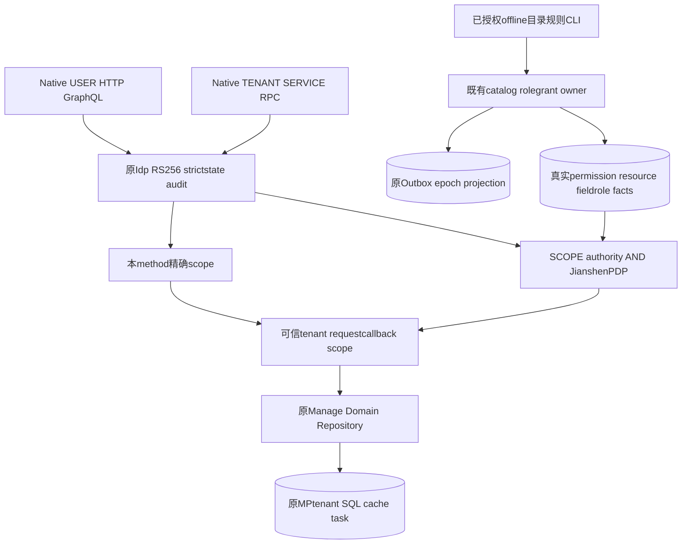
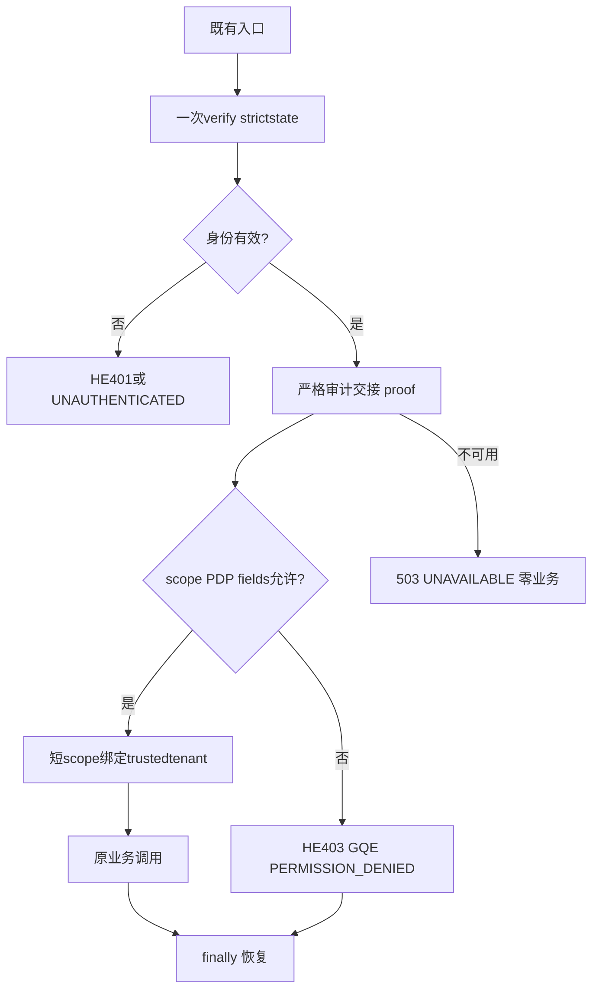
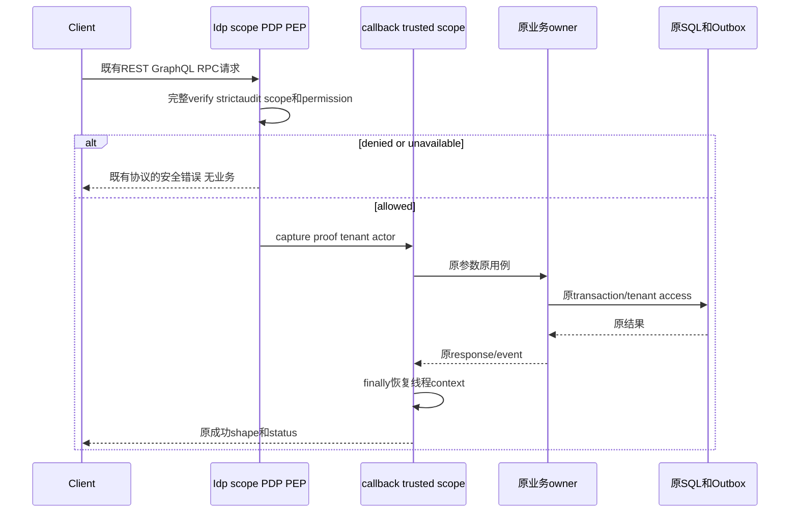

# 星垣非 open Archetype 完整接入：规范设计附录

| Field | Value |
| --- | --- |
| Document | `2026-10-11-10-26-xingyuan-native-full-integration-native.md` |
| Template Version | `7` |
| Status | `Accepted` |
| Type | Detailed Design / Security Integration |
| Complexity | Complex |
| Complexity Drivers | 78多协议入口、双PEP、异步trustedcontext、真实catalog/role field writer版本及Outbox、四profile和生成namespace |
| Change Surface | native安全/文档/context；catalog/field数据writer与CLI；对应测试/配置/生成门禁 |
| Affected Chapters | §7, §8, §9, §10, §11, §14, §15, §16, §18 |
| Created | 2026-10-11 10:26 Asia/Shanghai |
| Updated | `2026-10-16 11:52 Asia/Shanghai` |
| Repository | Egon-COLA |
| Owner | mario |
| Parent | [星垣完整接入主Spec](2026-10-11-10-26-xingyuan-native-full-integration.md) §7.3.2/3、§8–§11、§14–§16 |
| Scope | 四non-open源、78既有暴露、44目录意图、显式catalog/field-rule writer、profiles/生成验证；noSQL/no新HTTP授权接口/noautoGrant |
| Decisions | Agent统一身份/六层和必要技术依赖已批准；DEC005目录与字段规则真实owner已批准；source namespace按主文ASM004 |
| Source Requirement | 主Spec用户原请求及Agent/DEC005/DEC006批准；本附录只设计native安全delta |
| Baseline Revision | `b074c66737c8e9ebb33a66e1b37b69eda91829fd`；生产源码未由本设计修改 |
| Amends | [主Spec](2026-10-11-10-26-xingyuan-native-full-integration.md) §7–§11/§14–§16的native明细 |
| Supersedes | None |
| Depends On | [主Spec](2026-10-11-10-26-xingyuan-native-full-integration.md)及其有效前驱；[自身加固](2026-10-10-12-36-tianquan-security-self-hardening.md) §7–§10/§14–§16 |
| Related Specs | [Edge附录](2026-10-11-10-26-xingyuan-native-full-integration-edge.md)、[运行附录](2026-10-11-10-26-xingyuan-native-full-integration-runtime.md) |
| Related Plans | None |

## 1. Summary

78个既存成功入口必须逐项满足本附录共用合同和其原子block。身份、授权、tenant、audit、错误、文档为Affected；业务请求/成功DTO/SDL/PB/serializer/幂等/transaction/event为Context-only。不是给出class名/路由表就算设计完成。Source truth为四普通源工程，Open三种保持内容；主文平台/Edge/runtime附录负责其各自范围。

## 2. Background and Current State

L/W/S/A分别为 `egon-cola-archetypes/source-projects/egon-cola-source-{light,web,service,agent}`。L单模块；W/S七模块；A六模块。三native现HTTP permitAll、HTTP/RPC headers/defaultroles、Agent独立API-key/default0必须收敛。GraphQL现14root也需保护；web GraphQLContext当前只传Idempotency-Key，不能把旧裸TL当异步可信身份。

现目录真实gap：GlobalResourceCatalogService只有queries/archive/createField/changeFieldStatus，沒有API资源registration；CI DTO只MENU/ROUTE/ACTION，不是API scanner。FieldPolicyMerger仅遍历effective role rules，writable只给definition上限，createField不授WRITE；DEC005新增真实显式writer。

### 2.4 Evidence and current-chain map

原chain：HTTPpermitAll/headercontext→Controller；GQL前置裸TL→resolver；RPCoptionalUSER→provider；Agentkey/defaulttenant→knowledge/research。目标仅安全前置/可信scope和目录writer；所有exactcallee/schema/hash位于每block/§10，旧Domain/SQL止于trustedtenant input。源码ledger与主文EVD008/009/011、用户DEC005/006构成本附录证据，不从README推runtime。

| Entry/trigger | Current call chain | Data read/written | External dependency | Consumers | Evidence |
| --- | --- | --- | --- | --- | --- |
| nativeREST/GQL | permitAll/headercontext→原Controller/resolver→Manage | 默认tenant/角色/业务SQL | MP/cache/PG | 现native客户端 | 每§9 source/SDL |
| RPCpeer | optionalUSER→provider→业务 | 现scope缺/业务SQL | NativegRPC/Tianshu | S↔W五read | §9fullMethod与caller |
| Agent | ApiKey/default0→SSE/knowledge | task/SQL/vector | 原RAG/PG/outbox | Agent13HTTP | sourcefilter/DTO/fields |
| field授权 | definitioncap＋缺writer/rules→Core merger | 无rule不能WRITE | Jianshenprojection | 新explicitfieldguard callers | actualFieldPolicyMerger/reader |


## 3. Goals and Non-goals

### 3.3 Change Surface and Design Depth

| Area/layer | Disposition | Exact repository evidence | Changed or preserved behavior/contract | Required Spec treatment | Chapter(s) |
| --- | --- | --- | --- | --- | --- |
| 安全/PEP/context/error/doc | Affected | §9 source Controller/resolver/facade、SDKproof/MethodPEP | USERscope AND PDP、SERVICEmethodscope、trustedtenant、真实错误 | 逐原子设计/beans/tests/profiles | §7,§8,§9,§14,§15,§16 |
| catalog/rolefieldrule写路径 | Affected | GlobalResourceCatalogService/RoleResourceGrantService/Repository、原FieldRulePO | 显式注册与rule、version/epoch/Outbox，无schema | fields/constraints/lock/transaction/CLI | §8,§10,§11,§14,§18 |
| 业务DTO/SDL/PB/serializer | Context-only | §10 sourcehash/每blockserializer | fields/原成功shape/null/descriptor保持 | source证据和真实回归 | §9,§10,§14 |
| 原Domain/repository/SQL | Unchanged | 四source原CQE/MP及SQL | trusttenant输入、原事务幂等业务不重构 | 不变边界/SQL隔离验证 | §11,§13,§14 |
| Open3/generator机制 | Unchanged | 三-open/definitions与generate_archetypes.sh | byteequivalence，全7atomicgenerate | paths/modes/hash/IT | §16 |
| UI/Portal/Edge | Context-only | 主Spec与其Edge/runtime附录 | 无native新前端/allowedFields路由 | 本附录停止于server | §12 |

## 4. Requirements and Acceptance Criteria

### 4.1 Scenario matrix

| Scenario | Evidence / requirement | Failure / success | Verification |
| --- | --- | --- | --- |
| REST/GQL USER只有openid或PDP欠资源 | 现scopeauthority＋USERPDP | 403/GQE、business0 | 每USERatomic NTEST |
| RPC wrongaud/type/欠scope | SDKtypedverification＋requiredselector | UNAUTHENTICATED/PERMISSION_DENIED | 每RPC NTEST |
| catalogpending或无fieldrule | actualwriters/Core merger | 空目录/fielddeny | DATA-CAT/FIELD actualowner |
| Outbox/audit/strictstate失效 | mandatoryhandoff/currenttransaction | 503/UNAVAILABLE/rollback | controlled＋PG join |
| GraphQL并发aliases/取消 | immutablefacts＋server requestmarker | 一次DENY/finallyrestore | 两field异步scope |
| generated应用独立namespace | globalpermissionUK＋既有normalizer | sourceCode不残留/Open不漂 | currentartifact+generatedIT |

### 4.2 Use-case analysis

| Actor ID | Actor/role | Goal and responsibility | Entry/channel | Permission/tenant context | Evidence |
| --- | --- | --- | --- | --- | --- |
| ACTOR-001 | USER | 原native业务读写 | REST/GQL | USER scope＋PDP＋trustedtenant | 78sourcecatalog |
| ACTOR-002 | SERVICE | 现peer RPC | NativegRPC | 独立client/TENANT/精确scope | 五peerclient |
| ACTOR-003 | deployment reviewer | 注册及明确授权 | protectedofflineCLI | OSmanifest＋activeidentity/applicationowner | DEC005/owner新内合同 |

| ID | Use case/goal | Primary actor | Supporting actors/systems | Trigger | Preconditions | Main success outcome | Alternatives/failures | Postconditions | Requirements | Interfaces/pages | Tests |
| --- | --- | --- | --- | --- | --- | --- | --- | --- | --- | --- | --- |
| UC-001 | 原HTTP/GQL业务 | ACTOR-001 | Idp/PDP | 原请求 | signature/scope/resource/tenant | 原businessresult | HE/GQE无业务 | finallyrestore | REQ-006,REQ-004,REQ-007 | §9REST/GQL | 全USER NTEST |
| UC-002 | 内部peer读 | ACTOR-002 | SAS/NativeRPC | 五caller调用 | 独立client/targetgrant | 原PB结果 | status拒绝、no fallback | callbackscope清理 | REQ-006,REQ-004 | §9RPC | 全RPC NTEST |
| UC-003 | 目录注册与fieldreview | ACTOR-003 | catalog/rolegrant/Outbox | 明确offlinecmd | protectedfile/真实owner/version | pendingcatalog或rulecommit | conflict/unknowncommit停止 | 无autoGrant、actualprojection | REQ-007 | DATA-CAT/FIELD | writercontract/PG |
| UC-004 | 生成接入项目 | ACTOR-003 | Maven/generator | 已批准流程 | 当前制品/RootIDpreflight | 四native及全7兼容 | 旧JAR/Open漂移阻断 | sourceTruth | REQ-009 | generatedconsumers | generatedIT |


| ID | Requirement | Evidence required |
| --- | --- | --- |
| REQ-006（NREQ001） | 78入口身份/权限完整，无旁路 | 各NTEST实际chain/AOP/provider，缺凭证/错type/欠scope/PDP/audit失败business0 |
| REQ-004（NREQ002） | trustedtenant贯穿SQL/cache/异步且finally恢复 | 两tenant、线程切换/cancel/exception、actualcallback与SQL |
| REQ-007（NREQ003） | 44namespaced目录意图、最小scope、真实字段rules | 真实owner pending→explicitreview/mapping/grant/fieldrules→projection，无autoGrant |
| REQ-008（NREQ004） | 成功业务协议不变 | §10sourcehash＋真实成功status/headers/descriptor/SDL/business assertions |
| REQ-009（NREQ005） | 4profile/依赖/生成/Open | 实际Binder、currentStarter、四native/全七IT、byteequivalence |
| REQ-011（NREQ006） | 最小规范owner改动 | §8/18精确files/beans/deps，17MC，无新架构/SQL/HTTP授权接口 |

## 5. Constraints, Assumptions, and Decisions

permission unique实际 `uk_rbac3_permission_code_global(permission_code)`；resource实际unique `(application_id,resource_type,resource_code)`（V7:166–169），不能夸大resource跨app唯一。Source namespace为源artifact：`egon-cola-source-light`、`egon-cola-source-web`、`egon-cola-source-service`、`egon-cola-source-agent`；短light/organization/evaluation/agent只是意图alias。已有生成器源artifact→rootArtifactId替换得到消费者独立namespace，不能把同family所有生成项目共用一个逻辑application。

所有生成后的permission/scope/resource≤128 ASCII `[A-Za-z0-9._:-]+`，按最长真实suffix计算RootArtifact ID上限；过长/重复applicationCode/其他owner namespace在preflight拒绝，不截断/哈希改名。RPC消费者使用目标publishednamespace，不是本服务prefix。DEC005已批准新writer设计，但注册目录与审核授权分离，没有autoGrant。

## 6. Project Technology Context

复用JDK21、Boot管理的Security/GraphQL/Jackson/JakartaValidation/MapStruct/BaseForwardConverter、现Idp/Jianshen/RPC/Tianshu、MPtenant/cache/Outbox。Spring GraphQL1.4.6 compile已有graphql-java24.3；其SimplePerformantInstrumentation.instrumentDataFetcher(DataFetcher,InstrumentationFieldFetchParameters,InstrumentationState)和DataFetchingEnvironment.getGraphQlContext均现公开API。Boot3.5.16 GraphQlAutoConfiguration从ObjectProvider<Instrumentation>.orderedStream自动接入；现runtime Context propagation/Securityaccessors沿原依赖保持，不新增context-propagation直接compile声明、不反射规避dependency。原AgentFlyway/SQL只作为现存context，不以本安全Spec迁移持久化。

新业务Spring类@Slf4j、具名、@RequiredArgsConstructor、final @Qualifier；普通command/properties按Lombokclass标准，immutablevalue BO可record defensive-copy。原business DTO不为规范文档重构。Domain/facade不加Idp/JPA/SpringSecurity依赖。

### 6.2 User-mandated Java rule compliance

以下literal与主Spec完全同源，不重编号；本附录Rule1/2/3/4/5/6/7/9/10/11逐项对应exactfile/model/validation/qualifier/JSON/配置/模式/时间/架构。实施时保持现repoProfile与sourceTruth，不能以文档为由改业务DTO/旧SQL。

```text
1 类名规范，必须以 java的pojo规范命名。以dao po bo vo dto query command event等结尾
2 每层之间必须被 springboot-validation 校验，复用对象使用分组校验；基于原生和自定义约束注解、@Valid、@Validated 及 ConstraintValidator 扩展实现。ValidationUtils 只承担通用手工校验，不承载全部业务校验；电话号码复用 libphonenumber。
3 Java POJO 默认使用 class，注解为 @Data @NoArgsConstructor @AllArgsConstructor @Accessors(chain = true)，按构造目标选择 @Builder 或 @SuperBuilder；父类状态参与相等性时使用 @EqualsAndHashCode(callSuper = true)。只有不可变 value object 可以使用 record，并豁免 class 的 Lombok 规范；普通实体不能因简单而使用 record。使用 MapStruct、MapStructPlus 和 egon-cola-component-common-core 的 BaseConverter（双向）或 BaseForwardConverter（不可逆投影）进行转换。
4业务类必须使用@Slf4j注解注入log对象。如果业务类被spring管理，必须指定名称，如果是单例的情况下，参考@Service("userService")。如果需要依赖注入，必须@RequiredArgsConstructor进行修饰，不要代码中写。且属性必须被@qualify修饰。
5 工具类只允许使用jdk原生、Apache Commons(commons-lang3、commons-collections4、commons-io、commons-text、commons-codec、commons-beanutils)、Guava。针对Tika按需引入。
6 JSON 使用 Spring Boot Jackson；持久化枚举值使用 @EnumValue，向前端输出的枚举值使用 @JsonValue，禁止 ordinal 作为业务编码。
7 springboot 多环境配置文件，必须保持配置一致，但值不一定一致。
9 复杂业务必须引入设计模式，不允许硬编码
10 日期相关的必须使用java.time下的实体类，不允许使用java.util下的
11 只允许现有三层结构或当前 egon-cola-archetypes 的 DDD 结构，三层结构保持现状。必须尽量复用 egon-cola-components；持久化模块必须使用 Egon COLA MP Starter，DDL 统一由 egon-mp-sdj-ext-starter 分布式管理。业务唯一键必须组合业务列与 deletedAt（数据库 deleted_at），并验证 NULL、租户及重复软删除语义。采用 CQE（Command Query Event）；Event 必须经 egon-cola-component-transactional-outbox-starter 或 MQ 中间件投递。
```

| Literal rule | Affected? | Repository evidence | Exact design decision | Files/types/interfaces | Validation/test evidence | Status/blocker |
| --- | --- | --- | --- | --- | --- | --- |
| Rule 1 | Yes | newPOJO语义 | Command/DTO/BO/VO与技术Instrumentation/CLI职责suffix | §8/18文件清单 | naminginventory | PASS（设计） |
| Rule 2 | Yes | 原DTO＋newwriter边界 | Jakarta/nestedValid/groups/窗口与serverfactsreload，工具只补trigger | §9/11types | proxy/nonproxy约束 | PASS（设计） |
| Rule 3 | Yes | 原values与MapStruct/common | 普通classLombok/immutablevalue例外；真实跨projectionBaseForward | §10/18converter | 构造/enum投影 | PASS（设计） |
| Rule 4 | Yes | 原具名Spring/Slf4j | RequiredArgsConstructor/finalQualifier/实际EMproxy，不手写DI | §8/18Beans | contextwiring/log扫描 | PASS（设计） |
| Rule 5 | Yes | 现JDK与GraphQL | 闭合工具allowlist，不引新dependency/framework | §6/8imports | dependency/import | PASS（设计） |
| Rule 6 | Yes | 原BootJackson/IDL | 保持schema；newHE/GQE/CLI完整stringcode，无ordinal | §7/9/10/18 | JSON/OAS/SDL/PB | PASS（设计） |
| Rule 7 | Yes | 四profile | samekey结构、value可不同、test不permitAll | §15properties | Binder/parity | PASS（设计） |
| Rule 9 | Yes | 双identity/context/Outboxcomplex | 现Strategy/Factory/Decorator/Instrumentation；简单write常量 | §7/13 | 变体/故障测试 | PASS（设计） |
| Rule 10 | Yes | 原Instant/Duration窗口 | 只java.time、policytime/租户scopefinally | §11/15fields | time/window | PASS（设计） |
| Rule 11 | Yes | L单/SW七/A六＋原MP/CQE | 原架构owner扩，无新层/SQL，Event原Outbox | §3/11/16 | architecture/generated/PGjoin | PASS（设计） |

## 7. Architecture Design

### 7.0 Minimum-design baseline and element-necessity audit

| Proposed element | Change | Requirements | Existing/direct alternative | Concrete inadequacy of alternative | Added calls/state/coupling/failures/migration/operations | Verdict |
| --- | --- | --- | --- | --- | --- | --- |
| USER双PEP | Expand | REQ-006/007 | 只PDP或只scope | 各缺一个权威 | 无新network，现advisor | Add |
| GQLInstrumentation | Add | REQ-004/006 | HTTP裸TL | callback不可信 | 原frameworkscope，无新dep | Add |
| RPCbindings | Expand | REQ-006 | optionalUSER | 内部SERVICE未保护 | 有界本地map/原tokenclient | Add |
| catalog/fieldrulewriters | Expand | REQ-007 | 原cap/无writer | 无目录/空rule必deny | 原事务/version/Outbox，无DDL | Add |

| Path | Network calls | Client states | Server contracts/state | Failure and TOCTOU points | Additional user/business value |
| --- | --- | --- | --- | --- | --- |
| 直接旧路径 | 原业务calls | 假headers/key身份 | 无完整PEP/tenant来源 | 越权/跨tenant | 不满足目标 |
| 选定复用 | 原calls＋必要token/PDP缓存miss | 独立token/可信scope | 原SDK/PDP＋小本地scope/writer | strict失败明确、version/Outbox | 全入口真实权限与可撤销 |

### 7.1 System Architecture Design



### 7.2 High-Level Design



#### 7.2.2 High-level decision and quality matrix

| Concern/use case | Required behavior | Selected mechanism | Failure/degradation behavior | Trade-off | Verification | Requirements |
| --- | --- | --- | --- | --- | --- | --- |
| auth/audit | failclosed/0write | 原strictpipeline | 503/UNAVAILABLE | 依赖可用性 | callback0 | REQ-006/004 |
| GQLscope | no裸TL依赖 | 原Instrumentation/GraphQLContext | 每callbackfinally | 显式技术state | 并发aliases/cancel | REQ-004 |
| catalog | 无autoGrant | pending＋review | versionconflict0writes | 多阶段明确 | 真owner/权限negative | REQ-007 |
| fieldrule | ruleepochoutbox原子 | 原rolelock/state/Outbox | rollback/unknownconfirm | PGjoin需证 | 故障/投影 | REQ-007 |
| generation | OpenKeep/sourceTruth | 原全7atomicgenerate | 不满足阻断 | 重建但byteequal | hash/7IT | REQ-009 |



### 7.3 Detailed Design

#### 7.3.6 Conclusion evidence chain

| Conclusion | Source evidence | Constraint | Decision / consequence | Proof |
| --- | --- | --- | --- | --- |
| 78路径均PEP | sourcecontroller/facade/SDL逐block | 完整接入不缩范围 | eachIDscope/PDP或RPCscope | eachNTEST |
| Scope不能PDP代替 | Idp SCOPE_保留、Rbac RuntimeContextSource USER | 原acceptedbase合同 | AND advisors，不SERVICE伪USER |consent不足仍拒绝 |
| 仅cap不授WRITE | FieldPolicyMerger真实forrules | missingrulesdeny | 真实rolewriter+Outbox，noSchema |twoRole正负 |
| namespace必要 | permissioncodeglobalUK | 多generatedapp独立 | 源artifact替rootartifact |生成/注册冲突 |
| 所有成功shape保存 | exactfrozenfiles/serializer | 不扩大业务contract | Context-onlystop |descriptor/SDL/response |

### 7.4 N-HTTP

33个REST/SSE共用：外层idpSecurityObservationFilter→原Idp一次完整verify/revoke/strictaudit→USER RBAC桥保留SCOPE_*与details/proof→AuthorizationFilter authenticated→可信familycontext→Controller AOP。所有USER同时 `@PreAuthorize("hasAuthority('SCOPE_<namespaced-intent>')")` 与 `@RBACAPIResource(code,permission,name)` 独立AND；现 `Rbac3StarterAutoConfiguration#rbac3MethodAuthorizationInterceptor` 明确order=`AuthorizationInterceptorsOrder.PRE_AUTHORIZE.getOrder()+1`，使原PreAuthorize scope先于RBACPDP、fieldguard和business；RequiresPermission-only原行为保留；openid/profile不替业务scope，PDP允许但无consented businessscope仍403。@EnableMethodSecurity正常prePost与现RBACadvisor共存，必须真实代理验证。SERVICE不能走此USER路径。

只健康liveness/readiness公共；本地payload/header不选issuer/resource/tenant/roles。statelessBearer链可csrf关闭，不复制到SSO Cookie链。缺token先401，先于tenant/DTO/content negotiation。Base/test关闭外部能力只用于明确可控fixture，缺Idp/PDP业务deny/notready，不自动permitAll/defaultrole/tenant。

principal tenant必须registry=claim=principal。USERactor=subject，MDC由VerifiedTenantContextFilter可信绑定；L/W自有业务context在后续scope取verifiedsubject，原trace/idempotency保持；finally恢复previous，不污染线程。Agent知识与ingest task取真实tenant，不能default0；SSE先PEP再model/lease，cancel/timeout原资源释放。

Service（S）没有业务HTTP或GraphQL，11个业务暴露仅沿N-RPC required SERVICE/TENANT及精确method scope，不消费上述USER RBAC/PDP/字段链。其applicationSecurityFilterChain只保留health liveness/readiness PUBLIC与既有基础设施策略，其他fallback HTTP拒绝；无新业务URL或公开grant。文档沿主Spec EVD-006/§9.1与Edge既有GatewayOpenApiWebMvcSecurityAutoConfiguration窄链：default-off；显式启用时只/v3/api-docs/**，完整Shoubing SERVICE验证/撤销/strictusage及现SCOPE_yuheng.openapi.read、own-host resource，原更高优先级docs链拥有此路径。该既有scope不是新增native业务permission或自动grant；不添加Jianshen依赖/USER advisor，不把33个N-HTTP业务路径算到S。

### 7.5 N-GQL

14个root经POST /graphql USER入口，scope+resource+permission逐resolver。GraphQLContext捕获不可变RuntimeAuthorizationContext(identity,snapshot,fenced)、已验证scope集合、TokenAuditProofBO、TraceContext副本，不rawJWT/共享mutable SecurityContext。现GraphQL Java SimplePerformantInstrumentation装饰每DataFetcher执行时，从env.getGraphQlContext取该immutable快照，创建新SecurityContext/Rbac3AuthenticationToken、安装MDC/原业务context；delegate.get后finally恢复previous。原14businessresolver同步返回business result；当前源方法没有自建异步SQLworker（框架可异步调用），其SQL/PEP均在这个作用域；返回Future的框架继续用现runtimeaccessors，真正业务worker必须显式携trusted snapshot并在JDKExecutor callback短scope恢复，不凭空依赖HTTP裸TL。原web Idempotency-Key保留，不fakeheaderroles。

多root逐field检查，按原SDLnullable/non-null产生partialdata/error；scope欠缺或PDP缺资源均不调用该Manage。GQL与REST复用同意图scope/permission，不同暴露resource。原schema/selection不改。原ExceptionResolver新增安全分支在generic前，DENY audit marker去重。

GraphQLContext另保存已验证请求的标准ServletRequestAttributes/受控request audit marker，是框架服务器技术scope，不塞入immutableSnapshotBO，不publicJSON/客户端extensions。Instrumentation每DataFetcher恢复RequestContextHolder及Security/MDC/业务context，finally恢复previous attributes；原request仍async活动时可用绑定同request的新ServletRequestAttributes短作用域，不能使用已requestCompleted attrs访问失效state。现SDK共同marker精确型为`Starter/security/domain/IdpAuthorizationObservationContextBO.java` mutable技术class（active/closed、guarded delivery NEW/CONFIRMED/FAILED、denyOnce(BooleanSupplier)；非immutableVO、not newTL）。使用主SDK typed accessor `IdpSecurityObservationFilter.authorizationObservationContext(HttpServletRequest)`取同marker，oldbeforeAuthorizationDenied/authorizationDeniedRecorded兼容（Recorded仅镜像已CONFIRMED）。confirmed/failed/pending规约见主文：PreAuthorize scopeDenied且本次marker仍NEW时记录（正常scope-first尚未PDP；即使某内调用已有PDP ALLOW也不把它当DENY已记录）；PDP/field已有confirmed则只渲染，失败503，不pending假成功。Filter必须在async开始后沿标准AsyncListener保留callbacks直到complete/error/timeout再最终cleanup，sync保持finally。两并发aliases只能一次strictDENYhandoff；no newTL/no rawtoken进技术snapshot。实际修改shared IdpSecurityObservationFilter与Rbac3ObservedAuthorizationService/marker type由主SDK附录拥有，native不造parallelmarker。

### 7.6 N-RPC

31个样例method：本地 `rpc.provider.methods.<exactfullMethodName>` required=true、principalKind=SERVICE、scopeContext=TENANT、expectedResourceUri及requiredScopes固定。missing/duplicate/malformed/wrongiss/aud/错误token类型或未识别principal_type/revoked→UNAUTHENTICATED；已验证USER访问SERVICE-only method、欠scope或PLATFORM操作tenant SQL→PERMISSION_DENIED；state/JWK/audit/gettoken unavailable→UNAVAILABLE；每拒绝callback/business/SQL0。

verifyAny一次、strictaudit成功才proof；gRPC Context持IdpPrincipal/proof，各listenercallback安装Springauth/tenantMDC并finally恢复。currentTokenOrNull兼容仅USERtoken，不误把SERVICE作为USERrelay。L既有PB operator_id保留字段号但actor由可信principal重建，若提供冲突拒绝，不为operator_id伪user；request_id仍原幂等。

consumer `rpc.consumer.bindings.<id>`一项一fullMethodName，selector=serviceName/group/version/fullMethodName/processIdentity受控字段唯一；processIdentity只以现RpcProcessIdentity.applicationName与env精确匹配，host/pid/instanceId仅可信追踪，不作为静态授权条件或入站选binding依据；mode SERVICE/USER_RELAY固定、appId/resourceUri/scopeContext/scopes固定，PLATFORM只registrationId，TENANT只trustedtenant→tenantRegistrationIds有界map。不从DTO/header/address选target/tenant；未知binding零出站；CallCredentials appExecutor调用现IdpServiceOAuth2Client缓存/skew/singleflight，一Bearer无fallback。Tianshu HMAC directfactory仍独立。

### 7.6.1 可信actor与现MP审计兼容（SERVICE不是伪USER）

实际证据：`egon-cola-components/egon-cola-component-common/egon-cola-component-common-mybatis-plus-sharding-jdbc-ext-spring-boot-starter/src/main/java/top/egon/cola/component/common/mybatis/model/EgonModel.java` createUserId/updateUserId为String；`business/EgonColaMdcUserIdProvider.java#currentUserId`取配置audit.userIdMdcKey，missing/blank抛USER_CONTEXT_MISSING；`handler/EgonColaMetaObjectHandler.java#insertFill/updateFill`强制tenantLong＋actorString，并校不可覆盖technicalfields。三native managedDDL create_user_id/update_user_id是VARCHAR128；Agent correctiveSQL同列NOTNULL；不能说“不写userMDC”然后静默null/SYSTEM。

每authenticated callback同时bind服务器技术MDC key `egon.auth.actor-kind`=USER/SERVICE并finallyrestore（不是requestheader或授权角色）；audit compatibility key（defaultuserId，实际遵从原MybatisPlusProperties）必须bind真实principal.subject：USER是身份sub，SERVICE是已验证clientId/subject字符串（1..128）。这个名字只是既有MP审计接口，不创建USER/RBACtoken/role，不使clientID成为用户目录记录。tenant同JWTregistry核准；L Command.operatorId也String，service写命令由可信subject重建；W OrganizationRequestContext.actorId=同subject，actorRoles空；S Commands无actor参数，由MPprovider填；A USER写同scope。超过128/blank/错误context在业务callback前failclosed，不能truncate/生成system。finally恢复原tenant/audit MDC全部keys。

A异步gap与最小真实修复：当前 `egon-cola-source-agent-application/.../knowledge/service/KnowledgeIngestQueueService.java#enqueue` payload只schemaVersion/documentId/tenantId，handler只tenant，MP update缺actor会失败。复用现 `OutboxMessage.builder.headers` / `DeliveryContext.headers`，queue通过qualified现Bean `egonColaMdcUserIdProvider`（EgonColaUserIdProvider.currentUserId）和受控MDC `egon.auth.actor-kind`捕获 `egon.auth.actor-id`（String1..128）、`egon.auth.actor-kind`（USER或SERVICE）、`egon.auth.tenant-id`（与既有payloadtenant相等positiveLong）内部技术headers，既有payload/schemaVersion和publicDTO不变。queue必须group校actor-id非空长度1..128、kind两值、tenantpositive并与document/payloadtenant一致；缺scope在storeAndEnqueue原transaction内失败rollback原DB＋Outbox，原文件清理语义仍applicationowner。headers只服务器transaction写入，不复用HTTP同名header，不存token；handler从受信Outboxdelivery metadata读取/校验后bind原auditkey+tenant，finally恢复previous，不能移除别人的MDC值。

旧无actor消息不能猜migration/system；failclosed并按原delivery retry/dead可观察，运维若需要兼容只能沿真实owner事实重enqueue/审核，不本任务静默写旧队列。新隔离runtime验证真实enqueue→worker更新create/update actor=真实主体、tenant一致，两tenant线程复用/cancel无污染。不新增SQL/actoruseridnumeric映射/domainidentity接口。

### 7.7 完整新增安全wire HE/GQE/RSE（Affected）

HE401/403/503 application/json，只有code/message，BootJackson写；所有401 `WWW-Authenticate: Bearer`，无Location；所有securityerror no-store。SDK早期typedreason保留，不返回未知claim原值。L filter直接写不经ResponseWrapper；W/A原broadAdvice加具体securityexception delegate既有Rbac3AuthorizationExceptionHandler，别把拒绝吞500，原其它业务errors不变。

```jsonc
{
  "code": "AUTHENTICATION_REQUIRED", // 401稳定原因；typedbadJWT保持原reason
  "message": "Tianquan-Shoubing authentication failed" // 安全摘要，无cause或凭证
}
```

```jsonc
{
  "code": "AUTHORIZATION_DENIED", // 403；field拒绝用FIELD_ACCESS_DENIED
  "message": "Tianquan-Jianshen authorization denied" // 不回显scope/策略/字段名
}
```

```jsonc
{
  "code": "OAUTH_AUDIT_DELIVERY_UNAVAILABLE", // 503，PDP/state/JWK另保留该owner稳定reason
  "message": "Tianquan-Shoubing authentication state is temporarily unavailable" // SDKauthentication family摘要
}
```

PDP/字段Unavailable message沿现 `Tianquan-Jianshen authorization runtime unavailable`，审计失败的HTTPstatus必须503，无降级403/200。NativeSecurityError OAS schema两required String、additionalProperties=false。

GQE：入站缺身份HTTP401 HE；已认证执行拒绝HTTP200原GraphQL envelope。Web样例如下，nullable root仅该fieldnull而不是全data null；Light原extensions仅code＋classification，不添加web业务字段。Unavailable extensions.code=typedreason、classification=INTERNAL_ERROR，无新RESTwrapper。

```jsonc
{
  "data": null, // 本例non-null root导致原SDL错误传播；不更改nullable语义
  "errors": [ // 实际拒绝root/alias各一个
    {
      "message": "Tianquan-Jianshen authorization denied", // 安全摘要
      "locations": [{"line": 1, "column": 9}], // 实际语句位置
      "path": ["user"], // 实际root/alias路径
      "extensions": {
        "code": "AUTHORIZATION_DENIED", // 或FIELD_ACCESS_DENIED/typedUnavailable
        "classification": "FORBIDDEN", // Unavailable用INTERNAL_ERROR
        "traceId": "native-trace-1", // 服务器capture的关联ID
        "timestamp": "2026-10-11T02:26:00Z", // Instant ISO-8601
        "fieldErrors": {} // 不曝光私有授权字段名
      }
    }
  ]
}
```

RSE：gRPC close UNAUTHENTICATED(description jwt_invalid/authorization_header_invalid)、PERMISSION_DENIED(service_scope_denied/tenant_context_denied)、UNAVAILABLE(oauth_security_state_unavailable/oauth_audit_delivery_unavailable)，Metadata空、无新PB body/rawAT。授权失败不进入provider businesscatch，不伪success=false/internalerror；已授权后的业务PB错误与原INVALID_ARGUMENT保留。

## 8. Package Structure and Code File Tree

本节及§18为获准设计文件清单，Plan只能按它落实必要文件。新测试尚未执行；newClass不是新增业务接口/架构层。修改现Controller/resolver/provider的PEP、constraint边界、OAS属Affected；DTO/schema source仍Context-only。

| Operation | Exact file | Type / BeanName | Changed responsibility |
| --- | --- | --- | --- |
| MODIFY | egon-cola-archetypes/source-projects/egon-cola-source-light/src/main/java/top/egon/cola/archetype/source/light/start/config/NativeHttpSecurityConfiguration.java | NativeHttpSecurityConfiguration / nativeHttpSecurityConfiguration / applicationSecurityFilterChain | N-HTTP+EnableMethodSecurity+entrypoint/denied，缺deps deny/notready，Servletfilter注册disable |
| CREATE | egon-cola-archetypes/source-projects/egon-cola-source-light/src/test/java/top/egon/cola/archetype/source/light/start/config/NativeSecurityContractTest.java | NativeSecurityContractTest / nonBean | 该family所有原子身份scope/PEP/context与businessshape |
| CREATE | egon-cola-archetypes/source-projects/egon-cola-source-light/src/main/java/top/egon/cola/archetype/source/light/adapter/graphql/NativeGraphQlSecurityInterceptor.java | NativeGraphQlSecurityInterceptor / nativeGraphQlSecurityInterceptor | WebGraphQlInterceptor captureimmutablefacts进GraphQLContext，保留idempotency |
| CREATE | egon-cola-archetypes/source-projects/egon-cola-source-light/src/main/java/top/egon/cola/archetype/source/light/adapter/graphql/NativeGraphQlSecurityInstrumentation.java | NativeGraphQlSecurityInstrumentation / nativeGraphQlSecurityInstrumentation | 现graphql.execution.instrumentation.SimplePerformantInstrumentation.instrumentDataFetcher三参数；Boot自动收Instrumentation Bean；从GraphQLContext短scopefinallyrestore，不另TL |
| CREATE | egon-cola-archetypes/source-projects/egon-cola-source-light/src/main/java/top/egon/cola/archetype/source/light/adapter/graphql/NativeGraphQlSecuritySnapshotBO.java | NativeGraphQlSecuritySnapshotBO / nonBean | immutable record RuntimeAuthorizationContext/scopes/proof/TraceContext副本，不mutable SecurityContext/rawAT |
| CREATE | egon-cola-archetypes/source-projects/egon-cola-source-light/src/test/java/top/egon/cola/archetype/source/light/adapter/graphql/NativeGraphQlSecurityContractTest.java | NativeGraphQlSecurityContractTest / nonBean | named root、多field异步/negative+原SDL |
| MODIFY | egon-cola-archetypes/source-projects/egon-cola-source-web/egon-cola-source-web-starter/src/main/java/top/egon/cola/archetype/source/web/starter/config/NativeHttpSecurityConfiguration.java | NativeHttpSecurityConfiguration / nativeHttpSecurityConfiguration / applicationSecurityFilterChain | N-HTTP+EnableMethodSecurity+entrypoint/denied，缺deps deny/notready，Servletfilter注册disable |
| CREATE | egon-cola-archetypes/source-projects/egon-cola-source-web/egon-cola-source-web-starter/src/test/java/top/egon/cola/archetype/source/web/starter/config/NativeSecurityContractTest.java | NativeSecurityContractTest / nonBean | 该family所有原子身份scope/PEP/context与businessshape |
| CREATE | egon-cola-archetypes/source-projects/egon-cola-source-web/egon-cola-source-web-adapter/src/main/java/top/egon/cola/archetype/source/web/adapter/graphql/NativeGraphQlSecurityInterceptor.java | NativeGraphQlSecurityInterceptor / nativeGraphQlSecurityInterceptor | WebGraphQlInterceptor captureimmutablefacts进GraphQLContext，保留idempotency |
| CREATE | egon-cola-archetypes/source-projects/egon-cola-source-web/egon-cola-source-web-adapter/src/main/java/top/egon/cola/archetype/source/web/adapter/graphql/NativeGraphQlSecurityInstrumentation.java | NativeGraphQlSecurityInstrumentation / nativeGraphQlSecurityInstrumentation | 现graphql.execution.instrumentation.SimplePerformantInstrumentation.instrumentDataFetcher三参数；Boot自动收Instrumentation Bean；从GraphQLContext短scopefinallyrestore，不另TL |
| CREATE | egon-cola-archetypes/source-projects/egon-cola-source-web/egon-cola-source-web-adapter/src/main/java/top/egon/cola/archetype/source/web/adapter/graphql/NativeGraphQlSecuritySnapshotBO.java | NativeGraphQlSecuritySnapshotBO / nonBean | immutable record RuntimeAuthorizationContext/scopes/proof/TraceContext副本，不mutable SecurityContext/rawAT |
| CREATE | egon-cola-archetypes/source-projects/egon-cola-source-web/egon-cola-source-web-adapter/src/test/java/top/egon/cola/archetype/source/web/adapter/graphql/NativeGraphQlSecurityContractTest.java | NativeGraphQlSecurityContractTest / nonBean | named root、多field异步/negative+原SDL |
| MODIFY | egon-cola-archetypes/source-projects/egon-cola-source-service/egon-cola-source-service-starter/src/main/java/top/egon/cola/archetype/source/service/starter/config/NativeHttpSecurityConfiguration.java | NativeHttpSecurityConfiguration / nativeHttpSecurityConfiguration / applicationSecurityFilterChain | S仅health PUBLIC/其他HTTP fallback deny、既有default-off完整SERVICE docs窄链；N-RPC scope aspect独立，不装USER RBAC/PDP/字段链；Servletfilter注册disable |
| CREATE | egon-cola-archetypes/source-projects/egon-cola-source-service/egon-cola-source-service-starter/src/test/java/top/egon/cola/archetype/source/service/starter/config/NativeSecurityContractTest.java | NativeSecurityContractTest / nonBean | 该family所有原子身份scope/PEP/context与businessshape |
| CREATE | egon-cola-archetypes/source-projects/egon-cola-source-agent/egon-cola-source-agent-starter/src/main/java/top/egon/cola/archetype/source/agent/starter/config/NativeHttpSecurityConfiguration.java | NativeHttpSecurityConfiguration / nativeHttpSecurityConfiguration / applicationSecurityFilterChain | N-HTTP+EnableMethodSecurity+entrypoint/denied，缺deps deny/notready，Servletfilter注册disable |
| CREATE | egon-cola-archetypes/source-projects/egon-cola-source-agent/egon-cola-source-agent-starter/src/test/java/top/egon/cola/archetype/source/agent/starter/config/NativeSecurityContractTest.java | NativeSecurityContractTest / nonBean | 该family所有原子身份scope/PEP/context与businessshape |
| MODIFY | egon-cola-archetypes/source-projects/egon-cola-source-light/src/main/java/top/egon/cola/archetype/source/light/adapter/filter/RequestContextFilter.java | RequestContextFilter / domainRequestContextFilter | verifiedsubject/tenant→原RequestContext，不header权威，finallyrestore |
| MODIFY | egon-cola-archetypes/source-projects/egon-cola-source-web/egon-cola-source-web-adapter/src/main/java/top/egon/cola/archetype/source/web/adapter/filter/OrganizationAuthContextFilter.java | OrganizationAuthContextFilter / organizationAuthContextFilter | trustedprincipal，取消headerroles/default1 |
| MODIFY | egon-cola-archetypes/source-projects/egon-cola-source-web/egon-cola-source-web-adapter/src/main/java/top/egon/cola/archetype/source/web/adapter/facade/impl/OrganizationRpcContextInterceptor.java | OrganizationRpcContextInterceptor / organizationRpcContextInterceptor | 仅trace/idempotency机械metadata，真实actor来自RPCprincipal |
| MODIFY | egon-cola-archetypes/source-projects/egon-cola-source-web/egon-cola-source-web-adapter/src/main/java/top/egon/cola/archetype/source/web/adapter/facade/impl/OrganizationFacadeSupport.java | OrganizationFacadeSupport / nonBean | 取消facade-system/SYSTEM，原封装与businesserror保持 |
| MODIFY | egon-cola-archetypes/source-projects/egon-cola-source-agent/egon-cola-source-agent-adapter/src/main/java/top/egon/cola/archetype/source/agent/adapter/knowledge/filter/KnowledgeTenantMdcFilter.java | KnowledgeTenantMdcFilter / knowledgeTenantMdcFilter | trustedtenant，取消default0覆盖 |
| MODIFY | egon-cola-archetypes/source-projects/egon-cola-source-agent/egon-cola-source-agent-adapter/src/main/java/top/egon/cola/archetype/source/agent/adapter/filter/ResearchApiKeyFilter.java | ResearchApiKeyFilter / 取消生产identityBean | 旧key不抢先Bearer/no authfallback |
| MODIFY | egon-cola-archetypes/source-projects/egon-cola-source-agent/egon-cola-source-agent-adapter/src/main/java/top/egon/cola/archetype/source/agent/adapter/config/DeepResearchApiConfiguration.java | DeepResearchApiConfiguration / deepResearchApiConfiguration | 取消旧@NotBlank API-key注册依赖 |
| MODIFY | egon-cola-archetypes/source-projects/egon-cola-source-agent/egon-cola-source-agent-adapter/src/main/java/top/egon/cola/archetype/source/agent/adapter/config/DeepResearchApiProperties.java | DeepResearchApiProperties / 取消旧identitybinding | 不把key换另生产credential |
| MODIFY | egon-cola-archetypes/source-projects/egon-cola-source-light/src/main/java/top/egon/cola/archetype/source/light/start/config/OpenApiConfig.java | OpenApiConfig / studentManagementOpenApi | 增加nativeBearer/NativeSecurityError两fieldschema；io.swagger模型不org.springdoc新directimports |
| MODIFY | egon-cola-archetypes/source-projects/egon-cola-source-web/egon-cola-source-web-starter/src/main/java/top/egon/cola/archetype/source/web/starter/config/OrganizationSwaggerConfig.java | OrganizationSwaggerConfig / organizationOpenApi | 同左，原Info不改 |
| MODIFY | egon-cola-archetypes/source-projects/egon-cola-source-agent/egon-cola-source-agent-starter/src/main/java/top/egon/cola/archetype/source/agent/starter/config/DeepResearchOpenApiConfiguration.java | DeepResearchOpenApiConfiguration / deepResearchOpenApi | APIKEY→nativeBearer，原13operationIds/业务schemas保持 |
| MODIFY | egon-cola-archetypes/source-projects/egon-cola-source-light/src/main/java/top/egon/cola/archetype/source/light/adapter/handler/GraphQlExceptionResolver.java | GraphQlExceptionResolver / graphQlExceptionResolver | GQE security分支，原其它error保留 |
| MODIFY | egon-cola-archetypes/source-projects/egon-cola-source-web/egon-cola-source-web-adapter/src/main/java/top/egon/cola/archetype/source/web/adapter/handler/OrganizationGraphQlExceptionResolver.java | OrganizationGraphQlExceptionResolver / organizationGraphQlExceptionResolver | 同GQE，无generic掩auth |
| MODIFY | egon-cola-archetypes/source-projects/egon-cola-source-web/egon-cola-source-web-adapter/src/main/java/top/egon/cola/archetype/source/web/adapter/handler/OrganizationGlobalExceptionHandler.java | OrganizationGlobalExceptionHandler / organizationGlobalExceptionHandler | specificsecuritydelegate，原businesscodes/wrapper保持 |
| MODIFY | egon-cola-archetypes/source-projects/egon-cola-source-agent/egon-cola-source-agent-adapter/src/main/java/top/egon/cola/archetype/source/agent/adapter/knowledge/handler/KnowledgeGlobalExceptionHandler.java | KnowledgeGlobalExceptionHandler / knowledgeGlobalExceptionHandler | 同HE securitydelegate，原知识errors保持 |
| MODIFY | egon-cola-archetypes/source-projects/egon-cola-source-agent/egon-cola-source-agent-adapter/src/main/java/top/egon/cola/archetype/source/agent/adapter/handler/DeepResearchGlobalExceptionHandler.java | DeepResearchGlobalExceptionHandler / deepResearchGlobalExceptionHandler | 同HE，ApiKey挑战不再生产身份 |
| MODIFY | egon-cola-archetypes/source-projects/egon-cola-source-web/egon-cola-source-web-application/src/main/java/top/egon/cola/archetype/source/web/application/user/validators/UserApplicationValidator.java | UserApplicationValidator / userApplicationValidator | 仅移旧requireOrganizationAdmin角色权威，原inputvalidation保留 |
| MODIFY | egon-cola-archetypes/source-projects/egon-cola-source-web/egon-cola-source-web-application/src/main/java/top/egon/cola/archetype/source/web/application/teaching/validators/TeachingApplicationValidator.java | TeachingApplicationValidator / teachingApplicationValidator | 仅移旧requireTeachingAdmin，原validation保持 |
| MODIFY | egon-cola-archetypes/source-projects/egon-cola-source-web/egon-cola-source-web-application/src/main/java/top/egon/cola/archetype/source/web/application/user/manage/impl/UserManageImpl.java | UserManageImpl / 原ServiceName | 仅移旧role-header gate调用，adapter全路径先PEP，原transaction/idempotency/event保持 |
| MODIFY | egon-cola-archetypes/source-projects/egon-cola-source-web/egon-cola-source-web-application/src/main/java/top/egon/cola/archetype/source/web/application/user/manage/impl/RoleManageImpl.java | RoleManageImpl / 原ServiceName | 仅移旧role-header gate调用，adapter全路径先PEP，原transaction/idempotency/event保持 |
| MODIFY | egon-cola-archetypes/source-projects/egon-cola-source-web/egon-cola-source-web-application/src/main/java/top/egon/cola/archetype/source/web/application/user/manage/impl/PermissionManageImpl.java | PermissionManageImpl / 原ServiceName | 仅移旧role-header gate调用，adapter全路径先PEP，原transaction/idempotency/event保持 |
| MODIFY | egon-cola-archetypes/source-projects/egon-cola-source-web/egon-cola-source-web-application/src/main/java/top/egon/cola/archetype/source/web/application/teaching/manage/impl/GradeManageImpl.java | GradeManageImpl / 原ServiceName | 仅移旧role-header gate调用，adapter全路径先PEP，原transaction/idempotency/event保持 |
| MODIFY | egon-cola-archetypes/source-projects/egon-cola-source-web/egon-cola-source-web-application/src/main/java/top/egon/cola/archetype/source/web/application/teaching/manage/impl/SchoolClassManageImpl.java | SchoolClassManageImpl / 原ServiceName | 仅移旧role-header gate调用，adapter全路径先PEP，原transaction/idempotency/event保持 |

| MODIFY | egon-cola-archetypes/source-projects/egon-cola-source-agent/egon-cola-source-agent-application/src/main/java/top/egon/cola/archetype/source/agent/application/knowledge/service/KnowledgeIngestQueueService.java | 原Service / knowledgeIngestQueueService | 捕获verifiedauditactor到现Outbox.headers；payload不改 |
| MODIFY | egon-cola-archetypes/source-projects/egon-cola-source-agent/egon-cola-source-agent-infrastructure/src/main/java/top/egon/cola/archetype/source/agent/infrastructure/knowledge/handler/KnowledgeIngestDeliveryHandler.java | 原Handler / knowledgeIngestDeliveryHandler | metadata校tenant/actor、auditkey/tenant finallyrestore，无SYSTEM fallback |
| MODIFY | egon-cola-archetypes/source-projects/egon-cola-source-agent/egon-cola-source-agent-infrastructure/src/test/java/top/egon/cola/archetype/source/agent/infrastructure/knowledge/KnowledgeIngestDeliveryHandlerTest.java | Test/nonBean | 真实actorheader/missing/两tenant/exceptionfinally回归 |
| CREATE | egon-cola-archetypes/source-projects/egon-cola-source-agent/egon-cola-source-agent-application/src/test/java/top/egon/cola/archetype/source/agent/application/knowledge/KnowledgeIngestAuditContextTest.java | Test/nonBean | actualenqueue headers/correctrollback，不伪造公共schema |

L/W/A的USER身份/PEP所需依赖明确qualifier：idpBearerAuthenticationFilter、rbac3BearerAuthenticationFilter、verifiedTenantContextFilter、idpSecurityObservationFilter、authorizationService、rbac3FieldWriteAuthorizationComponent、jacksonObjectMapper、defaultValidator；S仅消费Shoubing SERVICE RPC/proof/scope与原docs完整SERVICE链所需Bean，不要求上述USER RBAC/PDP/field Bean；实际EMproxy/其他Springbeans必须context验证，不newEMsingleton。Instrumentation为host具名Bean，Boot将现instrumentations合并，不覆写observability/原frameworkinstrumentation；trace/identity capture为不可变副本，不复制身份库。
### 8.1 Exact POM coordinates

| Owning exact POM | Coordinate | Reason |
| --- | --- | --- |
| egon-cola-archetypes/source-projects/egon-cola-source-light/pom.xml | top.egon:egon-cola-tianquan-jianshen-starter | actual HTTP/GQL/field/PDP直接引用；direct dependency无version；已声明owner按§22.3复用现版本属性管理 |
| egon-cola-archetypes/source-projects/egon-cola-source-web/egon-cola-source-web-adapter/pom.xml | top.egon:egon-cola-tianquan-jianshen-starter | actual HTTP/GQL/field/PDP直接引用；direct dependency无version；已声明owner按§22.3复用现版本属性管理 |
| egon-cola-archetypes/source-projects/egon-cola-source-web/egon-cola-source-web-starter/pom.xml | top.egon:egon-cola-tianquan-jianshen-starter | actual HTTP/GQL/field/PDP直接引用；direct dependency无version；已声明owner按§22.3复用现版本属性管理 |
| egon-cola-archetypes/source-projects/egon-cola-source-agent/egon-cola-source-agent-adapter/pom.xml | top.egon:egon-cola-tianquan-jianshen-starter | actual HTTP/GQL/field/PDP直接引用；direct dependency无version；已声明owner按§22.3复用现版本属性管理 |
| egon-cola-archetypes/source-projects/egon-cola-source-agent/egon-cola-source-agent-starter/pom.xml | top.egon:egon-cola-tianquan-jianshen-starter | actual HTTP/GQL/field/PDP直接引用；direct dependency无version；已声明owner按§22.3复用现版本属性管理 |
| egon-cola-archetypes/source-projects/egon-cola-source-service/egon-cola-source-service-adapter/pom.xml | top.egon:egon-cola-tianquan-shoubing-starter | SERVICE principal/scope/consumer直接引用，S无USER业务不强加PDP |
| egon-cola-archetypes/source-projects/egon-cola-source-service/egon-cola-source-service-starter/pom.xml | top.egon:egon-cola-tianquan-shoubing-starter | SERVICE principal/scope/consumer直接引用，S无USER业务不强加PDP |
| egon-cola-archetypes/source-projects/egon-cola-source-service/egon-cola-source-service-infrastructure/pom.xml | top.egon:egon-cola-tianquan-shoubing-starter | SERVICE principal/scope/consumer直接引用，S无USER业务不强加PDP |
| egon-cola-archetypes/source-projects/egon-cola-source-web/egon-cola-source-web-infrastructure/pom.xml | top.egon:egon-cola-tianquan-shoubing-starter | fixedpeerconsumer binding/CallCredentials实际引用 |
| egon-cola-archetypes/source-projects/egon-cola-source-agent/egon-cola-source-agent-starter/pom.xml | top.egon:egon-cola-tianshu-starter | 已批准Agent技术注册/SDK边，不newbusinessfacade |
| egon-cola-archetypes/source-projects/egon-cola-source-agent/egon-cola-source-agent-starter/pom.xml | top.egon:egon-cola-tianshu-http-registration-starter | 已批准Agent技术注册/SDK边，不newbusinessfacade |
| egon-cola-archetypes/source-projects/egon-cola-source-agent/egon-cola-source-agent-starter/pom.xml | top.egon:egon-cola-component-rpc-tianshu-adapter | 已批准Agent技术注册/SDK边，不newbusinessfacade |

Application/domain不增加security依赖；explicit fieldguard在Controller/resolver的PEP之后、第一次Manage写之前。Servernamespace配置是ownRbac3 systemCode=generatedrootArtifactId，不从request给applicationCode。
## 9. Interface Definitions

以下78项均为独立合同，每项source/schema/serializer/businesscontext明确；通用HE/GQE/RSE以及scope+PDP/tenant不是可省略引用。各NTEST-ID是验收设计，未执行。
### 9.1 Interface Inventory

| Native stable ID | Existing atomic operation | Kind | Change scope | Normative contract | Requirements |
| --- | --- | --- | --- | --- | --- |
| L-HTTP-01 | POST /api/users | HTTP/SSE | Affected security/context/error/doc;Context-only成功 | §9.L-HTTP-01逐原子合同 | REQ-006,REQ-004,REQ-007 |
| L-HTTP-02 | GET /api/users/{userId} | HTTP/SSE | Affected security/context/error/doc;Context-only成功 | §9.L-HTTP-02逐原子合同 | REQ-006,REQ-004,REQ-007 |
| L-HTTP-03 | POST /api/users/{userId}/roles | HTTP/SSE | Affected security/context/error/doc;Context-only成功 | §9.L-HTTP-03逐原子合同 | REQ-006,REQ-004,REQ-007 |
| L-HTTP-04 | POST /api/roles/{roleCode}/permissions | HTTP/SSE | Affected security/context/error/doc;Context-only成功 | §9.L-HTTP-04逐原子合同 | REQ-006,REQ-004,REQ-007 |
| L-HTTP-05 | GET /api/users/{userId}/permissions | HTTP/SSE | Affected security/context/error/doc;Context-only成功 | §9.L-HTTP-05逐原子合同 | REQ-006,REQ-004,REQ-007 |
| L-HTTP-06 | POST /api/courses | HTTP/SSE | Affected security/context/error/doc;Context-only成功 | §9.L-HTTP-06逐原子合同 | REQ-006,REQ-004,REQ-007 |
| L-HTTP-07 | GET /api/courses/{courseId} | HTTP/SSE | Affected security/context/error/doc;Context-only成功 | §9.L-HTTP-07逐原子合同 | REQ-006,REQ-004,REQ-007 |
| L-HTTP-08 | POST /api/school-classes | HTTP/SSE | Affected security/context/error/doc;Context-only成功 | §9.L-HTTP-08逐原子合同 | REQ-006,REQ-004,REQ-007 |
| L-HTTP-09 | GET /api/school-classes/{schoolClassId} | HTTP/SSE | Affected security/context/error/doc;Context-only成功 | §9.L-HTTP-09逐原子合同 | REQ-006,REQ-004,REQ-007 |
| L-HTTP-10 | POST /api/school-classes/{schoolClassId}/courses/{courseId}/schedule | HTTP/SSE | Affected security/context/error/doc;Context-only成功 | §9.L-HTTP-10逐原子合同 | REQ-006,REQ-004,REQ-007 |
| W-HTTP-01 | POST /api/v1/users | HTTP/SSE | Affected security/context/error/doc;Context-only成功 | §9.W-HTTP-01逐原子合同 | REQ-006,REQ-004,REQ-007 |
| W-HTTP-02 | GET /api/v1/users/{userId} | HTTP/SSE | Affected security/context/error/doc;Context-only成功 | §9.W-HTTP-02逐原子合同 | REQ-006,REQ-004,REQ-007 |
| W-HTTP-03 | POST /api/v1/users/{userId}/roles | HTTP/SSE | Affected security/context/error/doc;Context-only成功 | §9.W-HTTP-03逐原子合同 | REQ-006,REQ-004,REQ-007 |
| W-HTTP-04 | POST /api/v1/roles/{roleCode}/permissions | HTTP/SSE | Affected security/context/error/doc;Context-only成功 | §9.W-HTTP-04逐原子合同 | REQ-006,REQ-004,REQ-007 |
| W-HTTP-05 | GET /api/v1/users/{userId}/permissions | HTTP/SSE | Affected security/context/error/doc;Context-only成功 | §9.W-HTTP-05逐原子合同 | REQ-006,REQ-004,REQ-007 |
| W-HTTP-06 | POST /api/v1/grades | HTTP/SSE | Affected security/context/error/doc;Context-only成功 | §9.W-HTTP-06逐原子合同 | REQ-006,REQ-004,REQ-007 |
| W-HTTP-07 | GET /api/v1/grades/{gradeId} | HTTP/SSE | Affected security/context/error/doc;Context-only成功 | §9.W-HTTP-07逐原子合同 | REQ-006,REQ-004,REQ-007 |
| W-HTTP-08 | POST /api/v1/school-classes | HTTP/SSE | Affected security/context/error/doc;Context-only成功 | §9.W-HTTP-08逐原子合同 | REQ-006,REQ-004,REQ-007 |
| W-HTTP-09 | GET /api/v1/grades/{gradeId}/school-classes/{schoolClassId} | HTTP/SSE | Affected security/context/error/doc;Context-only成功 | §9.W-HTTP-09逐原子合同 | REQ-006,REQ-004,REQ-007 |
| W-HTTP-10 | POST /api/v1/grades/{gradeId}/school-classes/{schoolClassId}/users | HTTP/SSE | Affected security/context/error/doc;Context-only成功 | §9.W-HTTP-10逐原子合同 | REQ-006,REQ-004,REQ-007 |
| L-RPC-01 | `top.egon.cola.archetype.source.light.facade.rpc.v1.CourseService/CreateCourse` | RPC | Affected security/context/error/doc;Context-only成功 | §9.L-RPC-01逐原子合同 | REQ-006,REQ-004,REQ-007 |
| L-RPC-02 | `top.egon.cola.archetype.source.light.facade.rpc.v1.CourseService/GetCourse` | RPC | Affected security/context/error/doc;Context-only成功 | §9.L-RPC-02逐原子合同 | REQ-006,REQ-004,REQ-007 |
| L-RPC-03 | `top.egon.cola.archetype.source.light.facade.rpc.v1.SchoolClassService/CreateSchoolClass` | RPC | Affected security/context/error/doc;Context-only成功 | §9.L-RPC-03逐原子合同 | REQ-006,REQ-004,REQ-007 |
| L-RPC-04 | `top.egon.cola.archetype.source.light.facade.rpc.v1.SchoolClassService/ScheduleCourse` | RPC | Affected security/context/error/doc;Context-only成功 | §9.L-RPC-04逐原子合同 | REQ-006,REQ-004,REQ-007 |
| L-RPC-05 | `top.egon.cola.archetype.source.light.facade.rpc.v1.SchoolClassService/GetSchoolClass` | RPC | Affected security/context/error/doc;Context-only成功 | §9.L-RPC-05逐原子合同 | REQ-006,REQ-004,REQ-007 |
| L-RPC-06 | `top.egon.cola.archetype.source.light.facade.rpc.v1.UserService/CreateUser` | RPC | Affected security/context/error/doc;Context-only成功 | §9.L-RPC-06逐原子合同 | REQ-006,REQ-004,REQ-007 |
| L-RPC-07 | `top.egon.cola.archetype.source.light.facade.rpc.v1.UserService/AssignRole` | RPC | Affected security/context/error/doc;Context-only成功 | §9.L-RPC-07逐原子合同 | REQ-006,REQ-004,REQ-007 |
| L-RPC-08 | `top.egon.cola.archetype.source.light.facade.rpc.v1.UserService/GetUser` | RPC | Affected security/context/error/doc;Context-only成功 | §9.L-RPC-08逐原子合同 | REQ-006,REQ-004,REQ-007 |
| L-RPC-09 | `top.egon.cola.archetype.source.light.facade.rpc.v1.PermissionService/GrantPermission` | RPC | Affected security/context/error/doc;Context-only成功 | §9.L-RPC-09逐原子合同 | REQ-006,REQ-004,REQ-007 |
| L-RPC-10 | `top.egon.cola.archetype.source.light.facade.rpc.v1.PermissionService/GetUserPermissions` | RPC | Affected security/context/error/doc;Context-only成功 | §9.L-RPC-10逐原子合同 | REQ-006,REQ-004,REQ-007 |
| S-RPC-01 | `top.egon.cola.evaluation.facade.rpc.v1.CourseService/CreateCourse` | RPC | Affected security/context/error/doc;Context-only成功 | §9.S-RPC-01逐原子合同 | REQ-006,REQ-004,REQ-007 |
| S-RPC-02 | `top.egon.cola.evaluation.facade.rpc.v1.CourseService/ScheduleCourse` | RPC | Affected security/context/error/doc;Context-only成功 | §9.S-RPC-02逐原子合同 | REQ-006,REQ-004,REQ-007 |
| S-RPC-03 | `top.egon.cola.evaluation.facade.rpc.v1.CourseService/GetCourse` | RPC | Affected security/context/error/doc;Context-only成功 | §9.S-RPC-03逐原子合同 | REQ-006,REQ-004,REQ-007 |
| S-RPC-04 | `top.egon.cola.evaluation.facade.rpc.v1.CourseService/PageCourses` | RPC | Affected security/context/error/doc;Context-only成功 | §9.S-RPC-04逐原子合同 | REQ-006,REQ-004,REQ-007 |
| S-RPC-05 | `top.egon.cola.evaluation.facade.rpc.v1.ExamService/CreateExam` | RPC | Affected security/context/error/doc;Context-only成功 | §9.S-RPC-05逐原子合同 | REQ-006,REQ-004,REQ-007 |
| S-RPC-06 | `top.egon.cola.evaluation.facade.rpc.v1.ExamService/AttachPaper` | RPC | Affected security/context/error/doc;Context-only成功 | §9.S-RPC-06逐原子合同 | REQ-006,REQ-004,REQ-007 |
| S-RPC-07 | `top.egon.cola.evaluation.facade.rpc.v1.ExamService/PublishExam` | RPC | Affected security/context/error/doc;Context-only成功 | §9.S-RPC-07逐原子合同 | REQ-006,REQ-004,REQ-007 |
| S-RPC-08 | `top.egon.cola.evaluation.facade.rpc.v1.ExamService/GetExam` | RPC | Affected security/context/error/doc;Context-only成功 | §9.S-RPC-08逐原子合同 | REQ-006,REQ-004,REQ-007 |
| S-RPC-09 | `top.egon.cola.evaluation.facade.rpc.v1.ScoreService/RecordScore` | RPC | Affected security/context/error/doc;Context-only成功 | §9.S-RPC-09逐原子合同 | REQ-006,REQ-004,REQ-007 |
| S-RPC-10 | `top.egon.cola.evaluation.facade.rpc.v1.ScoreService/GetScore` | RPC | Affected security/context/error/doc;Context-only成功 | §9.S-RPC-10逐原子合同 | REQ-006,REQ-004,REQ-007 |
| S-RPC-11 | `top.egon.cola.evaluation.facade.rpc.v1.ScoreService/PageScores` | RPC | Affected security/context/error/doc;Context-only成功 | §9.S-RPC-11逐原子合同 | REQ-006,REQ-004,REQ-007 |
| W-RPC-01 | `top.egon.cola.organization.facade.rpc.v1.UserService/CreateUser` | RPC | Affected security/context/error/doc;Context-only成功 | §9.W-RPC-01逐原子合同 | REQ-006,REQ-004,REQ-007 |
| W-RPC-02 | `top.egon.cola.organization.facade.rpc.v1.UserService/GetUser` | RPC | Affected security/context/error/doc;Context-only成功 | §9.W-RPC-02逐原子合同 | REQ-006,REQ-004,REQ-007 |
| W-RPC-03 | `top.egon.cola.organization.facade.rpc.v1.RoleService/AssignRole` | RPC | Affected security/context/error/doc;Context-only成功 | §9.W-RPC-03逐原子合同 | REQ-006,REQ-004,REQ-007 |
| W-RPC-04 | `top.egon.cola.organization.facade.rpc.v1.PermissionService/GrantPermission` | RPC | Affected security/context/error/doc;Context-only成功 | §9.W-RPC-04逐原子合同 | REQ-006,REQ-004,REQ-007 |
| W-RPC-05 | `top.egon.cola.organization.facade.rpc.v1.PermissionService/GetPermissionTree` | RPC | Affected security/context/error/doc;Context-only成功 | §9.W-RPC-05逐原子合同 | REQ-006,REQ-004,REQ-007 |
| W-RPC-06 | `top.egon.cola.organization.facade.rpc.v1.GradeService/CreateGrade` | RPC | Affected security/context/error/doc;Context-only成功 | §9.W-RPC-06逐原子合同 | REQ-006,REQ-004,REQ-007 |
| W-RPC-07 | `top.egon.cola.organization.facade.rpc.v1.GradeService/GetGrade` | RPC | Affected security/context/error/doc;Context-only成功 | §9.W-RPC-07逐原子合同 | REQ-006,REQ-004,REQ-007 |
| W-RPC-08 | `top.egon.cola.organization.facade.rpc.v1.SchoolClassService/CreateSchoolClass` | RPC | Affected security/context/error/doc;Context-only成功 | §9.W-RPC-08逐原子合同 | REQ-006,REQ-004,REQ-007 |
| W-RPC-09 | `top.egon.cola.organization.facade.rpc.v1.SchoolClassService/GetSchoolClass` | RPC | Affected security/context/error/doc;Context-only成功 | §9.W-RPC-09逐原子合同 | REQ-006,REQ-004,REQ-007 |
| W-RPC-10 | `top.egon.cola.organization.facade.rpc.v1.SchoolClassService/AssignUser` | RPC | Affected security/context/error/doc;Context-only成功 | §9.W-RPC-10逐原子合同 | REQ-006,REQ-004,REQ-007 |
| A-HTTP-01 | POST /api/v1/deep-research/runs | HTTP/SSE | Affected security/context/error/doc;Context-only成功 | §9.A-HTTP-01逐原子合同 | REQ-006,REQ-004,REQ-007 |
| A-HTTP-02 | POST /api/v1/knowledge-bases | HTTP/SSE | Affected security/context/error/doc;Context-only成功 | §9.A-HTTP-02逐原子合同 | REQ-006,REQ-004,REQ-007 |
| A-HTTP-03 | GET /api/v1/knowledge-bases | HTTP/SSE | Affected security/context/error/doc;Context-only成功 | §9.A-HTTP-03逐原子合同 | REQ-006,REQ-004,REQ-007 |
| A-HTTP-04 | GET /api/v1/knowledge-bases/{knowledgeBaseId} | HTTP/SSE | Affected security/context/error/doc;Context-only成功 | §9.A-HTTP-04逐原子合同 | REQ-006,REQ-004,REQ-007 |
| A-HTTP-05 | PUT /api/v1/knowledge-bases/{knowledgeBaseId} | HTTP/SSE | Affected security/context/error/doc;Context-only成功 | §9.A-HTTP-05逐原子合同 | REQ-006,REQ-004,REQ-007 |
| A-HTTP-06 | DELETE /api/v1/knowledge-bases/{knowledgeBaseId} | HTTP/SSE | Affected security/context/error/doc;Context-only成功 | §9.A-HTTP-06逐原子合同 | REQ-006,REQ-004,REQ-007 |
| A-HTTP-07 | POST /api/v1/knowledge-bases/{knowledgeBaseId}/documents | HTTP/SSE | Affected security/context/error/doc;Context-only成功 | §9.A-HTTP-07逐原子合同 | REQ-006,REQ-004,REQ-007 |
| A-HTTP-08 | GET /api/v1/knowledge-bases/{knowledgeBaseId}/documents | HTTP/SSE | Affected security/context/error/doc;Context-only成功 | §9.A-HTTP-08逐原子合同 | REQ-006,REQ-004,REQ-007 |
| A-HTTP-09 | GET /api/v1/knowledge-documents/{documentId} | HTTP/SSE | Affected security/context/error/doc;Context-only成功 | §9.A-HTTP-09逐原子合同 | REQ-006,REQ-004,REQ-007 |
| A-HTTP-10 | POST /api/v1/knowledge-documents/{documentId}/reingest | HTTP/SSE | Affected security/context/error/doc;Context-only成功 | §9.A-HTTP-10逐原子合同 | REQ-006,REQ-004,REQ-007 |
| A-HTTP-11 | DELETE /api/v1/knowledge-documents/{documentId} | HTTP/SSE | Affected security/context/error/doc;Context-only成功 | §9.A-HTTP-11逐原子合同 | REQ-006,REQ-004,REQ-007 |
| A-HTTP-12 | POST /api/v1/knowledge-bases/{knowledgeBaseId}/retrieve | HTTP/SSE | Affected security/context/error/doc;Context-only成功 | §9.A-HTTP-12逐原子合同 | REQ-006,REQ-004,REQ-007 |
| A-HTTP-13 | POST /api/v1/knowledge-bases/{knowledgeBaseId}/chat (Accept text/event-stream) | HTTP/SSE | Affected security/context/error/doc;Context-only成功 | §9.A-HTTP-13逐原子合同 | REQ-006,REQ-004,REQ-007 |
| L-GQL-01 | POST /graphql；`Query.user(id: ID!): User` | GraphQL | Affected security/context/error/doc;Context-only成功 | §9.L-GQL-01逐原子合同 | REQ-006,REQ-004,REQ-007 |
| L-GQL-02 | POST /graphql；`Query.permissions(userId: ID!): [Permission!]!` | GraphQL | Affected security/context/error/doc;Context-only成功 | §9.L-GQL-02逐原子合同 | REQ-006,REQ-004,REQ-007 |
| L-GQL-03 | POST /graphql；`Query.course(id: ID!): Course` | GraphQL | Affected security/context/error/doc;Context-only成功 | §9.L-GQL-03逐原子合同 | REQ-006,REQ-004,REQ-007 |
| L-GQL-04 | POST /graphql；`Query.schoolClass(id: ID!): SchoolClass` | GraphQL | Affected security/context/error/doc;Context-only成功 | §9.L-GQL-04逐原子合同 | REQ-006,REQ-004,REQ-007 |
| W-GQL-01 | POST /graphql；`Query.user(id: ID!): User!` | GraphQL | Affected security/context/error/doc;Context-only成功 | §9.W-GQL-01逐原子合同 | REQ-006,REQ-004,REQ-007 |
| W-GQL-02 | POST /graphql；`Query.permissionTree(userId: ID!): PermissionTree!` | GraphQL | Affected security/context/error/doc;Context-only成功 | §9.W-GQL-02逐原子合同 | REQ-006,REQ-004,REQ-007 |
| W-GQL-03 | POST /graphql；`Query.grade(id: ID!): Grade!` | GraphQL | Affected security/context/error/doc;Context-only成功 | §9.W-GQL-03逐原子合同 | REQ-006,REQ-004,REQ-007 |
| W-GQL-04 | POST /graphql；`Query.schoolClass(gradeId: ID!, id: ID!): SchoolClass!` | GraphQL | Affected security/context/error/doc;Context-only成功 | §9.W-GQL-04逐原子合同 | REQ-006,REQ-004,REQ-007 |
| W-GQL-05 | POST /graphql；`Mutation.createUser(input: CreateUserInput!): User!` | GraphQL | Affected security/context/error/doc;Context-only成功 | §9.W-GQL-05逐原子合同 | REQ-006,REQ-004,REQ-007 |
| W-GQL-06 | POST /graphql；`Mutation.assignRole(input: AssignRoleInput!): Boolean!` | GraphQL | Affected security/context/error/doc;Context-only成功 | §9.W-GQL-06逐原子合同 | REQ-006,REQ-004,REQ-007 |
| W-GQL-07 | POST /graphql；`Mutation.grantPermission(input: GrantPermissionInput!): Boolean!` | GraphQL | Affected security/context/error/doc;Context-only成功 | §9.W-GQL-07逐原子合同 | REQ-006,REQ-004,REQ-007 |
| W-GQL-08 | POST /graphql；`Mutation.createGrade(input: CreateGradeInput!): Grade!` | GraphQL | Affected security/context/error/doc;Context-only成功 | §9.W-GQL-08逐原子合同 | REQ-006,REQ-004,REQ-007 |
| W-GQL-09 | POST /graphql；`Mutation.createSchoolClass(input: CreateSchoolClassInput!): SchoolClass!` | GraphQL | Affected security/context/error/doc;Context-only成功 | §9.W-GQL-09逐原子合同 | REQ-006,REQ-004,REQ-007 |
| W-GQL-10 | POST /graphql；`Mutation.assignUserToSchoolClass(input: AssignUserToSchoolClassInput!): Boolean!` | GraphQL | Affected security/context/error/doc;Context-only成功 | §9.W-GQL-10逐原子合同 | REQ-006,REQ-004,REQ-007 |

### 9.2 Per-interface Detailed Contracts

下列每Native stable ID独立展开，不是新增API；没有为文档重做业务response/request。新的DATA-CAT/FIELD内合同详§11＋§18完整wire。

### 9.L-HTTP-01. POST /api/users

- **Classification/CQE/source**：security/context/error/doc=Affected；业务signature/成功schema/serializer/状态副作用=Context-only。`egon-cola-archetypes/source-projects/egon-cola-source-light/src/main/java/top/egon/cola/archetype/source/light/adapter/user/controller/UserController.java#create`；actualcaller `现有外部HTTP消费者/测试；未发现固定平台生产consumer`。原参数/return ``UserController#create(CreateUserRequest body)` → `UserDetailVO` / L-HTTP200`。
- **冻结schema/serializer**：`egon-cola-archetypes/source-projects/egon-cola-source-light/src/main/java/top/egon/cola/archetype/source/light/adapter/user/pojo/dto/CreateUserRequest.java`（SHA256 `99eafd4d81accf5f68a65e8a8bb78f3bec1f87752891d639634df61cc4de2d0a`）；`egon-cola-archetypes/source-projects/egon-cola-source-light/src/main/java/top/egon/cola/archetype/source/light/adapter/user/pojo/vo/UserDetailVO.java`（SHA256 `747fd8a1f4aa65ad08dba12a6dfcfacc970b843792b8ff0863cf070d2a9029e2`）。serializer `ResponseWrapperHandler→ResultRecord＋BootJackson`；@JsonValue/JsonInclude/Long/time/nestedencoding不改。原sourcefields及业务assertion按§10，而不是新SuccessDTO/新serializedpayload。
- **USER双重PEP**：N-HTTP；`@PreAuthorize("hasAuthority('SCOPE_egon-cola-source-light:user:create')")` **AND** `@RBACAPIResource(code="egon-cola-source-light.api.user.create",permission="egon-cola-source-light:user:create",name=本操作真实名)`。合法USER但无业务OAuthscope（仅openid/profile）或PDP缺permission/resource均拒绝；not SERVICE，not roleId→roleCode。
- **validation boundary/constraint**：原body @Valid、DTOconstraints/groups、path/Argument/parameter解析/unknownfieldsemantics保留；IDpositive/enum/窗口由现owner，不把DTO/JWT再解析成另一identity。verify/scope/PDP在原Manage前；已授权后badbusinessinput沿原400/GQLerror，不能以auth改变参数或strip字段。
- **显式受控写字段**：在`UserController.java#create`的methodPEP/原边界validation后、首次原Manage写之前，以server常量 `{externalId,name,email}` 构造FieldWriteAuthorizationCommand(permission="egon-cola-source-light:user:create",applicationCode=own已绑定systemCode,resource="egon-cola-source-light.api.user.create",submittedFields=该集合)，单次 `rbac3FieldWriteAuthorizationComponent.requireWritableFields`。源码实际API返回FieldPolicyDecision；缺/READ/NONE/DENY或不可用拒绝0write，全部WRITE才能写；newactualrole rule/cap由§11，not payloadallowedfields。
- **逻辑/tenant/并发**：一次原verify→strictproof→scope与PDP/field→trustedtenant actor短scope→原Manage/SQL/cache/task；原幂等/事务/事件不重排，finally/异常/cancel恢复；AgentSSE权限先于lease/model且task来自可信tenant。新bodytenant/角色header不能授信。
- **安全失败/原business兼容**：HE401/HE403/HE403F/HE503；完整安全body/header见§7.7。businesserror仍原family handler，不generic变500；原status/Location/204/noContent/分页/event类型保持。
- **OAS operationId/security assertions**：`nativeLightUserCreateV1`；exact `POST /api/users` 唯一路径。@Operation＋@SecurityRequirement(nativeBearer)；scheme HTTP bearer/JWT，`security:[{"nativeBearer":[]}]`（不把scope塞HTTPscheme数组）。原request/parameter/成功response schema与status保留；追加401/403/503 `#/components/schemas/NativeSecurityError` 两requiredfields，401WWW-Authenticate/全部no-store；body/payloadcontext不重构。A保留原operationId；L/W本id新机械值。
- **NTEST-L-HTTP-01**：actualSecurityChain＋SpringAOP＋generatedOASactualresponse；合法真实snapshot/role-rule或SERVICEscope→原成功schema/statusheaders/businessassertions；missing/expired/revoked/wrongtype/wrongaud/tenant；有PDPpermission无consentedscope仍拒绝；欠PDPresource/scope；state/PDP/audit unavailable；每拒绝provider/Manage/DAO0；twoTenant/异常线程复用finally无残留。 WRITEpositive、READ/缺rule/实际nullwrite负例无落库。

### 9.L-HTTP-02. GET /api/users/{userId}

- **Classification/CQE/source**：security/context/error/doc=Affected；业务signature/成功schema/serializer/状态副作用=Context-only。`egon-cola-archetypes/source-projects/egon-cola-source-light/src/main/java/top/egon/cola/archetype/source/light/adapter/user/controller/UserController.java#get`；actualcaller `现有外部HTTP消费者/测试；未发现固定平台生产consumer`。原参数/return ``UserController#get(String userId)` → `UserDetailVO` / L-HTTP200`。
- **冻结schema/serializer**：`egon-cola-archetypes/source-projects/egon-cola-source-light/src/main/java/top/egon/cola/archetype/source/light/adapter/user/pojo/vo/UserDetailVO.java`（SHA256 `747fd8a1f4aa65ad08dba12a6dfcfacc970b843792b8ff0863cf070d2a9029e2`）。serializer `ResponseWrapperHandler→ResultRecord＋BootJackson`；@JsonValue/JsonInclude/Long/time/nestedencoding不改。原sourcefields及业务assertion按§10，而不是新SuccessDTO/新serializedpayload。
- **USER双重PEP**：N-HTTP；`@PreAuthorize("hasAuthority('SCOPE_egon-cola-source-light:user:read')")` **AND** `@RBACAPIResource(code="egon-cola-source-light.api.user.read",permission="egon-cola-source-light:user:read",name=本操作真实名)`。合法USER但无业务OAuthscope（仅openid/profile）或PDP缺permission/resource均拒绝；not SERVICE，not roleId→roleCode。
- **validation boundary/constraint**：原body @Valid、DTOconstraints/groups、path/Argument/parameter解析/unknownfieldsemantics保留；IDpositive/enum/窗口由现owner，不把DTO/JWT再解析成另一identity。verify/scope/PDP在原Manage前；已授权后badbusinessinput沿原400/GQLerror，不能以auth改变参数或strip字段。
- **field/sideeffect scope**：本操作仅operation PEP，不为query/delete/reingest/research/chat/retrieve凭空造fieldwrite集合或新allowedFields接口；输出原fields仍Context-only。
- **逻辑/tenant/并发**：一次原verify→strictproof→scope与PDP/field→trustedtenant actor短scope→原Manage/SQL/cache/task；原幂等/事务/事件不重排，finally/异常/cancel恢复；AgentSSE权限先于lease/model且task来自可信tenant。新bodytenant/角色header不能授信。
- **安全失败/原business兼容**：HE401/HE403/HE403F/HE503；完整安全body/header见§7.7。businesserror仍原family handler，不generic变500；原status/Location/204/noContent/分页/event类型保持。
- **OAS operationId/security assertions**：`nativeLightUserGetV1`；exact `GET /api/users/{userId}` 唯一路径。@Operation＋@SecurityRequirement(nativeBearer)；scheme HTTP bearer/JWT，`security:[{"nativeBearer":[]}]`（不把scope塞HTTPscheme数组）。原request/parameter/成功response schema与status保留；追加401/403/503 `#/components/schemas/NativeSecurityError` 两requiredfields，401WWW-Authenticate/全部no-store；body/payloadcontext不重构。A保留原operationId；L/W本id新机械值。
- **NTEST-L-HTTP-02**：actualSecurityChain＋SpringAOP＋generatedOASactualresponse；合法真实snapshot/role-rule或SERVICEscope→原成功schema/statusheaders/businessassertions；missing/expired/revoked/wrongtype/wrongaud/tenant；有PDPpermission无consentedscope仍拒绝；欠PDPresource/scope；state/PDP/audit unavailable；每拒绝provider/Manage/DAO0；twoTenant/异常线程复用finally无残留。

### 9.L-HTTP-03. POST /api/users/{userId}/roles

- **Classification/CQE/source**：security/context/error/doc=Affected；业务signature/成功schema/serializer/状态副作用=Context-only。`egon-cola-archetypes/source-projects/egon-cola-source-light/src/main/java/top/egon/cola/archetype/source/light/adapter/user/controller/RoleController.java#assignRole`；actualcaller `现有外部HTTP消费者/测试；未发现固定平台生产consumer`。原参数/return ``RoleController#assignRole(String userId; AssignRoleRequest body)` → `UserDetailVO` / L-HTTP200`。
- **冻结schema/serializer**：`egon-cola-archetypes/source-projects/egon-cola-source-light/src/main/java/top/egon/cola/archetype/source/light/adapter/user/pojo/dto/AssignRoleRequest.java`（SHA256 `926d32185ac29fb56a9327d65208afc52b86d31caef1de368901d9d0c192b908`）；`egon-cola-archetypes/source-projects/egon-cola-source-light/src/main/java/top/egon/cola/archetype/source/light/adapter/user/pojo/vo/UserDetailVO.java`（SHA256 `747fd8a1f4aa65ad08dba12a6dfcfacc970b843792b8ff0863cf070d2a9029e2`）。serializer `ResponseWrapperHandler→ResultRecord＋BootJackson`；@JsonValue/JsonInclude/Long/time/nestedencoding不改。原sourcefields及业务assertion按§10，而不是新SuccessDTO/新serializedpayload。
- **USER双重PEP**：N-HTTP；`@PreAuthorize("hasAuthority('SCOPE_egon-cola-source-light:role:assign')")` **AND** `@RBACAPIResource(code="egon-cola-source-light.api.role.assign",permission="egon-cola-source-light:role:assign",name=本操作真实名)`。合法USER但无业务OAuthscope（仅openid/profile）或PDP缺permission/resource均拒绝；not SERVICE，not roleId→roleCode。
- **validation boundary/constraint**：原body @Valid、DTOconstraints/groups、path/Argument/parameter解析/unknownfieldsemantics保留；IDpositive/enum/窗口由现owner，不把DTO/JWT再解析成另一identity。verify/scope/PDP在原Manage前；已授权后badbusinessinput沿原400/GQLerror，不能以auth改变参数或strip字段。
- **显式受控写字段**：在`RoleController.java#assignRole`的methodPEP/原边界validation后、首次原Manage写之前，以server常量 `{roleCode}` 构造FieldWriteAuthorizationCommand(permission="egon-cola-source-light:role:assign",applicationCode=own已绑定systemCode,resource="egon-cola-source-light.api.role.assign",submittedFields=该集合)，单次 `rbac3FieldWriteAuthorizationComponent.requireWritableFields`。源码实际API返回FieldPolicyDecision；缺/READ/NONE/DENY或不可用拒绝0write，全部WRITE才能写；newactualrole rule/cap由§11，not payloadallowedfields。
- **逻辑/tenant/并发**：一次原verify→strictproof→scope与PDP/field→trustedtenant actor短scope→原Manage/SQL/cache/task；原幂等/事务/事件不重排，finally/异常/cancel恢复；AgentSSE权限先于lease/model且task来自可信tenant。新bodytenant/角色header不能授信。
- **安全失败/原business兼容**：HE401/HE403/HE403F/HE503；完整安全body/header见§7.7。businesserror仍原family handler，不generic变500；原status/Location/204/noContent/分页/event类型保持。
- **OAS operationId/security assertions**：`nativeLightRoleAssignRoleV1`；exact `POST /api/users/{userId}/roles` 唯一路径。@Operation＋@SecurityRequirement(nativeBearer)；scheme HTTP bearer/JWT，`security:[{"nativeBearer":[]}]`（不把scope塞HTTPscheme数组）。原request/parameter/成功response schema与status保留；追加401/403/503 `#/components/schemas/NativeSecurityError` 两requiredfields，401WWW-Authenticate/全部no-store；body/payloadcontext不重构。A保留原operationId；L/W本id新机械值。
- **NTEST-L-HTTP-03**：actualSecurityChain＋SpringAOP＋generatedOASactualresponse；合法真实snapshot/role-rule或SERVICEscope→原成功schema/statusheaders/businessassertions；missing/expired/revoked/wrongtype/wrongaud/tenant；有PDPpermission无consentedscope仍拒绝；欠PDPresource/scope；state/PDP/audit unavailable；每拒绝provider/Manage/DAO0；twoTenant/异常线程复用finally无残留。 WRITEpositive、READ/缺rule/实际nullwrite负例无落库。

### 9.L-HTTP-04. POST /api/roles/{roleCode}/permissions

- **Classification/CQE/source**：security/context/error/doc=Affected；业务signature/成功schema/serializer/状态副作用=Context-only。`egon-cola-archetypes/source-projects/egon-cola-source-light/src/main/java/top/egon/cola/archetype/source/light/adapter/user/controller/PermissionController.java#grantPermission`；actualcaller `现有外部HTTP消费者/测试；未发现固定平台生产consumer`。原参数/return ``PermissionController#grantPermission(String roleCode; GrantPermissionRequest body)` → `PermissionResult` / L-HTTP200`。
- **冻结schema/serializer**：`egon-cola-archetypes/source-projects/egon-cola-source-light/src/main/java/top/egon/cola/archetype/source/light/adapter/user/pojo/dto/GrantPermissionRequest.java`（SHA256 `40d52cac0bc1fe730466570a6c985ea22d6536a066240f048c8fc1950203834f`）；`egon-cola-archetypes/source-projects/egon-cola-source-light/src/main/java/top/egon/cola/archetype/source/light/application/user/pojo/result/PermissionResult.java`（SHA256 `9e4a74c878abe57ca99f7c50bc6890e22c52811b5d9f35cf5ec1cea0d5450565`）。serializer `ResponseWrapperHandler→ResultRecord＋BootJackson`；@JsonValue/JsonInclude/Long/time/nestedencoding不改。原sourcefields及业务assertion按§10，而不是新SuccessDTO/新serializedpayload。
- **USER双重PEP**：N-HTTP；`@PreAuthorize("hasAuthority('SCOPE_egon-cola-source-light:permission:grant')")` **AND** `@RBACAPIResource(code="egon-cola-source-light.api.permission.grant",permission="egon-cola-source-light:permission:grant",name=本操作真实名)`。合法USER但无业务OAuthscope（仅openid/profile）或PDP缺permission/resource均拒绝；not SERVICE，not roleId→roleCode。
- **validation boundary/constraint**：原body @Valid、DTOconstraints/groups、path/Argument/parameter解析/unknownfieldsemantics保留；IDpositive/enum/窗口由现owner，不把DTO/JWT再解析成另一identity。verify/scope/PDP在原Manage前；已授权后badbusinessinput沿原400/GQLerror，不能以auth改变参数或strip字段。
- **显式受控写字段**：在`PermissionController.java#grantPermission`的methodPEP/原边界validation后、首次原Manage写之前，以server常量 `{permissionCode}` 构造FieldWriteAuthorizationCommand(permission="egon-cola-source-light:permission:grant",applicationCode=own已绑定systemCode,resource="egon-cola-source-light.api.permission.grant",submittedFields=该集合)，单次 `rbac3FieldWriteAuthorizationComponent.requireWritableFields`。源码实际API返回FieldPolicyDecision；缺/READ/NONE/DENY或不可用拒绝0write，全部WRITE才能写；newactualrole rule/cap由§11，not payloadallowedfields。
- **逻辑/tenant/并发**：一次原verify→strictproof→scope与PDP/field→trustedtenant actor短scope→原Manage/SQL/cache/task；原幂等/事务/事件不重排，finally/异常/cancel恢复；AgentSSE权限先于lease/model且task来自可信tenant。新bodytenant/角色header不能授信。
- **安全失败/原business兼容**：HE401/HE403/HE403F/HE503；完整安全body/header见§7.7。businesserror仍原family handler，不generic变500；原status/Location/204/noContent/分页/event类型保持。
- **OAS operationId/security assertions**：`nativeLightPermissionGrantPermissionV1`；exact `POST /api/roles/{roleCode}/permissions` 唯一路径。@Operation＋@SecurityRequirement(nativeBearer)；scheme HTTP bearer/JWT，`security:[{"nativeBearer":[]}]`（不把scope塞HTTPscheme数组）。原request/parameter/成功response schema与status保留；追加401/403/503 `#/components/schemas/NativeSecurityError` 两requiredfields，401WWW-Authenticate/全部no-store；body/payloadcontext不重构。A保留原operationId；L/W本id新机械值。
- **NTEST-L-HTTP-04**：actualSecurityChain＋SpringAOP＋generatedOASactualresponse；合法真实snapshot/role-rule或SERVICEscope→原成功schema/statusheaders/businessassertions；missing/expired/revoked/wrongtype/wrongaud/tenant；有PDPpermission无consentedscope仍拒绝；欠PDPresource/scope；state/PDP/audit unavailable；每拒绝provider/Manage/DAO0；twoTenant/异常线程复用finally无残留。 WRITEpositive、READ/缺rule/实际nullwrite负例无落库。

### 9.L-HTTP-05. GET /api/users/{userId}/permissions

- **Classification/CQE/source**：security/context/error/doc=Affected；业务signature/成功schema/serializer/状态副作用=Context-only。`egon-cola-archetypes/source-projects/egon-cola-source-light/src/main/java/top/egon/cola/archetype/source/light/adapter/user/controller/PermissionController.java#getUserPermissions`；actualcaller `现有外部HTTP消费者/测试；未发现固定平台生产consumer`。原参数/return ``PermissionController#getUserPermissions(String userId)` → `List<PermissionTreeVO>` / L-HTTP200`。
- **冻结schema/serializer**：`egon-cola-archetypes/source-projects/egon-cola-source-light/src/main/java/top/egon/cola/archetype/source/light/adapter/user/pojo/vo/PermissionTreeVO.java`（SHA256 `bd36ae81d9dcec4128c8ed6396877af1e777d300ab6f2201a61b3f1120706f66`）。serializer `ResponseWrapperHandler→ResultRecord＋BootJackson`；@JsonValue/JsonInclude/Long/time/nestedencoding不改。原sourcefields及业务assertion按§10，而不是新SuccessDTO/新serializedpayload。
- **USER双重PEP**：N-HTTP；`@PreAuthorize("hasAuthority('SCOPE_egon-cola-source-light:permission:read')")` **AND** `@RBACAPIResource(code="egon-cola-source-light.api.permission.read",permission="egon-cola-source-light:permission:read",name=本操作真实名)`。合法USER但无业务OAuthscope（仅openid/profile）或PDP缺permission/resource均拒绝；not SERVICE，not roleId→roleCode。
- **validation boundary/constraint**：原body @Valid、DTOconstraints/groups、path/Argument/parameter解析/unknownfieldsemantics保留；IDpositive/enum/窗口由现owner，不把DTO/JWT再解析成另一identity。verify/scope/PDP在原Manage前；已授权后badbusinessinput沿原400/GQLerror，不能以auth改变参数或strip字段。
- **field/sideeffect scope**：本操作仅operation PEP，不为query/delete/reingest/research/chat/retrieve凭空造fieldwrite集合或新allowedFields接口；输出原fields仍Context-only。
- **逻辑/tenant/并发**：一次原verify→strictproof→scope与PDP/field→trustedtenant actor短scope→原Manage/SQL/cache/task；原幂等/事务/事件不重排，finally/异常/cancel恢复；AgentSSE权限先于lease/model且task来自可信tenant。新bodytenant/角色header不能授信。
- **安全失败/原business兼容**：HE401/HE403/HE403F/HE503；完整安全body/header见§7.7。businesserror仍原family handler，不generic变500；原status/Location/204/noContent/分页/event类型保持。
- **OAS operationId/security assertions**：`nativeLightPermissionGetUserPermissionsV1`；exact `GET /api/users/{userId}/permissions` 唯一路径。@Operation＋@SecurityRequirement(nativeBearer)；scheme HTTP bearer/JWT，`security:[{"nativeBearer":[]}]`（不把scope塞HTTPscheme数组）。原request/parameter/成功response schema与status保留；追加401/403/503 `#/components/schemas/NativeSecurityError` 两requiredfields，401WWW-Authenticate/全部no-store；body/payloadcontext不重构。A保留原operationId；L/W本id新机械值。
- **NTEST-L-HTTP-05**：actualSecurityChain＋SpringAOP＋generatedOASactualresponse；合法真实snapshot/role-rule或SERVICEscope→原成功schema/statusheaders/businessassertions；missing/expired/revoked/wrongtype/wrongaud/tenant；有PDPpermission无consentedscope仍拒绝；欠PDPresource/scope；state/PDP/audit unavailable；每拒绝provider/Manage/DAO0；twoTenant/异常线程复用finally无残留。

### 9.L-HTTP-06. POST /api/courses

- **Classification/CQE/source**：security/context/error/doc=Affected；业务signature/成功schema/serializer/状态副作用=Context-only。`egon-cola-archetypes/source-projects/egon-cola-source-light/src/main/java/top/egon/cola/archetype/source/light/adapter/teaching/controller/CourseController.java#create`；actualcaller `现有外部HTTP消费者/测试；未发现固定平台生产consumer`。原参数/return ``CourseController#create(CreateCourseRequest body)` → `CourseDetailVO` / L-HTTP200`。
- **冻结schema/serializer**：`egon-cola-archetypes/source-projects/egon-cola-source-light/src/main/java/top/egon/cola/archetype/source/light/adapter/teaching/pojo/vo/CourseDetailVO.java`（SHA256 `ce8761432299afd12853775b659c7ad55cc3487c9675ab061cf37e3d7975fef4`）；`egon-cola-archetypes/source-projects/egon-cola-source-light/src/main/java/top/egon/cola/archetype/source/light/adapter/teaching/pojo/dto/CreateCourseRequest.java`（SHA256 `cc451dfbce357583a567c584a37b4bd14f91a4746cf4169e12b6c1555af6852f`）。serializer `ResponseWrapperHandler→ResultRecord＋BootJackson`；@JsonValue/JsonInclude/Long/time/nestedencoding不改。原sourcefields及业务assertion按§10，而不是新SuccessDTO/新serializedpayload。
- **USER双重PEP**：N-HTTP；`@PreAuthorize("hasAuthority('SCOPE_egon-cola-source-light:course:create')")` **AND** `@RBACAPIResource(code="egon-cola-source-light.api.course.create",permission="egon-cola-source-light:course:create",name=本操作真实名)`。合法USER但无业务OAuthscope（仅openid/profile）或PDP缺permission/resource均拒绝；not SERVICE，not roleId→roleCode。
- **validation boundary/constraint**：原body @Valid、DTOconstraints/groups、path/Argument/parameter解析/unknownfieldsemantics保留；IDpositive/enum/窗口由现owner，不把DTO/JWT再解析成另一identity。verify/scope/PDP在原Manage前；已授权后badbusinessinput沿原400/GQLerror，不能以auth改变参数或strip字段。
- **显式受控写字段**：在`CourseController.java#create`的methodPEP/原边界validation后、首次原Manage写之前，以server常量 `{code,name}` 构造FieldWriteAuthorizationCommand(permission="egon-cola-source-light:course:create",applicationCode=own已绑定systemCode,resource="egon-cola-source-light.api.course.create",submittedFields=该集合)，单次 `rbac3FieldWriteAuthorizationComponent.requireWritableFields`。源码实际API返回FieldPolicyDecision；缺/READ/NONE/DENY或不可用拒绝0write，全部WRITE才能写；newactualrole rule/cap由§11，not payloadallowedfields。
- **逻辑/tenant/并发**：一次原verify→strictproof→scope与PDP/field→trustedtenant actor短scope→原Manage/SQL/cache/task；原幂等/事务/事件不重排，finally/异常/cancel恢复；AgentSSE权限先于lease/model且task来自可信tenant。新bodytenant/角色header不能授信。
- **安全失败/原business兼容**：HE401/HE403/HE403F/HE503；完整安全body/header见§7.7。businesserror仍原family handler，不generic变500；原status/Location/204/noContent/分页/event类型保持。
- **OAS operationId/security assertions**：`nativeLightCourseCreateV1`；exact `POST /api/courses` 唯一路径。@Operation＋@SecurityRequirement(nativeBearer)；scheme HTTP bearer/JWT，`security:[{"nativeBearer":[]}]`（不把scope塞HTTPscheme数组）。原request/parameter/成功response schema与status保留；追加401/403/503 `#/components/schemas/NativeSecurityError` 两requiredfields，401WWW-Authenticate/全部no-store；body/payloadcontext不重构。A保留原operationId；L/W本id新机械值。
- **NTEST-L-HTTP-06**：actualSecurityChain＋SpringAOP＋generatedOASactualresponse；合法真实snapshot/role-rule或SERVICEscope→原成功schema/statusheaders/businessassertions；missing/expired/revoked/wrongtype/wrongaud/tenant；有PDPpermission无consentedscope仍拒绝；欠PDPresource/scope；state/PDP/audit unavailable；每拒绝provider/Manage/DAO0；twoTenant/异常线程复用finally无残留。 WRITEpositive、READ/缺rule/实际nullwrite负例无落库。

### 9.L-HTTP-07. GET /api/courses/{courseId}

- **Classification/CQE/source**：security/context/error/doc=Affected；业务signature/成功schema/serializer/状态副作用=Context-only。`egon-cola-archetypes/source-projects/egon-cola-source-light/src/main/java/top/egon/cola/archetype/source/light/adapter/teaching/controller/CourseController.java#get`；actualcaller `现有外部HTTP消费者/测试；未发现固定平台生产consumer`。原参数/return ``CourseController#get(String courseId)` → `CourseDetailVO` / L-HTTP200`。
- **冻结schema/serializer**：`egon-cola-archetypes/source-projects/egon-cola-source-light/src/main/java/top/egon/cola/archetype/source/light/adapter/teaching/pojo/vo/CourseDetailVO.java`（SHA256 `ce8761432299afd12853775b659c7ad55cc3487c9675ab061cf37e3d7975fef4`）。serializer `ResponseWrapperHandler→ResultRecord＋BootJackson`；@JsonValue/JsonInclude/Long/time/nestedencoding不改。原sourcefields及业务assertion按§10，而不是新SuccessDTO/新serializedpayload。
- **USER双重PEP**：N-HTTP；`@PreAuthorize("hasAuthority('SCOPE_egon-cola-source-light:course:read')")` **AND** `@RBACAPIResource(code="egon-cola-source-light.api.course.read",permission="egon-cola-source-light:course:read",name=本操作真实名)`。合法USER但无业务OAuthscope（仅openid/profile）或PDP缺permission/resource均拒绝；not SERVICE，not roleId→roleCode。
- **validation boundary/constraint**：原body @Valid、DTOconstraints/groups、path/Argument/parameter解析/unknownfieldsemantics保留；IDpositive/enum/窗口由现owner，不把DTO/JWT再解析成另一identity。verify/scope/PDP在原Manage前；已授权后badbusinessinput沿原400/GQLerror，不能以auth改变参数或strip字段。
- **field/sideeffect scope**：本操作仅operation PEP，不为query/delete/reingest/research/chat/retrieve凭空造fieldwrite集合或新allowedFields接口；输出原fields仍Context-only。
- **逻辑/tenant/并发**：一次原verify→strictproof→scope与PDP/field→trustedtenant actor短scope→原Manage/SQL/cache/task；原幂等/事务/事件不重排，finally/异常/cancel恢复；AgentSSE权限先于lease/model且task来自可信tenant。新bodytenant/角色header不能授信。
- **安全失败/原business兼容**：HE401/HE403/HE403F/HE503；完整安全body/header见§7.7。businesserror仍原family handler，不generic变500；原status/Location/204/noContent/分页/event类型保持。
- **OAS operationId/security assertions**：`nativeLightCourseGetV1`；exact `GET /api/courses/{courseId}` 唯一路径。@Operation＋@SecurityRequirement(nativeBearer)；scheme HTTP bearer/JWT，`security:[{"nativeBearer":[]}]`（不把scope塞HTTPscheme数组）。原request/parameter/成功response schema与status保留；追加401/403/503 `#/components/schemas/NativeSecurityError` 两requiredfields，401WWW-Authenticate/全部no-store；body/payloadcontext不重构。A保留原operationId；L/W本id新机械值。
- **NTEST-L-HTTP-07**：actualSecurityChain＋SpringAOP＋generatedOASactualresponse；合法真实snapshot/role-rule或SERVICEscope→原成功schema/statusheaders/businessassertions；missing/expired/revoked/wrongtype/wrongaud/tenant；有PDPpermission无consentedscope仍拒绝；欠PDPresource/scope；state/PDP/audit unavailable；每拒绝provider/Manage/DAO0；twoTenant/异常线程复用finally无残留。

### 9.L-HTTP-08. POST /api/school-classes

- **Classification/CQE/source**：security/context/error/doc=Affected；业务signature/成功schema/serializer/状态副作用=Context-only。`egon-cola-archetypes/source-projects/egon-cola-source-light/src/main/java/top/egon/cola/archetype/source/light/adapter/teaching/controller/SchoolClassController.java#create`；actualcaller `现有外部HTTP消费者/测试；未发现固定平台生产consumer`。原参数/return ``SchoolClassController#create(CreateSchoolClassRequest body)` → `SchoolClassDetailVO` / L-HTTP200`。
- **冻结schema/serializer**：`egon-cola-archetypes/source-projects/egon-cola-source-light/src/main/java/top/egon/cola/archetype/source/light/adapter/teaching/pojo/dto/CreateSchoolClassRequest.java`（SHA256 `0e7adad92d89f78ce249434b83e9e7f8c2c41029e0722c7b229a17f759889bbe`）；`egon-cola-archetypes/source-projects/egon-cola-source-light/src/main/java/top/egon/cola/archetype/source/light/adapter/teaching/pojo/vo/SchoolClassDetailVO.java`（SHA256 `dce4523587cbfcd223c485a095237b450fc297c86c7bbf2a44fd04fd5288d004`）。serializer `ResponseWrapperHandler→ResultRecord＋BootJackson`；@JsonValue/JsonInclude/Long/time/nestedencoding不改。原sourcefields及业务assertion按§10，而不是新SuccessDTO/新serializedpayload。
- **USER双重PEP**：N-HTTP；`@PreAuthorize("hasAuthority('SCOPE_egon-cola-source-light:school-class:create')")` **AND** `@RBACAPIResource(code="egon-cola-source-light.api.school-class.create",permission="egon-cola-source-light:school-class:create",name=本操作真实名)`。合法USER但无业务OAuthscope（仅openid/profile）或PDP缺permission/resource均拒绝；not SERVICE，not roleId→roleCode。
- **validation boundary/constraint**：原body @Valid、DTOconstraints/groups、path/Argument/parameter解析/unknownfieldsemantics保留；IDpositive/enum/窗口由现owner，不把DTO/JWT再解析成另一identity。verify/scope/PDP在原Manage前；已授权后badbusinessinput沿原400/GQLerror，不能以auth改变参数或strip字段。
- **显式受控写字段**：在`SchoolClassController.java#create`的methodPEP/原边界validation后、首次原Manage写之前，以server常量 `{name,semester}` 构造FieldWriteAuthorizationCommand(permission="egon-cola-source-light:school-class:create",applicationCode=own已绑定systemCode,resource="egon-cola-source-light.api.school-class.create",submittedFields=该集合)，单次 `rbac3FieldWriteAuthorizationComponent.requireWritableFields`。源码实际API返回FieldPolicyDecision；缺/READ/NONE/DENY或不可用拒绝0write，全部WRITE才能写；newactualrole rule/cap由§11，not payloadallowedfields。
- **逻辑/tenant/并发**：一次原verify→strictproof→scope与PDP/field→trustedtenant actor短scope→原Manage/SQL/cache/task；原幂等/事务/事件不重排，finally/异常/cancel恢复；AgentSSE权限先于lease/model且task来自可信tenant。新bodytenant/角色header不能授信。
- **安全失败/原business兼容**：HE401/HE403/HE403F/HE503；完整安全body/header见§7.7。businesserror仍原family handler，不generic变500；原status/Location/204/noContent/分页/event类型保持。
- **OAS operationId/security assertions**：`nativeLightSchoolClassCreateV1`；exact `POST /api/school-classes` 唯一路径。@Operation＋@SecurityRequirement(nativeBearer)；scheme HTTP bearer/JWT，`security:[{"nativeBearer":[]}]`（不把scope塞HTTPscheme数组）。原request/parameter/成功response schema与status保留；追加401/403/503 `#/components/schemas/NativeSecurityError` 两requiredfields，401WWW-Authenticate/全部no-store；body/payloadcontext不重构。A保留原operationId；L/W本id新机械值。
- **NTEST-L-HTTP-08**：actualSecurityChain＋SpringAOP＋generatedOASactualresponse；合法真实snapshot/role-rule或SERVICEscope→原成功schema/statusheaders/businessassertions；missing/expired/revoked/wrongtype/wrongaud/tenant；有PDPpermission无consentedscope仍拒绝；欠PDPresource/scope；state/PDP/audit unavailable；每拒绝provider/Manage/DAO0；twoTenant/异常线程复用finally无残留。 WRITEpositive、READ/缺rule/实际nullwrite负例无落库。

### 9.L-HTTP-09. GET /api/school-classes/{schoolClassId}

- **Classification/CQE/source**：security/context/error/doc=Affected；业务signature/成功schema/serializer/状态副作用=Context-only。`egon-cola-archetypes/source-projects/egon-cola-source-light/src/main/java/top/egon/cola/archetype/source/light/adapter/teaching/controller/SchoolClassController.java#get`；actualcaller `现有外部HTTP消费者/测试；未发现固定平台生产consumer`。原参数/return ``SchoolClassController#get(String schoolClassId)` → `SchoolClassDetailVO` / L-HTTP200`。
- **冻结schema/serializer**：`egon-cola-archetypes/source-projects/egon-cola-source-light/src/main/java/top/egon/cola/archetype/source/light/adapter/teaching/pojo/vo/SchoolClassDetailVO.java`（SHA256 `dce4523587cbfcd223c485a095237b450fc297c86c7bbf2a44fd04fd5288d004`）。serializer `ResponseWrapperHandler→ResultRecord＋BootJackson`；@JsonValue/JsonInclude/Long/time/nestedencoding不改。原sourcefields及业务assertion按§10，而不是新SuccessDTO/新serializedpayload。
- **USER双重PEP**：N-HTTP；`@PreAuthorize("hasAuthority('SCOPE_egon-cola-source-light:school-class:read')")` **AND** `@RBACAPIResource(code="egon-cola-source-light.api.school-class.read",permission="egon-cola-source-light:school-class:read",name=本操作真实名)`。合法USER但无业务OAuthscope（仅openid/profile）或PDP缺permission/resource均拒绝；not SERVICE，not roleId→roleCode。
- **validation boundary/constraint**：原body @Valid、DTOconstraints/groups、path/Argument/parameter解析/unknownfieldsemantics保留；IDpositive/enum/窗口由现owner，不把DTO/JWT再解析成另一identity。verify/scope/PDP在原Manage前；已授权后badbusinessinput沿原400/GQLerror，不能以auth改变参数或strip字段。
- **field/sideeffect scope**：本操作仅operation PEP，不为query/delete/reingest/research/chat/retrieve凭空造fieldwrite集合或新allowedFields接口；输出原fields仍Context-only。
- **逻辑/tenant/并发**：一次原verify→strictproof→scope与PDP/field→trustedtenant actor短scope→原Manage/SQL/cache/task；原幂等/事务/事件不重排，finally/异常/cancel恢复；AgentSSE权限先于lease/model且task来自可信tenant。新bodytenant/角色header不能授信。
- **安全失败/原business兼容**：HE401/HE403/HE403F/HE503；完整安全body/header见§7.7。businesserror仍原family handler，不generic变500；原status/Location/204/noContent/分页/event类型保持。
- **OAS operationId/security assertions**：`nativeLightSchoolClassGetV1`；exact `GET /api/school-classes/{schoolClassId}` 唯一路径。@Operation＋@SecurityRequirement(nativeBearer)；scheme HTTP bearer/JWT，`security:[{"nativeBearer":[]}]`（不把scope塞HTTPscheme数组）。原request/parameter/成功response schema与status保留；追加401/403/503 `#/components/schemas/NativeSecurityError` 两requiredfields，401WWW-Authenticate/全部no-store；body/payloadcontext不重构。A保留原operationId；L/W本id新机械值。
- **NTEST-L-HTTP-09**：actualSecurityChain＋SpringAOP＋generatedOASactualresponse；合法真实snapshot/role-rule或SERVICEscope→原成功schema/statusheaders/businessassertions；missing/expired/revoked/wrongtype/wrongaud/tenant；有PDPpermission无consentedscope仍拒绝；欠PDPresource/scope；state/PDP/audit unavailable；每拒绝provider/Manage/DAO0；twoTenant/异常线程复用finally无残留。

### 9.L-HTTP-10. POST /api/school-classes/{schoolClassId}/courses/{courseId}/schedule

- **Classification/CQE/source**：security/context/error/doc=Affected；业务signature/成功schema/serializer/状态副作用=Context-only。`egon-cola-archetypes/source-projects/egon-cola-source-light/src/main/java/top/egon/cola/archetype/source/light/adapter/teaching/controller/SchoolClassController.java#schedule`；actualcaller `现有外部HTTP消费者/测试；未发现固定平台生产consumer`。原参数/return ``SchoolClassController#schedule(String schoolClassId, courseId; ScheduleCourseRequest body)` → `SchoolClassDetailVO` / L-HTTP200`。
- **冻结schema/serializer**：`egon-cola-archetypes/source-projects/egon-cola-source-light/src/main/java/top/egon/cola/archetype/source/light/adapter/teaching/pojo/dto/ScheduleCourseRequest.java`（SHA256 `d8e15e66dff5b3aa41c096fdd14eee84a61412fd5140fd1f9a912d83c1544fb4`）；`egon-cola-archetypes/source-projects/egon-cola-source-light/src/main/java/top/egon/cola/archetype/source/light/adapter/teaching/pojo/vo/SchoolClassDetailVO.java`（SHA256 `dce4523587cbfcd223c485a095237b450fc297c86c7bbf2a44fd04fd5288d004`）。serializer `ResponseWrapperHandler→ResultRecord＋BootJackson`；@JsonValue/JsonInclude/Long/time/nestedencoding不改。原sourcefields及业务assertion按§10，而不是新SuccessDTO/新serializedpayload。
- **USER双重PEP**：N-HTTP；`@PreAuthorize("hasAuthority('SCOPE_egon-cola-source-light:school-class:schedule-course')")` **AND** `@RBACAPIResource(code="egon-cola-source-light.api.school-class.schedule-course",permission="egon-cola-source-light:school-class:schedule-course",name=本操作真实名)`。合法USER但无业务OAuthscope（仅openid/profile）或PDP缺permission/resource均拒绝；not SERVICE，not roleId→roleCode。
- **validation boundary/constraint**：原body @Valid、DTOconstraints/groups、path/Argument/parameter解析/unknownfieldsemantics保留；IDpositive/enum/窗口由现owner，不把DTO/JWT再解析成另一identity。verify/scope/PDP在原Manage前；已授权后badbusinessinput沿原400/GQLerror，不能以auth改变参数或strip字段。
- **显式受控写字段**：在`SchoolClassController.java#schedule`的methodPEP/原边界validation后、首次原Manage写之前，以server常量 `{startsAt,endsAt}` 构造FieldWriteAuthorizationCommand(permission="egon-cola-source-light:school-class:schedule-course",applicationCode=own已绑定systemCode,resource="egon-cola-source-light.api.school-class.schedule-course",submittedFields=该集合)，单次 `rbac3FieldWriteAuthorizationComponent.requireWritableFields`。源码实际API返回FieldPolicyDecision；缺/READ/NONE/DENY或不可用拒绝0write，全部WRITE才能写；newactualrole rule/cap由§11，not payloadallowedfields。
- **逻辑/tenant/并发**：一次原verify→strictproof→scope与PDP/field→trustedtenant actor短scope→原Manage/SQL/cache/task；原幂等/事务/事件不重排，finally/异常/cancel恢复；AgentSSE权限先于lease/model且task来自可信tenant。新bodytenant/角色header不能授信。
- **安全失败/原business兼容**：HE401/HE403/HE403F/HE503；完整安全body/header见§7.7。businesserror仍原family handler，不generic变500；原status/Location/204/noContent/分页/event类型保持。
- **OAS operationId/security assertions**：`nativeLightSchoolClassScheduleV1`；exact `POST /api/school-classes/{schoolClassId}/courses/{courseId}/schedule` 唯一路径。@Operation＋@SecurityRequirement(nativeBearer)；scheme HTTP bearer/JWT，`security:[{"nativeBearer":[]}]`（不把scope塞HTTPscheme数组）。原request/parameter/成功response schema与status保留；追加401/403/503 `#/components/schemas/NativeSecurityError` 两requiredfields，401WWW-Authenticate/全部no-store；body/payloadcontext不重构。A保留原operationId；L/W本id新机械值。
- **NTEST-L-HTTP-10**：actualSecurityChain＋SpringAOP＋generatedOASactualresponse；合法真实snapshot/role-rule或SERVICEscope→原成功schema/statusheaders/businessassertions；missing/expired/revoked/wrongtype/wrongaud/tenant；有PDPpermission无consentedscope仍拒绝；欠PDPresource/scope；state/PDP/audit unavailable；每拒绝provider/Manage/DAO0；twoTenant/异常线程复用finally无残留。 WRITEpositive、READ/缺rule/实际nullwrite负例无落库。

### 9.W-HTTP-01. POST /api/v1/users

- **Classification/CQE/source**：security/context/error/doc=Affected；业务signature/成功schema/serializer/状态副作用=Context-only。`egon-cola-archetypes/source-projects/egon-cola-source-web/egon-cola-source-web-adapter/src/main/java/top/egon/cola/archetype/source/web/adapter/user/controller/UserController.java#create`；actualcaller `现有外部HTTP消费者/测试；Native service实际通过下面RPC读而非HTTP`。原参数/return ``UserController#create(String Idempotency-Key(optional); CreateUserRequest body)` → `ResponseEntity<UserDetailVO>` / 201＋Location; W-HTTP错误`。
- **冻结schema/serializer**：`egon-cola-archetypes/source-projects/egon-cola-source-web/egon-cola-source-web-adapter/src/main/java/top/egon/cola/archetype/source/web/adapter/user/pojo/dto/CreateUserRequest.java`（SHA256 `8645707af400e37f9d0a07abc76737820b6735fc35eb1ad03a1140f268366f80`）；`egon-cola-archetypes/source-projects/egon-cola-source-web/egon-cola-source-web-adapter/src/main/java/top/egon/cola/archetype/source/web/adapter/user/pojo/vo/UserDetailVO.java`（SHA256 `70980a77f06f0fdc6d73ecb568bfdd7dde0819e2d0592973748f98a9cb6c3ff4`）。serializer `BootJackson裸VO/ResponseEntity原statusheaders`；@JsonValue/JsonInclude/Long/time/nestedencoding不改。原sourcefields及业务assertion按§10，而不是新SuccessDTO/新serializedpayload。
- **USER双重PEP**：N-HTTP；`@PreAuthorize("hasAuthority('SCOPE_egon-cola-source-web:user:create')")` **AND** `@RBACAPIResource(code="egon-cola-source-web.api.user.create",permission="egon-cola-source-web:user:create",name=本操作真实名)`。合法USER但无业务OAuthscope（仅openid/profile）或PDP缺permission/resource均拒绝；not SERVICE，not roleId→roleCode。
- **validation boundary/constraint**：原body @Valid、DTOconstraints/groups、path/Argument/parameter解析/unknownfieldsemantics保留；IDpositive/enum/窗口由现owner，不把DTO/JWT再解析成另一identity。verify/scope/PDP在原Manage前；已授权后badbusinessinput沿原400/GQLerror，不能以auth改变参数或strip字段。
- **显式受控写字段**：在`UserController.java#create`的methodPEP/原边界validation后、首次原Manage写之前，以server常量 `{name,email}` 构造FieldWriteAuthorizationCommand(permission="egon-cola-source-web:user:create",applicationCode=own已绑定systemCode,resource="egon-cola-source-web.api.user.create",submittedFields=该集合)，单次 `rbac3FieldWriteAuthorizationComponent.requireWritableFields`。源码实际API返回FieldPolicyDecision；缺/READ/NONE/DENY或不可用拒绝0write，全部WRITE才能写；newactualrole rule/cap由§11，not payloadallowedfields。
- **逻辑/tenant/并发**：一次原verify→strictproof→scope与PDP/field→trustedtenant actor短scope→原Manage/SQL/cache/task；原幂等/事务/事件不重排，finally/异常/cancel恢复；AgentSSE权限先于lease/model且task来自可信tenant。新bodytenant/角色header不能授信。
- **安全失败/原business兼容**：HE401/HE403/HE403F/HE503；完整安全body/header见§7.7。businesserror仍原family handler，不generic变500；原status/Location/204/noContent/分页/event类型保持。
- **OAS operationId/security assertions**：`nativeWebUserCreateV1`；exact `POST /api/v1/users` 唯一路径。@Operation＋@SecurityRequirement(nativeBearer)；scheme HTTP bearer/JWT，`security:[{"nativeBearer":[]}]`（不把scope塞HTTPscheme数组）。原request/parameter/成功response schema与status保留；追加401/403/503 `#/components/schemas/NativeSecurityError` 两requiredfields，401WWW-Authenticate/全部no-store；body/payloadcontext不重构。A保留原operationId；L/W本id新机械值。
- **NTEST-W-HTTP-01**：actualSecurityChain＋SpringAOP＋generatedOASactualresponse；合法真实snapshot/role-rule或SERVICEscope→原成功schema/statusheaders/businessassertions；missing/expired/revoked/wrongtype/wrongaud/tenant；有PDPpermission无consentedscope仍拒绝；欠PDPresource/scope；state/PDP/audit unavailable；每拒绝provider/Manage/DAO0；twoTenant/异常线程复用finally无残留。 WRITEpositive、READ/缺rule/实际nullwrite负例无落库。

### 9.W-HTTP-02. GET /api/v1/users/{userId}

- **Classification/CQE/source**：security/context/error/doc=Affected；业务signature/成功schema/serializer/状态副作用=Context-only。`egon-cola-archetypes/source-projects/egon-cola-source-web/egon-cola-source-web-adapter/src/main/java/top/egon/cola/archetype/source/web/adapter/user/controller/UserController.java#get`；actualcaller `现有外部HTTP消费者/测试；Native service实际通过下面RPC读而非HTTP`。原参数/return ``UserController#get(String userId)` → `UserDetailVO` / 200裸VO; W-HTTP错误`。
- **冻结schema/serializer**：`egon-cola-archetypes/source-projects/egon-cola-source-web/egon-cola-source-web-adapter/src/main/java/top/egon/cola/archetype/source/web/adapter/user/pojo/vo/UserDetailVO.java`（SHA256 `70980a77f06f0fdc6d73ecb568bfdd7dde0819e2d0592973748f98a9cb6c3ff4`）。serializer `BootJackson裸VO/ResponseEntity原statusheaders`；@JsonValue/JsonInclude/Long/time/nestedencoding不改。原sourcefields及业务assertion按§10，而不是新SuccessDTO/新serializedpayload。
- **USER双重PEP**：N-HTTP；`@PreAuthorize("hasAuthority('SCOPE_egon-cola-source-web:user:read')")` **AND** `@RBACAPIResource(code="egon-cola-source-web.api.user.read",permission="egon-cola-source-web:user:read",name=本操作真实名)`。合法USER但无业务OAuthscope（仅openid/profile）或PDP缺permission/resource均拒绝；not SERVICE，not roleId→roleCode。
- **validation boundary/constraint**：原body @Valid、DTOconstraints/groups、path/Argument/parameter解析/unknownfieldsemantics保留；IDpositive/enum/窗口由现owner，不把DTO/JWT再解析成另一identity。verify/scope/PDP在原Manage前；已授权后badbusinessinput沿原400/GQLerror，不能以auth改变参数或strip字段。
- **field/sideeffect scope**：本操作仅operation PEP，不为query/delete/reingest/research/chat/retrieve凭空造fieldwrite集合或新allowedFields接口；输出原fields仍Context-only。
- **逻辑/tenant/并发**：一次原verify→strictproof→scope与PDP/field→trustedtenant actor短scope→原Manage/SQL/cache/task；原幂等/事务/事件不重排，finally/异常/cancel恢复；AgentSSE权限先于lease/model且task来自可信tenant。新bodytenant/角色header不能授信。
- **安全失败/原business兼容**：HE401/HE403/HE403F/HE503；完整安全body/header见§7.7。businesserror仍原family handler，不generic变500；原status/Location/204/noContent/分页/event类型保持。
- **OAS operationId/security assertions**：`nativeWebUserGetV1`；exact `GET /api/v1/users/{userId}` 唯一路径。@Operation＋@SecurityRequirement(nativeBearer)；scheme HTTP bearer/JWT，`security:[{"nativeBearer":[]}]`（不把scope塞HTTPscheme数组）。原request/parameter/成功response schema与status保留；追加401/403/503 `#/components/schemas/NativeSecurityError` 两requiredfields，401WWW-Authenticate/全部no-store；body/payloadcontext不重构。A保留原operationId；L/W本id新机械值。
- **NTEST-W-HTTP-02**：actualSecurityChain＋SpringAOP＋generatedOASactualresponse；合法真实snapshot/role-rule或SERVICEscope→原成功schema/statusheaders/businessassertions；missing/expired/revoked/wrongtype/wrongaud/tenant；有PDPpermission无consentedscope仍拒绝；欠PDPresource/scope；state/PDP/audit unavailable；每拒绝provider/Manage/DAO0；twoTenant/异常线程复用finally无残留。

### 9.W-HTTP-03. POST /api/v1/users/{userId}/roles

- **Classification/CQE/source**：security/context/error/doc=Affected；业务signature/成功schema/serializer/状态副作用=Context-only。`egon-cola-archetypes/source-projects/egon-cola-source-web/egon-cola-source-web-adapter/src/main/java/top/egon/cola/archetype/source/web/adapter/user/controller/RoleController.java#assign`；actualcaller `现有外部HTTP消费者/测试；Native service实际通过下面RPC读而非HTTP`。原参数/return ``RoleController#assign(String userId; AssignRoleRequest body; Idempotency-Key(optional))` → `ResponseEntity<Void>` / 204; W-HTTP错误`。
- **冻结schema/serializer**：`egon-cola-archetypes/source-projects/egon-cola-source-web/egon-cola-source-web-adapter/src/main/java/top/egon/cola/archetype/source/web/adapter/user/pojo/dto/AssignRoleRequest.java`（SHA256 `3d932cd4528169e71294b19d43472dc67b10be96c674ed02852f5cab844bf407`）。serializer `BootJackson裸VO/ResponseEntity原statusheaders`；@JsonValue/JsonInclude/Long/time/nestedencoding不改。原sourcefields及业务assertion按§10，而不是新SuccessDTO/新serializedpayload。
- **USER双重PEP**：N-HTTP；`@PreAuthorize("hasAuthority('SCOPE_egon-cola-source-web:role:assign')")` **AND** `@RBACAPIResource(code="egon-cola-source-web.api.role.assign",permission="egon-cola-source-web:role:assign",name=本操作真实名)`。合法USER但无业务OAuthscope（仅openid/profile）或PDP缺permission/resource均拒绝；not SERVICE，not roleId→roleCode。
- **validation boundary/constraint**：原body @Valid、DTOconstraints/groups、path/Argument/parameter解析/unknownfieldsemantics保留；IDpositive/enum/窗口由现owner，不把DTO/JWT再解析成另一identity。verify/scope/PDP在原Manage前；已授权后badbusinessinput沿原400/GQLerror，不能以auth改变参数或strip字段。
- **显式受控写字段**：在`RoleController.java#assign`的methodPEP/原边界validation后、首次原Manage写之前，以server常量 `{roleCode}` 构造FieldWriteAuthorizationCommand(permission="egon-cola-source-web:role:assign",applicationCode=own已绑定systemCode,resource="egon-cola-source-web.api.role.assign",submittedFields=该集合)，单次 `rbac3FieldWriteAuthorizationComponent.requireWritableFields`。源码实际API返回FieldPolicyDecision；缺/READ/NONE/DENY或不可用拒绝0write，全部WRITE才能写；newactualrole rule/cap由§11，not payloadallowedfields。
- **逻辑/tenant/并发**：一次原verify→strictproof→scope与PDP/field→trustedtenant actor短scope→原Manage/SQL/cache/task；原幂等/事务/事件不重排，finally/异常/cancel恢复；AgentSSE权限先于lease/model且task来自可信tenant。新bodytenant/角色header不能授信。
- **安全失败/原business兼容**：HE401/HE403/HE403F/HE503；完整安全body/header见§7.7。businesserror仍原family handler，不generic变500；原status/Location/204/noContent/分页/event类型保持。
- **OAS operationId/security assertions**：`nativeWebRoleAssignV1`；exact `POST /api/v1/users/{userId}/roles` 唯一路径。@Operation＋@SecurityRequirement(nativeBearer)；scheme HTTP bearer/JWT，`security:[{"nativeBearer":[]}]`（不把scope塞HTTPscheme数组）。原request/parameter/成功response schema与status保留；追加401/403/503 `#/components/schemas/NativeSecurityError` 两requiredfields，401WWW-Authenticate/全部no-store；body/payloadcontext不重构。A保留原operationId；L/W本id新机械值。
- **NTEST-W-HTTP-03**：actualSecurityChain＋SpringAOP＋generatedOASactualresponse；合法真实snapshot/role-rule或SERVICEscope→原成功schema/statusheaders/businessassertions；missing/expired/revoked/wrongtype/wrongaud/tenant；有PDPpermission无consentedscope仍拒绝；欠PDPresource/scope；state/PDP/audit unavailable；每拒绝provider/Manage/DAO0；twoTenant/异常线程复用finally无残留。 WRITEpositive、READ/缺rule/实际nullwrite负例无落库。

### 9.W-HTTP-04. POST /api/v1/roles/{roleCode}/permissions

- **Classification/CQE/source**：security/context/error/doc=Affected；业务signature/成功schema/serializer/状态副作用=Context-only。`egon-cola-archetypes/source-projects/egon-cola-source-web/egon-cola-source-web-adapter/src/main/java/top/egon/cola/archetype/source/web/adapter/user/controller/PermissionController.java#grant`；actualcaller `现有外部HTTP消费者/测试；Native service实际通过下面RPC读而非HTTP`。原参数/return ``PermissionController#grant(String roleCode; GrantPermissionRequest body; Idempotency-Key(optional))` → `ResponseEntity<Void>` / 204; W-HTTP错误`。
- **冻结schema/serializer**：`egon-cola-archetypes/source-projects/egon-cola-source-web/egon-cola-source-web-adapter/src/main/java/top/egon/cola/archetype/source/web/adapter/user/pojo/dto/GrantPermissionRequest.java`（SHA256 `fd9d03cb224c156cbf7dee72ceee0522fdee267785305ae50d30c16194fd9b06`）。serializer `BootJackson裸VO/ResponseEntity原statusheaders`；@JsonValue/JsonInclude/Long/time/nestedencoding不改。原sourcefields及业务assertion按§10，而不是新SuccessDTO/新serializedpayload。
- **USER双重PEP**：N-HTTP；`@PreAuthorize("hasAuthority('SCOPE_egon-cola-source-web:permission:grant')")` **AND** `@RBACAPIResource(code="egon-cola-source-web.api.permission.grant",permission="egon-cola-source-web:permission:grant",name=本操作真实名)`。合法USER但无业务OAuthscope（仅openid/profile）或PDP缺permission/resource均拒绝；not SERVICE，not roleId→roleCode。
- **validation boundary/constraint**：原body @Valid、DTOconstraints/groups、path/Argument/parameter解析/unknownfieldsemantics保留；IDpositive/enum/窗口由现owner，不把DTO/JWT再解析成另一identity。verify/scope/PDP在原Manage前；已授权后badbusinessinput沿原400/GQLerror，不能以auth改变参数或strip字段。
- **显式受控写字段**：在`PermissionController.java#grant`的methodPEP/原边界validation后、首次原Manage写之前，以server常量 `{permissionCode}` 构造FieldWriteAuthorizationCommand(permission="egon-cola-source-web:permission:grant",applicationCode=own已绑定systemCode,resource="egon-cola-source-web.api.permission.grant",submittedFields=该集合)，单次 `rbac3FieldWriteAuthorizationComponent.requireWritableFields`。源码实际API返回FieldPolicyDecision；缺/READ/NONE/DENY或不可用拒绝0write，全部WRITE才能写；newactualrole rule/cap由§11，not payloadallowedfields。
- **逻辑/tenant/并发**：一次原verify→strictproof→scope与PDP/field→trustedtenant actor短scope→原Manage/SQL/cache/task；原幂等/事务/事件不重排，finally/异常/cancel恢复；AgentSSE权限先于lease/model且task来自可信tenant。新bodytenant/角色header不能授信。
- **安全失败/原business兼容**：HE401/HE403/HE403F/HE503；完整安全body/header见§7.7。businesserror仍原family handler，不generic变500；原status/Location/204/noContent/分页/event类型保持。
- **OAS operationId/security assertions**：`nativeWebPermissionGrantV1`；exact `POST /api/v1/roles/{roleCode}/permissions` 唯一路径。@Operation＋@SecurityRequirement(nativeBearer)；scheme HTTP bearer/JWT，`security:[{"nativeBearer":[]}]`（不把scope塞HTTPscheme数组）。原request/parameter/成功response schema与status保留；追加401/403/503 `#/components/schemas/NativeSecurityError` 两requiredfields，401WWW-Authenticate/全部no-store；body/payloadcontext不重构。A保留原operationId；L/W本id新机械值。
- **NTEST-W-HTTP-04**：actualSecurityChain＋SpringAOP＋generatedOASactualresponse；合法真实snapshot/role-rule或SERVICEscope→原成功schema/statusheaders/businessassertions；missing/expired/revoked/wrongtype/wrongaud/tenant；有PDPpermission无consentedscope仍拒绝；欠PDPresource/scope；state/PDP/audit unavailable；每拒绝provider/Manage/DAO0；twoTenant/异常线程复用finally无残留。 WRITEpositive、READ/缺rule/实际nullwrite负例无落库。

### 9.W-HTTP-05. GET /api/v1/users/{userId}/permissions

- **Classification/CQE/source**：security/context/error/doc=Affected；业务signature/成功schema/serializer/状态副作用=Context-only。`egon-cola-archetypes/source-projects/egon-cola-source-web/egon-cola-source-web-adapter/src/main/java/top/egon/cola/archetype/source/web/adapter/user/controller/PermissionController.java#getPermissionTree`；actualcaller `现有外部HTTP消费者/测试；Native service实际通过下面RPC读而非HTTP`。原参数/return ``PermissionController#getPermissionTree(String userId)` → `PermissionTreeVO` / 200裸VO; W-HTTP错误`。
- **冻结schema/serializer**：`egon-cola-archetypes/source-projects/egon-cola-source-web/egon-cola-source-web-adapter/src/main/java/top/egon/cola/archetype/source/web/adapter/user/pojo/vo/PermissionTreeVO.java`（SHA256 `ac8bbfba4ef6d7cff296761cd3125c3cba28d939343401053054844ea1866319`）。serializer `BootJackson裸VO/ResponseEntity原statusheaders`；@JsonValue/JsonInclude/Long/time/nestedencoding不改。原sourcefields及业务assertion按§10，而不是新SuccessDTO/新serializedpayload。
- **USER双重PEP**：N-HTTP；`@PreAuthorize("hasAuthority('SCOPE_egon-cola-source-web:permission:read')")` **AND** `@RBACAPIResource(code="egon-cola-source-web.api.permission.read",permission="egon-cola-source-web:permission:read",name=本操作真实名)`。合法USER但无业务OAuthscope（仅openid/profile）或PDP缺permission/resource均拒绝；not SERVICE，not roleId→roleCode。
- **validation boundary/constraint**：原body @Valid、DTOconstraints/groups、path/Argument/parameter解析/unknownfieldsemantics保留；IDpositive/enum/窗口由现owner，不把DTO/JWT再解析成另一identity。verify/scope/PDP在原Manage前；已授权后badbusinessinput沿原400/GQLerror，不能以auth改变参数或strip字段。
- **field/sideeffect scope**：本操作仅operation PEP，不为query/delete/reingest/research/chat/retrieve凭空造fieldwrite集合或新allowedFields接口；输出原fields仍Context-only。
- **逻辑/tenant/并发**：一次原verify→strictproof→scope与PDP/field→trustedtenant actor短scope→原Manage/SQL/cache/task；原幂等/事务/事件不重排，finally/异常/cancel恢复；AgentSSE权限先于lease/model且task来自可信tenant。新bodytenant/角色header不能授信。
- **安全失败/原business兼容**：HE401/HE403/HE403F/HE503；完整安全body/header见§7.7。businesserror仍原family handler，不generic变500；原status/Location/204/noContent/分页/event类型保持。
- **OAS operationId/security assertions**：`nativeWebPermissionGetPermissionTreeV1`；exact `GET /api/v1/users/{userId}/permissions` 唯一路径。@Operation＋@SecurityRequirement(nativeBearer)；scheme HTTP bearer/JWT，`security:[{"nativeBearer":[]}]`（不把scope塞HTTPscheme数组）。原request/parameter/成功response schema与status保留；追加401/403/503 `#/components/schemas/NativeSecurityError` 两requiredfields，401WWW-Authenticate/全部no-store；body/payloadcontext不重构。A保留原operationId；L/W本id新机械值。
- **NTEST-W-HTTP-05**：actualSecurityChain＋SpringAOP＋generatedOASactualresponse；合法真实snapshot/role-rule或SERVICEscope→原成功schema/statusheaders/businessassertions；missing/expired/revoked/wrongtype/wrongaud/tenant；有PDPpermission无consentedscope仍拒绝；欠PDPresource/scope；state/PDP/audit unavailable；每拒绝provider/Manage/DAO0；twoTenant/异常线程复用finally无残留。

### 9.W-HTTP-06. POST /api/v1/grades

- **Classification/CQE/source**：security/context/error/doc=Affected；业务signature/成功schema/serializer/状态副作用=Context-only。`egon-cola-archetypes/source-projects/egon-cola-source-web/egon-cola-source-web-adapter/src/main/java/top/egon/cola/archetype/source/web/adapter/teaching/controller/GradeController.java#create`；actualcaller `现有外部HTTP消费者/测试；Native service实际通过下面RPC读而非HTTP`。原参数/return ``GradeController#create(CreateGradeRequest body; Idempotency-Key(optional))` → `ResponseEntity<GradeDetailVO>` / 201＋Location; W-HTTP错误`。
- **冻结schema/serializer**：`egon-cola-archetypes/source-projects/egon-cola-source-web/egon-cola-source-web-adapter/src/main/java/top/egon/cola/archetype/source/web/adapter/teaching/pojo/dto/CreateGradeRequest.java`（SHA256 `61c6348e8aa1fa9ff271b834a760d44845c2c39b8180c5a36fb44761b5a66390`）；`egon-cola-archetypes/source-projects/egon-cola-source-web/egon-cola-source-web-adapter/src/main/java/top/egon/cola/archetype/source/web/adapter/teaching/pojo/vo/GradeDetailVO.java`（SHA256 `4527e43be63afb6625fc016570307e0d7ae31c62eb6e98fae59f6a19ca687ab1`）。serializer `BootJackson裸VO/ResponseEntity原statusheaders`；@JsonValue/JsonInclude/Long/time/nestedencoding不改。原sourcefields及业务assertion按§10，而不是新SuccessDTO/新serializedpayload。
- **USER双重PEP**：N-HTTP；`@PreAuthorize("hasAuthority('SCOPE_egon-cola-source-web:grade:create')")` **AND** `@RBACAPIResource(code="egon-cola-source-web.api.grade.create",permission="egon-cola-source-web:grade:create",name=本操作真实名)`。合法USER但无业务OAuthscope（仅openid/profile）或PDP缺permission/resource均拒绝；not SERVICE，not roleId→roleCode。
- **validation boundary/constraint**：原body @Valid、DTOconstraints/groups、path/Argument/parameter解析/unknownfieldsemantics保留；IDpositive/enum/窗口由现owner，不把DTO/JWT再解析成另一identity。verify/scope/PDP在原Manage前；已授权后badbusinessinput沿原400/GQLerror，不能以auth改变参数或strip字段。
- **显式受控写字段**：在`GradeController.java#create`的methodPEP/原边界validation后、首次原Manage写之前，以server常量 `{code,name}` 构造FieldWriteAuthorizationCommand(permission="egon-cola-source-web:grade:create",applicationCode=own已绑定systemCode,resource="egon-cola-source-web.api.grade.create",submittedFields=该集合)，单次 `rbac3FieldWriteAuthorizationComponent.requireWritableFields`。源码实际API返回FieldPolicyDecision；缺/READ/NONE/DENY或不可用拒绝0write，全部WRITE才能写；newactualrole rule/cap由§11，not payloadallowedfields。
- **逻辑/tenant/并发**：一次原verify→strictproof→scope与PDP/field→trustedtenant actor短scope→原Manage/SQL/cache/task；原幂等/事务/事件不重排，finally/异常/cancel恢复；AgentSSE权限先于lease/model且task来自可信tenant。新bodytenant/角色header不能授信。
- **安全失败/原business兼容**：HE401/HE403/HE403F/HE503；完整安全body/header见§7.7。businesserror仍原family handler，不generic变500；原status/Location/204/noContent/分页/event类型保持。
- **OAS operationId/security assertions**：`nativeWebGradeCreateV1`；exact `POST /api/v1/grades` 唯一路径。@Operation＋@SecurityRequirement(nativeBearer)；scheme HTTP bearer/JWT，`security:[{"nativeBearer":[]}]`（不把scope塞HTTPscheme数组）。原request/parameter/成功response schema与status保留；追加401/403/503 `#/components/schemas/NativeSecurityError` 两requiredfields，401WWW-Authenticate/全部no-store；body/payloadcontext不重构。A保留原operationId；L/W本id新机械值。
- **NTEST-W-HTTP-06**：actualSecurityChain＋SpringAOP＋generatedOASactualresponse；合法真实snapshot/role-rule或SERVICEscope→原成功schema/statusheaders/businessassertions；missing/expired/revoked/wrongtype/wrongaud/tenant；有PDPpermission无consentedscope仍拒绝；欠PDPresource/scope；state/PDP/audit unavailable；每拒绝provider/Manage/DAO0；twoTenant/异常线程复用finally无残留。 WRITEpositive、READ/缺rule/实际nullwrite负例无落库。

### 9.W-HTTP-07. GET /api/v1/grades/{gradeId}

- **Classification/CQE/source**：security/context/error/doc=Affected；业务signature/成功schema/serializer/状态副作用=Context-only。`egon-cola-archetypes/source-projects/egon-cola-source-web/egon-cola-source-web-adapter/src/main/java/top/egon/cola/archetype/source/web/adapter/teaching/controller/GradeController.java#get`；actualcaller `现有外部HTTP消费者/测试；Native service实际通过下面RPC读而非HTTP`。原参数/return ``GradeController#get(String gradeId)` → `GradeDetailVO` / 200裸VO; W-HTTP错误`。
- **冻结schema/serializer**：`egon-cola-archetypes/source-projects/egon-cola-source-web/egon-cola-source-web-adapter/src/main/java/top/egon/cola/archetype/source/web/adapter/teaching/pojo/vo/GradeDetailVO.java`（SHA256 `4527e43be63afb6625fc016570307e0d7ae31c62eb6e98fae59f6a19ca687ab1`）。serializer `BootJackson裸VO/ResponseEntity原statusheaders`；@JsonValue/JsonInclude/Long/time/nestedencoding不改。原sourcefields及业务assertion按§10，而不是新SuccessDTO/新serializedpayload。
- **USER双重PEP**：N-HTTP；`@PreAuthorize("hasAuthority('SCOPE_egon-cola-source-web:grade:read')")` **AND** `@RBACAPIResource(code="egon-cola-source-web.api.grade.read",permission="egon-cola-source-web:grade:read",name=本操作真实名)`。合法USER但无业务OAuthscope（仅openid/profile）或PDP缺permission/resource均拒绝；not SERVICE，not roleId→roleCode。
- **validation boundary/constraint**：原body @Valid、DTOconstraints/groups、path/Argument/parameter解析/unknownfieldsemantics保留；IDpositive/enum/窗口由现owner，不把DTO/JWT再解析成另一identity。verify/scope/PDP在原Manage前；已授权后badbusinessinput沿原400/GQLerror，不能以auth改变参数或strip字段。
- **field/sideeffect scope**：本操作仅operation PEP，不为query/delete/reingest/research/chat/retrieve凭空造fieldwrite集合或新allowedFields接口；输出原fields仍Context-only。
- **逻辑/tenant/并发**：一次原verify→strictproof→scope与PDP/field→trustedtenant actor短scope→原Manage/SQL/cache/task；原幂等/事务/事件不重排，finally/异常/cancel恢复；AgentSSE权限先于lease/model且task来自可信tenant。新bodytenant/角色header不能授信。
- **安全失败/原business兼容**：HE401/HE403/HE403F/HE503；完整安全body/header见§7.7。businesserror仍原family handler，不generic变500；原status/Location/204/noContent/分页/event类型保持。
- **OAS operationId/security assertions**：`nativeWebGradeGetV1`；exact `GET /api/v1/grades/{gradeId}` 唯一路径。@Operation＋@SecurityRequirement(nativeBearer)；scheme HTTP bearer/JWT，`security:[{"nativeBearer":[]}]`（不把scope塞HTTPscheme数组）。原request/parameter/成功response schema与status保留；追加401/403/503 `#/components/schemas/NativeSecurityError` 两requiredfields，401WWW-Authenticate/全部no-store；body/payloadcontext不重构。A保留原operationId；L/W本id新机械值。
- **NTEST-W-HTTP-07**：actualSecurityChain＋SpringAOP＋generatedOASactualresponse；合法真实snapshot/role-rule或SERVICEscope→原成功schema/statusheaders/businessassertions；missing/expired/revoked/wrongtype/wrongaud/tenant；有PDPpermission无consentedscope仍拒绝；欠PDPresource/scope；state/PDP/audit unavailable；每拒绝provider/Manage/DAO0；twoTenant/异常线程复用finally无残留。

### 9.W-HTTP-08. POST /api/v1/school-classes

- **Classification/CQE/source**：security/context/error/doc=Affected；业务signature/成功schema/serializer/状态副作用=Context-only。`egon-cola-archetypes/source-projects/egon-cola-source-web/egon-cola-source-web-adapter/src/main/java/top/egon/cola/archetype/source/web/adapter/teaching/controller/SchoolClassController.java#create`；actualcaller `现有外部HTTP消费者/测试；Native service实际通过下面RPC读而非HTTP`。原参数/return ``SchoolClassController#create(CreateSchoolClassRequest body; Idempotency-Key(optional))` → `ResponseEntity<SchoolClassDetailVO>` / 201＋Location; W-HTTP错误`。
- **冻结schema/serializer**：`egon-cola-archetypes/source-projects/egon-cola-source-web/egon-cola-source-web-adapter/src/main/java/top/egon/cola/archetype/source/web/adapter/teaching/pojo/dto/CreateSchoolClassRequest.java`（SHA256 `c1d1e12a4ba190ed16945dcfce5710e993b10fdb58245d2f56859a2f8e3fdb06`）；`egon-cola-archetypes/source-projects/egon-cola-source-web/egon-cola-source-web-adapter/src/main/java/top/egon/cola/archetype/source/web/adapter/teaching/pojo/vo/SchoolClassDetailVO.java`（SHA256 `409ae2b26d8f90a6c85aa20b7da836d4acb3fb9a36c05cd13da2b472ba692e4b`）。serializer `BootJackson裸VO/ResponseEntity原statusheaders`；@JsonValue/JsonInclude/Long/time/nestedencoding不改。原sourcefields及业务assertion按§10，而不是新SuccessDTO/新serializedpayload。
- **USER双重PEP**：N-HTTP；`@PreAuthorize("hasAuthority('SCOPE_egon-cola-source-web:school-class:create')")` **AND** `@RBACAPIResource(code="egon-cola-source-web.api.school-class.create",permission="egon-cola-source-web:school-class:create",name=本操作真实名)`。合法USER但无业务OAuthscope（仅openid/profile）或PDP缺permission/resource均拒绝；not SERVICE，not roleId→roleCode。
- **validation boundary/constraint**：原body @Valid、DTOconstraints/groups、path/Argument/parameter解析/unknownfieldsemantics保留；IDpositive/enum/窗口由现owner，不把DTO/JWT再解析成另一identity。verify/scope/PDP在原Manage前；已授权后badbusinessinput沿原400/GQLerror，不能以auth改变参数或strip字段。
- **显式受控写字段**：在`SchoolClassController.java#create`的methodPEP/原边界validation后、首次原Manage写之前，以server常量 `{name,gradeCode}` 构造FieldWriteAuthorizationCommand(permission="egon-cola-source-web:school-class:create",applicationCode=own已绑定systemCode,resource="egon-cola-source-web.api.school-class.create",submittedFields=该集合)，单次 `rbac3FieldWriteAuthorizationComponent.requireWritableFields`。源码实际API返回FieldPolicyDecision；缺/READ/NONE/DENY或不可用拒绝0write，全部WRITE才能写；newactualrole rule/cap由§11，not payloadallowedfields。
- **逻辑/tenant/并发**：一次原verify→strictproof→scope与PDP/field→trustedtenant actor短scope→原Manage/SQL/cache/task；原幂等/事务/事件不重排，finally/异常/cancel恢复；AgentSSE权限先于lease/model且task来自可信tenant。新bodytenant/角色header不能授信。
- **安全失败/原business兼容**：HE401/HE403/HE403F/HE503；完整安全body/header见§7.7。businesserror仍原family handler，不generic变500；原status/Location/204/noContent/分页/event类型保持。
- **OAS operationId/security assertions**：`nativeWebSchoolClassCreateV1`；exact `POST /api/v1/school-classes` 唯一路径。@Operation＋@SecurityRequirement(nativeBearer)；scheme HTTP bearer/JWT，`security:[{"nativeBearer":[]}]`（不把scope塞HTTPscheme数组）。原request/parameter/成功response schema与status保留；追加401/403/503 `#/components/schemas/NativeSecurityError` 两requiredfields，401WWW-Authenticate/全部no-store；body/payloadcontext不重构。A保留原operationId；L/W本id新机械值。
- **NTEST-W-HTTP-08**：actualSecurityChain＋SpringAOP＋generatedOASactualresponse；合法真实snapshot/role-rule或SERVICEscope→原成功schema/statusheaders/businessassertions；missing/expired/revoked/wrongtype/wrongaud/tenant；有PDPpermission无consentedscope仍拒绝；欠PDPresource/scope；state/PDP/audit unavailable；每拒绝provider/Manage/DAO0；twoTenant/异常线程复用finally无残留。 WRITEpositive、READ/缺rule/实际nullwrite负例无落库。

### 9.W-HTTP-09. GET /api/v1/grades/{gradeId}/school-classes/{schoolClassId}

- **Classification/CQE/source**：security/context/error/doc=Affected；业务signature/成功schema/serializer/状态副作用=Context-only。`egon-cola-archetypes/source-projects/egon-cola-source-web/egon-cola-source-web-adapter/src/main/java/top/egon/cola/archetype/source/web/adapter/teaching/controller/SchoolClassController.java#get`；actualcaller `现有外部HTTP消费者/测试；Native service实际通过下面RPC读而非HTTP`。原参数/return ``SchoolClassController#get(String gradeId, schoolClassId)` → `SchoolClassDetailVO` / 200裸VO; W-HTTP错误`。
- **冻结schema/serializer**：`egon-cola-archetypes/source-projects/egon-cola-source-web/egon-cola-source-web-adapter/src/main/java/top/egon/cola/archetype/source/web/adapter/teaching/pojo/vo/SchoolClassDetailVO.java`（SHA256 `409ae2b26d8f90a6c85aa20b7da836d4acb3fb9a36c05cd13da2b472ba692e4b`）。serializer `BootJackson裸VO/ResponseEntity原statusheaders`；@JsonValue/JsonInclude/Long/time/nestedencoding不改。原sourcefields及业务assertion按§10，而不是新SuccessDTO/新serializedpayload。
- **USER双重PEP**：N-HTTP；`@PreAuthorize("hasAuthority('SCOPE_egon-cola-source-web:school-class:read')")` **AND** `@RBACAPIResource(code="egon-cola-source-web.api.school-class.read",permission="egon-cola-source-web:school-class:read",name=本操作真实名)`。合法USER但无业务OAuthscope（仅openid/profile）或PDP缺permission/resource均拒绝；not SERVICE，not roleId→roleCode。
- **validation boundary/constraint**：原body @Valid、DTOconstraints/groups、path/Argument/parameter解析/unknownfieldsemantics保留；IDpositive/enum/窗口由现owner，不把DTO/JWT再解析成另一identity。verify/scope/PDP在原Manage前；已授权后badbusinessinput沿原400/GQLerror，不能以auth改变参数或strip字段。
- **field/sideeffect scope**：本操作仅operation PEP，不为query/delete/reingest/research/chat/retrieve凭空造fieldwrite集合或新allowedFields接口；输出原fields仍Context-only。
- **逻辑/tenant/并发**：一次原verify→strictproof→scope与PDP/field→trustedtenant actor短scope→原Manage/SQL/cache/task；原幂等/事务/事件不重排，finally/异常/cancel恢复；AgentSSE权限先于lease/model且task来自可信tenant。新bodytenant/角色header不能授信。
- **安全失败/原business兼容**：HE401/HE403/HE403F/HE503；完整安全body/header见§7.7。businesserror仍原family handler，不generic变500；原status/Location/204/noContent/分页/event类型保持。
- **OAS operationId/security assertions**：`nativeWebSchoolClassGetV1`；exact `GET /api/v1/grades/{gradeId}/school-classes/{schoolClassId}` 唯一路径。@Operation＋@SecurityRequirement(nativeBearer)；scheme HTTP bearer/JWT，`security:[{"nativeBearer":[]}]`（不把scope塞HTTPscheme数组）。原request/parameter/成功response schema与status保留；追加401/403/503 `#/components/schemas/NativeSecurityError` 两requiredfields，401WWW-Authenticate/全部no-store；body/payloadcontext不重构。A保留原operationId；L/W本id新机械值。
- **NTEST-W-HTTP-09**：actualSecurityChain＋SpringAOP＋generatedOASactualresponse；合法真实snapshot/role-rule或SERVICEscope→原成功schema/statusheaders/businessassertions；missing/expired/revoked/wrongtype/wrongaud/tenant；有PDPpermission无consentedscope仍拒绝；欠PDPresource/scope；state/PDP/audit unavailable；每拒绝provider/Manage/DAO0；twoTenant/异常线程复用finally无残留。

### 9.W-HTTP-10. POST /api/v1/grades/{gradeId}/school-classes/{schoolClassId}/users

- **Classification/CQE/source**：security/context/error/doc=Affected；业务signature/成功schema/serializer/状态副作用=Context-only。`egon-cola-archetypes/source-projects/egon-cola-source-web/egon-cola-source-web-adapter/src/main/java/top/egon/cola/archetype/source/web/adapter/teaching/controller/SchoolClassController.java#assignUser`；actualcaller `现有外部HTTP消费者/测试；Native service实际通过下面RPC读而非HTTP`。原参数/return ``SchoolClassController#assignUser(String gradeId, schoolClassId; AssignUserToClassRequest body; Idempotency-Key(optional))` → `ResponseEntity<Void>` / 204; W-HTTP错误`。
- **冻结schema/serializer**：`egon-cola-archetypes/source-projects/egon-cola-source-web/egon-cola-source-web-adapter/src/main/java/top/egon/cola/archetype/source/web/adapter/teaching/pojo/dto/AssignUserToClassRequest.java`（SHA256 `cb7382a32459adc8ef552fa6d8b9fb297efb1f59ebdedd883bc996ba40c29714`）。serializer `BootJackson裸VO/ResponseEntity原statusheaders`；@JsonValue/JsonInclude/Long/time/nestedencoding不改。原sourcefields及业务assertion按§10，而不是新SuccessDTO/新serializedpayload。
- **USER双重PEP**：N-HTTP；`@PreAuthorize("hasAuthority('SCOPE_egon-cola-source-web:school-class:assign-user')")` **AND** `@RBACAPIResource(code="egon-cola-source-web.api.school-class.assign-user",permission="egon-cola-source-web:school-class:assign-user",name=本操作真实名)`。合法USER但无业务OAuthscope（仅openid/profile）或PDP缺permission/resource均拒绝；not SERVICE，not roleId→roleCode。
- **validation boundary/constraint**：原body @Valid、DTOconstraints/groups、path/Argument/parameter解析/unknownfieldsemantics保留；IDpositive/enum/窗口由现owner，不把DTO/JWT再解析成另一identity。verify/scope/PDP在原Manage前；已授权后badbusinessinput沿原400/GQLerror，不能以auth改变参数或strip字段。
- **显式受控写字段**：在`SchoolClassController.java#assignUser`的methodPEP/原边界validation后、首次原Manage写之前，以server常量 `{userId}` 构造FieldWriteAuthorizationCommand(permission="egon-cola-source-web:school-class:assign-user",applicationCode=own已绑定systemCode,resource="egon-cola-source-web.api.school-class.assign-user",submittedFields=该集合)，单次 `rbac3FieldWriteAuthorizationComponent.requireWritableFields`。源码实际API返回FieldPolicyDecision；缺/READ/NONE/DENY或不可用拒绝0write，全部WRITE才能写；newactualrole rule/cap由§11，not payloadallowedfields。
- **逻辑/tenant/并发**：一次原verify→strictproof→scope与PDP/field→trustedtenant actor短scope→原Manage/SQL/cache/task；原幂等/事务/事件不重排，finally/异常/cancel恢复；AgentSSE权限先于lease/model且task来自可信tenant。新bodytenant/角色header不能授信。
- **安全失败/原business兼容**：HE401/HE403/HE403F/HE503；完整安全body/header见§7.7。businesserror仍原family handler，不generic变500；原status/Location/204/noContent/分页/event类型保持。
- **OAS operationId/security assertions**：`nativeWebSchoolClassAssignUserV1`；exact `POST /api/v1/grades/{gradeId}/school-classes/{schoolClassId}/users` 唯一路径。@Operation＋@SecurityRequirement(nativeBearer)；scheme HTTP bearer/JWT，`security:[{"nativeBearer":[]}]`（不把scope塞HTTPscheme数组）。原request/parameter/成功response schema与status保留；追加401/403/503 `#/components/schemas/NativeSecurityError` 两requiredfields，401WWW-Authenticate/全部no-store；body/payloadcontext不重构。A保留原operationId；L/W本id新机械值。
- **NTEST-W-HTTP-10**：actualSecurityChain＋SpringAOP＋generatedOASactualresponse；合法真实snapshot/role-rule或SERVICEscope→原成功schema/statusheaders/businessassertions；missing/expired/revoked/wrongtype/wrongaud/tenant；有PDPpermission无consentedscope仍拒绝；欠PDPresource/scope；state/PDP/audit unavailable；每拒绝provider/Manage/DAO0；twoTenant/异常线程复用finally无残留。 WRITEpositive、READ/缺rule/实际nullwrite负例无落库。

### 9.L-RPC-01. `top.egon.cola.archetype.source.light.facade.rpc.v1.CourseService/CreateCourse`

- **Classification/CQE/source**：security/context/error/doc=Affected；业务signature/成功schema/serializer/状态副作用=Context-only。`egon-cola-archetypes/source-projects/egon-cola-source-light/src/main/java/top/egon/cola/archetype/source/light/adapter/teaching/facade/impl/CourseFacadeImpl.java#createCourse`；actualcaller `无已发现固定生产caller；现有facade contract/provider fixtures覆盖；调用需明确client grant`。原参数/return ``createCourse(@NotNull CreateCourseRpcRequest request)` → `CourseRpcResponse`；L-RPC`。
- **冻结schema/serializer**：`egon-cola-archetypes/source-projects/egon-cola-source-light/src/main/proto/teaching_user_facade.proto`（SHA256 `9cca36945eb79465803c30b9879430f2e9663a53acc05a2482a7e00ce8e42e04`）；PB `CreateCourseRpcRequest`→`CourseRpcResponse` generatedMessage serialization；原字段号request `optional string code = 1;   optional string name = 2;   optional string operator_id = 3;   optional string request_id = 4;`；response `bool success = 1;   optional string code = 2;   optional string message = 3;   CourseResponse data = 4;   optional string trace_id = 5;`。不JSON包装；descriptor fullMethod对应本标题，S/W frozenwirepackage保持、L生成namespace按现normalizer。
- **主体/PEP**：N-RPC exclusively SERVICE/TENANT/required；expectedResourceUri=own已绑定资源；`@RequiresServiceScope("egon-cola-source-light:course:create")` 在实际Springprovider impl（非只IDL接口）；scope `egon-cola-source-light:course:create`。无USERPDP/角色/字段WRITE伪装，不把scope扩为service通配。
- **输入/约束边界**：原@NotNull PB、RpcContractValidator/nativeRpcValidation、presence-aware converter/DTOgroups→原application/domain；认证授权在callback前，invalid业务数据仅已授权后映射原INVALID_ARGUMENT/业务envelope。tenant只JWT；L operator_id兼容机械字段不能取代可信actor、冲突拒绝；其他ID为selector。
- **逻辑/side effects/context**：一次verify/state/strictauditproof→requiredscope→每listener可信短scope→原Manage；读操作无新增业务写；写保持原幂等/transaction/events及businessfailure，finally/cancel restore。callback/SQL拒绝0；不在业务泛catch内做PEP而被掩INTERNAL。
- **失败wire/兼容**：RSE UNAUTHENTICATED/PERMISSION_DENIED/UNAVAILABLE、空Metadata/no新PB body；已授权业务fail仍本PB原code/message/trace/data。scope不足与badtoken不是success=false。旧API shape/null/time/unknownfield兼容保持。
- **operation identity/document assertion**：fullMethod `top.egon.cola.archetype.source.light.facade.rpc.v1.CourseService/CreateCourse` 本身为Native operation identity；descriptor断言request/response及service/version/group。RPC不造RESTpaths或OAS业务endpoint；部署catalog机械scope row来自该固定descriptor，not自动grant。
- **NTEST-L-RPC-01**：actualSecurityChain＋SpringAOP＋actualproviderdescriptor/listeners；合法真实snapshot/role-rule或SERVICEscope→原成功schema/statusheaders/businessassertions；missing/expired/revoked/wrongtype/wrongaud/tenant；USER虽有同名permission仍type拒绝；SERVICE欠本method精确scope；state/PDP/audit unavailable；每拒绝provider/Manage/DAO0；twoTenant/异常线程复用finally无残留。

### 9.L-RPC-02. `top.egon.cola.archetype.source.light.facade.rpc.v1.CourseService/GetCourse`

- **Classification/CQE/source**：security/context/error/doc=Affected；业务signature/成功schema/serializer/状态副作用=Context-only。`egon-cola-archetypes/source-projects/egon-cola-source-light/src/main/java/top/egon/cola/archetype/source/light/adapter/teaching/facade/impl/CourseFacadeImpl.java#getCourse`；actualcaller `无已发现固定生产caller；现有facade contract/provider fixtures覆盖；调用需明确client grant`。原参数/return ``getCourse(@NotNull GetCourseRpcRequest request)` → `CourseRpcResponse`；L-RPC`。
- **冻结schema/serializer**：`egon-cola-archetypes/source-projects/egon-cola-source-light/src/main/proto/teaching_user_facade.proto`（SHA256 `9cca36945eb79465803c30b9879430f2e9663a53acc05a2482a7e00ce8e42e04`）；PB `GetCourseRpcRequest`→`CourseRpcResponse` generatedMessage serialization；原字段号request `optional int64 course_id = 1;`；response `bool success = 1;   optional string code = 2;   optional string message = 3;   CourseResponse data = 4;   optional string trace_id = 5;`。不JSON包装；descriptor fullMethod对应本标题，S/W frozenwirepackage保持、L生成namespace按现normalizer。
- **主体/PEP**：N-RPC exclusively SERVICE/TENANT/required；expectedResourceUri=own已绑定资源；`@RequiresServiceScope("egon-cola-source-light:course:read")` 在实际Springprovider impl（非只IDL接口）；scope `egon-cola-source-light:course:read`。无USERPDP/角色/字段WRITE伪装，不把scope扩为service通配。
- **输入/约束边界**：原@NotNull PB、RpcContractValidator/nativeRpcValidation、presence-aware converter/DTOgroups→原application/domain；认证授权在callback前，invalid业务数据仅已授权后映射原INVALID_ARGUMENT/业务envelope。tenant只JWT；L operator_id兼容机械字段不能取代可信actor、冲突拒绝；其他ID为selector。
- **逻辑/side effects/context**：一次verify/state/strictauditproof→requiredscope→每listener可信短scope→原Manage；读操作无新增业务写；写保持原幂等/transaction/events及businessfailure，finally/cancel restore。callback/SQL拒绝0；不在业务泛catch内做PEP而被掩INTERNAL。
- **失败wire/兼容**：RSE UNAUTHENTICATED/PERMISSION_DENIED/UNAVAILABLE、空Metadata/no新PB body；已授权业务fail仍本PB原code/message/trace/data。scope不足与badtoken不是success=false。旧API shape/null/time/unknownfield兼容保持。
- **operation identity/document assertion**：fullMethod `top.egon.cola.archetype.source.light.facade.rpc.v1.CourseService/GetCourse` 本身为Native operation identity；descriptor断言request/response及service/version/group。RPC不造RESTpaths或OAS业务endpoint；部署catalog机械scope row来自该固定descriptor，not自动grant。
- **NTEST-L-RPC-02**：actualSecurityChain＋SpringAOP＋actualproviderdescriptor/listeners；合法真实snapshot/role-rule或SERVICEscope→原成功schema/statusheaders/businessassertions；missing/expired/revoked/wrongtype/wrongaud/tenant；USER虽有同名permission仍type拒绝；SERVICE欠本method精确scope；state/PDP/audit unavailable；每拒绝provider/Manage/DAO0；twoTenant/异常线程复用finally无残留。

### 9.L-RPC-03. `top.egon.cola.archetype.source.light.facade.rpc.v1.SchoolClassService/CreateSchoolClass`

- **Classification/CQE/source**：security/context/error/doc=Affected；业务signature/成功schema/serializer/状态副作用=Context-only。`egon-cola-archetypes/source-projects/egon-cola-source-light/src/main/java/top/egon/cola/archetype/source/light/adapter/teaching/facade/impl/SchoolClassFacadeImpl.java#createSchoolClass`；actualcaller `无已发现固定生产caller；现有facade contract/provider fixtures覆盖；调用需明确client grant`。原参数/return ``createSchoolClass(@NotNull CreateSchoolClassRpcRequest request)` → `SchoolClassRpcResponse`；L-RPC`。
- **冻结schema/serializer**：`egon-cola-archetypes/source-projects/egon-cola-source-light/src/main/proto/teaching_user_facade.proto`（SHA256 `9cca36945eb79465803c30b9879430f2e9663a53acc05a2482a7e00ce8e42e04`）；PB `CreateSchoolClassRpcRequest`→`SchoolClassRpcResponse` generatedMessage serialization；原字段号request `optional string name = 1;   optional string semester = 2;   optional string operator_id = 3;   optional string request_id = 4;`；response `bool success = 1;   optional string code = 2;   optional string message = 3;   SchoolClassResponse data = 4;   optional string trace_id = 5;`。不JSON包装；descriptor fullMethod对应本标题，S/W frozenwirepackage保持、L生成namespace按现normalizer。
- **主体/PEP**：N-RPC exclusively SERVICE/TENANT/required；expectedResourceUri=own已绑定资源；`@RequiresServiceScope("egon-cola-source-light:school-class:create")` 在实际Springprovider impl（非只IDL接口）；scope `egon-cola-source-light:school-class:create`。无USERPDP/角色/字段WRITE伪装，不把scope扩为service通配。
- **输入/约束边界**：原@NotNull PB、RpcContractValidator/nativeRpcValidation、presence-aware converter/DTOgroups→原application/domain；认证授权在callback前，invalid业务数据仅已授权后映射原INVALID_ARGUMENT/业务envelope。tenant只JWT；L operator_id兼容机械字段不能取代可信actor、冲突拒绝；其他ID为selector。
- **逻辑/side effects/context**：一次verify/state/strictauditproof→requiredscope→每listener可信短scope→原Manage；读操作无新增业务写；写保持原幂等/transaction/events及businessfailure，finally/cancel restore。callback/SQL拒绝0；不在业务泛catch内做PEP而被掩INTERNAL。
- **失败wire/兼容**：RSE UNAUTHENTICATED/PERMISSION_DENIED/UNAVAILABLE、空Metadata/no新PB body；已授权业务fail仍本PB原code/message/trace/data。scope不足与badtoken不是success=false。旧API shape/null/time/unknownfield兼容保持。
- **operation identity/document assertion**：fullMethod `top.egon.cola.archetype.source.light.facade.rpc.v1.SchoolClassService/CreateSchoolClass` 本身为Native operation identity；descriptor断言request/response及service/version/group。RPC不造RESTpaths或OAS业务endpoint；部署catalog机械scope row来自该固定descriptor，not自动grant。
- **NTEST-L-RPC-03**：actualSecurityChain＋SpringAOP＋actualproviderdescriptor/listeners；合法真实snapshot/role-rule或SERVICEscope→原成功schema/statusheaders/businessassertions；missing/expired/revoked/wrongtype/wrongaud/tenant；USER虽有同名permission仍type拒绝；SERVICE欠本method精确scope；state/PDP/audit unavailable；每拒绝provider/Manage/DAO0；twoTenant/异常线程复用finally无残留。

### 9.L-RPC-04. `top.egon.cola.archetype.source.light.facade.rpc.v1.SchoolClassService/ScheduleCourse`

- **Classification/CQE/source**：security/context/error/doc=Affected；业务signature/成功schema/serializer/状态副作用=Context-only。`egon-cola-archetypes/source-projects/egon-cola-source-light/src/main/java/top/egon/cola/archetype/source/light/adapter/teaching/facade/impl/SchoolClassFacadeImpl.java#scheduleCourse`；actualcaller `无已发现固定生产caller；现有facade contract/provider fixtures覆盖；调用需明确client grant`。原参数/return ``scheduleCourse(@NotNull ScheduleCourseRpcRequest request)` → `SchoolClassRpcResponse`；L-RPC`。
- **冻结schema/serializer**：`egon-cola-archetypes/source-projects/egon-cola-source-light/src/main/proto/teaching_user_facade.proto`（SHA256 `9cca36945eb79465803c30b9879430f2e9663a53acc05a2482a7e00ce8e42e04`）；PB `ScheduleCourseRpcRequest`→`SchoolClassRpcResponse` generatedMessage serialization；原字段号request `optional int64 school_class_id = 1;   optional int64 course_id = 2;   // ISO_LOCAL_DATE_TIME (no zone conversion), including nanoseconds; absent means null.   optional string starts_at = 3;   // ISO_LOCAL_DATE_TIME (no zone conversion), including nanoseconds; absent means null.   optional string ends_at = 4;   optional string operator_id = 5;   optional string request_id = 6;`；response `bool success = 1;   optional string code = 2;   optional string message = 3;   SchoolClassResponse data = 4;   optional string trace_id = 5;`。不JSON包装；descriptor fullMethod对应本标题，S/W frozenwirepackage保持、L生成namespace按现normalizer。
- **主体/PEP**：N-RPC exclusively SERVICE/TENANT/required；expectedResourceUri=own已绑定资源；`@RequiresServiceScope("egon-cola-source-light:school-class:schedule-course")` 在实际Springprovider impl（非只IDL接口）；scope `egon-cola-source-light:school-class:schedule-course`。无USERPDP/角色/字段WRITE伪装，不把scope扩为service通配。
- **输入/约束边界**：原@NotNull PB、RpcContractValidator/nativeRpcValidation、presence-aware converter/DTOgroups→原application/domain；认证授权在callback前，invalid业务数据仅已授权后映射原INVALID_ARGUMENT/业务envelope。tenant只JWT；L operator_id兼容机械字段不能取代可信actor、冲突拒绝；其他ID为selector。
- **逻辑/side effects/context**：一次verify/state/strictauditproof→requiredscope→每listener可信短scope→原Manage；读操作无新增业务写；写保持原幂等/transaction/events及businessfailure，finally/cancel restore。callback/SQL拒绝0；不在业务泛catch内做PEP而被掩INTERNAL。
- **失败wire/兼容**：RSE UNAUTHENTICATED/PERMISSION_DENIED/UNAVAILABLE、空Metadata/no新PB body；已授权业务fail仍本PB原code/message/trace/data。scope不足与badtoken不是success=false。旧API shape/null/time/unknownfield兼容保持。
- **operation identity/document assertion**：fullMethod `top.egon.cola.archetype.source.light.facade.rpc.v1.SchoolClassService/ScheduleCourse` 本身为Native operation identity；descriptor断言request/response及service/version/group。RPC不造RESTpaths或OAS业务endpoint；部署catalog机械scope row来自该固定descriptor，not自动grant。
- **NTEST-L-RPC-04**：actualSecurityChain＋SpringAOP＋actualproviderdescriptor/listeners；合法真实snapshot/role-rule或SERVICEscope→原成功schema/statusheaders/businessassertions；missing/expired/revoked/wrongtype/wrongaud/tenant；USER虽有同名permission仍type拒绝；SERVICE欠本method精确scope；state/PDP/audit unavailable；每拒绝provider/Manage/DAO0；twoTenant/异常线程复用finally无残留。

### 9.L-RPC-05. `top.egon.cola.archetype.source.light.facade.rpc.v1.SchoolClassService/GetSchoolClass`

- **Classification/CQE/source**：security/context/error/doc=Affected；业务signature/成功schema/serializer/状态副作用=Context-only。`egon-cola-archetypes/source-projects/egon-cola-source-light/src/main/java/top/egon/cola/archetype/source/light/adapter/teaching/facade/impl/SchoolClassFacadeImpl.java#getSchoolClass`；actualcaller `无已发现固定生产caller；现有facade contract/provider fixtures覆盖；调用需明确client grant`。原参数/return ``getSchoolClass(@NotNull GetSchoolClassRpcRequest request)` → `SchoolClassRpcResponse`；L-RPC`。
- **冻结schema/serializer**：`egon-cola-archetypes/source-projects/egon-cola-source-light/src/main/proto/teaching_user_facade.proto`（SHA256 `9cca36945eb79465803c30b9879430f2e9663a53acc05a2482a7e00ce8e42e04`）；PB `GetSchoolClassRpcRequest`→`SchoolClassRpcResponse` generatedMessage serialization；原字段号request `optional int64 school_class_id = 1;`；response `bool success = 1;   optional string code = 2;   optional string message = 3;   SchoolClassResponse data = 4;   optional string trace_id = 5;`。不JSON包装；descriptor fullMethod对应本标题，S/W frozenwirepackage保持、L生成namespace按现normalizer。
- **主体/PEP**：N-RPC exclusively SERVICE/TENANT/required；expectedResourceUri=own已绑定资源；`@RequiresServiceScope("egon-cola-source-light:school-class:read")` 在实际Springprovider impl（非只IDL接口）；scope `egon-cola-source-light:school-class:read`。无USERPDP/角色/字段WRITE伪装，不把scope扩为service通配。
- **输入/约束边界**：原@NotNull PB、RpcContractValidator/nativeRpcValidation、presence-aware converter/DTOgroups→原application/domain；认证授权在callback前，invalid业务数据仅已授权后映射原INVALID_ARGUMENT/业务envelope。tenant只JWT；L operator_id兼容机械字段不能取代可信actor、冲突拒绝；其他ID为selector。
- **逻辑/side effects/context**：一次verify/state/strictauditproof→requiredscope→每listener可信短scope→原Manage；读操作无新增业务写；写保持原幂等/transaction/events及businessfailure，finally/cancel restore。callback/SQL拒绝0；不在业务泛catch内做PEP而被掩INTERNAL。
- **失败wire/兼容**：RSE UNAUTHENTICATED/PERMISSION_DENIED/UNAVAILABLE、空Metadata/no新PB body；已授权业务fail仍本PB原code/message/trace/data。scope不足与badtoken不是success=false。旧API shape/null/time/unknownfield兼容保持。
- **operation identity/document assertion**：fullMethod `top.egon.cola.archetype.source.light.facade.rpc.v1.SchoolClassService/GetSchoolClass` 本身为Native operation identity；descriptor断言request/response及service/version/group。RPC不造RESTpaths或OAS业务endpoint；部署catalog机械scope row来自该固定descriptor，not自动grant。
- **NTEST-L-RPC-05**：actualSecurityChain＋SpringAOP＋actualproviderdescriptor/listeners；合法真实snapshot/role-rule或SERVICEscope→原成功schema/statusheaders/businessassertions；missing/expired/revoked/wrongtype/wrongaud/tenant；USER虽有同名permission仍type拒绝；SERVICE欠本method精确scope；state/PDP/audit unavailable；每拒绝provider/Manage/DAO0；twoTenant/异常线程复用finally无残留。

### 9.L-RPC-06. `top.egon.cola.archetype.source.light.facade.rpc.v1.UserService/CreateUser`

- **Classification/CQE/source**：security/context/error/doc=Affected；业务signature/成功schema/serializer/状态副作用=Context-only。`egon-cola-archetypes/source-projects/egon-cola-source-light/src/main/java/top/egon/cola/archetype/source/light/adapter/user/facade/impl/UserFacadeImpl.java#createUser`；actualcaller `无已发现固定生产caller；现有facade contract/provider fixtures覆盖；调用需明确client grant`。原参数/return ``createUser(@NotNull CreateUserRpcRequest request)` → `UserRpcResponse`；L-RPC`。
- **冻结schema/serializer**：`egon-cola-archetypes/source-projects/egon-cola-source-light/src/main/proto/teaching_user_facade.proto`（SHA256 `9cca36945eb79465803c30b9879430f2e9663a53acc05a2482a7e00ce8e42e04`）；PB `CreateUserRpcRequest`→`UserRpcResponse` generatedMessage serialization；原字段号request `optional string external_id = 1;   optional string name = 2;   optional string email = 3;   optional string operator_id = 4;   optional string request_id = 5;`；response `bool success = 1;   optional string code = 2;   optional string message = 3;   UserResponse data = 4;   optional string trace_id = 5;`。不JSON包装；descriptor fullMethod对应本标题，S/W frozenwirepackage保持、L生成namespace按现normalizer。
- **主体/PEP**：N-RPC exclusively SERVICE/TENANT/required；expectedResourceUri=own已绑定资源；`@RequiresServiceScope("egon-cola-source-light:user:create")` 在实际Springprovider impl（非只IDL接口）；scope `egon-cola-source-light:user:create`。无USERPDP/角色/字段WRITE伪装，不把scope扩为service通配。
- **输入/约束边界**：原@NotNull PB、RpcContractValidator/nativeRpcValidation、presence-aware converter/DTOgroups→原application/domain；认证授权在callback前，invalid业务数据仅已授权后映射原INVALID_ARGUMENT/业务envelope。tenant只JWT；L operator_id兼容机械字段不能取代可信actor、冲突拒绝；其他ID为selector。
- **逻辑/side effects/context**：一次verify/state/strictauditproof→requiredscope→每listener可信短scope→原Manage；读操作无新增业务写；写保持原幂等/transaction/events及businessfailure，finally/cancel restore。callback/SQL拒绝0；不在业务泛catch内做PEP而被掩INTERNAL。
- **失败wire/兼容**：RSE UNAUTHENTICATED/PERMISSION_DENIED/UNAVAILABLE、空Metadata/no新PB body；已授权业务fail仍本PB原code/message/trace/data。scope不足与badtoken不是success=false。旧API shape/null/time/unknownfield兼容保持。
- **operation identity/document assertion**：fullMethod `top.egon.cola.archetype.source.light.facade.rpc.v1.UserService/CreateUser` 本身为Native operation identity；descriptor断言request/response及service/version/group。RPC不造RESTpaths或OAS业务endpoint；部署catalog机械scope row来自该固定descriptor，not自动grant。
- **NTEST-L-RPC-06**：actualSecurityChain＋SpringAOP＋actualproviderdescriptor/listeners；合法真实snapshot/role-rule或SERVICEscope→原成功schema/statusheaders/businessassertions；missing/expired/revoked/wrongtype/wrongaud/tenant；USER虽有同名permission仍type拒绝；SERVICE欠本method精确scope；state/PDP/audit unavailable；每拒绝provider/Manage/DAO0；twoTenant/异常线程复用finally无残留。

### 9.L-RPC-07. `top.egon.cola.archetype.source.light.facade.rpc.v1.UserService/AssignRole`

- **Classification/CQE/source**：security/context/error/doc=Affected；业务signature/成功schema/serializer/状态副作用=Context-only。`egon-cola-archetypes/source-projects/egon-cola-source-light/src/main/java/top/egon/cola/archetype/source/light/adapter/user/facade/impl/UserFacadeImpl.java#assignRole`；actualcaller `无已发现固定生产caller；现有facade contract/provider fixtures覆盖；调用需明确client grant`。原参数/return ``assignRole(@NotNull AssignRoleRpcRequest request)` → `UserRpcResponse`；L-RPC`。
- **冻结schema/serializer**：`egon-cola-archetypes/source-projects/egon-cola-source-light/src/main/proto/teaching_user_facade.proto`（SHA256 `9cca36945eb79465803c30b9879430f2e9663a53acc05a2482a7e00ce8e42e04`）；PB `AssignRoleRpcRequest`→`UserRpcResponse` generatedMessage serialization；原字段号request `optional int64 user_id = 1;   optional string role_code = 2;   optional string operator_id = 3;   optional string request_id = 4;`；response `bool success = 1;   optional string code = 2;   optional string message = 3;   UserResponse data = 4;   optional string trace_id = 5;`。不JSON包装；descriptor fullMethod对应本标题，S/W frozenwirepackage保持、L生成namespace按现normalizer。
- **主体/PEP**：N-RPC exclusively SERVICE/TENANT/required；expectedResourceUri=own已绑定资源；`@RequiresServiceScope("egon-cola-source-light:role:assign")` 在实际Springprovider impl（非只IDL接口）；scope `egon-cola-source-light:role:assign`。无USERPDP/角色/字段WRITE伪装，不把scope扩为service通配。
- **输入/约束边界**：原@NotNull PB、RpcContractValidator/nativeRpcValidation、presence-aware converter/DTOgroups→原application/domain；认证授权在callback前，invalid业务数据仅已授权后映射原INVALID_ARGUMENT/业务envelope。tenant只JWT；L operator_id兼容机械字段不能取代可信actor、冲突拒绝；其他ID为selector。
- **逻辑/side effects/context**：一次verify/state/strictauditproof→requiredscope→每listener可信短scope→原Manage；读操作无新增业务写；写保持原幂等/transaction/events及businessfailure，finally/cancel restore。callback/SQL拒绝0；不在业务泛catch内做PEP而被掩INTERNAL。
- **失败wire/兼容**：RSE UNAUTHENTICATED/PERMISSION_DENIED/UNAVAILABLE、空Metadata/no新PB body；已授权业务fail仍本PB原code/message/trace/data。scope不足与badtoken不是success=false。旧API shape/null/time/unknownfield兼容保持。
- **operation identity/document assertion**：fullMethod `top.egon.cola.archetype.source.light.facade.rpc.v1.UserService/AssignRole` 本身为Native operation identity；descriptor断言request/response及service/version/group。RPC不造RESTpaths或OAS业务endpoint；部署catalog机械scope row来自该固定descriptor，not自动grant。
- **NTEST-L-RPC-07**：actualSecurityChain＋SpringAOP＋actualproviderdescriptor/listeners；合法真实snapshot/role-rule或SERVICEscope→原成功schema/statusheaders/businessassertions；missing/expired/revoked/wrongtype/wrongaud/tenant；USER虽有同名permission仍type拒绝；SERVICE欠本method精确scope；state/PDP/audit unavailable；每拒绝provider/Manage/DAO0；twoTenant/异常线程复用finally无残留。

### 9.L-RPC-08. `top.egon.cola.archetype.source.light.facade.rpc.v1.UserService/GetUser`

- **Classification/CQE/source**：security/context/error/doc=Affected；业务signature/成功schema/serializer/状态副作用=Context-only。`egon-cola-archetypes/source-projects/egon-cola-source-light/src/main/java/top/egon/cola/archetype/source/light/adapter/user/facade/impl/UserFacadeImpl.java#getUser`；actualcaller `无已发现固定生产caller；现有facade contract/provider fixtures覆盖；调用需明确client grant`。原参数/return ``getUser(@NotNull GetUserRpcRequest request)` → `UserRpcResponse`；L-RPC`。
- **冻结schema/serializer**：`egon-cola-archetypes/source-projects/egon-cola-source-light/src/main/proto/teaching_user_facade.proto`（SHA256 `9cca36945eb79465803c30b9879430f2e9663a53acc05a2482a7e00ce8e42e04`）；PB `GetUserRpcRequest`→`UserRpcResponse` generatedMessage serialization；原字段号request `optional int64 user_id = 1;`；response `bool success = 1;   optional string code = 2;   optional string message = 3;   UserResponse data = 4;   optional string trace_id = 5;`。不JSON包装；descriptor fullMethod对应本标题，S/W frozenwirepackage保持、L生成namespace按现normalizer。
- **主体/PEP**：N-RPC exclusively SERVICE/TENANT/required；expectedResourceUri=own已绑定资源；`@RequiresServiceScope("egon-cola-source-light:user:read")` 在实际Springprovider impl（非只IDL接口）；scope `egon-cola-source-light:user:read`。无USERPDP/角色/字段WRITE伪装，不把scope扩为service通配。
- **输入/约束边界**：原@NotNull PB、RpcContractValidator/nativeRpcValidation、presence-aware converter/DTOgroups→原application/domain；认证授权在callback前，invalid业务数据仅已授权后映射原INVALID_ARGUMENT/业务envelope。tenant只JWT；L operator_id兼容机械字段不能取代可信actor、冲突拒绝；其他ID为selector。
- **逻辑/side effects/context**：一次verify/state/strictauditproof→requiredscope→每listener可信短scope→原Manage；读操作无新增业务写；写保持原幂等/transaction/events及businessfailure，finally/cancel restore。callback/SQL拒绝0；不在业务泛catch内做PEP而被掩INTERNAL。
- **失败wire/兼容**：RSE UNAUTHENTICATED/PERMISSION_DENIED/UNAVAILABLE、空Metadata/no新PB body；已授权业务fail仍本PB原code/message/trace/data。scope不足与badtoken不是success=false。旧API shape/null/time/unknownfield兼容保持。
- **operation identity/document assertion**：fullMethod `top.egon.cola.archetype.source.light.facade.rpc.v1.UserService/GetUser` 本身为Native operation identity；descriptor断言request/response及service/version/group。RPC不造RESTpaths或OAS业务endpoint；部署catalog机械scope row来自该固定descriptor，not自动grant。
- **NTEST-L-RPC-08**：actualSecurityChain＋SpringAOP＋actualproviderdescriptor/listeners；合法真实snapshot/role-rule或SERVICEscope→原成功schema/statusheaders/businessassertions；missing/expired/revoked/wrongtype/wrongaud/tenant；USER虽有同名permission仍type拒绝；SERVICE欠本method精确scope；state/PDP/audit unavailable；每拒绝provider/Manage/DAO0；twoTenant/异常线程复用finally无残留。

### 9.L-RPC-09. `top.egon.cola.archetype.source.light.facade.rpc.v1.PermissionService/GrantPermission`

- **Classification/CQE/source**：security/context/error/doc=Affected；业务signature/成功schema/serializer/状态副作用=Context-only。`egon-cola-archetypes/source-projects/egon-cola-source-light/src/main/java/top/egon/cola/archetype/source/light/adapter/user/facade/impl/PermissionFacadeImpl.java#grantPermission`；actualcaller `无已发现固定生产caller；现有facade contract/provider fixtures覆盖；调用需明确client grant`。原参数/return ``grantPermission(@NotNull GrantPermissionRpcRequest request)` → `PermissionRpcResponse`；L-RPC`。
- **冻结schema/serializer**：`egon-cola-archetypes/source-projects/egon-cola-source-light/src/main/proto/teaching_user_facade.proto`（SHA256 `9cca36945eb79465803c30b9879430f2e9663a53acc05a2482a7e00ce8e42e04`）；PB `GrantPermissionRpcRequest`→`PermissionRpcResponse` generatedMessage serialization；原字段号request `optional string role_code = 1;   optional string permission_code = 2;   optional string operator_id = 3;   optional string request_id = 4;`；response `bool success = 1;   optional string code = 2;   optional string message = 3;   PermissionResponse data = 4;   optional string trace_id = 5;`。不JSON包装；descriptor fullMethod对应本标题，S/W frozenwirepackage保持、L生成namespace按现normalizer。
- **主体/PEP**：N-RPC exclusively SERVICE/TENANT/required；expectedResourceUri=own已绑定资源；`@RequiresServiceScope("egon-cola-source-light:permission:grant")` 在实际Springprovider impl（非只IDL接口）；scope `egon-cola-source-light:permission:grant`。无USERPDP/角色/字段WRITE伪装，不把scope扩为service通配。
- **输入/约束边界**：原@NotNull PB、RpcContractValidator/nativeRpcValidation、presence-aware converter/DTOgroups→原application/domain；认证授权在callback前，invalid业务数据仅已授权后映射原INVALID_ARGUMENT/业务envelope。tenant只JWT；L operator_id兼容机械字段不能取代可信actor、冲突拒绝；其他ID为selector。
- **逻辑/side effects/context**：一次verify/state/strictauditproof→requiredscope→每listener可信短scope→原Manage；读操作无新增业务写；写保持原幂等/transaction/events及businessfailure，finally/cancel restore。callback/SQL拒绝0；不在业务泛catch内做PEP而被掩INTERNAL。
- **失败wire/兼容**：RSE UNAUTHENTICATED/PERMISSION_DENIED/UNAVAILABLE、空Metadata/no新PB body；已授权业务fail仍本PB原code/message/trace/data。scope不足与badtoken不是success=false。旧API shape/null/time/unknownfield兼容保持。
- **operation identity/document assertion**：fullMethod `top.egon.cola.archetype.source.light.facade.rpc.v1.PermissionService/GrantPermission` 本身为Native operation identity；descriptor断言request/response及service/version/group。RPC不造RESTpaths或OAS业务endpoint；部署catalog机械scope row来自该固定descriptor，not自动grant。
- **NTEST-L-RPC-09**：actualSecurityChain＋SpringAOP＋actualproviderdescriptor/listeners；合法真实snapshot/role-rule或SERVICEscope→原成功schema/statusheaders/businessassertions；missing/expired/revoked/wrongtype/wrongaud/tenant；USER虽有同名permission仍type拒绝；SERVICE欠本method精确scope；state/PDP/audit unavailable；每拒绝provider/Manage/DAO0；twoTenant/异常线程复用finally无残留。

### 9.L-RPC-10. `top.egon.cola.archetype.source.light.facade.rpc.v1.PermissionService/GetUserPermissions`

- **Classification/CQE/source**：security/context/error/doc=Affected；业务signature/成功schema/serializer/状态副作用=Context-only。`egon-cola-archetypes/source-projects/egon-cola-source-light/src/main/java/top/egon/cola/archetype/source/light/adapter/user/facade/impl/PermissionFacadeImpl.java#getUserPermissions`；actualcaller `无已发现固定生产caller；现有facade contract/provider fixtures覆盖；调用需明确client grant`。原参数/return ``getUserPermissions(@NotNull GetUserPermissionsRpcRequest request)` → `PermissionListRpcResponse`；L-RPC`。
- **冻结schema/serializer**：`egon-cola-archetypes/source-projects/egon-cola-source-light/src/main/proto/teaching_user_facade.proto`（SHA256 `9cca36945eb79465803c30b9879430f2e9663a53acc05a2482a7e00ce8e42e04`）；PB `GetUserPermissionsRpcRequest`→`PermissionListRpcResponse` generatedMessage serialization；原字段号request `optional int64 user_id = 1;`；response `bool success = 1;   optional string code = 2;   optional string message = 3;   repeated PermissionDetailResponse data = 4;   optional string trace_id = 5;`。不JSON包装；descriptor fullMethod对应本标题，S/W frozenwirepackage保持、L生成namespace按现normalizer。
- **主体/PEP**：N-RPC exclusively SERVICE/TENANT/required；expectedResourceUri=own已绑定资源；`@RequiresServiceScope("egon-cola-source-light:permission:read")` 在实际Springprovider impl（非只IDL接口）；scope `egon-cola-source-light:permission:read`。无USERPDP/角色/字段WRITE伪装，不把scope扩为service通配。
- **输入/约束边界**：原@NotNull PB、RpcContractValidator/nativeRpcValidation、presence-aware converter/DTOgroups→原application/domain；认证授权在callback前，invalid业务数据仅已授权后映射原INVALID_ARGUMENT/业务envelope。tenant只JWT；L operator_id兼容机械字段不能取代可信actor、冲突拒绝；其他ID为selector。
- **逻辑/side effects/context**：一次verify/state/strictauditproof→requiredscope→每listener可信短scope→原Manage；读操作无新增业务写；写保持原幂等/transaction/events及businessfailure，finally/cancel restore。callback/SQL拒绝0；不在业务泛catch内做PEP而被掩INTERNAL。
- **失败wire/兼容**：RSE UNAUTHENTICATED/PERMISSION_DENIED/UNAVAILABLE、空Metadata/no新PB body；已授权业务fail仍本PB原code/message/trace/data。scope不足与badtoken不是success=false。旧API shape/null/time/unknownfield兼容保持。
- **operation identity/document assertion**：fullMethod `top.egon.cola.archetype.source.light.facade.rpc.v1.PermissionService/GetUserPermissions` 本身为Native operation identity；descriptor断言request/response及service/version/group。RPC不造RESTpaths或OAS业务endpoint；部署catalog机械scope row来自该固定descriptor，not自动grant。
- **NTEST-L-RPC-10**：actualSecurityChain＋SpringAOP＋actualproviderdescriptor/listeners；合法真实snapshot/role-rule或SERVICEscope→原成功schema/statusheaders/businessassertions；missing/expired/revoked/wrongtype/wrongaud/tenant；USER虽有同名permission仍type拒绝；SERVICE欠本method精确scope；state/PDP/audit unavailable；每拒绝provider/Manage/DAO0；twoTenant/异常线程复用finally无残留。

### 9.S-RPC-01. `top.egon.cola.evaluation.facade.rpc.v1.CourseService/CreateCourse`

- **Classification/CQE/source**：security/context/error/doc=Affected；业务signature/成功schema/serializer/状态副作用=Context-only。`egon-cola-archetypes/source-projects/egon-cola-source-service/egon-cola-source-service-adapter/src/main/java/top/egon/cola/archetype/source/service/adapter/course/facade/impl/CourseFacadeImpl.java#createCourse`；actualcaller `无已发现固定生产caller；现有facade contract/provider fixtures覆盖；调用需明确client grant`。原参数/return ``createCourse(@NotNull CreateCourseRpcRequest request)` → `CourseRpcResponse`；S-RPC`。
- **冻结schema/serializer**：`egon-cola-archetypes/source-projects/egon-cola-source-service/egon-cola-source-service-facade/src/main/proto/evaluation_facade.proto`（SHA256 `6207f69ffa74026c4c1a8e2ca70e79ef86bf5c718d94c66f34904f8226f24254`）；PB `CreateCourseRpcRequest`→`CourseRpcResponse` generatedMessage serialization；原字段号request `optional string code = 1;   optional string name = 2;   int32 credit = 3;`；response `bool success = 1;   optional string code = 2;   optional string message = 3;   CourseResponse data = 4;   optional string trace_id = 5;`。不JSON包装；descriptor fullMethod对应本标题，S/W frozenwirepackage保持、L生成namespace按现normalizer。
- **主体/PEP**：N-RPC exclusively SERVICE/TENANT/required；expectedResourceUri=own已绑定资源；`@RequiresServiceScope("egon-cola-source-service:course:create")` 在实际Springprovider impl（非只IDL接口）；scope `egon-cola-source-service:course:create`。无USERPDP/角色/字段WRITE伪装，不把scope扩为service通配。
- **输入/约束边界**：原@NotNull PB、RpcContractValidator/nativeRpcValidation、presence-aware converter/DTOgroups→原application/domain；认证授权在callback前，invalid业务数据仅已授权后映射原INVALID_ARGUMENT/业务envelope。tenant只JWT；L operator_id兼容机械字段不能取代可信actor、冲突拒绝；其他ID为selector。
- **逻辑/side effects/context**：一次verify/state/strictauditproof→requiredscope→每listener可信短scope→原Manage；读操作无新增业务写；写保持原幂等/transaction/events及businessfailure，finally/cancel restore。callback/SQL拒绝0；不在业务泛catch内做PEP而被掩INTERNAL。
- **失败wire/兼容**：RSE UNAUTHENTICATED/PERMISSION_DENIED/UNAVAILABLE、空Metadata/no新PB body；已授权业务fail仍本PB原code/message/trace/data。scope不足与badtoken不是success=false。旧API shape/null/time/unknownfield兼容保持。
- **operation identity/document assertion**：fullMethod `top.egon.cola.evaluation.facade.rpc.v1.CourseService/CreateCourse` 本身为Native operation identity；descriptor断言request/response及service/version/group。RPC不造RESTpaths或OAS业务endpoint；部署catalog机械scope row来自该固定descriptor，not自动grant。
- **NTEST-S-RPC-01**：actualSecurityChain＋SpringAOP＋actualproviderdescriptor/listeners；合法真实snapshot/role-rule或SERVICEscope→原成功schema/statusheaders/businessassertions；missing/expired/revoked/wrongtype/wrongaud/tenant；USER虽有同名permission仍type拒绝；SERVICE欠本method精确scope；state/PDP/audit unavailable；每拒绝provider/Manage/DAO0；twoTenant/异常线程复用finally无残留。

### 9.S-RPC-02. `top.egon.cola.evaluation.facade.rpc.v1.CourseService/ScheduleCourse`

- **Classification/CQE/source**：security/context/error/doc=Affected；业务signature/成功schema/serializer/状态副作用=Context-only。`egon-cola-archetypes/source-projects/egon-cola-source-service/egon-cola-source-service-adapter/src/main/java/top/egon/cola/archetype/source/service/adapter/course/facade/impl/CourseFacadeImpl.java#scheduleCourse`；actualcaller `无已发现固定生产caller；现有facade contract/provider fixtures覆盖；调用需明确client grant`。原参数/return ``scheduleCourse(@NotNull ScheduleCourseRpcRequest request)` → `CourseScheduleRpcResponse`；S-RPC`。
- **冻结schema/serializer**：`egon-cola-archetypes/source-projects/egon-cola-source-service/egon-cola-source-service-facade/src/main/proto/evaluation_facade.proto`（SHA256 `6207f69ffa74026c4c1a8e2ca70e79ef86bf5c718d94c66f34904f8226f24254`）；PB `ScheduleCourseRpcRequest`→`CourseScheduleRpcResponse` generatedMessage serialization；原字段号request `optional int64 course_id = 1;   optional int64 class_id = 2;   // ISO_INSTANT (UTC), including nanoseconds; absent means null.   optional string starts_at = 3;   // ISO_INSTANT (UTC), including nanoseconds; absent means null.   optional string ends_at = 4;`；response `bool success = 1;   optional string code = 2;   optional string message = 3;   CourseScheduleResponse data = 4;   optional string trace_id = 5;`。不JSON包装；descriptor fullMethod对应本标题，S/W frozenwirepackage保持、L生成namespace按现normalizer。
- **主体/PEP**：N-RPC exclusively SERVICE/TENANT/required；expectedResourceUri=own已绑定资源；`@RequiresServiceScope("egon-cola-source-service:course:schedule")` 在实际Springprovider impl（非只IDL接口）；scope `egon-cola-source-service:course:schedule`。无USERPDP/角色/字段WRITE伪装，不把scope扩为service通配。
- **输入/约束边界**：原@NotNull PB、RpcContractValidator/nativeRpcValidation、presence-aware converter/DTOgroups→原application/domain；认证授权在callback前，invalid业务数据仅已授权后映射原INVALID_ARGUMENT/业务envelope。tenant只JWT；L operator_id兼容机械字段不能取代可信actor、冲突拒绝；其他ID为selector。
- **逻辑/side effects/context**：一次verify/state/strictauditproof→requiredscope→每listener可信短scope→原Manage；读操作无新增业务写；写保持原幂等/transaction/events及businessfailure，finally/cancel restore。callback/SQL拒绝0；不在业务泛catch内做PEP而被掩INTERNAL。
- **失败wire/兼容**：RSE UNAUTHENTICATED/PERMISSION_DENIED/UNAVAILABLE、空Metadata/no新PB body；已授权业务fail仍本PB原code/message/trace/data。scope不足与badtoken不是success=false。旧API shape/null/time/unknownfield兼容保持。
- **operation identity/document assertion**：fullMethod `top.egon.cola.evaluation.facade.rpc.v1.CourseService/ScheduleCourse` 本身为Native operation identity；descriptor断言request/response及service/version/group。RPC不造RESTpaths或OAS业务endpoint；部署catalog机械scope row来自该固定descriptor，not自动grant。
- **NTEST-S-RPC-02**：actualSecurityChain＋SpringAOP＋actualproviderdescriptor/listeners；合法真实snapshot/role-rule或SERVICEscope→原成功schema/statusheaders/businessassertions；missing/expired/revoked/wrongtype/wrongaud/tenant；USER虽有同名permission仍type拒绝；SERVICE欠本method精确scope；state/PDP/audit unavailable；每拒绝provider/Manage/DAO0；twoTenant/异常线程复用finally无残留。

### 9.S-RPC-03. `top.egon.cola.evaluation.facade.rpc.v1.CourseService/GetCourse`

- **Classification/CQE/source**：security/context/error/doc=Affected；业务signature/成功schema/serializer/状态副作用=Context-only。`egon-cola-archetypes/source-projects/egon-cola-source-service/egon-cola-source-service-adapter/src/main/java/top/egon/cola/archetype/source/service/adapter/course/facade/impl/CourseFacadeImpl.java#getCourse`；actualcaller `W NativeEvaluationQueryClientImpl#getCourse`。原参数/return ``getCourse(@NotNull GetCourseRpcRequest request)` → `CourseRpcResponse`；S-RPC`。
- **冻结schema/serializer**：`egon-cola-archetypes/source-projects/egon-cola-source-service/egon-cola-source-service-facade/src/main/proto/evaluation_facade.proto`（SHA256 `6207f69ffa74026c4c1a8e2ca70e79ef86bf5c718d94c66f34904f8226f24254`）；PB `GetCourseRpcRequest`→`CourseRpcResponse` generatedMessage serialization；原字段号request `optional int64 course_id = 1;`；response `bool success = 1;   optional string code = 2;   optional string message = 3;   CourseResponse data = 4;   optional string trace_id = 5;`。不JSON包装；descriptor fullMethod对应本标题，S/W frozenwirepackage保持、L生成namespace按现normalizer。
- **主体/PEP**：N-RPC exclusively SERVICE/TENANT/required；expectedResourceUri=own已绑定资源；`@RequiresServiceScope("egon-cola-source-service:course:read")` 在实际Springprovider impl（非只IDL接口）；scope `egon-cola-source-service:course:read`。无USERPDP/角色/字段WRITE伪装，不把scope扩为service通配。
- **输入/约束边界**：原@NotNull PB、RpcContractValidator/nativeRpcValidation、presence-aware converter/DTOgroups→原application/domain；认证授权在callback前，invalid业务数据仅已授权后映射原INVALID_ARGUMENT/业务envelope。tenant只JWT；L operator_id兼容机械字段不能取代可信actor、冲突拒绝；其他ID为selector。
- **逻辑/side effects/context**：一次verify/state/strictauditproof→requiredscope→每listener可信短scope→原Manage；读操作无新增业务写；写保持原幂等/transaction/events及businessfailure，finally/cancel restore。callback/SQL拒绝0；不在业务泛catch内做PEP而被掩INTERNAL。
- **失败wire/兼容**：RSE UNAUTHENTICATED/PERMISSION_DENIED/UNAVAILABLE、空Metadata/no新PB body；已授权业务fail仍本PB原code/message/trace/data。scope不足与badtoken不是success=false。旧API shape/null/time/unknownfield兼容保持。
- **operation identity/document assertion**：fullMethod `top.egon.cola.evaluation.facade.rpc.v1.CourseService/GetCourse` 本身为Native operation identity；descriptor断言request/response及service/version/group。RPC不造RESTpaths或OAS业务endpoint；部署catalog机械scope row来自该固定descriptor，not自动grant。
- **NTEST-S-RPC-03**：actualSecurityChain＋SpringAOP＋actualproviderdescriptor/listeners；合法真实snapshot/role-rule或SERVICEscope→原成功schema/statusheaders/businessassertions；missing/expired/revoked/wrongtype/wrongaud/tenant；USER虽有同名permission仍type拒绝；SERVICE欠本method精确scope；state/PDP/audit unavailable；每拒绝provider/Manage/DAO0；twoTenant/异常线程复用finally无残留。

### 9.S-RPC-04. `top.egon.cola.evaluation.facade.rpc.v1.CourseService/PageCourses`

- **Classification/CQE/source**：security/context/error/doc=Affected；业务signature/成功schema/serializer/状态副作用=Context-only。`egon-cola-archetypes/source-projects/egon-cola-source-service/egon-cola-source-service-adapter/src/main/java/top/egon/cola/archetype/source/service/adapter/course/facade/impl/CourseFacadeImpl.java#pageCourses`；actualcaller `无已发现固定生产caller；现有facade contract/provider fixtures覆盖；调用需明确client grant`。原参数/return ``pageCourses(@NotNull PageCourseRpcRequest request)` → `PageCourseRpcResponse`；S-RPC`。
- **冻结schema/serializer**：`egon-cola-archetypes/source-projects/egon-cola-source-service/egon-cola-source-service-facade/src/main/proto/evaluation_facade.proto`（SHA256 `6207f69ffa74026c4c1a8e2ca70e79ef86bf5c718d94c66f34904f8226f24254`）；PB `PageCourseRpcRequest`→`PageCourseRpcResponse` generatedMessage serialization；原字段号request `int32 current_page = 1;   int32 page_size = 2;`；response `bool success = 1;   optional string code = 2;   optional string message = 3;   PageCourseResponse data = 4;   optional string trace_id = 5;`。不JSON包装；descriptor fullMethod对应本标题，S/W frozenwirepackage保持、L生成namespace按现normalizer。
- **主体/PEP**：N-RPC exclusively SERVICE/TENANT/required；expectedResourceUri=own已绑定资源；`@RequiresServiceScope("egon-cola-source-service:course:list")` 在实际Springprovider impl（非只IDL接口）；scope `egon-cola-source-service:course:list`。无USERPDP/角色/字段WRITE伪装，不把scope扩为service通配。
- **输入/约束边界**：原@NotNull PB、RpcContractValidator/nativeRpcValidation、presence-aware converter/DTOgroups→原application/domain；认证授权在callback前，invalid业务数据仅已授权后映射原INVALID_ARGUMENT/业务envelope。tenant只JWT；L operator_id兼容机械字段不能取代可信actor、冲突拒绝；其他ID为selector。
- **逻辑/side effects/context**：一次verify/state/strictauditproof→requiredscope→每listener可信短scope→原Manage；读操作无新增业务写；写保持原幂等/transaction/events及businessfailure，finally/cancel restore。callback/SQL拒绝0；不在业务泛catch内做PEP而被掩INTERNAL。
- **失败wire/兼容**：RSE UNAUTHENTICATED/PERMISSION_DENIED/UNAVAILABLE、空Metadata/no新PB body；已授权业务fail仍本PB原code/message/trace/data。scope不足与badtoken不是success=false。旧API shape/null/time/unknownfield兼容保持。
- **operation identity/document assertion**：fullMethod `top.egon.cola.evaluation.facade.rpc.v1.CourseService/PageCourses` 本身为Native operation identity；descriptor断言request/response及service/version/group。RPC不造RESTpaths或OAS业务endpoint；部署catalog机械scope row来自该固定descriptor，not自动grant。
- **NTEST-S-RPC-04**：actualSecurityChain＋SpringAOP＋actualproviderdescriptor/listeners；合法真实snapshot/role-rule或SERVICEscope→原成功schema/statusheaders/businessassertions；missing/expired/revoked/wrongtype/wrongaud/tenant；USER虽有同名permission仍type拒绝；SERVICE欠本method精确scope；state/PDP/audit unavailable；每拒绝provider/Manage/DAO0；twoTenant/异常线程复用finally无残留。

### 9.S-RPC-05. `top.egon.cola.evaluation.facade.rpc.v1.ExamService/CreateExam`

- **Classification/CQE/source**：security/context/error/doc=Affected；业务signature/成功schema/serializer/状态副作用=Context-only。`egon-cola-archetypes/source-projects/egon-cola-source-service/egon-cola-source-service-adapter/src/main/java/top/egon/cola/archetype/source/service/adapter/exam/facade/impl/ExamFacadeImpl.java#createExam`；actualcaller `无已发现固定生产caller；现有facade contract/provider fixtures覆盖；调用需明确client grant`。原参数/return ``createExam(@NotNull CreateExamRpcRequest request)` → `ExamRpcResponse`；S-RPC`。
- **冻结schema/serializer**：`egon-cola-archetypes/source-projects/egon-cola-source-service/egon-cola-source-service-facade/src/main/proto/evaluation_facade.proto`（SHA256 `6207f69ffa74026c4c1a8e2ca70e79ef86bf5c718d94c66f34904f8226f24254`）；PB `CreateExamRpcRequest`→`ExamRpcResponse` generatedMessage serialization；原字段号request `optional int64 course_id = 1;   optional string title = 2;   // ISO_INSTANT (UTC), including nanoseconds; absent means null.   optional string starts_at = 3;   // ISO_INSTANT (UTC), including nanoseconds; absent means null.   optional string ends_at = 4;`；response `bool success = 1;   optional string code = 2;   optional string message = 3;   ExamResponse data = 4;   optional string trace_id = 5;`。不JSON包装；descriptor fullMethod对应本标题，S/W frozenwirepackage保持、L生成namespace按现normalizer。
- **主体/PEP**：N-RPC exclusively SERVICE/TENANT/required；expectedResourceUri=own已绑定资源；`@RequiresServiceScope("egon-cola-source-service:exam:create")` 在实际Springprovider impl（非只IDL接口）；scope `egon-cola-source-service:exam:create`。无USERPDP/角色/字段WRITE伪装，不把scope扩为service通配。
- **输入/约束边界**：原@NotNull PB、RpcContractValidator/nativeRpcValidation、presence-aware converter/DTOgroups→原application/domain；认证授权在callback前，invalid业务数据仅已授权后映射原INVALID_ARGUMENT/业务envelope。tenant只JWT；L operator_id兼容机械字段不能取代可信actor、冲突拒绝；其他ID为selector。
- **逻辑/side effects/context**：一次verify/state/strictauditproof→requiredscope→每listener可信短scope→原Manage；读操作无新增业务写；写保持原幂等/transaction/events及businessfailure，finally/cancel restore。callback/SQL拒绝0；不在业务泛catch内做PEP而被掩INTERNAL。
- **失败wire/兼容**：RSE UNAUTHENTICATED/PERMISSION_DENIED/UNAVAILABLE、空Metadata/no新PB body；已授权业务fail仍本PB原code/message/trace/data。scope不足与badtoken不是success=false。旧API shape/null/time/unknownfield兼容保持。
- **operation identity/document assertion**：fullMethod `top.egon.cola.evaluation.facade.rpc.v1.ExamService/CreateExam` 本身为Native operation identity；descriptor断言request/response及service/version/group。RPC不造RESTpaths或OAS业务endpoint；部署catalog机械scope row来自该固定descriptor，not自动grant。
- **NTEST-S-RPC-05**：actualSecurityChain＋SpringAOP＋actualproviderdescriptor/listeners；合法真实snapshot/role-rule或SERVICEscope→原成功schema/statusheaders/businessassertions；missing/expired/revoked/wrongtype/wrongaud/tenant；USER虽有同名permission仍type拒绝；SERVICE欠本method精确scope；state/PDP/audit unavailable；每拒绝provider/Manage/DAO0；twoTenant/异常线程复用finally无残留。

### 9.S-RPC-06. `top.egon.cola.evaluation.facade.rpc.v1.ExamService/AttachPaper`

- **Classification/CQE/source**：security/context/error/doc=Affected；业务signature/成功schema/serializer/状态副作用=Context-only。`egon-cola-archetypes/source-projects/egon-cola-source-service/egon-cola-source-service-adapter/src/main/java/top/egon/cola/archetype/source/service/adapter/exam/facade/impl/ExamFacadeImpl.java#attachPaper`；actualcaller `无已发现固定生产caller；现有facade contract/provider fixtures覆盖；调用需明确client grant`。原参数/return ``attachPaper(@NotNull AttachExamPaperRpcRequest request)` → `ExamPaperRpcResponse`；S-RPC`。
- **冻结schema/serializer**：`egon-cola-archetypes/source-projects/egon-cola-source-service/egon-cola-source-service-facade/src/main/proto/evaluation_facade.proto`（SHA256 `6207f69ffa74026c4c1a8e2ca70e79ef86bf5c718d94c66f34904f8226f24254`）；PB `AttachExamPaperRpcRequest`→`ExamPaperRpcResponse` generatedMessage serialization；原字段号request `optional int64 exam_id = 1;   optional string title = 2;   int32 total_points = 3;`；response `bool success = 1;   optional string code = 2;   optional string message = 3;   ExamPaperResponse data = 4;   optional string trace_id = 5;`。不JSON包装；descriptor fullMethod对应本标题，S/W frozenwirepackage保持、L生成namespace按现normalizer。
- **主体/PEP**：N-RPC exclusively SERVICE/TENANT/required；expectedResourceUri=own已绑定资源；`@RequiresServiceScope("egon-cola-source-service:exam:attach-paper")` 在实际Springprovider impl（非只IDL接口）；scope `egon-cola-source-service:exam:attach-paper`。无USERPDP/角色/字段WRITE伪装，不把scope扩为service通配。
- **输入/约束边界**：原@NotNull PB、RpcContractValidator/nativeRpcValidation、presence-aware converter/DTOgroups→原application/domain；认证授权在callback前，invalid业务数据仅已授权后映射原INVALID_ARGUMENT/业务envelope。tenant只JWT；L operator_id兼容机械字段不能取代可信actor、冲突拒绝；其他ID为selector。
- **逻辑/side effects/context**：一次verify/state/strictauditproof→requiredscope→每listener可信短scope→原Manage；读操作无新增业务写；写保持原幂等/transaction/events及businessfailure，finally/cancel restore。callback/SQL拒绝0；不在业务泛catch内做PEP而被掩INTERNAL。
- **失败wire/兼容**：RSE UNAUTHENTICATED/PERMISSION_DENIED/UNAVAILABLE、空Metadata/no新PB body；已授权业务fail仍本PB原code/message/trace/data。scope不足与badtoken不是success=false。旧API shape/null/time/unknownfield兼容保持。
- **operation identity/document assertion**：fullMethod `top.egon.cola.evaluation.facade.rpc.v1.ExamService/AttachPaper` 本身为Native operation identity；descriptor断言request/response及service/version/group。RPC不造RESTpaths或OAS业务endpoint；部署catalog机械scope row来自该固定descriptor，not自动grant。
- **NTEST-S-RPC-06**：actualSecurityChain＋SpringAOP＋actualproviderdescriptor/listeners；合法真实snapshot/role-rule或SERVICEscope→原成功schema/statusheaders/businessassertions；missing/expired/revoked/wrongtype/wrongaud/tenant；USER虽有同名permission仍type拒绝；SERVICE欠本method精确scope；state/PDP/audit unavailable；每拒绝provider/Manage/DAO0；twoTenant/异常线程复用finally无残留。

### 9.S-RPC-07. `top.egon.cola.evaluation.facade.rpc.v1.ExamService/PublishExam`

- **Classification/CQE/source**：security/context/error/doc=Affected；业务signature/成功schema/serializer/状态副作用=Context-only。`egon-cola-archetypes/source-projects/egon-cola-source-service/egon-cola-source-service-adapter/src/main/java/top/egon/cola/archetype/source/service/adapter/exam/facade/impl/ExamFacadeImpl.java#publishExam`；actualcaller `无已发现固定生产caller；现有facade contract/provider fixtures覆盖；调用需明确client grant`。原参数/return ``publishExam(@NotNull PublishExamRpcRequest request)` → `ExamRpcResponse`；S-RPC`。
- **冻结schema/serializer**：`egon-cola-archetypes/source-projects/egon-cola-source-service/egon-cola-source-service-facade/src/main/proto/evaluation_facade.proto`（SHA256 `6207f69ffa74026c4c1a8e2ca70e79ef86bf5c718d94c66f34904f8226f24254`）；PB `PublishExamRpcRequest`→`ExamRpcResponse` generatedMessage serialization；原字段号request `optional int64 exam_id = 1;`；response `bool success = 1;   optional string code = 2;   optional string message = 3;   ExamResponse data = 4;   optional string trace_id = 5;`。不JSON包装；descriptor fullMethod对应本标题，S/W frozenwirepackage保持、L生成namespace按现normalizer。
- **主体/PEP**：N-RPC exclusively SERVICE/TENANT/required；expectedResourceUri=own已绑定资源；`@RequiresServiceScope("egon-cola-source-service:exam:publish")` 在实际Springprovider impl（非只IDL接口）；scope `egon-cola-source-service:exam:publish`。无USERPDP/角色/字段WRITE伪装，不把scope扩为service通配。
- **输入/约束边界**：原@NotNull PB、RpcContractValidator/nativeRpcValidation、presence-aware converter/DTOgroups→原application/domain；认证授权在callback前，invalid业务数据仅已授权后映射原INVALID_ARGUMENT/业务envelope。tenant只JWT；L operator_id兼容机械字段不能取代可信actor、冲突拒绝；其他ID为selector。
- **逻辑/side effects/context**：一次verify/state/strictauditproof→requiredscope→每listener可信短scope→原Manage；读操作无新增业务写；写保持原幂等/transaction/events及businessfailure，finally/cancel restore。callback/SQL拒绝0；不在业务泛catch内做PEP而被掩INTERNAL。
- **失败wire/兼容**：RSE UNAUTHENTICATED/PERMISSION_DENIED/UNAVAILABLE、空Metadata/no新PB body；已授权业务fail仍本PB原code/message/trace/data。scope不足与badtoken不是success=false。旧API shape/null/time/unknownfield兼容保持。
- **operation identity/document assertion**：fullMethod `top.egon.cola.evaluation.facade.rpc.v1.ExamService/PublishExam` 本身为Native operation identity；descriptor断言request/response及service/version/group。RPC不造RESTpaths或OAS业务endpoint；部署catalog机械scope row来自该固定descriptor，not自动grant。
- **NTEST-S-RPC-07**：actualSecurityChain＋SpringAOP＋actualproviderdescriptor/listeners；合法真实snapshot/role-rule或SERVICEscope→原成功schema/statusheaders/businessassertions；missing/expired/revoked/wrongtype/wrongaud/tenant；USER虽有同名permission仍type拒绝；SERVICE欠本method精确scope；state/PDP/audit unavailable；每拒绝provider/Manage/DAO0；twoTenant/异常线程复用finally无残留。

### 9.S-RPC-08. `top.egon.cola.evaluation.facade.rpc.v1.ExamService/GetExam`

- **Classification/CQE/source**：security/context/error/doc=Affected；业务signature/成功schema/serializer/状态副作用=Context-only。`egon-cola-archetypes/source-projects/egon-cola-source-service/egon-cola-source-service-adapter/src/main/java/top/egon/cola/archetype/source/service/adapter/exam/facade/impl/ExamFacadeImpl.java#getExam`；actualcaller `W NativeEvaluationQueryClientImpl#getExam`。原参数/return ``getExam(@NotNull GetExamRpcRequest request)` → `ExamRpcResponse`；S-RPC`。
- **冻结schema/serializer**：`egon-cola-archetypes/source-projects/egon-cola-source-service/egon-cola-source-service-facade/src/main/proto/evaluation_facade.proto`（SHA256 `6207f69ffa74026c4c1a8e2ca70e79ef86bf5c718d94c66f34904f8226f24254`）；PB `GetExamRpcRequest`→`ExamRpcResponse` generatedMessage serialization；原字段号request `optional int64 exam_id = 1;`；response `bool success = 1;   optional string code = 2;   optional string message = 3;   ExamResponse data = 4;   optional string trace_id = 5;`。不JSON包装；descriptor fullMethod对应本标题，S/W frozenwirepackage保持、L生成namespace按现normalizer。
- **主体/PEP**：N-RPC exclusively SERVICE/TENANT/required；expectedResourceUri=own已绑定资源；`@RequiresServiceScope("egon-cola-source-service:exam:read")` 在实际Springprovider impl（非只IDL接口）；scope `egon-cola-source-service:exam:read`。无USERPDP/角色/字段WRITE伪装，不把scope扩为service通配。
- **输入/约束边界**：原@NotNull PB、RpcContractValidator/nativeRpcValidation、presence-aware converter/DTOgroups→原application/domain；认证授权在callback前，invalid业务数据仅已授权后映射原INVALID_ARGUMENT/业务envelope。tenant只JWT；L operator_id兼容机械字段不能取代可信actor、冲突拒绝；其他ID为selector。
- **逻辑/side effects/context**：一次verify/state/strictauditproof→requiredscope→每listener可信短scope→原Manage；读操作无新增业务写；写保持原幂等/transaction/events及businessfailure，finally/cancel restore。callback/SQL拒绝0；不在业务泛catch内做PEP而被掩INTERNAL。
- **失败wire/兼容**：RSE UNAUTHENTICATED/PERMISSION_DENIED/UNAVAILABLE、空Metadata/no新PB body；已授权业务fail仍本PB原code/message/trace/data。scope不足与badtoken不是success=false。旧API shape/null/time/unknownfield兼容保持。
- **operation identity/document assertion**：fullMethod `top.egon.cola.evaluation.facade.rpc.v1.ExamService/GetExam` 本身为Native operation identity；descriptor断言request/response及service/version/group。RPC不造RESTpaths或OAS业务endpoint；部署catalog机械scope row来自该固定descriptor，not自动grant。
- **NTEST-S-RPC-08**：actualSecurityChain＋SpringAOP＋actualproviderdescriptor/listeners；合法真实snapshot/role-rule或SERVICEscope→原成功schema/statusheaders/businessassertions；missing/expired/revoked/wrongtype/wrongaud/tenant；USER虽有同名permission仍type拒绝；SERVICE欠本method精确scope；state/PDP/audit unavailable；每拒绝provider/Manage/DAO0；twoTenant/异常线程复用finally无残留。

### 9.S-RPC-09. `top.egon.cola.evaluation.facade.rpc.v1.ScoreService/RecordScore`

- **Classification/CQE/source**：security/context/error/doc=Affected；业务signature/成功schema/serializer/状态副作用=Context-only。`egon-cola-archetypes/source-projects/egon-cola-source-service/egon-cola-source-service-adapter/src/main/java/top/egon/cola/archetype/source/service/adapter/exam/facade/impl/ScoreFacadeImpl.java#recordScore`；actualcaller `无已发现固定生产caller；现有facade contract/provider fixtures覆盖；调用需明确client grant`。原参数/return ``recordScore(@NotNull RecordScoreRpcRequest request)` → `ScoreRpcResponse`；S-RPC`。
- **冻结schema/serializer**：`egon-cola-archetypes/source-projects/egon-cola-source-service/egon-cola-source-service-facade/src/main/proto/evaluation_facade.proto`（SHA256 `6207f69ffa74026c4c1a8e2ca70e79ef86bf5c718d94c66f34904f8226f24254`）；PB `RecordScoreRpcRequest`→`ScoreRpcResponse` generatedMessage serialization；原字段号request `optional int64 exam_id = 1;   optional int64 student_id = 2;   int32 points = 3;`；response `bool success = 1;   optional string code = 2;   optional string message = 3;   ScoreResponse data = 4;   optional string trace_id = 5;`。不JSON包装；descriptor fullMethod对应本标题，S/W frozenwirepackage保持、L生成namespace按现normalizer。
- **主体/PEP**：N-RPC exclusively SERVICE/TENANT/required；expectedResourceUri=own已绑定资源；`@RequiresServiceScope("egon-cola-source-service:score:record")` 在实际Springprovider impl（非只IDL接口）；scope `egon-cola-source-service:score:record`。无USERPDP/角色/字段WRITE伪装，不把scope扩为service通配。
- **输入/约束边界**：原@NotNull PB、RpcContractValidator/nativeRpcValidation、presence-aware converter/DTOgroups→原application/domain；认证授权在callback前，invalid业务数据仅已授权后映射原INVALID_ARGUMENT/业务envelope。tenant只JWT；L operator_id兼容机械字段不能取代可信actor、冲突拒绝；其他ID为selector。
- **逻辑/side effects/context**：一次verify/state/strictauditproof→requiredscope→每listener可信短scope→原Manage；读操作无新增业务写；写保持原幂等/transaction/events及businessfailure，finally/cancel restore。callback/SQL拒绝0；不在业务泛catch内做PEP而被掩INTERNAL。
- **失败wire/兼容**：RSE UNAUTHENTICATED/PERMISSION_DENIED/UNAVAILABLE、空Metadata/no新PB body；已授权业务fail仍本PB原code/message/trace/data。scope不足与badtoken不是success=false。旧API shape/null/time/unknownfield兼容保持。
- **operation identity/document assertion**：fullMethod `top.egon.cola.evaluation.facade.rpc.v1.ScoreService/RecordScore` 本身为Native operation identity；descriptor断言request/response及service/version/group。RPC不造RESTpaths或OAS业务endpoint；部署catalog机械scope row来自该固定descriptor，not自动grant。
- **NTEST-S-RPC-09**：actualSecurityChain＋SpringAOP＋actualproviderdescriptor/listeners；合法真实snapshot/role-rule或SERVICEscope→原成功schema/statusheaders/businessassertions；missing/expired/revoked/wrongtype/wrongaud/tenant；USER虽有同名permission仍type拒绝；SERVICE欠本method精确scope；state/PDP/audit unavailable；每拒绝provider/Manage/DAO0；twoTenant/异常线程复用finally无残留。

### 9.S-RPC-10. `top.egon.cola.evaluation.facade.rpc.v1.ScoreService/GetScore`

- **Classification/CQE/source**：security/context/error/doc=Affected；业务signature/成功schema/serializer/状态副作用=Context-only。`egon-cola-archetypes/source-projects/egon-cola-source-service/egon-cola-source-service-adapter/src/main/java/top/egon/cola/archetype/source/service/adapter/exam/facade/impl/ScoreFacadeImpl.java#getScore`；actualcaller `W NativeEvaluationQueryClientImpl#getScore`。原参数/return ``getScore(@NotNull GetScoreRpcRequest request)` → `ScoreRpcResponse`；S-RPC`。
- **冻结schema/serializer**：`egon-cola-archetypes/source-projects/egon-cola-source-service/egon-cola-source-service-facade/src/main/proto/evaluation_facade.proto`（SHA256 `6207f69ffa74026c4c1a8e2ca70e79ef86bf5c718d94c66f34904f8226f24254`）；PB `GetScoreRpcRequest`→`ScoreRpcResponse` generatedMessage serialization；原字段号request `optional int64 exam_id = 1;   optional int64 score_id = 2;`；response `bool success = 1;   optional string code = 2;   optional string message = 3;   ScoreResponse data = 4;   optional string trace_id = 5;`。不JSON包装；descriptor fullMethod对应本标题，S/W frozenwirepackage保持、L生成namespace按现normalizer。
- **主体/PEP**：N-RPC exclusively SERVICE/TENANT/required；expectedResourceUri=own已绑定资源；`@RequiresServiceScope("egon-cola-source-service:score:read")` 在实际Springprovider impl（非只IDL接口）；scope `egon-cola-source-service:score:read`。无USERPDP/角色/字段WRITE伪装，不把scope扩为service通配。
- **输入/约束边界**：原@NotNull PB、RpcContractValidator/nativeRpcValidation、presence-aware converter/DTOgroups→原application/domain；认证授权在callback前，invalid业务数据仅已授权后映射原INVALID_ARGUMENT/业务envelope。tenant只JWT；L operator_id兼容机械字段不能取代可信actor、冲突拒绝；其他ID为selector。
- **逻辑/side effects/context**：一次verify/state/strictauditproof→requiredscope→每listener可信短scope→原Manage；读操作无新增业务写；写保持原幂等/transaction/events及businessfailure，finally/cancel restore。callback/SQL拒绝0；不在业务泛catch内做PEP而被掩INTERNAL。
- **失败wire/兼容**：RSE UNAUTHENTICATED/PERMISSION_DENIED/UNAVAILABLE、空Metadata/no新PB body；已授权业务fail仍本PB原code/message/trace/data。scope不足与badtoken不是success=false。旧API shape/null/time/unknownfield兼容保持。
- **operation identity/document assertion**：fullMethod `top.egon.cola.evaluation.facade.rpc.v1.ScoreService/GetScore` 本身为Native operation identity；descriptor断言request/response及service/version/group。RPC不造RESTpaths或OAS业务endpoint；部署catalog机械scope row来自该固定descriptor，not自动grant。
- **NTEST-S-RPC-10**：actualSecurityChain＋SpringAOP＋actualproviderdescriptor/listeners；合法真实snapshot/role-rule或SERVICEscope→原成功schema/statusheaders/businessassertions；missing/expired/revoked/wrongtype/wrongaud/tenant；USER虽有同名permission仍type拒绝；SERVICE欠本method精确scope；state/PDP/audit unavailable；每拒绝provider/Manage/DAO0；twoTenant/异常线程复用finally无残留。

### 9.S-RPC-11. `top.egon.cola.evaluation.facade.rpc.v1.ScoreService/PageScores`

- **Classification/CQE/source**：security/context/error/doc=Affected；业务signature/成功schema/serializer/状态副作用=Context-only。`egon-cola-archetypes/source-projects/egon-cola-source-service/egon-cola-source-service-adapter/src/main/java/top/egon/cola/archetype/source/service/adapter/exam/facade/impl/ScoreFacadeImpl.java#pageScores`；actualcaller `无已发现固定生产caller；现有facade contract/provider fixtures覆盖；调用需明确client grant`。原参数/return ``pageScores(@NotNull PageScoreRpcRequest request)` → `PageScoreRpcResponse`；S-RPC`。
- **冻结schema/serializer**：`egon-cola-archetypes/source-projects/egon-cola-source-service/egon-cola-source-service-facade/src/main/proto/evaluation_facade.proto`（SHA256 `6207f69ffa74026c4c1a8e2ca70e79ef86bf5c718d94c66f34904f8226f24254`）；PB `PageScoreRpcRequest`→`PageScoreRpcResponse` generatedMessage serialization；原字段号request `optional int64 exam_id = 1;   int32 current_page = 2;   int32 page_size = 3;`；response `bool success = 1;   optional string code = 2;   optional string message = 3;   PageScoreResponse data = 4;   optional string trace_id = 5;`。不JSON包装；descriptor fullMethod对应本标题，S/W frozenwirepackage保持、L生成namespace按现normalizer。
- **主体/PEP**：N-RPC exclusively SERVICE/TENANT/required；expectedResourceUri=own已绑定资源；`@RequiresServiceScope("egon-cola-source-service:score:list")` 在实际Springprovider impl（非只IDL接口）；scope `egon-cola-source-service:score:list`。无USERPDP/角色/字段WRITE伪装，不把scope扩为service通配。
- **输入/约束边界**：原@NotNull PB、RpcContractValidator/nativeRpcValidation、presence-aware converter/DTOgroups→原application/domain；认证授权在callback前，invalid业务数据仅已授权后映射原INVALID_ARGUMENT/业务envelope。tenant只JWT；L operator_id兼容机械字段不能取代可信actor、冲突拒绝；其他ID为selector。
- **逻辑/side effects/context**：一次verify/state/strictauditproof→requiredscope→每listener可信短scope→原Manage；读操作无新增业务写；写保持原幂等/transaction/events及businessfailure，finally/cancel restore。callback/SQL拒绝0；不在业务泛catch内做PEP而被掩INTERNAL。
- **失败wire/兼容**：RSE UNAUTHENTICATED/PERMISSION_DENIED/UNAVAILABLE、空Metadata/no新PB body；已授权业务fail仍本PB原code/message/trace/data。scope不足与badtoken不是success=false。旧API shape/null/time/unknownfield兼容保持。
- **operation identity/document assertion**：fullMethod `top.egon.cola.evaluation.facade.rpc.v1.ScoreService/PageScores` 本身为Native operation identity；descriptor断言request/response及service/version/group。RPC不造RESTpaths或OAS业务endpoint；部署catalog机械scope row来自该固定descriptor，not自动grant。
- **NTEST-S-RPC-11**：actualSecurityChain＋SpringAOP＋actualproviderdescriptor/listeners；合法真实snapshot/role-rule或SERVICEscope→原成功schema/statusheaders/businessassertions；missing/expired/revoked/wrongtype/wrongaud/tenant；USER虽有同名permission仍type拒绝；SERVICE欠本method精确scope；state/PDP/audit unavailable；每拒绝provider/Manage/DAO0；twoTenant/异常线程复用finally无残留。

### 9.W-RPC-01. `top.egon.cola.organization.facade.rpc.v1.UserService/CreateUser`

- **Classification/CQE/source**：security/context/error/doc=Affected；业务signature/成功schema/serializer/状态副作用=Context-only。`egon-cola-archetypes/source-projects/egon-cola-source-web/egon-cola-source-web-adapter/src/main/java/top/egon/cola/archetype/source/web/adapter/user/facade/impl/UserFacadeImpl.java#createUser`；actualcaller `无已发现固定生产caller；现有facade contract/provider fixtures覆盖；调用需明确client grant`。原参数/return ``createUser(@NotNull CreateUserRpcRequest request)` → `UserRpcResponse`；W-RPC`。
- **冻结schema/serializer**：`egon-cola-archetypes/source-projects/egon-cola-source-web/egon-cola-source-web-facade/src/main/proto/organization_facade.proto`（SHA256 `20360f566cc9d3f9db1c0753f693436a914038d73eea98388715105b5f51884f`）；PB `CreateUserRpcRequest`→`UserRpcResponse` generatedMessage serialization；原字段号request `optional string name = 1;   optional string email = 2;`；response `bool success = 1;   optional string code = 2;   optional string message = 3;   UserResponse data = 4;   optional string trace_id = 5;`。不JSON包装；descriptor fullMethod对应本标题，S/W frozenwirepackage保持、L生成namespace按现normalizer。
- **主体/PEP**：N-RPC exclusively SERVICE/TENANT/required；expectedResourceUri=own已绑定资源；`@RequiresServiceScope("egon-cola-source-web:user:create")` 在实际Springprovider impl（非只IDL接口）；scope `egon-cola-source-web:user:create`。无USERPDP/角色/字段WRITE伪装，不把scope扩为service通配。
- **输入/约束边界**：原@NotNull PB、RpcContractValidator/nativeRpcValidation、presence-aware converter/DTOgroups→原application/domain；认证授权在callback前，invalid业务数据仅已授权后映射原INVALID_ARGUMENT/业务envelope。tenant只JWT；L operator_id兼容机械字段不能取代可信actor、冲突拒绝；其他ID为selector。
- **逻辑/side effects/context**：一次verify/state/strictauditproof→requiredscope→每listener可信短scope→原Manage；读操作无新增业务写；写保持原幂等/transaction/events及businessfailure，finally/cancel restore。callback/SQL拒绝0；不在业务泛catch内做PEP而被掩INTERNAL。
- **失败wire/兼容**：RSE UNAUTHENTICATED/PERMISSION_DENIED/UNAVAILABLE、空Metadata/no新PB body；已授权业务fail仍本PB原code/message/trace/data。scope不足与badtoken不是success=false。旧API shape/null/time/unknownfield兼容保持。
- **operation identity/document assertion**：fullMethod `top.egon.cola.organization.facade.rpc.v1.UserService/CreateUser` 本身为Native operation identity；descriptor断言request/response及service/version/group。RPC不造RESTpaths或OAS业务endpoint；部署catalog机械scope row来自该固定descriptor，not自动grant。
- **NTEST-W-RPC-01**：actualSecurityChain＋SpringAOP＋actualproviderdescriptor/listeners；合法真实snapshot/role-rule或SERVICEscope→原成功schema/statusheaders/businessassertions；missing/expired/revoked/wrongtype/wrongaud/tenant；USER虽有同名permission仍type拒绝；SERVICE欠本method精确scope；state/PDP/audit unavailable；每拒绝provider/Manage/DAO0；twoTenant/异常线程复用finally无残留。

### 9.W-RPC-02. `top.egon.cola.organization.facade.rpc.v1.UserService/GetUser`

- **Classification/CQE/source**：security/context/error/doc=Affected；业务signature/成功schema/serializer/状态副作用=Context-only。`egon-cola-archetypes/source-projects/egon-cola-source-web/egon-cola-source-web-adapter/src/main/java/top/egon/cola/archetype/source/web/adapter/user/facade/impl/UserFacadeImpl.java#getUser`；actualcaller `S NativeOrganizationDirectoryClientImpl#getUser`。原参数/return ``getUser(@NotNull GetUserRpcRequest request)` → `UserRpcResponse`；W-RPC`。
- **冻结schema/serializer**：`egon-cola-archetypes/source-projects/egon-cola-source-web/egon-cola-source-web-facade/src/main/proto/organization_facade.proto`（SHA256 `20360f566cc9d3f9db1c0753f693436a914038d73eea98388715105b5f51884f`）；PB `GetUserRpcRequest`→`UserRpcResponse` generatedMessage serialization；原字段号request `optional int64 user_id = 1;`；response `bool success = 1;   optional string code = 2;   optional string message = 3;   UserResponse data = 4;   optional string trace_id = 5;`。不JSON包装；descriptor fullMethod对应本标题，S/W frozenwirepackage保持、L生成namespace按现normalizer。
- **主体/PEP**：N-RPC exclusively SERVICE/TENANT/required；expectedResourceUri=own已绑定资源；`@RequiresServiceScope("egon-cola-source-web:user:read")` 在实际Springprovider impl（非只IDL接口）；scope `egon-cola-source-web:user:read`。无USERPDP/角色/字段WRITE伪装，不把scope扩为service通配。
- **输入/约束边界**：原@NotNull PB、RpcContractValidator/nativeRpcValidation、presence-aware converter/DTOgroups→原application/domain；认证授权在callback前，invalid业务数据仅已授权后映射原INVALID_ARGUMENT/业务envelope。tenant只JWT；L operator_id兼容机械字段不能取代可信actor、冲突拒绝；其他ID为selector。
- **逻辑/side effects/context**：一次verify/state/strictauditproof→requiredscope→每listener可信短scope→原Manage；读操作无新增业务写；写保持原幂等/transaction/events及businessfailure，finally/cancel restore。callback/SQL拒绝0；不在业务泛catch内做PEP而被掩INTERNAL。
- **失败wire/兼容**：RSE UNAUTHENTICATED/PERMISSION_DENIED/UNAVAILABLE、空Metadata/no新PB body；已授权业务fail仍本PB原code/message/trace/data。scope不足与badtoken不是success=false。旧API shape/null/time/unknownfield兼容保持。
- **operation identity/document assertion**：fullMethod `top.egon.cola.organization.facade.rpc.v1.UserService/GetUser` 本身为Native operation identity；descriptor断言request/response及service/version/group。RPC不造RESTpaths或OAS业务endpoint；部署catalog机械scope row来自该固定descriptor，not自动grant。
- **NTEST-W-RPC-02**：actualSecurityChain＋SpringAOP＋actualproviderdescriptor/listeners；合法真实snapshot/role-rule或SERVICEscope→原成功schema/statusheaders/businessassertions；missing/expired/revoked/wrongtype/wrongaud/tenant；USER虽有同名permission仍type拒绝；SERVICE欠本method精确scope；state/PDP/audit unavailable；每拒绝provider/Manage/DAO0；twoTenant/异常线程复用finally无残留。

### 9.W-RPC-03. `top.egon.cola.organization.facade.rpc.v1.RoleService/AssignRole`

- **Classification/CQE/source**：security/context/error/doc=Affected；业务signature/成功schema/serializer/状态副作用=Context-only。`egon-cola-archetypes/source-projects/egon-cola-source-web/egon-cola-source-web-adapter/src/main/java/top/egon/cola/archetype/source/web/adapter/user/facade/impl/RoleFacadeImpl.java#assignRole`；actualcaller `无已发现固定生产caller；现有facade contract/provider fixtures覆盖；调用需明确client grant`。原参数/return ``assignRole(@NotNull AssignRoleRpcRequest request)` → `RpcResponse`；W-RPC`。
- **冻结schema/serializer**：`egon-cola-archetypes/source-projects/egon-cola-source-web/egon-cola-source-web-facade/src/main/proto/organization_facade.proto`（SHA256 `20360f566cc9d3f9db1c0753f693436a914038d73eea98388715105b5f51884f`）；PB `AssignRoleRpcRequest`→`RpcResponse` generatedMessage serialization；原字段号request `optional int64 user_id = 1;   optional string role_code = 2;`；response `bool success = 1;   optional string code = 2;   optional string message = 3;   reserved 4;   optional string trace_id = 5;`。不JSON包装；descriptor fullMethod对应本标题，S/W frozenwirepackage保持、L生成namespace按现normalizer。
- **主体/PEP**：N-RPC exclusively SERVICE/TENANT/required；expectedResourceUri=own已绑定资源；`@RequiresServiceScope("egon-cola-source-web:role:assign")` 在实际Springprovider impl（非只IDL接口）；scope `egon-cola-source-web:role:assign`。无USERPDP/角色/字段WRITE伪装，不把scope扩为service通配。
- **输入/约束边界**：原@NotNull PB、RpcContractValidator/nativeRpcValidation、presence-aware converter/DTOgroups→原application/domain；认证授权在callback前，invalid业务数据仅已授权后映射原INVALID_ARGUMENT/业务envelope。tenant只JWT；L operator_id兼容机械字段不能取代可信actor、冲突拒绝；其他ID为selector。
- **逻辑/side effects/context**：一次verify/state/strictauditproof→requiredscope→每listener可信短scope→原Manage；读操作无新增业务写；写保持原幂等/transaction/events及businessfailure，finally/cancel restore。callback/SQL拒绝0；不在业务泛catch内做PEP而被掩INTERNAL。
- **失败wire/兼容**：RSE UNAUTHENTICATED/PERMISSION_DENIED/UNAVAILABLE、空Metadata/no新PB body；已授权业务fail仍本PB原code/message/trace/data。scope不足与badtoken不是success=false。旧API shape/null/time/unknownfield兼容保持。
- **operation identity/document assertion**：fullMethod `top.egon.cola.organization.facade.rpc.v1.RoleService/AssignRole` 本身为Native operation identity；descriptor断言request/response及service/version/group。RPC不造RESTpaths或OAS业务endpoint；部署catalog机械scope row来自该固定descriptor，not自动grant。
- **NTEST-W-RPC-03**：actualSecurityChain＋SpringAOP＋actualproviderdescriptor/listeners；合法真实snapshot/role-rule或SERVICEscope→原成功schema/statusheaders/businessassertions；missing/expired/revoked/wrongtype/wrongaud/tenant；USER虽有同名permission仍type拒绝；SERVICE欠本method精确scope；state/PDP/audit unavailable；每拒绝provider/Manage/DAO0；twoTenant/异常线程复用finally无残留。

### 9.W-RPC-04. `top.egon.cola.organization.facade.rpc.v1.PermissionService/GrantPermission`

- **Classification/CQE/source**：security/context/error/doc=Affected；业务signature/成功schema/serializer/状态副作用=Context-only。`egon-cola-archetypes/source-projects/egon-cola-source-web/egon-cola-source-web-adapter/src/main/java/top/egon/cola/archetype/source/web/adapter/user/facade/impl/PermissionFacadeImpl.java#grantPermission`；actualcaller `无已发现固定生产caller；现有facade contract/provider fixtures覆盖；调用需明确client grant`。原参数/return ``grantPermission(@NotNull GrantPermissionRpcRequest request)` → `RpcResponse`；W-RPC`。
- **冻结schema/serializer**：`egon-cola-archetypes/source-projects/egon-cola-source-web/egon-cola-source-web-facade/src/main/proto/organization_facade.proto`（SHA256 `20360f566cc9d3f9db1c0753f693436a914038d73eea98388715105b5f51884f`）；PB `GrantPermissionRpcRequest`→`RpcResponse` generatedMessage serialization；原字段号request `optional string role_code = 1;   optional string permission_code = 2;`；response `bool success = 1;   optional string code = 2;   optional string message = 3;   reserved 4;   optional string trace_id = 5;`。不JSON包装；descriptor fullMethod对应本标题，S/W frozenwirepackage保持、L生成namespace按现normalizer。
- **主体/PEP**：N-RPC exclusively SERVICE/TENANT/required；expectedResourceUri=own已绑定资源；`@RequiresServiceScope("egon-cola-source-web:permission:grant")` 在实际Springprovider impl（非只IDL接口）；scope `egon-cola-source-web:permission:grant`。无USERPDP/角色/字段WRITE伪装，不把scope扩为service通配。
- **输入/约束边界**：原@NotNull PB、RpcContractValidator/nativeRpcValidation、presence-aware converter/DTOgroups→原application/domain；认证授权在callback前，invalid业务数据仅已授权后映射原INVALID_ARGUMENT/业务envelope。tenant只JWT；L operator_id兼容机械字段不能取代可信actor、冲突拒绝；其他ID为selector。
- **逻辑/side effects/context**：一次verify/state/strictauditproof→requiredscope→每listener可信短scope→原Manage；读操作无新增业务写；写保持原幂等/transaction/events及businessfailure，finally/cancel restore。callback/SQL拒绝0；不在业务泛catch内做PEP而被掩INTERNAL。
- **失败wire/兼容**：RSE UNAUTHENTICATED/PERMISSION_DENIED/UNAVAILABLE、空Metadata/no新PB body；已授权业务fail仍本PB原code/message/trace/data。scope不足与badtoken不是success=false。旧API shape/null/time/unknownfield兼容保持。
- **operation identity/document assertion**：fullMethod `top.egon.cola.organization.facade.rpc.v1.PermissionService/GrantPermission` 本身为Native operation identity；descriptor断言request/response及service/version/group。RPC不造RESTpaths或OAS业务endpoint；部署catalog机械scope row来自该固定descriptor，not自动grant。
- **NTEST-W-RPC-04**：actualSecurityChain＋SpringAOP＋actualproviderdescriptor/listeners；合法真实snapshot/role-rule或SERVICEscope→原成功schema/statusheaders/businessassertions；missing/expired/revoked/wrongtype/wrongaud/tenant；USER虽有同名permission仍type拒绝；SERVICE欠本method精确scope；state/PDP/audit unavailable；每拒绝provider/Manage/DAO0；twoTenant/异常线程复用finally无残留。

### 9.W-RPC-05. `top.egon.cola.organization.facade.rpc.v1.PermissionService/GetPermissionTree`

- **Classification/CQE/source**：security/context/error/doc=Affected；业务signature/成功schema/serializer/状态副作用=Context-only。`egon-cola-archetypes/source-projects/egon-cola-source-web/egon-cola-source-web-adapter/src/main/java/top/egon/cola/archetype/source/web/adapter/user/facade/impl/PermissionFacadeImpl.java#getPermissionTree`；actualcaller `无已发现固定生产caller；现有facade contract/provider fixtures覆盖；调用需明确client grant`。原参数/return ``getPermissionTree(@NotNull GetPermissionTreeRpcRequest request)` → `PermissionTreeRpcResponse`；W-RPC`。
- **冻结schema/serializer**：`egon-cola-archetypes/source-projects/egon-cola-source-web/egon-cola-source-web-facade/src/main/proto/organization_facade.proto`（SHA256 `20360f566cc9d3f9db1c0753f693436a914038d73eea98388715105b5f51884f`）；PB `GetPermissionTreeRpcRequest`→`PermissionTreeRpcResponse` generatedMessage serialization；原字段号request `optional int64 user_id = 1;`；response `bool success = 1;   optional string code = 2;   optional string message = 3;   PermissionTreeResponse data = 4;   optional string trace_id = 5;`。不JSON包装；descriptor fullMethod对应本标题，S/W frozenwirepackage保持、L生成namespace按现normalizer。
- **主体/PEP**：N-RPC exclusively SERVICE/TENANT/required；expectedResourceUri=own已绑定资源；`@RequiresServiceScope("egon-cola-source-web:permission:read")` 在实际Springprovider impl（非只IDL接口）；scope `egon-cola-source-web:permission:read`。无USERPDP/角色/字段WRITE伪装，不把scope扩为service通配。
- **输入/约束边界**：原@NotNull PB、RpcContractValidator/nativeRpcValidation、presence-aware converter/DTOgroups→原application/domain；认证授权在callback前，invalid业务数据仅已授权后映射原INVALID_ARGUMENT/业务envelope。tenant只JWT；L operator_id兼容机械字段不能取代可信actor、冲突拒绝；其他ID为selector。
- **逻辑/side effects/context**：一次verify/state/strictauditproof→requiredscope→每listener可信短scope→原Manage；读操作无新增业务写；写保持原幂等/transaction/events及businessfailure，finally/cancel restore。callback/SQL拒绝0；不在业务泛catch内做PEP而被掩INTERNAL。
- **失败wire/兼容**：RSE UNAUTHENTICATED/PERMISSION_DENIED/UNAVAILABLE、空Metadata/no新PB body；已授权业务fail仍本PB原code/message/trace/data。scope不足与badtoken不是success=false。旧API shape/null/time/unknownfield兼容保持。
- **operation identity/document assertion**：fullMethod `top.egon.cola.organization.facade.rpc.v1.PermissionService/GetPermissionTree` 本身为Native operation identity；descriptor断言request/response及service/version/group。RPC不造RESTpaths或OAS业务endpoint；部署catalog机械scope row来自该固定descriptor，not自动grant。
- **NTEST-W-RPC-05**：actualSecurityChain＋SpringAOP＋actualproviderdescriptor/listeners；合法真实snapshot/role-rule或SERVICEscope→原成功schema/statusheaders/businessassertions；missing/expired/revoked/wrongtype/wrongaud/tenant；USER虽有同名permission仍type拒绝；SERVICE欠本method精确scope；state/PDP/audit unavailable；每拒绝provider/Manage/DAO0；twoTenant/异常线程复用finally无残留。

### 9.W-RPC-06. `top.egon.cola.organization.facade.rpc.v1.GradeService/CreateGrade`

- **Classification/CQE/source**：security/context/error/doc=Affected；业务signature/成功schema/serializer/状态副作用=Context-only。`egon-cola-archetypes/source-projects/egon-cola-source-web/egon-cola-source-web-adapter/src/main/java/top/egon/cola/archetype/source/web/adapter/teaching/facade/impl/GradeFacadeImpl.java#createGrade`；actualcaller `无已发现固定生产caller；现有facade contract/provider fixtures覆盖；调用需明确client grant`。原参数/return ``createGrade(@NotNull CreateGradeRpcRequest request)` → `GradeRpcResponse`；W-RPC`。
- **冻结schema/serializer**：`egon-cola-archetypes/source-projects/egon-cola-source-web/egon-cola-source-web-facade/src/main/proto/organization_facade.proto`（SHA256 `20360f566cc9d3f9db1c0753f693436a914038d73eea98388715105b5f51884f`）；PB `CreateGradeRpcRequest`→`GradeRpcResponse` generatedMessage serialization；原字段号request `optional string code = 1;   optional string name = 2;`；response `bool success = 1;   optional string code = 2;   optional string message = 3;   GradeResponse data = 4;   optional string trace_id = 5;`。不JSON包装；descriptor fullMethod对应本标题，S/W frozenwirepackage保持、L生成namespace按现normalizer。
- **主体/PEP**：N-RPC exclusively SERVICE/TENANT/required；expectedResourceUri=own已绑定资源；`@RequiresServiceScope("egon-cola-source-web:grade:create")` 在实际Springprovider impl（非只IDL接口）；scope `egon-cola-source-web:grade:create`。无USERPDP/角色/字段WRITE伪装，不把scope扩为service通配。
- **输入/约束边界**：原@NotNull PB、RpcContractValidator/nativeRpcValidation、presence-aware converter/DTOgroups→原application/domain；认证授权在callback前，invalid业务数据仅已授权后映射原INVALID_ARGUMENT/业务envelope。tenant只JWT；L operator_id兼容机械字段不能取代可信actor、冲突拒绝；其他ID为selector。
- **逻辑/side effects/context**：一次verify/state/strictauditproof→requiredscope→每listener可信短scope→原Manage；读操作无新增业务写；写保持原幂等/transaction/events及businessfailure，finally/cancel restore。callback/SQL拒绝0；不在业务泛catch内做PEP而被掩INTERNAL。
- **失败wire/兼容**：RSE UNAUTHENTICATED/PERMISSION_DENIED/UNAVAILABLE、空Metadata/no新PB body；已授权业务fail仍本PB原code/message/trace/data。scope不足与badtoken不是success=false。旧API shape/null/time/unknownfield兼容保持。
- **operation identity/document assertion**：fullMethod `top.egon.cola.organization.facade.rpc.v1.GradeService/CreateGrade` 本身为Native operation identity；descriptor断言request/response及service/version/group。RPC不造RESTpaths或OAS业务endpoint；部署catalog机械scope row来自该固定descriptor，not自动grant。
- **NTEST-W-RPC-06**：actualSecurityChain＋SpringAOP＋actualproviderdescriptor/listeners；合法真实snapshot/role-rule或SERVICEscope→原成功schema/statusheaders/businessassertions；missing/expired/revoked/wrongtype/wrongaud/tenant；USER虽有同名permission仍type拒绝；SERVICE欠本method精确scope；state/PDP/audit unavailable；每拒绝provider/Manage/DAO0；twoTenant/异常线程复用finally无残留。

### 9.W-RPC-07. `top.egon.cola.organization.facade.rpc.v1.GradeService/GetGrade`

- **Classification/CQE/source**：security/context/error/doc=Affected；业务signature/成功schema/serializer/状态副作用=Context-only。`egon-cola-archetypes/source-projects/egon-cola-source-web/egon-cola-source-web-adapter/src/main/java/top/egon/cola/archetype/source/web/adapter/teaching/facade/impl/GradeFacadeImpl.java#getGrade`；actualcaller `无已发现固定生产caller；现有facade contract/provider fixtures覆盖；调用需明确client grant`。原参数/return ``getGrade(@NotNull GetGradeRpcRequest request)` → `GradeRpcResponse`；W-RPC`。
- **冻结schema/serializer**：`egon-cola-archetypes/source-projects/egon-cola-source-web/egon-cola-source-web-facade/src/main/proto/organization_facade.proto`（SHA256 `20360f566cc9d3f9db1c0753f693436a914038d73eea98388715105b5f51884f`）；PB `GetGradeRpcRequest`→`GradeRpcResponse` generatedMessage serialization；原字段号request `optional int64 grade_id = 1;`；response `bool success = 1;   optional string code = 2;   optional string message = 3;   GradeResponse data = 4;   optional string trace_id = 5;`。不JSON包装；descriptor fullMethod对应本标题，S/W frozenwirepackage保持、L生成namespace按现normalizer。
- **主体/PEP**：N-RPC exclusively SERVICE/TENANT/required；expectedResourceUri=own已绑定资源；`@RequiresServiceScope("egon-cola-source-web:grade:read")` 在实际Springprovider impl（非只IDL接口）；scope `egon-cola-source-web:grade:read`。无USERPDP/角色/字段WRITE伪装，不把scope扩为service通配。
- **输入/约束边界**：原@NotNull PB、RpcContractValidator/nativeRpcValidation、presence-aware converter/DTOgroups→原application/domain；认证授权在callback前，invalid业务数据仅已授权后映射原INVALID_ARGUMENT/业务envelope。tenant只JWT；L operator_id兼容机械字段不能取代可信actor、冲突拒绝；其他ID为selector。
- **逻辑/side effects/context**：一次verify/state/strictauditproof→requiredscope→每listener可信短scope→原Manage；读操作无新增业务写；写保持原幂等/transaction/events及businessfailure，finally/cancel restore。callback/SQL拒绝0；不在业务泛catch内做PEP而被掩INTERNAL。
- **失败wire/兼容**：RSE UNAUTHENTICATED/PERMISSION_DENIED/UNAVAILABLE、空Metadata/no新PB body；已授权业务fail仍本PB原code/message/trace/data。scope不足与badtoken不是success=false。旧API shape/null/time/unknownfield兼容保持。
- **operation identity/document assertion**：fullMethod `top.egon.cola.organization.facade.rpc.v1.GradeService/GetGrade` 本身为Native operation identity；descriptor断言request/response及service/version/group。RPC不造RESTpaths或OAS业务endpoint；部署catalog机械scope row来自该固定descriptor，not自动grant。
- **NTEST-W-RPC-07**：actualSecurityChain＋SpringAOP＋actualproviderdescriptor/listeners；合法真实snapshot/role-rule或SERVICEscope→原成功schema/statusheaders/businessassertions；missing/expired/revoked/wrongtype/wrongaud/tenant；USER虽有同名permission仍type拒绝；SERVICE欠本method精确scope；state/PDP/audit unavailable；每拒绝provider/Manage/DAO0；twoTenant/异常线程复用finally无残留。

### 9.W-RPC-08. `top.egon.cola.organization.facade.rpc.v1.SchoolClassService/CreateSchoolClass`

- **Classification/CQE/source**：security/context/error/doc=Affected；业务signature/成功schema/serializer/状态副作用=Context-only。`egon-cola-archetypes/source-projects/egon-cola-source-web/egon-cola-source-web-adapter/src/main/java/top/egon/cola/archetype/source/web/adapter/teaching/facade/impl/SchoolClassFacadeImpl.java#createSchoolClass`；actualcaller `无已发现固定生产caller；现有facade contract/provider fixtures覆盖；调用需明确client grant`。原参数/return ``createSchoolClass(@NotNull CreateSchoolClassRpcRequest request)` → `SchoolClassRpcResponse`；W-RPC`。
- **冻结schema/serializer**：`egon-cola-archetypes/source-projects/egon-cola-source-web/egon-cola-source-web-facade/src/main/proto/organization_facade.proto`（SHA256 `20360f566cc9d3f9db1c0753f693436a914038d73eea98388715105b5f51884f`）；PB `CreateSchoolClassRpcRequest`→`SchoolClassRpcResponse` generatedMessage serialization；原字段号request `optional string name = 1;   optional string grade_code = 2;`；response `bool success = 1;   optional string code = 2;   optional string message = 3;   SchoolClassResponse data = 4;   optional string trace_id = 5;`。不JSON包装；descriptor fullMethod对应本标题，S/W frozenwirepackage保持、L生成namespace按现normalizer。
- **主体/PEP**：N-RPC exclusively SERVICE/TENANT/required；expectedResourceUri=own已绑定资源；`@RequiresServiceScope("egon-cola-source-web:school-class:create")` 在实际Springprovider impl（非只IDL接口）；scope `egon-cola-source-web:school-class:create`。无USERPDP/角色/字段WRITE伪装，不把scope扩为service通配。
- **输入/约束边界**：原@NotNull PB、RpcContractValidator/nativeRpcValidation、presence-aware converter/DTOgroups→原application/domain；认证授权在callback前，invalid业务数据仅已授权后映射原INVALID_ARGUMENT/业务envelope。tenant只JWT；L operator_id兼容机械字段不能取代可信actor、冲突拒绝；其他ID为selector。
- **逻辑/side effects/context**：一次verify/state/strictauditproof→requiredscope→每listener可信短scope→原Manage；读操作无新增业务写；写保持原幂等/transaction/events及businessfailure，finally/cancel restore。callback/SQL拒绝0；不在业务泛catch内做PEP而被掩INTERNAL。
- **失败wire/兼容**：RSE UNAUTHENTICATED/PERMISSION_DENIED/UNAVAILABLE、空Metadata/no新PB body；已授权业务fail仍本PB原code/message/trace/data。scope不足与badtoken不是success=false。旧API shape/null/time/unknownfield兼容保持。
- **operation identity/document assertion**：fullMethod `top.egon.cola.organization.facade.rpc.v1.SchoolClassService/CreateSchoolClass` 本身为Native operation identity；descriptor断言request/response及service/version/group。RPC不造RESTpaths或OAS业务endpoint；部署catalog机械scope row来自该固定descriptor，not自动grant。
- **NTEST-W-RPC-08**：actualSecurityChain＋SpringAOP＋actualproviderdescriptor/listeners；合法真实snapshot/role-rule或SERVICEscope→原成功schema/statusheaders/businessassertions；missing/expired/revoked/wrongtype/wrongaud/tenant；USER虽有同名permission仍type拒绝；SERVICE欠本method精确scope；state/PDP/audit unavailable；每拒绝provider/Manage/DAO0；twoTenant/异常线程复用finally无残留。

### 9.W-RPC-09. `top.egon.cola.organization.facade.rpc.v1.SchoolClassService/GetSchoolClass`

- **Classification/CQE/source**：security/context/error/doc=Affected；业务signature/成功schema/serializer/状态副作用=Context-only。`egon-cola-archetypes/source-projects/egon-cola-source-web/egon-cola-source-web-adapter/src/main/java/top/egon/cola/archetype/source/web/adapter/teaching/facade/impl/SchoolClassFacadeImpl.java#getSchoolClass`；actualcaller `S NativeOrganizationDirectoryClientImpl#getSchoolClass`。原参数/return ``getSchoolClass(@NotNull GetSchoolClassRpcRequest request)` → `SchoolClassRpcResponse`；W-RPC`。
- **冻结schema/serializer**：`egon-cola-archetypes/source-projects/egon-cola-source-web/egon-cola-source-web-facade/src/main/proto/organization_facade.proto`（SHA256 `20360f566cc9d3f9db1c0753f693436a914038d73eea98388715105b5f51884f`）；PB `GetSchoolClassRpcRequest`→`SchoolClassRpcResponse` generatedMessage serialization；原字段号request `optional int64 grade_id = 1;   optional int64 school_class_id = 2;`；response `bool success = 1;   optional string code = 2;   optional string message = 3;   SchoolClassResponse data = 4;   optional string trace_id = 5;`。不JSON包装；descriptor fullMethod对应本标题，S/W frozenwirepackage保持、L生成namespace按现normalizer。
- **主体/PEP**：N-RPC exclusively SERVICE/TENANT/required；expectedResourceUri=own已绑定资源；`@RequiresServiceScope("egon-cola-source-web:school-class:read")` 在实际Springprovider impl（非只IDL接口）；scope `egon-cola-source-web:school-class:read`。无USERPDP/角色/字段WRITE伪装，不把scope扩为service通配。
- **输入/约束边界**：原@NotNull PB、RpcContractValidator/nativeRpcValidation、presence-aware converter/DTOgroups→原application/domain；认证授权在callback前，invalid业务数据仅已授权后映射原INVALID_ARGUMENT/业务envelope。tenant只JWT；L operator_id兼容机械字段不能取代可信actor、冲突拒绝；其他ID为selector。
- **逻辑/side effects/context**：一次verify/state/strictauditproof→requiredscope→每listener可信短scope→原Manage；读操作无新增业务写；写保持原幂等/transaction/events及businessfailure，finally/cancel restore。callback/SQL拒绝0；不在业务泛catch内做PEP而被掩INTERNAL。
- **失败wire/兼容**：RSE UNAUTHENTICATED/PERMISSION_DENIED/UNAVAILABLE、空Metadata/no新PB body；已授权业务fail仍本PB原code/message/trace/data。scope不足与badtoken不是success=false。旧API shape/null/time/unknownfield兼容保持。
- **operation identity/document assertion**：fullMethod `top.egon.cola.organization.facade.rpc.v1.SchoolClassService/GetSchoolClass` 本身为Native operation identity；descriptor断言request/response及service/version/group。RPC不造RESTpaths或OAS业务endpoint；部署catalog机械scope row来自该固定descriptor，not自动grant。
- **NTEST-W-RPC-09**：actualSecurityChain＋SpringAOP＋actualproviderdescriptor/listeners；合法真实snapshot/role-rule或SERVICEscope→原成功schema/statusheaders/businessassertions；missing/expired/revoked/wrongtype/wrongaud/tenant；USER虽有同名permission仍type拒绝；SERVICE欠本method精确scope；state/PDP/audit unavailable；每拒绝provider/Manage/DAO0；twoTenant/异常线程复用finally无残留。

### 9.W-RPC-10. `top.egon.cola.organization.facade.rpc.v1.SchoolClassService/AssignUser`

- **Classification/CQE/source**：security/context/error/doc=Affected；业务signature/成功schema/serializer/状态副作用=Context-only。`egon-cola-archetypes/source-projects/egon-cola-source-web/egon-cola-source-web-adapter/src/main/java/top/egon/cola/archetype/source/web/adapter/teaching/facade/impl/SchoolClassFacadeImpl.java#assignUser`；actualcaller `无已发现固定生产caller；现有facade contract/provider fixtures覆盖；调用需明确client grant`。原参数/return ``assignUser(@NotNull AssignUserRpcRequest request)` → `RpcResponse`；W-RPC`。
- **冻结schema/serializer**：`egon-cola-archetypes/source-projects/egon-cola-source-web/egon-cola-source-web-facade/src/main/proto/organization_facade.proto`（SHA256 `20360f566cc9d3f9db1c0753f693436a914038d73eea98388715105b5f51884f`）；PB `AssignUserRpcRequest`→`RpcResponse` generatedMessage serialization；原字段号request `optional int64 grade_id = 1;   optional int64 user_id = 2;   optional int64 school_class_id = 3;`；response `bool success = 1;   optional string code = 2;   optional string message = 3;   reserved 4;   optional string trace_id = 5;`。不JSON包装；descriptor fullMethod对应本标题，S/W frozenwirepackage保持、L生成namespace按现normalizer。
- **主体/PEP**：N-RPC exclusively SERVICE/TENANT/required；expectedResourceUri=own已绑定资源；`@RequiresServiceScope("egon-cola-source-web:school-class:assign-user")` 在实际Springprovider impl（非只IDL接口）；scope `egon-cola-source-web:school-class:assign-user`。无USERPDP/角色/字段WRITE伪装，不把scope扩为service通配。
- **输入/约束边界**：原@NotNull PB、RpcContractValidator/nativeRpcValidation、presence-aware converter/DTOgroups→原application/domain；认证授权在callback前，invalid业务数据仅已授权后映射原INVALID_ARGUMENT/业务envelope。tenant只JWT；L operator_id兼容机械字段不能取代可信actor、冲突拒绝；其他ID为selector。
- **逻辑/side effects/context**：一次verify/state/strictauditproof→requiredscope→每listener可信短scope→原Manage；读操作无新增业务写；写保持原幂等/transaction/events及businessfailure，finally/cancel restore。callback/SQL拒绝0；不在业务泛catch内做PEP而被掩INTERNAL。
- **失败wire/兼容**：RSE UNAUTHENTICATED/PERMISSION_DENIED/UNAVAILABLE、空Metadata/no新PB body；已授权业务fail仍本PB原code/message/trace/data。scope不足与badtoken不是success=false。旧API shape/null/time/unknownfield兼容保持。
- **operation identity/document assertion**：fullMethod `top.egon.cola.organization.facade.rpc.v1.SchoolClassService/AssignUser` 本身为Native operation identity；descriptor断言request/response及service/version/group。RPC不造RESTpaths或OAS业务endpoint；部署catalog机械scope row来自该固定descriptor，not自动grant。
- **NTEST-W-RPC-10**：actualSecurityChain＋SpringAOP＋actualproviderdescriptor/listeners；合法真实snapshot/role-rule或SERVICEscope→原成功schema/statusheaders/businessassertions；missing/expired/revoked/wrongtype/wrongaud/tenant；USER虽有同名permission仍type拒绝；SERVICE欠本method精确scope；state/PDP/audit unavailable；每拒绝provider/Manage/DAO0；twoTenant/异常线程复用finally无残留。

### 9.A-HTTP-01. POST /api/v1/deep-research/runs

- **Classification/CQE/source**：security/context/error/doc=Affected；业务signature/成功schema/serializer/状态副作用=Context-only。`egon-cola-archetypes/source-projects/egon-cola-source-agent/egon-cola-source-agent-adapter/src/main/java/top/egon/cola/archetype/source/agent/adapter/research/controller/DeepResearchController.java#startDeepResearch`；actualcaller `现有HTTP/SSE消费者、adapter/starter测试；无新增Native RPC业务facade`。原参数/return ``DeepResearchController#startDeepResearch(StartDeepResearchRequest body; server traceId; HttpServletResponse)` → SseEmitter / 200 text/event-stream；A-HTTP错误`。
- **冻结schema/serializer**：`egon-cola-archetypes/source-projects/egon-cola-source-agent/egon-cola-source-agent-adapter/src/main/java/top/egon/cola/archetype/source/agent/adapter/research/pojo/dto/StartDeepResearchRequest.java`（SHA256 `f130126a6010ec763f8747c2dfbe497c24e88b7b21d01548898376919917d64a`）；`egon-cola-archetypes/source-projects/egon-cola-source-agent/egon-cola-source-agent-adapter/src/main/java/top/egon/cola/archetype/source/agent/adapter/research/pojo/vo/DeepResearchEventVO.java`（SHA256 `cb39b39f79d3ee0ccae91f3ad4b066961d1d9c0b0cb80fcf54212b2fd599d822`）。serializer `BootJackson原NON_NULL/PageResultRecord；SSE现eventwriter`；@JsonValue/JsonInclude/Long/time/nestedencoding不改。原sourcefields及业务assertion按§10，而不是新SuccessDTO/新serializedpayload。
- **USER双重PEP**：N-HTTP；`@PreAuthorize("hasAuthority('SCOPE_egon-cola-source-agent:research:start')")` **AND** `@RBACAPIResource(code="egon-cola-source-agent.api.research.start",permission="egon-cola-source-agent:research:start",name=本操作真实名)`。合法USER但无业务OAuthscope（仅openid/profile）或PDP缺permission/resource均拒绝；not SERVICE，not roleId→roleCode。
- **validation boundary/constraint**：原body @Valid、DTOconstraints/groups、path/Argument/parameter解析/unknownfieldsemantics保留；IDpositive/enum/窗口由现owner，不把DTO/JWT再解析成另一identity。verify/scope/PDP在原Manage前；已授权后badbusinessinput沿原400/GQLerror，不能以auth改变参数或strip字段。
- **field/sideeffect scope**：本操作仅operation PEP，不为query/delete/reingest/research/chat/retrieve凭空造fieldwrite集合或新allowedFields接口；输出原fields仍Context-only。
- **逻辑/tenant/并发**：一次原verify→strictproof→scope与PDP/field→trustedtenant actor短scope→原Manage/SQL/cache/task；原幂等/事务/事件不重排，finally/异常/cancel恢复；AgentSSE权限先于lease/model且task来自可信tenant。新bodytenant/角色header不能授信。
- **安全失败/原business兼容**：HE401/HE403/HE403F/HE503；完整安全body/header见§7.7。businesserror仍原family handler，不generic变500；原status/Location/204/noContent/分页/event类型保持。
- **OAS operationId/security assertions**：`startDeepResearch`；exact `POST /api/v1/deep-research/runs` 唯一路径。@Operation＋@SecurityRequirement(nativeBearer)；scheme HTTP bearer/JWT，`security:[{"nativeBearer":[]}]`（不把scope塞HTTPscheme数组）。原request/parameter/成功response schema与status保留；追加401/403/503 `#/components/schemas/NativeSecurityError` 两requiredfields，401WWW-Authenticate/全部no-store；body/payloadcontext不重构。A保留原operationId；L/W本id新机械值。
- **NTEST-A-HTTP-01**：actualSecurityChain＋SpringAOP＋generatedOASactualresponse；合法真实snapshot/role-rule或SERVICEscope→原成功schema/statusheaders/businessassertions；missing/expired/revoked/wrongtype/wrongaud/tenant；有PDPpermission无consentedscope仍拒绝；欠PDPresource/scope；state/PDP/audit unavailable；每拒绝provider/Manage/DAO0；twoTenant/异常线程复用finally无残留。

### 9.A-HTTP-02. POST /api/v1/knowledge-bases

- **Classification/CQE/source**：security/context/error/doc=Affected；业务signature/成功schema/serializer/状态副作用=Context-only。`egon-cola-archetypes/source-projects/egon-cola-source-agent/egon-cola-source-agent-adapter/src/main/java/top/egon/cola/archetype/source/agent/adapter/knowledge/controller/KnowledgeBaseController.java#createKnowledgeBase`；actualcaller `现有HTTP/SSE消费者、adapter/starter测试；无新增Native RPC业务facade`。原参数/return ``KnowledgeBaseController#createKnowledgeBase(CreateKnowledgeBaseRequest body; server traceId)` → KnowledgeBaseVO / 200 JSON；A-HTTP错误`。
- **冻结schema/serializer**：`egon-cola-archetypes/source-projects/egon-cola-source-agent/egon-cola-source-agent-adapter/src/main/java/top/egon/cola/archetype/source/agent/adapter/knowledge/pojo/dto/CreateKnowledgeBaseRequest.java`（SHA256 `45dffea6c7a9e1deb531fec614165fba0901e211d08b4bfd7cca9f32fcf81a03`）；`egon-cola-archetypes/source-projects/egon-cola-source-agent/egon-cola-source-agent-adapter/src/main/java/top/egon/cola/archetype/source/agent/adapter/knowledge/pojo/vo/KnowledgeBaseVO.java`（SHA256 `4077593aa6adcdd914a250ae02fa5f153f317a810979a401630e12677067921e`）。serializer `BootJackson原NON_NULL/PageResultRecord；SSE现eventwriter`；@JsonValue/JsonInclude/Long/time/nestedencoding不改。原sourcefields及业务assertion按§10，而不是新SuccessDTO/新serializedpayload。
- **USER双重PEP**：N-HTTP；`@PreAuthorize("hasAuthority('SCOPE_egon-cola-source-agent:knowledge-base:create')")` **AND** `@RBACAPIResource(code="egon-cola-source-agent.api.knowledge-base.create",permission="egon-cola-source-agent:knowledge-base:create",name=本操作真实名)`。合法USER但无业务OAuthscope（仅openid/profile）或PDP缺permission/resource均拒绝；not SERVICE，not roleId→roleCode。
- **validation boundary/constraint**：原body @Valid、DTOconstraints/groups、path/Argument/parameter解析/unknownfieldsemantics保留；IDpositive/enum/窗口由现owner，不把DTO/JWT再解析成另一identity。verify/scope/PDP在原Manage前；已授权后badbusinessinput沿原400/GQLerror，不能以auth改变参数或strip字段。
- **显式受控写字段**：在`KnowledgeBaseController.java#createKnowledgeBase`的methodPEP/原边界validation后、首次原Manage写之前，以server常量 `{code,name,description,embeddingModel,chunkStrategy,chunkConfig}` 构造FieldWriteAuthorizationCommand(permission="egon-cola-source-agent:knowledge-base:create",applicationCode=own已绑定systemCode,resource="egon-cola-source-agent.api.knowledge-base.create",submittedFields=该集合)，单次 `rbac3FieldWriteAuthorizationComponent.requireWritableFields`。源码实际API返回FieldPolicyDecision；缺/READ/NONE/DENY或不可用拒绝0write，全部WRITE才能写；newactualrole rule/cap由§11，not payloadallowedfields。
- **逻辑/tenant/并发**：一次原verify→strictproof→scope与PDP/field→trustedtenant actor短scope→原Manage/SQL/cache/task；原幂等/事务/事件不重排，finally/异常/cancel恢复；AgentSSE权限先于lease/model且task来自可信tenant。新bodytenant/角色header不能授信。
- **安全失败/原business兼容**：HE401/HE403/HE403F/HE503；完整安全body/header见§7.7。businesserror仍原family handler，不generic变500；原status/Location/204/noContent/分页/event类型保持。
- **OAS operationId/security assertions**：`createKnowledgeBase`；exact `POST /api/v1/knowledge-bases` 唯一路径。@Operation＋@SecurityRequirement(nativeBearer)；scheme HTTP bearer/JWT，`security:[{"nativeBearer":[]}]`（不把scope塞HTTPscheme数组）。原request/parameter/成功response schema与status保留；追加401/403/503 `#/components/schemas/NativeSecurityError` 两requiredfields，401WWW-Authenticate/全部no-store；body/payloadcontext不重构。A保留原operationId；L/W本id新机械值。
- **NTEST-A-HTTP-02**：actualSecurityChain＋SpringAOP＋generatedOASactualresponse；合法真实snapshot/role-rule或SERVICEscope→原成功schema/statusheaders/businessassertions；missing/expired/revoked/wrongtype/wrongaud/tenant；有PDPpermission无consentedscope仍拒绝；欠PDPresource/scope；state/PDP/audit unavailable；每拒绝provider/Manage/DAO0；twoTenant/异常线程复用finally无残留。 WRITEpositive、READ/缺rule/实际nullwrite负例无落库。

### 9.A-HTTP-03. GET /api/v1/knowledge-bases

- **Classification/CQE/source**：security/context/error/doc=Affected；业务signature/成功schema/serializer/状态副作用=Context-only。`egon-cola-archetypes/source-projects/egon-cola-source-agent/egon-cola-source-agent-adapter/src/main/java/top/egon/cola/archetype/source/agent/adapter/knowledge/controller/KnowledgeBaseController.java#listKnowledgeBases`；actualcaller `现有HTTP/SSE消费者、adapter/starter测试；无新增Native RPC业务facade`。原参数/return ``KnowledgeBaseController#listKnowledgeBases(page=1(min1), size=20(1..100), keyword?(max64), embeddingModel?(max32); traceId)` → PageResultRecord<KnowledgeBaseVO> / 200；A-HTTP错误`。
- **冻结schema/serializer**：`egon-cola-archetypes/source-projects/egon-cola-source-agent/egon-cola-source-agent-adapter/src/main/java/top/egon/cola/archetype/source/agent/adapter/knowledge/pojo/vo/KnowledgeBaseVO.java`（SHA256 `4077593aa6adcdd914a250ae02fa5f153f317a810979a401630e12677067921e`）。serializer `BootJackson原NON_NULL/PageResultRecord；SSE现eventwriter`；@JsonValue/JsonInclude/Long/time/nestedencoding不改。原sourcefields及业务assertion按§10，而不是新SuccessDTO/新serializedpayload。
- **USER双重PEP**：N-HTTP；`@PreAuthorize("hasAuthority('SCOPE_egon-cola-source-agent:knowledge-base:list')")` **AND** `@RBACAPIResource(code="egon-cola-source-agent.api.knowledge-base.list",permission="egon-cola-source-agent:knowledge-base:list",name=本操作真实名)`。合法USER但无业务OAuthscope（仅openid/profile）或PDP缺permission/resource均拒绝；not SERVICE，not roleId→roleCode。
- **validation boundary/constraint**：原body @Valid、DTOconstraints/groups、path/Argument/parameter解析/unknownfieldsemantics保留；IDpositive/enum/窗口由现owner，不把DTO/JWT再解析成另一identity。verify/scope/PDP在原Manage前；已授权后badbusinessinput沿原400/GQLerror，不能以auth改变参数或strip字段。
- **field/sideeffect scope**：本操作仅operation PEP，不为query/delete/reingest/research/chat/retrieve凭空造fieldwrite集合或新allowedFields接口；输出原fields仍Context-only。
- **逻辑/tenant/并发**：一次原verify→strictproof→scope与PDP/field→trustedtenant actor短scope→原Manage/SQL/cache/task；原幂等/事务/事件不重排，finally/异常/cancel恢复；AgentSSE权限先于lease/model且task来自可信tenant。新bodytenant/角色header不能授信。
- **安全失败/原business兼容**：HE401/HE403/HE403F/HE503；完整安全body/header见§7.7。businesserror仍原family handler，不generic变500；原status/Location/204/noContent/分页/event类型保持。
- **OAS operationId/security assertions**：`listKnowledgeBases`；exact `GET /api/v1/knowledge-bases` 唯一路径。@Operation＋@SecurityRequirement(nativeBearer)；scheme HTTP bearer/JWT，`security:[{"nativeBearer":[]}]`（不把scope塞HTTPscheme数组）。原request/parameter/成功response schema与status保留；追加401/403/503 `#/components/schemas/NativeSecurityError` 两requiredfields，401WWW-Authenticate/全部no-store；body/payloadcontext不重构。A保留原operationId；L/W本id新机械值。
- **NTEST-A-HTTP-03**：actualSecurityChain＋SpringAOP＋generatedOASactualresponse；合法真实snapshot/role-rule或SERVICEscope→原成功schema/statusheaders/businessassertions；missing/expired/revoked/wrongtype/wrongaud/tenant；有PDPpermission无consentedscope仍拒绝；欠PDPresource/scope；state/PDP/audit unavailable；每拒绝provider/Manage/DAO0；twoTenant/异常线程复用finally无残留。

### 9.A-HTTP-04. GET /api/v1/knowledge-bases/{knowledgeBaseId}

- **Classification/CQE/source**：security/context/error/doc=Affected；业务signature/成功schema/serializer/状态副作用=Context-only。`egon-cola-archetypes/source-projects/egon-cola-source-agent/egon-cola-source-agent-adapter/src/main/java/top/egon/cola/archetype/source/agent/adapter/knowledge/controller/KnowledgeBaseController.java#getKnowledgeBase`；actualcaller `现有HTTP/SSE消费者、adapter/starter测试；无新增Native RPC业务facade`。原参数/return ``KnowledgeBaseController#getKnowledgeBase(String knowledgeBaseId; traceId)` → KnowledgeBaseVO / 200 JSON；A-HTTP错误`。
- **冻结schema/serializer**：`egon-cola-archetypes/source-projects/egon-cola-source-agent/egon-cola-source-agent-adapter/src/main/java/top/egon/cola/archetype/source/agent/adapter/knowledge/pojo/vo/KnowledgeBaseVO.java`（SHA256 `4077593aa6adcdd914a250ae02fa5f153f317a810979a401630e12677067921e`）。serializer `BootJackson原NON_NULL/PageResultRecord；SSE现eventwriter`；@JsonValue/JsonInclude/Long/time/nestedencoding不改。原sourcefields及业务assertion按§10，而不是新SuccessDTO/新serializedpayload。
- **USER双重PEP**：N-HTTP；`@PreAuthorize("hasAuthority('SCOPE_egon-cola-source-agent:knowledge-base:read')")` **AND** `@RBACAPIResource(code="egon-cola-source-agent.api.knowledge-base.read",permission="egon-cola-source-agent:knowledge-base:read",name=本操作真实名)`。合法USER但无业务OAuthscope（仅openid/profile）或PDP缺permission/resource均拒绝；not SERVICE，not roleId→roleCode。
- **validation boundary/constraint**：原body @Valid、DTOconstraints/groups、path/Argument/parameter解析/unknownfieldsemantics保留；IDpositive/enum/窗口由现owner，不把DTO/JWT再解析成另一identity。verify/scope/PDP在原Manage前；已授权后badbusinessinput沿原400/GQLerror，不能以auth改变参数或strip字段。
- **field/sideeffect scope**：本操作仅operation PEP，不为query/delete/reingest/research/chat/retrieve凭空造fieldwrite集合或新allowedFields接口；输出原fields仍Context-only。
- **逻辑/tenant/并发**：一次原verify→strictproof→scope与PDP/field→trustedtenant actor短scope→原Manage/SQL/cache/task；原幂等/事务/事件不重排，finally/异常/cancel恢复；AgentSSE权限先于lease/model且task来自可信tenant。新bodytenant/角色header不能授信。
- **安全失败/原business兼容**：HE401/HE403/HE403F/HE503；完整安全body/header见§7.7。businesserror仍原family handler，不generic变500；原status/Location/204/noContent/分页/event类型保持。
- **OAS operationId/security assertions**：`getKnowledgeBase`；exact `GET /api/v1/knowledge-bases/{knowledgeBaseId}` 唯一路径。@Operation＋@SecurityRequirement(nativeBearer)；scheme HTTP bearer/JWT，`security:[{"nativeBearer":[]}]`（不把scope塞HTTPscheme数组）。原request/parameter/成功response schema与status保留；追加401/403/503 `#/components/schemas/NativeSecurityError` 两requiredfields，401WWW-Authenticate/全部no-store；body/payloadcontext不重构。A保留原operationId；L/W本id新机械值。
- **NTEST-A-HTTP-04**：actualSecurityChain＋SpringAOP＋generatedOASactualresponse；合法真实snapshot/role-rule或SERVICEscope→原成功schema/statusheaders/businessassertions；missing/expired/revoked/wrongtype/wrongaud/tenant；有PDPpermission无consentedscope仍拒绝；欠PDPresource/scope；state/PDP/audit unavailable；每拒绝provider/Manage/DAO0；twoTenant/异常线程复用finally无残留。

### 9.A-HTTP-05. PUT /api/v1/knowledge-bases/{knowledgeBaseId}

- **Classification/CQE/source**：security/context/error/doc=Affected；业务signature/成功schema/serializer/状态副作用=Context-only。`egon-cola-archetypes/source-projects/egon-cola-source-agent/egon-cola-source-agent-adapter/src/main/java/top/egon/cola/archetype/source/agent/adapter/knowledge/controller/KnowledgeBaseController.java#updateKnowledgeBase`；actualcaller `现有HTTP/SSE消费者、adapter/starter测试；无新增Native RPC业务facade`。原参数/return ``KnowledgeBaseController#updateKnowledgeBase(String knowledgeBaseId; UpdateKnowledgeBaseRequest body; traceId)` → KnowledgeBaseVO / 200 JSON；A-HTTP错误`。
- **冻结schema/serializer**：`egon-cola-archetypes/source-projects/egon-cola-source-agent/egon-cola-source-agent-adapter/src/main/java/top/egon/cola/archetype/source/agent/adapter/knowledge/pojo/vo/KnowledgeBaseVO.java`（SHA256 `4077593aa6adcdd914a250ae02fa5f153f317a810979a401630e12677067921e`）；`egon-cola-archetypes/source-projects/egon-cola-source-agent/egon-cola-source-agent-adapter/src/main/java/top/egon/cola/archetype/source/agent/adapter/knowledge/pojo/dto/UpdateKnowledgeBaseRequest.java`（SHA256 `fc172221341923914649902c319d0c1cff9871a3b90295031b2a1b380ad5049f`）。serializer `BootJackson原NON_NULL/PageResultRecord；SSE现eventwriter`；@JsonValue/JsonInclude/Long/time/nestedencoding不改。原sourcefields及业务assertion按§10，而不是新SuccessDTO/新serializedpayload。
- **USER双重PEP**：N-HTTP；`@PreAuthorize("hasAuthority('SCOPE_egon-cola-source-agent:knowledge-base:update')")` **AND** `@RBACAPIResource(code="egon-cola-source-agent.api.knowledge-base.update",permission="egon-cola-source-agent:knowledge-base:update",name=本操作真实名)`。合法USER但无业务OAuthscope（仅openid/profile）或PDP缺permission/resource均拒绝；not SERVICE，not roleId→roleCode。
- **validation boundary/constraint**：原body @Valid、DTOconstraints/groups、path/Argument/parameter解析/unknownfieldsemantics保留；IDpositive/enum/窗口由现owner，不把DTO/JWT再解析成另一identity。verify/scope/PDP在原Manage前；已授权后badbusinessinput沿原400/GQLerror，不能以auth改变参数或strip字段。
- **显式受控写字段**：在`KnowledgeBaseController.java#updateKnowledgeBase`的methodPEP/原边界validation后、首次原Manage写之前，以server常量 `{name,description}` 构造FieldWriteAuthorizationCommand(permission="egon-cola-source-agent:knowledge-base:update",applicationCode=own已绑定systemCode,resource="egon-cola-source-agent.api.knowledge-base.update",submittedFields=该集合)，单次 `rbac3FieldWriteAuthorizationComponent.requireWritableFields`。源码实际API返回FieldPolicyDecision；缺/READ/NONE/DENY或不可用拒绝0write，全部WRITE才能写；newactualrole rule/cap由§11，not payloadallowedfields。
- **PUT presence**：缺description或null均实际清空，集合固定name,description；code/embeddingModel/chunkStrategy/chunkConfig只immutableprobes按原400，不能用“非nullfield”捕捉替代语义。
- **逻辑/tenant/并发**：一次原verify→strictproof→scope与PDP/field→trustedtenant actor短scope→原Manage/SQL/cache/task；原幂等/事务/事件不重排，finally/异常/cancel恢复；AgentSSE权限先于lease/model且task来自可信tenant。新bodytenant/角色header不能授信。
- **安全失败/原business兼容**：HE401/HE403/HE403F/HE503；完整安全body/header见§7.7。businesserror仍原family handler，不generic变500；原status/Location/204/noContent/分页/event类型保持。
- **OAS operationId/security assertions**：`updateKnowledgeBase`；exact `PUT /api/v1/knowledge-bases/{knowledgeBaseId}` 唯一路径。@Operation＋@SecurityRequirement(nativeBearer)；scheme HTTP bearer/JWT，`security:[{"nativeBearer":[]}]`（不把scope塞HTTPscheme数组）。原request/parameter/成功response schema与status保留；追加401/403/503 `#/components/schemas/NativeSecurityError` 两requiredfields，401WWW-Authenticate/全部no-store；body/payloadcontext不重构。A保留原operationId；L/W本id新机械值。
- **NTEST-A-HTTP-05**：actualSecurityChain＋SpringAOP＋generatedOASactualresponse；合法真实snapshot/role-rule或SERVICEscope→原成功schema/statusheaders/businessassertions；missing/expired/revoked/wrongtype/wrongaud/tenant；有PDPpermission无consentedscope仍拒绝；欠PDPresource/scope；state/PDP/audit unavailable；每拒绝provider/Manage/DAO0；twoTenant/异常线程复用finally无残留。 WRITEpositive、READ/缺rule/实际nullwrite负例无落库。

### 9.A-HTTP-06. DELETE /api/v1/knowledge-bases/{knowledgeBaseId}

- **Classification/CQE/source**：security/context/error/doc=Affected；业务signature/成功schema/serializer/状态副作用=Context-only。`egon-cola-archetypes/source-projects/egon-cola-source-agent/egon-cola-source-agent-adapter/src/main/java/top/egon/cola/archetype/source/agent/adapter/knowledge/controller/KnowledgeBaseController.java#deleteKnowledgeBase`；actualcaller `现有HTTP/SSE消费者、adapter/starter测试；无新增Native RPC业务facade`。原参数/return ``KnowledgeBaseController#deleteKnowledgeBase(String knowledgeBaseId; traceId)` → ResponseEntity<Void> / 204；A-HTTP错误`。
- **冻结schema/serializer**：原nestedInput定义在`egon-cola-archetypes/source-projects/egon-cola-source-agent/egon-cola-source-agent-adapter/src/main/java/top/egon/cola/archetype/source/agent/adapter/knowledge/controller/KnowledgeBaseController.java`、确切SDL字段见下namedoperation；不改变record字段。serializer `BootJackson原NON_NULL/PageResultRecord；SSE现eventwriter`；@JsonValue/JsonInclude/Long/time/nestedencoding不改。原sourcefields及业务assertion按§10，而不是新SuccessDTO/新serializedpayload。
- **USER双重PEP**：N-HTTP；`@PreAuthorize("hasAuthority('SCOPE_egon-cola-source-agent:knowledge-base:delete')")` **AND** `@RBACAPIResource(code="egon-cola-source-agent.api.knowledge-base.delete",permission="egon-cola-source-agent:knowledge-base:delete",name=本操作真实名)`。合法USER但无业务OAuthscope（仅openid/profile）或PDP缺permission/resource均拒绝；not SERVICE，not roleId→roleCode。
- **validation boundary/constraint**：原body @Valid、DTOconstraints/groups、path/Argument/parameter解析/unknownfieldsemantics保留；IDpositive/enum/窗口由现owner，不把DTO/JWT再解析成另一identity。verify/scope/PDP在原Manage前；已授权后badbusinessinput沿原400/GQLerror，不能以auth改变参数或strip字段。
- **field/sideeffect scope**：本操作仅operation PEP，不为query/delete/reingest/research/chat/retrieve凭空造fieldwrite集合或新allowedFields接口；输出原fields仍Context-only。
- **逻辑/tenant/并发**：一次原verify→strictproof→scope与PDP/field→trustedtenant actor短scope→原Manage/SQL/cache/task；原幂等/事务/事件不重排，finally/异常/cancel恢复；AgentSSE权限先于lease/model且task来自可信tenant。新bodytenant/角色header不能授信。
- **安全失败/原business兼容**：HE401/HE403/HE403F/HE503；完整安全body/header见§7.7。businesserror仍原family handler，不generic变500；原status/Location/204/noContent/分页/event类型保持。
- **OAS operationId/security assertions**：`deleteKnowledgeBase`；exact `DELETE /api/v1/knowledge-bases/{knowledgeBaseId}` 唯一路径。@Operation＋@SecurityRequirement(nativeBearer)；scheme HTTP bearer/JWT，`security:[{"nativeBearer":[]}]`（不把scope塞HTTPscheme数组）。原request/parameter/成功response schema与status保留；追加401/403/503 `#/components/schemas/NativeSecurityError` 两requiredfields，401WWW-Authenticate/全部no-store；body/payloadcontext不重构。A保留原operationId；L/W本id新机械值。
- **NTEST-A-HTTP-06**：actualSecurityChain＋SpringAOP＋generatedOASactualresponse；合法真实snapshot/role-rule或SERVICEscope→原成功schema/statusheaders/businessassertions；missing/expired/revoked/wrongtype/wrongaud/tenant；有PDPpermission无consentedscope仍拒绝；欠PDPresource/scope；state/PDP/audit unavailable；每拒绝provider/Manage/DAO0；twoTenant/异常线程复用finally无残留。

### 9.A-HTTP-07. POST /api/v1/knowledge-bases/{knowledgeBaseId}/documents

- **Classification/CQE/source**：security/context/error/doc=Affected；业务signature/成功schema/serializer/状态副作用=Context-only。`egon-cola-archetypes/source-projects/egon-cola-source-agent/egon-cola-source-agent-adapter/src/main/java/top/egon/cola/archetype/source/agent/adapter/knowledge/controller/KnowledgeDocumentController.java#uploadKnowledgeDocument`；actualcaller `现有HTTP/SSE消费者、adapter/starter测试；无新增Native RPC业务facade`。原参数/return ``KnowledgeDocumentController#uploadKnowledgeDocument(String knowledgeBaseId; MultipartFile file part(optional binding/usecase rejects absent); displayName? request param; traceId)` → ResponseEntity<KnowledgeDocumentVO> / 202；A-HTTP错误`。
- **冻结schema/serializer**：`egon-cola-archetypes/source-projects/egon-cola-source-agent/egon-cola-source-agent-adapter/src/main/java/top/egon/cola/archetype/source/agent/adapter/knowledge/pojo/vo/KnowledgeDocumentVO.java`（SHA256 `984ae8459a295c3048ff2ba6828292325653cdffb2dbdaccd4b87b4b05ff97ea`）。serializer `BootJackson原NON_NULL/PageResultRecord；SSE现eventwriter`；@JsonValue/JsonInclude/Long/time/nestedencoding不改。原sourcefields及业务assertion按§10，而不是新SuccessDTO/新serializedpayload。
- **USER双重PEP**：N-HTTP；`@PreAuthorize("hasAuthority('SCOPE_egon-cola-source-agent:knowledge-document:upload')")` **AND** `@RBACAPIResource(code="egon-cola-source-agent.api.knowledge-document.upload",permission="egon-cola-source-agent:knowledge-document:upload",name=本操作真实名)`。合法USER但无业务OAuthscope（仅openid/profile）或PDP缺permission/resource均拒绝；not SERVICE，not roleId→roleCode。
- **validation boundary/constraint**：原body @Valid、DTOconstraints/groups、path/Argument/parameter解析/unknownfieldsemantics保留；IDpositive/enum/窗口由现owner，不把DTO/JWT再解析成另一identity。verify/scope/PDP在原Manage前；已授权后badbusinessinput沿原400/GQLerror，不能以auth改变参数或strip字段。
- **显式受控写字段**：在`KnowledgeDocumentController.java#uploadKnowledgeDocument`的methodPEP/原边界validation后、首次原Manage写之前，以server常量 `{file,displayName}` 构造FieldWriteAuthorizationCommand(permission="egon-cola-source-agent:knowledge-document:upload",applicationCode=own已绑定systemCode,resource="egon-cola-source-agent.api.knowledge-document.upload",submittedFields=该集合)，单次 `rbac3FieldWriteAuthorizationComponent.requireWritableFields`。源码实际API返回FieldPolicyDecision；缺/READ/NONE/DENY或不可用拒绝0write，全部WRITE才能写；newactualrole rule/cap由§11，not payloadallowedfields。
- **逻辑/tenant/并发**：一次原verify→strictproof→scope与PDP/field→trustedtenant actor短scope→原Manage/SQL/cache/task；原幂等/事务/事件不重排，finally/异常/cancel恢复；AgentSSE权限先于lease/model且task来自可信tenant。新bodytenant/角色header不能授信。
- **安全失败/原business兼容**：HE401/HE403/HE403F/HE503；完整安全body/header见§7.7。businesserror仍原family handler，不generic变500；原status/Location/204/noContent/分页/event类型保持。
- **OAS operationId/security assertions**：`uploadKnowledgeDocument`；exact `POST /api/v1/knowledge-bases/{knowledgeBaseId}/documents` 唯一路径。@Operation＋@SecurityRequirement(nativeBearer)；scheme HTTP bearer/JWT，`security:[{"nativeBearer":[]}]`（不把scope塞HTTPscheme数组）。原request/parameter/成功response schema与status保留；追加401/403/503 `#/components/schemas/NativeSecurityError` 两requiredfields，401WWW-Authenticate/全部no-store；body/payloadcontext不重构。A保留原operationId；L/W本id新机械值。
- **NTEST-A-HTTP-07**：actualSecurityChain＋SpringAOP＋generatedOASactualresponse；合法真实snapshot/role-rule或SERVICEscope→原成功schema/statusheaders/businessassertions；missing/expired/revoked/wrongtype/wrongaud/tenant；有PDPpermission无consentedscope仍拒绝；欠PDPresource/scope；state/PDP/audit unavailable；每拒绝provider/Manage/DAO0；twoTenant/异常线程复用finally无残留。 WRITEpositive、READ/缺rule/实际nullwrite负例无落库。

### 9.A-HTTP-08. GET /api/v1/knowledge-bases/{knowledgeBaseId}/documents

- **Classification/CQE/source**：security/context/error/doc=Affected；业务signature/成功schema/serializer/状态副作用=Context-only。`egon-cola-archetypes/source-projects/egon-cola-source-agent/egon-cola-source-agent-adapter/src/main/java/top/egon/cola/archetype/source/agent/adapter/knowledge/controller/KnowledgeDocumentController.java#listKnowledgeDocuments`；actualcaller `现有HTTP/SSE消费者、adapter/starter测试；无新增Native RPC业务facade`。原参数/return ``KnowledgeDocumentController#listKnowledgeDocuments(String knowledgeBaseId; page=1, size=20(1..100), DocumentIngestStatusEnum status?, keyword?(max64); traceId)` → PageResultRecord<KnowledgeDocumentVO> / 200；A-HTTP错误`。
- **冻结schema/serializer**：`egon-cola-archetypes/source-projects/egon-cola-source-agent/egon-cola-source-agent-adapter/src/main/java/top/egon/cola/archetype/source/agent/adapter/knowledge/pojo/vo/KnowledgeDocumentVO.java`（SHA256 `984ae8459a295c3048ff2ba6828292325653cdffb2dbdaccd4b87b4b05ff97ea`）。serializer `BootJackson原NON_NULL/PageResultRecord；SSE现eventwriter`；@JsonValue/JsonInclude/Long/time/nestedencoding不改。原sourcefields及业务assertion按§10，而不是新SuccessDTO/新serializedpayload。
- **USER双重PEP**：N-HTTP；`@PreAuthorize("hasAuthority('SCOPE_egon-cola-source-agent:knowledge-document:list')")` **AND** `@RBACAPIResource(code="egon-cola-source-agent.api.knowledge-document.list",permission="egon-cola-source-agent:knowledge-document:list",name=本操作真实名)`。合法USER但无业务OAuthscope（仅openid/profile）或PDP缺permission/resource均拒绝；not SERVICE，not roleId→roleCode。
- **validation boundary/constraint**：原body @Valid、DTOconstraints/groups、path/Argument/parameter解析/unknownfieldsemantics保留；IDpositive/enum/窗口由现owner，不把DTO/JWT再解析成另一identity。verify/scope/PDP在原Manage前；已授权后badbusinessinput沿原400/GQLerror，不能以auth改变参数或strip字段。
- **field/sideeffect scope**：本操作仅operation PEP，不为query/delete/reingest/research/chat/retrieve凭空造fieldwrite集合或新allowedFields接口；输出原fields仍Context-only。
- **逻辑/tenant/并发**：一次原verify→strictproof→scope与PDP/field→trustedtenant actor短scope→原Manage/SQL/cache/task；原幂等/事务/事件不重排，finally/异常/cancel恢复；AgentSSE权限先于lease/model且task来自可信tenant。新bodytenant/角色header不能授信。
- **安全失败/原business兼容**：HE401/HE403/HE403F/HE503；完整安全body/header见§7.7。businesserror仍原family handler，不generic变500；原status/Location/204/noContent/分页/event类型保持。
- **OAS operationId/security assertions**：`listKnowledgeDocuments`；exact `GET /api/v1/knowledge-bases/{knowledgeBaseId}/documents` 唯一路径。@Operation＋@SecurityRequirement(nativeBearer)；scheme HTTP bearer/JWT，`security:[{"nativeBearer":[]}]`（不把scope塞HTTPscheme数组）。原request/parameter/成功response schema与status保留；追加401/403/503 `#/components/schemas/NativeSecurityError` 两requiredfields，401WWW-Authenticate/全部no-store；body/payloadcontext不重构。A保留原operationId；L/W本id新机械值。
- **NTEST-A-HTTP-08**：actualSecurityChain＋SpringAOP＋generatedOASactualresponse；合法真实snapshot/role-rule或SERVICEscope→原成功schema/statusheaders/businessassertions；missing/expired/revoked/wrongtype/wrongaud/tenant；有PDPpermission无consentedscope仍拒绝；欠PDPresource/scope；state/PDP/audit unavailable；每拒绝provider/Manage/DAO0；twoTenant/异常线程复用finally无残留。

### 9.A-HTTP-09. GET /api/v1/knowledge-documents/{documentId}

- **Classification/CQE/source**：security/context/error/doc=Affected；业务signature/成功schema/serializer/状态副作用=Context-only。`egon-cola-archetypes/source-projects/egon-cola-source-agent/egon-cola-source-agent-adapter/src/main/java/top/egon/cola/archetype/source/agent/adapter/knowledge/controller/KnowledgeDocumentController.java#getKnowledgeDocument`；actualcaller `现有HTTP/SSE消费者、adapter/starter测试；无新增Native RPC业务facade`。原参数/return ``KnowledgeDocumentController#getKnowledgeDocument(String documentId; traceId)` → KnowledgeDocumentVO / 200 JSON；A-HTTP错误`。
- **冻结schema/serializer**：`egon-cola-archetypes/source-projects/egon-cola-source-agent/egon-cola-source-agent-adapter/src/main/java/top/egon/cola/archetype/source/agent/adapter/knowledge/pojo/vo/KnowledgeDocumentVO.java`（SHA256 `984ae8459a295c3048ff2ba6828292325653cdffb2dbdaccd4b87b4b05ff97ea`）。serializer `BootJackson原NON_NULL/PageResultRecord；SSE现eventwriter`；@JsonValue/JsonInclude/Long/time/nestedencoding不改。原sourcefields及业务assertion按§10，而不是新SuccessDTO/新serializedpayload。
- **USER双重PEP**：N-HTTP；`@PreAuthorize("hasAuthority('SCOPE_egon-cola-source-agent:knowledge-document:read')")` **AND** `@RBACAPIResource(code="egon-cola-source-agent.api.knowledge-document.read",permission="egon-cola-source-agent:knowledge-document:read",name=本操作真实名)`。合法USER但无业务OAuthscope（仅openid/profile）或PDP缺permission/resource均拒绝；not SERVICE，not roleId→roleCode。
- **validation boundary/constraint**：原body @Valid、DTOconstraints/groups、path/Argument/parameter解析/unknownfieldsemantics保留；IDpositive/enum/窗口由现owner，不把DTO/JWT再解析成另一identity。verify/scope/PDP在原Manage前；已授权后badbusinessinput沿原400/GQLerror，不能以auth改变参数或strip字段。
- **field/sideeffect scope**：本操作仅operation PEP，不为query/delete/reingest/research/chat/retrieve凭空造fieldwrite集合或新allowedFields接口；输出原fields仍Context-only。
- **逻辑/tenant/并发**：一次原verify→strictproof→scope与PDP/field→trustedtenant actor短scope→原Manage/SQL/cache/task；原幂等/事务/事件不重排，finally/异常/cancel恢复；AgentSSE权限先于lease/model且task来自可信tenant。新bodytenant/角色header不能授信。
- **安全失败/原business兼容**：HE401/HE403/HE403F/HE503；完整安全body/header见§7.7。businesserror仍原family handler，不generic变500；原status/Location/204/noContent/分页/event类型保持。
- **OAS operationId/security assertions**：`getKnowledgeDocument`；exact `GET /api/v1/knowledge-documents/{documentId}` 唯一路径。@Operation＋@SecurityRequirement(nativeBearer)；scheme HTTP bearer/JWT，`security:[{"nativeBearer":[]}]`（不把scope塞HTTPscheme数组）。原request/parameter/成功response schema与status保留；追加401/403/503 `#/components/schemas/NativeSecurityError` 两requiredfields，401WWW-Authenticate/全部no-store；body/payloadcontext不重构。A保留原operationId；L/W本id新机械值。
- **NTEST-A-HTTP-09**：actualSecurityChain＋SpringAOP＋generatedOASactualresponse；合法真实snapshot/role-rule或SERVICEscope→原成功schema/statusheaders/businessassertions；missing/expired/revoked/wrongtype/wrongaud/tenant；有PDPpermission无consentedscope仍拒绝；欠PDPresource/scope；state/PDP/audit unavailable；每拒绝provider/Manage/DAO0；twoTenant/异常线程复用finally无残留。

### 9.A-HTTP-10. POST /api/v1/knowledge-documents/{documentId}/reingest

- **Classification/CQE/source**：security/context/error/doc=Affected；业务signature/成功schema/serializer/状态副作用=Context-only。`egon-cola-archetypes/source-projects/egon-cola-source-agent/egon-cola-source-agent-adapter/src/main/java/top/egon/cola/archetype/source/agent/adapter/knowledge/controller/KnowledgeDocumentController.java#reingestKnowledgeDocument`；actualcaller `现有HTTP/SSE消费者、adapter/starter测试；无新增Native RPC业务facade`。原参数/return ``KnowledgeDocumentController#reingestKnowledgeDocument(String documentId; String body?(original empty-body constraints); traceId)` → ResponseEntity<KnowledgeDocumentVO> / 202；A-HTTP错误`。
- **冻结schema/serializer**：`egon-cola-archetypes/source-projects/egon-cola-source-agent/egon-cola-source-agent-adapter/src/main/java/top/egon/cola/archetype/source/agent/adapter/knowledge/pojo/vo/KnowledgeDocumentVO.java`（SHA256 `984ae8459a295c3048ff2ba6828292325653cdffb2dbdaccd4b87b4b05ff97ea`）。serializer `BootJackson原NON_NULL/PageResultRecord；SSE现eventwriter`；@JsonValue/JsonInclude/Long/time/nestedencoding不改。原sourcefields及业务assertion按§10，而不是新SuccessDTO/新serializedpayload。
- **USER双重PEP**：N-HTTP；`@PreAuthorize("hasAuthority('SCOPE_egon-cola-source-agent:knowledge-document:reingest')")` **AND** `@RBACAPIResource(code="egon-cola-source-agent.api.knowledge-document.reingest",permission="egon-cola-source-agent:knowledge-document:reingest",name=本操作真实名)`。合法USER但无业务OAuthscope（仅openid/profile）或PDP缺permission/resource均拒绝；not SERVICE，not roleId→roleCode。
- **validation boundary/constraint**：原body @Valid、DTOconstraints/groups、path/Argument/parameter解析/unknownfieldsemantics保留；IDpositive/enum/窗口由现owner，不把DTO/JWT再解析成另一identity。verify/scope/PDP在原Manage前；已授权后badbusinessinput沿原400/GQLerror，不能以auth改变参数或strip字段。
- **field/sideeffect scope**：本操作仅operation PEP，不为query/delete/reingest/research/chat/retrieve凭空造fieldwrite集合或新allowedFields接口；输出原fields仍Context-only。
- **逻辑/tenant/并发**：一次原verify→strictproof→scope与PDP/field→trustedtenant actor短scope→原Manage/SQL/cache/task；原幂等/事务/事件不重排，finally/异常/cancel恢复；AgentSSE权限先于lease/model且task来自可信tenant。新bodytenant/角色header不能授信。
- **安全失败/原business兼容**：HE401/HE403/HE403F/HE503；完整安全body/header见§7.7。businesserror仍原family handler，不generic变500；原status/Location/204/noContent/分页/event类型保持。
- **OAS operationId/security assertions**：`reingestKnowledgeDocument`；exact `POST /api/v1/knowledge-documents/{documentId}/reingest` 唯一路径。@Operation＋@SecurityRequirement(nativeBearer)；scheme HTTP bearer/JWT，`security:[{"nativeBearer":[]}]`（不把scope塞HTTPscheme数组）。原request/parameter/成功response schema与status保留；追加401/403/503 `#/components/schemas/NativeSecurityError` 两requiredfields，401WWW-Authenticate/全部no-store；body/payloadcontext不重构。A保留原operationId；L/W本id新机械值。
- **NTEST-A-HTTP-10**：actualSecurityChain＋SpringAOP＋generatedOASactualresponse；合法真实snapshot/role-rule或SERVICEscope→原成功schema/statusheaders/businessassertions；missing/expired/revoked/wrongtype/wrongaud/tenant；有PDPpermission无consentedscope仍拒绝；欠PDPresource/scope；state/PDP/audit unavailable；每拒绝provider/Manage/DAO0；twoTenant/异常线程复用finally无残留。

### 9.A-HTTP-11. DELETE /api/v1/knowledge-documents/{documentId}

- **Classification/CQE/source**：security/context/error/doc=Affected；业务signature/成功schema/serializer/状态副作用=Context-only。`egon-cola-archetypes/source-projects/egon-cola-source-agent/egon-cola-source-agent-adapter/src/main/java/top/egon/cola/archetype/source/agent/adapter/knowledge/controller/KnowledgeDocumentController.java#deleteKnowledgeDocument`；actualcaller `现有HTTP/SSE消费者、adapter/starter测试；无新增Native RPC业务facade`。原参数/return ``KnowledgeDocumentController#deleteKnowledgeDocument(String documentId; traceId)` → ResponseEntity<Void> / 204；A-HTTP错误`。
- **冻结schema/serializer**：原nestedInput定义在`egon-cola-archetypes/source-projects/egon-cola-source-agent/egon-cola-source-agent-adapter/src/main/java/top/egon/cola/archetype/source/agent/adapter/knowledge/controller/KnowledgeDocumentController.java`、确切SDL字段见下namedoperation；不改变record字段。serializer `BootJackson原NON_NULL/PageResultRecord；SSE现eventwriter`；@JsonValue/JsonInclude/Long/time/nestedencoding不改。原sourcefields及业务assertion按§10，而不是新SuccessDTO/新serializedpayload。
- **USER双重PEP**：N-HTTP；`@PreAuthorize("hasAuthority('SCOPE_egon-cola-source-agent:knowledge-document:delete')")` **AND** `@RBACAPIResource(code="egon-cola-source-agent.api.knowledge-document.delete",permission="egon-cola-source-agent:knowledge-document:delete",name=本操作真实名)`。合法USER但无业务OAuthscope（仅openid/profile）或PDP缺permission/resource均拒绝；not SERVICE，not roleId→roleCode。
- **validation boundary/constraint**：原body @Valid、DTOconstraints/groups、path/Argument/parameter解析/unknownfieldsemantics保留；IDpositive/enum/窗口由现owner，不把DTO/JWT再解析成另一identity。verify/scope/PDP在原Manage前；已授权后badbusinessinput沿原400/GQLerror，不能以auth改变参数或strip字段。
- **field/sideeffect scope**：本操作仅operation PEP，不为query/delete/reingest/research/chat/retrieve凭空造fieldwrite集合或新allowedFields接口；输出原fields仍Context-only。
- **逻辑/tenant/并发**：一次原verify→strictproof→scope与PDP/field→trustedtenant actor短scope→原Manage/SQL/cache/task；原幂等/事务/事件不重排，finally/异常/cancel恢复；AgentSSE权限先于lease/model且task来自可信tenant。新bodytenant/角色header不能授信。
- **安全失败/原business兼容**：HE401/HE403/HE403F/HE503；完整安全body/header见§7.7。businesserror仍原family handler，不generic变500；原status/Location/204/noContent/分页/event类型保持。
- **OAS operationId/security assertions**：`deleteKnowledgeDocument`；exact `DELETE /api/v1/knowledge-documents/{documentId}` 唯一路径。@Operation＋@SecurityRequirement(nativeBearer)；scheme HTTP bearer/JWT，`security:[{"nativeBearer":[]}]`（不把scope塞HTTPscheme数组）。原request/parameter/成功response schema与status保留；追加401/403/503 `#/components/schemas/NativeSecurityError` 两requiredfields，401WWW-Authenticate/全部no-store；body/payloadcontext不重构。A保留原operationId；L/W本id新机械值。
- **NTEST-A-HTTP-11**：actualSecurityChain＋SpringAOP＋generatedOASactualresponse；合法真实snapshot/role-rule或SERVICEscope→原成功schema/statusheaders/businessassertions；missing/expired/revoked/wrongtype/wrongaud/tenant；有PDPpermission无consentedscope仍拒绝；欠PDPresource/scope；state/PDP/audit unavailable；每拒绝provider/Manage/DAO0；twoTenant/异常线程复用finally无残留。

### 9.A-HTTP-12. POST /api/v1/knowledge-bases/{knowledgeBaseId}/retrieve

- **Classification/CQE/source**：security/context/error/doc=Affected；业务signature/成功schema/serializer/状态副作用=Context-only。`egon-cola-archetypes/source-projects/egon-cola-source-agent/egon-cola-source-agent-adapter/src/main/java/top/egon/cola/archetype/source/agent/adapter/knowledge/controller/KnowledgeQaController.java#retrieveKnowledgeChunks`；actualcaller `现有HTTP/SSE消费者、adapter/starter测试；无新增Native RPC业务facade`。原参数/return ``KnowledgeQaController#retrieveKnowledgeChunks(String knowledgeBaseId; RetrieveKnowledgeRequest body; traceId)` → KnowledgeRetrievalVO / 200 JSON；A-HTTP错误`。
- **冻结schema/serializer**：`egon-cola-archetypes/source-projects/egon-cola-source-agent/egon-cola-source-agent-adapter/src/main/java/top/egon/cola/archetype/source/agent/adapter/knowledge/pojo/vo/KnowledgeRetrievalVO.java`（SHA256 `ee7fba317733b9860ce04274df6dc2e4f3121dc84ce0a983f7882a61b7eaf7e5`）；`egon-cola-archetypes/source-projects/egon-cola-source-agent/egon-cola-source-agent-adapter/src/main/java/top/egon/cola/archetype/source/agent/adapter/knowledge/pojo/dto/RetrieveKnowledgeRequest.java`（SHA256 `6eeabc8128cfe1f85b5f5a54fda32adbd56dfeae21c523b398809563f54d7363`）。serializer `BootJackson原NON_NULL/PageResultRecord；SSE现eventwriter`；@JsonValue/JsonInclude/Long/time/nestedencoding不改。原sourcefields及业务assertion按§10，而不是新SuccessDTO/新serializedpayload。
- **USER双重PEP**：N-HTTP；`@PreAuthorize("hasAuthority('SCOPE_egon-cola-source-agent:knowledge:retrieve')")` **AND** `@RBACAPIResource(code="egon-cola-source-agent.api.knowledge.retrieve",permission="egon-cola-source-agent:knowledge:retrieve",name=本操作真实名)`。合法USER但无业务OAuthscope（仅openid/profile）或PDP缺permission/resource均拒绝；not SERVICE，not roleId→roleCode。
- **validation boundary/constraint**：原body @Valid、DTOconstraints/groups、path/Argument/parameter解析/unknownfieldsemantics保留；IDpositive/enum/窗口由现owner，不把DTO/JWT再解析成另一identity。verify/scope/PDP在原Manage前；已授权后badbusinessinput沿原400/GQLerror，不能以auth改变参数或strip字段。
- **field/sideeffect scope**：本操作仅operation PEP，不为query/delete/reingest/research/chat/retrieve凭空造fieldwrite集合或新allowedFields接口；输出原fields仍Context-only。
- **逻辑/tenant/并发**：一次原verify→strictproof→scope与PDP/field→trustedtenant actor短scope→原Manage/SQL/cache/task；原幂等/事务/事件不重排，finally/异常/cancel恢复；AgentSSE权限先于lease/model且task来自可信tenant。新bodytenant/角色header不能授信。
- **安全失败/原business兼容**：HE401/HE403/HE403F/HE503；完整安全body/header见§7.7。businesserror仍原family handler，不generic变500；原status/Location/204/noContent/分页/event类型保持。
- **OAS operationId/security assertions**：`retrieveKnowledgeChunks`；exact `POST /api/v1/knowledge-bases/{knowledgeBaseId}/retrieve` 唯一路径。@Operation＋@SecurityRequirement(nativeBearer)；scheme HTTP bearer/JWT，`security:[{"nativeBearer":[]}]`（不把scope塞HTTPscheme数组）。原request/parameter/成功response schema与status保留；追加401/403/503 `#/components/schemas/NativeSecurityError` 两requiredfields，401WWW-Authenticate/全部no-store；body/payloadcontext不重构。A保留原operationId；L/W本id新机械值。
- **NTEST-A-HTTP-12**：actualSecurityChain＋SpringAOP＋generatedOASactualresponse；合法真实snapshot/role-rule或SERVICEscope→原成功schema/statusheaders/businessassertions；missing/expired/revoked/wrongtype/wrongaud/tenant；有PDPpermission无consentedscope仍拒绝；欠PDPresource/scope；state/PDP/audit unavailable；每拒绝provider/Manage/DAO0；twoTenant/异常线程复用finally无残留。

### 9.A-HTTP-13. POST /api/v1/knowledge-bases/{knowledgeBaseId}/chat (Accept text/event-stream)

- **Classification/CQE/source**：security/context/error/doc=Affected；业务signature/成功schema/serializer/状态副作用=Context-only。`egon-cola-archetypes/source-projects/egon-cola-source-agent/egon-cola-source-agent-adapter/src/main/java/top/egon/cola/archetype/source/agent/adapter/knowledge/controller/KnowledgeQaController.java#chatWithKnowledgeBase`；actualcaller `现有HTTP/SSE消费者、adapter/starter测试；无新增Native RPC业务facade`。原参数/return ``KnowledgeQaController#chatWithKnowledgeBase(String knowledgeBaseId; AskKnowledgeBaseRequest body; traceId; HttpServletResponse)` → SseEmitter / 200 text/event-stream；A-HTTP错误`。
- **冻结schema/serializer**：`egon-cola-archetypes/source-projects/egon-cola-source-agent/egon-cola-source-agent-adapter/src/main/java/top/egon/cola/archetype/source/agent/adapter/knowledge/pojo/dto/AskKnowledgeBaseRequest.java`（SHA256 `9e935d8d7614038631c705921112149c4c9174bdb0300c769ca63c9622710003`）；`egon-cola-archetypes/source-projects/egon-cola-source-agent/egon-cola-source-agent-adapter/src/main/java/top/egon/cola/archetype/source/agent/adapter/knowledge/pojo/vo/KnowledgeQaEventVO.java`（SHA256 `2889bf59fd42951b281dabd6e216853b56733ec4b1e134482265611a665ba46f`）。serializer `BootJackson原NON_NULL/PageResultRecord；SSE现eventwriter`；@JsonValue/JsonInclude/Long/time/nestedencoding不改。原sourcefields及业务assertion按§10，而不是新SuccessDTO/新serializedpayload。
- **USER双重PEP**：N-HTTP；`@PreAuthorize("hasAuthority('SCOPE_egon-cola-source-agent:knowledge:chat')")` **AND** `@RBACAPIResource(code="egon-cola-source-agent.api.knowledge.chat",permission="egon-cola-source-agent:knowledge:chat",name=本操作真实名)`。合法USER但无业务OAuthscope（仅openid/profile）或PDP缺permission/resource均拒绝；not SERVICE，not roleId→roleCode。
- **validation boundary/constraint**：原body @Valid、DTOconstraints/groups、path/Argument/parameter解析/unknownfieldsemantics保留；IDpositive/enum/窗口由现owner，不把DTO/JWT再解析成另一identity。verify/scope/PDP在原Manage前；已授权后badbusinessinput沿原400/GQLerror，不能以auth改变参数或strip字段。
- **field/sideeffect scope**：本操作仅operation PEP，不为query/delete/reingest/research/chat/retrieve凭空造fieldwrite集合或新allowedFields接口；输出原fields仍Context-only。
- **逻辑/tenant/并发**：一次原verify→strictproof→scope与PDP/field→trustedtenant actor短scope→原Manage/SQL/cache/task；原幂等/事务/事件不重排，finally/异常/cancel恢复；AgentSSE权限先于lease/model且task来自可信tenant。新bodytenant/角色header不能授信。
- **安全失败/原business兼容**：HE401/HE403/HE403F/HE503；完整安全body/header见§7.7。businesserror仍原family handler，不generic变500；原status/Location/204/noContent/分页/event类型保持。
- **OAS operationId/security assertions**：`chatWithKnowledgeBase`；exact `POST /api/v1/knowledge-bases/{knowledgeBaseId}/chat` 唯一路径。@Operation＋@SecurityRequirement(nativeBearer)；scheme HTTP bearer/JWT，`security:[{"nativeBearer":[]}]`（不把scope塞HTTPscheme数组）。原request/parameter/成功response schema与status保留；追加401/403/503 `#/components/schemas/NativeSecurityError` 两requiredfields，401WWW-Authenticate/全部no-store；body/payloadcontext不重构。A保留原operationId；L/W本id新机械值。
- **NTEST-A-HTTP-13**：actualSecurityChain＋SpringAOP＋generatedOASactualresponse；合法真实snapshot/role-rule或SERVICEscope→原成功schema/statusheaders/businessassertions；missing/expired/revoked/wrongtype/wrongaud/tenant；有PDPpermission无consentedscope仍拒绝；欠PDPresource/scope；state/PDP/audit unavailable；每拒绝provider/Manage/DAO0；twoTenant/异常线程复用finally无残留。

### 9.L-GQL-01. POST /graphql；`Query.user(id: ID!): User`

- **Classification/CQE/source**：security/context/error/doc=Affected；业务signature/成功schema/serializer/状态副作用=Context-only。`egon-cola-archetypes/source-projects/egon-cola-source-light/src/main/java/top/egon/cola/archetype/source/light/adapter/user/graphql/UserResolver.java#user`；actualcaller `现有GraphQL客户端/测试；直接调用原Manage`。原参数/return ``UserResolver#user(String id)` → `UserDetailVO` / L-GQL`。
- **冻结schema/serializer**：`egon-cola-archetypes/source-projects/egon-cola-source-light/src/main/java/top/egon/cola/archetype/source/light/adapter/user/pojo/vo/UserDetailVO.java`（SHA256 `747fd8a1f4aa65ad08dba12a6dfcfacc970b843792b8ff0863cf070d2a9029e2`）；`egon-cola-archetypes/source-projects/egon-cola-source-light/src/main/resources/graphql/user.graphqls`（SHA256 `4dfa873f3da694c32f1afaad84f440c4d66d578a4c7e0785ecdcba9a861319d9`）；`egon-cola-archetypes/source-projects/egon-cola-source-light/src/main/resources/graphql/teaching.graphqls`（SHA256 `1fab0861e0878886bb9aaa8768b120a5cb76bd417ad3f99d7629709146bd2ffc`）。serializer `GraphQLexecution＋BootJackson，SDL原nullable/fieldselection，不ResponseBodyAdvice`；@JsonValue/JsonInclude/Long/time/nestedencoding不改。原sourcefields及业务assertion按§10，而不是新SuccessDTO/新serializedpayload。
- **USER双重PEP**：N-HTTP/N-GQL；`@PreAuthorize("hasAuthority('SCOPE_egon-cola-source-light:user:read')")` **AND** `@RBACAPIResource(code="egon-cola-source-light.graphql.query.user",permission="egon-cola-source-light:user:read",name=本操作真实名)`。合法USER但无业务OAuthscope（仅openid/profile）或PDP缺permission/resource均拒绝；not SERVICE，not roleId→roleCode。
- **validation boundary/constraint**：原body @Valid、DTOconstraints/groups、path/Argument/parameter解析/unknownfieldsemantics保留；IDpositive/enum/窗口由现owner，不把DTO/JWT再解析成另一identity。verify/scope/PDP在原Manage前；已授权后badbusinessinput沿原400/GQLerror，不能以auth改变参数或strip字段。
- **field/sideeffect scope**：本操作仅operation PEP，不为query/delete/reingest/research/chat/retrieve凭空造fieldwrite集合或新allowedFields接口；输出原fields仍Context-only。
- **逻辑/tenant/并发**：一次原verify→strictproof→scope与PDP/field→trustedtenant actor短scope→原Manage/SQL/cache/task；原幂等/事务/事件不重排，finally/异常/cancel恢复；AgentSSE权限先于lease/model且task来自可信tenant。新bodytenant/角色header不能授信。
- **安全失败/原business兼容**：入站HE401，执行GQE，scope/PDP403语义或typed503语义，按原SDL传播；完整安全body/header见§7.7。businesserror仍原family handler，不generic变500；原status/Location/204/noContent/分页/event类型保持。
- **GraphQL原子schema/document assertions**：`NativeLightQueryUserV1`；SDL `Query.user(id: ID!): User`；variables/selection见§9.80，与真实SDL/Java参数匹配。introspection/types/nullability/batching原义保持；多root仅该field拒绝0Manage。GraphQL不是14条SwaggerREST路径，/graphql运输只Bearer说明，rootauthorization按本资源。
- **NTEST-L-GQL-01**：actualSecurityChain＋SpringAOP＋§9.80named operation；合法真实snapshot/role-rule或SERVICEscope→原成功schema/statusheaders/businessassertions；missing/expired/revoked/wrongtype/wrongaud/tenant；有PDPpermission无consentedscope仍拒绝；欠PDPresource/scope；state/PDP/audit unavailable；每拒绝provider/Manage/DAO0；twoTenant/异常线程复用finally无残留。

### 9.L-GQL-02. POST /graphql；`Query.permissions(userId: ID!): [Permission!]!`

- **Classification/CQE/source**：security/context/error/doc=Affected；业务signature/成功schema/serializer/状态副作用=Context-only。`egon-cola-archetypes/source-projects/egon-cola-source-light/src/main/java/top/egon/cola/archetype/source/light/adapter/user/graphql/UserResolver.java#permissions`；actualcaller `现有GraphQL客户端/测试；直接调用原Manage`。原参数/return ``UserResolver#permissions(String userId)` → `List<PermissionTreeVO>` / L-GQL`。
- **冻结schema/serializer**：`egon-cola-archetypes/source-projects/egon-cola-source-light/src/main/java/top/egon/cola/archetype/source/light/adapter/user/pojo/vo/PermissionTreeVO.java`（SHA256 `bd36ae81d9dcec4128c8ed6396877af1e777d300ab6f2201a61b3f1120706f66`）；`egon-cola-archetypes/source-projects/egon-cola-source-light/src/main/resources/graphql/user.graphqls`（SHA256 `4dfa873f3da694c32f1afaad84f440c4d66d578a4c7e0785ecdcba9a861319d9`）；`egon-cola-archetypes/source-projects/egon-cola-source-light/src/main/resources/graphql/teaching.graphqls`（SHA256 `1fab0861e0878886bb9aaa8768b120a5cb76bd417ad3f99d7629709146bd2ffc`）。serializer `GraphQLexecution＋BootJackson，SDL原nullable/fieldselection，不ResponseBodyAdvice`；@JsonValue/JsonInclude/Long/time/nestedencoding不改。原sourcefields及业务assertion按§10，而不是新SuccessDTO/新serializedpayload。
- **USER双重PEP**：N-HTTP/N-GQL；`@PreAuthorize("hasAuthority('SCOPE_egon-cola-source-light:permission:read')")` **AND** `@RBACAPIResource(code="egon-cola-source-light.graphql.query.permissions",permission="egon-cola-source-light:permission:read",name=本操作真实名)`。合法USER但无业务OAuthscope（仅openid/profile）或PDP缺permission/resource均拒绝；not SERVICE，not roleId→roleCode。
- **validation boundary/constraint**：原body @Valid、DTOconstraints/groups、path/Argument/parameter解析/unknownfieldsemantics保留；IDpositive/enum/窗口由现owner，不把DTO/JWT再解析成另一identity。verify/scope/PDP在原Manage前；已授权后badbusinessinput沿原400/GQLerror，不能以auth改变参数或strip字段。
- **field/sideeffect scope**：本操作仅operation PEP，不为query/delete/reingest/research/chat/retrieve凭空造fieldwrite集合或新allowedFields接口；输出原fields仍Context-only。
- **逻辑/tenant/并发**：一次原verify→strictproof→scope与PDP/field→trustedtenant actor短scope→原Manage/SQL/cache/task；原幂等/事务/事件不重排，finally/异常/cancel恢复；AgentSSE权限先于lease/model且task来自可信tenant。新bodytenant/角色header不能授信。
- **安全失败/原business兼容**：入站HE401，执行GQE，scope/PDP403语义或typed503语义，按原SDL传播；完整安全body/header见§7.7。businesserror仍原family handler，不generic变500；原status/Location/204/noContent/分页/event类型保持。
- **GraphQL原子schema/document assertions**：`NativeLightQueryPermissionsV1`；SDL `Query.permissions(userId: ID!): [Permission!]!`；variables/selection见§9.80，与真实SDL/Java参数匹配。introspection/types/nullability/batching原义保持；多root仅该field拒绝0Manage。GraphQL不是14条SwaggerREST路径，/graphql运输只Bearer说明，rootauthorization按本资源。
- **NTEST-L-GQL-02**：actualSecurityChain＋SpringAOP＋§9.80named operation；合法真实snapshot/role-rule或SERVICEscope→原成功schema/statusheaders/businessassertions；missing/expired/revoked/wrongtype/wrongaud/tenant；有PDPpermission无consentedscope仍拒绝；欠PDPresource/scope；state/PDP/audit unavailable；每拒绝provider/Manage/DAO0；twoTenant/异常线程复用finally无残留。

### 9.L-GQL-03. POST /graphql；`Query.course(id: ID!): Course`

- **Classification/CQE/source**：security/context/error/doc=Affected；业务signature/成功schema/serializer/状态副作用=Context-only。`egon-cola-archetypes/source-projects/egon-cola-source-light/src/main/java/top/egon/cola/archetype/source/light/adapter/teaching/graphql/CourseResolver.java#course`；actualcaller `现有GraphQL客户端/测试；直接调用原Manage`。原参数/return ``CourseResolver#course(String id)` → `CourseDetailVO` / L-GQL`。
- **冻结schema/serializer**：`egon-cola-archetypes/source-projects/egon-cola-source-light/src/main/java/top/egon/cola/archetype/source/light/adapter/teaching/pojo/vo/CourseDetailVO.java`（SHA256 `ce8761432299afd12853775b659c7ad55cc3487c9675ab061cf37e3d7975fef4`）；`egon-cola-archetypes/source-projects/egon-cola-source-light/src/main/resources/graphql/user.graphqls`（SHA256 `4dfa873f3da694c32f1afaad84f440c4d66d578a4c7e0785ecdcba9a861319d9`）；`egon-cola-archetypes/source-projects/egon-cola-source-light/src/main/resources/graphql/teaching.graphqls`（SHA256 `1fab0861e0878886bb9aaa8768b120a5cb76bd417ad3f99d7629709146bd2ffc`）。serializer `GraphQLexecution＋BootJackson，SDL原nullable/fieldselection，不ResponseBodyAdvice`；@JsonValue/JsonInclude/Long/time/nestedencoding不改。原sourcefields及业务assertion按§10，而不是新SuccessDTO/新serializedpayload。
- **USER双重PEP**：N-HTTP/N-GQL；`@PreAuthorize("hasAuthority('SCOPE_egon-cola-source-light:course:read')")` **AND** `@RBACAPIResource(code="egon-cola-source-light.graphql.query.course",permission="egon-cola-source-light:course:read",name=本操作真实名)`。合法USER但无业务OAuthscope（仅openid/profile）或PDP缺permission/resource均拒绝；not SERVICE，not roleId→roleCode。
- **validation boundary/constraint**：原body @Valid、DTOconstraints/groups、path/Argument/parameter解析/unknownfieldsemantics保留；IDpositive/enum/窗口由现owner，不把DTO/JWT再解析成另一identity。verify/scope/PDP在原Manage前；已授权后badbusinessinput沿原400/GQLerror，不能以auth改变参数或strip字段。
- **field/sideeffect scope**：本操作仅operation PEP，不为query/delete/reingest/research/chat/retrieve凭空造fieldwrite集合或新allowedFields接口；输出原fields仍Context-only。
- **逻辑/tenant/并发**：一次原verify→strictproof→scope与PDP/field→trustedtenant actor短scope→原Manage/SQL/cache/task；原幂等/事务/事件不重排，finally/异常/cancel恢复；AgentSSE权限先于lease/model且task来自可信tenant。新bodytenant/角色header不能授信。
- **安全失败/原business兼容**：入站HE401，执行GQE，scope/PDP403语义或typed503语义，按原SDL传播；完整安全body/header见§7.7。businesserror仍原family handler，不generic变500；原status/Location/204/noContent/分页/event类型保持。
- **GraphQL原子schema/document assertions**：`NativeLightQueryCourseV1`；SDL `Query.course(id: ID!): Course`；variables/selection见§9.80，与真实SDL/Java参数匹配。introspection/types/nullability/batching原义保持；多root仅该field拒绝0Manage。GraphQL不是14条SwaggerREST路径，/graphql运输只Bearer说明，rootauthorization按本资源。
- **NTEST-L-GQL-03**：actualSecurityChain＋SpringAOP＋§9.80named operation；合法真实snapshot/role-rule或SERVICEscope→原成功schema/statusheaders/businessassertions；missing/expired/revoked/wrongtype/wrongaud/tenant；有PDPpermission无consentedscope仍拒绝；欠PDPresource/scope；state/PDP/audit unavailable；每拒绝provider/Manage/DAO0；twoTenant/异常线程复用finally无残留。

### 9.L-GQL-04. POST /graphql；`Query.schoolClass(id: ID!): SchoolClass`

- **Classification/CQE/source**：security/context/error/doc=Affected；业务signature/成功schema/serializer/状态副作用=Context-only。`egon-cola-archetypes/source-projects/egon-cola-source-light/src/main/java/top/egon/cola/archetype/source/light/adapter/teaching/graphql/CourseResolver.java#schoolClass`；actualcaller `现有GraphQL客户端/测试；直接调用原Manage`。原参数/return ``CourseResolver#schoolClass(String id)` → `SchoolClassDetailVO` / L-GQL`。
- **冻结schema/serializer**：`egon-cola-archetypes/source-projects/egon-cola-source-light/src/main/java/top/egon/cola/archetype/source/light/adapter/teaching/pojo/vo/SchoolClassDetailVO.java`（SHA256 `dce4523587cbfcd223c485a095237b450fc297c86c7bbf2a44fd04fd5288d004`）；`egon-cola-archetypes/source-projects/egon-cola-source-light/src/main/resources/graphql/user.graphqls`（SHA256 `4dfa873f3da694c32f1afaad84f440c4d66d578a4c7e0785ecdcba9a861319d9`）；`egon-cola-archetypes/source-projects/egon-cola-source-light/src/main/resources/graphql/teaching.graphqls`（SHA256 `1fab0861e0878886bb9aaa8768b120a5cb76bd417ad3f99d7629709146bd2ffc`）。serializer `GraphQLexecution＋BootJackson，SDL原nullable/fieldselection，不ResponseBodyAdvice`；@JsonValue/JsonInclude/Long/time/nestedencoding不改。原sourcefields及业务assertion按§10，而不是新SuccessDTO/新serializedpayload。
- **USER双重PEP**：N-HTTP/N-GQL；`@PreAuthorize("hasAuthority('SCOPE_egon-cola-source-light:school-class:read')")` **AND** `@RBACAPIResource(code="egon-cola-source-light.graphql.query.schoolClass",permission="egon-cola-source-light:school-class:read",name=本操作真实名)`。合法USER但无业务OAuthscope（仅openid/profile）或PDP缺permission/resource均拒绝；not SERVICE，not roleId→roleCode。
- **validation boundary/constraint**：原body @Valid、DTOconstraints/groups、path/Argument/parameter解析/unknownfieldsemantics保留；IDpositive/enum/窗口由现owner，不把DTO/JWT再解析成另一identity。verify/scope/PDP在原Manage前；已授权后badbusinessinput沿原400/GQLerror，不能以auth改变参数或strip字段。
- **field/sideeffect scope**：本操作仅operation PEP，不为query/delete/reingest/research/chat/retrieve凭空造fieldwrite集合或新allowedFields接口；输出原fields仍Context-only。
- **逻辑/tenant/并发**：一次原verify→strictproof→scope与PDP/field→trustedtenant actor短scope→原Manage/SQL/cache/task；原幂等/事务/事件不重排，finally/异常/cancel恢复；AgentSSE权限先于lease/model且task来自可信tenant。新bodytenant/角色header不能授信。
- **安全失败/原business兼容**：入站HE401，执行GQE，scope/PDP403语义或typed503语义，按原SDL传播；完整安全body/header见§7.7。businesserror仍原family handler，不generic变500；原status/Location/204/noContent/分页/event类型保持。
- **GraphQL原子schema/document assertions**：`NativeLightQuerySchoolClassV1`；SDL `Query.schoolClass(id: ID!): SchoolClass`；variables/selection见§9.80，与真实SDL/Java参数匹配。introspection/types/nullability/batching原义保持；多root仅该field拒绝0Manage。GraphQL不是14条SwaggerREST路径，/graphql运输只Bearer说明，rootauthorization按本资源。
- **NTEST-L-GQL-04**：actualSecurityChain＋SpringAOP＋§9.80named operation；合法真实snapshot/role-rule或SERVICEscope→原成功schema/statusheaders/businessassertions；missing/expired/revoked/wrongtype/wrongaud/tenant；有PDPpermission无consentedscope仍拒绝；欠PDPresource/scope；state/PDP/audit unavailable；每拒绝provider/Manage/DAO0；twoTenant/异常线程复用finally无残留。

### 9.W-GQL-01. POST /graphql；`Query.user(id: ID!): User!`

- **Classification/CQE/source**：security/context/error/doc=Affected；业务signature/成功schema/serializer/状态副作用=Context-only。`egon-cola-archetypes/source-projects/egon-cola-source-web/egon-cola-source-web-adapter/src/main/java/top/egon/cola/archetype/source/web/adapter/user/graphql/UserResolver.java#user`；actualcaller `现有GraphQL客户端/测试；直接调用原Manage`。原参数/return ``UserResolver#user(String id)` → `UserDetailResult` / W-GQL`。
- **冻结schema/serializer**：`egon-cola-archetypes/source-projects/egon-cola-source-web/egon-cola-source-web-application/src/main/java/top/egon/cola/archetype/source/web/application/user/pojo/result/UserDetailResult.java`（SHA256 `32b2af2ab988e774821726b84c804265dae0ad0f393a4b13924ef9df708d88cb`）；`egon-cola-archetypes/source-projects/egon-cola-source-web/egon-cola-source-web-adapter/src/main/resources/graphql/schema.graphqls`（SHA256 `0fb0ca5cd7abe0523992286ed7212b81d482df074d091eecc6b2678d89128766`）。serializer `GraphQLexecution＋BootJackson，SDL原nullable/fieldselection，不ResponseBodyAdvice`；@JsonValue/JsonInclude/Long/time/nestedencoding不改。原sourcefields及业务assertion按§10，而不是新SuccessDTO/新serializedpayload。
- **USER双重PEP**：N-HTTP/N-GQL；`@PreAuthorize("hasAuthority('SCOPE_egon-cola-source-web:user:read')")` **AND** `@RBACAPIResource(code="egon-cola-source-web.graphql.query.user",permission="egon-cola-source-web:user:read",name=本操作真实名)`。合法USER但无业务OAuthscope（仅openid/profile）或PDP缺permission/resource均拒绝；not SERVICE，not roleId→roleCode。
- **validation boundary/constraint**：原body @Valid、DTOconstraints/groups、path/Argument/parameter解析/unknownfieldsemantics保留；IDpositive/enum/窗口由现owner，不把DTO/JWT再解析成另一identity。verify/scope/PDP在原Manage前；已授权后badbusinessinput沿原400/GQLerror，不能以auth改变参数或strip字段。
- **field/sideeffect scope**：本操作仅operation PEP，不为query/delete/reingest/research/chat/retrieve凭空造fieldwrite集合或新allowedFields接口；输出原fields仍Context-only。
- **逻辑/tenant/并发**：一次原verify→strictproof→scope与PDP/field→trustedtenant actor短scope→原Manage/SQL/cache/task；原幂等/事务/事件不重排，finally/异常/cancel恢复；AgentSSE权限先于lease/model且task来自可信tenant。新bodytenant/角色header不能授信。
- **安全失败/原business兼容**：入站HE401，执行GQE，scope/PDP403语义或typed503语义，按原SDL传播；完整安全body/header见§7.7。businesserror仍原family handler，不generic变500；原status/Location/204/noContent/分页/event类型保持。
- **GraphQL原子schema/document assertions**：`NativeWebQueryUserV1`；SDL `Query.user(id: ID!): User!`；variables/selection见§9.80，与真实SDL/Java参数匹配。introspection/types/nullability/batching原义保持；多root仅该field拒绝0Manage。GraphQL不是14条SwaggerREST路径，/graphql运输只Bearer说明，rootauthorization按本资源。
- **NTEST-W-GQL-01**：actualSecurityChain＋SpringAOP＋§9.80named operation；合法真实snapshot/role-rule或SERVICEscope→原成功schema/statusheaders/businessassertions；missing/expired/revoked/wrongtype/wrongaud/tenant；有PDPpermission无consentedscope仍拒绝；欠PDPresource/scope；state/PDP/audit unavailable；每拒绝provider/Manage/DAO0；twoTenant/异常线程复用finally无残留。

### 9.W-GQL-02. POST /graphql；`Query.permissionTree(userId: ID!): PermissionTree!`

- **Classification/CQE/source**：security/context/error/doc=Affected；业务signature/成功schema/serializer/状态副作用=Context-only。`egon-cola-archetypes/source-projects/egon-cola-source-web/egon-cola-source-web-adapter/src/main/java/top/egon/cola/archetype/source/web/adapter/user/graphql/UserResolver.java#permissionTree`；actualcaller `现有GraphQL客户端/测试；直接调用原Manage`。原参数/return ``UserResolver#permissionTree(String userId)` → `PermissionTreeResult` / W-GQL`。
- **冻结schema/serializer**：`egon-cola-archetypes/source-projects/egon-cola-source-web/egon-cola-source-web-application/src/main/java/top/egon/cola/archetype/source/web/application/user/pojo/result/PermissionTreeResult.java`（SHA256 `6038bf452d611546f84371607e91a6c594786e11cdca73ccbb6291a7de0bca9e`）；`egon-cola-archetypes/source-projects/egon-cola-source-web/egon-cola-source-web-adapter/src/main/resources/graphql/schema.graphqls`（SHA256 `0fb0ca5cd7abe0523992286ed7212b81d482df074d091eecc6b2678d89128766`）。serializer `GraphQLexecution＋BootJackson，SDL原nullable/fieldselection，不ResponseBodyAdvice`；@JsonValue/JsonInclude/Long/time/nestedencoding不改。原sourcefields及业务assertion按§10，而不是新SuccessDTO/新serializedpayload。
- **USER双重PEP**：N-HTTP/N-GQL；`@PreAuthorize("hasAuthority('SCOPE_egon-cola-source-web:permission:read')")` **AND** `@RBACAPIResource(code="egon-cola-source-web.graphql.query.permissionTree",permission="egon-cola-source-web:permission:read",name=本操作真实名)`。合法USER但无业务OAuthscope（仅openid/profile）或PDP缺permission/resource均拒绝；not SERVICE，not roleId→roleCode。
- **validation boundary/constraint**：原body @Valid、DTOconstraints/groups、path/Argument/parameter解析/unknownfieldsemantics保留；IDpositive/enum/窗口由现owner，不把DTO/JWT再解析成另一identity。verify/scope/PDP在原Manage前；已授权后badbusinessinput沿原400/GQLerror，不能以auth改变参数或strip字段。
- **field/sideeffect scope**：本操作仅operation PEP，不为query/delete/reingest/research/chat/retrieve凭空造fieldwrite集合或新allowedFields接口；输出原fields仍Context-only。
- **逻辑/tenant/并发**：一次原verify→strictproof→scope与PDP/field→trustedtenant actor短scope→原Manage/SQL/cache/task；原幂等/事务/事件不重排，finally/异常/cancel恢复；AgentSSE权限先于lease/model且task来自可信tenant。新bodytenant/角色header不能授信。
- **安全失败/原business兼容**：入站HE401，执行GQE，scope/PDP403语义或typed503语义，按原SDL传播；完整安全body/header见§7.7。businesserror仍原family handler，不generic变500；原status/Location/204/noContent/分页/event类型保持。
- **GraphQL原子schema/document assertions**：`NativeWebQueryPermissionTreeV1`；SDL `Query.permissionTree(userId: ID!): PermissionTree!`；variables/selection见§9.80，与真实SDL/Java参数匹配。introspection/types/nullability/batching原义保持；多root仅该field拒绝0Manage。GraphQL不是14条SwaggerREST路径，/graphql运输只Bearer说明，rootauthorization按本资源。
- **NTEST-W-GQL-02**：actualSecurityChain＋SpringAOP＋§9.80named operation；合法真实snapshot/role-rule或SERVICEscope→原成功schema/statusheaders/businessassertions；missing/expired/revoked/wrongtype/wrongaud/tenant；有PDPpermission无consentedscope仍拒绝；欠PDPresource/scope；state/PDP/audit unavailable；每拒绝provider/Manage/DAO0；twoTenant/异常线程复用finally无残留。

### 9.W-GQL-03. POST /graphql；`Query.grade(id: ID!): Grade!`

- **Classification/CQE/source**：security/context/error/doc=Affected；业务signature/成功schema/serializer/状态副作用=Context-only。`egon-cola-archetypes/source-projects/egon-cola-source-web/egon-cola-source-web-adapter/src/main/java/top/egon/cola/archetype/source/web/adapter/teaching/graphql/SchoolClassResolver.java#grade`；actualcaller `现有GraphQL客户端/测试；直接调用原Manage`。原参数/return ``SchoolClassResolver#grade(String id)` → `GradeDetailResult` / W-GQL`。
- **冻结schema/serializer**：`egon-cola-archetypes/source-projects/egon-cola-source-web/egon-cola-source-web-application/src/main/java/top/egon/cola/archetype/source/web/application/teaching/pojo/result/GradeDetailResult.java`（SHA256 `f5725f3baf07f3d2f02812d9932609b19b0404cd4fe5fca5b7b5934f9a7f8768`）；`egon-cola-archetypes/source-projects/egon-cola-source-web/egon-cola-source-web-adapter/src/main/resources/graphql/schema.graphqls`（SHA256 `0fb0ca5cd7abe0523992286ed7212b81d482df074d091eecc6b2678d89128766`）。serializer `GraphQLexecution＋BootJackson，SDL原nullable/fieldselection，不ResponseBodyAdvice`；@JsonValue/JsonInclude/Long/time/nestedencoding不改。原sourcefields及业务assertion按§10，而不是新SuccessDTO/新serializedpayload。
- **USER双重PEP**：N-HTTP/N-GQL；`@PreAuthorize("hasAuthority('SCOPE_egon-cola-source-web:grade:read')")` **AND** `@RBACAPIResource(code="egon-cola-source-web.graphql.query.grade",permission="egon-cola-source-web:grade:read",name=本操作真实名)`。合法USER但无业务OAuthscope（仅openid/profile）或PDP缺permission/resource均拒绝；not SERVICE，not roleId→roleCode。
- **validation boundary/constraint**：原body @Valid、DTOconstraints/groups、path/Argument/parameter解析/unknownfieldsemantics保留；IDpositive/enum/窗口由现owner，不把DTO/JWT再解析成另一identity。verify/scope/PDP在原Manage前；已授权后badbusinessinput沿原400/GQLerror，不能以auth改变参数或strip字段。
- **field/sideeffect scope**：本操作仅operation PEP，不为query/delete/reingest/research/chat/retrieve凭空造fieldwrite集合或新allowedFields接口；输出原fields仍Context-only。
- **逻辑/tenant/并发**：一次原verify→strictproof→scope与PDP/field→trustedtenant actor短scope→原Manage/SQL/cache/task；原幂等/事务/事件不重排，finally/异常/cancel恢复；AgentSSE权限先于lease/model且task来自可信tenant。新bodytenant/角色header不能授信。
- **安全失败/原business兼容**：入站HE401，执行GQE，scope/PDP403语义或typed503语义，按原SDL传播；完整安全body/header见§7.7。businesserror仍原family handler，不generic变500；原status/Location/204/noContent/分页/event类型保持。
- **GraphQL原子schema/document assertions**：`NativeWebQueryGradeV1`；SDL `Query.grade(id: ID!): Grade!`；variables/selection见§9.80，与真实SDL/Java参数匹配。introspection/types/nullability/batching原义保持；多root仅该field拒绝0Manage。GraphQL不是14条SwaggerREST路径，/graphql运输只Bearer说明，rootauthorization按本资源。
- **NTEST-W-GQL-03**：actualSecurityChain＋SpringAOP＋§9.80named operation；合法真实snapshot/role-rule或SERVICEscope→原成功schema/statusheaders/businessassertions；missing/expired/revoked/wrongtype/wrongaud/tenant；有PDPpermission无consentedscope仍拒绝；欠PDPresource/scope；state/PDP/audit unavailable；每拒绝provider/Manage/DAO0；twoTenant/异常线程复用finally无残留。

### 9.W-GQL-04. POST /graphql；`Query.schoolClass(gradeId: ID!, id: ID!): SchoolClass!`

- **Classification/CQE/source**：security/context/error/doc=Affected；业务signature/成功schema/serializer/状态副作用=Context-only。`egon-cola-archetypes/source-projects/egon-cola-source-web/egon-cola-source-web-adapter/src/main/java/top/egon/cola/archetype/source/web/adapter/teaching/graphql/SchoolClassResolver.java#schoolClass`；actualcaller `现有GraphQL客户端/测试；直接调用原Manage`。原参数/return ``SchoolClassResolver#schoolClass(String gradeId, id)` → `SchoolClassDetailResult` / W-GQL`。
- **冻结schema/serializer**：`egon-cola-archetypes/source-projects/egon-cola-source-web/egon-cola-source-web-application/src/main/java/top/egon/cola/archetype/source/web/application/teaching/pojo/result/SchoolClassDetailResult.java`（SHA256 `593856236030bb5de9ef62fdc829d9becd0562bfd95132965e61cf11d87d8ceb`）；`egon-cola-archetypes/source-projects/egon-cola-source-web/egon-cola-source-web-adapter/src/main/resources/graphql/schema.graphqls`（SHA256 `0fb0ca5cd7abe0523992286ed7212b81d482df074d091eecc6b2678d89128766`）。serializer `GraphQLexecution＋BootJackson，SDL原nullable/fieldselection，不ResponseBodyAdvice`；@JsonValue/JsonInclude/Long/time/nestedencoding不改。原sourcefields及业务assertion按§10，而不是新SuccessDTO/新serializedpayload。
- **USER双重PEP**：N-HTTP/N-GQL；`@PreAuthorize("hasAuthority('SCOPE_egon-cola-source-web:school-class:read')")` **AND** `@RBACAPIResource(code="egon-cola-source-web.graphql.query.schoolClass",permission="egon-cola-source-web:school-class:read",name=本操作真实名)`。合法USER但无业务OAuthscope（仅openid/profile）或PDP缺permission/resource均拒绝；not SERVICE，not roleId→roleCode。
- **validation boundary/constraint**：原body @Valid、DTOconstraints/groups、path/Argument/parameter解析/unknownfieldsemantics保留；IDpositive/enum/窗口由现owner，不把DTO/JWT再解析成另一identity。verify/scope/PDP在原Manage前；已授权后badbusinessinput沿原400/GQLerror，不能以auth改变参数或strip字段。
- **field/sideeffect scope**：本操作仅operation PEP，不为query/delete/reingest/research/chat/retrieve凭空造fieldwrite集合或新allowedFields接口；输出原fields仍Context-only。
- **逻辑/tenant/并发**：一次原verify→strictproof→scope与PDP/field→trustedtenant actor短scope→原Manage/SQL/cache/task；原幂等/事务/事件不重排，finally/异常/cancel恢复；AgentSSE权限先于lease/model且task来自可信tenant。新bodytenant/角色header不能授信。
- **安全失败/原business兼容**：入站HE401，执行GQE，scope/PDP403语义或typed503语义，按原SDL传播；完整安全body/header见§7.7。businesserror仍原family handler，不generic变500；原status/Location/204/noContent/分页/event类型保持。
- **GraphQL原子schema/document assertions**：`NativeWebQuerySchoolClassV1`；SDL `Query.schoolClass(gradeId: ID!, id: ID!): SchoolClass!`；variables/selection见§9.80，与真实SDL/Java参数匹配。introspection/types/nullability/batching原义保持；多root仅该field拒绝0Manage。GraphQL不是14条SwaggerREST路径，/graphql运输只Bearer说明，rootauthorization按本资源。
- **NTEST-W-GQL-04**：actualSecurityChain＋SpringAOP＋§9.80named operation；合法真实snapshot/role-rule或SERVICEscope→原成功schema/statusheaders/businessassertions；missing/expired/revoked/wrongtype/wrongaud/tenant；有PDPpermission无consentedscope仍拒绝；欠PDPresource/scope；state/PDP/audit unavailable；每拒绝provider/Manage/DAO0；twoTenant/异常线程复用finally无残留。

### 9.W-GQL-05. POST /graphql；`Mutation.createUser(input: CreateUserInput!): User!`

- **Classification/CQE/source**：security/context/error/doc=Affected；业务signature/成功schema/serializer/状态副作用=Context-only。`egon-cola-archetypes/source-projects/egon-cola-source-web/egon-cola-source-web-adapter/src/main/java/top/egon/cola/archetype/source/web/adapter/user/graphql/UserResolver.java#createUser`；actualcaller `现有GraphQL客户端/测试；直接调用原Manage`。原参数/return ``UserResolver#createUser(CreateUserInput(name,email); ContextValue idempotencyKey?)` → `UserDetailResult` / W-GQL`。
- **冻结schema/serializer**：`egon-cola-archetypes/source-projects/egon-cola-source-web/egon-cola-source-web-application/src/main/java/top/egon/cola/archetype/source/web/application/user/pojo/result/UserDetailResult.java`（SHA256 `32b2af2ab988e774821726b84c804265dae0ad0f393a4b13924ef9df708d88cb`）；`egon-cola-archetypes/source-projects/egon-cola-source-web/egon-cola-source-web-adapter/src/main/resources/graphql/schema.graphqls`（SHA256 `0fb0ca5cd7abe0523992286ed7212b81d482df074d091eecc6b2678d89128766`）。serializer `GraphQLexecution＋BootJackson，SDL原nullable/fieldselection，不ResponseBodyAdvice`；@JsonValue/JsonInclude/Long/time/nestedencoding不改。原sourcefields及业务assertion按§10，而不是新SuccessDTO/新serializedpayload。
- **USER双重PEP**：N-HTTP/N-GQL；`@PreAuthorize("hasAuthority('SCOPE_egon-cola-source-web:user:create')")` **AND** `@RBACAPIResource(code="egon-cola-source-web.graphql.mutation.createUser",permission="egon-cola-source-web:user:create",name=本操作真实名)`。合法USER但无业务OAuthscope（仅openid/profile）或PDP缺permission/resource均拒绝；not SERVICE，not roleId→roleCode。
- **validation boundary/constraint**：原body @Valid、DTOconstraints/groups、path/Argument/parameter解析/unknownfieldsemantics保留；IDpositive/enum/窗口由现owner，不把DTO/JWT再解析成另一identity。verify/scope/PDP在原Manage前；已授权后badbusinessinput沿原400/GQLerror，不能以auth改变参数或strip字段。
- **显式受控写字段**：在`UserResolver.java#createUser`的methodPEP/原边界validation后、首次原Manage写之前，以server常量 `{name,email}` 构造FieldWriteAuthorizationCommand(permission="egon-cola-source-web:user:create",applicationCode=own已绑定systemCode,resource="egon-cola-source-web.graphql.mutation.createUser",submittedFields=该集合)，单次 `rbac3FieldWriteAuthorizationComponent.requireWritableFields`。源码实际API返回FieldPolicyDecision；缺/READ/NONE/DENY或不可用拒绝0write，全部WRITE才能写；newactualrole rule/cap由§11，not payloadallowedfields。
- **逻辑/tenant/并发**：一次原verify→strictproof→scope与PDP/field→trustedtenant actor短scope→原Manage/SQL/cache/task；原幂等/事务/事件不重排，finally/异常/cancel恢复；AgentSSE权限先于lease/model且task来自可信tenant。新bodytenant/角色header不能授信。
- **安全失败/原business兼容**：入站HE401，执行GQE，scope/PDP403语义或typed503语义，按原SDL传播；完整安全body/header见§7.7。businesserror仍原family handler，不generic变500；原status/Location/204/noContent/分页/event类型保持。
- **GraphQL原子schema/document assertions**：`NativeWebMutationCreateUserV1`；SDL `Mutation.createUser(input: CreateUserInput!): User!`；variables/selection见§9.80，与真实SDL/Java参数匹配。introspection/types/nullability/batching原义保持；多root仅该field拒绝0Manage。GraphQL不是14条SwaggerREST路径，/graphql运输只Bearer说明，rootauthorization按本资源。
- **NTEST-W-GQL-05**：actualSecurityChain＋SpringAOP＋§9.80named operation；合法真实snapshot/role-rule或SERVICEscope→原成功schema/statusheaders/businessassertions；missing/expired/revoked/wrongtype/wrongaud/tenant；有PDPpermission无consentedscope仍拒绝；欠PDPresource/scope；state/PDP/audit unavailable；每拒绝provider/Manage/DAO0；twoTenant/异常线程复用finally无残留。 WRITEpositive、READ/缺rule/实际nullwrite负例无落库。

### 9.W-GQL-06. POST /graphql；`Mutation.assignRole(input: AssignRoleInput!): Boolean!`

- **Classification/CQE/source**：security/context/error/doc=Affected；业务signature/成功schema/serializer/状态副作用=Context-only。`egon-cola-archetypes/source-projects/egon-cola-source-web/egon-cola-source-web-adapter/src/main/java/top/egon/cola/archetype/source/web/adapter/user/graphql/UserResolver.java#assignRole`；actualcaller `现有GraphQL客户端/测试；直接调用原Manage`。原参数/return ``UserResolver#assignRole(AssignRoleInput(userId,roleCode); idempotencyKey?)` → `boolean` / W-GQL`。
- **冻结schema/serializer**：`egon-cola-archetypes/source-projects/egon-cola-source-web/egon-cola-source-web-adapter/src/main/resources/graphql/schema.graphqls`（SHA256 `0fb0ca5cd7abe0523992286ed7212b81d482df074d091eecc6b2678d89128766`）。serializer `GraphQLexecution＋BootJackson，SDL原nullable/fieldselection，不ResponseBodyAdvice`；@JsonValue/JsonInclude/Long/time/nestedencoding不改。原sourcefields及业务assertion按§10，而不是新SuccessDTO/新serializedpayload。
- **USER双重PEP**：N-HTTP/N-GQL；`@PreAuthorize("hasAuthority('SCOPE_egon-cola-source-web:role:assign')")` **AND** `@RBACAPIResource(code="egon-cola-source-web.graphql.mutation.assignRole",permission="egon-cola-source-web:role:assign",name=本操作真实名)`。合法USER但无业务OAuthscope（仅openid/profile）或PDP缺permission/resource均拒绝；not SERVICE，not roleId→roleCode。
- **validation boundary/constraint**：原body @Valid、DTOconstraints/groups、path/Argument/parameter解析/unknownfieldsemantics保留；IDpositive/enum/窗口由现owner，不把DTO/JWT再解析成另一identity。verify/scope/PDP在原Manage前；已授权后badbusinessinput沿原400/GQLerror，不能以auth改变参数或strip字段。
- **显式受控写字段**：在`UserResolver.java#assignRole`的methodPEP/原边界validation后、首次原Manage写之前，以server常量 `{roleCode}` 构造FieldWriteAuthorizationCommand(permission="egon-cola-source-web:role:assign",applicationCode=own已绑定systemCode,resource="egon-cola-source-web.graphql.mutation.assignRole",submittedFields=该集合)，单次 `rbac3FieldWriteAuthorizationComponent.requireWritableFields`。源码实际API返回FieldPolicyDecision；缺/READ/NONE/DENY或不可用拒绝0write，全部WRITE才能写；newactualrole rule/cap由§11，not payloadallowedfields。
- **逻辑/tenant/并发**：一次原verify→strictproof→scope与PDP/field→trustedtenant actor短scope→原Manage/SQL/cache/task；原幂等/事务/事件不重排，finally/异常/cancel恢复；AgentSSE权限先于lease/model且task来自可信tenant。新bodytenant/角色header不能授信。
- **安全失败/原business兼容**：入站HE401，执行GQE，scope/PDP403语义或typed503语义，按原SDL传播；完整安全body/header见§7.7。businesserror仍原family handler，不generic变500；原status/Location/204/noContent/分页/event类型保持。
- **GraphQL原子schema/document assertions**：`NativeWebMutationAssignRoleV1`；SDL `Mutation.assignRole(input: AssignRoleInput!): Boolean!`；variables/selection见§9.80，与真实SDL/Java参数匹配。introspection/types/nullability/batching原义保持；多root仅该field拒绝0Manage。GraphQL不是14条SwaggerREST路径，/graphql运输只Bearer说明，rootauthorization按本资源。
- **NTEST-W-GQL-06**：actualSecurityChain＋SpringAOP＋§9.80named operation；合法真实snapshot/role-rule或SERVICEscope→原成功schema/statusheaders/businessassertions；missing/expired/revoked/wrongtype/wrongaud/tenant；有PDPpermission无consentedscope仍拒绝；欠PDPresource/scope；state/PDP/audit unavailable；每拒绝provider/Manage/DAO0；twoTenant/异常线程复用finally无残留。 WRITEpositive、READ/缺rule/实际nullwrite负例无落库。

### 9.W-GQL-07. POST /graphql；`Mutation.grantPermission(input: GrantPermissionInput!): Boolean!`

- **Classification/CQE/source**：security/context/error/doc=Affected；业务signature/成功schema/serializer/状态副作用=Context-only。`egon-cola-archetypes/source-projects/egon-cola-source-web/egon-cola-source-web-adapter/src/main/java/top/egon/cola/archetype/source/web/adapter/user/graphql/UserResolver.java#grantPermission`；actualcaller `现有GraphQL客户端/测试；直接调用原Manage`。原参数/return ``UserResolver#grantPermission(GrantPermissionInput(roleCode,permissionCode); idempotencyKey?)` → `boolean` / W-GQL`。
- **冻结schema/serializer**：`egon-cola-archetypes/source-projects/egon-cola-source-web/egon-cola-source-web-adapter/src/main/resources/graphql/schema.graphqls`（SHA256 `0fb0ca5cd7abe0523992286ed7212b81d482df074d091eecc6b2678d89128766`）。serializer `GraphQLexecution＋BootJackson，SDL原nullable/fieldselection，不ResponseBodyAdvice`；@JsonValue/JsonInclude/Long/time/nestedencoding不改。原sourcefields及业务assertion按§10，而不是新SuccessDTO/新serializedpayload。
- **USER双重PEP**：N-HTTP/N-GQL；`@PreAuthorize("hasAuthority('SCOPE_egon-cola-source-web:permission:grant')")` **AND** `@RBACAPIResource(code="egon-cola-source-web.graphql.mutation.grantPermission",permission="egon-cola-source-web:permission:grant",name=本操作真实名)`。合法USER但无业务OAuthscope（仅openid/profile）或PDP缺permission/resource均拒绝；not SERVICE，not roleId→roleCode。
- **validation boundary/constraint**：原body @Valid、DTOconstraints/groups、path/Argument/parameter解析/unknownfieldsemantics保留；IDpositive/enum/窗口由现owner，不把DTO/JWT再解析成另一identity。verify/scope/PDP在原Manage前；已授权后badbusinessinput沿原400/GQLerror，不能以auth改变参数或strip字段。
- **显式受控写字段**：在`UserResolver.java#grantPermission`的methodPEP/原边界validation后、首次原Manage写之前，以server常量 `{permissionCode}` 构造FieldWriteAuthorizationCommand(permission="egon-cola-source-web:permission:grant",applicationCode=own已绑定systemCode,resource="egon-cola-source-web.graphql.mutation.grantPermission",submittedFields=该集合)，单次 `rbac3FieldWriteAuthorizationComponent.requireWritableFields`。源码实际API返回FieldPolicyDecision；缺/READ/NONE/DENY或不可用拒绝0write，全部WRITE才能写；newactualrole rule/cap由§11，not payloadallowedfields。
- **逻辑/tenant/并发**：一次原verify→strictproof→scope与PDP/field→trustedtenant actor短scope→原Manage/SQL/cache/task；原幂等/事务/事件不重排，finally/异常/cancel恢复；AgentSSE权限先于lease/model且task来自可信tenant。新bodytenant/角色header不能授信。
- **安全失败/原business兼容**：入站HE401，执行GQE，scope/PDP403语义或typed503语义，按原SDL传播；完整安全body/header见§7.7。businesserror仍原family handler，不generic变500；原status/Location/204/noContent/分页/event类型保持。
- **GraphQL原子schema/document assertions**：`NativeWebMutationGrantPermissionV1`；SDL `Mutation.grantPermission(input: GrantPermissionInput!): Boolean!`；variables/selection见§9.80，与真实SDL/Java参数匹配。introspection/types/nullability/batching原义保持；多root仅该field拒绝0Manage。GraphQL不是14条SwaggerREST路径，/graphql运输只Bearer说明，rootauthorization按本资源。
- **NTEST-W-GQL-07**：actualSecurityChain＋SpringAOP＋§9.80named operation；合法真实snapshot/role-rule或SERVICEscope→原成功schema/statusheaders/businessassertions；missing/expired/revoked/wrongtype/wrongaud/tenant；有PDPpermission无consentedscope仍拒绝；欠PDPresource/scope；state/PDP/audit unavailable；每拒绝provider/Manage/DAO0；twoTenant/异常线程复用finally无残留。 WRITEpositive、READ/缺rule/实际nullwrite负例无落库。

### 9.W-GQL-08. POST /graphql；`Mutation.createGrade(input: CreateGradeInput!): Grade!`

- **Classification/CQE/source**：security/context/error/doc=Affected；业务signature/成功schema/serializer/状态副作用=Context-only。`egon-cola-archetypes/source-projects/egon-cola-source-web/egon-cola-source-web-adapter/src/main/java/top/egon/cola/archetype/source/web/adapter/teaching/graphql/SchoolClassResolver.java#createGrade`；actualcaller `现有GraphQL客户端/测试；直接调用原Manage`。原参数/return ``SchoolClassResolver#createGrade(CreateGradeInput(code,name); idempotencyKey?)` → `GradeDetailResult` / W-GQL`。
- **冻结schema/serializer**：`egon-cola-archetypes/source-projects/egon-cola-source-web/egon-cola-source-web-application/src/main/java/top/egon/cola/archetype/source/web/application/teaching/pojo/result/GradeDetailResult.java`（SHA256 `f5725f3baf07f3d2f02812d9932609b19b0404cd4fe5fca5b7b5934f9a7f8768`）；`egon-cola-archetypes/source-projects/egon-cola-source-web/egon-cola-source-web-adapter/src/main/resources/graphql/schema.graphqls`（SHA256 `0fb0ca5cd7abe0523992286ed7212b81d482df074d091eecc6b2678d89128766`）。serializer `GraphQLexecution＋BootJackson，SDL原nullable/fieldselection，不ResponseBodyAdvice`；@JsonValue/JsonInclude/Long/time/nestedencoding不改。原sourcefields及业务assertion按§10，而不是新SuccessDTO/新serializedpayload。
- **USER双重PEP**：N-HTTP/N-GQL；`@PreAuthorize("hasAuthority('SCOPE_egon-cola-source-web:grade:create')")` **AND** `@RBACAPIResource(code="egon-cola-source-web.graphql.mutation.createGrade",permission="egon-cola-source-web:grade:create",name=本操作真实名)`。合法USER但无业务OAuthscope（仅openid/profile）或PDP缺permission/resource均拒绝；not SERVICE，not roleId→roleCode。
- **validation boundary/constraint**：原body @Valid、DTOconstraints/groups、path/Argument/parameter解析/unknownfieldsemantics保留；IDpositive/enum/窗口由现owner，不把DTO/JWT再解析成另一identity。verify/scope/PDP在原Manage前；已授权后badbusinessinput沿原400/GQLerror，不能以auth改变参数或strip字段。
- **显式受控写字段**：在`SchoolClassResolver.java#createGrade`的methodPEP/原边界validation后、首次原Manage写之前，以server常量 `{code,name}` 构造FieldWriteAuthorizationCommand(permission="egon-cola-source-web:grade:create",applicationCode=own已绑定systemCode,resource="egon-cola-source-web.graphql.mutation.createGrade",submittedFields=该集合)，单次 `rbac3FieldWriteAuthorizationComponent.requireWritableFields`。源码实际API返回FieldPolicyDecision；缺/READ/NONE/DENY或不可用拒绝0write，全部WRITE才能写；newactualrole rule/cap由§11，not payloadallowedfields。
- **逻辑/tenant/并发**：一次原verify→strictproof→scope与PDP/field→trustedtenant actor短scope→原Manage/SQL/cache/task；原幂等/事务/事件不重排，finally/异常/cancel恢复；AgentSSE权限先于lease/model且task来自可信tenant。新bodytenant/角色header不能授信。
- **安全失败/原business兼容**：入站HE401，执行GQE，scope/PDP403语义或typed503语义，按原SDL传播；完整安全body/header见§7.7。businesserror仍原family handler，不generic变500；原status/Location/204/noContent/分页/event类型保持。
- **GraphQL原子schema/document assertions**：`NativeWebMutationCreateGradeV1`；SDL `Mutation.createGrade(input: CreateGradeInput!): Grade!`；variables/selection见§9.80，与真实SDL/Java参数匹配。introspection/types/nullability/batching原义保持；多root仅该field拒绝0Manage。GraphQL不是14条SwaggerREST路径，/graphql运输只Bearer说明，rootauthorization按本资源。
- **NTEST-W-GQL-08**：actualSecurityChain＋SpringAOP＋§9.80named operation；合法真实snapshot/role-rule或SERVICEscope→原成功schema/statusheaders/businessassertions；missing/expired/revoked/wrongtype/wrongaud/tenant；有PDPpermission无consentedscope仍拒绝；欠PDPresource/scope；state/PDP/audit unavailable；每拒绝provider/Manage/DAO0；twoTenant/异常线程复用finally无残留。 WRITEpositive、READ/缺rule/实际nullwrite负例无落库。

### 9.W-GQL-09. POST /graphql；`Mutation.createSchoolClass(input: CreateSchoolClassInput!): SchoolClass!`

- **Classification/CQE/source**：security/context/error/doc=Affected；业务signature/成功schema/serializer/状态副作用=Context-only。`egon-cola-archetypes/source-projects/egon-cola-source-web/egon-cola-source-web-adapter/src/main/java/top/egon/cola/archetype/source/web/adapter/teaching/graphql/SchoolClassResolver.java#createSchoolClass`；actualcaller `现有GraphQL客户端/测试；直接调用原Manage`。原参数/return ``SchoolClassResolver#createSchoolClass(CreateSchoolClassInput(name,gradeCode); idempotencyKey?)` → `SchoolClassDetailResult` / W-GQL`。
- **冻结schema/serializer**：`egon-cola-archetypes/source-projects/egon-cola-source-web/egon-cola-source-web-application/src/main/java/top/egon/cola/archetype/source/web/application/teaching/pojo/result/SchoolClassDetailResult.java`（SHA256 `593856236030bb5de9ef62fdc829d9becd0562bfd95132965e61cf11d87d8ceb`）；`egon-cola-archetypes/source-projects/egon-cola-source-web/egon-cola-source-web-adapter/src/main/resources/graphql/schema.graphqls`（SHA256 `0fb0ca5cd7abe0523992286ed7212b81d482df074d091eecc6b2678d89128766`）。serializer `GraphQLexecution＋BootJackson，SDL原nullable/fieldselection，不ResponseBodyAdvice`；@JsonValue/JsonInclude/Long/time/nestedencoding不改。原sourcefields及业务assertion按§10，而不是新SuccessDTO/新serializedpayload。
- **USER双重PEP**：N-HTTP/N-GQL；`@PreAuthorize("hasAuthority('SCOPE_egon-cola-source-web:school-class:create')")` **AND** `@RBACAPIResource(code="egon-cola-source-web.graphql.mutation.createSchoolClass",permission="egon-cola-source-web:school-class:create",name=本操作真实名)`。合法USER但无业务OAuthscope（仅openid/profile）或PDP缺permission/resource均拒绝；not SERVICE，not roleId→roleCode。
- **validation boundary/constraint**：原body @Valid、DTOconstraints/groups、path/Argument/parameter解析/unknownfieldsemantics保留；IDpositive/enum/窗口由现owner，不把DTO/JWT再解析成另一identity。verify/scope/PDP在原Manage前；已授权后badbusinessinput沿原400/GQLerror，不能以auth改变参数或strip字段。
- **显式受控写字段**：在`SchoolClassResolver.java#createSchoolClass`的methodPEP/原边界validation后、首次原Manage写之前，以server常量 `{name,gradeCode}` 构造FieldWriteAuthorizationCommand(permission="egon-cola-source-web:school-class:create",applicationCode=own已绑定systemCode,resource="egon-cola-source-web.graphql.mutation.createSchoolClass",submittedFields=该集合)，单次 `rbac3FieldWriteAuthorizationComponent.requireWritableFields`。源码实际API返回FieldPolicyDecision；缺/READ/NONE/DENY或不可用拒绝0write，全部WRITE才能写；newactualrole rule/cap由§11，not payloadallowedfields。
- **逻辑/tenant/并发**：一次原verify→strictproof→scope与PDP/field→trustedtenant actor短scope→原Manage/SQL/cache/task；原幂等/事务/事件不重排，finally/异常/cancel恢复；AgentSSE权限先于lease/model且task来自可信tenant。新bodytenant/角色header不能授信。
- **安全失败/原business兼容**：入站HE401，执行GQE，scope/PDP403语义或typed503语义，按原SDL传播；完整安全body/header见§7.7。businesserror仍原family handler，不generic变500；原status/Location/204/noContent/分页/event类型保持。
- **GraphQL原子schema/document assertions**：`NativeWebMutationCreateSchoolClassV1`；SDL `Mutation.createSchoolClass(input: CreateSchoolClassInput!): SchoolClass!`；variables/selection见§9.80，与真实SDL/Java参数匹配。introspection/types/nullability/batching原义保持；多root仅该field拒绝0Manage。GraphQL不是14条SwaggerREST路径，/graphql运输只Bearer说明，rootauthorization按本资源。
- **NTEST-W-GQL-09**：actualSecurityChain＋SpringAOP＋§9.80named operation；合法真实snapshot/role-rule或SERVICEscope→原成功schema/statusheaders/businessassertions；missing/expired/revoked/wrongtype/wrongaud/tenant；有PDPpermission无consentedscope仍拒绝；欠PDPresource/scope；state/PDP/audit unavailable；每拒绝provider/Manage/DAO0；twoTenant/异常线程复用finally无残留。 WRITEpositive、READ/缺rule/实际nullwrite负例无落库。

### 9.W-GQL-10. POST /graphql；`Mutation.assignUserToSchoolClass(input: AssignUserToSchoolClassInput!): Boolean!`

- **Classification/CQE/source**：security/context/error/doc=Affected；业务signature/成功schema/serializer/状态副作用=Context-only。`egon-cola-archetypes/source-projects/egon-cola-source-web/egon-cola-source-web-adapter/src/main/java/top/egon/cola/archetype/source/web/adapter/teaching/graphql/SchoolClassResolver.java#assignUserToSchoolClass`；actualcaller `现有GraphQL客户端/测试；直接调用原Manage`。原参数/return ``SchoolClassResolver#assignUserToSchoolClass(AssignUserToSchoolClassInput(gradeId,userId,schoolClassId); idempotencyKey?)` → `boolean` / W-GQL`。
- **冻结schema/serializer**：`egon-cola-archetypes/source-projects/egon-cola-source-web/egon-cola-source-web-adapter/src/main/resources/graphql/schema.graphqls`（SHA256 `0fb0ca5cd7abe0523992286ed7212b81d482df074d091eecc6b2678d89128766`）。serializer `GraphQLexecution＋BootJackson，SDL原nullable/fieldselection，不ResponseBodyAdvice`；@JsonValue/JsonInclude/Long/time/nestedencoding不改。原sourcefields及业务assertion按§10，而不是新SuccessDTO/新serializedpayload。
- **USER双重PEP**：N-HTTP/N-GQL；`@PreAuthorize("hasAuthority('SCOPE_egon-cola-source-web:school-class:assign-user')")` **AND** `@RBACAPIResource(code="egon-cola-source-web.graphql.mutation.assignUserToSchoolClass",permission="egon-cola-source-web:school-class:assign-user",name=本操作真实名)`。合法USER但无业务OAuthscope（仅openid/profile）或PDP缺permission/resource均拒绝；not SERVICE，not roleId→roleCode。
- **validation boundary/constraint**：原body @Valid、DTOconstraints/groups、path/Argument/parameter解析/unknownfieldsemantics保留；IDpositive/enum/窗口由现owner，不把DTO/JWT再解析成另一identity。verify/scope/PDP在原Manage前；已授权后badbusinessinput沿原400/GQLerror，不能以auth改变参数或strip字段。
- **显式受控写字段**：在`SchoolClassResolver.java#assignUserToSchoolClass`的methodPEP/原边界validation后、首次原Manage写之前，以server常量 `{userId}` 构造FieldWriteAuthorizationCommand(permission="egon-cola-source-web:school-class:assign-user",applicationCode=own已绑定systemCode,resource="egon-cola-source-web.graphql.mutation.assignUserToSchoolClass",submittedFields=该集合)，单次 `rbac3FieldWriteAuthorizationComponent.requireWritableFields`。源码实际API返回FieldPolicyDecision；缺/READ/NONE/DENY或不可用拒绝0write，全部WRITE才能写；newactualrole rule/cap由§11，not payloadallowedfields。
- **逻辑/tenant/并发**：一次原verify→strictproof→scope与PDP/field→trustedtenant actor短scope→原Manage/SQL/cache/task；原幂等/事务/事件不重排，finally/异常/cancel恢复；AgentSSE权限先于lease/model且task来自可信tenant。新bodytenant/角色header不能授信。
- **安全失败/原business兼容**：入站HE401，执行GQE，scope/PDP403语义或typed503语义，按原SDL传播；完整安全body/header见§7.7。businesserror仍原family handler，不generic变500；原status/Location/204/noContent/分页/event类型保持。
- **GraphQL原子schema/document assertions**：`NativeWebMutationAssignUserToSchoolClassV1`；SDL `Mutation.assignUserToSchoolClass(input: AssignUserToSchoolClassInput!): Boolean!`；variables/selection见§9.80，与真实SDL/Java参数匹配。introspection/types/nullability/batching原义保持；多root仅该field拒绝0Manage。GraphQL不是14条SwaggerREST路径，/graphql运输只Bearer说明，rootauthorization按本资源。
- **NTEST-W-GQL-10**：actualSecurityChain＋SpringAOP＋§9.80named operation；合法真实snapshot/role-rule或SERVICEscope→原成功schema/statusheaders/businessassertions；missing/expired/revoked/wrongtype/wrongaud/tenant；有PDPpermission无consentedscope仍拒绝；欠PDPresource/scope；state/PDP/audit unavailable；每拒绝provider/Manage/DAO0；twoTenant/异常线程复用finally无残留。 WRITEpositive、READ/缺rule/实际nullwrite负例无落库。

### 9.79. A-HTTP-13-N /chat既有协商拒绝handler
KnowledgeQaController#rejectUnacceptableAccept仍同POST/chat；same source namespace knowledge:chat scope/permission及agent.api.knowledge.chat生成namespace资源，不新增目录意图；@Operation(hidden=true)保留，OAS只原chat一个operation。Missing/欠授权先HE401/403，authorized后原406 KNOWLEDGE_NOT_ACCEPTABLE；0model/lease/Manage。

### 9.80. GraphQL named operations / variables / selections（14个各有真实SDL）

**L-GQL-01** operationName=`NativeLightQueryUserV1`；source method `egon-cola-archetypes/source-projects/egon-cola-source-light/src/main/java/top/egon/cola/archetype/source/light/adapter/user/graphql/UserResolver.java#user`；本sample业务roleCode不当auth角色。
```graphql
query NativeLightQueryUserV1($id: ID!) { user(id: $id) { id name email status } }
```
```jsonc
{
  "query": "query NativeLightQueryUserV1($id: ID!) { user(id: $id) { id name email status } }",
  "operationName": "NativeLightQueryUserV1",
  "variables": {
    "id": "1"
  }
}
```
NTEST-L-GQL-01严格验证此selection/nullability/variablevalidation、多alias/root与scope+PDP拒绝；Mutation idempotencyContext保留，非法identifier按原positiveID解析。

**L-GQL-02** operationName=`NativeLightQueryPermissionsV1`；source method `egon-cola-archetypes/source-projects/egon-cola-source-light/src/main/java/top/egon/cola/archetype/source/light/adapter/user/graphql/UserResolver.java#permissions`；本sample业务roleCode不当auth角色。
```graphql
query NativeLightQueryPermissionsV1($userId: ID!) { permissions(userId: $userId) { code name children { code name } } }
```
```jsonc
{
  "query": "query NativeLightQueryPermissionsV1($userId: ID!) { permissions(userId: $userId) { code name children { code name } } }",
  "operationName": "NativeLightQueryPermissionsV1",
  "variables": {
    "userId": "1"
  }
}
```
NTEST-L-GQL-02严格验证此selection/nullability/variablevalidation、多alias/root与scope+PDP拒绝；Mutation idempotencyContext保留，非法identifier按原positiveID解析。

**L-GQL-03** operationName=`NativeLightQueryCourseV1`；source method `egon-cola-archetypes/source-projects/egon-cola-source-light/src/main/java/top/egon/cola/archetype/source/light/adapter/teaching/graphql/CourseResolver.java#course`；本sample业务roleCode不当auth角色。
```graphql
query NativeLightQueryCourseV1($id: ID!) { course(id: $id) { id code name status } }
```
```jsonc
{
  "query": "query NativeLightQueryCourseV1($id: ID!) { course(id: $id) { id code name status } }",
  "operationName": "NativeLightQueryCourseV1",
  "variables": {
    "id": "1"
  }
}
```
NTEST-L-GQL-03严格验证此selection/nullability/variablevalidation、多alias/root与scope+PDP拒绝；Mutation idempotencyContext保留，非法identifier按原positiveID解析。

**L-GQL-04** operationName=`NativeLightQuerySchoolClassV1`；source method `egon-cola-archetypes/source-projects/egon-cola-source-light/src/main/java/top/egon/cola/archetype/source/light/adapter/teaching/graphql/CourseResolver.java#schoolClass`；本sample业务roleCode不当auth角色。
```graphql
query NativeLightQuerySchoolClassV1($id: ID!) { schoolClass(id: $id) { id name semester status scheduleCount } }
```
```jsonc
{
  "query": "query NativeLightQuerySchoolClassV1($id: ID!) { schoolClass(id: $id) { id name semester status scheduleCount } }",
  "operationName": "NativeLightQuerySchoolClassV1",
  "variables": {
    "id": "1"
  }
}
```
NTEST-L-GQL-04严格验证此selection/nullability/variablevalidation、多alias/root与scope+PDP拒绝；Mutation idempotencyContext保留，非法identifier按原positiveID解析。

**W-GQL-01** operationName=`NativeWebQueryUserV1`；source method `egon-cola-archetypes/source-projects/egon-cola-source-web/egon-cola-source-web-adapter/src/main/java/top/egon/cola/archetype/source/web/adapter/user/graphql/UserResolver.java#user`；本sample业务roleCode不当auth角色。
```graphql
query NativeWebQueryUserV1($id: ID!) { user(id: $id) { id name email status roleCodes } }
```
```jsonc
{
  "query": "query NativeWebQueryUserV1($id: ID!) { user(id: $id) { id name email status roleCodes } }",
  "operationName": "NativeWebQueryUserV1",
  "variables": {
    "id": "1"
  }
}
```
NTEST-W-GQL-01严格验证此selection/nullability/variablevalidation、多alias/root与scope+PDP拒绝；Mutation idempotencyContext保留，非法identifier按原positiveID解析。

**W-GQL-02** operationName=`NativeWebQueryPermissionTreeV1`；source method `egon-cola-archetypes/source-projects/egon-cola-source-web/egon-cola-source-web-adapter/src/main/java/top/egon/cola/archetype/source/web/adapter/user/graphql/UserResolver.java#permissionTree`；本sample业务roleCode不当auth角色。
```graphql
query NativeWebQueryPermissionTreeV1($userId: ID!) { permissionTree(userId: $userId) { userId permissionCodes } }
```
```jsonc
{
  "query": "query NativeWebQueryPermissionTreeV1($userId: ID!) { permissionTree(userId: $userId) { userId permissionCodes } }",
  "operationName": "NativeWebQueryPermissionTreeV1",
  "variables": {
    "userId": "1"
  }
}
```
NTEST-W-GQL-02严格验证此selection/nullability/variablevalidation、多alias/root与scope+PDP拒绝；Mutation idempotencyContext保留，非法identifier按原positiveID解析。

**W-GQL-03** operationName=`NativeWebQueryGradeV1`；source method `egon-cola-archetypes/source-projects/egon-cola-source-web/egon-cola-source-web-adapter/src/main/java/top/egon/cola/archetype/source/web/adapter/teaching/graphql/SchoolClassResolver.java#grade`；本sample业务roleCode不当auth角色。
```graphql
query NativeWebQueryGradeV1($id: ID!) { grade(id: $id) { id code name status } }
```
```jsonc
{
  "query": "query NativeWebQueryGradeV1($id: ID!) { grade(id: $id) { id code name status } }",
  "operationName": "NativeWebQueryGradeV1",
  "variables": {
    "id": "1"
  }
}
```
NTEST-W-GQL-03严格验证此selection/nullability/variablevalidation、多alias/root与scope+PDP拒绝；Mutation idempotencyContext保留，非法identifier按原positiveID解析。

**W-GQL-04** operationName=`NativeWebQuerySchoolClassV1`；source method `egon-cola-archetypes/source-projects/egon-cola-source-web/egon-cola-source-web-adapter/src/main/java/top/egon/cola/archetype/source/web/adapter/teaching/graphql/SchoolClassResolver.java#schoolClass`；本sample业务roleCode不当auth角色。
```graphql
query NativeWebQuerySchoolClassV1($gradeId: ID!, $id: ID!) { schoolClass(gradeId: $gradeId, id: $id) { id name gradeCode gradeName status userIds } }
```
```jsonc
{
  "query": "query NativeWebQuerySchoolClassV1($gradeId: ID!, $id: ID!) { schoolClass(gradeId: $gradeId, id: $id) { id name gradeCode gradeName status userIds } }",
  "operationName": "NativeWebQuerySchoolClassV1",
  "variables": {
    "gradeId": "1",
    "id": "1"
  }
}
```
NTEST-W-GQL-04严格验证此selection/nullability/variablevalidation、多alias/root与scope+PDP拒绝；Mutation idempotencyContext保留，非法identifier按原positiveID解析。

**W-GQL-05** operationName=`NativeWebMutationCreateUserV1`；source method `egon-cola-archetypes/source-projects/egon-cola-source-web/egon-cola-source-web-adapter/src/main/java/top/egon/cola/archetype/source/web/adapter/user/graphql/UserResolver.java#createUser`；本sample业务roleCode不当auth角色。
```graphql
mutation NativeWebMutationCreateUserV1($input: CreateUserInput!) { createUser(input: $input) { id name email status roleCodes } }
```
```jsonc
{
  "query": "mutation NativeWebMutationCreateUserV1($input: CreateUserInput!) { createUser(input: $input) { id name email status roleCodes } }",
  "operationName": "NativeWebMutationCreateUserV1",
  "variables": {
    "input": {
      "name": "sample-user",
      "email": "sample@example.test"
    }
  }
}
```
NTEST-W-GQL-05严格验证此selection/nullability/variablevalidation、多alias/root与scope+PDP拒绝；Mutation idempotencyContext保留，非法identifier按原positiveID解析。

**W-GQL-06** operationName=`NativeWebMutationAssignRoleV1`；source method `egon-cola-archetypes/source-projects/egon-cola-source-web/egon-cola-source-web-adapter/src/main/java/top/egon/cola/archetype/source/web/adapter/user/graphql/UserResolver.java#assignRole`；本sample业务roleCode不当auth角色。
```graphql
mutation NativeWebMutationAssignRoleV1($input: AssignRoleInput!) { assignRole(input: $input) }
```
```jsonc
{
  "query": "mutation NativeWebMutationAssignRoleV1($input: AssignRoleInput!) { assignRole(input: $input) }",
  "operationName": "NativeWebMutationAssignRoleV1",
  "variables": {
    "input": {
      "userId": "1",
      "roleCode": "SAMPLE_READER"
    }
  }
}
```
NTEST-W-GQL-06严格验证此selection/nullability/variablevalidation、多alias/root与scope+PDP拒绝；Mutation idempotencyContext保留，非法identifier按原positiveID解析。

**W-GQL-07** operationName=`NativeWebMutationGrantPermissionV1`；source method `egon-cola-archetypes/source-projects/egon-cola-source-web/egon-cola-source-web-adapter/src/main/java/top/egon/cola/archetype/source/web/adapter/user/graphql/UserResolver.java#grantPermission`；本sample业务roleCode不当auth角色。
```graphql
mutation NativeWebMutationGrantPermissionV1($input: GrantPermissionInput!) { grantPermission(input: $input) }
```
```jsonc
{
  "query": "mutation NativeWebMutationGrantPermissionV1($input: GrantPermissionInput!) { grantPermission(input: $input) }",
  "operationName": "NativeWebMutationGrantPermissionV1",
  "variables": {
    "input": {
      "roleCode": "SAMPLE_READER",
      "permissionCode": "SAMPLE_READ"
    }
  }
}
```
NTEST-W-GQL-07严格验证此selection/nullability/variablevalidation、多alias/root与scope+PDP拒绝；Mutation idempotencyContext保留，非法identifier按原positiveID解析。

**W-GQL-08** operationName=`NativeWebMutationCreateGradeV1`；source method `egon-cola-archetypes/source-projects/egon-cola-source-web/egon-cola-source-web-adapter/src/main/java/top/egon/cola/archetype/source/web/adapter/teaching/graphql/SchoolClassResolver.java#createGrade`；本sample业务roleCode不当auth角色。
```graphql
mutation NativeWebMutationCreateGradeV1($input: CreateGradeInput!) { createGrade(input: $input) { id code name status } }
```
```jsonc
{
  "query": "mutation NativeWebMutationCreateGradeV1($input: CreateGradeInput!) { createGrade(input: $input) { id code name status } }",
  "operationName": "NativeWebMutationCreateGradeV1",
  "variables": {
    "input": {
      "code": "GRADE_1",
      "name": "Grade1"
    }
  }
}
```
NTEST-W-GQL-08严格验证此selection/nullability/variablevalidation、多alias/root与scope+PDP拒绝；Mutation idempotencyContext保留，非法identifier按原positiveID解析。

**W-GQL-09** operationName=`NativeWebMutationCreateSchoolClassV1`；source method `egon-cola-archetypes/source-projects/egon-cola-source-web/egon-cola-source-web-adapter/src/main/java/top/egon/cola/archetype/source/web/adapter/teaching/graphql/SchoolClassResolver.java#createSchoolClass`；本sample业务roleCode不当auth角色。
```graphql
mutation NativeWebMutationCreateSchoolClassV1($input: CreateSchoolClassInput!) { createSchoolClass(input: $input) { id name gradeCode gradeName status userIds } }
```
```jsonc
{
  "query": "mutation NativeWebMutationCreateSchoolClassV1($input: CreateSchoolClassInput!) { createSchoolClass(input: $input) { id name gradeCode gradeName status userIds } }",
  "operationName": "NativeWebMutationCreateSchoolClassV1",
  "variables": {
    "input": {
      "name": "Class1",
      "gradeCode": "GRADE_1"
    }
  }
}
```
NTEST-W-GQL-09严格验证此selection/nullability/variablevalidation、多alias/root与scope+PDP拒绝；Mutation idempotencyContext保留，非法identifier按原positiveID解析。

**W-GQL-10** operationName=`NativeWebMutationAssignUserToSchoolClassV1`；source method `egon-cola-archetypes/source-projects/egon-cola-source-web/egon-cola-source-web-adapter/src/main/java/top/egon/cola/archetype/source/web/adapter/teaching/graphql/SchoolClassResolver.java#assignUserToSchoolClass`；本sample业务roleCode不当auth角色。
```graphql
mutation NativeWebMutationAssignUserToSchoolClassV1($input: AssignUserToSchoolClassInput!) { assignUserToSchoolClass(input: $input) }
```
```jsonc
{
  "query": "mutation NativeWebMutationAssignUserToSchoolClassV1($input: AssignUserToSchoolClassInput!) { assignUserToSchoolClass(input: $input) }",
  "operationName": "NativeWebMutationAssignUserToSchoolClassV1",
  "variables": {
    "input": {
      "gradeId": "1",
      "userId": "2",
      "schoolClassId": "3"
    }
  }
}
```
NTEST-W-GQL-10严格验证此selection/nullability/variablevalidation、多alias/root与scope+PDP拒绝；Mutation idempotencyContext保留，非法identifier按原positiveID解析。

GraphQL样例变量中的SAMPLE_READER/SAMPLE_READ/GRADE_1遵守原OrganizationCodeValidator `[A-Z][A-Z0-9_]{1,63}`；只是原business samplecode，不是身份role/Tianquan permissionnamespace。成功fixture须经原Domain/Repository建立对应业务数据，与§11授权facts隔离；未知ID/不存在的businesscode仍原业务拒绝，不能把错误样例假成成功。

## 10. POJO and Data Model Design

真实现API `Rbac3FieldWriteAuthorizationComponent#requireWritableFields(@Valid FieldWriteAuthorizationCommand): FieldPolicyDecision`，command WriteFields group，permission/application/resourceASCII1..128、fieldset1..100非空，只有currentUSER+单次decideFields+全部WRITE返回。无new publicallowedfields，无DTOstrip。普通new commandclass，immutable snapshotBO defensive-copy，proof@JsonIgnore；原MapStruct/commonBase链保持，newcrossprojection才使用BaseForwardConverter，不JSONroundtrip。
### 10.1 15种真实受控写集合 / 原命令字段映射

下面写集合由服务器常量声明，create/full replacement即缺省/null/default仍是真写入，不DTO序列化fieldNames；pathselector、tenant、actor、trace/idempotency排除。每行引用§9的Controller/resolver实际Manage调用点和原DTO/Command映射；role assignment/schedule只约束真实被改属性，不造publicallowedfields/通用RequestBodyAdvice。GQL六mutation同应用行为但使用自身resource码/field IDs。实际cap/rule由§11，客户端不提交这些集合。

| 原子IDs / 业务intent | 写集合 / fieldRule code | 实际owner-input→businesswrite | presence / boundary |
| --- | --- | --- | --- |
| L-HTTP-01 user:create | externalId,name,email | UserController→CreateUserCommand(externalId,name,email,actor,requestId)→UserManage | create写全部3；actor/requestId非field |
| L-HTTP-03 role:assign | roleCode | RoleController→AssignRoleCommand userId selector/roleCode关联 | 用户ID是selector，roleCode改变关系 |
| L-HTTP-04 permission:grant | permissionCode | PermissionController→GrantPermissionCommand(roleCode selector,permissionCode) | permissionCode是实际role-permission写 |
| L-HTTP-06 course:create | code,name | CourseController→CreateCourseCommand | create2全表示 |
| L-HTTP-08 school-class:create | name,semester | SchoolClassController→CreateSchoolClassCommand | create2，完整nonnull约束原样 |
| L-HTTP-10 school-class:schedule-course | startsAt,endsAt | SchoolClassController→ScheduleCourseCommand | class/course IDs选择器，时间区间才write |
| W-HTTP-01 / W-GQL-05 user:create | name,email | UserController/UserResolver→CreateUserCommand | 完整2field，两exposure资源policy分别存在 |
| W-HTTP-03 / W-GQL-06 role:assign | roleCode | RoleController/UserResolver→AssignRoleCommand | GQL input.userId仍selector |
| W-HTTP-04 / W-GQL-07 permission:grant | permissionCode | PermissionController/UserResolver→GrantPermissionCommand | GQL input.roleCode selector |
| W-HTTP-06 / W-GQL-08 grade:create | code,name | GradeController/SchoolClassResolver→CreateGradeCommand | 完整2field |
| W-HTTP-08 / W-GQL-09 school-class:create | name,gradeCode | SchoolClassController/SchoolClassResolver→CreateSchoolClassCommand | gradeCode确为create输入写入关联 |
| W-HTTP-10 / W-GQL-10 school-class:assign-user | userId | SchoolClassController/SchoolClassResolver→AssignUserToClassCommand | grade/class ID selector，userId改变成员集合 |
| A-HTTP-02 knowledge-base:create | code,name,description,embeddingModel,chunkStrategy,chunkConfig | KnowledgeBaseController→CreateKnowledgeBaseCommand | nullable description/default chunk values仍实际新对象写；chunkConfig整体OBJECTcap/rule，不控制技术trace |
| A-HTTP-05 knowledge-base:update | name,description | KnowledgeBaseController→UpdateKnowledgeBaseCommand | PUT replacement，absent/null description清空；immutable probe保持400 |
| A-HTTP-07 knowledge-document:upload | file,displayName | KnowledgeDocumentController→UploadKnowledgeDocumentCommand(filebytes/metadata,name) | 新内容+显示名；displayName缺省仍实际filename默认；file为OBJECT逻辑受控输入，derived storage/fileSize不造public字段 |

每fieldset fieldCode就表列名字，jsonPath REST $.field、GQL $.input.field；multipart file是已存在part的机械描述（不是新增JSON业务请求），dataType OBJECT/STRING使用现schemaallowed类型，不发明FILE/BINARY枚举。applicationCode=ownnamespace、resourceCode=该atomic既有暴露code、permissionCode=同意图；全WRITEguard一次，不strip字段。查询/删除/reingest/researchstart/chat/retrieve无字段写集合；S与L/W RPC只SERVICE methodscope＋原businessvalidation，不伪造USER调用fieldguard。

### 10.2 Native字段读取边界（Context-only / 非“全部field-read已接入”）

Scope disposition: Context-only。四native authored源码/SDL/profile/JSON没有`@RBACFieldResource`（实际注解名，不是`@FieldResource`）、没有已声明query资源的FieldDefinition/FieldRule或静态Sensitive RESPONSE差异。当前协议的GET/GraphQLQuery通过固定DTO/result/SDL安全投影只输出既有视图字段（例如User id/name/email/status、知识retrieval明确content），不是直接暴露PO/password/token；本轮加可信tenant、该操作OAuthscope与resource/PDP后，授权的是整个既有视图。没有业务定义的字段级差异，不能凭email名称猜新MASKED/NONE策略，也不以“最小安全”改所有已有成功值/nullability。

具体能力事实：`egon-cola-xingyuan/egon-cola-tianquan-jianshen/egon-cola-tianquan-jianshen-starter/src/main/java/top/egon/cola/platform/tianquan/jianshen/starter/field/Rbac3FieldSerializerModifier.java#changeProperties`只在BeanPropertyWriter存在`RBACFieldResource`时包装；未标注属性返回原writer。`Rbac3FieldPropertyWriter#resolveAccess`从currentRbac3User的permission:systemCode:resourceCode/fieldCode读取FieldPolicyDecision；缺/非ALLOW为NONE，serializeAsField NONE按现实现写null、MASKED_READ使用现SensitiveStrategyRegistry，READ/WRITE保留原值（若另有静态Sensitive仍其原策略）。这是opt-in能力可供已有明确业务定义的Jackson视图消费，不是加入Starter就自动给native字段授权。

GraphQL明确例外：原SpringGraphQL DataFetcher/SDL从返回Java对象获取选中field，结果成为execution Map/scalar之后才JSON序列化；不能声称给VO加Jackson module后GraphQL automaticallymask。原Native PB serializer也不走Jackson。未来如果决定同一个email等字段READ/MASKED_READ/NONE差异，需要分别定义REST字段projection与GQLresolver PEP，以及SDL `String!`下NONE的错误/nonnull传播或获准nullable变更；不能本次未经业务定义就改SDL/业务response。Accepted2026-08-17字段Spec既有Scope/§3.1提供Yuheng/Jianshen/前端能力，不指定四native sample敏感字段读矩阵；2026-10-10自加固新explicit组件是WRITE。没有发现本轮源代码/获准nativecatalog已声明读策略却未绑定的具体query字段。

本轮native field验收严格限§10.1十五写语义、write暴露resourceCode的定义/cap/roleRule与显式requireWritableFields：正WRITE及READ/MASKED/NONE“拒绝写”是写门禁验收，不是query脱敏/读取policy正例。native mechanical fields报告/部署review只这批write contracts，query field声明保持空；新role规则writer支持已有访问级别以复用Core，但不会暗中给readquery制造策略。本结论是当前源码/批准目录证据，未声称真实线上不存在管理员人工读policy；若部署遇到独立已声明readpolicy，必须先核对应消费binding，不能拿无注解视图宣称已执行。

主REQ-007 native trace边界：API/method/scope/resource＋真实受控WRITE；平台已声明read-view/frontendFieldGuard仍由其明确owner/附录验收。**不宣称native field-read/mask全接入，也不扩大此source inventory。** 以后需要sample演示时最小候选为User.email，需主审明确viewer READ/MASKED/NONE、resource/permission和REST/GQL nullable/error语义，再另按批准范围设计，当前仅记录候选不改代码。

下列原DTO/VO/SDL/PB/schema字段Context-only：hash为当前source证明，实施不得为文档改字段/编码/serialization；Controller属Affected不凭整filehash宣称不变。业务真实result/约束/事务仍需要回归。
| Exact source/schema | SHA256 | Preserved invariant |
| --- | --- | --- |
| egon-cola-archetypes/source-projects/egon-cola-source-agent/egon-cola-source-agent-adapter/src/main/java/top/egon/cola/archetype/source/agent/adapter/knowledge/pojo/dto/AskKnowledgeBaseRequest.java | 9e935d8d7614038631c705921112149c4c9174bdb0300c769ca63c9622710003 | Fields/optional/null/time/enum/wrapper保持；serializer沿每atomic block原路径 |
| egon-cola-archetypes/source-projects/egon-cola-source-agent/egon-cola-source-agent-adapter/src/main/java/top/egon/cola/archetype/source/agent/adapter/knowledge/pojo/dto/CreateKnowledgeBaseRequest.java | 45dffea6c7a9e1deb531fec614165fba0901e211d08b4bfd7cca9f32fcf81a03 | Fields/optional/null/time/enum/wrapper保持；serializer沿每atomic block原路径 |
| egon-cola-archetypes/source-projects/egon-cola-source-agent/egon-cola-source-agent-adapter/src/main/java/top/egon/cola/archetype/source/agent/adapter/knowledge/pojo/dto/RetrieveKnowledgeRequest.java | 6eeabc8128cfe1f85b5f5a54fda32adbd56dfeae21c523b398809563f54d7363 | Fields/optional/null/time/enum/wrapper保持；serializer沿每atomic block原路径 |
| egon-cola-archetypes/source-projects/egon-cola-source-agent/egon-cola-source-agent-adapter/src/main/java/top/egon/cola/archetype/source/agent/adapter/knowledge/pojo/dto/UpdateKnowledgeBaseRequest.java | fc172221341923914649902c319d0c1cff9871a3b90295031b2a1b380ad5049f | Fields/optional/null/time/enum/wrapper保持；serializer沿每atomic block原路径 |
| egon-cola-archetypes/source-projects/egon-cola-source-agent/egon-cola-source-agent-adapter/src/main/java/top/egon/cola/archetype/source/agent/adapter/knowledge/pojo/dto/package-info.java | 6f11aec7fe4bc4cc87b8f5888640a0cfacb147c81a83ada57b426bc7c5fdccf4 | Fields/optional/null/time/enum/wrapper保持；serializer沿每atomic block原路径 |
| egon-cola-archetypes/source-projects/egon-cola-source-agent/egon-cola-source-agent-adapter/src/main/java/top/egon/cola/archetype/source/agent/adapter/knowledge/pojo/vo/KnowledgeBaseVO.java | 4077593aa6adcdd914a250ae02fa5f153f317a810979a401630e12677067921e | Fields/optional/null/time/enum/wrapper保持；serializer沿每atomic block原路径 |
| egon-cola-archetypes/source-projects/egon-cola-source-agent/egon-cola-source-agent-adapter/src/main/java/top/egon/cola/archetype/source/agent/adapter/knowledge/pojo/vo/KnowledgeDocumentVO.java | 984ae8459a295c3048ff2ba6828292325653cdffb2dbdaccd4b87b4b05ff97ea | Fields/optional/null/time/enum/wrapper保持；serializer沿每atomic block原路径 |
| egon-cola-archetypes/source-projects/egon-cola-source-agent/egon-cola-source-agent-adapter/src/main/java/top/egon/cola/archetype/source/agent/adapter/knowledge/pojo/vo/KnowledgeQaEventVO.java | 2889bf59fd42951b281dabd6e216853b56733ec4b1e134482265611a665ba46f | Fields/optional/null/time/enum/wrapper保持；serializer沿每atomic block原路径 |
| egon-cola-archetypes/source-projects/egon-cola-source-agent/egon-cola-source-agent-adapter/src/main/java/top/egon/cola/archetype/source/agent/adapter/knowledge/pojo/vo/KnowledgeQaReferenceVO.java | ecfff388b6df873afac1ce61797fc21a048933b5a45ae6956bfb38c14f2dc6c1 | Fields/optional/null/time/enum/wrapper保持；serializer沿每atomic block原路径 |
| egon-cola-archetypes/source-projects/egon-cola-source-agent/egon-cola-source-agent-adapter/src/main/java/top/egon/cola/archetype/source/agent/adapter/knowledge/pojo/vo/KnowledgeRetrievalVO.java | ee7fba317733b9860ce04274df6dc2e4f3121dc84ce0a983f7882a61b7eaf7e5 | Fields/optional/null/time/enum/wrapper保持；serializer沿每atomic block原路径 |
| egon-cola-archetypes/source-projects/egon-cola-source-agent/egon-cola-source-agent-adapter/src/main/java/top/egon/cola/archetype/source/agent/adapter/knowledge/pojo/vo/KnowledgeRetrievedChunkVO.java | 7e3b5ba6f6b95e1f5a4391ed2f1aee6f690271856b2543264298a47e2ac41437 | Fields/optional/null/time/enum/wrapper保持；serializer沿每atomic block原路径 |
| egon-cola-archetypes/source-projects/egon-cola-source-agent/egon-cola-source-agent-adapter/src/main/java/top/egon/cola/archetype/source/agent/adapter/knowledge/pojo/vo/package-info.java | 7d1acba0bc36cba44b1d91942b1155f92c33da6c8caf3e5cf066346c821fb7e5 | Fields/optional/null/time/enum/wrapper保持；serializer沿每atomic block原路径 |
| egon-cola-archetypes/source-projects/egon-cola-source-agent/egon-cola-source-agent-adapter/src/main/java/top/egon/cola/archetype/source/agent/adapter/research/pojo/dto/StartDeepResearchRequest.java | f130126a6010ec763f8747c2dfbe497c24e88b7b21d01548898376919917d64a | Fields/optional/null/time/enum/wrapper保持；serializer沿每atomic block原路径 |
| egon-cola-archetypes/source-projects/egon-cola-source-agent/egon-cola-source-agent-adapter/src/main/java/top/egon/cola/archetype/source/agent/adapter/research/pojo/dto/package-info.java | e3cc9b45c8032653293100cf04f0005ada4cd9d99fe783119bd6628f5256cf5e | Fields/optional/null/time/enum/wrapper保持；serializer沿每atomic block原路径 |
| egon-cola-archetypes/source-projects/egon-cola-source-agent/egon-cola-source-agent-adapter/src/main/java/top/egon/cola/archetype/source/agent/adapter/research/pojo/vo/DeepResearchEventVO.java | cb39b39f79d3ee0ccae91f3ad4b066961d1d9c0b0cb80fcf54212b2fd599d822 | Fields/optional/null/time/enum/wrapper保持；serializer沿每atomic block原路径 |
| egon-cola-archetypes/source-projects/egon-cola-source-agent/egon-cola-source-agent-adapter/src/main/java/top/egon/cola/archetype/source/agent/adapter/research/pojo/vo/package-info.java | 1eb3e58f6ded97a9e1f98bcd63d4d4acc922a2d79cc024d5acb6050b393c725a | Fields/optional/null/time/enum/wrapper保持；serializer沿每atomic block原路径 |
| egon-cola-archetypes/source-projects/egon-cola-source-light/src/main/java/top/egon/cola/archetype/source/light/adapter/pojo/dto/RpcIdQuery.java | 4df0a442ed45d2e931f2d241f17cf0a46fc14c31854cec6d0a04e6e1268304c5 | Fields/optional/null/time/enum/wrapper保持；serializer沿每atomic block原路径 |
| egon-cola-archetypes/source-projects/egon-cola-source-light/src/main/java/top/egon/cola/archetype/source/light/adapter/pojo/dto/package-info.java | ce3e4331d71d43585ad92032d098c13a927764bf34979e7964e2368216824036 | Fields/optional/null/time/enum/wrapper保持；serializer沿每atomic block原路径 |
| egon-cola-archetypes/source-projects/egon-cola-source-light/src/main/java/top/egon/cola/archetype/source/light/adapter/teaching/pojo/dto/CreateCourseRequest.java | cc451dfbce357583a567c584a37b4bd14f91a4746cf4169e12b6c1555af6852f | Fields/optional/null/time/enum/wrapper保持；serializer沿每atomic block原路径 |
| egon-cola-archetypes/source-projects/egon-cola-source-light/src/main/java/top/egon/cola/archetype/source/light/adapter/teaching/pojo/dto/CreateSchoolClassRequest.java | 0e7adad92d89f78ce249434b83e9e7f8c2c41029e0722c7b229a17f759889bbe | Fields/optional/null/time/enum/wrapper保持；serializer沿每atomic block原路径 |
| egon-cola-archetypes/source-projects/egon-cola-source-light/src/main/java/top/egon/cola/archetype/source/light/adapter/teaching/pojo/dto/ScheduleCourseRequest.java | d8e15e66dff5b3aa41c096fdd14eee84a61412fd5140fd1f9a912d83c1544fb4 | Fields/optional/null/time/enum/wrapper保持；serializer沿每atomic block原路径 |
| egon-cola-archetypes/source-projects/egon-cola-source-light/src/main/java/top/egon/cola/archetype/source/light/adapter/teaching/pojo/dto/package-info.java | efa07f9f5fe60f90a60152c370c979f5327110ec68ec9030d871e247355215fb | Fields/optional/null/time/enum/wrapper保持；serializer沿每atomic block原路径 |
| egon-cola-archetypes/source-projects/egon-cola-source-light/src/main/java/top/egon/cola/archetype/source/light/adapter/teaching/pojo/vo/CourseDetailVO.java | ce8761432299afd12853775b659c7ad55cc3487c9675ab061cf37e3d7975fef4 | Fields/optional/null/time/enum/wrapper保持；serializer沿每atomic block原路径 |
| egon-cola-archetypes/source-projects/egon-cola-source-light/src/main/java/top/egon/cola/archetype/source/light/adapter/teaching/pojo/vo/SchoolClassDetailVO.java | dce4523587cbfcd223c485a095237b450fc297c86c7bbf2a44fd04fd5288d004 | Fields/optional/null/time/enum/wrapper保持；serializer沿每atomic block原路径 |
| egon-cola-archetypes/source-projects/egon-cola-source-light/src/main/java/top/egon/cola/archetype/source/light/adapter/teaching/pojo/vo/package-info.java | d191cf64adb83323b7893ac7a6789271258430ec9c531770c7a5d2765a19e1dc | Fields/optional/null/time/enum/wrapper保持；serializer沿每atomic block原路径 |
| egon-cola-archetypes/source-projects/egon-cola-source-light/src/main/java/top/egon/cola/archetype/source/light/adapter/user/pojo/dto/AssignRoleRequest.java | 926d32185ac29fb56a9327d65208afc52b86d31caef1de368901d9d0c192b908 | Fields/optional/null/time/enum/wrapper保持；serializer沿每atomic block原路径 |
| egon-cola-archetypes/source-projects/egon-cola-source-light/src/main/java/top/egon/cola/archetype/source/light/adapter/user/pojo/dto/CreateUserRequest.java | 99eafd4d81accf5f68a65e8a8bb78f3bec1f87752891d639634df61cc4de2d0a | Fields/optional/null/time/enum/wrapper保持；serializer沿每atomic block原路径 |
| egon-cola-archetypes/source-projects/egon-cola-source-light/src/main/java/top/egon/cola/archetype/source/light/adapter/user/pojo/dto/GrantPermissionRequest.java | 40d52cac0bc1fe730466570a6c985ea22d6536a066240f048c8fc1950203834f | Fields/optional/null/time/enum/wrapper保持；serializer沿每atomic block原路径 |
| egon-cola-archetypes/source-projects/egon-cola-source-light/src/main/java/top/egon/cola/archetype/source/light/adapter/user/pojo/dto/package-info.java | 6674a386176d8af6ea2fd51bf6a7ce6eca37e5c3c2ed2e6e557ac07a412cb21f | Fields/optional/null/time/enum/wrapper保持；serializer沿每atomic block原路径 |
| egon-cola-archetypes/source-projects/egon-cola-source-light/src/main/java/top/egon/cola/archetype/source/light/adapter/user/pojo/vo/PermissionTreeVO.java | bd36ae81d9dcec4128c8ed6396877af1e777d300ab6f2201a61b3f1120706f66 | Fields/optional/null/time/enum/wrapper保持；serializer沿每atomic block原路径 |
| egon-cola-archetypes/source-projects/egon-cola-source-light/src/main/java/top/egon/cola/archetype/source/light/adapter/user/pojo/vo/UserDetailVO.java | 747fd8a1f4aa65ad08dba12a6dfcfacc970b843792b8ff0863cf070d2a9029e2 | Fields/optional/null/time/enum/wrapper保持；serializer沿每atomic block原路径 |
| egon-cola-archetypes/source-projects/egon-cola-source-light/src/main/java/top/egon/cola/archetype/source/light/adapter/user/pojo/vo/package-info.java | df5a17691dd9b519554b8d1cbeef79fa2e5c91c31fd3f2a3b2441cc06d4ee742 | Fields/optional/null/time/enum/wrapper保持；serializer沿每atomic block原路径 |
| egon-cola-archetypes/source-projects/egon-cola-source-light/src/main/java/top/egon/cola/archetype/source/light/application/user/pojo/result/PermissionResult.java | 9e4a74c878abe57ca99f7c50bc6890e22c52811b5d9f35cf5ec1cea0d5450565 | Fields/optional/null/time/enum/wrapper保持；serializer沿每atomic block原路径 |
| egon-cola-archetypes/source-projects/egon-cola-source-light/src/main/java/top/egon/cola/archetype/source/light/facade/teaching/CourseFacade.java | 63c6bbe8f0629d8bf6c1554e45ff934ed9de25e51f207e41e9861af26abee625 | Fields/optional/null/time/enum/wrapper保持；serializer沿每atomic block原路径 |
| egon-cola-archetypes/source-projects/egon-cola-source-light/src/main/java/top/egon/cola/archetype/source/light/facade/teaching/SchoolClassFacade.java | 28babd7fd97945b88f2c13658696f000e5fdbe706f5e6bbb0526ff64bcce093a | Fields/optional/null/time/enum/wrapper保持；serializer沿每atomic block原路径 |
| egon-cola-archetypes/source-projects/egon-cola-source-light/src/main/java/top/egon/cola/archetype/source/light/facade/user/PermissionFacade.java | 455dba200261e36cc60211f7dfbc965862981797c488429ec12e970a60d4b13d | Fields/optional/null/time/enum/wrapper保持；serializer沿每atomic block原路径 |
| egon-cola-archetypes/source-projects/egon-cola-source-light/src/main/java/top/egon/cola/archetype/source/light/facade/user/UserFacade.java | dcf6aaf07eb1561c498fb27e9bb6ee1e15478b769e029e82808f8db269845b49 | Fields/optional/null/time/enum/wrapper保持；serializer沿每atomic block原路径 |
| egon-cola-archetypes/source-projects/egon-cola-source-light/src/main/proto/teaching_user_facade.proto | 9cca36945eb79465803c30b9879430f2e9663a53acc05a2482a7e00ce8e42e04 | Fields/optional/null/time/enum/wrapper保持；serializer沿每atomic block原路径 |
| egon-cola-archetypes/source-projects/egon-cola-source-light/src/main/resources/graphql/teaching.graphqls | 1fab0861e0878886bb9aaa8768b120a5cb76bd417ad3f99d7629709146bd2ffc | Fields/optional/null/time/enum/wrapper保持；serializer沿每atomic block原路径 |
| egon-cola-archetypes/source-projects/egon-cola-source-light/src/main/resources/graphql/user.graphqls | 4dfa873f3da694c32f1afaad84f440c4d66d578a4c7e0785ecdcba9a861319d9 | Fields/optional/null/time/enum/wrapper保持；serializer沿每atomic block原路径 |
| egon-cola-archetypes/source-projects/egon-cola-source-service/egon-cola-source-service-adapter/src/main/java/top/egon/cola/archetype/source/service/adapter/exam/pojo/dto/RecordScoreMessage.java | 1ae5c21976293f0a6ed3c757dbea8793c8325a2bd6553cb106d09709a8920a46 | Fields/optional/null/time/enum/wrapper保持；serializer沿每atomic block原路径 |
| egon-cola-archetypes/source-projects/egon-cola-source-service/egon-cola-source-service-adapter/src/main/java/top/egon/cola/archetype/source/service/adapter/exam/pojo/dto/package-info.java | be6cd6f158c398b68de9d20084917ce0d7cb08df1eecdbeeb286ddbf4b176361 | Fields/optional/null/time/enum/wrapper保持；serializer沿每atomic block原路径 |
| egon-cola-archetypes/source-projects/egon-cola-source-service/egon-cola-source-service-adapter/src/main/java/top/egon/cola/archetype/source/service/adapter/pojo/dto/FacadeFailureDTO.java | e81b7c23e585e76bb18fa03af45e42678fbf21f20b4bc7f38f130a48659ab2f3 | Fields/optional/null/time/enum/wrapper保持；serializer沿每atomic block原路径 |
| egon-cola-archetypes/source-projects/egon-cola-source-service/egon-cola-source-service-adapter/src/main/java/top/egon/cola/archetype/source/service/adapter/pojo/dto/package-info.java | d2bc34250e6a3ee1b121a4b2b8a56787deed352edc293b69901a20645414a9d9 | Fields/optional/null/time/enum/wrapper保持；serializer沿每atomic block原路径 |
| egon-cola-archetypes/source-projects/egon-cola-source-service/egon-cola-source-service-facade/src/main/java/top/egon/cola/archetype/source/service/facade/course/CourseFacade.java | 8f62a110347204db4509a471ade88dc8356494f5e42e9425370d0cea8c05a4db | Fields/optional/null/time/enum/wrapper保持；serializer沿每atomic block原路径 |
| egon-cola-archetypes/source-projects/egon-cola-source-service/egon-cola-source-service-facade/src/main/java/top/egon/cola/archetype/source/service/facade/exam/ExamFacade.java | 5869185555bf357edee1ca29fdf13b140ed59aa846e52eb4ef1c57c03f54283c | Fields/optional/null/time/enum/wrapper保持；serializer沿每atomic block原路径 |
| egon-cola-archetypes/source-projects/egon-cola-source-service/egon-cola-source-service-facade/src/main/java/top/egon/cola/archetype/source/service/facade/exam/ScoreFacade.java | fae0570ad6e4a67578f4cb058fd33005d67a2b2d5a4136ed17ee68e872058353 | Fields/optional/null/time/enum/wrapper保持；serializer沿每atomic block原路径 |
| egon-cola-archetypes/source-projects/egon-cola-source-service/egon-cola-source-service-facade/src/main/proto/evaluation_facade.proto | 6207f69ffa74026c4c1a8e2ca70e79ef86bf5c718d94c66f34904f8226f24254 | Fields/optional/null/time/enum/wrapper保持；serializer沿每atomic block原路径 |
| egon-cola-archetypes/source-projects/egon-cola-source-web/egon-cola-source-web-adapter/src/main/java/top/egon/cola/archetype/source/web/adapter/pojo/dto/RpcIdQuery.java | 416607681e81863f9ad9154fa92cf2c245cea8a4a01e3f985c502aeac85bfcf9 | Fields/optional/null/time/enum/wrapper保持；serializer沿每atomic block原路径 |
| egon-cola-archetypes/source-projects/egon-cola-source-web/egon-cola-source-web-adapter/src/main/java/top/egon/cola/archetype/source/web/adapter/pojo/dto/package-info.java | f0a82b05a21eb18996119c784f3fd4a18b9751a17a2377369884eafe5d341ed5 | Fields/optional/null/time/enum/wrapper保持；serializer沿每atomic block原路径 |
| egon-cola-archetypes/source-projects/egon-cola-source-web/egon-cola-source-web-adapter/src/main/java/top/egon/cola/archetype/source/web/adapter/teaching/pojo/dto/AssignUserToClassRequest.java | cb7382a32459adc8ef552fa6d8b9fb297efb1f59ebdedd883bc996ba40c29714 | Fields/optional/null/time/enum/wrapper保持；serializer沿每atomic block原路径 |
| egon-cola-archetypes/source-projects/egon-cola-source-web/egon-cola-source-web-adapter/src/main/java/top/egon/cola/archetype/source/web/adapter/teaching/pojo/dto/CreateGradeRequest.java | 61c6348e8aa1fa9ff271b834a760d44845c2c39b8180c5a36fb44761b5a66390 | Fields/optional/null/time/enum/wrapper保持；serializer沿每atomic block原路径 |
| egon-cola-archetypes/source-projects/egon-cola-source-web/egon-cola-source-web-adapter/src/main/java/top/egon/cola/archetype/source/web/adapter/teaching/pojo/dto/CreateSchoolClassMessage.java | b3100809b53ef8c8a0d26f80b5fbf9a983b4bf15f30d11a36caa98d915ccf26a | Fields/optional/null/time/enum/wrapper保持；serializer沿每atomic block原路径 |
| egon-cola-archetypes/source-projects/egon-cola-source-web/egon-cola-source-web-adapter/src/main/java/top/egon/cola/archetype/source/web/adapter/teaching/pojo/dto/CreateSchoolClassRequest.java | c1d1e12a4ba190ed16945dcfce5710e993b10fdb58245d2f56859a2f8e3fdb06 | Fields/optional/null/time/enum/wrapper保持；serializer沿每atomic block原路径 |
| egon-cola-archetypes/source-projects/egon-cola-source-web/egon-cola-source-web-adapter/src/main/java/top/egon/cola/archetype/source/web/adapter/teaching/pojo/dto/package-info.java | 9755d38566d2b7fcb99dc7ecf7d8e5b6db013affddebcd34c06de2934fa5936b | Fields/optional/null/time/enum/wrapper保持；serializer沿每atomic block原路径 |
| egon-cola-archetypes/source-projects/egon-cola-source-web/egon-cola-source-web-adapter/src/main/java/top/egon/cola/archetype/source/web/adapter/teaching/pojo/vo/GradeDetailVO.java | 4527e43be63afb6625fc016570307e0d7ae31c62eb6e98fae59f6a19ca687ab1 | Fields/optional/null/time/enum/wrapper保持；serializer沿每atomic block原路径 |
| egon-cola-archetypes/source-projects/egon-cola-source-web/egon-cola-source-web-adapter/src/main/java/top/egon/cola/archetype/source/web/adapter/teaching/pojo/vo/SchoolClassDetailVO.java | 409ae2b26d8f90a6c85aa20b7da836d4acb3fb9a36c05cd13da2b472ba692e4b | Fields/optional/null/time/enum/wrapper保持；serializer沿每atomic block原路径 |
| egon-cola-archetypes/source-projects/egon-cola-source-web/egon-cola-source-web-adapter/src/main/java/top/egon/cola/archetype/source/web/adapter/teaching/pojo/vo/package-info.java | b77f4278c0d66304ea806634ebfa7cf22931c70363490f3f62558676376ce789 | Fields/optional/null/time/enum/wrapper保持；serializer沿每atomic block原路径 |
| egon-cola-archetypes/source-projects/egon-cola-source-web/egon-cola-source-web-adapter/src/main/java/top/egon/cola/archetype/source/web/adapter/user/pojo/dto/AssignRoleRequest.java | 3d932cd4528169e71294b19d43472dc67b10be96c674ed02852f5cab844bf407 | Fields/optional/null/time/enum/wrapper保持；serializer沿每atomic block原路径 |
| egon-cola-archetypes/source-projects/egon-cola-source-web/egon-cola-source-web-adapter/src/main/java/top/egon/cola/archetype/source/web/adapter/user/pojo/dto/CreateUserMessage.java | 713824f86bdb91b7090a4da015fd93398dbf44c105e8939dc9f044c93409a2f5 | Fields/optional/null/time/enum/wrapper保持；serializer沿每atomic block原路径 |
| egon-cola-archetypes/source-projects/egon-cola-source-web/egon-cola-source-web-adapter/src/main/java/top/egon/cola/archetype/source/web/adapter/user/pojo/dto/CreateUserRequest.java | 8645707af400e37f9d0a07abc76737820b6735fc35eb1ad03a1140f268366f80 | Fields/optional/null/time/enum/wrapper保持；serializer沿每atomic block原路径 |
| egon-cola-archetypes/source-projects/egon-cola-source-web/egon-cola-source-web-adapter/src/main/java/top/egon/cola/archetype/source/web/adapter/user/pojo/dto/GrantPermissionRequest.java | fd9d03cb224c156cbf7dee72ceee0522fdee267785305ae50d30c16194fd9b06 | Fields/optional/null/time/enum/wrapper保持；serializer沿每atomic block原路径 |
| egon-cola-archetypes/source-projects/egon-cola-source-web/egon-cola-source-web-adapter/src/main/java/top/egon/cola/archetype/source/web/adapter/user/pojo/dto/package-info.java | 3d8f50d1b4dd8bacb157c1e0d35c3a5310e35db6014f678a316c89612dfa845c | Fields/optional/null/time/enum/wrapper保持；serializer沿每atomic block原路径 |
| egon-cola-archetypes/source-projects/egon-cola-source-web/egon-cola-source-web-adapter/src/main/java/top/egon/cola/archetype/source/web/adapter/user/pojo/vo/PermissionTreeVO.java | ac8bbfba4ef6d7cff296761cd3125c3cba28d939343401053054844ea1866319 | Fields/optional/null/time/enum/wrapper保持；serializer沿每atomic block原路径 |
| egon-cola-archetypes/source-projects/egon-cola-source-web/egon-cola-source-web-adapter/src/main/java/top/egon/cola/archetype/source/web/adapter/user/pojo/vo/UserDetailVO.java | 70980a77f06f0fdc6d73ecb568bfdd7dde0819e2d0592973748f98a9cb6c3ff4 | Fields/optional/null/time/enum/wrapper保持；serializer沿每atomic block原路径 |
| egon-cola-archetypes/source-projects/egon-cola-source-web/egon-cola-source-web-adapter/src/main/java/top/egon/cola/archetype/source/web/adapter/user/pojo/vo/package-info.java | f1c78ccbda9b8a9c3cca7a4d7b10c7bc0d0fb565603b80864e28e4513858e30b | Fields/optional/null/time/enum/wrapper保持；serializer沿每atomic block原路径 |
| egon-cola-archetypes/source-projects/egon-cola-source-web/egon-cola-source-web-adapter/src/main/resources/graphql/schema.graphqls | 0fb0ca5cd7abe0523992286ed7212b81d482df074d091eecc6b2678d89128766 | Fields/optional/null/time/enum/wrapper保持；serializer沿每atomic block原路径 |
| egon-cola-archetypes/source-projects/egon-cola-source-web/egon-cola-source-web-application/src/main/java/top/egon/cola/archetype/source/web/application/teaching/pojo/result/GradeDetailResult.java | f5725f3baf07f3d2f02812d9932609b19b0404cd4fe5fca5b7b5934f9a7f8768 | Fields/optional/null/time/enum/wrapper保持；serializer沿每atomic block原路径 |
| egon-cola-archetypes/source-projects/egon-cola-source-web/egon-cola-source-web-application/src/main/java/top/egon/cola/archetype/source/web/application/teaching/pojo/result/SchoolClassDetailResult.java | 593856236030bb5de9ef62fdc829d9becd0562bfd95132965e61cf11d87d8ceb | Fields/optional/null/time/enum/wrapper保持；serializer沿每atomic block原路径 |
| egon-cola-archetypes/source-projects/egon-cola-source-web/egon-cola-source-web-application/src/main/java/top/egon/cola/archetype/source/web/application/user/pojo/result/PermissionTreeResult.java | 6038bf452d611546f84371607e91a6c594786e11cdca73ccbb6291a7de0bca9e | Fields/optional/null/time/enum/wrapper保持；serializer沿每atomic block原路径 |
| egon-cola-archetypes/source-projects/egon-cola-source-web/egon-cola-source-web-application/src/main/java/top/egon/cola/archetype/source/web/application/user/pojo/result/UserDetailResult.java | 32b2af2ab988e774821726b84c804265dae0ad0f393a4b13924ef9df708d88cb | Fields/optional/null/time/enum/wrapper保持；serializer沿每atomic block原路径 |
| egon-cola-archetypes/source-projects/egon-cola-source-web/egon-cola-source-web-facade/src/main/java/top/egon/cola/archetype/source/web/facade/teaching/GradeFacade.java | 8c3a65abb37afa41fe245f9042c36156f0df4be62a82f641288f6e9e7b5fc70a | Fields/optional/null/time/enum/wrapper保持；serializer沿每atomic block原路径 |
| egon-cola-archetypes/source-projects/egon-cola-source-web/egon-cola-source-web-facade/src/main/java/top/egon/cola/archetype/source/web/facade/teaching/SchoolClassFacade.java | 1af8bc197be9378c0321de31163db1fd92754f6941c2fee6f327f3efca2ded98 | Fields/optional/null/time/enum/wrapper保持；serializer沿每atomic block原路径 |
| egon-cola-archetypes/source-projects/egon-cola-source-web/egon-cola-source-web-facade/src/main/java/top/egon/cola/archetype/source/web/facade/user/PermissionFacade.java | 2ce29b6da29e1a10253848e24234abf1ee1a4725b6cc7f7583f627bab5dfff05 | Fields/optional/null/time/enum/wrapper保持；serializer沿每atomic block原路径 |
| egon-cola-archetypes/source-projects/egon-cola-source-web/egon-cola-source-web-facade/src/main/java/top/egon/cola/archetype/source/web/facade/user/RoleFacade.java | 4d3fb8b9ccfadcddf0118359285b796072cebe779ba1baed0bffb45aed289d22 | Fields/optional/null/time/enum/wrapper保持；serializer沿每atomic block原路径 |
| egon-cola-archetypes/source-projects/egon-cola-source-web/egon-cola-source-web-facade/src/main/java/top/egon/cola/archetype/source/web/facade/user/UserFacade.java | 67c10194e7d01cc7b7775d24ea1badc88d7bbd1e39e9309c55f406563893e8fd | Fields/optional/null/time/enum/wrapper保持；serializer沿每atomic block原路径 |
| egon-cola-archetypes/source-projects/egon-cola-source-web/egon-cola-source-web-facade/src/main/proto/organization_facade.proto | 20360f566cc9d3f9db1c0753f693436a914038d73eea98388715105b5f51884f | Fields/optional/null/time/enum/wrapper保持；serializer沿每atomic block原路径 |
| egon-cola-components/egon-cola-component-common/egon-cola-component-common-core/src/main/java/top/egon/cola/component/common/core/pojo/PageResultRecord.java | e47949413daa477b50986d3fe72859654afc6d2556f76556df12b643f98ccce8 | Fields/optional/null/time/enum/wrapper保持；serializer沿每atomic block原路径 |
| egon-cola-components/egon-cola-component-common/egon-cola-component-common-core/src/main/java/top/egon/cola/component/common/core/pojo/ResultRecord.java | a4b1ecc6676802356d6dc9f80f4d48c89131c5e7411aad7ad81583b51f9e1854 | Fields/optional/null/time/enum/wrapper保持；serializer沿每atomic block原路径 |


## 11. Database Design

### 11.1 Table Inventory

本次没有new table或relational model change；以下既有physicalowner仅涉及明确catalog/fieldrule数据写与原锁/版本/Outbox，不重新设计其完整schema。历史DDL为Context-only，§11.2原子writer数据/约束Affected。既有owner数据列/index详列下节；没有新表蓝图inventory。

### 11.2 Per-table Detailed Design

本节详设的是现有dataowner accesses与commit，不schema迁移；原physicalmodels/relationships保持。

### 11.1 DATA-CAT-001 Deployment catalog（新内合同，无生产HTTP）

Owner：`egon-cola-xingyuan/egon-cola-tianquan-jianshen/egon-cola-tianquan-jianshen-admin/src/main/java/top/egon/cola/platform/tianquan/jianshen/admin/authorization/resource/service/GlobalResourceCatalogService.java` 新 `registerDeploymentCatalog(@Valid DeploymentCatalogRegistrationCommand command,String actorId): DeploymentCatalogRegistrationResultVO`；Bean名 `globalResourceCatalogService`。现owner以真实EntityManager/DatabaseClock/@Transactional写archive/createField；没有通用registration、applicationlock/version/checksum幂等。此扩展是production离线和runtime/test共同真实owner，不test-only DAO、不新parallelrepository。

严格JSON→普通Lombok command。输入data contract：businessCode/applicationCode/buildId（schema界限build256）、checksum hex64、expectedApplicationVersion≥0、permissions≤64、resources≤128、fields≤256；nested@Valid、集合unique、unknown/duplicate字段拒绝。PermissionDefinitionBO：permissionCode/permissionName/riskLevel/description。ResourceDefinitionBO：resourceCode/name/transport=REST|GRAPHQL|RPC、method/path/operationId/fullMethodName、suggestedPermissionCode。FieldDefinitionBO：resourceCode/fieldCode/jsonPath/dataType；native生产报告只§10.1明确write contracts，query read字段不凭空声明。无tenant/user/role/grants/actualpermissionmapping/writable/defaultAccess/securityrule。这里只4family44intent/78暴露、一生成application独立namespace；纯SERVICEscope row可作机械catalog描述，不让USER调用RPC。

输入校验与状态：真实reload现application/business及天枢已登记catalog，核applicationCode与namespace同owner、ACTIVEapplication及manifest/Directory核准deploymentactor。首次nativeprovision必须先CLI004真实platform/Tianshu业务应用、CLI006真实Tianshu AT、CLI004 native真实DDC /bizs/apps，再 TenantApplicationFacade.admit 建应用entitlement；entitlement row ID不是global rbac applicationID，Globalcatalog查询/result的applicationId才是后续permission/resource/role字段所属全局ID，server必须分开验证，不混用；已存在permissionCode在另一application→拒绝。`rbac3_application SELECT FOR UPDATE`，expectedversion CAS；checksum用BootJackson typedcanonical JSON（key稳定、permissions按code、resources按code、fields按(resource,field)排序，不含actor/expectedVersion），SHA256。same app+buildId+checksum重试同结果；samebuild不同checksum、跨owner、staleversion拒绝0writes。长度/ASCII由generation及registration双preflight，不能截断。多application批次每app事务，不假跨库原子。

单事务写：permission不存在复用PermissionCatalogService#create(CreatePermissionRequestDTO,actorId)→PENDING_VALIDATION/MANUAL；同owner已存在的ACTIVE/security不覆盖。资源机械assembly复用/抽取Rbac3DevelopmentResourceBootstrap#ensureResource，**不调用**其ensureLocalAdminResourceGrants、不给requiredPermission自动赋值；resource_type=API，GraphQL的transport/rootField存mechanical_facts（不是新增resource enum），建议permission是建议。新resource机械status ACTIVE但required_permission_id=null，原mapping/PENDINGpermission/无rolegrant使它deny；结果REGISTERED_PENDING_REVIEW不表示已授权。已有ARCHIVED/DISABLED/映射/security不覆盖；同code机械方法/路由/含义变化需explicitreview，不偷偷放大既有权限。fields仅存在resource.mechanical_facts.declaredFields，不写active安全field定义，不默认WRITE。

application version/build/checksum与上述机械facts同commit。DeploymentCatalogRegistrationResultVO全部field：applicationId/applicationCode/buildId/checksum/applicationVersion/permissionCount/resourceCount/fieldCount/status=REGISTERED_PENDING_REVIEW；fieldCount是报告机械字段数，不是启用fieldpolicy数。失败rollback全部本app写；commitUnknown新连接read app/build/checksum/version再确认，重试只同payload，no repair/no删数据。目录变更如需要触发原RESOURCE_CATALOG_UPDATED，仅复用同transaction Outbox事实，不发送USER授权成功。原MANUAL审核/grant保持独立。

### 11.1.1 固定44条注册permission/scope目录（每条展开，不短码代替）

| Canonical source code（generated替rootArtifactId） | 主体/精确作用 | API resource mapping |
| --- | --- | --- |
| `egon-cola-source-agent:knowledge-base:create` | USER_HTTP_GRAPHQL | egon-cola-source-agent.api.knowledge-base.create；对应GraphQL独立resource见该atomicblock |
| `egon-cola-source-agent:knowledge-base:delete` | USER_HTTP_GRAPHQL | egon-cola-source-agent.api.knowledge-base.delete；对应GraphQL独立resource见该atomicblock |
| `egon-cola-source-agent:knowledge-base:list` | USER_HTTP_GRAPHQL | egon-cola-source-agent.api.knowledge-base.list；对应GraphQL独立resource见该atomicblock |
| `egon-cola-source-agent:knowledge-base:read` | USER_HTTP_GRAPHQL | egon-cola-source-agent.api.knowledge-base.read；对应GraphQL独立resource见该atomicblock |
| `egon-cola-source-agent:knowledge-base:update` | USER_HTTP_GRAPHQL | egon-cola-source-agent.api.knowledge-base.update；对应GraphQL独立resource见该atomicblock |
| `egon-cola-source-agent:knowledge-document:delete` | USER_HTTP_GRAPHQL | egon-cola-source-agent.api.knowledge-document.delete；对应GraphQL独立resource见该atomicblock |
| `egon-cola-source-agent:knowledge-document:list` | USER_HTTP_GRAPHQL | egon-cola-source-agent.api.knowledge-document.list；对应GraphQL独立resource见该atomicblock |
| `egon-cola-source-agent:knowledge-document:read` | USER_HTTP_GRAPHQL | egon-cola-source-agent.api.knowledge-document.read；对应GraphQL独立resource见该atomicblock |
| `egon-cola-source-agent:knowledge-document:reingest` | USER_HTTP_GRAPHQL | egon-cola-source-agent.api.knowledge-document.reingest；对应GraphQL独立resource见该atomicblock |
| `egon-cola-source-agent:knowledge-document:upload` | USER_HTTP_GRAPHQL | egon-cola-source-agent.api.knowledge-document.upload；对应GraphQL独立resource见该atomicblock |
| `egon-cola-source-agent:knowledge:chat` | USER_HTTP_GRAPHQL | egon-cola-source-agent.api.knowledge.chat；对应GraphQL独立resource见该atomicblock |
| `egon-cola-source-agent:knowledge:retrieve` | USER_HTTP_GRAPHQL | egon-cola-source-agent.api.knowledge.retrieve；对应GraphQL独立resource见该atomicblock |
| `egon-cola-source-agent:research:start` | USER_HTTP_GRAPHQL | egon-cola-source-agent.api.research.start；对应GraphQL独立resource见该atomicblock |
| `egon-cola-source-light:course:create` | SERVICE_RPC / USER_HTTP_GRAPHQL | egon-cola-source-light.api.course.create；对应GraphQL独立resource见该atomicblock |
| `egon-cola-source-light:course:read` | SERVICE_RPC / USER_HTTP_GRAPHQL | egon-cola-source-light.api.course.read；对应GraphQL独立resource见该atomicblock |
| `egon-cola-source-light:permission:grant` | SERVICE_RPC / USER_HTTP_GRAPHQL | egon-cola-source-light.api.permission.grant；对应GraphQL独立resource见该atomicblock |
| `egon-cola-source-light:permission:read` | SERVICE_RPC / USER_HTTP_GRAPHQL | egon-cola-source-light.api.permission.read；对应GraphQL独立resource见该atomicblock |
| `egon-cola-source-light:role:assign` | SERVICE_RPC / USER_HTTP_GRAPHQL | egon-cola-source-light.api.role.assign；对应GraphQL独立resource见该atomicblock |
| `egon-cola-source-light:school-class:create` | SERVICE_RPC / USER_HTTP_GRAPHQL | egon-cola-source-light.api.school-class.create；对应GraphQL独立resource见该atomicblock |
| `egon-cola-source-light:school-class:read` | SERVICE_RPC / USER_HTTP_GRAPHQL | egon-cola-source-light.api.school-class.read；对应GraphQL独立resource见该atomicblock |
| `egon-cola-source-light:school-class:schedule-course` | SERVICE_RPC / USER_HTTP_GRAPHQL | egon-cola-source-light.api.school-class.schedule-course；对应GraphQL独立resource见该atomicblock |
| `egon-cola-source-light:user:create` | SERVICE_RPC / USER_HTTP_GRAPHQL | egon-cola-source-light.api.user.create；对应GraphQL独立resource见该atomicblock |
| `egon-cola-source-light:user:read` | SERVICE_RPC / USER_HTTP_GRAPHQL | egon-cola-source-light.api.user.read；对应GraphQL独立resource见该atomicblock |
| `egon-cola-source-service:course:create` | SERVICE_RPC | RPC exactmethod机械scope，无USER调用 |
| `egon-cola-source-service:course:list` | SERVICE_RPC | RPC exactmethod机械scope，无USER调用 |
| `egon-cola-source-service:course:read` | SERVICE_RPC | RPC exactmethod机械scope，无USER调用 |
| `egon-cola-source-service:course:schedule` | SERVICE_RPC | RPC exactmethod机械scope，无USER调用 |
| `egon-cola-source-service:exam:attach-paper` | SERVICE_RPC | RPC exactmethod机械scope，无USER调用 |
| `egon-cola-source-service:exam:create` | SERVICE_RPC | RPC exactmethod机械scope，无USER调用 |
| `egon-cola-source-service:exam:publish` | SERVICE_RPC | RPC exactmethod机械scope，无USER调用 |
| `egon-cola-source-service:exam:read` | SERVICE_RPC | RPC exactmethod机械scope，无USER调用 |
| `egon-cola-source-service:score:list` | SERVICE_RPC | RPC exactmethod机械scope，无USER调用 |
| `egon-cola-source-service:score:read` | SERVICE_RPC | RPC exactmethod机械scope，无USER调用 |
| `egon-cola-source-service:score:record` | SERVICE_RPC | RPC exactmethod机械scope，无USER调用 |
| `egon-cola-source-web:grade:create` | SERVICE_RPC / USER_HTTP_GRAPHQL | egon-cola-source-web.api.grade.create；对应GraphQL独立resource见该atomicblock |
| `egon-cola-source-web:grade:read` | SERVICE_RPC / USER_HTTP_GRAPHQL | egon-cola-source-web.api.grade.read；对应GraphQL独立resource见该atomicblock |
| `egon-cola-source-web:permission:grant` | SERVICE_RPC / USER_HTTP_GRAPHQL | egon-cola-source-web.api.permission.grant；对应GraphQL独立resource见该atomicblock |
| `egon-cola-source-web:permission:read` | SERVICE_RPC / USER_HTTP_GRAPHQL | egon-cola-source-web.api.permission.read；对应GraphQL独立resource见该atomicblock |
| `egon-cola-source-web:role:assign` | SERVICE_RPC / USER_HTTP_GRAPHQL | egon-cola-source-web.api.role.assign；对应GraphQL独立resource见该atomicblock |
| `egon-cola-source-web:school-class:assign-user` | SERVICE_RPC / USER_HTTP_GRAPHQL | egon-cola-source-web.api.school-class.assign-user；对应GraphQL独立resource见该atomicblock |
| `egon-cola-source-web:school-class:create` | SERVICE_RPC / USER_HTTP_GRAPHQL | egon-cola-source-web.api.school-class.create；对应GraphQL独立resource见该atomicblock |
| `egon-cola-source-web:school-class:read` | SERVICE_RPC / USER_HTTP_GRAPHQL | egon-cola-source-web.api.school-class.read；对应GraphQL独立resource见该atomicblock |
| `egon-cola-source-web:user:create` | SERVICE_RPC / USER_HTTP_GRAPHQL | egon-cola-source-web.api.user.create；对应GraphQL独立resource见该atomicblock |
| `egon-cola-source-web:user:read` | SERVICE_RPC / USER_HTTP_GRAPHQL | egon-cola-source-web.api.user.read；对应GraphQL独立resource见该atomicblock |

44是全体businessintent，其中S11仅SERVICE RPC；USERHTTP/GraphQL实际33意图，不为service仅RPC造USER API。OAuth第三方USERclient.allowedScopes与USERresource grant必须显式含该真实业务scope（openid/profile仅身份）；SERVICEClient分别按该methodgrant。所有记录先catalogpending，PDP/rules/mapping/grants仍explicitreview。实际5caller范围固定：service→web仅 `egon-cola-source-web:user:read`、`egon-cola-source-web:school-class:read`；web→service仅 `egon-cola-source-service:course:read`、`egon-cola-source-service:exam:read`、`egon-cola-source-service:score:read`，生成后目标namespace从该publishedartifact配置与descriptor证明，不照搬源token。

### 11.2 DATA-FIELD-001 显式role field-rule writer（DEC005已批准）

真实cap与grant区别：`FieldDefinitionDefaultAccessEnum`和B14__create_current_rbac3_schema.sql CHECK只 NONE/MASKED_READ/READ，defaultAccess=WRITE非法；JpaRoleActivationFactRepository定义读取 `case when writable then 'WRITE' else default_access end`仅给cap。Core `FieldPolicyMerger.merge`先caps，再遍历属于effectiveRoleIds的FieldRuleFact；rules为空→空field result。`UserAuthorizationSnapshotProjector#fieldPolicies`按resource#field构造permission:application:resource key。本轮正WRITE必须经过真实role rules、epoch/activation projection，不能mock结果或把writable=true当授予。

Owner现 `authorization/grant/roleresource/service/RoleResourceGrantService.java` 新 `replaceFieldRules(@Valid ReplaceRoleFieldRulesCommandDTO command): RoleFieldRuleMutationVO`，Bean `roleResourceGrantService`。现 `RoleResourceGrantRepository`/`repository/jpa/JpaRoleResourceGrantRepository` 增`replaceFieldRules`内方法，Bean `jpaRoleResourceGrantRepository`；不新框架/表/HTTP。command Mutation组：serverresolved tenantId/applicationId/roleId positive Long、expectedRoleVersion≥0、actorId ASCII1..128、@Valid rules≤256可空（空=撤销该role规则）。RoleFieldRuleDTO：permissionId/fieldDefinitionId positive、accessLevel=已有CORE FieldAccessLevel（NONE/MASKED_READ/READ/WRITE string）、validFrom Instant非空、validTo?必须>from、status已有FieldRuleStatusEnum ACTIVE/DISABLED/EXPIRED。CLI受protectedmanifest限定并serverreload，不从业务request选择scope/tenant/permission；duplicate(permission,field,from)拒绝。

Repository同事务锁真实RolePO PESSIMISTIC_WRITE、expectedversion、role ACTIVE、tenant/application一致；reload每ACTIVE PermissionPO/FieldDefinitionPO/ResourcePO，同application、requiredPermissionId绑定一致、原tenantApplication entitlement有效、role已经有该controlledresource有效direct/derivedgrant。字段rule本身不得授整个API权限；requestedaccess≤definitioncap，WRITE必须writable=true。查existingFieldRulePO按tenant/app/role；UK `(tenant,role,permission,field,valid_from)`保持：同key同content=noop；相同key变access/window/status按已有@Version更新；newkey生成Snowflake；replacement没列的ACTIVE规则改DISABLED，保留history/window，不delete或改历史UK。有限rule更新不是genericpolicy管理接口。

新rule DTO的CORE FieldAccessLevel→既有FieldRuleAccessLevelEnum使用按code/name的MapStruct enum映射，不ordinal。RoleFieldRuleReplacementConverter置现 `authorization/grant/roleresource/domain/convertor/RoleFieldRuleReplacementConverter.java`，@Mapper(componentModel=spring)＋具名生成Bean roleFieldRuleReplacementConverterImpl，复用BaseForwardConverter对真正DTO→PO/Repository BO投影，serverid/actor/time作为显式context；禁止JSONroundtrip。FieldRulePO现update已有access/window更新但没有status mutation，新增 `changeStatus(FieldRuleStatusEnum status,String actorId,Instant now)`保持实体字段/旧constructor/update签名，符合旧status/window业务，不用反射setter。FieldRulePO现继承TenantScopedPO/原技术字段，status变更只增加真实mutation方法，不伪称schema需要改变。

有变更则同tx role.touch/versionCAS＋field rules/versions＋TenantAuthorizationStateRepository.increment(tenant,actor)＋AuthorizationEventPublisher.enqueue(AuthorizationEventVO(tenant,"ROLE",roleId,"ROLE_FIELD_RULE_CHANGED",payload={policyVersion,roleVersion},server稳定请求id))。现TransactionalOutboxAuthorizationEventPublisher.destination对*_CHANGED映到 `tianquan-jianshen.role.policy-changed.v1`，safePayload版本参与event identity；不新传输/事件表/businessstatemachine。现Rbac3RuntimeProjectionDeliveryHandler/recovery负责投影修复。noop不增epoch/event，stale expectedVersion仍冲突。ResultVO fullfields：roleId/roleVersion/ruleCount/addedCount/changedCount/disabledCount/authVersion/policyVersion/status=CONFIRMED；CONFIRMED只DB+Outboxcommit，不代表projection已刷新。

真实atomicjoin：JPA existingsharedEMproxy与MP Outbox必须加入同实际datasource/transactionManager；可用qualifier只来自真实Spring context（候选jpaSharedEM_entityManagerFactory待test证明），禁止new EntityManager singleton。event enqueue失败全rollback规则/role/epoch；实际PG故障rollback验证同connectionjoin，source注解/mock不够。commitUnknown以新连接role/facts/version/outbox确认，不能“rules成功但event best effort”。samecontent查询可确认重试，但不blind覆写stale role版本。

审核/授权各真实owner独立：PermissionCatalogService.changeStatus(id,ChangePermissionStatusRequestDTO,actorId) ACTIVE；ResourcePermissionMappingService.update(resourceId,UpdateResourcePermissionMappingRequestDTO,actorId,now)保留loadForUpdate/version/同application/activePermission/RESOURCE_PERMISSION_MAPPING_IN_USE；RoleResourceGrantService.replace(..)明确role资源授权；AssignmentFacade.assign(RoleAssignmentDTO)/RoleActivationFacade原身份/有效角色激活；GlobalResourceCatalogService.createField(CreateFieldDefinitionRequestDTO,actorId)明确cap（如defaultAccess=READ,writable=true,sensitivity=NORMAL,exportable=false）；最后本writer对specific role/field授WRITE。没有catalogregistration auto-grant或读取“默认allowedfields”接口。

正例要等原Outbox/repair/activationresolution→SystemAuthorizationSnapshot/fieldpolicy达到result.policyVersion，实际字段=WRITE才业务调用；未刷新旧versionfailclosed/503。空rules/READ/失效definition/未grant resource必deny；role继承/多rules maximum再cap沿现Core语义。撤销后epoch/cache/activation刷新证明旧WRITE失效，实际两个role差异，不把globaldefinition WRITE替rolegrant。

### 11.2.0 既有Affected data columns/约束/owner（schema不变）

| Existing physical data owner | 本新增写路径涉及列 | 真实constraint / access / lock | 保护边界 |
| --- | --- | --- | --- |
| rbac3_application | id,ddc_business_id,ddc_application_id,application_code,status,source_build_id,source_checksum,version,updated_at/by | application_code/ddc_application_id globalUK；registration SELECTFORUPDATE/CAS | 真实应用权威，不创建默认family共享应用 |
| rbac3_permission | id,application_id,permission_code/name,risk_level,status,description,source_type,source_build_id/checksum,version,created/updated | permission_code globalUK；create PENDING；冲突拒绝 | 现MANUAL审核，不自动ACTIVE/grant |
| rbac3_resource | id,application_id,resource_type,resource_code/name,required_permission_id,suggested_permission_code,status,mechanical_facts,display_metadata,source_type/build/checksum,version | UK(app,type,code)；映射owner lock/version/in-useguard | 不把建议映射实际授权 |
| rbac3_field_definition | id,application_id,resource_id,field_code,json_path,data_type,sensitivity,default_access,masking_strategy,writable,exportable,status,source_type,version | UK(app,resource,field)；CHECK default3/type7/sensitivity4/status；createField owner | 目录仅机械field、审核真实cap |
| rbac3_field_rule | id,tenant_id,application_id,role_id,permission_id,field_definition_id,access_level,valid_from/to,status,version,created/updated | PKid;UK(tenant,role,permission,field,from),UK(tenant,id);index(tenant,role,permission,status);FKrole(tenant,app,role)、field/permission；CHECK access4/status3/window/version | rolewrite lock/CAS；history不delete |
| role / tenant_authorization_state | roleversion/updated、原policyVersion/auth epoch | existingRolePO PESSIMISTIC_WRITE＋expectedversion；state.increment原owner | role-resource/assignment仍独立 |
| resource mapping / grants / assignment / outbox | 原mappingversion/directgrants/activationfacts/outbox versionpayload | 原owner transactions；fieldrule＋epoch＋Outbox原子 | 没有新表、transport、manager |

物理证据 `egon-cola-tianquan-jianshen-admin/src/main/resources/db/migration/B14__create_current_rbac3_schema.sql` 271–290/1012–1016/1177/1344–1351与V7 166–172。DDL仅Context-only/immutable，不加index/ER关系，不edit/rename/repair已有B/V/Flyway/managed SQL。新数据写路径详设并不许可数据库模型迁移。

### 11.3 Entity-relationship diagram

Relational model change: No。没有增删列/table/FK/UK/index；关系已由V7/B14与现PO/context完整证明；此变更仅现owner的数据事务/授权事实写，按proportional-depth不画装饰新ER图。

### 11.4 CLI-CAT-001 / CLI-FIELD-001

`Rbac3ApplicationCatalogRegistrationCli` 位于现鉴神 `authorization/resource/controller/cli`，Bean `rbac3ApplicationCatalogRegistrationCli`；原Rbac3AdminApplication新增one-shot WebApplicationType.NONE dispatch，原Rbac3ApplicationConfiguration具名bean。两命令同class有限mode、不新HTTP：

- `register-application-catalog --manifest <protected-local-manifest> --catalog-file <local-json> --business-code <code> --application-code <namespace> --expected-version <n> --actor-id <verified-deployment-actor>`。
- `replace-role-field-rules --manifest <protected-local-manifest> --rules-file <local-json> --tenant-id <positive> --application-code <namespace> --role-id <positive> --expected-role-version <n> --actor-id <verified-deployment-actor>`。

OS/deployment执行权限＋明确--manifest绝对路径、regular file/current owner/无group-world写权限、受控root/runId/制品checksum＋真实Directory activeidentity/membership/applicationowner核验才调用writer；actor-id必须等于manifest已验证identitySub，不能以旗子任意冒充，也不接受network提供actor。生产CLI使用其受保护deploymentmanifest路径，不错误限制到测试目录；test明确 `XINGYUAN_INTEGRATION_MANIFEST` 可作--manifest等价alias，仅testmode且命名root/runId校验，两者同时给必须canonical相同，缺任何显式来源拒绝，不默默fallback。catalog不接受tenant/grants/securityattrs；fieldmode目标manifest限定再serverreload。文件regularlocal/noURL/1MiB限额，strictJacksonunknown/duplicatefield、duplicate/unknownCLIoption拒绝。两mode各事务独立，输出分别REGISTERED_PENDING_REVIEW或CONFIRMED；批任务某项已commit不能假全成功。退出0成功/2输入/3versionstateconflict/4依赖或commitUnknown，完整ResultVO stdout无token/密码/正文。CLI在原NONE分支加入命令专用imports/conditionalprofile，禁HTTP/RPCprovider listener、Tianshu auto lifecycle、@Scheduled runner、自动DevelopmentBootstrap existingusers，保留真实Directory/cat/grant/Outbox DB能力。仅WebApplicationType.NONE不足以禁止这些bean生命周期，必须controlledcontext+socket/scheduler/DDL计数验证，不能扫描main全应用并假称无监听；close只自己context，不停其他进程。nonce/JWK private key/client secret file不输出。

## 12. Frontend Page Design

Unchanged：四native没有frontend package.json，不造native管理页面/allowedFields API。平台UI/Portal/Edge由主文/其他附录；native既有REST/SSE/GraphQL/RPC客户端只获准身份收敛。README写Bearer、独立TENANT SERVICE、namespace目录/显式review流程，旧key/headers生产identity失效明确。

## 13. Design Patterns and Architecture Principles

复杂身份/target用既有Strategy/Factory绑定、audit/PDP原Decorator；GraphQL现DataFetcher instrumentation adapter不是新securityframework；目录/规则扩现Service/Repository composition，不加继承/parallelDAO。简单serverwrite-set直接常量＋现explicitfield组件，不造RequestBodyAdvice/15wrapper或generalregistry。原CQE L1、幂等/事务/events保留，authaudit是技术事实，query不因此变businesswrite。

## 14. Test Design

各NTEST-ID为独立required验收，不仅参数化methodcount。实际host SecurityFilterChain/SpringAOP/providerdescriptor；每USER缺businessscope而PDP允许仍403；每REST generated OAS检查operationId/path/parameter/body/成功statusheaders/schema＋401/403/503/nativeBearer/NativeSecurityError；GraphQL §9.80 namedoperations真实schema/variable/selection/nullable、多root异步与cancel；RPCTLS/precisescopes/aud/tenant/status/callback0。

Catalog并发版本/重复checksum/另一owner code冲突、未知attrs/部署operator验证、rollback0writes/noGrant，pending不可访问。Field：真实Core merger空rulesdeny、WRITEcap+rule+grant才allow、READ/NONE/窗口/disabled/继承/dup、expectedversion/Outbox失败rollback、JPA+MP实际PGjoin、epochprojection/cache撤销正负。schemahash是Context-onlyproof，不能替真正response/business/SQL断言。源测试先focused/externalfree，sourceArtifact当前Starter需install后generatedconsumer，四native及全七IT/Open hash门禁不省略。


## 15. Non-functional and Cross-cutting Design

P=`egon.cola.platform.tianquan.shoubing`、R=`egon.cola.platform.tianquan.jianshen`、C=`egon.cola.component`；以下所有组合逐suffix展开为canonical key，不是新prefix。每family main/dev/prod/test拥有同核心key结构，值按表；test external-off≠permitAll，需要securityfixture提供真正chain/AOP可控beans，directdomain tests不改。receiver固定APPLICATION；scheduler/externalDB由fixture控制，生产不开fallback。

| Canonical key(s) | main | dev | prod | test |
| --- | --- | --- | --- | --- |
| P.enabled / register-filter | true / false | true / false | true / false | false / false，mock beans明确保护business |
| P.issuer / jwk-set-uri / resource-server-id / resource-uri | 受控HTTPS/ownresource，无秘密default | taskHTTPS/explicit | requiredHTTPS | fixturecanonicalHTTPS或真实controlledverifier |
| P.trusted-issuers.<key>.issuer / jwks-uri / realm-key / realm-type / tenant-id / status / trust-version | 有界显式registry | task两TENANT | 实际registry | fixture两tenant |
| P.clock-skew | PT30S | PT30S | PT30S | PT30S |
| P.revocation.mode / primary-endpoint / timeout / epoch | STRICT_SHARED/rediss/PT0.5S/required | taskprimary，仅明确approvedloopback可redis | strict/rediss/required | controlledfake，不偷偷回源 |
| P.jwks-cache.ttl / max-issuers / connect-timeout / read-timeout | PT300S/1000/PT2S/PT5S | same | same | same |
| P.usage-observation.enabled / receiver / fallback-issuer / allow-local-plaintext | true/APPLICATION/trustedHTTPS/false | true/APPLICATION/taskHTTPS/explicitlocalopt-in | true/APPLICATION/trustedHTTPS/false | false/APPLICATION/fixtureHTTPS/false |
| P.audit.stream / spool-directory / spool-max-bytes / hmac-key-file | 原OAuthAuditProperties；exclusiveabsolutevolume/≤1GiB/0600 key | taskabsolutevolume/key | requiredexclusivevolume/key | controlledtemp，无scheduler/externalstream |
| P.audit.replay-initial-delay / replay-delay | 5000ms/5000ms | same | same | scheduler不启动，keys保持 |
| P.audit.delivery.receipt-ttl / confirmation-timeout / batch-size | PT1H/PT30S/100 | same | same | same |
| P.service-client.app-id / registration-id / credential-versions / tenant-registration-ids / renewal-skew | 本服务client/明确controlregistration/versionmap/TENANTmap/PT60S | task独立client | prod独立secret版本 | mocktokenclient、有限fixtures |
| P.rpc.consumer.bindings.<id>.service-name / group / version / full-method-name / process-identity / mode / app-id / resource-uri / scope-context / registration-id / tenant-registration-ids / scopes | oneexactmethod、本地唯一selector、SERVICE、targetnamespace | same/generatedtarget | publishedtarget | boundedfixtures、unknowndeny |
| P.rpc.provider.methods.<fullMethod>.required / principal-kind / scope-context / expected-resource-uri / required-scopes | 全31 required/SERVICE/TENANT/ownresource/本method | same | same | samepolicies，组件供controlledfixture |
| R.enabled / register-filter / system-code | L/W/A true/false/ownnamespace；S false | same | same | externaloff，context fixture仍保护业务 |
| R.authorization.endpoint / cache-ttl / maximum-jitter / near-cache-ttl / fetch-timeout | HTTPS/PT5M/PT30S/PT5S/PT1S | taskHTTPS/same | HTTPS/same | mockendpoint/same |
| R.runtime.redis-enabled / redis-address / database / password-file / timeout | true/rediss/ownlogicalDB/secretfile/PT2S | taskexplicitloopback | true/rediss/required | false/fake，完整keys |
| C.rpc.enabled / provider.enabled / consumer.enabled | Ltrue/true/false；W/Strue/true/true；A仅技术client、无业务provider | same | same | false/false/false（inprocesscontrolled另明示） |
| C.rpc.tls.enabled / development-plaintext / certificate-chain-path / private-key-path / trust-certificate-collection-path | true/false/requiredpaths | TLS默认，明确devloopbackexception | true/false/required | disabledtransport或fixtureTLS，keys不缺 |
| C.tianshu.enabled / tenant-id / biz-code / app-code / registration-resource-uri | true/明确controltenant/biz/ownnamespace/HTTPS | taskexact | prodexact | false/fixturekeys |
| C.tianshu.rpc.target / tls.enabled / tls.development-plaintext / tls.certificate-chain-path / tls.private-key-path / tls.trust-certificate-collection-path / auth.enabled | 原target、TLStrue/false/paths、HMACtrue | taskTLS或approvedloopback | TLStrue/false/paths/authtrue | disabledtransport，不改原HMAC协议 |
| C.tianshu.redis.enabled / host / port / username / password / database | 现registryowner明确 | tasklogicalDB | deploymentowner | externaloff；完整结构 |
| spring.security.oauth2.client.registration.<id>.provider / client-id / client-secret / authorization-grant-type / client-authentication-method / scope | 受控独立服务client/secretref/client_credentials/client_secret_basic/最小scope | taskclient | prodindependentclient | controlledmock，不下载凭据 |
| spring.security.oauth2.client.provider.<id>.token-uri | HTTPS受信issuer/oauth2/token | taskHTTPS | HTTPSrequired | fixtureHTTPS |
| server.ssl.enabled / key-store / key-store-password / key-store-type | HTTPS、secretrefs | taskHTTPS | HTTPSrequired | MockMvc无监听，keys存在 |
| management.endpoint.health.group.readiness.include | 原health＋idpSecurityAuditReady＋Tianshu实际状态 | same | same | controlledhealth组件 |
| C.mybatis-plus.tenant-id.mdc-key / ignored-tables / audit.user-id-mdc-key | 原tenantId/明确名单/userId | same | same | same |
| agent.knowledge.tenant.default-id / agent.deep-research.security.api-key | 从生产identity配置移除 | 同移除 | 同移除 | legacy专用unit常量不是authfallback |

实际audit绑定来源 `starter/audit/OAuthAuditProperties.java` 是record stream/spoolDirectory/spoolMaxBytes/hmacKeyFile，不能猜signing-key-file/spool-dir/spool-capacity-bytes。其spool/hmackey必须absolute、spool cap≤1GiB；replay两延迟来自TokenUsageAuditComponent @Scheduled实际key。AuditDeliveryProperties key三项已存在。R.runtime没有username字段，不复制不存在key。RPC新增nestedtypes由主文冻结RpcProperties/RpcConsumerProperties/RpcProviderProperties/RpcConsumerBindingProperties/RpcProviderMethodProperties；ordinaryLombok＋Validation、有界Map、duplicate selector拒绝、TENANTmap/PLATFORMsingle registration互斥。client/token/JWKS issuer仍HTTPS、strictstate真实epoch，不因本地loopback放宽prod。

AccessToken5–10min由授柄client配置，native服务client renewalSkew60s原cache/临期client_credentials获取；不造SERVICE refresh_token流。HTTPForwarded裸头不能授权HTTP明文；prod现正确RPC/TianshuTLS defaults保持，不为了localtest改prod。disabledexternal健康notready业务deny，如fakefixture供模型与permission允许则只用于controlled测试。

## 16. Compatibility, Migration, Rollout, and Rollback

四source与四definitions是真源，.generated派生全7原子generate/check。Open三source/definitions/rootversion不改，generated产品含manifest的路径/mode/bytes前后等值；不新native-onlyflag，不搬Open定义，不手改派生。新namespace在普通source中用完整sourceArtifactId literal；现normalization替rootArtifactId，generatedIT检查所有scope/permission/resource/registry/README实际消费者namespace且≤128，无sourceprefix残留。service↔web5caller核目标publishednamespace，与本地client/aud匹配。

definition basic verifiers四种；service/web no-peer verifiers保持单生成解析；Agent原全禁native改允许approved Idp/Jianshen/Tianshu/RPC技术边，仍禁Nacos/Dubbo/Cloud/Open混入、保留六层/AI/RAG/PG能力，self-test正负例不是删禁令。Source实际currentStarter本地install后生成consumer；四nativeIT及全7兼容回归，Openbyte与descriptor/SDL成功协议门禁缺一不完成。

## 17. Alternatives and Decisions

不用permitAll/testflag生产fallback、fakeSYSTEM/user/roleCode、SERVICE→USER、scope当PDP、只URL保护/graphql、DTO/header选target/tenant、CI菜单假APIscanner、defaultAccess=WRITE、fieldcap假rolegrant、autoGrant、只有mock正例。选现双PEP/Scope、GraphQL公开DataFetcher instrumentation、既有真实catalog/RoleResourceGrantowner、samephysicaltxOutbox，是最小满足完整接入的路径。不存在新增响应框架/框架依赖/数据库模型迁移。

## 18. Risks and Open Questions

无本附录独立未决用户设计项；EMproxy qualifier、实际transactionjoin、异步marker和源码/生成门禁需要实现验证，不把source声明当runtime。下面exactfiles使这些验证可review；任何不可满足证据留在主goal不得假完成。

### 18.0 Exact Catalog / Field Owner Files, Beans and Inner Models

所有路径根为 `egon-cola-xingyuan/egon-cola-tianquan-jianshen/egon-cola-tianquan-jianshen-admin/src/main/java/top/egon/cola/platform/tianquan/jianshen/admin/`；test同路径src/test/java。本表字符串根＋相对path为exact目标。无代码已修改。

| Operation | Exact relative file | Type suffix / BeanName | Responsibility |
| --- | --- | --- | --- |
| MODIFY | authorization/resource/service/GlobalResourceCatalogService.java | globalResourceCatalogService | registerDeploymentCatalog transaction/application lock/version/checksum；原createField/query保持；具名Slf4j/Lombok/finalqual |
| MODIFY | authorization/permission/service/PermissionCatalogService.java | permissionCatalogService | 真实create PENDING owner复用，旧签名兼容，不autoACTIVE |
| CREATE | authorization/resource/domain/command/DeploymentCatalogRegistrationCommand.java | Command / nonBean；nested PermissionDefinitionBO/ResourceDefinitionBO/FieldDefinitionBO | 普通class标准Lombok，Registration group/nestedValid/bounds/crosschecks，strictJackson |
| CREATE | authorization/resource/domain/vo/DeploymentCatalogRegistrationResultVO.java | immutable VO / nonBean | §11全部结果fields，status稳定string，noordinal |
| CREATE | authorization/resource/controller/cli/Rbac3ApplicationCatalogRegistrationCli.java | Cli / rbac3ApplicationCatalogRegistrationCli | two有限mode、protectedfile/actor、真实owner，不newHTTP |
| MODIFY | Rbac3AdminApplication.java | 原Application | 新offline dispatch，NONE，关闭自己context；原bootstrap命令保持 |
| MODIFY | config/runtime/Rbac3ApplicationConfiguration.java | 原Configuration / rbac3ApplicationConfiguration | CLI具名Bean/actualEMproxy/defaultValidator，no newEM |
| MODIFY shared SDK | `egon-cola-xingyuan/egon-cola-tianquan-jianshen/egon-cola-tianquan-jianshen-starter/src/main/java/top/egon/cola/platform/tianquan/jianshen/starter/autoconfigure/Rbac3StarterAutoConfiguration.java` | Configuration / 原rbac3MethodAuthorizationInterceptor | 现Advisor PRE_AUTHORIZE+1顺序；scope不足PDP0；无新advisor/framework |
| MODIFY | authorization/grant/roleresource/service/RoleResourceGrantService.java | roleResourceGrantService | replaceFieldRules/state/Outbox同tx，原replace资源契约保留 |
| MODIFY | authorization/grant/roleresource/repository/RoleResourceGrantRepository.java | Repository interface nonBean | replaceFieldRules; nested FieldRuleReplacementBO/FieldRuleReplacementResultBO immutable边界 |
| MODIFY | authorization/grant/roleresource/repository/jpa/JpaRoleResourceGrantRepository.java | jpaRoleResourceGrantRepository | rolewriteLock/version、reloadpermission/definition/resource、FieldRulePO真实持久化 |
| CREATE | authorization/grant/roleresource/domain/dto/ReplaceRoleFieldRulesCommandDTO.java | DTO/nonBean；nested RoleFieldRuleDTO | serverresolvedMutation组、CORE access/status、Instant window、boundedrules |
| CREATE | authorization/grant/roleresource/domain/vo/RoleFieldRuleMutationVO.java | immutable VO/nonBean | §11完整结果，CONFIRMED并非projectionready |
| MODIFY | authorization/policy/domain/po/FieldRulePO.java | 原PO/nonBean | 新changeStatus(status,actor,Instant)供explicit撤销；原update保留、字段/constructor/schema不改 |
| CREATE | authorization/grant/roleresource/domain/convertor/RoleFieldRuleReplacementConverter.java | Mapper/BaseForwardConverter / roleFieldRuleReplacementConverterImpl | 真实CORE enum/DTO→PO/BO投影，serverfacts为context，无ordinal/JSONroundtrip |
| CREATE test | authorization/resource/DeploymentCatalogRegistrationContractTest.java | Test/nonBean | actualcatalog/CLI/canonical/tx/冲突/noGrant |
| CREATE test | authorization/grant/roleresource/RoleFieldRuleReplacementContractTest.java | Test/nonBean | actualCore/PG rollback/epoch/projection；默认不启Docker |

现PO具体型：RolePO、PermissionPO、ResourcePO、FieldDefinitionPO、FieldRulePO；不另造JPA entity/DAO。EntityManager字段必须qualifier真实sharedproxy（test以context读bean name证明），@RequiredArgsConstructor自动注入；不new singleton或复制PersistenceUnit。新carrier普通class @Data/@NoArgsConstructor/@AllArgsConstructor/@Accessors/@Builder，fieldgroup约束；只有不可变value BO/VO可record且defensive-copy。新跨模型converter只有必要投影才MapStruct/BaseForward，命令不为模式造forwarding层。

### 18.1 DATA-CAT-001完整输入/结果wire（Affected内协议）

下面一应用一个permission/resource/field的合法结构，真实部署file是§9指定子集完整列表，不能以样例替代78目录。security/grants字段禁止出现在file。JSON序列化SpringBootJackson，code/namespace/operation来自服务器校验实际artifact。

```jsonc
{
  "businessCode": "student-management", // 实际已登记业务；不创造默认owner
  "applicationCode": "egon-cola-source-light", // 实际应用namespace，生成后替rootArtifactId
  "buildId": "native-build-1", // 此部署制品build身份
  "checksum": "0123456789abcdef0123456789abcdef0123456789abcdef0123456789abcdef", // canonicalpayload SHA256，此处展示格式，运行需实际计算
  "expectedApplicationVersion": 0, // CAS读取版本；重试遵循samebuild/checksum
  "permissions": [ // 明确待审核目录，不grant
    {
      "permissionCode": "egon-cola-source-light:user:create", // 有限businessintent
      "permissionName": "创建样例用户", // 展示元数据
      "riskLevel": "HIGH", // 按实际owner allowedrisk校验
      "description": "Native USER user creation" // 非授权事实
    }
  ],
  "resources": [ // API类机械暴露
    {
      "resourceCode": "egon-cola-source-light.api.user.create", // application内精确resource
      "name": "创建样例用户", // 展示名
      "transport": "REST", // REST/GRAPHQL/RPC有限值
      "method": "POST", // 与实际handler匹配
      "path": "/api/users", // 机械path，无tenant或目标secret
      "operationId": "nativeLightUserCreateV1", // 本附录真实OAS断言值
      "fullMethodName": null, // REST不填RPCselector
      "suggestedPermissionCode": "egon-cola-source-light:user:create" // 建议；不是实际mapping
    }
  ],
  "fields": [ // 仅报告mechanical facts，未启用WRITE
    {
      "resourceCode": "egon-cola-source-light.api.user.create", // 引用同目录resource
      "fieldCode": "name", // 真受控businesswrite code
      "jsonPath": "$.name", // 原请求位置；GraphQL用$.input.name
      "dataType": "STRING" // 原fieldDefinition允许类型，不传securityflags
    }
  ]
}
```

```jsonc
{
  "applicationId": "101", // 真实owner解析现ID，不固定种子
  "applicationCode": "egon-cola-source-light", // 请求namespace经server核准
  "buildId": "native-build-1", // 已确认事实identity
  "checksum": "0123456789abcdef0123456789abcdef0123456789abcdef0123456789abcdef", // 已计算并确认payloaddigest
  "applicationVersion": 1, // 实际commit后CAS版本
  "permissionCount": 1, // 报告目录entry数，notgrantcount
  "resourceCount": 1, // 报告机械暴露数
  "fieldCount": 1, // declared field数，notactivefieldpolicy数
  "status": "REGISTERED_PENDING_REVIEW" // 注册不等于任何用户可访问
}
```

### 18.2 DATA-FIELD-001完整内命令/结果wire

CLI文件选择事实但server核真实activeidentity、role/app/tenant/permission/definition/resource；Command是serverresolved边界，不供生产HTTP直接绑定。用现COREaccesslevel值，不ordinal。这里WRITE规则的definition必须已有合法cap（defaultAccess READ/NONE＋writable=true），不是defaultAccessWRITE。

```jsonc
{
  "tenantId": 10001, // 真实server核准tenant，不trusted requestheader
  "applicationId": 101, // 从role/application ownerreload
  "roleId": 201, // 受deploymentmanifest限定且same tenant/app
  "expectedRoleVersion": 2, // CAS读取版本
  "actorId": "verified-deployment-actor", // 真实activeidentity/OSauthority已核
  "rules": [ // 有界完整replacement；空数组显式撤销
    {
      "permissionId": 301, // serverreload ACTIVE且actualresource映射
      "fieldDefinitionId": 401, // serverreload ACTIVE且sameapp/resource
      "accessLevel": "WRITE", // 当前role明确允许值，仍≤definitioncap
      "validFrom": "2026-10-11T02:26:00Z", // Instant窗口起点
      "validTo": null, // null长期；非空必须>from
      "status": "ACTIVE" // ACTIVE/DISABLED/EXPIRED原状态码
    }
  ]
}
```

```jsonc
{
  "roleId": "201", // 真实目标role
  "roleVersion": 3, // commit后CAS版本
  "ruleCount": 1, // 当前replacement规则数
  "addedCount": 1, // 新事实数
  "changedCount": 0, // 改已有key内容数
  "disabledCount": 0, // 保留history但撤销的旧规则数
  "authVersion": 7, // 原authorizationState返回version语义
  "policyVersion": 7, // Outbox/projection要追上的policyepoch
  "status": "CONFIRMED" // DB+Outboxcommit，不冒充已更新Redis/PDP
}
```

## 19. Traceability Matrix

| Requirement | Design source | Required proof | Context-onlystop |
| --- | --- | --- | --- |
| 主REQ002/003，REQ-006（NREQ001） | §7＋78独立blocks | 每NTEST真实chain/proxy/provider、scope与PDP独立拒绝 | 原DTO/SDL/PBserializer |
| 主REQ004/006，REQ-004（NREQ002） | GraphQLinstrumentation/tenant/task/callback | 两tenantSQL/cancel/threadfinally、原cache分区 | 不重构domain/repo |
| 主REQ006/007，REQ-007（NREQ003） | 44namespaceintent/§11真实catalog+fieldwriter | actualruleWRITE/READ、emptydeny、epoch/outboxrollback | 注册不autoGrant |
| 主REQ008/009，REQ-008（NREQ004）/REQ-009（NREQ005） | exactPOM/profile/生成/§10hash | 当前artifact/4native+全7/Open等值 | 旧DDL/IDL不改 |
| 主REQ011/012，REQ-011（NREQ006） | §8/18类/beans/validation | literal＋17MC、actualDI/transactionjoin/runtime证据 | 本附录只文档 |

| UC-001 | ACTOR-001 / N-HTTP/N-GQL / 47USER暴露 | 每USER NTEST、scope/PDP/field正负 | 原DTO/SDL/serializer |
| UC-002 | ACTOR-002 / 31RPC及五caller | 每RPC NTEST、currentclient最小scope | frozenPB/businessbody |
| UC-003 | ACTOR-003 / DATA-CAT/FIELD | ownertransaction/actualrule/epoch/Outbox | noautoGrant/noSQL |
| UC-004 | ACTOR-003 / source生成 | 四native/全七/Openhash | 原generator模型 |

## 20. Review and Acceptance

本附录设计验收是内容与证据一致性，不宣称已运行78项或新writer。每block完整Affecteddelta与Context-onlysource/serializer/schema；默认test外部free不恢复开放身份；rootArtifactnamespace实际来源与permission全局UK、resource(application,type,code)UK真实区别；fieldcap不代替rule。主文/Edge/运行附录须共同采相同Bean/types/RPCkeys/namespace/DEC005，缺同physicaltx/outbox与projection证据不能最终goalcomplete。

### 20.5 Blocking Manual Check

| Check ID | Applicability | Status | Evidence | Finding | Required action/exception |
| --- | --- | --- | --- | --- | --- |
| MC-ARCH-001 | Applicable | PASS | L单/SW七/A六、现Service/Repository扩 | 设计已闭合；未宣称运行 | 不污染Domain/DDL |
| MC-REUSE-001 | Applicable | PASS | Idp/PDP/explicitfield/GraphQL公开instrumentation/Outbox | 设计已闭合；未宣称运行 | 实际调用原能力 |
| MC-DEP-001 | Applicable | PASS | §8exact内部POM；撤销context-propagation compile | 设计已闭合；未宣称运行 | 原managed版本，真实解析 |
| MC-NAME-001 | Applicable | PASS | §8/18 suffix/path/BeanNames | 设计已闭合；未宣称运行 | 真实class/file复核 |
| MC-VALID-001 | Applicable | PASS | peratomicgroup/constraint/IDs/window/unknownfields | 设计已闭合；未宣称运行 | actualproxy/nonproxyvalidation |
| MC-MODEL-001 | Applicable | PASS | oldcontractsContextonly；mutablecommand/immutablevalue | 设计已闭合；未宣称运行 | fields/encoding保持 |
| MC-CONVERT-001 | Applicable | PASS | 原MapStruct/common链，不JSONroundtrip | 设计已闭合；未宣称运行 | 真实跨模型投影检查 |
| MC-LOG-001 | Applicable | PASS | 新业务Slf4j/有限reason，无credential/body | 设计已闭合；未宣称运行 | sensitive扫描 |
| MC-BEAN-001 | Applicable | PASS | qualifiedfinal/Lombok/显式名 | 设计已闭合；未宣称运行 | 真EMproxy/Meter/chain/Advisor context |
| MC-UTIL-001 | Applicable | PASS | JDK＋已有Boot/GraphQL，no新增框架 | 设计已闭合；未宣称运行 | imports/deps复核 |
| MC-JSON-001 | Applicable | PASS | HE/GQE/RSE/newCLI完整wire，sourcehash/serializer | 设计已闭合；未宣称运行 | actualOAS/response/SDL/PB |
| MC-TIME-001 | Applicable | PASS | Instant/Duration，窗口与version | 设计已闭合；未宣称运行 | 时间/重试边界 |
| MC-CONFIG-001 | Applicable | PASS | §15actualaudit四键/RPC冻结四profile | 设计已闭合；未宣称运行 | Binder/parity/no productionfallback |
| MC-PATTERN-001 | Applicable | PASS | Strategy/Factory/Decorator/现instrumentation | 设计已闭合；未宣称运行 | 无泛用wrapper/parallelTL |
| MC-SCOPE-001 | Applicable | PASS | 四native/sourceTruth/Openkeep/approvedwriters | 设计已闭合；未宣称运行 | 精确diff、不改SQL |
| MC-TEST-001 | Applicable | PASS | 78NTEST+actualwriter/transaction/OAS/GQL | 设计已闭合；未宣称运行 | 不拿静态/mocks当runtime |
| MC-BLOCKER-001 | Applicable | PASS | 无独立未决用户设计项；六项重大方案均已approved，整份Spec仍Review待整文正式接受 | 设计已闭合；未宣称运行 | 主owner合并一致性检查 |

**PASS — Ready for user review（本规范附录内容）**。主Spec总审批/执行授权由主代理汇总；实现、运行和最终goal完成状态均未由此文档判PASS。


### 22.1 Step9现有MapStruct生成器的必要编译接通（2026-10-13）

DATA-CAT-001依旧复用生成的MapStruct＋BaseForwardConverter，不接受手写投影。Admin现配置只能编译新Mapper接口而没有Impl，故同Admin POM纳入直接必要编译配置：复用已存在Starter的Boot/Lombok/binding/MapStruct processor paths及现版本，不升级或新增运行依赖/框架/SQL/HTTP。用户已授权必要编译/配置文件及小问题按推荐方案修复；本项保持原19Step和所有协议/授权/运行门禁，只补实际生成与Bean验证。实施与本Spec/Plan修订纳入Step9的11条uniquepath；缺生成类/装配不能冒行为GREEN。应用表沿实际ci_report_build_id/ci_report_checksum/ci_reported_at，而非新增/改名列。


### 22.2 Step9受保护部署文件与命令启动边界的具体装配

DATA-CAT-001的既有 `--manifest` 文件由同CLI nested `DeploymentManifestBO` 表达：schemaVersion=1、canonical UUID runId、absolute canonical rootPath、identitySub≤64、正Long tenantId、1..64条application定义。每条 `ApplicationDeploymentBO` 明确businessCode/applicationCode、buildId≤256、root内artifactFile、artifactSha256与catalogSha256（lowercase SHA256）；namespace唯一，不含任意SQL、授权默认值或私钥/token。manifest与catalog≤1MiB，制品摘要有界读取；regular/current-owner、无group/world写、无symlink/路径逃逸，strictJackson unknown/duplicate拒绝；actor flag必须等于manifest身份并经过实际Directory ACTIVE profile＋membership。Production root由受保护部署文件给定；显式test alias再核runId root，两源必须canonical一致。这些是原部署操作者/制品校验合同的具体文件形状，不新增HTTP或任意授权入口。

启动先在仅BootJackson＋Validation的input profile做全部本地参数/文件/hash/namespace预检；通过后才开启精确catalog command profile（NONE、无main组件扫描）。标准应用与原bootstrap入口保留。命令profile沿现共享EntityManager、既有Owner、只读DdcManagementClient/RPC目录以及Spring原OAuth Client＋缓存/credential factory；不启动RPCprovider、Tianshu实例注册生命周期、HTTP、developmentbootstrap或业务@Scheduled；命令专用DeniedStrategy使既有Provider注册自动配置退让，误调用register/heartbeat/deregister全部拒绝，绝无noop成功。只读RPC订阅适配沿现client coordinator并在自己context关闭时释放，不复制registry；指标复用实际Micrometer adapter/宿主registry，不静默NOOP。受控consumer-disabledBean图与client-onlyBean图只算装配证据，真正SERVICE Token/RPC/SQL/SSO与进程关闭仍由Step18完整验收。

### 22.3 Native SDK 管理来源的编译事实澄清

Step 11 offline model preflight 证明当前 archetypes parent 没有鉴神 Starter dependencyManagement，也没有独立平台 BOM 可继承。§8 依赖许可及既有框架版本保持：Light 对已批准 `top.egon:egon-cola-tianquan-jianshen-starter` 的直接 dependency 不带 version，在同一已声明 owner 的 dependencyManagement 使用既有 `${egon-cola.version}`，当前 5.4.1。其他已声明 native SDK owner 在自己的执行 Step 复核并按同一方式补必要管理项；没有新增依赖许可、升级版本、改变共享 parent 或影响 Open 变体。本修正属于用户允许自行推荐处理的小型编译配置问题，行为、层次、协议、数据库与运行验收不变。Step 11 纳入当前 Spec 与 Plan 文档；其他源码仍按原顺序逐 Step 处理。

### 22.4 Light 原有 MVC 测试调用方的安全兼容

五个现有 adapter ControllerTest 显式加载已批准改造的原 HTTP chain/context filter，旧匿名/header 身份不再合法。把这些既有调用方测试纳入同一 Step11 的兼容验证与提交范围，使用受控的已验证 USER、精确 OAuth scope/PDP/字段 fixture；原请求、业务参数、成功响应及业务校验断言保留。更新目的为关闭已发现的安全配置/构造调用方依赖，不能关闭安全、引入生产 Noop 字段 guard 或把业务专注 mock 当 NTEST/runtime 证明。实际生产协议、业务/SQL与已批准依赖边界均不变，Source/Open 范围不扩展。

### 22.5 Light真实RPC方法安全与actor冲突接线

既有 `egon-cola-archetypes/source-projects/egon-cola-source-light/src/main/java/top/egon/cola/archetype/source/light/start/config/NativeRpcConfiguration.java` 是方法安全的非Servlet owner。使用现Spring Security `AnnotationTemplateExpressionDefaults` 的具名static Bean展开SDK `RequiresServiceScope`；`@EnableMethodSecurity` 在RPC-only上下文生效。既有native exception mapper保留校验INVALID_ARGUMENT，同时将方法安全/actor冲突拒绝经共享RPC marker一次严格DENY交付后映射PERMISSION_DENIED；缺proof/marker或交付失败UNAVAILABLE。无SDK/依赖/业务协议新增。四Light provider按§7.6保留operator_id字段号，未提供则由verified subject重建，提供冲突值则拒绝、零业务；已有测试验证真实代理的正向scope和六种写冲突。源码配置和受控代理证据不表示真实TLS/PG/Redis互调已验。

### 22.6 Light既有完整上下文调用方

RuntimeConfigurationTest和StudentManagementApplicationTest纳入同一受控SDK fixture；external-off test profile不豁免安全依赖。仅既有liveness/readiness公共，disabled docs401，原Instant序列化保持；启用docs的实际OAS信息/paths/security沿NativeHttpCompatibilityTest窄SERVICE链验证。两者是必要已有测试兼容，不表示应用/数据库/浏览器启动或真实运行通过。

### 22.7 Light全模块既有caller兼容

全模块回归纳入HttpAdapterContractTest、TeachingFacadeImplTest、UserFacadeImplTest、RepositoryPersistenceContractTest的可信身份fixture，原wire/业务/MP语义保留。RPC configuration-only验证可以不装外部观察器；qualified ObjectProvider仅延迟取得该组件，不构造替代/noop，缺观察器、proof或active marker的拒绝映射UNAVAILABLE。真实host准入/方法代理仍执行共同SDK完整验证与严格DENY。

### 22.8 Service RPC-only方法安全与既有状态区分

既有Service Adapter NativeRpcConfiguration独立启用方法安全与现RequiresServiceScope模板，原RPC exception mapper在共享active marker严格DENY确认后输出PERMISSION_DENIED；缺观察/proof/active marker或交付失败UNAVAILABLE，保留原校验/业务PB。合法已认证USER的receiver-kind不匹配是授权失败PERMISSION_DENIED；无效token/ID token/未知principal_type仍UNAUTHENTICATED，全部拒绝且零provider/SQL。这消除§7.6短码歧义，保持既有Step4 SDK实际行为与31方法的SERVICE-only边界。

### 22.9 Service组织只读配置的独立namespace

既有NativeOrganizationRpcProperties增加 `applicationNamespace`：部署声明目标发布namespace，不能从bizCode/appCode/header猜测。`app.integrations.organization.application-namespace` 四profile一致，无默认权限；source目标的实际facade默认RPC version1.0.0。两个reference保留原descriptor/strategy/proxy/failure行为，创建前只校验共同SDK两条固定TENANT SERVICE binding和精确namespace:user:read、namespace:school-class:read，不授权同facade其他write methods。TENANT registration map需来自部署事实；缺失、重复、错scope/selector关闭出站。改动只在已声明属性/配置/caller文件，不引入新client或新scope。

### 22.10 Service profile的typed map与测试关闭语义

同一tenant-registration-ids typed Map在部署与测试拥有不同有界条目，不把动态tenant条目误判为新增core key；四profile剩余P/OAuth/SSL keys均实际相同，Map以实际Binder/Jakarta验证。TENANT binding的registration-id保持未声明/null，runtime需部署映射，external-off test显式1001/1002fixture和规范HTTPS例值。NONE测试关闭Servlet及Reactive OAuthClient自动创建，无生产弱化或默认role。Step4独立提交ee414cb645a67725899d69f2fdddc69865a8f0e8补公共RPC actor-kind，实际signed两类主体及MDC恢复由33受控test证明。

### 22.11 Web Adapter compile注解API与既有caller

现Common Core的provided/optional Swagger Jakarta annotations2.2.47不传递到Web Adapter，而声明OAS需要实际compile API。仅在既有Adapter POM复制同坐标、继承swagger.annotations.version及provided/optional范围；Host仍使用原OpenAPI runtime，无新框架/升级/下载/Domain/Open变更。两旧直接callerOrganizationFilterTest/OrganizationHttpErrorContractTest加入原兼容门禁，所有controller/resolver test实际使用受控已验证SDK fixture和Core-derived field policies；不构造允许型PDP/fieldguard/noop。

### 22.12 Web entry proxy、namespace及既有context兼容

30个实际Spring代理配真实signedUSER和SDK/Core授权fixture证明scope gate在PDP前，20个USER入口scope足够但PDPdeny仍不进usecase；之后按已批准范围移除header-role的Application判断，保留业务/幂等/事务/事件。Web既有NativeRpcConfiguration复用同Light/Service方法template和shared active marker严格DENY mapper，非Servlet也生效。三evaluation只读binding新增既有properties.applicationNamespace配置槽，部署声明目标namespace，group/version按原RPC descriptor与实际default1.0.0；不给当前app或header选择target，unknown/错scope关闭proxy。

已有完整context tests五个caller加入显式SDKfixture；业务H2用例tenant1有专用test-only signedRealm1，原1001/1002安全用例不变；不改production默认tenant/role、持久化或publicDTO。并行UTC修改保留工作树并从本安全commit分离，时间规范原位SQL/启动/Profile/README由UTC任务拥有。本轮检验security/CQE/schema冻结，真实DB/AS/SSO/TLS/注册仍后续运行Gate，不以workingTree UTC与source测试冒部署证明。

### 22.13. Agent 同一503业务与安全响应的文档兼容

A-HTTP-01/12/13 已有业务依赖503 body DeepResearchErrorResponse 保持；安全503 body NativeSecurityError 不变。三个操作的503 OAS schema由现metadata owner以 oneOf 组合两个原schema引用；其余503仅NativeSecurityError。没有新的运行响应类、状态或业务字段。chat隐藏406 handler仍为A-HTTP-13同一权限、scope及resource，先双PEP再406。并行UTC配置与文档改动由独立任务负责，本安全delta不更改其wire/存储时间语义。

### 22.14. Agent 文档窄 SERVICE 链能力声明

实际 Agent starter缺少 L/W/S已有的yuheng-starter-openapi-webmvc；完整接入复用该现5.4.1技术SDK，以 declared Agent starter POM 的 direct无版本依赖、原parent管理补齐。不新增Admin或业务层依赖。文档 default-off；显式启用仅原 /v3/api-docs/** 窄完整Shoubing SERVICE chain（own-host resource/revocation/strict APPLICATION usage与现yuheng.openapi.read）。Agent13 USER业务路径与隐藏chat406双PEP不变，无新业务RPC/provider/scope/自动grant。

### 22.15. Agent SSE 容器响应续传边界

两个原SSE路径容器ASYNC仅发送初次REQUEST已双PEP准入任务的 response continuation，允许在SDK初次request scope已finally恢复后完成终端输出。不会重建USER认证、重开scope或进入新Manage；普通REQUEST以及其他ASYNC仍原USER认证/denyAll。初次权限失败task/model/capacity0不变；原cancel/timeout释放与worker技术headers/contextfinally保持，不能从HTTP参数/header选择dispatchertype。


### MCP原接线执行澄清（Plan §12.120，用户已批准，2026-10-15）

受管理MCP入口以已有operationId `yuheng.mcp.<serverCode>`精确匹配已激活签名快照中SECURITY policy的既有configuration.operationIds；每次从一次active读取核同一server id/code/resourceUri及enabled状态，必须恰好一条绑定。MCP角色现没有预存security编译map，复用现有GatewaySecurityPolicyCompiler及原capabilities编译同一条已发布policy；不扩展DTO或引入另一缓存。缺快照、未ready、server不一致、绑定缺失/歧义、空/非法必需业务scope或配置错误均失败闭合503，业务调用为零；不得从token/header猜scope或使用identity-only静态默认策略。原scope AND per-capability PDP/approval/installation合同继续适用。

原身份adapter仅在内部可信attributes增加同次已验证TokenAuditProofBO的canonical issuer；managed MCP identity.issuer只消费该值，不读身份header或使用单一配置issuer回退。保留旧公开authenticator构造器ABI及旧off-policy兼容行为，当前managed工厂使用Function策略。GatewaySecurityException沿原HTTP renderer保持401/403/503及原响应头/错误JSON形状；普通业务/协议错误语义保持。范围为§12.120列明四生产文件及三个测试，不新增公开接口、权限、依赖、配置key或DDL。此为源码/定向受控验证；真实多issuer MCP/PG/Redis验收仍归Step18，Step17完成后停止。


§12.125 已批准的 MCP 严格请求接线澄清：整次原 handler route/dispatcher 用同一 Core AuthorizationObservationScope，认证成功只在本机传递原 GatewayAuthContext 引用，进入 session/capability 前移除 opaque 字段。managed fine PDP 核同一 scope 引用、issuer/resource/subject/tenant/USER audience/token/time 与原 verified proof/scopes，复用原 denyOnce 和 authorizationDenied；确认失败、缺可信证据/marker、授权依赖或版本 fence 均503、业务0。完成/异常/cancel 由唯一外层 owner close。原 dispatcher 会把实际 capability 拒绝转换成 JSON-RPC response；仅同请求已经严格确认的 MCP_FORBIDDEN 恢复原403 renderer，依赖故障即使被列表过滤/dispatcher 包装仍恢复503；普通协议/业务错误与按权限过滤列表的既有成功形状保留。身份/安全错误强制 no-store，原挑战头保留。旧 loader/authenticator 构造器保留，原已存在 Shoubing gateway-adapter 仅 runtime→compile、同GAV同版本，无新制品/配置/权限/DDL。无实际服务/数据库/Redis/HTTP运行证明，Step17只关闭源码/受控门禁，完成后停止于Step18之前。

### Step19 最终实施审计 — 78原子合同与生成证明（PARTIAL，2026-10-16）

审计时HEAD为e8117274b。四个非Open模板的78条既有暴露接入已随Step11（fea7f5f73）、Step12（b9a515391）、Step13（3c7723f1a）、Step14（c6a677096）提交；源码→生成的一致性与Open不变性由Step16（a064f2545）承担。Step18真实隔离运行经用户2026-10-16明确批准跳过。判定 **PARTIAL — required runtime evidence remains unverified**。完整台账见[实施Plan](../plan/2026-10-11-12-03-xingyuan-native-full-integration-plan.md) §12.128。

`Satisfied` — 本次实际复跑的生成与边界门禁全部exit0：

| Gate | 观察结果 |
| --- | --- |
| `bash scripts/generate_archetypes.sh check` | 七族deterministic且与当前workspace一致：agent 254、light 438、light-open 428、service 346、service-open 353、web 453、web-open 431文件 |
| `python3 scripts/checks/check-native-archetype-boundaries.py` | domain framework/security、raw identity、frozen wire fixtures PASS；light 394、service 287、web 387、agent 227 源码/配置/文档文件，native必需依赖齐全 |
| `python3 scripts/checks/check-archetype-family-boundaries.py` | 经纠正提交e8117274b后exit0；Open兼容与Agent最小依赖边界PASS |
| `python3 scripts/checks/check-archetype-dependency-ownership.py` | seven source parents、Components BOM、Commons、ShardingSphere owners PASS |

该门禁在审计首次运行时真实失败（`ERROR: light: incorrect initialization manifest`，exit1）。追因为b634e4b2d给Light加入已批准的forward ALTER `V20261015_001__scope_user_uniqueness_to_tenant.sql`（Rule 11要求的业务唯一键组合`deleted_at`），使light族MP-SDJ受管manifest变为两个script，而门禁仍断言非agent族恰好一个script。经用户批准以focused纠正提交e8117274b修正并复跑转绿；light-open维持单script与byte/mode/hash冻结，逐script checksum校验未放宽，已应用SQL与历史未改写。Agent族原有的「恰好一条forward model correction」特例保持不变。

`Runtime unverified`：78条原子合同的真实REST/GraphQL/RPC/SSE无旁路行为；Light/Web的真实JWT/tenant/PDP与denied零write、SQL租户隔离、async context/finally；Service↔Web native Unary与direct registry的真实lease/HMAC/catalog/fullMethod绑定及gRPC状态；Agent六层业务在真实Client/resource/token/inbound guard下的保持；15类显式写语义的真实WRITE/READ拒写与projection/activation版本推进。Step17已为这些提供固定证明的生产消费源码与默认关闭入口，但源码入口、fixture与模拟不构成live证据。外部模型推理未提供输入，依原边界保持未验证，不宣称已验。
