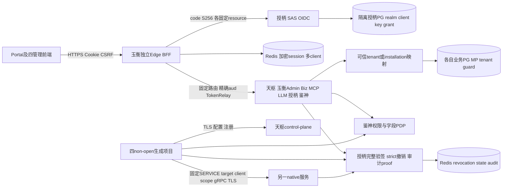
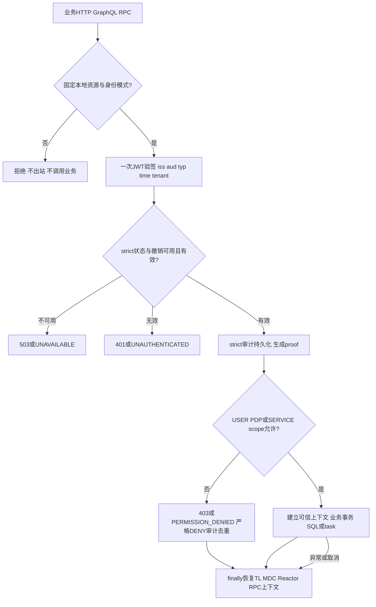
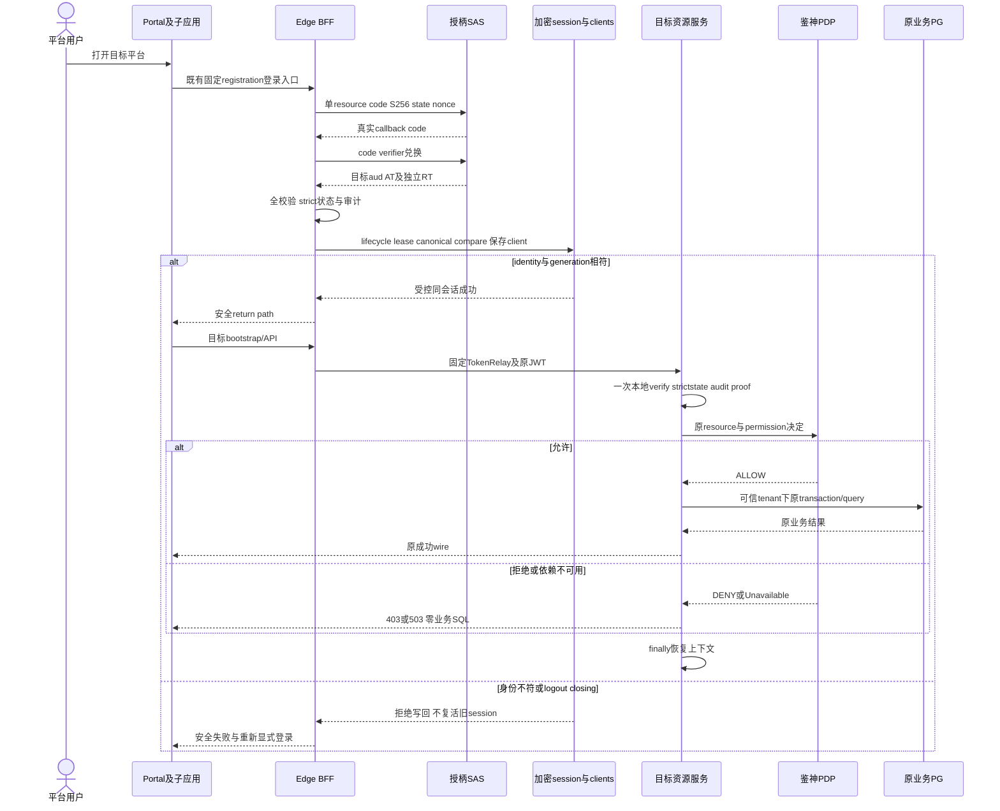

# 星垣各平台与非 open Archetype 完整接入设计

| Field | Value |
| --- | --- |
| Document | `2026-10-11-10-26-xingyuan-native-full-integration.md` |
| Template Version | `7` |
| Status | `Accepted` |
| Type | `Architecture / Bugfix / Integration` |
| Complexity | `Complex` |
| Complexity Drivers | 多 issuer、USER/SERVICE 双身份、Servlet/Reactor/GraphQL/gRPC 上下文、BFF 多资源会话、跨平台授权、生成产品与真实进程验证 |
| Created | `2026-10-11 10:26 Asia/Shanghai` |
| Updated | `2026-10-16 11:52 Asia/Shanghai` |
| Owner | mario |
| Repository | Egon-COLA |
| Scope | Xingyuan消费方、Portal、四native真源/生成/门禁、隔离联调；另拟纳入DEC-007直接必要的9路径Outbox/JPA兼容 |
| Change Surface | SDK 观测及 RPC 扩展；消费方安全链/可信上下文/最小授权；Edge registration 与资源路由绑定；前端真实制品与同源挂载；native 示例安全入口与 Agent boundary；隔离联调脚本及测试 |
| Affected Chapters | §7, §8, §9, §10, §11, §12, §13, §14, §15, §16, §17, §18 |
| Source Requirement | 2026-10-11 用户要求其余平台完整打通、非 open 接入星垣、允许浏览器验证、不启动 Docker；小问题自主推荐修复，严重问题确认 |
| Baseline Revision | `main @ b074c6673`；设计开始时工作树干净 |
| Amends | [多租户 OAuth/OIDC 基础设计](2026-09-22-17-14-tianquan-multitenant-oauth-oidc-design.md) §7.3.1 的第一方 BFF 资源选择、§7–§10/§12/§14–§16 的消费方接入；[自身加固](2026-10-10-12-36-tianquan-security-self-hardening.md) §3.2的其他平台/模板排除仅在本阶段解除、§7–§10的复用扩展；[Agent 研究与知识库设计](2026-09-10-11-51-agent-archetype-knowledge-rag.md) §3/§6–§9/§14–§16 的身份来源与依赖边界 |
| Supersedes | None |
| Depends On | [授柄、鉴神自身加固](2026-10-10-12-36-tianquan-security-self-hardening.md) §7–§10/§14–§16；[OAuth 当前代码修订](2026-10-08-10-18-oauth-current-code-alignment.md) 已执行并获准部分；[原生/Open 依赖治理](2026-09-07-16-52-archetype-native-open-dependency-governance.md) §7/§8/§14–§16 |
| Related Specs | [Archetype 组件契约](2026-09-20-12-18-archetype-component-contract-convergence.md)；[两阶段生成](2026-08-27-20-31-archetype-two-stage-source-generation.md) |
| Related Plans | [完整接入实施 Plan](../plan/2026-10-11-12-03-xingyuan-native-full-integration-plan.md) |

## 1. Summary

授柄、鉴神已完成自身安全加固并发布共享前端包 `@egon-cola/admin-web-shared@0.2.5`。其余消费方仍有旧制品、缺审计 proof、身份类型转换丢 details、原生示例信任请求头或固定角色、Agent 独立 API-key 等缺口。完整接入必须证明可信身份从入口到业务授权、租户 SQL、出站调用和审计的连续性，不能以编译通过或 fixture 页面替代真实联调。

本设计复用既有授柄 JWT/撤销/客户端缓存、鉴神 PDP/资源注解/字段策略、天枢配置注册、玉衡独立 Edge 与业务引擎，保持每个模块现有分层。推荐 Edge 按服务端白名单为每个资源选择独立 OAuth registration 和 token，同一会话保持相同 issuer/subject/tenant；DEC-004已获用户确认。四种 native 模板覆盖所有现存 REST、GraphQL、RPC 入口；Open 模板只做不变性回归。

用户已允许新建隔离测试库/租户/客户端/权限数据、必要 Java/Node/Edge 和专用 HTTPS 进程及浏览器测试。运行只管理本任务 PID 和新数据，不启动 Docker。最终成功需要真实跨平台 SSO、最小 scope/aud、租户隔离、退出撤销、native 注册/RPC 和生成产品证据；未执行项不能标记完成。

## 2. Background and Current State

### 2.1 用户与业务背景

登录身份由授柄负责，业务授权由鉴神负责，天枢负责配置/注册，玉衡保留管理面、Biz/MCP/LLM 引擎和独立 SCG/BFF。Portal 挂载四个管理前端。Archetype 是可生成的业务项目示例，不能把示例默认角色、tenant=1/0、外部 X-Tenant-Id 当生产信任来源。

### 2.2 证据表

下文路径别名：`X=egon-cola-xingyuan/`，`S=X/egon-cola-tianquan-shoubing/`，`J=X/egon-cola-tianquan-jianshen/`，`D=X/egon-cola-tianshu/`，`Y=X/egon-cola-yuheng/`，`A=egon-cola-archetypes/source-projects/`。别名展开不增加新目录。

| Evidence ID | Classification | Exact path/symbol/decision/command | Observed fact | Design significance | Verification limit/freshness |
| --- | --- | --- | --- | --- | --- |
| EVD-001 | Static repository | 自身加固 Plan §13；`HEAD=b074c6673` | Step 11 及最终源码审计完成；0.2.5 签名制品可用 | 重用已完成能力，剩余消费方单独接入 | 前次255后端/55授柄Web/64鉴神Web/14共享测试是受控证据；真实运行仍未验收 |
| EVD-002 | Static repository | `D/egon-cola-tianshu-admin/.../DdcAdminSecurityConfiguration.java`、`IdpJwtDdcRegistrationCredentialVerifier.java` | 管理链缺观测；注册 verifier 未独立处理 Unavailable | 单次验签与503保持依赖故障语义 | 当前源文件，未发真实注册请求 |
| EVD-003 | Static repository | `Y/yuheng-admin/.../GatewayAdminServiceAuthorityFilter.java`、`GatewayPersistenceContextFilter.java` | SERVICE auth 重建丢 details；租户读法只接受 JwtAuthenticationToken | proof 保留，核对真正的 USER/SERVICE principal | 不改变玉衡 installation tenant 的数据模型 |
| EVD-004 | Static repository | `S/egon-cola-tianquan-shoubing-gateway-adapter/.../IdpGatewayJwtVerifier.java` | 自建 route-resource verifier 无观测并丢 proof | GatewayAuthContext 保存可信 proof，不放请求头 | Biz/MCP 延续独立引擎 |
| EVD-005 | Static repository | `Y/yuheng-edge-gateway/.../EdgeSecurityConfiguration.java`、`EdgeSessionController.java`、`EdgeAuthorizedClientRepository.java` | 所有 registration 固定同一 resource；session 固定 aud；bare TokenRelay 使用当前登录 client；仓库已加密存多 client | DEC-004：复用多 client 仓库而非放宽 aud | 源码缺口，不能由测试代理伪装解决 |
| EVD-006 | Static repository | `Y/yuheng-starter-openapi-webmvc/...SecurityAutoConfiguration.java` 及 webflux 对应文件 | docs 窄链只用默认 JWT 与 scope，缺完整状态/撤销校验 | 保持默认关闭和窄路径，接入原完整 SERVICE verifier | 不扩文档发布/发现协议 |
| EVD-007 | Static repository | `Y/yuheng-llm-gateway/.../LlmApiController.java`、`LlmClientCredentialFilter.java`、application.yml | 已有 Starter，但无保护 `/v1/**` 的完整自有链 | 先认证/授权后模型调用；保留兼容协议 | 本轮不重新设计知识库或模型提供方 |
| EVD-008 | Static repository | `A/egon-cola-source-{light,service,web}` 的 NativeHttpSecurityConfiguration 与 context filters | permitAll/原始请求头/默认角色仍在 | 必须保护既有 HTTP、GraphQL、RPC 全路径 | 当前三个 native prod TLS 已为true，不把正确配置改坏 |
| EVD-009 | Static repository | `A/egon-cola-source-agent`；`scripts/checks/check-archetype-family-boundaries.py` | 六层 Agent 用 API-key/默认租户，boundary 禁 Tianshu/RPC | DEC-001 已批准统一身份并修改对应边界门禁 | 不迁移研究/知识业务层、不改旧 SQL |
| EVD-010 | Static repository | 三个剩余前端 package.json/lock；共享 `src/auth/gatewayAuthClient.ts` | 天枢 logical npm 包名不存在；玉衡/Portal 旧0.2.4；0.2.5 已支持 registrationId | 使用可信0.2.5 alias，无源码 paths 替代制品 | 不需要为 registration 参数再次发布新包 |
| EVD-011 | Static repository | `scripts/generate_archetypes.sh` | generate/check 只接受一个动作并发现全部7种；.generated 是派生产物 | 全量生成但证明三种Open源码/产物内容不变 | 不发明native-only参数，不手改.generated |
| EVD-012 | Runtime evidence | 2026-10-11只读本机探查；旧 `.runtime/unified-identity` PID状态 | PG/Redis运行；旧服务PID已不存在；Edge未由旧脚本管理；需要专用TLS入口 | 新隔离运行流程，不复用旧清理逻辑 | 未读取秘密值，未创建库、未启动平台、未执行浏览器 |
| EVD-013 | Runtime evidence | `verify-local-stack.sh --static-only`、`test-direct-run-contract.sh`、脚本bash -n | 现有静态门禁通过 | 保留基线，补真正新协议门禁 | 仅静态，不是SSO/SQL隔离证据 |
| EVD-014 | User decision | 本轮六项回答 | Agent统一接入、隔离联调、可选Micrometer API、每资源token同BFF会话、显式目录/字段rulewriter及全USER scope双校验已获准 | DEC-001–006 | 只按明确内容使用权限 |

| EVD-015 | Static repository | J/Admin/db/migration/V7__globalize_resource_catalog_and_remove_manifest.sql:166–169；GlobalResourceCatalogService、Rbac3DevelopmentResourceBootstrap | permission_code全局唯一；resource是application_id/resource_type/resource_code联合唯一；CI仅frontend种类，现APIwriter是local自动grant bootstrap | rootArtifact namespace；登记与grant分离，新增显式owner内注册 | 不改SQL/index，不宣称注解即已登记 |

### 2.3 缺口

认证与授权消费方尚未完整串接，原生模板部分入口仍公开，Edge实际单资源实现与多平台需求不符。本文不重跑已完成加固；新的剩余接入Plan另行记录。

### 2.4 Evidence and current-chain map

| Entry/trigger | Current call chain | Data read/written | External dependency | Consumers | Evidence |
| --- | --- | --- | --- | --- | --- |
| 管理HTTP | IdpBearerAuthenticationFilter → RBAC桥/能力filter → context → Controller | JWT/cache、业务SQL | Redis/鉴神/PG | 天枢、玉衡管理端 | EVD-002/003 |
| Gateway流量 | Route resource → IdpGatewayJwtVerifier → GatewayAuthContext → authz → engine | trusted issuer/cache、路由数据 | JWKS/Redis/鉴神 | Biz/MCP | EVD-004 |
| BFF登录/转发 | resolver → SAS code/PKCE → AuthorizedClientRepository → bare TokenRelay | session、多client加密Map | 授柄/Redis/下游 | 五前端 | EVD-005 |
| 原生样例 | permitAll或API-key/原始headers → resolver/facade → application/domain → repository | 默认tenant/role、业务SQL | 天枢/RPC/PG | 生成四种项目 | EVD-008/009 |
| SERVICE出站 | 当前RPC USER relay factory；Tianshu注册已用IdpServiceOAuth2Client | 客户端token缓存 | 授柄/gRPC | service↔web及control-plane | 既有Starter RPC源码 |

## 3. Goals and Non-goals

### 3.1 Goals

全平台使用当前认证/授权契约，所有消费方单次完整验签、严格撤销、审计与指标；所有 native 入口身份、权限、租户和出站凭证可追踪。生成产品可独立解析当前制品并运行。真实测试通过任务专用 HTTPS、真实 SAS code/PKCE 和最小授权，覆盖两个租户、不同资源、USER/SERVICE 和失败恢复。

### 3.2 Non-goals

不启动Docker；不覆盖现有业务库、旧runtime、系统证书信任或系统nginx；不修改已有SQL/Flyway/managed-DDL历史；不引入新安全框架/消息总线/独立SDK transport模块；不重构研究、知识库、路由、配置、用户/课程等业务分层；不为示例默认授全权；不扩大Open源码接入；不重新实施已完成授柄、鉴神Step；完成后不自动重启任何服务。

### 3.3 Change Surface and Design Depth

| Area/layer | Disposition | Exact repository evidence | Changed or preserved behavior/contract | Required Spec treatment | Chapter(s) |
| --- | --- | --- | --- | --- | --- |
| SDK观测、RPC USER/SERVICE | Affected | S/Starter/security、audit；现有IdpServiceOAuth2Client | 共用适配、严格proof、目标白名单/最小scope | 组件/上下文/故障/依赖详细设计 | §7, §8, §9, §10, §13, §14, §15, §16 |
| 各宿主安全链/上下文 | Affected | EVD-002–009 | 认证先于业务和SQL，DENY/Unavailable明确 | 各入口边界与测试 | §7, §8, §9, §10, §13, §14, §15, §16 |
| Edge资源会话与路由 | Affected | EVD-005 | 每资源精确aud、同一可信身份会话 | 完整状态/并发/协议兼容设计 | §7, §8, §9, §10, §12, §13, §14, §15, §16, §17, §18 |
| 目录注册owner与内CLI | Affected | GlobalResourceCatalogService/原localbootstrap/V7约束 | 显式版本化目录登记、无自动grant、rootArtifactnamespace | transaction/既有列/内合同/CLI详细设计 | §7, §8, §9, §10, §11, §13, §14, §15, §16 |
| 原生REST/GraphQL/RPC适配 | Affected | native controllers/resolvers/facades | 加PEP/可信上下文，已有成功业务语义不变 | 原子入口与安全delta、协议文档 | §8, §9, §10, §14, §15, §16 |
| 现存业务Domain/Repository/SQL | Unchanged | source四family、平台业务包 | 事务/幂等/事件/SQL数据模型继续由原owner负责 | 不变边界和可信tenant接入验证 | §11,§13,§14 |
| Outbox同DS本地JPA兼容 | Affected | §7.0.1/既有Outbox resolver/MPvalidate/guard | 仅严格同DS JPA识别与实际ConnectionHolder，不改变producer/worker事务分界 | 9路径、optional API、受控与真实回滚详细方案 | §7.0.1/§8/§14/§16 |
| 测试数据与隔离运行 | Affected | EVD-012，真实realm/client/grant/bootstrap owner | 新库只用真实写入/cipher/事务，任务TLS/进程 | 数据owner、provision防误操作、验收 | §7, §9, §11, §14, §15, §16 |
| 前端制品/路由/权限呈现 | Affected | package/lock、router、AuthContext、Portal manifest | 真实0.2.5、固定registration、可配置base、session generation | 状态/API映射/同源行为 | §8, §12, §14, §15, §16 |
| Open source/definitions产物 | Unchanged | 三个-open source/definitions | 不改变认证/协议/版本；全量生成内容等值 | hashes/七产品兼容回归 | §8,§14,§16 |
| 新关系表/新业务数据模型 | Not applicable | 重用现有realm/client/grant/role schema，source SQL保留 | 无新表/列/键/索引/ER关系 | N/A，有证据说明 | §11 |

## 4. Requirements and Acceptance Criteria

### 4.0 原子需求

| ID | Source wording / Requirement | Priority | Observable acceptance criteria |
| --- | --- | --- | --- |
| REQ-001 | 各星垣平台完整打通 | Must | 天枢、玉衡Admin/Biz/MCP/LLM/Edge、Portal及授柄/鉴神回归均覆盖；真实授权失败不进入业务 |
| REQ-002 | 重用自身安全加固 | Must | 完整验签仅一次，proof在严格撤销和审计成功后可用，DENY只记录一次；9种指标有界 |
| REQ-003 | 最小权限双身份 | Must | 每服务独立client；目标aud/scope由本地绑定；HTTP USER与RPC SERVICE原子PEP；无USER失败转SERVICE |
| REQ-004 | 可信租户全链路 | Must | issuer registry=claim=principal；SQL/cache/task租户来自可信上下文；外部头不授信；finally/cancel恢复 |
| REQ-005 | Edge真实多资源SSO | Must | 每资源独立注册/令牌，不能误用另一aud；同会话身份/tenant一致，refresh与logout覆盖全部token；DEC-004已获准 |
| REQ-006 | 原生四family完整接入 | Must | light/service/web/agent现存REST、GraphQL、RPC均认证授权；Agent六层与业务行为保留 |
| REQ-007 | 字段/页面/按钮/路由授权 | Must | 现有鉴神API/method/permission/resource及前端bootstrap guard一致；存在受控写字段时显式调用write闸门，DENY无写入 |
| REQ-008 | 正确依赖与制品 | Must | 余下三个前端签名制品0.2.5实际typecheck；native项目当前Starter制品解析；仅获准必要内部依赖及optional micrometer-core |
| REQ-009 | 模板生成与Open保护 | Must | source为真源、四native生成IT；三Open源码和派生产物内容byte-identical；全7回归不过则不完成 |
| REQ-010 | 允许真实隔离浏览器测试 | Must | 新数据库/逻辑RedisDB/测试命名空间/PID/TLS/浏览器profile；Portal四平台SSO、两租户、step-up/logout/撤销实测 |
| REQ-011 | 不启动Docker、代码优雅 | Must | 不调用Docker；固定责任边界/最小复用/17MC；每Plan Step验证后focused commit |
| REQ-012 | 诚实最终审计 | Must | 按源码/受控/真实运行分别记录；任何required门禁未通过保持未完成，报告确切原因 |
| REQ-013 | 完整接入所需的真实目录登记 | Must | namespaced API/GraphQL/field目录由鉴神既有owner显式登记，版本/校验/事务可复核；与permission mapping/role grant分离，空或pending不授权 |

### 4.1 Scenario matrix

| Scenario | Preconditions | Ordered path / state effect | Observable outcome | Constraint / tests |
| --- | --- | --- | --- | --- |
| 正常USER业务 | 受信tenant USER、目标token/细权限已授 | verify一次→strictstate/audit→PEP→trustedtenant→原业务 | 原成功body，proof有效，finally释放 | REQ-002/004/007；TEST-002/011 |
| 无身份/错误类型或aud | 缺token、IDtoken、另一resourceAT | 入站authentication拒绝，零businesscall | HTTP401/RPCUNAUTHENTICATED | TEST-002/003/023 |
| 有身份无授权 | 无USER resource/permission或SERVICE scope | auth有效后PEP拒绝、DENY去重 | 403/PERMISSION_DENIED、无SQL | TEST-003/014/022 |
| strictstate/audit故障 | Redis/spool/PDP无法可靠完成 | Unavailable保持原typed语义、不castValid | 503/UNAVAILABLE，readyfalse | TEST-001/003 |
| 两resource同identity登录 | canonical会话存在、另一个正常codeflow | state绑定→完整tokencheck→同identity compare→addclient | 两exactaud独立，absoluteTime不重置 | DEC-004；TEST-015/016 |
| callback/refresh与logout并发 | RT临期或code在途，logout开始 | 同lifecyclelease/closingfence→durableintents→localinvalidate | late写回拒绝，无token复活 | TEST-017/019 |
| GraphQL/SSE异步取消 | verifiedsnapshot进入另一worker | restore scope→execute→finally/cancel release | 后续tenant不继承，原协议termination | TEST-004/013 |
| 真实provision部分失败 | 任务新库白名单、真实owner事务 | 独立realm/keytx，未知commit新连接确认 | 停止误写、不repair/drop、不继续假ready | TEST-030 |
| 生成与旧artifact | Starter未install或Open内容漂移 | exacthash/dependency验证阻断后续 | 不宣称生成产品完整 | TEST-027–029 |

### 4.2 Use-case analysis

| Actor ID | Role | Evidence | Authority boundary |
| --- | --- | --- | --- |
| ACTOR-001 | 平台用户 | 五前端AuthContext/Portal | 真实USER JWT；仅已授资源/租户 |
| ACTOR-002 | 微服务 | native consumer/provider、天枢注册 | 独立SERVICE client、固定目标/最小scope |
| ACTOR-003 | 平台管理员 | 既有资源/授权/租户管理owner | provisioning仍检查权限/realm，不默认超管 |
| ACTOR-004 | 集成测试执行者 | 用户已批准隔离运行 | 只管理任务创建资源及PID，不碰已有数据 |

| ID | Use case/goal | Actor | Trigger/preconditions | Main outcome | Alternatives/failures | Postconditions | Requirements | Interfaces/pages | Tests |
| --- | --- | --- | --- | --- | --- | --- | --- | --- | --- |
| UC-001 | Portal打开有权管理平台 | ACTOR-001 | 固定平台入口；真实SAS会话和client/grant可用 | code/PKCE取目标token；bootstrap可用 | 无scope403；无资源token401；AS拒绝不循环 | token仅服务端；资源隔离 | REQ-001,005,007 | 既有OAuth入口/平台bootstrap/Portal | TEST-020–024 |
| UC-002 | native用户业务读写 | ACTOR-001 | USER、正确tenant和对应细粒度授权 | REST/GraphQL同一application行为 | 原始headers不授信；字段DENY先拒绝 | 无跨租户SQL/缓存/任务残留 | REQ-004,006,007 | §9原子catalog | TEST-011–014, TEST-033–036 |
| UC-003 | 服务调用另一服务 | ACTOR-002 | 本地consumer/provider binding、独立client/grant | 缓存或一次client_credentials，固定aud/scope RPC | 缺绑定/坏token→拒绝；Unavailable503/UNAVAILABLE | 无过宽token/无USERfallback | REQ-002–004,006 | SDK RPC、native facades | TEST-005–009,026 |
| UC-004 | 强认证、切租户、退出 | ACTOR-001 | CSRF、固定registration/tenant白名单 | 所有heldtoken退出/轮换清理，前端generation更新 | pending/unknown保持真实remoteState；race被CAS拒绝 | 旧client无回写；旧权限缓存清空 | REQ-004,005,010 | 既有stepUp/logout/tenant entry | TEST-015–019,025 |
| UC-005 | 生成并验收项目 | ACTOR-004 | 获准Plan、已安装当前Starter、任务新库 | 四native生成IT及真实注册/RPC/tenant验收 | 解析旧JAR/Open漂移/运行失败不可PASS | 保留证据，服务不自动重启 | REQ-008–012 | generator/隔离harness | TEST-027–036 |

## 5. Constraints, Assumptions, and Decisions

### 5.1 Confirmed constraints

原SQL及checksum不可变；source-projects为模板真源；保持light单模块、service/web七层、Agent六层；纯domain/facade不引入Spring Security/MP；授柄SAS、鉴神PDP、天枢control-plane和玉衡引擎职责保留。全链HTTPS和gRPC TLS使用独立任务CA，不改全局信任。任何缺可信身份、tenant、scope、审计或严格撤销不可进入业务。不得把客户端头或DTO metadata视为鉴权输入。

### 5.2 Assumptions

| ID | Inference | Repository evidence | Why reversible | Impact if wrong |
| --- | --- | --- | --- | --- |
| ASM-001 | 前端base和router basename复用`VITE_BASE_PATH`配置，独立模式默认`/` | 现有独立SPA路由 | 保持独立模式，部署路径可显式配置 | 子路径联调需调整manifest而非改业务URL |
| ASM-002 | Redis逻辑DB由只读DBSIZE选择空库后写任务namespace | 本机Redis已运行且受保护 | 不清库/不覆盖旧keys | 无可用DB则改获准的独立实例方案，不直接复用旧state |
| ASM-003 | 必要内部Starter沿当前父POM版本，无升级 | 四family与平台POM | 最小接入依赖，不新框架 | 解析差异先更正具体POM和Plan清单 |
| ASM-004 | 权限码以rootArtifactId命名空间，source原值为sourceArtifactId，现生成器正常替换；resource同步命名清晰 | EVD-015及生成脚本已有artifact替换 | 不改全局唯一约束，保留44业务意图alias；重复applicationCode/owner冲突在登记前拒绝 | 不允许覆盖另应用目录，target scope从真实published namespace核对 |

### 5.3 已决事项

| ID | Decision | Owner | Evidence and rationale | Requirements |
| --- | --- | --- | --- | --- |
| DEC-001 | Agent采用统一Bearer/可信tenant，允许必要Tianshu/RPC依赖，保留六层，生产不用API-key替代身份 | 用户 | 2026-10-11 async明确回答；旧boundary是当前接入阻碍 | REQ-004,006 |
| DEC-002 | 使用现有本机PG/Redis，新隔离库/测试facts，启动必要Java/Node/Edge和专用HTTPS/浏览器；不改旧库/系统信任/不Docker | 用户 | 同轮明确回答 | REQ-010,011 |
| DEC-003 | 授柄Starter可选io.micrometer:micrometer-core，Boot管理1.15.12；readiness为JDK BooleanSupplier | 用户 | Starter目前只有observation API，不重复各宿主指标；无新Actuator API依赖 | REQ-002,008 |
| DEC-005 | 显式部署目录登记与角色字段规则写入内方法/离线CLI纳入；复用角色版本/授权版本/Outbox；不HTTP/SQL/autoGrant | 用户 | 2026-10-11明确回答“纳入显式目录与字段规则写入”；现defaultAccess不能WRITE且FieldPolicyMerger只遍历fieldrules | REQ-007,013 |
| DEC-006 | 四管理平台及Biz/MCP/LLM的USER scope与原细权限同时必过；签名route policy.configuration增加bounded requiredOAuthScopes，未声明拒绝/旧定义显式补发布，不SQL/框架/自动扩旧scope | 用户 | 本轮明确选择补齐scope与细权限双重校验；现完整验签保存scope但消费方未AND使用 | REQ-001,003,005,007 |

### 5.4 重大方案闭合记录

| ID | Question and options | Recommendation, not decision | Impact | Owner | Status |
| --- | --- | --- | --- | --- | --- |
| DEC-004 | 每资源独立token同一BFF会话；或授柄第一方多aud token | 已选前者：现有单resource guard、加密多client仓库与0.2.5 registration参数可复用，严格aud不变 | Edge会话/路由/退出与旧§7.3.1第一方aud约定修订；不由测试配置掩盖 | 用户 | Resolved：2026-10-11明确选择“采用每资源独立 token、同一 BFF 会话” |
| DEC-007 | 既有Outbox组件增加同一DataSource的JpaTransactionManager兼容；或迁移鉴神角色持久化/拆事务 | 推荐前者：仅Boot管理optional spring-orm API、typed可选helper及严格同DS/MP factory/绑定ConnectionHolder检查；既有JPA框架保留 | 直接必要的跨组件改动；JPA规则/授权版本/Outbox须同LOCAL事务；不SQL/新框架/双TM/REQUIRES_NEW | 用户 | Resolved：用户于2026-10-11 15:17 Asia/Shanghai明确回复confirmed，批准本行具体修订与整份Spec/Plan |
| DEC-008 | 一个资源入口alias按可信canonical issuer选择真实registration；或固定registration限制同一路径只能一个issuer | 推荐前者：既有resources map按logicalalias登记defaultRegistrationId与bounded issuerRegistrationIds；NEW取配置default、ACTIVE只取canonical issuer对应项，显式其他tenant realreg须先logout | 完成DEC-004真实多租户路由/跨平台append；五frontend现key取alias，pending存alias/realreg/issuer/generation，TokenRelay显式realreg；不新端点/query/依赖/源码文件 | 用户 | Resolved：用户于2026-10-11 15:17 Asia/Shanghai明确回复confirmed，批准本行具体修订与整份Spec/Plan |

## 6. Project Technology Context

| Concern | Current choice | Evidence | Design constraint |
| --- | --- | --- | --- |
| Java/Boot/Security | Java21；Boot3.5.16及父POM管理Security/SAS | 根POM及SDK/POM | 不按最新网络版本升级 |
| HTTP栈 | MVC宿主、独立SCG WebFlux Edge、自有Biz/MCP engines | 当前各application/config | Servlet filter不能塞Reactor；不混合Edge与引擎 |
| 数据 | PostgreSQL、Egon MP-SDJ、现有Redis/Redisson | 各POM/application/sql manifest | 重用tenant guard/managedDDL；旧脚本不修checksum |
| 前端 | React/TypeScript/Vite/Wujie、现有SDK/0.2.5 | package.json/locks | 用真实registry制品，不paths到共享源码假typecheck |
| 构建验证 | Maven/ArchUnit/GraphQlTester、Vitest/Playwright、现有生成门禁 | source/definitions/scripts/tests | 区分in-process与跨进程证据 |

### 6.1 Architecture profile and reuse ledger

| Owner | Profile | Exact evidence/verifier | Design action |
| --- | --- | --- | --- |
| 平台和Starter | 既有传统分包/技术自动配置 | 各security/config/service/repository包，自身Spec§6/§8 | 仅扩展现有owner，不套COLA新层 |
| native light | Egon-COLA Light单模块 | A/egon-cola-source-light及architecture tests | adapter/start security，domain纯业务 |
| native service/web | 对应原生七模块COLA | 各common/facade/domain/application/infrastructure/adapter/starter POM | 安全策略在入口/基础设施，保留依赖方向 |
| native agent | 原生Agent六层 | A/egon-cola-source-agent及boundary | DEC-001只调整认证/注册技术依赖，不加facade |

| Need | Existing candidate | Proven gap | Decision |
| --- | --- | --- | --- |
| 单次观测/strict审计 | IdpObservedVerificationComponent、TokenUsageAuditComponent、IdpSecurityMetricsRecorder | 宿主复制metrics/FSready，RPC/Edge未完整消费 | Lift到Starter，旧overload兼容 |
| MeterRegistry | Boot管理micrometer-core1.15.12 | Starter无core | DEC-003 optional依赖；纯Core不加Micrometer |
| readiness | 两自身宿主现有FSlease/key/DEAD/unsent/full守卫 | 其他宿主无 | JDK BooleanSupplier共用，宿主HealthIndicator组合 |
| SERVICE客户端 | IdpServiceOAuth2Client缓存/renewal/singleflight | RPC只USER relay | 本地target binding+CallCredentials，复用客户端缓存 |
| USER权限/字段 | 鉴神原MethodManager/PDP/FieldWriteAuthorizationComponent | sample固定角色/开放入口 | 原注解与显式write gate，不新authorization DSL |
| BFF多资源 | 加密AuthorizedClientRepository、SingleFlightManager、0.2.5 registrationId | 固定resource/implicitrelay | DEC-004复用仓库，增加可信binding |
| 测试realm数据 | 真实realm/key repositories、cipher、development bootstraps | 空库无初始realm/JWK | 仅test-only防误操作provision，不造生产bootstrap API |

### 6.2 User-mandated Java rule compliance

```text
1 类名规范，必须以 java的pojo规范命名。以dao po bo vo dto query command event等结尾
2 每层之间必须被 springboot-validation 校验，复用对象使用分组校验；基于原生和自定义约束注解、@Valid、@Validated 及 ConstraintValidator 扩展实现。ValidationUtils 只承担通用手工校验，不承载全部业务校验；电话号码复用 libphonenumber。
3 Java POJO 默认使用 class，注解为 @Data @NoArgsConstructor @AllArgsConstructor @Accessors(chain = true)，按构造目标选择 @Builder 或 @SuperBuilder；父类状态参与相等性时使用 @EqualsAndHashCode(callSuper = true)。只有不可变 value object 可以使用 record，并豁免 class 的 Lombok 规范；普通实体不能因简单而使用 record。使用 MapStruct、MapStructPlus 和 egon-cola-component-common-core 的 BaseConverter（双向）或 BaseForwardConverter（不可逆投影）进行转换。
4业务类必须使用@Slf4j注解注入log对象。如果业务类被spring管理，必须指定名称，如果是单例的情况下，参考@Service("userService")。如果需要依赖注入，必须@RequiredArgsConstructor进行修饰，不要代码中写。且属性必须被@qualify修饰。
5 工具类只允许使用jdk原生、Apache Commons(commons-lang3、commons-collections4、commons-io、commons-text、commons-codec、commons-beanutils)、Guava。针对Tika按需引入。
6 JSON 使用 Spring Boot Jackson；持久化枚举值使用 @EnumValue，向前端输出的枚举值使用 @JsonValue，禁止 ordinal 作为业务编码。
7 springboot 多环境配置文件，必须保持配置一致，但值不一定一致。
9 复杂业务必须引入设计模式，不允许硬编码
10 日期相关的必须使用java.time下的实体类，不允许使用java.util下的
11 只允许现有三层结构或当前 egon-cola-archetypes 的 DDD 结构，三层结构保持现状。必须尽量复用 egon-cola-components；持久化模块必须使用 Egon COLA MP Starter，DDL 统一由 egon-mp-sdj-ext-starter 分布式管理。业务唯一键必须组合业务列与 deletedAt（数据库 deleted_at），并验证 NULL、租户及重复软删除语义。采用 CQE（Command Query Event）；Event 必须经 egon-cola-component-transactional-outbox-starter 或 MQ 中间件投递。
```

| Literal rule | Affected? | Repository evidence | Exact design decision | Files/types/interfaces | Validation/test evidence | Status/blocker |
| --- | --- | --- | --- | --- | --- | --- |
| Rule 1 | Yes | 既有BO/DTO/proof、semantic技术类 | 新carrier用BO/DTO/Command/Result；不新Data/Info/Param | §8/§10 | type inventory/compile | PASS，设计约束 |
| Rule 2 | Yes | 各constraint/Validator、现有Validated应用入口 | binding外部→properties→组件、REST/GraphQL/RPC→application均验证；保留组/幂等 | §7.3/§9 | TEST-005/011–014 | PASS，设计约束 |
| Rule 3 | Yes | 既有Lombok/common BaseConverter | 可变properties用class标准注解与Builder；immutable proof值对象可record/defensive copy；跨角色MapStruct | §10 | constructor/mapping测试 | PASS，设计约束 |
| Rule 4 | Yes | 项目lombok.config复制Qualifier | final qualified依赖、RequiredArgsConstructor、Slf4j、具名Bean，不复制全局Bean别名实例 | §8技术组件 | Bean/wiring gate | PASS，设计约束 |
| Rule 5 | Yes | JDK/Spring现有API | JDK crypto/FS，已有Commons/Guava；无自造Utils | §7/§15 | imports/dependency gate | PASS，设计约束 |
| Rule 6 | Yes | Boot Jackson/既有wire | proof/token忽略；完整现有error envelope；固定enum显式JSON值，不ordinal | §9/§10 | serialization/OAS | PASS，设计约束 |
| Rule 7 | Yes | base/dev/prod/test配置 | 所有新增key各profile同结构，enabled/TLS值按环境；template.test外部关闭 | §8/§15 | config parity | PASS，设计约束 |
| Rule 9 | Yes | observer/Decorator/目标Strategy与现有OAuth manager | 真实 variation以Decorator/Strategy/Context scope复用；不新bus/factory层 | §13 | variation/concurrency tests | PASS，设计约束 |
| Rule 10 | Yes | Clock/Instant/Duration | UTC Clock、Instant生命周期、Duration超时；不Date/Calendar | §7/§10 | fakeClock/expiry tests | PASS，设计约束 |
| Rule 11 | Yes | §6.1 profiles/MP/DDl/outbox | 不增层/新表/业务event；只可信tenant进入旧MP/outbox | §8/§11/§13 | architecture/SQL/生成门禁 | PASS，设计约束 |

## 7. Architecture Design

### 7.0 Minimum-design baseline and element-necessity audit

| Proposed element | Change | Requirements | Direct alternative and inadequacy | Added cost/failure | Verdict |
| --- | --- | --- | --- | --- | --- |
| 共用观测/FSreadiness | Expand existing Starter | REQ-002 | 复制两宿主会使各平台审计/metrics语义漂移 | 一个optional API，FSlease生命周期 | Merge |
| RPC SERVICE target binding | Expand existing factory/context | REQ-003 | USER relay无client mode；body target不可授信 | 有界配置与token获取失败，无新缓存 | Add |
| Edge资源映射 | Expand existing properties/repo/routes | REQ-005 | 固定resource/bare relay不能访问多aud | 每资源一次codeflow、独立client/grant；DEC-004 | Add，已批准 |
| native入口PEP | Expand existing adapters | REQ-006/007 | permitAll/API-key/固定角色不能授信 | PDP/strict审计可用性；业务层不扩 | Add |
| 同DS JPA Outbox兼容 | Expand existing 4 source/5 test paths | REQ-007/008/013 | 现DSTX-only守卫无法接入真实JPA owner；迁移全角色仓库或分开事务都不满足最小/原子性 | 一个Boot管理optional ORM API、typed optional gate和真实连接/PG回滚验证；不新框架/SQL | Add，DEC-007待批准 |
| 测试provision harness | New test-only entry | REQ-010 | 旧脚本不创建空realm/JWK并碰旧runtime | 防误操作与任务facts清单 | Add |
| 新生产provision API/事件总线/表 | New candidate | 无独立需要 | 真实owner与既有schema足够 | 不必要协议/状态/迁移 | Remove |

| Path | Network calls | Client states | Server state | Failure/TOCTOU | User value |
| --- | --- | --- | --- | --- | --- |
| 当前单资源BFF | 首次codeflow；转发一RTT；需刷新时token请求 | 当前registration | 单登录身份、多client但固定aud | 跨平台token不匹配 | 不能满足完整接入 |
| 推荐逐资源BFF | 每新资源正常codeflow，已有AS SSO可复用；缓存转发一RTT；临期该client刷新一次 | 固定平台registration、loading/needsLogin/denied | 一个canonical身份，多独立加密client | callback/logout/refresh CAS防旧写回；无预flight发现API | 精确aud，多平台SSO |
| RPC缓存命中/miss | 命中一次RPC；miss加一次固定client_credentials | 无浏览器状态 | 原cached client key/singleflight | token未知失效/Unavailable拒绝 | 最小权限机器互调 |

### 7.0.1 DEC-007：既有 Outbox 的同数据源 JPA 事务兼容提案

状态：ACCEPTED，用户本轮confirmed批准该具体修订与整份Spec/Plan；未修改源码。只解决本轮鉴神目录/角色字段写 owner 的实际能力缺口，不迁移既有 JPA 角色仓库，不增加第二事务管理器、XA/JTA、DAO复制、框架或 Schema。

#### 证据与边界

`OutboxMybatisPlusAutoConfiguration#validateStoreInfrastructure` 当前 lines222–225 强制 DataSourceTransactionManager，同 DataSource 的 JpaTransactionManager 也被拒绝。`OutboxInfrastructureResolver#resolve` 目前只对 DSTX 校验 getDataSource，默认/显式/primary 选择与 OutboxInfrastructure record 均已有。`OutboxTransactionGuard#requireSelectedTransaction` 当前仅验证 active/synchronization 与 selectedDS hasResource，未验证真实 ConnectionHolder。

鉴神 Admin 已依赖 spring-boot-starter-data-jpa，使用真实 EntityManager 仓库；application.yml 选 dataSource/transactionManager。现 RoleResourceGrantService.replace 为 @Transactional 并依次调用真实 JPA grant repo、TenantAuthorizationStateRepository.increment、TransactionalOutboxAuthorizationEventPublisher.enqueue。Outbox DefaultTransactionalOutbox.enqueue → MybatisPlusOutboxStore.enqueue → technicalContext.execute → 原 OutboxMessageRepository.insertMessage，producer不进入workerTransaction。现 outboxWorkerTransactionTemplate 的 REQUIRES_NEW 仅用于 claim/ack/retry 等已存在 worker 行为，本提案保持，不拿它解决 producer 原子性。

现 Outbox POM 无 spring-orm compile；只增加 org.springframework:spring-orm optional=true、无 version、由当前 Boot3.5.16 管理。没有新增 jakarta.persistence-api dependency，没有新增 Hibernate/JPA starter。鉴神 existing starter-data-jpa 提供真正测试所需 API/Hibernate；component tests不假定它们存在。

实际configured Maven仓库为 `/Users/mario/maven/repository`。已读当前 Boot3.5.16 BOM：Spring Framework6.2.19、Hibernate6.6.53.Final、Persistence API3.1.0；新增optional ORM仍省略version，按这个现BOM管理，不升级版本。当前source证据来自实际cached artifacts，不能当真实SpringContext已运行。

已重复最小API编译 `/tmp/xingyuan-jpa-compat-api-proof/configured-6.2.19`：javac21 --release21，classpath仅实际configuredrepo Spring6.2.19 orm/jdbc/tx/core/beans/context/expression/jcl/aop，排除Persistence API/Hibernate，typed nested instanceof JpaTransactionManager/getDataSource、两canonicalClassUtils gates、默认constructor/setDataSource编译exit0。此项只证明optionalORM compile足够；未运行Maven/真实Context/DB/服务。

实际Boot3.5.16源码：`HibernateJpaAutoConfiguration.java:42–44`明确before DataSourceTransactionManagerAutoConfiguration；`JpaBaseConfiguration.java:94–100`以@ConditionalOnMissingBean(TransactionManager.class)创建默认名transactionManager的JpaTransactionManager；`DataSourceTransactionManagerAutoConfiguration.java:59–65`同missing条件，通常因此退让。实际Spring6.2.19 `JpaTransactionManager.java:327–354`从唯一现EntityManagerFactory/EntityManagerFactoryInfo自动取得DataSource和JpaDialect。JA当前没有显式TM Bean，Egon MP两个nativeAutoConfiguration没有PTM Bean或DSTX类型限制，只先于Boot DataSource注册唯一@Primary logical dataSource；MP `EgonColaLocalWriteGuardInnerInterceptor:77–97`及`EgonColaRepository#requireTransaction:595–602`只沿Spring active/sync/ConnectionHolder/SpringManagedTransactionFactory校验。因此本提案不新增JA manager Bean或path，但controlled/live都必须验证默认Bean实际来源/唯一性/同DS；不能用POM的starter-data-jpa声明代替。

实际artifact源码hash：Boot3.5.16 autoconfigure sources `577c8541d2c4dc32285a26bc618afbea646f4f0c8563e1c2bb308346c37f57c7`；spring-orm6.2.19 sources `4bbbde7f79c26125f2413f11abcb26826caec8ff5ccd2acc25a359588bfb6172`。原非configured ~/.m2 版本证据由本实际版本证据取代。

ConnectionHolder.hasConnection()/isTransactionActive为protected，Guard不能调用；public getConnectionHandle/getConnection 与 DataSourceUtils.isConnectionTransactional 可用。实际Spring6.2.19 JpaTransactionManager#doBegin:435建立JDBC ConnectionHolder、442 bindResource、458只给EntityManagerHolder设置synchronizedWithTransaction；JDBC ConnectionHolder仅new/bind，因此不得把holder同步flag作为本地JPA事务必要条件。

#### 最小设计

Resolver新增 package-private static `supportsSelectedLocalTransaction(PlatformTransactionManager manager, DataSource selected, ClassLoader classLoader): boolean`。DSTX分支首先比较既有getDataSource()==selected；已知canonical optional类型同时使用 Spring ClassUtils.isPresent("org.springframework.orm.jpa.JpaTransactionManager",classLoader) 与 ClassUtils.isPresent("jakarta.persistence.EntityManagerFactory",classLoader) 做明确classpath存在门禁，两者都存在才进入private static nested `JpaTransactionManagerSupport` 用typed instanceof/getDataSource()==selected。复用本模块现 `src/main/java/top/egon/cola/component/outbox/aop/TransactionalMessageMethodValidator.java#isAsynchronous`（约72行）的框架optional-type ClassUtils.isPresent pattern，非新增generic business Utils。无JDK反射、类名猜测、getMethod/invoke、自定义Utils或公开SPI。

`classLoader` 从现 ConfigurableListableBeanFactory.getBeanClassLoader 取得；不在static initializer缓存一份跨context存在状态，FilteredClassLoader负例必须实际有效。Resolver保留无参构造、resolve签名、既有Bean名/选择规则与OutboxInfrastructure四字段；ORM缺失或ORM存在而Persistence API缺失时不得加载typed nested helper，unknown PTM在pure-selection阶段保持旧行为而actualMP store受控拒绝，不能泄漏LinkageError；识别的JDBC/JPA manager若getDataSource不匹配即原OutboxConfigurationException。原纯选择阶段对未知PTM的既有行为保持，实际默认MPstore仍通过新helper拒绝unknown/JTA。JPA getDataSource null同样拒绝，不自动创建DS或manager。

MP validate只将现DSTX硬条件替为同helper true条件，当前unsupported异常代码保持；单PRIMARY/SHARDING/LOCAL、tenant ignored-table、exactSqlSessionFactory DataSource同实例、SpringManagedTransactionFactory、mapper/XML检查全部保留。没有新增Bean或配置键。

Guard保留 constructor(DataSource)/void requireSelectedTransaction签名。先沿原 active/synchronization，再取selectedDS绑定资源；要求ConnectionHolder、非null publicConnectionHandle，getConnection非null且 DataSourceUtils.isConnectionTransactional(connection, selectedDS)==true。失败沿原Mismatch，不能先调用DataSourceUtils.getConnection补开连接或把任意资源当成功。此guard验证实际绑定；MP SpringManagedTransactionFactory沿现DataSourceUtils获得同holder connection，因此producer insert加入当前JPA local事务。Guard不打开/关闭Hibernate所有权连接。

鉴神 owner 的原 @Transactional 与 configured transactionManager 使用同一 JpaTransactionManager/同logicalDS；不新增另一个localTM，不另开producer事务。真实Hibernate+PG测试必须验证这一点，不能仅由注解或holder mock宣称已证。若当前Boot实际默认manager不是JPA或JPA factory用另一DS，必须failclosed并返回这条Spec缺口，不能默认强行换全平台manager。

#### Exact file scope（9条，无新生产文件）

- `egon-cola-components/egon-cola-component-transactional-outbox-starter/pom.xml` — MODIFY exact symbols described below
- `egon-cola-xingyuan/egon-cola-tianquan-jianshen/egon-cola-tianquan-jianshen-admin/src/test/java/top/egon/cola/platform/tianquan/jianshen/admin/authorization/runtime/OutboxJpaCompatibilityTest.java` — CREATE controlled test
- `egon-cola-components/egon-cola-component-transactional-outbox-starter/src/test/java/top/egon/cola/component/outbox/transaction/OutboxTransactionGuardTest.java` — MODIFY exact symbols described below
- `egon-cola-components/egon-cola-component-transactional-outbox-starter/src/test/java/top/egon/cola/component/outbox/autoconfigure/OutboxInfrastructureResolverTest.java` — MODIFY exact symbols described below
- `egon-cola-components/egon-cola-component-transactional-outbox-starter/src/test/java/top/egon/cola/component/outbox/autoconfigure/OutboxMybatisPlusAutoConfigurationTest.java` — MODIFY exact symbols described below
- `egon-cola-components/egon-cola-component-transactional-outbox-starter/src/main/java/top/egon/cola/component/outbox/autoconfigure/OutboxInfrastructureResolver.java` — MODIFY exact symbols described below
- `egon-cola-components/egon-cola-component-transactional-outbox-starter/src/main/java/top/egon/cola/component/outbox/autoconfigure/OutboxMybatisPlusAutoConfiguration.java` — MODIFY exact symbols described below
- `egon-cola-components/egon-cola-component-transactional-outbox-starter/src/main/java/top/egon/cola/component/outbox/transaction/OutboxTransactionGuard.java` — MODIFY exact symbols described below
- `egon-cola-xingyuan/egon-cola-tianquan-jianshen/egon-cola-tianquan-jianshen-admin/src/test/java/top/egon/cola/platform/tianquan/jianshen/admin/authorization/runtime/OutboxTransactionRollbackIT.java` — MODIFY in Step17 after IsolatedAuthorizationProvisioningIT; three original JPA cases execute in Step18

#### 测试与编译顺序

POM仅建立optional ORM compile前置；然后先写Admin新OutboxJpaCompatibilityTest，以ApplicationContextRunner只装明确Outbox/MP配置和本地受控ports，不扫描Admin/main/不连接DS，mock真实JpaTransactionManager.getDataSource()==同DS，沿现OutboxMybatisPlusAutoConfigurationTest的合法singlePRIMARY、完整MP plugins、原XML/DAO factory fixture装配；真实工厂无参 new SpringManagedTransactionFactory()，selectedDS放在 new org.apache.ibatis.mapping.Environment(id,factory,selectedDS)，不构造 SpringManagedTransactionFactory(selectedDS)：期望MybatisPlusOutboxStore存在，现DSTX硬guard导致assertion RED；wrong Jpa DS/nullDS、unknown/JTA、wrongSessionDS/非SpringManaged、multiPRIMARY拒绝。Mockito typedJpa在Admin现JPA classpath，不新增test制品。 同一File再增加Boot实际自动配置owner正例：ApplicationContextRunner仅加载HibernateJpaAutoConfiguration、DataSourceTransactionManagerAutoConfiguration及必要Transaction配置，显式mock同logicalDS的EntityManagerFactory并实现EntityManagerFactoryInfo、给其DataSource和HibernateJpaDialect，阻止真实EMF/DS连接。无手工JpaTM Bean，断言仅一PlatformTM、默认transactionManager为JpaTM、BeanDefinition factoryMethod=transactionManager且factory owner=HibernateJpaConfiguration、manager.getDataSource()==logicalDS，并断言原resolver选同一Bean。竞争负例显式提供唯一legacyJdbcManager（非default名字），证明JpaBaseConfiguration missing条件退让、无默认transactionManager；Outbox既有explicit配置选default名字时抛受控OutboxConfigurationException，不创建第二TM或回退别名。若竞争者恰占default名字，其类型不同的观察不能算JPA ready，最终JA live preflight必须拒绝。

OutboxTransactionGuardTest先增加绑定Object、空handle拒绝；原guard只hasResource使assertThrows失败，属于另一行为RED。正例分别覆盖合法JPA-like ConnectionHolder未设置同步flag和JDBC已设置flag，两者都以原activeTransaction/synchronizationActive及selectedDS的真实绑定connection通过；不能mock强行置true掩盖真实JPA行为。Outbox resolver/MP tests补DSTX保持与两种FilteredClassLoader：ORM整体隐藏；ORM保留但jakarta.persistence整体隐藏。两种均证明JDBC consumers正常装配；unknown PTM纯selection旧行为保持、actualMP store受控OutboxConfigurationException拒绝，不能是LinkageError。原签名与Bean名保持，不用伪JPA Class.forName，不增加Persistence API编译依赖。

之后实现resolver/helper→MP gate→ConnectionHolder guard，再同focused selectors GREEN。不把NoClassDefFoundError/fixture setup/compile缺符号当RED。实际PG证据在后续隔离live Step18，不在默认unit阶段启动数据库。

#### 真正Hibernate+PG证明（Step17复用隔离夹具，Step18全部执行）

不继承组件PostgresqlOutboxTestSupport：它会调用Testcontainers.start并TRUNCATE。新case仅由Step17 harness注入已授权task manifest/新taskPG，默认不建context；failclosed检查运行runId/受控路径、endpoint与manifest匹配，只有新taskDB/schema/COMMENT/OID/manifest归本任务；复用的现有本机PG服务/PID必须保护、不停止；无默认旧库或Docker。

明确subset NONE测试context装配现JPA EntityManagerFactory/Hibernate、同logical dataSource上的唯一JpaTransactionManager、现MP SqlSessionFactory/SpringManagedTransactionFactory、真实OutboxStore/TransactionalOutbox/publisher，以及真实RoleResourceGrantService/JpaRoleResourceGrantRepository/TenantAuthorizationStateRepository。沿runtime真实owner准备本轮独立application/tenant/role/resource/grant事实，不test-only直接DAO授权；原schema迁移仅按harness已批准流程，测试不新建业务表/不改旧DDL。不能复用现旧IT只JdbcTemplate业务写或旧migration-count断言作为JPA证据。

outer TransactionTemplate使用该同manager，调用原已存在 RoleResourceGrantService.replace（new fieldwriter尚属后续Step10，不能Step8引用未编译新signature），显式em.flush；Hibernate Session.doWork connection 与 DataSourceUtils.getConnection(selectedDS)严格同对象；test-only StatementHandler.prepare interceptor捕获MP实际insertConnection也同对象，并核pg_backend_pid()/txid_current()一致。验证JPA业务change+roleversion+授权epoch+真实MPoutboxappend后抛错，fresh不同connection看到所有值恢复baseline、Outbox0增量。另case在真实append后故障边界抛错，同样全rollback；成功case事实/version/epoch/event一同commit，元数据指向原role policy destination。后续真实fieldwriter live复用此已证sharedcontext再覆盖FieldRulePO/cap/activation结果。

若JPA dialect未暴露Jdbc连接/未绑定holder、MPsession其他DS或JPA entityfactory DS不一致，case必须失败而不是打开新连接补救。producer内不得调用worker REQUIRES_NEW；existingworker lifecycle不变。最终live18必须通过Step17 harness强护栏后精确选择新case并验证非0执行/0skip；默认不建live context、不把跳过判PASS，required未运行不完成。

#### 未来验证命令（未执行）

cwd `/Users/mario/SelfProject/Egon-COLA`。

Component controlled：`./mvnw -B -ntp -o -pl egon-cola-components/egon-cola-component-transactional-outbox-starter -am -Dtest=OutboxInfrastructureResolverTest,OutboxMybatisPlusAutoConfigurationTest,OutboxTransactionGuardTest -Dsurefire.failIfNoSpecifiedTests=false test`。

Admin controlled：`./mvnw -B -ntp -o -pl egon-cola-xingyuan/egon-cola-tianquan-jianshen/egon-cola-tianquan-jianshen-admin -am -Dtest=OutboxJpaCompatibilityTest -Dsurefire.failIfNoSpecifiedTests=false test`。

最终live18（manifest taskPG已provision，由harness注入受控env）：`./mvnw -B -ntp -o -pl egon-cola-xingyuan/egon-cola-tianquan-jianshen/egon-cola-tianquan-jianshen-admin -am -Ptianquan-jianshen-local-it -Dit.test=OutboxTransactionRollbackIT#jpaRoleResourceAndMpOutbox* -Dfailsafe.failIfNoSpecifiedTests=false verify`。此selector须3真实positive/rollback/fault case都执行；不运行组件integration目录/Docker，不宣称旧Jdbc case通过。

此新增Step8为一个直接必要的能力修订focusedcommit；原catalog9、rolefields10、Light11、Service12、Web13、Agent14、frontend15、generated16、harness17、live18、audit19。用户2026-10-13已批准：Step8实施原前8条兼容/受控测试路径；真实事务测试实现由harness17复用JA隔离夹具，live18仍全部验收三个原命名case。本节为必要修订的规范内容；DEC-007及本次实施归属已获批准，§8/Plan列精确inventory；受控证据记录在Step8，真实事务证据仍由Step18验收。

### 7.1 System Architecture Design



| Owner | Owned capability | Allowed dependency | Forbidden responsibility |
| --- | --- | --- | --- |
| AS | issuer/client/consent/key/issuance/revocation facts | 原repository/cipher/事务 | 给未经grant的scope/aud、样例默认管理员 |
| SDK | local验签、trusted claim、strict state、token cache、proof/观测 | 现有Core/Redisson/Security/RPC/optionalmetrics | 根据浏览器/DTO决定target、将SERVICE冒充USER |
| Jianshen | USER resource/permission/field decision与版本 | 原PDP/identity directory | 当OAuth login provider或SERVICE全权判断 |
| Edge | OIDC会话、resource绑定、加密clients/refresh/logout | AS/Redis、服务端route whitelist | browser token导出、转发任意destination、放宽下游aud |
| Native/hosts | 入口PEP、可信上下文、业务owner调用 | 自身原层级与Starter | body/header选可信tenant、硬编码角色代替授权 |

### 7.2 High-Level Design

#### 7.2.1 Critical flow



#### 7.2.2 High-level decision and quality matrix

| Concern/use case | Required mechanism | Failure behavior | Trade-off | Verification |
| --- | --- | --- | --- | --- |
| 认证 | 受信issuer/JWKS、本地RS256及完整claims | bad401，state/audit unavailable503 | 冷JWKS获取有超时；不每请求回AS | TEST-001–004 |
| 鉴权 | USER原MethodManager/PDP、SERVICE精确最小scope | DENY403，PDP unavailable不降级 | 登录不代表业务许可 | TEST-005–014 |
| tenant | USER/SERVICE principal经registry比对；原MP读取MDC | 缺或错tenant无SQL | event-loop不触碰TL/JDBC | TEST-004/009/013 |
| 多资源会话 | 服务端registration/resource/route绑定 | 无目标client401；不同身份callback拒绝 | 每资源正常授权，保留只读session | TEST-015–025 |
| 模板 | source改动→全量派生→4nativeIT→7回归 | staleartifact/Open diff阻断 | 不造第二生成命令 | TEST-027–029 |

### 7.3 Detailed Design

#### 7.3.0 Critical-path Mermaid swimlane




#### 7.3.1 SDK观测与宿主链

扩展已有 `OAuthUsageObservationProperties` 的 `egon.cola.platform.tianquan.shoubing.usage-observation.receiver`；共用 `IdpSecurityMetricsComponent` 放既有Starter observability，固定receiver enum：SHOUBING/JIANSHEN/TIANSHU/YUHENG_ADMIN/BIZ/MCP/LLM/EDGE/APPLICATION。复用现有9个signal；不以issuer/tenant/user/resource/scope/client任意值作tag。ObjectProvider唯一/primary MeterRegistry失败不影响原认证结果；metrics异常不得吞业务异常。两自身宿主删除复制逻辑，保留其TLS/deployment特定健康条件。

`IdpSecurityObservationAutoConfiguration` 提供具名 `idpSecurityMetricsRecorder`、`idpAuditSpoolLease`、`idpSecurityAuditReady`，继承FS锁/force探针、0600 key、DEAD/unsent/full限制；宿主原readiness与BooleanSupplier AND，不添加Actuator API依赖。`idpAuditRedissonClient` 是现有本机/宿主唯一Redis的Bean别名，不创建新连接；旧工厂/qualifier继续兼容。

天枢/玉衡Admin认证链顺序：外层观测→Idp完整verify→SERVICE capability或USER RBAC桥→AuthorizationFilter→可信tenant业务上下文→Controller。缺token先401，不能被tenantfilter改成错误403；authenticated的tenant错误先拒绝。SERVICE authentication重建复制可信details/proof。玉衡读 `IdentityPrincipal`/`ServiceIdentityPrincipal`/`Rbac3UserDetails`，保留identitytenant→installationtenant的既有白名单映射，不改成共享业务多租户。天枢注册 verifier独立映射Valid/Expired/Invalid/Unavailable，Unavailable为既有DdcErrorStatus新增的RESOURCE_ADMISSION_UNAVAILABLE（code56028、wire TIANSHU_RESOURCE_ADMISSION_UNAVAILABLE），HTTP503/gRPC UNAVAILABLE，不盲cast或catch成INVALID。

Gateway route-resource verifier复用一次verifyAny，proof及同次verifiedscopes放在adapter-owned immutable GatewayVerifiedIdentityBO，并进入GatewayPrincipal的内部opaque trustedAuthenticationEvidence（JDK @java.beans.Transient，保留旧constructor与safe toString；当前Boot Jackson2.19.4独立fixture已证序列化/反序列化均不授信），随GatewayAuthContext自然传播，Core不依赖Tianquan，原authz DENY handoff保持原响应；不生成可信identity头来替代业务服务验签。OpenAPI窄链默认关闭，启用后按完整SERVICE pipeline、`yuheng.openapi.read`精确scope，ID token/wrongaud/revoked拒绝。LLM `/v1/**`先完整身份+OAuthscope与既有调用能力同时校验再模型；models固定`yuheng:llm:read`，四invoke固定`yuheng:llm:invoke`，保留allowedSubjects/installation/原细权限，兼容API-key头只能按原协议桥接Bearer格式，不能成为独立身份；installation tenant语义保留。

#### 7.3.2 Reactor/GraphQL/异步作用域

既有observer新增显式trace overload，保留MDC overload；仅在所有验签/state/revocation完成后对 typed result+VerifiedJwtBO 完成观测。Gateway阻塞verify、JWK/FS/crypto审计通过现有boundedElastic；Edge reactive Redis保留Mono，不调用.block()，最终strict append在worker完成后才允许下游。

Reactor Context保存trustedprincipal/tenant/proof/trace；执行MP/JDBC任务前将已验证不可变快照显式带入worker的短作用域并finally恢复。GraphQL web interceptor保留原Idempotency-Key，capture可信身份/tenant/proof进GraphQLContext；resolver/app非同步回调恢复受控scope并finally释放，不依赖HTTP线程裸TL。light四Query、web四Query六Mutation各PEP，与对应REST复用业务意图权限但资源码按暴露边界明确。取消/超时/异常都不得污染下一任务。

Agent ingest producer从已验证作用域捕获真实actor及kind放入既有OutboxMessage受控internal headers（actor≤128，tenant与payload/task事实一致），不从HTTP同名header复制、不改业务payload schema。delivery先validate该内部事实，bind实际MDC审计actor+tenant，finally恢复；缺actor的旧消息保留可恢复证据并按明确review处理，不猜SYSTEM/User。该补丁修复现队列只有tenant导致MP更新USER_CONTEXT_MISSING的真实缺口，精确queue/handler/tests与内部header合同在native附录。

#### 7.3.3 RPC USER/SERVICE

扩展当前IdpRpcClientCredentialInterceptorFactory及IdpStarterProperties。可信target key来自RpcClientInvocation serviceName/group/version/fullMethodName/processIdentity；本地有界map精确绑定 appId/resourceUri/scopeContext/scopes/模式，不能从protobuf/rawmetadata/body决定。配置冻结为 `IdpStarterProperties.rpc.consumer.bindings` 与 `rpc.provider.methods`：consumer每binding包含五selector字段、一条fullMethodName及mode；其中processIdentity仅精确匹配RpcProcessIdentity的applicationName和env两个稳定属性，host/pid/instanceId只作可信运行追踪，不参与静态授权，也不能由入站metadata选择；PLATFORM用registrationId，TENANT用tenantRegistrationIds（已验证业务context tenant→固定localregistration的有界Map）。不能用默认tenant覆盖入站verifiedtenant。provider map key=exactfullMethodName，required/principalKind/scopeContext/requiredScopes/expectedResourceUri固定，新native为required SERVICE/TENANT。重复selector、空scope、无matchingtenantregistration在出站前拒绝。嵌套class为RpcProperties/RpcConsumerProperties/RpcProviderProperties/RpcConsumerBindingProperties/RpcProviderMethodProperties，统一嵌套Valid/配置约束；枚举显式稳定编码。旧noarg构造继续USER relay兼容。新SERVICE以gRPC CallCredentials.applyRequestMetadata提供的appExecutor调用原IdpServiceOAuth2Client，复用缓存/临期获取/per-key singleflight；不在factory/event-loop阻塞。已有Authorization header拒绝，至多一个Bearer，无失败USER→SERVICE fallback。

服务器本地provider method binding为REQUIRED，verifyAny一次、绑定identitykind/aud/tenant/scope。missing/Invalid为UNAUTHENTICATED，insufficient为PERMISSION_DENIED，状态/audit/取tokenUnavailable为UNAVAILABLE；拒绝时零provider回调。Context保存IdpPrincipal和proof，currentTokenOrNull继续仅USER token，防SERVICE误当用户转发。每listener callback严格恢复SecurityContext/TL/MDC（tenantId及纯审计兼容userId均是真实主体值，SERVICE优先clientId≤128；不NULL/System fallback）。TianshuDdcRpcClientFactory的control-plane HMAC协议保持独立，不把业务OAuth interceptor塞该directfactory。

#### 7.3.4 Edge 每资源方案 DEC-004 与多issuer配置提案 DEC-008

服务端按资源入口alias登记精确resource、固定route/path、defaultRegistrationId与bounded issuerRegistrationIds。后者key是trusted registry的canonical issuer，value是Spring真实registration；URL map键以Boot Binder要求的quoted bracket形态配置。无canonical的NEW alias用部署default；ACTIVE只按加密会话canonical issuer唯一选择realreg，缺项不可回退；显式其他tenant realreg须先全部logout再NEW。路由、headerfilter、manager复用同请求私有selection，TokenRelay始终显式realreg。pending/native state固定alias/realreg/issuer/resource/generation，callback按真实ClientRegistration验证；AAD/cache含alias和realreg，不能将alias当issuer或clientId。详细配置/碰撞/并发在Edge附录DEC-008。

各资源每tenant独立CONFIDENTIAL OIDC clientId：四宿主业务scope合计96加OIDC3=99，不能共用allowedScopes≤64的单client；每资源scopes+OIDC为授柄24/鉴神55/玉衡20/天枢9。当前SAS publicsubject需真实跨client证明，同canonical严格比较issuer/sub/tenant。五frontend保留VITE_OAUTH_REGISTRATION_ID键，其值是服务端逻辑入口alias；不自由传resource/issuer/scopes，不增token-exchange/discovery API。真实验收必须全A退出→显式B登录→同路径及五页面alias取真实B token→B刷新/stepUp/全族退出，不用CLI B token替代。

复用AuthorizedClientRepository：加密key/context和refresh锁包含issuer/tenant/client/registration/resource/subject/sessionBinding；持久化之前校验canonical issuer/sub/tenant，不依赖successhandler事后检查。追加同身份资源client不重置SESSION_CREATED_AT；首次登录session fixation changeSessionId继续，受控step-up使用既有prompt/max_age并校验新auth_time。不同身份/tenant callback拒绝旧会话合并；切租户先以CSRF完成当前全部client durable撤销/清会话，再启动受信tenant registration，不把old RT跨issuer换用。

`/bff/session`保持read-only、不refresh、不回AS；有界加载已有clients，对每个按其服务端映射的精确aud做完整local验证和strict state；至少一个有效且canonical一致方可返回现有session Result。全过期401，不降低aud/type规则。业务route只使用指定registration TokenRelay；缺resourceclient返回401资源授权所需，API不自动302、不从任意当前loginclient取token。refresh原锁/CAS绑定session generation；logout已durable fence后任何late callback/refresh不能写回。退出枚举全部持有AT/RT，队列加密存储和remoteState语义保留；两个并发resource回调/注销/切租户须明确线性化和相同identity比较。

#### 7.3.5.0 签名路由 mandatory scope 阶段（DEC-006）

沿既有可信 `GatewayRuntimePolicy.configuration` 加 `requiredOAuthScopes`，unique ASCII业务scope≤64且每值≤128，只有发布owner/编译验证/signed snapshot可决定，不能来自headers/body。token同次verify的trustedscopes经opaque证据供adapter scopeprovider读取。Core仅typed scopes与通用SPI，绝不castTianquan类型。

现authentication provider SPI新增兼容default `requiredAuthorizationProviderIds()=Set.of()`；Idp声明scopeprovider。authorization provider SPI新增兼容default `mandatory()=false`，scopeprovider为true。`GatewaySecurityCapabilityRegistry.validate`解析/校验必需provider必须存在且mandatory，Processor先独立执行mandatory全允许，再执行原ordinary provider名单的ANY/ALL。保留IDENTITY_PROTECTED的ordinary名单为空，不能强塞scope到该名单或将普通ANY改ALL。缺scope/缺必需provider/旧snapshot不可默认允许：显式补配置并发布新签名定义后接入。原allowedSubjects、App/BIZ/PDP和installationtenant保持，与scope各自独立。

#### 7.3.5.1 异步观测生命期

统一技术状态 `Starter/security/domain/IdpAuthorizationObservationContextBO` 是mutable class，server-owned request active/closed及delivery NEW/CONFIRMED/FAILED；`denyOnce(BooleanSupplier)` 以JDK受控同步/状态维护一次strict handoff，其他调用读取已确认结果，无pending假成功、不再append。Rbac3ObservedAuthorizationService与现filter callback共用此marker，role/fieldPDP已记录时GraphQLmapper只渲染；@PreAuthorize scope拒绝尚未PDP时显式交接。

`IdpSecurityObservationFilter` synchronous保持原finally恢复attrs；asyncStarted保留callbacks/marker到标准AsyncListener complete/error/timeout，onStartAsync重新附着。原threadSecurityContext/TL/MDC仍每dispatch finally清理；listener只关闭marker/释放请求属性，不造新TL。NativeGraphQlSecurityInstrumentation通过现GraphQL Java24.3 API逐fetch恢复GraphQLContext可信snapshot及捕获的框架ServletRequestAttributes，然后finally恢复，Boot3.5.16已有Instrumentation注册入口。无需新增micrometer context-propagation compile依赖，不反射；14resolver业务同步，实际异步worker显式传可信snapshot。

#### 7.3.5 并发、失败与恢复

| Mutable fact / failure | Owner / boundary | Mechanism / commit point | Immediate failure | Recovery / verification |
| --- | --- | --- | --- | --- |
| 验签与strict审计 | 原SDK observer/spool | proof仅完整校验+durable append后可用 | audit/state503或UNAVAILABLE，无业务 | 原spool replay/DEAD守卫，TEST-001–004 |
| token cache | IdpServiceOAuth2Client | 原issuer/registration/credentialVersion/resource/context/tenant/sortedscopes key，临期singleflight | 不复用expired；token4xx不循环 | 有界并发/超时/secret轮换测试 |
| BFF client保存/刷新 | 原repository/manager | identity/session fence+resourcekey+CAS，原跨实例lock | stale callback/RT不能覆盖；未知结果重新授权 | TEST-015–019 |
| logout | 原logoutService/intentStore/worker | durable撤销意图及local fence后invalidate，所有heldclient | 已本地退出但远端未确认保留PENDING/UNKNOWN | 原worker重试，TEST-019/025 |
| 业务命令 | 原application/domain/repository | 原幂等/LOCAL事务/outbox，不迁移事务owner | auth先拒绝无SQL；业务异常原协议 | REST/GraphQL/RPC同business regression |
| 测试provision | 新库test-only harness、真实owner | 显式new DB manifest、真实cipher/repository/事务，状态可核对 | checksum/不匹配/未知结果停写，禁止repair/drop | 新连接确认commit；仅taskfacts重试，不自动删旧库 |

#### 7.3.6 Conclusion evidence chain

| Conclusion | Evidence | Constraint | Decision | Cost/consequence | Verification |
| --- | --- | --- | --- | --- | --- |
| 复用平台SDK而非四种自造安全层 | EVD-001/002/004/008 | REQ-002/006 | 共用observer/proof/target binding；各入口最小bridge | strict Redis/spool可用性依赖 | focused tests+真实拒绝门禁 |
| BFF不能靠代理aud绕过打通 | EVD-005及accepted§7.3.1 | REQ-003/005 | DEC-004推荐各resource独立token | 首次每resource正常授权；保留单可信会话 | 真实SAS两个resource误用拒绝 |
| 模板改源而非派生产物 | EVD-011 | REQ-009 | source修→全generate→Open等值→native/7IT | 生成会物理重建Open但内容不变 | byte hashes/模式/manifest+IT |

## 8. Package Structure and Code File Tree

文件清单按现存责任所在模块展开；生产业务类不因门禁而全域改名。新增技术类置于已有security/observability/autoconfigure包；精确类/文件与测试清单在设计附录中逐项列明，Plan只能使用本设计获准清单。

| Root | Modify existing owner | New/expanded responsibility | Requirements |
| --- | --- | --- | --- |
| egon-cola-components/egon-cola-component-transactional-outbox-starter及J/Admin tests | §7.0.1精确9路径 | 4既有生产文件+5测试：optional ORM、typed sameDS、MP/真实连接守卫；不新runtime框架/SQL | REQ-007/008/013，DEC-007待批准 |
| S/egon-cola-tianquan-shoubing-starter | pom.xml、IdpStarterProperties、IdpObservedVerificationComponent、IdpRpcClientCredentialInterceptorFactory、IdpRpcBearerServerInterceptor、IdpRpcSecurityContext、audit producer/autoconfig | optional micrometer-core；共用metrics/readiness；reactive completion；本地RPC bindings/CallCredentials | REQ-002–004/008 |
| 两Tianquan自身Admin | 原TianquanSecurityMetricsComponent、readiness/security配置 | 复用Starter，原TLS/health组合与回归 | REQ-002 |
| D/egon-cola-tianshu-admin | management security/entrypoint、tenantfilter、IdpJwtDdcRegistrationCredentialVerifier、securityproperties、profiles/tests | 观测、Unavailable、可信tenant；注册最小scope保留 | REQ-001–004 |
| Y/yuheng-admin | GatewayAdminSecurityConfiguration、ServiceAuthorityFilter、PersistenceContextFilter/Component、profiles/tests | proof、实际principal tenant验证、健康组合 | REQ-001/002/004 |
| S/gateway-adapter 与 Y/yuheng-core | IdpGatewayJwtVerifier、GatewayPrincipal及context传播、既有authz provider/测试 | 单verify/routeaud、proof、DENYhandoff | REQ-001–004 |
| Y/yuheng-starter-openapi-webmvc/webflux | 两SecurityAutoConfiguration及tests | 完整SERVICE文档链，默认off | REQ-001–003 |
| Y/yuheng-llm-gateway | 现有config/filter/controller入口与profiles/tests | `/v1/**`完整链、安装tenant | REQ-001/004 |
| Y/yuheng-edge-gateway | properties/securityconfiguration/sessioncontroller/repository/singleflight/logout service+worker、application/profiles/tests | DEC-004 resource绑定+canonical/fence；reactive audit | REQ-002/004/005 |
| 剩余天枢/玉衡Web/Portal | package.json/package-lock、AuthContext、api client、router/root、vite config/manifest与tests | 真实0.2.5、固定registration、base/basename、401/403/generation | REQ-005/007/008/010 |
| 授柄/鉴神Web | 自身AuthContext、router/root、vite config与tests | 固定resource registration和同源base；保留已验证包 | REQ-005/010 |
| A/四native source、definitions | 既有starter/adapter/infrastructure application POM/security/context/facade/resolver/config与相应测试；Agent boundary | §9既有入口PEP/身份上下文；scope target；注册/TLS；保留业务schema | REQ-003/004/006/007/009 |
| scripts/checks、scripts/unified-xingyuan、对应live tests | 原family/dependency门禁、legacy live错误断言 | Agent获准边界；新隔离harness/TLS/SSO/RPC门禁，旧路径不自动清理 | REQ-009–012 |

`.generated`只有生成器拥有；当前已有SQL、旧migration、生产secret、用户旧runtime均Keep。四native profiles均枚举main/dev/prod/test；新增binding/auth/registration/TLS/audit/core keys各profile同结构；外部free test disabled。Open source/definitions/root version/generator实现Keep，生成后核对产物。

## 9. Interface Definitions

本章只改变既有业务接口的身份/PEP/租户/error/documentation delta，原DTO/SDL/成功body/幂等/事务继续以精确当前source为权威；不发明新CRUD/API或统一wrapper。Edge existing OAuth/session/logout以及SDK扩展、隔离CLI需要完整附录合同。native暴露目录包括33 REST/SSE、14个GraphQL root operations与31 RPC，catalog与逐接口详细设计一一对应；见native附录78个独立block、79份冻结协议文件SHA-256和14个完整GraphQL请求。设计门禁已核对，尚未执行代码与真实运行。

### 9.1 Interface Inventory

接口明细由三个本Spec的规范附录共同组成：

- [Edge及平台SDK接入合同](2026-10-11-10-26-xingyuan-native-full-integration-edge.md)：五个既有BFF/OAuth入口及完整资源会话/SDK/宿主文件与配置清单。
- [四native原子入口合同](2026-10-11-10-26-xingyuan-native-full-integration-native.md)：33 REST/SSE、31 RPC、14 GraphQL，共78个成功原子入口与一个chat协商拒绝handler；44个业务意图及最小SERVICEscope。
- [隔离运行合同](2026-10-11-10-26-xingyuan-native-full-integration-runtime.md)：每个test-only CLI子命令、真实provision/数据owner/TLS/PID/浏览器/RPCgate。

附录与本文同一批准范围、同一baseline和DEC；无独立新增需求，接口ID保持附录atomicinventory与details一一对应。已有成功payload/业务transaction是Context-only且引用精确source权威，不代表免除新增安全delta/OAS/error测试。

### 9.2 Per-interface Detailed Contracts

#### 9.2.1 共享安全协议

HTTP缺身份/无效token401；USER必须先有该入口的已明确OAuth业务scope，再通过独立细权限/资源PDP，openid/profile不是业务授权。现SCOPE_*已由完整Idp验签生成并由Rbac3桥保留；native @PreAuthorize(hasAuthority固定namespacedscope)与API资源PEP独立AND，平台按附录有限本地permission→scope/URLcapability策略逐入口落实。未知启用映射拒绝，旧constructor兼容，不把scope/CAP/PDP解释为同一来源。scope不足即使PDP可ALLOW也403，零业务调用，strict DENYhandoff。Shoubing21/Jianshen52/Yuheng17固定已知permission/cap同值scope，Tianshu原四cap与AI_READ/WRITE共6scope，分别≤64；不为未来增长改分组语义，不deriveunknownscope。USER细粒度DENY和SERVICE scope不足403，strictstate/audit/PDP依赖不可用503；遵守各owner现有JSON/OpenAI/Anthropic/GraphQL/gRPC错误格式，不返回token/SQL/tenant存在细节。所有身份错误no-store，适用Bearer挑战头保持原约定。外部X-Tenant-Id/X-Operator-Id/roles不用于授信，expectedtenant只可作为已验tenant等值检测，不能选择租户。API doc scope是OAuth scope，不把权限字符串伪装成securityscheme。

REST每原子Method+URL明确operationId/security/401/403/503，所有已存在输入约束/成功schema继续。GraphQL逐Query/Mutation定义named operation、SDL/non-null/部分errors，路径认证不替代root/business授权；不把所有执行错误改成HTTP400。RPC fullMethod每项固定消费/提供binding、deadline和拒绝状态。细粒度 USER必须permission+resourceCode，不把单permission注解误认为API资源授权。

#### 9.2.2 Permission catalog and service minima

catalog是目标注册数据契约，不表示数据库已存在。light 10业务意图、organization 10、evaluation 11、Agent13；REST/GraphQL同意图permission可以共用，resourceCode按各暴露明示。SERVICE只用scope及本地binding，不叠RequiresPermission+RequiresServiceScope形成错误AND。实际Spring providerimpl被拦截的方法拥有注解；不得仅放未被代理的facade接口后宣称生效。

实际permission/scope使用目标应用的rootArtifactId namespace；短light/organization/evaluation/agent只保留44业务意图alias，不注册为跨项目固定码。service→web只目标web的user:read和school-class:read；web→service只目标service的course:read、exam:read、score:read，精确码与生成替换见native附录。天枢OAuth平台注册只 `tianshu:registration:write`，既有HMAC管理/配置scope合同继续，不混用为业务scope。业务跨服务使用TENANT语义，PLATFORM仅明确control-plane。actor USER取subject，SERVICE取真实clientId（或已验证且≤128的subject），不创建SYSTEMrole或虚构USER身份。EgonModel createUserId/updateUserId是String、MP的EgonColaMdcUserIdProvider缺值抛USER_CONTEXT_MISSING且列VARCHAR128，因此兼容MDC[userId]保存实际SERVICE审计actor；这不是USER认证或RBAC角色。所有callback/线程作用域同时绑定和finally恢复actor+tenant。现有PermissionController/ResourcePermissionMappingController仍拥有定义/映射确认，role-resource管理仍拥有grant。ApplicationResourceController目前只读/archive/createField，没有API/GraphQLresource注册写能力；CI只MENU/ROUTE/ACTION，不是API scanner。该确切缺口通过GlobalResourceCatalogService的显式内合同补足，详9.2.4，不改示例业务role表来冒充鉴神grant。

#### 9.2.3 扩展内契约

观测保留 `observe(Function<Consumer<VerifiedJwtBO>,AccessTokenVerification<P>>)` 和旧DENY接口，加explicit trace/fullyvalidated completion overload；旧optionalproof/currentTokenOrNull兼容。RPC新增policy是opt-in REQUIRED，native新接入使用REQUIRED；旧使用者原optional USER行为不静默变更。JDK readiness BooleanSupplier无HTTP新接口，宿主现有health组合。provision CLI只test-local，禁止生产HTTP入口。

#### 9.2.4 显式部署目录注册内合同

扩展鉴神现有catalog owner `GlobalResourceCatalogService.registerDeploymentCatalog(DeploymentCatalogRegistrationCommand command, String actorId)` 返回 `DeploymentCatalogRegistrationResultVO`，由同owner离线部署CLI与隔离provision复用；不增加生产HTTP endpoint、publicallowedfields接口或自动grant。精确command/fields/manifest/actors/transaction/CAS/error/CLI文件在native附录设计。只允许既有应用owner、精确applicationCode/buildId/checksum/expectedVersion，permissioncode属于部署rootArtifactId namespace；错误或跨owner冲突拒绝，不能覆盖另应用。原局部bootstrap的ensureResource行为只抽取登记能力，不携auto-activate/admin grants；定义、映射确认、role grant是明确独立管理步骤。

同application有界目录事务提交前整体validate，真实ownerlock/version/CAS保证同build/checksum幂等、不同payload冲突；角色/tenant grant零自动写入。未确认映射/pending资源保持拒绝；实际field definitions/read/write策略仍经原field owner与显式write gate，不把字段声明变成默认WRITE。新事务/数据写入影响仅在现有catalog结构，schema/index/history不变，新增影响在§11及附录逐现有column/constraint/locking列明。

#### 9.2.5 角色字段规则写入内合同（DEC-005）

现 `FieldDefinitionDefaultAccessEnum` 与原CHECK只允许NONE/MASKED_READ/READ；writable=true只使definition maximumAccess=WRITE。`FieldPolicyMerger.merge`仅遍历有效role的FieldRuleFact；空rules没有WRITE。不得用非法defaultAccess=WRITE或mockPDP代替正向字段验收。

在既有 `RoleResourceGrantService` 增加 `replaceFieldRules(ReplaceRoleFieldRulesCommandDTO)`，返回 `RoleFieldRuleMutationVO`；实际写入由同owner的repository完成，离线CLI显式批准路径调用它，登记目录不会调用。command的tenant/application/role/permission/field/access/validity/expectedRoleVersion与可信actor分别验证；只能写当前tenant和同application的已确认permission、activefield、有效role，access不能超过definition上限，WRITE还需writable，export语义保持。无默认角色/隐式WRITE/跨tenant grant；改动empty-set含义是显式撤销目标规则集合，非“授全权”。

同LOCAL事务取得既有role row lock、CAS expectedRoleVersion→nextversion，规则集校验后差量写入；无差异幂等不升授权版本。有差异按现owner更新tenantauthorizationState版本并 `AuthorizationEventPublisher.enqueue` 持久化repairtrigger，与规则/roleversion同事务提交。Outboxevent/版本投影失效旧snapshot；失败whole事务回滚，未知commit按version重新核对后再retry，不盲目重授规则。精确rulecolumns/有效期/唯一键/事件类型和consumer兼容、CLI参数及返回在native附录列明；本轮不改FieldPolicyMerger语义、不新增table或HTTP。

### 9.4 Blocking API gates

| Gate ID | Status | Evidence / remaining closure |
| --- | --- | --- |
| API-GATE-001 | PASS | 三附录独立inventory与details：78 native/5 Edge/9 CLI；新内方法均有独立登记/规则目的，无fetch-then-forward API |
| API-GATE-002 | PASS | 复用既有REST Query/Command、GraphQL Query/Mutation、RPC；CQE L0/L1不扩存储 |
| API-GATE-003 | PASS | native78块/Edge5协议，原DTO/SDL/PB/serializer79哈希Context-only，新增security/outcomes/OAS与幂等明确 |
| API-GATE-004 | PASS | native附录14 named operation/SDL权威/完整JSON/null/errors，DataFetcher instrumentation+scopes/PDP/finally及成本门禁 |
| API-GATE-005 | PASS | native附录frozen source/field与CLI/Edge完整JSONC、§10 validation/转换/敏感排除一致 |
| API-GATE-006 | PASS | §7.3/§9.1完整身份/tenant/strict故障/隐私/默认offdocs，零业务旁路 |
| API-GATE-007 | PASS | 现有springdoc与io.swagger.v3；只改mappedoperation安全/outcomes，不加文档接口 |
| API-GATE-008 | PASS | §14声明真实OAS/GraphQlTester/schema gates，执行结果另记 |
| API-GATE-009 | PASS | §7.3/三附录/DEC-001–006：scope mandatory、原ANY/ALL、独立Client、actor、真实应用ID、runtime两phase及冷启动顺序一致 |

## 10. POJO and Data Model Design

重用原IdpPrincipal/IdentityPrincipal/ServiceIdentityPrincipal、VerifiedJwtBO、TokenAuditProofBO、AccessTokenVerification、GatewayPrincipal/GatewayAuthContext和所有业务Command/Query/Result；proof是不可通过JSON或header/body还原的内部技术状态。已有Jackson宿主沿现@JsonIgnore；无Jackson依赖的Gateway Core accessor使用JDK @java.beans.Transient，序列化及反序列化测试验证不泄露、不授信。RPC context拓展主身份+proof，保留旧USER accessor，不创建平行业务身份模型。

新增/拓展对象限定：本地RPC目标binding、Edge registration-resource binding、可信身份快照/会话fence值。properties是可变class标准Lombok/Builder并Bean Validation（required ASCII ID1–128、URI HTTPS/无userinfo/query/fragment、scope≤64项/ASCII1–128、collection有限/不可重复）；immutable snapshot defensive-copy，不可携可变MDC/securitycontext引用。业务数据到PO的现有MapStruct/common BaseConverter链不变；新的跨角色投影用BaseForwardConverter，禁止JSONroundtrip/setter散拷。

时间统一Clock UTC/Instant/Duration；token生命周期沿现有5–10min配置，SERVICE无refresh_token，临期重新client_credentials；BFF confidential RT按原rotating/CAS。rawtoken、secret、私钥、CSRF不可日志或用户结果；session Result保持四字段且无客户端tokens。

| Boundary | Validation / mapping | Failure | Test |
| --- | --- | --- | --- |
| YAML/env→properties→binding | Jakarta嵌套Valid/Validated、URL/ID/scope约束，一次规范化；重复拒绝 | startup notready，不能按缺省宽授权 | config parity/binding negatives |
| JWT→verifiedprincipal→tenant/proof | 原完整validator，一次verify，不信未验claims | 401/503，proof不可用 | TEST-001–004 |
| HTTP/GraphQL/RPC→application | 原Valid/Validated/groups/幂等；PEP与可信actor替换旧原始headerrole | owner原validation/error，授权先拒绝 | TEST-011–014 |
| Application→repository/DAO/task | 原PO约束/MP interceptor；可信tenant快照/版本/outbox | 缺tenant无SQL，finally清理 | TEST-009/013/026 |

## 11. Database Design

Relational model change: No。不增加/改变关系表、列、键、索引、sharding算法或既有SQL/history，故不绘制装饰ER图。授柄OAuth realm/client/resource/grant/key及鉴神role/resource权限沿原schema与真实repository/managedDDL owner；native业务PO、查询、softdelete/幂等/outbox继续。新增有效测试数据不等于新业务数据模型。

玉衡数据是installation绑定，trustedidentity tenant经既有映射核对后进入原installation SQL，不假改为所有租户共用一库。native三family标准MP guard与Agent knowledge/task既有tenant route只改变输入可信性；不新造SQL interceptor、data source bootstrap或另跑Flyway repair。每family实际SQL入口/tenant谓词/缓存key在Plan gate检查。

新测试库命名白名单、空库检查、managedDDL显式PRIMARY/schema/role以及task manifest为必需前置。初始realm/JWK使用真实cipher/repository/transaction；每realm独立RSA≥3072和加密privatekey，真实client/grant版本与projection；development管理员bcrypt、membership与Rbac3DevelopmentBootstrap沿真实IdentityDirectory，无假migration VERIFIED或fakeJWT。新库写入未知commit需新connection确认，不重复写旧库；不FLUSHDB/FLUSHALL/drop旧库，不修改旧identity哈希或复制私钥。

### 11.1 Table Inventory

Context-only：现有tianquan_oauth及鉴神/天枢/玉衡/native业务schema不改变，原受管SQL与每owner的真实repository是权威；没有新/改结构关系表。Affected是catalog/fieldrule既有数据的显式写入事务、版本和projection，详细columns/index/owner/访问路径在native附录，不重绘未改ER。测试写入的是现有模型的新taskfacts，其事务/projection顺序见运行附录。数据层安全delta是可信tenant输入、等值guard和finally恢复，不改column/index或重建表。

### 11.2 Per-table Detailed Design

新增/修改schema为N/A：本轮无新表/列/key/index；但既有catalog/fieldrule写入事务为Affected，其permission/resource/role/fielddefinition/rule/state/outbox实际owner、受影响列/constraint/index/CAS/重试在native附录完整列明。保留原查询/LOCAL事务/outbox与soft-delete语义，针对实际调用验证SQLtenant，不能借接入修旧DDL。测试库准备使用现有完整managedDDL路径，不手写CREATE或修历史checksum。

### 11.3 Entity-relationship diagram

Relational model change: No。现有relationships保持，因此不需要新ER设计。Redis会话binding是非关系技术状态，字段/锁/TTL/fence在Edge附录详细设计。

## 12. Frontend Page Design

五前端默认独立base`/`保留，新增可配VITE_BASE_PATH控制Vite base和Router basename，Portal manifest固定白名单平台URLs与mount path；任务同HTTPS origin下`/apps/<platform>/`挂载，API/BFF/callback仍由Edge真实处理。生产TLS/同源要求不由ignoreHTTPSErrors或CORS通配绕过。Wujie与standalone用相同资源registration，navigation走既有safe return paths，base配置不拼用户输入。

余下三个前端logical import保留，通过npm alias锁定已验证 `admin-web-shared@0.2.5`；已有两个自身前端不回退。各AuthContext将固定registration传0.2.5 createGatewayAuthClient；不新增共享包发布或源码alias。`login()/stepUp()`无密码，logout.remoteState真实CONFIRMED/PENDING/UNKNOWN。userInfo只读身份并不代表目标资源有token/permission；bootstrap目标route401显示登录/授权所需，403显示无权，不自动无限login。

| State | Trigger | UI / action | Cache / data |
| --- | --- | --- | --- |
| loading | 首次bootstrap/用户主动transition | 禁止重复提交，保留现有表单unsaved guard | generation捕获，旧请求不能回写 |
| needsLogin | 缺session/目标resource token401 | 现有登录按钮触发固定registration OAuth入口 | 清权限/tenant缓存；不显示受保护数据 |
| denied | authenticated但bootstrap/action403 | 显示无权，隐藏/disable对应page/router/button | 不用自动登录重试获取权限 |
| authorized | 目标bootstrap成功、resource/menu/field policies存在 | 现有菜单/路由/按钮/field展示 | tenant+subject+generation cache隔离 |
| writeDenied | server字段presence显式闸门拒绝 | 保留编辑值并提示，不能静默strip伪成功 | no write；刷新策略不提升权限 |
| localLoggedOutRemotePending | logout503合法failure result | 本地清状态，显示撤销待恢复 | 无旧token复活；所有子app会话generation失效 |
| tenantChanged | 新tenant真实OAuth完成 | 清旧state，reload各child授权 | 旧请求/旧resourceclients不复用 |

权限呈现只改善可用性，服务端PEP仍为权威。表单字段presence由服务端HTTP mapping/明确写命令拥有，不由用户任意传allowed-field list；只有实际字段策略绑定的入口纳入，不凭空给所有business command做通用JSON过滤。native现无已声明query字段读取/脱敏矩阵或@RBACFieldResource，原整体视图按operation PEP授权，保持projection/SDL；本轮只15个真实write-set及规则WRITE/READ/MASKED/NONE拒写，不声称其GraphQL/PB会自动应用Jackson字段writer。保留既有键盘导航/焦点/响应式/确认UI；本轮不做视觉重构。

## 13. Design Patterns and Architecture Principles

观测采用现有Decorator：包装验证/授权结果并严格hand off，不二次verify/吞原结果。身份模式和本地target选择采用现有Strategy/Factory扩展（USER_RELAY与SERVICE、服务端配置注册），不根据请求strings建大switch。tenant使用受控作用域，异步不可变snapshot，不创建另一全局ThreadLocal体系。BFF会话生命周期使用原状态/CAS/锁，资源隔离使用registration repository与固定route配置。业务简单输入绑定保持直接，不拆几十个forwarding类。

每个owner只知所需identity/permissions/tenant，不把AS/JPA/Security塞domain/facade；native示例原CQE/transaction/outbox owner保留。新增内部依赖只在使用security/config/RPC的既有adapter/starter/infrastructure/application必要owner，不污染纯domain。Agent六层保留，获准Tianshu/RPC只为统一注册/SDK技术能力。

## 14. Test Design

下面为required验收设计，不表示已执行。单位/受控/真实进程必须分栏记证据；不由fixture满足真实门禁。

| Test ID | Level | Concrete behavior / preserved boundary | Acceptance |
| --- | --- | --- | --- |
| TEST-001 | unit/controlled | 共用metrics/FSlease/readiness、9signal boundedtags | 异常不改业务result；key/dead/full/unsent notready；无duplicatelease |
| TEST-002 | controlled real RSA | 各Servlet/route/OpenAPI/LLM完整verify | wrongiss/aud/type/revoked拒绝；verified once/proof afterstrict |
| TEST-003 | controlled | auth失败/DENY/auditUnavailable/errorprotocol | 401/403/503或RPC对应；DENY单event；零业务calls |
| TEST-004 | controlled concurrent | Servlet/RPC/Reactor cancellation/tenant finally | 多tenant复用线程/取消无MDC/TL/proof泄露 |
| TEST-005 | unit | RPC target mode配置/既有header/未绑定target | 非trustedtarget零outbound；无fallback/重复Bearer |
| TEST-006 | controlled | SERVICEcache临期singleflight/credentialVersion/aud/tenant/scopes | 一次同key获取、跨key隔离、坏secret不loop |
| TEST-007 | controlled RPC | typed/generic/direct服务requiredpolicy | 4种status明确、provider计数零或预期1 |
| TEST-008 | regression | Tianshu HMAC directfactory | 原协议/body/env/instance binding不被OAuth覆盖 |
| TEST-009 | controlled/SQL | 真principal→MP/installationtenant比较 | mismatch/no context零SQL；任务finally恢复 |
| TEST-010 | controlled | 各profilekey parity/TLS/docs exposure | main/dev/prod/test同核心keys；prod正确TLS不回退 |
| TEST-011 | controlled | light现存REST/GraphQL/RPC PEP | 全暴露无旁路、成功schema与原业务一致 |
| TEST-012 | controlled | web现存REST/GraphQL/RPC PEP | 旧role/header不授信、同application行为、真实代理annotation生效 |
| TEST-013 | controlled | Agent research/knowledge/task/SSE | Bearer优先于business/content negotiation；租户来自可信上下文；SSE取消释放 |
| TEST-014 | controlled | FieldWrite显式presence、API/method/resource | DENY/非WRITE/非USER零write，不strip字段 |
| TEST-015 | controlled | Edge资源map、固定TokenRelay、精确aud | clientA不能routeB；未知registration/resource拒绝 |
| TEST-016 | controlled concurrent | 同身份多resourcecallback/canonical与createdAt | 不重置absolute session，不跨sub/tenant保存 |
| TEST-017 | controlled concurrent | RT锁/CAS/logout fence/late callback | stale结果不复活；各resource刷新隔离 |
| TEST-018 | controlled | bff/session只读有界验证 | 无AS调用/refresh；exactmappedaud；全过期401 |
| TEST-019 | controlled | allclientlogout/stepup/tenantchange | 全token durableintent；正确remoteState/回收与新session |
| TEST-020 | real browser/TLS/SAS | Portal→四管理平台真实code/S256/consent | 不fixture、不password browserAPI；每resource真实aud与SSO |
| TEST-021 | real browser | 同HTTPSbase/Wujie/standalone/navigation | deep link刷新/base正确，无跨originCSRF/Cookie绕过 |
| TEST-022 | real HTTP/browser | 正确token且PDP允许但欠delegation scope，或缺PDP/page/button/field | 403/隐藏受控入口、无businesswrite |
| TEST-023 | real HTTP | 两resourceAT误用/IDtoken当Bearer | local拒绝，不放宽aud，不把一个registryAT复用四resource |
| TEST-024 | real PG/browser | 两tenant读写隔离、旧headers无效 | 真实SQL/缓存/result不越租户 |
| TEST-025 | real browser/Redis | stepUp/CSRF/logout/PENDING恢复/撤销 | 原AT本地及时拒绝，旧RT/client不能复活 |
| TEST-026 | real TLS/RPC | native服务互调、Tianshu注册/配置 | 独立clients/最小scope/TLS、正确aud、拒绝badtarget |
| TEST-027 | build/generation | 4native source tests与generatedIT | 当前Starter已install，产品独立构建，原分层门禁 |
| TEST-028 | static/generation | Open byte/mode/manifest不变与determinism | 三Open内容无diff，重复generate/check无漂移 |
| TEST-029 | build/regression | 全7generated compatibility/regression scripts | required gates全过；失败不能省略 |
| TEST-030 | real harness safety | new DB whitelist/empty check/taskPID/Redisnamespace/TLS | 不碰旧库/state/nginx/证书，无Docker |
| TEST-031 | frontend artifact | 三余前端0.2.5签名tar与实际安装/fulltypecheck | 真实发布包API正确，原两前端回归 |
| TEST-032 | final audit | Spec/Plan/diff/API/MC/runtime evidence | 无required未完成/无范围外diff，生产部署不宣称已验 |
| TEST-033 | controlled/真实provision | 部署目录owner、同build重复/冲突、namespace、空/pending无权 | 幂等或409/CLI冲突；跨owner拒绝；catalog登记不自动grant |
| TEST-034 | controlled/真实PG/Redis/PDP | explicit replaceFieldRules 正WRITE/READ/NONE/超上限/roleCAS/rollback/过期/撤销 | 合法已授WRITE准许、其余拒绝零write；authversion/outbox/新snapshot真实传播，无假defaultWRITE |
| TEST-035 | controlled/真实route | mandatoryscope在ordinary ANY之前，IDENTITY_PROTECTED、缺provider/scopes/旧snapshot | scopeDENY不可被ordinaryALLOW绕过，原ANY语义保留，发布缺字段拒绝 |
| TEST-036 | controlled concurrent/async | GraphQL两field/PDP+mapper/PreScope拒绝/timeout/redis审计失败 | strictappend一次、confirmed/failed真实，attrs到terminal清理，无ThreadLocal泄漏 |

现有focused tests首先复用DdcAdminSecurityIntegrationTest、DdcTenantIsolationTest、IdpJwtDdcRegistrationCredentialVerifierTest、GatewayPersistenceContextTest、两OpenAPI SecurityAutoConfigurationTest、IdpGatewayJwtVerifierTest、EdgeLoginContractTest、各native API/GraphQL/RPC/architecture tests及五前端AuthContext/Wujie/router suites。新增 tests仅验证真实变化/安全边界，不为低影响文档/机械setter造镜像测试。

可行静态命令：`python3 scripts/checks/check-native-archetype-boundaries.py`、`check-archetype-family-boundaries.py`、`check-archetype-dependency-ownership.py`；`bash scripts/generate_archetypes.sh generate`及`check`；`bash scripts/regression/test-generate-archetypes.sh unit`/`generation`/`package reactor`。Maven/source/generated -pl范围与精确测试名称由Plan从实树列出，先确认不会启动外部容器，不传不存在的native-only选项。

## 15. Non-functional and Cross-cutting Design

HTTPS终止与端到端下游TLS配置由任务local证书与JDK/Node/curl进程级trust承担；浏览器专用profileCA或经过leaf verify后的精确SPKI pin，仅测试进程使用，不使用ignoreHTTPSErrors。真实gRPC TLS与SERVICEtoken叠加，不只依赖内网。secrets原始32byte文件0600，目录0700，TLSkey与JWK分离，每realm独立JWK；不打印npm auth/Redis secret/token/password。

metrics固定receiver/signal/outcome，无user/tenant/client/resource动态tags；继承既有验证耗时/cachehit/失败类型。token申请由AS审计、使用/拒绝由实际receiver观察、撤销由AS+durableintent，proof refs为HMAC，不原token。readiness与TLS/key/FS/state/DEAD/容量组合；不得启动false-ready。JWK缓存按trustedissuer与kid，未知kid刷新超时拒绝，不每请求回AS。

所有缓存/refresh/任务上下文包含issuer/resource/context/tenant/identity相应维度；token临期5–10min/renewalskew原设定，SERVICE无RT。Reactive取消必须释放上下文/lock，FS/JWK/阻塞Redis不在event-loop；性能门禁分受控计数与真实耗时/缓存命中率，未经测量不宣称生产SLO达标。功能真实跑通不代替负载/故障演练/生产密钥运维验收。

## 16. Compatibility, Migration, Rollout, and Rollback

旧Starter方法/qualifier、currentTokenOrNull USER含义、现存业务DTO/SDL/成功body/事务/SQL/history保留。新native安全开启后旧API-key/headers/默认角色入口不兼容是用户获准的身份收敛，必须在样例README/profile和生成验证说明；不保留生产permitAll后门。default/test外部free模式仅用于明确受控测试，不作为生产授权fallback。

Edge资源key/fence变化对旧session视为需重新登录，不混读不带resource的旧client；旧encryptedstate在原TTL到期，禁止自动导入/解密重绑定。联调只新namespaces，生产迁移须明确fence/TTL/退出策略。新的固定registration/client/grants由真实owner准备，不能给旧client扩大scope来跳过登录；missing grant保持deny。

实施顺序由Plan定义为可独立验证的逻辑Step：先SDK共用能力与RPC，后平台/Edge，后native各family与前端，最后生成/隔离runtime/final audit。每Step一次focused commit，验证并记录新HEAD后再下一Step，不能批量改完后拆commit。新测试库/任务CA/TLS/PIDmanifest保留供证据，不自动drop数据库或停旧进程；任务进程清理由显式taskPID控制，最终状态清楚，不完成后自动重启服务。回滚应用不回退旧开放身份链，不repair SQL；严重安全故障先停止仅任务入口并报告。

## 17. Alternatives and Decisions

| Option | Fit | Cost/failure | Decision |
| --- | --- | --- | --- |
| 每宿主复制metrics/readiness | 现有两宿主做法可延续 | 多版本strict audit语义易漂移 | DEC-003已选共用optionalAPI |
| 先拆transport无RPCSDK给Agent | 能保持旧boundary | 新模块/发布/消费者迁移，当前目标无需 | DEC-001已选必要依赖，六层保留 |
| 第一方多aud AT | 旧基础Spec允许有限集合 | 要扩SAS单resourceguard/grant/consent/aud验收，token权域变宽 | DEC-004用户备选 |
| 每resource独立AT+单canonicalsession | 现有repo、0.2.5、单resource验证可复用 | 每资源首次授权及callback/fence测试 | DEC-004已由用户选择 |
| 在测试nginx伪token/identityheaders打通 | 不能证明真实生产代码 | 规避aud/CSRF/claim/data安全 | 拒绝，不属于可接受验收 |
| 旧脚本直接prepare/start | 可编排部分平台 | 覆盖旧runtime/写库、不管理Edge/TLS，不满足隔离 | DEC-002新任务隔离harness |

## 18. Risks and Open Questions

DEC-001–006均已获准；独立Plan审查确认现Outbox仅支持DSTX，鉴神JPA owner不能实现原同事务假设。§7.0.1/DEC-007给出9路径的最小兼容方案及受控/真实PG门禁，待整文批准，不拆开事务或将框架限制误称环境故障。native原子目录/Edge/运行合同已核对，后续验证仍按实际证据。GraphQL异步可信scope和BFF保存先于successhandler的顺序必须由实际代理/并发测试证明。新库初始realm/JWK暂无现成emptybootstrap，test-only harness不能把mock或旧migration参数当真实facts。实际制品解析与native dependencyboundary需要生成consumer证明，不能用源reactor替代。

只有static baseline门禁在本轮已执行；无代码改造/新数据/平台启动/浏览器SSO。后续运行可能遇到现有PG/Redis授权、TLS、DDL/schema或OAuth facts问题；能安全修复的局部问题按推荐处理，涉及旧数据、全局信任、额外dependency/framework/public接口的重大变化回到用户。required runtime门禁无法通过时任务保持未完成，不缩成仅源码交付。

## 19. Traceability Matrix

| Requirement / use case | Affected chapters/owners | Preserved boundaries | Tests | Acceptance evidence |
| --- | --- | --- | --- | --- |
| REQ-001 / UC-001 | §7/§8所有platform/Portal | AS/PDP/DDC/engine职责 | TEST-002/003/020–026 | 各消费方+真实链路 |
| REQ-002 | SDK/两自身宿主/所有receivers | 原完整verify/spoolproof | TEST-001–004/017 | singleverify/strictaudit/metrics |
| REQ-003 / UC-003 | RPC/HTTP SERVICE/本地binding | USER权限不变/无fallback | TEST-005–008/023/026 | 独立client/aud/minscope |
| REQ-004 / UC-002 | 所有入口/context/SQL/tasks | installationmapping/原MP事务 | TEST-004/009/013/024 | 同线程/异步/真实PG隔离 |
| REQ-005 / UC-004 | Edge/五前端 | 单resource guard/只读session | TEST-015–025 | DEC-004+真实多资源SSO |
| REQ-006 | 四native/14GraphQL/Agentboundary | 单/七/六层业务/原成功协议 | TEST-011–014/026–029 | 全暴露无旁路 |
| REQ-007 | USERPEP/PDP/bootstrap/显式字段写/DEC-005 | 原权限owner/不默认grant | TEST-011–014/022/034 | API/method/page/router/button/field |
| REQ-008 | POMs/剩余三前端lock | 版本不升级/纯domain不污染 | TEST-006/027/031 | actual signedartifact解析 |
| REQ-009 / UC-005 | source/definitions/checks/generator | 三Openbyteequivalence | TEST-027–029 | 四nativeIT/全7回归 |
| REQ-010 | 任务harness/TLS/进程/browser | 旧库/runtime/系统信任 | TEST-020–026/030 | 新任务manifest/真实facts |
| REQ-011 | 全改动/PlanSteps/门禁 | 不Docker/不无关refactor | TEST-010/028/030/032 | diff/MC/commitpaths |
| REQ-012 | §20/finalaudit | 不把fixture当runtime | TEST-032 | required全部可核对 |
| REQ-013 | §9.2.4/§11/catalogowner/native附录 | 历史SQL/无autoGrant/原permissionmappingowner | TEST-033 | owner/namespace/version/真实目录注册及deny |

## 20. Review and Acceptance

### 20.1 Original-request review

全平台、四native、GraphQL、真实浏览器与无Docker约束均已纳入；旧业务/Open/SQL历史边界保持。

### 20.2 Repository fidelity

main b074c6673与三个独立源代码探查、当前制品/JAR协议为证据。尚无实现和运行验收。

### 20.3 Cross-section consistency

DEC-001–006均已明确批准；新确认DEC-007事务兼容及DEC-008按可信issuer选择registration待整文确认。78个native原子合同、五Edge协议、角色/目录内合同、9个隔离CLI及精确文件/配置附录已核对；tenantB后必须真实运行同路径和五平台BFF链，不能用CLI发B令牌替代。字段读取不捏造业务差异，native字段验收限定15类显式写语义。设计状态与实现/运行证据分开。

### 20.4 RFC governance

本Spec只Amends列明条款，既有Accepted原文不改；本文与三个规范附录一起审查。六项明确设计选择已获用户批准；新发现的DEC-007/008已获本轮confirmed批准，整份文档已获本轮confirmed批准，现标Accepted，源码/运行按Plan另验证。

### 20.5 Blocking Manual Check

| Check ID | Applicability | Status | Evidence | Finding | Required action/exception |
| --- | --- | --- | --- | --- | --- |
| MC-ARCH-001 | Applicable | PASS | §6.1/DEC-001/既有source/verifiers | 每owner原profile保留；Agent六层 | None，后续实作门禁 |
| MC-REUSE-001 | Applicable | PASS | §6.1/§7.0/源码证据 | 不造第二SDK/缓存/授权框架 | None |
| MC-DEP-001 | Applicable | PASS | DEC-001/003/007及本轮confirmed；§7.0.1/精确POM清单 | optional API与内部Starter具体scope已批准，无升级/新运行框架 | 实施须依赖/编译验证，此行仅设计审批 |
| MC-NAME-001 | Applicable | PASS | §8/§10 | Edge/native/runtime逐path及type/suffix/Bean表，新BO/DTO/Component语义明确 | None；实施按Plan逐文件验证 |
| MC-VALID-001 | Applicable | PASS | §10/§9 | native78条、Root§10、Edge§9、runtimeR2/R4：所有输入与proxy/manual/组/失败明确 | None；实施negative tests |
| MC-MODEL-001 | Applicable | PASS | §10/§11、literalRule3 | mutableclass/immutableproof、无新PO/DDL | None |
| MC-CONVERT-001 | Applicable | PASS | §10/原BaseConverter | 现有业务MapStruct不变、新跨角色BaseForward | None |
| MC-LOG-001 | Applicable | PASS | §7.3/§15 | Slf4j、安全refs/有界signal，无rawtokens | None |
| MC-BEAN-001 | Applicable | PASS | §6.2/§7.3.1/项目lombok.config | namedbean/qualifier/Lombok、alias同实例 | None |
| MC-UTIL-001 | Applicable | PASS | §6.2Rule5/§15 | JDK/现有API，无Utils/新工具依赖 | None |
| MC-JSON-001 | Applicable | PASS | §9/§10 | Edge5端点完整JSON、native7共享协议及78securitydelta、14GraphQL JSON、runtimeR3全字段schema | None；实施serialization/OAS tests |
| MC-TIME-001 | Applicable | PASS | §7.3/§10/§15 | UTCClock/Instant/Duration、不重置会话absolute | None |
| MC-CONFIG-001 | Applicable | PASS | DEC-008与本轮confirmed；资源alias/default/issuer map及键表 | 两issuer同route完整选择合同已批准，no fallback/新API | 实施须真实Binder/tenantB链验证 |
| MC-PATTERN-001 | Applicable | PASS | §13/§7.3 | Decorator/Strategy/作用域与原CAS，不新架构层 | None |
| MC-SCOPE-001 | Applicable | PASS | §3/§16 | sourceonly/native改动、OpenKeep、旧数据不动 | None |
| MC-TEST-001 | Applicable | PASS | §14/运行附录R3/R4/R6已完整 | Root TEST001–036、三附录exact当前Maven/Vitest/生成/9CLI/24Live入口与未来验证边界 | None；实施controlled/live gates |
| MC-BLOCKER-001 | Applicable | PASS | DEC-001–008及整套Spec/Plan已获人类confirmed，严格验证/逐文件清单完成 | 无未决设计批准；源码/运行未实施，不冒PASS | 按批准Plan逐Step实施和最终真实审计 |

Verdict: **PASS — Ready for user review**。用户已明确confirmed批准本规范及整份Plan，设计审批完成，状态Accepted；此PASS只表示设计与批准门禁，不表示源码/生成/真实运行通过。

规范协议参考：[RFC 8707 Resource Indicators](https://www.rfc-editor.org/rfc/rfc8707.html)、[Spring Security Reactive Authorized Clients](https://docs.spring.io/spring-security/reference/reactive/oauth2/client/authorized-clients.html)。仅作协议依据，实际装配以当前Security 6.5.11/SCG 4.3.5本地JAR与源码为准，不按网站新版本升级。

### 20.6 Step 3 dependency preflight approval — DEC-009

状态：**Accepted — 用户于2026-10-11本轮回复 confirmed，批准DEC-009的最小依赖与接线补齐**。DEC-001–008及Step1/2提交不变；执行按本修订后的Step3精确34文件及原19Step顺序。此审批只解除设计/依赖门禁，不表示Step3源码、测试或runtime已完成。

执行预检证据（2026-10-11，`main @ 233144d0d14008153c1d244bc3af9878c26d61f9`）：鉴神 Gateway Adapter 当前依赖仅鉴神 Contract/Core、Yuheng Core、Boot/Security/Reactor/Jackson/Redis，无授柄 Starter/Gateway Adapter，也无 Lombok compile API；其 Core/Contract 没有补足这些传递能力。原 `Rbac3GatewayAdapterAutoConfiguration#rbac3BizAppScopeAuthorizationProvider` 只构造 `runtime::authorize`，无法把批准的 shared strict deny handoff 接入运行 Bean。已批准 Step3 File14 的 proof/观察职责因此无法按原清单编译或装配。

推荐最小修订：鉴神 Gateway Adapter 依赖现有 `top.egon:egon-cola-tianquan-shoubing-gateway-adapter`，版本沿既有 Xingyuan dependencyManagement `${project.version}=5.4.1`，不写新版本、不下载新的第三方制品；补 `org.projectlombok:lombok:${lombok.version}=1.18.46`，`provided=true`、`optional=true`（Maven 写 `<scope>provided</scope><optional>true</optional>`），复用父 POM 已有 annotationProcessorPaths，不增加处理器/框架。Lombok 1.18.46 JAR 已在现有本机 Maven 仓库。授柄 adapter 本身只依赖身份 SDK 与 Gateway Core，无鉴神依赖，因此该方向不形成模块循环。普通 Gateway Core 仍不依赖 Tianquan/Jackson/Micrometer，鉴神领域 Core 也不引入身份/Spring。

同时补齐下面四个当前 owner 路径。其它 Plan 内容、授权规则、SQL、HTTP/OAuth 协议、19Step 顺序、部署与隔离运行边界不变。

| Operation | Exact path | Owning change |
| --- | --- | --- |
| MODIFY | `egon-cola-xingyuan/egon-cola-tianquan-jianshen/egon-cola-tianquan-jianshen-gateway-adapter/pom.xml` | 仅增加已有授柄 Gateway Adapter compile 依赖及已缓存 Lombok provided/optional 编译依赖；不加框架、不升级 |
| MODIFY | `egon-cola-xingyuan/egon-cola-tianquan-jianshen/egon-cola-tianquan-jianshen-gateway-adapter/src/main/java/top/egon/cola/platform/tianquan/jianshen/yuheng/autoconfigure/Rbac3GatewayAdapterAutoConfiguration.java` | 将既有 observed proof/metrics/defaultValidator 注入原 BIZ/APP provider；保留具名 Bean、旧直接构造兼容和授权职责 |
| MODIFY | `egon-cola-xingyuan/egon-cola-tianquan-shoubing/egon-cola-tianquan-shoubing-gateway-adapter/src/test/java/top/egon/cola/platform/tianquan/shoubing/yuheng/autoconfigure/IdpGatewayAdapterAutoConfigurationTest.java` | 原 identity-only 自动装配 fixture 改为断言新增 mandatory scope capability 与严格配置；不把 scope 混入 ordinary ANY/ALL |
| MODIFY | `egon-cola-xingyuan/egon-cola-tianquan-jianshen/egon-cola-tianquan-jianshen-gateway-adapter/src/test/java/top/egon/cola/platform/tianquan/jianshen/yuheng/autoconfigure/Rbac3GatewayAdapterAutoConfigurationTest.java` | 验证实际审计/validator 接线与原授权-only能力、旧构造兼容；防止只改类却未接 Bean factory |

按本轮已批准修订：POM 编译前提在 Step3 原接口前执行；鉴神自动配置在原 File14 行为存在后接线；两个自动配置 fixture 纳入 Step3 组合回归，原 File1–30 对应角色不转移到其它 Step。实际 Step3 清单重编号为34文件，逐文件仍按声明顺序执行；19个 Step 编号不变。

共享审计状态仍按已经批准的 Reactor request scope 生命周期（主Spec §7.3.5.1 / Edge §7.3.7）实现，身份 proof/scopes 的 immutable BO 不包含 mutable marker；Core 只提供标准 Reactor/JDK 的作用域承载及 terminal/cancel cleanup，不引用授柄类型，不使用全局缓存、ThreadLocal、反射或请求头恢复 proof。只有 adapter 使用实际 `IdpAuthorizationObservationContextBO`，同一 physical request 的 mandatory/ordinary DENY 共用同一个严格交付结果。具体 helper 可放在已批准的现 owner 文件内，不能为了避免这项明确依赖而新增平行审计协议或弱化 strict 交付。

备选：保持现依赖并把整个审计职责重新设计为新的跨平台 Core SPI。这会新增公有技术合同与更多 Core/wiring 变化，超过当前最小方案，因此不推荐。只写源码 import、依赖偶然 runtime classpath、反射调用 SDK、或将审计失败改成普通403都不接受。

验证：Step3 原 RED/GREEN 保留，增加 `IdpGatewayAdapterAutoConfigurationTest`、`Rbac3GatewayAdapterAutoConfigurationTest` 到同一选择器；检查实际解析依赖、无循环、一次真实 handoff、strict ERROR/503、Reactor terminal/cancel 清理及 old constructors。原源码仍停在 Step3 预检，不能以本提案或先前 Step2 GREEN 作为 Step3 完成证据。

本增补的设计MC-DEP-001 / MC-BEAN-001 / MC-SCOPE-001 / MC-BLOCKER-001：**PASS — DEC-009已获明确confirmed，精确清单/版本/无循环方案已核对**。实施时须逐Step重新核对真实diff/依赖/行为证据；原runtime许可边界不变。

### 20.7 Step 6 docs compile prerequisite approval — DEC-010

状态：**Accepted — 用户于2026-10-12明确批准“最小 POM 修订并继续”**。Step6 的两文档适配器已经通过 `yuheng-starter-openapi → egon-cola-tianshu-http-registration-starter` 取得授柄 Starter 5.4.1；该中间 Starter 的 optional Lombok 不传递给叶子模块。只补两个叶子 POM 的现有 `org.projectlombok:lombok`，沿父级 `${lombok.version}=1.18.46`，`provided`、`optional=true`，复用当前处理器及 `lombok.config` 的 Qualifier 传播。既有 JAR 已缓存，不升级版本、不下载制品、不新增运行框架、身份 SDK 或测试依赖。

| Operation | Exact path | Responsibility |
| --- | --- | --- |
| MODIFY | `egon-cola-xingyuan/egon-cola-yuheng/yuheng-starter-openapi-webmvc/pom.xml` | 仅补父级管理的 Lombok provided/optional 编译依赖；原依赖、模块边界及默认关闭行为保持 |
| MODIFY | `egon-cola-xingyuan/egon-cola-yuheng/yuheng-starter-openapi-webflux/pom.xml` | 仅补父级管理的 Lombok provided/optional 编译依赖；原依赖、模块边界及默认关闭行为保持 |

批准范围只解除本次编译前提与文件清单遗漏。Step6 仍实现原完整 SERVICE 验证、撤销、严格使用/拒绝审计和 `yuheng.openapi.read`，MVC 只在窄链内加实际 SDK filter，Reactive 复用实际 SDK 验证及 reactive Redis、阻塞工作移出事件线程。保留原四个源码/测试路径、19Step 顺序、SQL/协议和运行许可边界；本阶段不启动服务、浏览器、部署或 Docker。

原 MVC File1 在批准前已用现有依赖独立完成 RED：10 个真实窄链测试、5 个预期行为失败、0 error/skip，错误资源/ID token/已撤销 token/状态不可用/审计不可用实际返回200。这是缺口证据，不能冒充实现完成。两个 POM 前提先于生产实现；随后按原 MVC 测试→MVC 实现→WebFlux 测试→WebFlux 实现顺序继续，同一选择器必须实际 GREEN。17项 MC 和10条 Literal Rule 仍逐项执行；本修订与两个 POM 纳入 Step6 单一 focused commit。

### 20.8 Step 6 affected Springdoc test coverage clarification

按已授权“小问题探索推荐方案改造”的范围补 Step6 测试清单遗漏：两个现有 Springdoc ContractTest 仍使用 `alg=none` 的整体验证替身，且 Reactive 用 RANDOM_PORT 启服务器。它们不能消费已经批准的完整 SERVICE 链。仅更新这两个现有测试，复用当前 SecurityAutoConfigurationTest 的真实 RSA/可信 issuer/状态/严格审计夹具；保留原真实 Springdoc 3.1、scope 拒绝和分组治理断言，改为内存 Servlet/Reactive context，不启动服务。无生产行为、协议、API、依赖、SQL、19Step顺序或运行许可变化；不记新的用户决定。旧 metadata/依赖契约也纳入本Step受影响模块回归。此为必要的测试配置与清单补齐，不能弱化生产验证来迎合旧假令牌。

| Operation | Exact path | Responsibility |
| --- | --- | --- |
| MODIFY | `egon-cola-xingyuan/egon-cola-yuheng/yuheng-starter-openapi-webmvc/src/test/java/top/egon/cola/component/yuheng/openapi/webmvc/GatewayOpenApiWebMvcContractTest.java` | 复用已验证实际 SDK 夹具，保留真实 Springdoc 断言并消除服务器启动 |
| MODIFY | `egon-cola-xingyuan/egon-cola-yuheng/yuheng-starter-openapi-webflux/src/test/java/top/egon/cola/component/yuheng/openapi/webflux/GatewayOpenApiWebFluxContractTest.java` | 复用已验证实际 SDK 夹具，保留真实 Springdoc 断言并消除服务器启动 |

### 20.9 Step 7 fixed resource ID and complete external Bearer approval — DEC-011

状态：**Accepted — 用户于2026-10-12直接批准“必填资源 ID 与完整 Bearer 验证”**。授柄完整 SERVICE 验证调用 `IdentityResourceServerStateReader.read(resourceServerId)`，检查 ACTIVE、精确 resourceUri 和 resource_version；当前端口没有 URI lookup。Edge 每 alias 原只有 resourceUri，不能借 Edge portal ID 或从 JWT/Header 推导目标 ID。原外部 Bearer 透传草稿不能作为 §9.6/REQ-001 的完整 receiver 验证。

在既有 `EdgeRegistrationResourceBindingBO` 增加部署必填 `String resourceServerId`，`@NotBlank @Size(max=128)`，只来自原可信资源 owner/部署目录；不新增 HTTP/query/header selector，不设置权限/租户/资源默认值。base/local 的 `resources.<alias>.resource-server-id` 同层级且值引用既有真实部署来源。已批准的 resourceUri、issuer/realreg、scope/redirect/canonical/fence 合同不变。

复用当前 `IdpJwtVerifier.createConfigured` 和 capture overload：每固定 alias 使用其明确 ID/URI、已有 issuer manager/状态 readers/converter/clock/共享 revocation/usage observer，外部 USER/SERVICE 在本地 RS256、类型、iss/aud/time、资源/客户端状态、共享撤销及严格 usage 完成后才透传同一原 token。验证/FS 在 boundedElastic，revocation 复用现 Reactive reader；不重解析/重复解码、不新增 token cache/Redis/registry/框架/依赖/SQL/SDK API。外部 Bearer 不选 BFF registration；denial 必须零 TokenRelay/业务调用，保持现401/503/400、no-store/Bearer和业务响应形状。

本修订复用 Step7 原 File1/5/6/7/10/11/12/16/17 owners，无新增生产文件。两既有测试 owner 增实际 RSA/SDK/状态/撤销/审计正反例：USER/SERVICE成功、wrongaud/资源disabled或版本stale/revoked401、依赖/审计503、原Bearer不变、混合Cookie400及零AS/BFF调用。原完整 native A→append→全logout→B、lease/refresh/latecallback/cancel及17MC/10Literal门禁继续。本三份文档修订纳入 Step7 单一 focused commit；19Step 顺序、无服务/浏览器/部署/Docker本阶段限制不变。批准不表示源码/行为/真实运行通过。


### 20.10 已批准的真实 JPA 事务测试实施归属调整（2026-10-13）

状态：**Accepted**，用户直接批准。§7.0.1九条总体文件清单与同DataSource原子事务要求不变，实施归属分为Step8前八条兼容/受控测试路径与Step17既有 `OutboxTransactionRollbackIT`。后者在真实JA隔离夹具 `IsolatedAuthorizationProvisioningIT` 就绪后复用受保护manifest、归属凭据、授权事实及NONE上下文，不创建第二套准备入口。Step18三个原用例 `jpaRoleResourceAndMpOutboxRollback`、`jpaRoleResourceAndMpOutboxAppendFault`、`jpaRoleResourceAndMpOutboxCommit` 和原精确selector全部保留，必须实际执行、零跳过，证明同连接/pid/txid和完整业务版本/授权epoch/MP事件原子回滚或提交。32个受控用例不是这项运行证明；缺失真实验收仍不完成。该修订不改变19Step总体顺序、生产API、依赖版本、SQL或最终验收范围，不授权启动Docker。


### MCP原接线执行澄清（Plan §12.120，用户已批准，2026-10-15）

受管理MCP入口以已有operationId `yuheng.mcp.<serverCode>`精确匹配已激活签名快照中SECURITY policy的既有configuration.operationIds；每次从一次active读取核同一server id/code/resourceUri及enabled状态，必须恰好一条绑定。MCP角色现没有预存security编译map，复用现有GatewaySecurityPolicyCompiler及原capabilities编译同一条已发布policy；不扩展DTO或引入另一缓存。缺快照、未ready、server不一致、绑定缺失/歧义、空/非法必需业务scope或配置错误均失败闭合503，业务调用为零；不得从token/header猜scope或使用identity-only静态默认策略。原scope AND per-capability PDP/approval/installation合同继续适用。

原身份adapter仅在内部可信attributes增加同次已验证TokenAuditProofBO的canonical issuer；managed MCP identity.issuer只消费该值，不读身份header或使用单一配置issuer回退。保留旧公开authenticator构造器ABI及旧off-policy兼容行为，当前managed工厂使用Function策略。GatewaySecurityException沿原HTTP renderer保持401/403/503及原响应头/错误JSON形状；普通业务/协议错误语义保持。范围为§12.120列明四生产文件及三个测试，不新增公开接口、权限、依赖、配置key或DDL。此为源码/定向受控验证；真实多issuer MCP/PG/Redis验收仍归Step18，Step17完成后停止。


§12.125 已批准的 MCP 严格请求接线澄清：整次原 handler route/dispatcher 用同一 Core AuthorizationObservationScope，认证成功只在本机传递原 GatewayAuthContext 引用，进入 session/capability 前移除 opaque 字段。managed fine PDP 核同一 scope 引用、issuer/resource/subject/tenant/USER audience/token/time 与原 verified proof/scopes，复用原 denyOnce 和 authorizationDenied；确认失败、缺可信证据/marker、授权依赖或版本 fence 均503、业务0。完成/异常/cancel 由唯一外层 owner close。原 dispatcher 会把实际 capability 拒绝转换成 JSON-RPC response；仅同请求已经严格确认的 MCP_FORBIDDEN 恢复原403 renderer，依赖故障即使被列表过滤/dispatcher 包装仍恢复503；普通协议/业务错误与按权限过滤列表的既有成功形状保留。身份/安全错误强制 no-store，原挑战头保留。旧 loader/authenticator 构造器保留，原已存在 Shoubing gateway-adapter 仅 runtime→compile、同GAV同版本，无新制品/配置/权限/DDL。无实际服务/数据库/Redis/HTTP运行证明，Step17只关闭源码/受控门禁，完成后停止于Step18之前。

### 20.11 最终实施审计（Step19，PARTIAL，2026-10-16）

状态：**PARTIAL — required runtime evidence remains unverified**。审计时HEAD为e8117274b。Steps1–17各有一条focused语义commit并通过各自门禁；Step18的真实隔离运行经用户于2026-10-16明确批准跳过（本机缺少经人工核对的`intent-manifest.json`、PostgreSQL/Redis凭据文件、九角色secret文件及两租户真实owner提交的issuer/registration/clientID registry导出），因此24项LIVE、九CLI与两phase没有产生任何真实结果。§20.5的设计PASS与本节的实施判定互不替代。

本轮完整的Step台账、实际门禁命令与观察、Manual Check与Literal Rule逐项结果记录在[实施Plan](../plan/2026-10-11-12-03-xingyuan-native-full-integration-plan.md) §12.128，不在此重复。

按document+REQ限定的本轮需求状态：

| Requirement | 状态 | 实施证据 | 未验证边界 |
| --- | --- | --- | --- |
| REQ-001 | Runtime unverified | Steps1–7/15（82bdaa76f…97bfe5ac3）的入口guard与安全链源码 | 真实SSO与全入口live |
| REQ-002 | Runtime unverified | Steps1/2/5–7及受控测试 | 真实重复verify/deny与marker生命周期 |
| REQ-003 | Runtime unverified | Steps3–6/11–14 | 真实403与RPC status |
| REQ-004 | Runtime unverified | Steps4/5/11–14 | 真实跨tenant SQL/缓存/worker |
| REQ-005 | Runtime unverified | Step7（46a20f041）/Step15（97bfe5ac3） | 两租户真实Code链、exactaud、全token退出 |
| REQ-006 | Runtime unverified | Steps11–14；Step16生成门禁本次exit0 | REST/GraphQL/RPC/SSE真实无旁路 |
| REQ-007 | Runtime unverified | Steps9/10/11/13/14/15 | 15类writeintent真实WRITE/READ拒写 |
| REQ-008 | Satisfied | Steps1/11–16的真实0.2.5制品typecheck与当前Starter安装；无版本升级 | 本次未重跑制品安装，沿Step15/16提交结论 |
| REQ-009 | Satisfied | 本次`generate_archetypes.sh check` exit0、七族deterministic；native/family/dependency三门禁exit0；四native IT随a064f2545 | 无 |
| REQ-010 | Runtime unverified | Step17（e99c004d7）harness；contract test本次exit0 | 24项LIVE、新库/TLS/任务进程/真实浏览器与owned stop保留证据 |
| REQ-011 | Satisfied | Steps1–17逐Step一条focused commit；全程无Docker/数据库/浏览器启动 | Step18无commit（用户批准跳过） |
| REQ-012 | Satisfied | 本节与Plan §12.128逐项记录实际门禁、跳过原因、失败门禁与未验证边界 | 无 |
| REQ-013 | Runtime unverified | Steps9/10；Step8（b575455ee）同DS JPA+MP源码与受控测试 | `jpaRoleResourceAndMpOutbox*`三case真实PG执行 |

§19 Traceability的历史裸REQ-014–048按document-qualified解释处理：自身加固与OAuth基线REQ为baseline兼容，本轮不重新执行旧migration；旧阶段的no-generator过程排除已由本轮完整接入与真实生成明确替代，不得以同名裸ID宣称本轮新增运行验收。

审计期间发现并经用户批准闭合的唯一缺陷：`scripts/checks/check-archetype-family-boundaries.py`自b634e4b2d（Light已批准forward ALTER使manifest变为两个script）起持续exit1，门禁仍断言非agent族恰好一个script，并因此遮蔽其末行Open/Agent边界检查。以focused纠正提交e8117274b归属originating Step16门禁修正，复跑转绿；light-open保持单script与byte冻结，逐script checksum校验未放宽，已应用SQL与历史未改。

DEC-001–008在设计阶段均已获用户confirmed；本节不新增设计决策。跨节点HA、持久卷掉电、生产网络/CA安装、JWK定期轮换负载与外部付费模型推理依原边界保持未验证，本轮不缩减这些边界，也不以本机源码/受控证据冒充。要将本Spec推进到实施`PASS`，必须按Runtime附录R6在具备真实manifest与registry导出的本机完成24项LIVE并保留owned stop证据。
