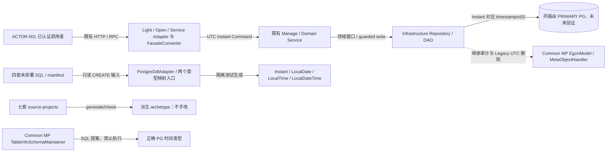
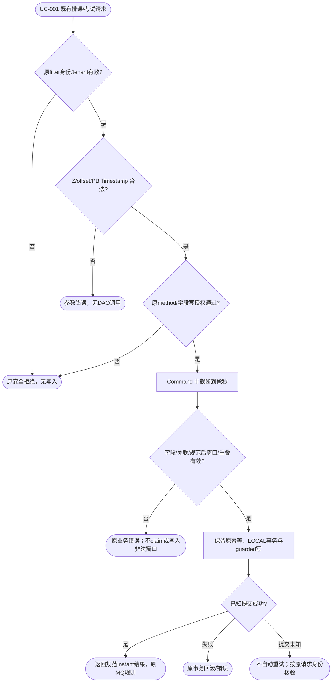
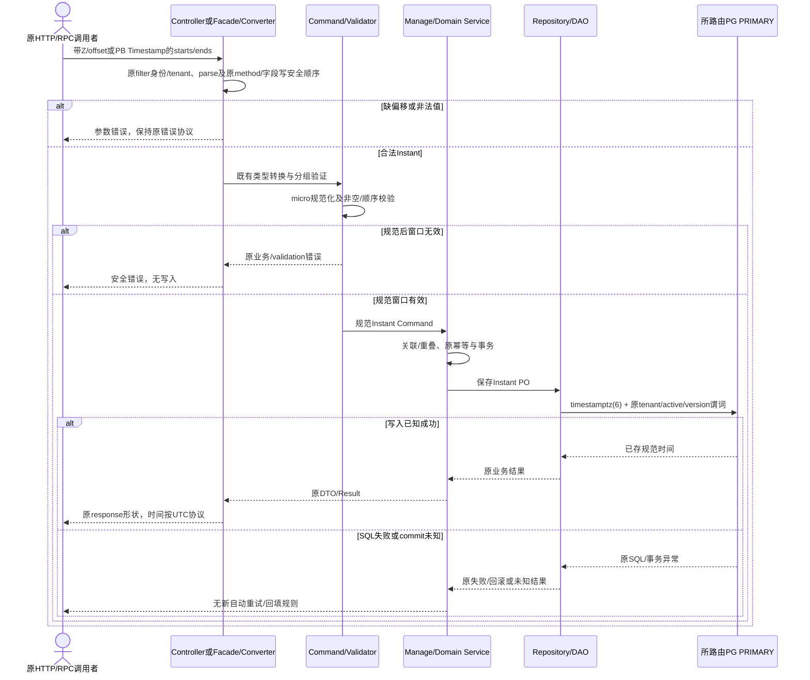

# Archetype 排课、考试 UTC 与生成器/Common MP 时间映射修订

| Field | Value |
| --- | --- |
| Document | `2026-10-13-14-07-archetype-utc-time-contract-amendment.md` |
| Template Version | `9` |
| Archetype Cleanup | `Not applicable` |
| Status | `Accepted` |
| Type | `Architecture` |
| Complexity | `Complex` |
| Complexity Drivers | 七套源模板的时间配置；Light/Open 排课 HTTP/RPC 时间语义变更；Service/Open SQL 与 Instant 映射对齐；两个生成器映射入口和 Common MP SQL 提案；未发布模板 SQL 直接改写例外；deletedAt 兼容及字段级校验 |
| Created | `2026-10-13 14:07 Asia/Shanghai` |
| Updated | `2026-10-13 18:07 Asia/Shanghai` |
| Owner | `mario` |
| Repository | `Egon-COLA` |
| Scope | `egon-cola-archetypes/source-projects` 七套源模板的适用时间边界；egon-cola-component-code-generator；Common MP-SDJ Starter 时间类型映射及对应测试；派生 archetype 的重新生成与验证 |
| Change Surface | 排课/考试 Instant、UTC 文本传输、微秒持久化与输入归一化；源模板初始化 SQL/manifest、配置/启动默认 UTC；生成 SQL↔Java 时间类型；保留 deletedAt/既有命名 Clock 与身份/租户/事务/事件协议 |
| Affected Chapters | §7, §8, §9, §10, §11, §13, §14, §15, §16, §17, §18 |
| Source Requirement | 用户于 2026-10-13 指定“排课和考试统一用 Instant + UTC，deletedAt 保留兼容方案，覆盖 archetype、相关生成器和 Common MP 时间映射”；并明确 archetype 没有真实库使用，SQL 可直接修改且不新增版本。本轮只写 Spec |
| Baseline Revision | `main @ 2f01b7937f3e2d68fe66d62ec7bed5b913a07b6d`；2026-10-13 14:07 工作区包含 86 项既有修改/未跟踪项，含 skill 时间规范和并行 native 安全工作；不将它们认定为本 Spec 的实施结果 |
| Amends | [Archetype MP 统一](2026-08-25-19-09-archetype-mybatis-plus-unification.md) §6 Rule 10、§9 排课输入、§10.3/§11 业务 timetable 的 LocalDateTime/TIMESTAMP 规则及 §14/§16 对应验证/兼容部分；[MP 演进](2026-09-12-21-11-mybatis-repository-cqrs-postgresql-evolution.md) §10/§11 时间映射、§14 验证，保留 DEC-001 deletedAt 和 Clock 主机覆盖合同；[测试库修订](2026-09-13-07-42-mybatis-test-database-rebuild-amendment.md) §1/§11/§16 中仅针对本稿列明、用户确认未部署 archetype SQL 的“必须新版本/不可改原字节”约束 |
| Supersedes | `None` |
| Depends On | [两阶段 archetype 生成](2026-08-27-20-31-archetype-two-stage-source-generation.md) 源工程/definitions/派生产物所有权；[MP 演进](2026-09-12-21-11-mybatis-repository-cqrs-postgresql-evolution.md) §5 DEC-001、§7/§10/§11 的租户、ID、Repository、LOCAL、deletedAt/版本和主机 Clock 不变量 |
| Related Specs | [Native/Open 治理](2026-09-07-16-52-archetype-native-open-dependency-governance.md)；[公共规范收敛草案](2026-09-20-12-18-archetype-component-contract-convergence.md)；[当前 Native 集成设计](2026-10-11-10-26-xingyuan-native-full-integration-native.md)，仅作为当前工作区的协议/安全边界上下文，不接受其尚未实施结论 |
| Related Plans | [UTC 时间契约实施 Plan](../plan/2026-10-13-16-21-archetype-utc-time-contract-implementation.md) |

## 1. Summary

排课和考试窗口代表已经确定的发生时刻，不再以服务器本地钟表时间作为业务事实。Light/Light-open 的 startsAt、endsAt 从 LocalDateTime 统一为 Instant；Service/Service-open 已是 Instant，持久化列改为 TIMESTAMP(6) WITH TIME ZONE。文本传输带明确偏移输入并输出 UTC Z，Protobuf 原有字段号、消息类型和标准 Timestamp 表示保留。业务比较使用 Instant，纯日期/本地时间仍分别使用 LocalDate/LocalTime。

复用现有 MapStruct/Egon Converter、Jakarta Validation、Common MP-SDJ 和 java.time，纠正生成器的两个 SQL→Java 分支及 Common MP SQL 提案的 Java→SQL 分支。EgonModel 创建/更新时间、微秒填充和主机 Clock 覆盖机制保留；deletedAt 保留 LocalDateTime + timestamp(6) without time zone + 显式 UTC 写入的兼容合同，不改变删除/恢复守卫。

按本次用户明确例外，只设计直接修改四套排课/考试 archetype 的现有初始化 SQL，并更新对应 manifest SHA-256，不新增迁移版本。此例外只适用于本稿列出的未部署模板；不授权连接、清理、repair 或接管任何真实库。本轮产物仅为本 Spec，PASS 只表示设计可供审核。

## 2. Background and Current State

### 2.1 Business and user context

源模板维护者需要新生成的项目从 HTTP/RPC 输入到领域比较、PO、SQL 都使用同一时刻；调用方不能用自己的服务器默认时区解释排课。现有已声明的服务考试窗口也不能因 PostgreSQL 会话/JVM 时区改变读回值。模板不是正在迁移的生产应用，用户已经明确不存在需要保留的真实库。

### 2.2 Repository evidence

| Evidence ID | Classification | Exact path/symbol/decision/command | Observed fact | Design significance | Verification limit/freshness |
| --- | --- | --- | --- | --- | --- |
| EVD-001 | User decision | 本轮用户原文 | 排课/考试 Instant + UTC，deletedAt 保留，覆盖 archetype/生成器/Common MP | REQ-001～004 | 不授权本轮代码实施 |
| EVD-002 | User decision | “因为是 archetype…没有真实的库用” | 允许未部署模板 SQL 原位修改，不新增版本 | REQ-008；限定 SQL 例外 | 不是独立查库结论，不外推到已生成/已部署项目 |
| EVD-003 | Static repository | egon-cola-archetypes/source-projects/egon-cola-source-light/src/main/java/top/egon/cola/archetype/source/light/adapter/teaching/pojo/dto/ScheduleCourseRequest.java:7；domain/teaching/vos/CourseSchedule.java:8 | LocalDateTime 从 HTTP 到 Command、值对象、PO，缺少地区时区 | REQ-001/002 | 没有运行 HTTP |
| EVD-004 | Static repository | egon-cola-archetypes/source-projects/egon-cola-source-light/src/main/proto/teaching_user_facade.proto:46；egon-cola-archetypes/source-projects/egon-cola-source-light/src/main/java/top/egon/cola/archetype/source/light/adapter/pojo/convertor/LightFacadeConverter.java:269 | starts_at/ends_at 为 string 3/4，当前 ISO_LOCAL_DATE_TIME | RPC-001 | 尚未生成/运行新 PB |
| EVD-005 | Static repository | egon-cola-archetypes/source-projects/egon-cola-source-service/egon-cola-source-service-infrastructure/src/main/java/top/egon/cola/archetype/source/service/infrastructure/exam/po/ExamPO.java:33；db/egon-mp/V20260913_001__initialize_repository_schema.sql:29 | Java Instant 对应无时区 TIMESTAMP；native/open 同样存在 | REQ-003 | 只核对源 SQL |
| EVD-006 | Static repository | egon-cola-components/egon-cola-component-common/egon-cola-component-common-mybatis-plus-sharding-jdbc-ext-spring-boot-starter/src/main/java/top/egon/cola/component/common/mybatis/model/EgonModel.java:49；handler/EgonColaMetaObjectHandler.java:38 | createTime/updateTime 是 Instant，Clock.instant() 截断微秒；deletedAt 显式 UTC | REQ-004/007 | 不证明当前 JDBC/PG 往返 |
| EVD-007 | Static repository | egon-cola-components/egon-cola-component-code-generator/src/main/java/top/egon/cola/component/codegen/template/TemplateContextService.java:108；validation/GenerationScopeValidator.java:396 | timestamp/date/time 均被映射为 LocalDateTime | REQ-005 | 两个入口必须同步 |
| EVD-008 | Static repository | egon-cola-components/egon-cola-component-common/egon-cola-component-common-mybatis-plus-sharding-jdbc-ext-spring-boot-starter/src/main/java/top/egon/cola/component/common/mybatis/schema/EgonColaTableInfoSchemaMaintainer.java:105 | Instant 和 LocalDateTime 都输出 TIMESTAMPTZ；LocalDate/LocalTime 落入 TEXT | REQ-006 | maintain 当前只返回 SQL 提案，无连接执行 |
| EVD-009 | Static repository | egon-cola-archetypes/source-projects/egon-cola-source-light/src/main/resources/application.yml:70；deploy/container/Dockerfile:26 | 六套 Jackson 默认 APP_TIME_ZONE:Asia/Shanghai、容器 TZ=Asia/Shanghai | REQ-007 | 不能据此断言 Instant 已错误序列化 |
| EVD-010 | Static repository | egon-cola-archetypes/source-projects/egon-cola-source-agent/egon-cola-source-agent-application/src/main/java/top/egon/cola/archetype/source/agent/application/research/config/DeepResearchApplicationConfiguration.java:20 | Agent 已有 agentClock/deepResearchClock UTC；知识表审计列带时区 | 边界保留 | 不迁移 Agent Flyway/Outbox 所有权 |
| EVD-011 | Static repository | egon-cola-archetypes/source-projects/egon-cola-source-light/src/main/resources/graphql/teaching.graphqls；egon-cola-archetypes/source-projects/egon-cola-source-light/src/main/java/top/egon/cola/archetype/source/light/adapter/teaching/pojo/vo/SchoolClassDetailVO.java | GraphQL 与 SchoolClassDetailVO 只有 scheduleCount，无窗口时间字段 | GraphQL 不改变 | 不虚构新字段/页面 |
| EVD-012 | Static repository | egon-cola-components/egon-cola-component-common/egon-cola-component-common-mybatis-plus-sharding-jdbc-ext-spring-boot-starter/src/main/java/top/egon/cola/component/common/mybatis/autoconfigure/EgonColaMybatisPlusAutoConfiguration.java:93-129；对应 AutoConfigurationTest | 默认 Clock 按类型缺失条件，MetaObjectHandler 支持 unique/Primary 主机 Clock，否则 UTC 回退 | 保留 Clock 覆盖合同 | 新样例 wiring 不假定名为 egonColaMybatisPlusClock 的 Bean 必然存在 |
| EVD-013 | Static repository | egon-cola-components/egon-cola-component-code-generator/pom.xml；scripts/egon-codegen.sh；scripts/generate_archetypes.sh | 生成器已有 Common MP 依赖；维护源树，派生产物由脚本生成 | REQ-009/010 | 本轮不执行 generate/apply |
| EVD-014 | Static repository | git status --porcelain -uall；native Light OpenApiConfig/Controller tests | native 安全工作正在并行变动，部分当前文本尚存在编译拼写漂移 | RISK-003 | 不是本稿时间变更引入，不顺带修复 |

| EVD-015 | Static framework source / reuse investigation | 本地缓存 jackson-datatype-jsr310 2.21.2-sources.jar 中 InstantDeserializer.deserialize/_fromString；仓库没有严格字符串Instant decoder | 默认Instant可接收number，也有stringified timestamp路径；shape=STRING不能当作输入拒绝证明 | REQ-002/011；仅排课Request组件级decoder | 源行为证据不等于当前声明版本已运行；TEST-001须在实际项目mapper证明 |

### 2.3 Problem statement and gap

两个主要错误是语义混淆：无时区字符串不能唯一定位排课时刻；Instant 对应 naive timestamp 会让驱动/会话承担未声明的解释。生成器把纯日期、本地时间和发生时刻混成一个 Java 类型，未来生成也会重新引入问题。Common MP 提案则把本地钟表值错误升级为带时区列。

### 2.4 Evidence and current-chain map

| Entry/trigger | Current call chain | Data read/written | External dependency | Consumers | Evidence |
| --- | --- | --- | --- | --- | --- |
| Light 排课 HTTP/RPC | SchoolClassController/SchoolClassFacadeImpl → SchoolClassManageImpl → SchoolClassDomainService → SchoolClassServiceImpl → ClassCourseScheduleRepository/DAO | class_course_schedules、SchoolClassAggregate | PG、既有 MQ | 排课调用者 | EVD-003/004；§8 精确路径 |
| Service 排课/考试 RPC | CourseFacade/ExamFacade adapter → CourseManage/ExamManage → domain ports → infra Repository/DAO | evaluation_course_schedule、evaluation_exam | PG、既有 RPC/MQ | Web 查询客户端、考试客户端 | EVD-005；service/open 源树 |
| CREATE 生成 | PostgreDdlAdapter → DdlSchemaService → GenerationScopeValidator/TemplateContextService → FreeMarker → 源文件 | 只读 SQL，获准时写生成产物 | 现有 FreeMarker | native light/web/service 维护者 | EVD-007/013 |
| MP SQL 提案 | maintain(query) → TableInfo → postgresType → result.sql | 仅读模型元数据 | 不执行 DataSource | SQL 提案调用者 | EVD-008 |

### 2.5 Archetype example cleanup

Cleanup disposition: Not applicable

Reason: 本任务维护 Egon-COLA 的 source-projects/生成器/Common MP，不是已生成业务项目开始真实业务。七套教学/考试/知识样例是需要维护的 archetype 示例，不删除其业务链路；后续生成的真实业务项目仍按 skill 清理门禁执行。

## 3. Goals and Non-goals

### 3.1 Goals

排课和考试的一次性窗口只认 UTC instant；源模板、输入、比较、存储和生成结果一致；基础时区与业务/展示时区职责分开；deletedAt 明确保留兼容。

### 3.2 Non-goals

不设计重复日历排课、地区时区持久化、按日报表或前端页面；不改身份/权限、路由、拓扑、MQ/Outbox、缓存、ID、公共 ResultRecord 的既有 Unix 毫秒 timestamp。也不为时间任务机械整改所有原有 Instant.now()、普通领域身份类型或其他非时间缺陷。源模板已有事件/异常发生时刻继续使用 Instant，协议和 Clock 创建流程为 Unchanged；以后触达其生成时间逻辑时须用注入 Clock。

本轮不写 Plan、代码、配置、SQL、manifest、生成产物或数据库数据；Spec 不意味着未来实施已获批。任何真实/已部署项目的历史迁移不在 SQL 直接修改例外内。

### 3.3 Change Surface and Design Depth

| Area/layer | Disposition | Exact repository evidence | Changed or preserved behavior/contract | Required Spec treatment | Chapter(s) |
| --- | --- | --- | --- | --- | --- |
| Light/Open 时间入参、窗口值对象与转换 | Affected | egon-cola-archetypes/source-projects/egon-cola-source-light/src/main/java/top/egon/cola/archetype/source/light/adapter/teaching/pojo/dto/ScheduleCourseRequest.java；对应 Open 路径 | LocalDateTime→Instant；拒绝 naive 文本；原 route/字段名保留 | §9/§10 全量受影响合同 | §7, §8, §9, §10, §13, §14, §16 |
| Service/Open 精度归一化边界及四套窗口 SQL | Affected | 四套 application Command、db/egon-mp SQL、manifest | 业务窗口明确微秒归一化；列带时区；直接改未部署源脚本 | SQL、列、数据前提、兼容详述 | §7, §8, §9, §10, §11, §14, §16 |
| 生成器 SQL→Java 两个入口 | Affected | egon-cola-components/egon-cola-component-code-generator/src/main/java/top/egon/cola/component/codegen/template/TemplateContextService.java；validation/GenerationScopeValidator.java | 区分 instant/date/time/local timestamp，支持带时区别名 | 类型表、未知类型失败、生成/校验一致性 | §7, §8, §9, §10, §13, §14, §17 |
| Common MP SQL 提案 | Affected | egon-cola-components/egon-cola-component-common/egon-cola-component-common-mybatis-plus-sharding-jdbc-ext-spring-boot-starter/src/main/java/top/egon/cola/component/common/mybatis/schema/EgonColaTableInfoSchemaMaintainer.java | Java 时间类型→正确 PG 类型，保持 deletedAt naive UTC | 提案输入/输出，禁止执行、未知时间类型关闭 | §7, §8, §9, §10, §11, §13, §14 |
| 七套 UTC 默认配置/文档/测试 | Affected | 每套 application*.yml、launch.args；六套 Dockerfile；README/验证源 | 传输和运行默认 UTC；无日历规则时不添加 business-zone 功能 | 配置键矩阵、发布/回退/误用风险 | §8, §14, §15, §16, §18 |
| EgonModel / 元数据填充 / 删除恢复守卫 | Context-only | egon-cola-components/egon-cola-component-common/egon-cola-component-common-mybatis-plus-sharding-jdbc-ext-spring-boot-starter/src/main/java/top/egon/cola/component/common/mybatis/model/EgonModel.java；handler/EgonColaMetaObjectHandler.java | Instant audit + micro Clock；LocalDateTime deletedAt、UTC SQL、NULL active 全保留 | 证明边界并增加回归，无模型 ABI 改动 | §10, §11, §14 |
| 其他业务、权限、事件渠道、拓扑与索引 | Unchanged | 现有 Controller/RBAC、Domain ports、Mapper、sharding tables 与 MQ config | 只变时间值，不改变权限/租户/事务和已存业务规则 | 当前精确源证据 + 最小回归 | §7, §15 |
| GraphQL / 前端 | Not applicable | egon-cola-archetypes/source-projects/egon-cola-source-light/src/main/resources/graphql/teaching.graphqls；七套没有 JS/TS 前端 | 无窗口时间字段；不创建新的 mutation/scalar/UI | §12 N/A；GraphQL 现有查询作为 Unchanged 回归 | §12 |

## 4. Requirements and Acceptance Criteria

| ID | Atomic requirement | Priority | Observable acceptance criteria | Source |
| --- | --- | --- | --- | --- |
| REQ-001 | 四套排课/考试窗口统一 Instant，Light/Open 不再保存 LocalDateTime 窗口 | Must | 所有受影响请求/Command/DTO/值对象/PO 类型一致；同一 UTC 点比较/重叠一致 | 用户 Instant + UTC |
| REQ-002 | 发生时刻文本输入必须含 Z 或数值偏移，输出 UTC Z；纯日期/本地时间保持语义 | Must | naive/空白/缺失偏移拒绝；+08:00 与 Z 等值；PB 字段号及标准 Timestamp 载体保留 | 用户新时间规范 |
| REQ-003 | 窗口持久化使用 timestamptz(6)，入参归一到微秒后才比较/写入 | Must | 四套所有物理排课/考试窗口列带时区；任意 JVM/PG 时区往返规范 Instant 相等；不足一微秒窗口归一后拒绝 | 统一存储 + 已有 PG 精度约束 |
| REQ-004 | deletedAt 保留 Legacy UTC，其他 EgonModel 技术字段保持 ABI | Must | LocalDateTime/NULL/UTC SQL/版本/单调删除及恢复传参不变；不透出 naive deletedAt 为新发生时刻契约 | 用户保留兼容方案 |
| REQ-005 | 生成器分别识别 SQL instant/date/local time/local timestamp | Must | timestamp with time zone/timestamptz→Instant；date→LocalDate；time without→LocalTime；naive timestamp→LocalDateTime；两入口一致 | 覆盖相关生成器 |
| REQ-006 | Common MP SQL 提案区分 Java 时间类型 | Must | Instant/OffsetDateTime→TIMESTAMPTZ(6)，LocalDateTime→TIMESTAMP(6)，LocalDate→DATE，LocalTime→TIME(6)；unsupported temporal 类型失败；无 DataSource 调用 | 覆盖 Common MP 时间映射 |
| REQ-007 | 模板传输与启动默认 UTC，显式保留业务/展示时区边界 | Must | 七套全部 profile 时间键一致；六套容器 TZ=UTC、启动默认 UTC；无 naive fallback、无全局按请求切换时区 | 新规则 + 已检查配置差距 |
| REQ-008 | 允许列明未部署 archetype SQL 原位修改，不新增版本 | Must | 只改四个初始化脚本和相应 manifest checksum；版本 token 不变；旧真实库/ddl_history 不 repair、不回填、不连接 | 用户本轮明确 SQL 例外 |
| REQ-009 | source-projects 是真源，派生 archetype 按既有脚本重建 | Must | 不手改 .generated；generate/check 与每个相关生成样例验证；初始 CREATE 生成只在隔离 native 测试目标使用 | 仓库生成所有权 |
| REQ-010 | 不新增依赖、运行时、时间框架或命名 Clock 行为改变 | Must | 保持 Maven 坐标/版本、Common MP host unique/Primary Clock 覆盖与 UTC 回退；不新增业务查询/时区表 | 用户最小安全变更/当前 skill |
| REQ-011 | 异常、校验、文档与消费者准确表达新时间契约 | Must | 受影响 REST/RPC 输入错误一致无写入；springdoc date-time、示例、operationId 与测试一致；输入纳秒明确微秒截断 | skill API/Validation/时间规则 |
| REQ-012 | 只交付可审核的 Spec，保留全部既有工作区修改 | Must | 所有章节、TIME/API/Manual gate 完整，严格校验通过；状态 Review；本轮仅新增本文件 | 用户先写 Spec |

### 4.1 Scenario matrix

| Scenario | Actor/trigger | Preconditions | Main path | Alternative/failure path | Data/state change | Observable result | Requirements |
| --- | --- | --- | --- | --- | --- | --- | --- |
| UTC 排课/考试 | 合法 HTTP/RPC 调用者 | 权限/tenant、课程/班级可见 | parse offset→Instant→微秒规范值→业务校验→单目标写入 | 权限/关联缺失沿用现有错误 | 一次业务窗口保存 | 不随主机时区改变 | REQ-001/002/003 |
| +08:00 与 Z 等值 | 调用者 | 表达同一时刻 | 两值归一为相同 Instant | 无区域字符串猜测 | 重叠/排序比较一致 | 两请求结果语义一致 | REQ-002/003 |
| naive 或非法时刻 | 旧客户端 | 无 Z/偏移或不能解析 | 边界拒绝 | 返回参数错误；不调用 Manage/DAO | 无写入/无新事件 | 明确修正输入，不自动重试 | REQ-002/011 |
| 亚微秒窄窗口 | RPC/手工 Command | 原始 end-start 小于一个微秒 | 先各自 truncatedTo(MICROS) | 归一后 start≥end 即 INVALID_SCHEDULE/既有 service 验证错误 | 无写入 | 不依赖 DB 四舍五入制造成功 | REQ-003/011 |
| 重复/重叠/响应丢失 | 业务调用者 | 既有 requestId/并发规则 | 既有 claim、重叠检查、事务 | Duplicate/overlap 或未知提交状态沿用原合同 | 无额外重试机制 | 同一规范时间参与原业务逻辑 | REQ-001/010 |
| 删除/恢复 | Repository 调用者 | tenant/id/version/业务键有效 | UTC deleted_at + 版本，恢复持有原 LocalDateTime token | 原冲突/不存在处理 | 原逻辑删除状态 | 不改变旧生命周期键 | REQ-004 |
| CREATE 模板生成 | 维护者/CLI 测试 | native profile、CREATE schema、工具已可用 | parse→类型映射→计划/检查→隔离生成 | 不支持时间类型/未知值返回诊断；无扩大产物 | 仅隔离生成目录 | date/time 不再成为 LocalDateTime | REQ-005/009 |
| 源 SQL 修改发布 | 模板维护者 | 用户确认未部署；获批 Plan | 改四份源 SQL→重算各 manifest→派生验证 | 真库/既有 history 必须停止该例外路径 | 无真实库变化 | 版本不新增，checksum 与新源一致 | REQ-008 |

### 4.2 Use-case analysis

| Actor ID | Actor/role | Goal and responsibility | Entry/channel | Permission/tenant context | Evidence |
| --- | --- | --- | --- | --- | --- |
| ACTOR-001 | 排课/考试调用者 | 提交并读取确定的窗口 | 既有 HTTP/RPC | 保留 native RBAC/SERVICE 或 open 既有上下文 | SchoolClassController/Facade、CourseFacade/ExamFacade |
| ACTOR-002 | 模板/生成器维护者 | 产出类型正确且可重复的新模板 | 源工程、CLI/生成验证 | 本地获批文件范围，不代替业务用户 | scripts/generate_archetypes.sh、egon-codegen.sh |
| ACTOR-003 | MP SQL 提案调用者 | 得到准确时间类型的 CREATE 提案 | maintain(Query) | 管理调用，drop=false | EgonColaTableInfoSchemaMaintainer |

| ID | Use case/goal | Primary actor | Supporting actors/systems | Trigger | Preconditions | Main success outcome | Alternatives/failures | Postconditions | Requirements | Interfaces/pages | Tests |
| --- | --- | --- | --- | --- | --- | --- | --- | --- | --- | --- | --- |
| UC-001 | 以 UTC 确定排课和考试窗口 | ACTOR-001 | 既有域服务/PG | 有偏移时间请求 | 身份/tenant、关联对象合法 | 相同 Instant 贯穿接口/模型/存储 | 格式、缺失、归一后非法窗口、重叠、权限、提交未知 | 成功一笔原业务写入；失败无新时区修复/重试副作用 | REQ-001/002/003/011 | API-001/002、RPC-001～006 | TEST-001～006/012 |
| UC-002 | 生成不混淆日期语义的项目 | ACTOR-002 | SQL parser/FreeMarker | CREATE 生成 | native 及授权产物/路径有效 | 四种时间类型正确 | 未知 temporal 类型、stale 输入、所有权冲突 | 仅批准产物可写；失败不扩大范围 | REQ-005/009/010 | INTERNAL-001/002 | TEST-007/008/013 |
| UC-003 | 维护未部署模板的最终 SQL | ACTOR-002 | 源 SQL/manifest/派生脚本 | 时间契约修订 | 用户确认无真实库 | 原版本 SQL 与新 checksum 一致 | 检出已部署/历史应用证据则停止直接修改路径 | 不连接、不改 history，不产生新版本 | REQ-008/009/012 | 源文件维护，无新增运行 API | TEST-009/013 |
| UC-004 | 保留删除 UTC 兼容并输出正确 SQL 提案 | ACTOR-003 | EgonModel/TableInfo | 提案/生命周期回归 | typed query/合法目标 | 准确 SQL；原删除/恢复 ABI 可用 | unsupported temporal/drop 请求失败 | maintain 无库执行；Lifecycle 行为保持 | REQ-004/006/010 | INTERNAL-003 | TEST-010/011 |

## 5. Constraints, Assumptions, and Decisions

### 5.1 Confirmed constraints

用户最新 SQL 例外优先于此前 AGENTS/skill/旧 Spec 的迁移不可改规则，范围仅限本稿明确的未部署 archetype 初始化源 SQL/manifest。其他源历史文件因本次不需要而不修改，不是借它们“修复”真实 history。初始 schema 仍由现有 MP-SDJ runner 初始化，保留 checksum/路由指纹/锁/逐目标事务；Agent 迁移所有权不在此处重构。

新 Spec 保存为 Review。源工程/生成器修改属于后续获批 Plan；本轮没有代码/SQL 实施授权。新增依赖数为零。两个排课Request内部的无状态UtcInstantInputDeserializer是现有Jackson扩展点内的必要输入守卫，不是新框架；证据与局部成本见EVD-015/§10.4。

### 5.2 Small-gap assumptions

| ID | Inference | Repository evidence | Why locally reversible | Impact if wrong |
| --- | --- | --- | --- | --- |
| ASM-001 | 业务窗口规范精度为微秒；接受既有纳秒文本/标准 PB Timestamp，并在 Command 边界显式截断到微秒后比较 | EgonModel micro fill、PostgreSQL timestamp(6)、native PB 注释接受纳秒 | 纯模板且未部署；本稿明确写入合同，审核时可调整精度策略 | 小于一微秒的窗口会被拒绝；消费者不能期待保存纳秒 |
| ASM-002 | 两个被改排课值对象 CourseSchedule 改为 CourseScheduleBO，其他领域身份/聚合名称保留 | 两个 domain/teaching/vos/CourseSchedule.java 是 immutable 时间业务值对象；Rule 1 carrier 语义命名 | 只更新本地编译依赖，不增加平行载体或改变 wire 字段 | 本地 Java 调用方需改类型/import，外部 DTO/PB 类型不改 |
| ASM-003 | schema 使用既有 routing profile 的物理 schema，部署值可能不同于 public | role-scoped SQL 无显式 schema 前缀；EgonColaPhysicalTargetBO 明确 schema | 不新增 schema 名/路由；下述表名均相对目标 schema | 验证必须覆盖所配置各 PRIMARY，不假定全在 public |

### 5.3 Resolved decisions

| ID | Decision | Decision owner | Evidence and rationale | Requirements |
| --- | --- | --- | --- | --- |
| DEC-001 | 排课/考试是确定的 Instant，取消本地日历意图模型；不另存地区 zone | User | 本轮明确 Instant + UTC | REQ-001/002/003 |
| DEC-002 | deletedAt 继续 LocalDateTime/naive UTC、NULL active、既有删除/恢复规则 | User | 本轮明确兼容；旧 MP DEC-001 | REQ-004 |
| DEC-003 | 四个指定初始化 SQL 原位改写，manifest 重算，version 不变，不新增迁移 | User | 没有真实库使用的本轮明确例外 | REQ-008 |
| DEC-004 | SQL→Java/Java→SQL 复用两个现有生成入口和 Common MP 提案方法，不加策略注册表/依赖 | Spec design, pending review | 分支是简单类型判定，没有动态业务算法 | REQ-005/006/010 |
| DEC-005 | 框架 JDBC 现有 Instant mapping 先验证；本稿不新增 TypeHandler | Spec design, pending review | MyBatis 有 InstantTypeHandler，pgJDBC native OffsetDateTime 不代表 MyBatis 无法使用 Instant | REQ-003/010 |
| DEC-006 | 保留 unique/Primary Clock 主机覆盖与回退，不强制改变 Common MP Bean 选择 ABI；批量 Instant.now 整改不属于此契约修订 | Spec design, pending review | AutoConfiguration 当前明确注释与 tests 覆盖，不能把 by-name Clock 必然存在当事实 | REQ-007/010 |

### 5.4 Open major decisions

None。用户已经决定发生时刻模型、deletedAt 和 SQL 直接改写前提；本稿技术方案/精度选择待整份 Spec 审阅，不伪装为 Accepted。若后续出现真实库使用证据，DEC-003 的适用前提失效，停止该实施路径并重新定案。

## 6. Project Technology Context

| Concern | Current choice | Repository evidence | Constraint on design |
| --- | --- | --- | --- |
| Java/build | Java 21、Maven；当前根 Spring Boot 3.5.16 | root/source POM | 不升级依赖，不能以本地旧缓存 JAR 证明声明版本运行成功 |
| Persistence | MP 3.5.16、PG、ShardingSphere、Common MP-SDJ | components POM、source configs | Instant 真实 PG mapping 要独立验证；H2 仅快速测试 |
| Conversion/validation | MapStruct 1.6.3、MapStructPlus 1.5.1、Common BaseConverter/BaseForwardConverter、Jakarta Validation | source POM/converter/validators | 窗口归一化使用 java.time；沿用已有边界对象和分组 |
| REST docs | Spring MVC，springdoc 2.8.17 BOM，现有 nativeBearer / open 原文档边界 | root pom、archetypes BOM、OpenApiConfig/Controllers | 不新增 springdoc 堆栈，不修改安全/文档 exposure |
| Generation | FreeMarker、native CREATE-only CLI、source-projects/definitions 派生 | generator module/scripts | Open/Agent 不假装由 native CLI 支持；不覆盖用户自定义已有文件 |
| Tests | JUnit/AssertJ/Mockito、MockMvc、ArchUnit、Groovy verify | src/test 与 definitions | 常规门禁不启动 DB/MQ/应用；PG 门禁另行按授权执行 |

### 6.1 Java architecture profile and capability baseline

| Architecture profile | Archetype/template or base package | Exact evidence and verifier | Existing deviations | Design action |
| --- | --- | --- | --- | --- |
| Egon-COLA Light / Light-open | 单模块 start/adapter/facade/application/domain/infrastructure/common | source-projects 两树、LightPersistenceArchitectureTest/OpenArchitectureTest | native 安全任务并行修改；不重写其合同 | 保留准确 native/open profile |
| Egon-COLA Service / Web 及 open | common/facade/domain/application/infrastructure/adapter/starter | 根 POM modules、各 architecture tests、definitions 包装 | 无时间任务造成的新模块差异 | 保留各树及 proto/native/Open 协议 |
| Egon-COLA Agent | 六模块、无 facade | Agent root POM；agentClock/typed boundaries | 既有 DDL/Flyway 所有权差距不在本稿 | 只加 UTC 默认配置与回归，其他域不改 |
| 既有组件技术结构 | codegen/template/validation；common/mybatis/schema | G/J 既有包、依赖与 tests | 组件不是业务 archetype，不能机械改造成七层 | 只改现有技术方法，不引入第三种业务层结构 |

| Need | Spring/JDK candidate | Spring Boot Starter candidate | Egon-COLA/module candidate | Proven gap | Decision/dependency impact |
| --- | --- | --- | --- | --- | --- |
| UTC parse/format/precision | Instant/OffsetDateTime/ChronoUnit | Boot Jackson JavaTimeModule | 既有 FacadeConverter 与 Command | Light naive 类型不表达时刻 | 在原边界改类型；零依赖 |
| 严格HTTP时间输入 | JsonToken + OffsetDateTime/ISO_OFFSET_DATE_TIME | 当前Jackson StdScalarDeserializer/@JsonDeserialize | 两个现有ScheduleCourseRequest，未发现可复用严格decoder | 默认Instant允许numeric等，单独Schema/JsonFormat不执行输入拒绝 | 在两个record内增加局部无状态decoder，零新依赖/Bean/global module |
| 对象转换 | MapStruct | 已有 processor/starter | BaseConverter/BaseForwardConverter | 当前时间参数类型变更 | 保留真实 converter，不新建转发层 |
| 参数/分组 | Jakarta Validator | 已有 Validation starter | ValidationUtils/NativeRpcValidationGroup/Model groups | 时间格式与归一后窗口约束 | 注解 + 原 validator，工具仅手动触发元数据 |
| JDBC Instant | MyBatis InstantTypeHandler、JDBC Timestamp/native OffsetDateTime | 已有 MP Starter | EgonModel/PO/Mapper | 是待验证证据，不预设框架功能缺失 | 复用；若实际 PG 失败，先回 Spec，不自行新增 handler |
| SQL 类型 | 现有字符串标准化/Class 判定 | 不需要新的 starter | 两 codegen 入口 + MP postgresType | date/time/zone 分支错误 | 直接修正表格分支，零外部库 |
| clock | Clock/systemUTC/fixed | 不加新时钟 starter | Common MP host 覆盖/Agent named Clock | 没有新增发生时刻生成算法 | 保留选择逻辑，测试固定 Clock 的 UTC/micro 结果 |

### 6.2 User-mandated Java rule compliance

| Literal rule | Affected? | Repository evidence | Exact design decision | Files/types/interfaces | Validation/test evidence | Status/blocker |
| --- | --- | --- | --- | --- | --- | --- |
| Rule 1 | Yes | 受影响 DTO/Command/PO/Converter/Validator、CourseSchedule 时间值对象 | 两值对象命名 CourseScheduleBO；其他 carriers 保留有语义后缀，不泛化 Data/Info | §8/§10 inventory | TEST-013 名称/import/编译检查 | PASS |
| Rule 2 | Yes | RequestValidator/ApplicationValidator、native group、Model interceptor | 每个触达 handoff 用 Jakarta/Valid/Validated/已有组；工具手动触发，不把业务规则搬进 DAO | §7.3/§10 handoff | TEST-001/002/006 | PASS |
| Rule 3 | Yes | PO class 与 EgonModel；immutable scalar DTO/Command/value object record | 普通 PO class 完整 Lombok；immutable value carriers 可保留 record；现有 Converter/Common 基类复用 | §10.3.1/§10.4 | TEST-004/007/013 | PASS |
| Rule 4 | Yes | 触达 Manage/Converter/Validator/Controller 技术 Bean | 业务类 Slf4j、显式 Bean 名、RequiredArgsConstructor、每依赖 Qualifier；lombok copy propagation核对；不改未触达 Bean | §8 / §10.4 | TEST-013 wiring/static | PASS |
| Rule 5 | Yes | JDK java.time、现有 parser/FreeMarker | 只用 JDK/现有准许库；不新建 DateUtils 或依赖 | 两类型 mapper、原 converters | TEST-007/010 + dependency diff | PASS |
| Rule 6 | Yes | Boot Jackson、PB 字段、Common ResultRecord | 文本 UTC Z；PB 原消息类型；ResultRecord 数字时间为未改既有合同；必要 Schema 注解与 DTO默认行为一致 | API/RPC/§10 | TEST-001/003/006 | PASS |
| Rule 7 | Yes | 七套 application/base/dev/test/prod | 时间键每个 profile一致，值 UTC；不把 Jackson 时区当业务规则 | §15配置矩阵 | TEST-014 | PASS |
| Rule 9 | Yes | 文档 Complex 来自跨边界；重叠比较/SQL类型判定是简单逻辑 | 复用现有 Adapter/Facade/MapStruct，原业务 Domain Event/Repository协作保留；不造 Strategy registry | §13 | TEST-003/007/010 | PASS |
| Rule 10 | Yes | 新 TIME 表与 current Instant fill | Instant/LocalDate/LocalTime/LocalDateTime语义分开；精度/UTC/Clock/DB/JSON边界明确 | §6.3/§7.3/§11 | TEST-001～011 | PASS |
| Rule 11 | Yes | 既有七树和组件技术包 | 原传统/准确 COLA profile的责任保留；组件包不机械迁移，不新增层 | §6.1/§8 | TEST-013 architecture | PASS |

### 6.3 Time semantics and conversion contract

Time contract: Required

| Time ID | Fields/symbols | Semantics | Java/runtime type | Storage policy | Wire policy | Business zone source | Display zone source | Boundary / DST rules | Precision / Clock | Compatibility | Verification |
| --- | --- | --- | --- | --- | --- | --- | --- | --- | --- | --- | --- |
| TIME-001 | ScheduleCourseRequest/DTO/Command、CourseScheduleBO、ClassCourseSchedulePO.startsAt/endsAt，两 Light 树 | Occurred instant | Instant | UTC instant | UTC Z | Not applicable: 窗口已经是确定时刻，无日历日计算 | Not applicable: 源模板没有时间展示页，消费端按显式展示 zone | Z/offset输入；不接受无偏移/地区标签猜测；微秒后 start<end；DST 已由输入偏移消除歧义 | 输入0–9位小数，Command截断微秒；DB(6)、文本输出规范值；无当前时刻生成 | 旧无偏移调用不兼容，未部署模板与调用fixture一起更新 | TEST-001/003/004/005 |
| TIME-002 | Service/Open ScheduleCourseCommand/CreateExamCommand、CourseSchedulePO/ExamPO.startsAt/endsAt | Occurred instant | Instant | UTC instant | UTC Z | Not applicable: 一次性排课/考试窗口只比较 instant | Not applicable: 只维护服务模板，无前端 | 保留 offset/标准 PB Timestamp 输入；归一化为微秒再业务验证；不得固定加减8小时 | wire可解析纳秒，Command显式truncatedTo(MICROS)；PG(6)；结果取规范领域值/已存值 | Java/PB类型与字段号保留，§16限定微秒精度修订；标准 Timestamp按协议保持seconds/nanos | TEST-003/004/005/006 |
| TIME-003 | EgonModel.createTime/updateTime 及其 PG 列 | Occurred instant | Instant | UTC instant | Internal | Not applicable: 技术审计记录时刻，无日历规则 | Not applicable: 不新增审计外部输出 | 保留现有填充、禁止外部写入；读取同一Instant | 已有注入Clock/host选择；truncatedTo(MICROS)，PG(6) | 既有技术字段ABI和Clock覆盖行为保持，非新增字段 | TEST-004/011 |
| TIME-004 | EgonModel.deletedAt、所有 inherited deleted_at 与恢复token | Occurred instant | LocalDateTime | Legacy UTC | Internal | Not applicable: 强制UTC解释，不是业务当地时间 | Not applicable: 不新增 deletedAt 外部传输 | 原CURRENT_TIMESTAMP AT TIME ZONE UTC、NULL active；仅需要外部投影时在Converter以ZoneOffset.UTC转Instant，禁止直接输出naive值 | 保持timestamp(6)、单调删除微秒策略、数据库Clock | 既有UTC解释和UTC conversion保留；恢复持有LocalDateTime token；不改列/守卫/唯一键 | TEST-011 |
| TIME-005 | codegen date 列/MP LocalDate 提案 | Pure date | LocalDate | Pure date | Internal | Not applicable: 纯日期没有发生时刻或地区偏移 | Not applicable: 类型生成测试，不新增页面 | date ↔ LocalDate；不得转午夜Instant | 日期精度一天；Not applicable: 不生成当前日期 | 没有对应业务字段迁移，只纠正未来类型生成 | TEST-007/010 |
| TIME-006 | codegen time without zone 列/MP LocalTime 提案 | Local time | LocalTime | Local time | Internal | Not applicable: 提案/生成类型，不解析排课发生时刻 | Not applicable: 不新增页面 | time ↔ LocalTime；不认为已得到全球唯一时刻 | 使用明确列精度，提案TIME(6)；Not applicable: 无Clock生成 | naive timestamp仍LocalDateTime、date/time不混用 | TEST-007/010 |

## 7. Architecture Design

### 7.0 Minimum-design baseline and element-necessity audit

| Proposed element | Change | Requirements | Existing/direct alternative | Concrete inadequacy of alternative | Added calls/state/coupling/failures/migration/operations | Verdict |
| --- | --- | --- | --- | --- | --- | --- |
| 现有 Request/DTO/Command/PO 时间字段 | Expand | REQ-001/002/003 | 在原对象改类型，不新增每层对象 | 原 LocalDateTime 没有偏移语义 | 零新增网络调用；调用方改带偏移输入；仅局部codec守卫；模板重建 | Keep |
| CourseScheduleBO | Rename | REQ-001/010/011 | 替换两个既有 CourseSchedule，不保留平行载体 | 当前 materially changed carrier 未体现 BO 角色 | 本地 import/签名与 tests；无 wire 新模型 | Keep |
| SQL→Java 两入口和 MP SQL 提案函数 | Expand | REQ-005/006 | 原小型固定分支内修正 | 原映射把不同语义合并 | 无新策略/Bean；参数化映射矩阵测试 | Keep |
| 新时间框架/TypeHandler/DateUtils/时区表/API | New candidate | REQ-010 | JDK、现有 MyBatis/Jackson/Converter | 没有JDBC/新框架已证实缺口；额外状态/依赖不必要 | 不添加上述框架或JDBC Handler；组件级输入守卫另列 | Remove |
| 两Request内部UtcInstantInputDeserializer | New bounded extension | REQ-002/011 | 默认JavaTimeModule/@JsonFormat/coercion配置 | 默认Instant仍允许number和stringified timestamp，不能证明本合同的只字符串offset输入 | 两个独立模板各一个无状态nested codec；零dep/Bean/global module；只影响对应字段 | Add |
| 既有 SQL/manifest/派生脚本 | Expand | REQ-008/009 | 原位维护未部署源模板 | 新迁移并无真实库可迁移 | 四次 checksum 更新，无 version 增长，无真实库 history 变化 | Keep |
| 部署/传输 UTC 默认 | Expand | REQ-007 | Spring 现有配置、JVM 参数、TZ | 上海默认不能充当基础UTC策略 | 每 profile一致，不添加闲置业务zone属性 | Keep |

| Path | Network calls | Client states | Server contracts/state | Failure and TOCTOU points | Additional user/business value |
| --- | --- | --- | --- | --- | --- |
| Direct baseline | 排课一次 HTTP/RPC；原域读写/MQ数不变 | 原提交/错误状态 | 原窗口/幂等/租户状态 | 原关联、并发、提交未知 | 使用本地时间的窗口存在歧义 |
| Selected design | 与原相同，零 preflight | 仅提示日期需偏移与精度 | 原状态，规范 Instant/SQL 类型 | 增加边界格式/精度拒绝；无新重试链 | 跨主机时区窗口相同，生成日期类型准确 |

### 7.1 System Architecture Design

采用每个 source-project 既有 profile；跨项目维护不把它们合并成新 reactor/运行系统。Common MP、codegen 仍是各自技术组件，Domain 不依赖 Spring/Jackson/MP。所有 time 语义由 approved table/DTO 边界决定，数据库 session/浏览器不能补猜。

#### 7.1.1 Architecture Mermaid view



#### 7.1.2 Boundary and responsibility table

| Module/component | Capability and data owned | Inputs/outputs | Allowed dependencies | Forbidden responsibility | Requirements |
| --- | --- | --- | --- | --- | --- |
| HTTP/RPC Adapter | 协议格式、既有安全/错误、字段转换 | 带偏移文本/PB→Instant DTO/Command | 现有 facade/application/Common Converter/Validation | 猜测服务器时区；访问 DAO；新建发现时区 API | REQ-001/002/011 |
| Application Manage / Command | 当前用例、规范微秒窗口、事务 | 规范 Instant、原业务结果 | Domain ports、既有 Validator/Converter | 新增存储本地时间副本；把 DB 默认时区当事实 | REQ-003/010 |
| Domain | 窗口严格顺序/重叠业务规则 | Instant 窗口 | 自身/JDK | Spring、Jackson、时区配置/驱动语义 | REQ-001 |
| Repository/DAO/Common MP | tenant/active/version、PO 映射、规范 UTC 审计和兼容删除 | typed PO↔SQL | 既有 Starter/Mapper/PG | 更换 deletedAt 类型/恢复令牌；普通表内数据回填 | REQ-003/004 |
| Generator | CREATE schema 与产物类型/哈希所有权 | SQL→Java 类型/计划 | 现有 parser/FreeMarker/Egon dependencies | 把 time/date都当 timestamp；支持范围外的 apply；数据库执行 | REQ-005/009 |
| MP SQL 提案 | TableInfo 时间类型到 SQL 的准确表示 | query→List<Result> | 当前 Validator/Clock/JDK/MP metadata | 从 Class 猜地区；执行 Query.primaryDataSources | REQ-006 |

### 7.2 High-Level Design

业务链路只有两个额外明确步骤：协议文本先解析为 Instant，Command 作为规范输入将 startsAt/endsAt 截断到微秒后再进行现有非空、顺序和重叠校验。创建与读取窗口都使用规范值，不能一边保存微秒值一边返回原纳秒值。SQL 类型改为带时区以后，这个规范值在不同 DB/JVM zone 下仍表示同一时刻。

#### 7.2.1 Critical business/control flowchart



#### 7.2.2 High-level decision and quality matrix

| Concern/use case | Required behavior | Selected mechanism | Failure/degradation behavior | Trade-off | Verification | Requirements |
| --- | --- | --- | --- | --- | --- | --- |
| 时刻正确性 | 任意 host/session zone 同一窗口 | Instant + aware PG，文本UTC Z | naive输入关闭，不能猜测 | 旧客户端输入要改 | TEST-001/003/004 | REQ-001/002/003 |
| 精度 | 业务比较/存储/返回同一微秒规范值 | Command 首次构造 truncatedTo(MICROS) | 规范后零/反向窗口拒绝 | 不能保存亚微秒排课 | TEST-005/006 | REQ-003/011 |
| 删除兼容 | 原恢复token/版本和生命周期可用 | LocalDateTime UTC约定保留 | 原0行/conflict规则 | 不把全部时间字段强制改Instant | TEST-011 | REQ-004 |
| 生成质量 | 类型矩阵、验证与输出不漂移 | 两入口同一表，参数化正反测试 | unknown temporal诊断，不默认String/TEXT | 少量显式分支，零新架构 | TEST-007/008/010 | REQ-005/006 |
| 可部署/回退 | 未部署模板checksum自洽，真库不被处理 | 原SQL版本+新SHA，派生验证 | 已用history漂移仍fail closed | 例外不能普遍推广 | TEST-009/013 | REQ-008/009 |

### 7.3 Detailed Design

#### 7.3.1 Detailed component collaboration

1. Light Request/DTO 的 startsAt/endsAt 类型变为 Instant。两个ScheduleCourseRequest组件用@JsonDeserialize绑定本record内UtcInstantInputDeserializer；它只接收带Z/数值偏移的字符串，使用JDK严格解析为Instant；默认JavaTimeModule负责输出，必须由TEST-001证明number/stringified number/array/object及无偏移/非法字符串拒绝；不添加一个先取时区的接口。PB string 在既有 LightFacadeConverter.to/fromProtoTime 使用 Instant ISO 解析/格式，null仍保留给分组约束验证。
2. Light 和 Service/Open 的被列明 ScheduleCourseCommand/CreateExamCommand compact constructor 对非null时刻用 JDK truncatedTo(MICROS)，不修改用户 ID/title/requestId。null 不被伪造为 epoch，而由既有 @NotNull、分组/validator拒绝。RequestValidator 对比规范值，ApplicationValidator/Domain 使用规范 Command 值；两个 endpoint 字段相同而调用重入路径也不能绕过规范化。
3. 两个 CourseSchedule 值对象更名 CourseScheduleBO，仅改变 Instant字段和本地类型引用，compact constructor保留非空、start<end、半开窗口重叠语义。SchoolClassAggregate 仅对应泛型/import替换，不进行实体重构。
4. PO继承EgonModel，既有 Mapper/XML 保留 tenant/active/version、表路由和命名 SQL。Light PO字段变Instant，Service PO已Instant不重复改字段。audit 的 micro填充和 deleted_at UTC表达式保持原样。
5. 当前 MyBatis Instant handler路径先验证。不能把 pgJDBC不直接支持setObject(Instant)与MyBatis不能存Instant混为一谈。设计不创建handler、second mapper或custom时区缓存；PG gate不通过时把精确原因带回Spec修订，而不是以H2替代证据。
6. generator 两入口标准化SQL时间类型大小写/空格/精度后按§10.4矩阵选类型；不受column名字决定。与EgonModel base fields的校验独立：create_time/update_time只能aware timestamp，deleted_at只能naive timestamp、version/id/tenant合同不变。
7. MP maintain(query)只产生SQL提案；postgresType字段按Class映射，unsupported temporal报TIME_TYPE_UNSUPPORTED；不调用primaryDataSources、不扩充自动数据库管理。默认Clock及appliedAt行为保持。

#### 7.3.2 Critical-path Mermaid swimlane



#### 7.3.3 Transactions, consistency, concurrency, and idempotency

| Concern/state change | Owner and boundary | Mechanism/isolation/lock | Concurrent or duplicate behavior | Commit/visibility point | Failure result | Requirements/tests |
| --- | --- | --- | --- | --- | --- | --- |
| 排课/考试保存 | 现有 Manage @Transactional；Repository/DAO参加原LOCAL目标 | 已有guard、tenant及version；不加锁 | 时间先规范化再原claim/重叠；不宣称原内存claim是跨节点持久幂等 | 原事务commit | 原回滚/冲突；未知提交不自动重试 | REQ-001/003；TEST-002/005/012 |
| deletedAt/恢复 | EgonColaRepository/Mapper既有合同 | NULL active、UTC SQL、单调历史微秒、版本与token | 恢复冲突/重复删除保持原行为 | 原guarded写/版本更新 | 原0行/异常结果 | REQ-004；TEST-011 |
| 模板SQL | 发布时维护源文件与SHA，不是数据库事务 | 原version token；未来runner事务/lock仍逐physical target | 不连接已有history、不repair | 未来新空目标初始化完成 | checksum/history漂移仍拒绝 | REQ-008；TEST-009 |
| 生成/提案 | 原CLI所有权与maintain只读 | stale fingerprints/conflicts仍阻断；提案无SQL执行 | 不覆盖未知/手改文件 | 原生成成功/返回SQL列表 | unknown时间类型关闭 | REQ-005/006；TEST-007/010 |

#### 7.3.4 Failure semantics, recovery, and reconciliation

| Failure point | Detection | Immediate control flow | Data/transaction state | Retry and idempotency | Caller/frontend result | Recovery/reconciliation owner | Verification |
| --- | --- | --- | --- | --- | --- | --- | --- |
| JSON token或JSON/PB时间格式/offset缺失 | Jackson/Instant.parse/字段validation | 在现有Adapter中映射400或原RPC参数错误 | 未进入写事务，无事件 | 不自动重试 | 改正输入；不按显示时区直接回填naive文本 | 调用者 | TEST-001/003 |
| 归一后start≥end | 原Request/Application/Domain约束 | 原INVALID_SCHEDULE/validation结果 | 未claim/无写入 | 新正确输入才可重试 | 明确微秒精度约束 | 调用者 | TEST-002/005 |
| 库写入失败/返回丢失 | 原Repository/transaction异常 | 原回滚；提交未知不得视为失败后再新请求重试 | 保留原已知/未知状态；本稿不增加ledger | 原requestId/业务查询核验；RPC retries=0保持 | 原错误，真实状态需确认 | 原用例/运维路径 | TEST-012；实际MQ/DB不在本轮执行 |
| 旧模板SQL已用于库 | runner checksum/history或部署证据 | 停止直接改写/初始化该目标，回到单独真实库迁移设计 | 不修改history和数据 | 无repair/自动DROP/重放 | 发布前提不满足 | 模板维护者/用户 | TEST-009 |
| 不支持时间类型 | scope UNKNOWN_SQL_TYPE或MP TIME_TYPE_UNSUPPORTED | 拒绝生成/提案 | 不写产物、不调用DataSource | 需求明确后另行支持 | 可定位到类型/列的诊断，日志不含凭据 | 生成器/MP维护者 | TEST-007/010 |

#### 7.3.5 Observability and operational boundaries

复用原traceId/requestId、业务码及SQL配置异常日志，不为每个时间parse增加高频日志。记录被拒绝的字段名和格式原因，不回显Authorization、主机凭据、完整输入body/DDL。gen记录已有diagnostic code/column path，不把timezone/IANA任意输入作为新高基数metric标签。本稿没有新SLO、告警、后台重试或运维作业；运行UTC配置、PG映射和真实发布需实施后验证。

#### 7.3.6 Conclusion evidence chain

| Conclusion | Repository/user evidence | Constraint or requirement | Design decision | Consequence and trade-off | Verification and acceptance evidence |
| --- | --- | --- | --- | --- | --- |
| 时刻模型统一 | EVD-001/003/005及旧Spec本地规则 | REQ-001/002/003 | Instant throughout、aware PG、边界micro | 无offset调用不再合法；不存地区日历意图 | TEST-001～006，§9/§11字段一致 |
| deletedAt 不整体迁移 | 用户兼容要求、EgonModel/guard实际LocalDateTime ABI | REQ-004 | 明确Legacy UTC，保持字段/列/restore | 保留兼容成本而不扩散naive默认 | TEST-011 |
| 源SQL可原位修订 | 用户未部署前提、原manifest初始化资源 | REQ-008 | 同version更新四源脚本与checksum，不新migration | 已用旧资源的真实库不受此授权 | TEST-009/013，§16限定边界 |
| 日期类型不需新框架 | 两原映射错误、Common MP现有metadata方法 | REQ-005/006/010 | 原函数的固定类型表 | 少量显式技术分支，零生产新依赖/注册表 | TEST-007/010 |

## 8. Package Structure and Code File Tree

### 8.1 Current relevant tree

`egon-cola-archetypes/source-projects/egon-cola-source-{light,light-open}` 为单模块。Service/Web/Open保留原七模块，Agent保留六模块。生成器保持codegen/template与codegen/validation，Common MP保持common/mybatis/schema。所有目录从当前rg文件清单取得，不新增biz.*、时区模块、API/handler层。

### 8.2 Target tree

下面是精确目标文件清单，非实施顺序。`Rename`只针对两个CourseSchedule值对象及其本地编译依赖；DTO/Command/PB/route名字保留。维护既有source-projects由agent在获批Plan中按小补丁修改，不能对这些有自定义行为的源文件直接跑CLI apply覆盖。CLI用于隔离的全新native CREATE测试目标；Open/Agent不伪装为受支持profile。派生archetype只由generate/check重建。

### 8.3 Package and file responsibilities

| Operation | Path/package | Symbols | Responsibility | Dependencies | Requirements |
| --- | --- | --- | --- | --- | --- |
| Modify | `egon-cola-archetypes/source-projects/egon-cola-source-agent/README.md` | 时间/输入/部署段 | 同步中英文Instant/UTC、微秒、deletedAt兼容、未部署SQL例外 | 原module/JDK/已批准框架 | REQ-007/008/011 |
| Modify | `egon-cola-archetypes/source-projects/egon-cola-source-agent/README.zh-CN.md` | 时间/输入/部署段 | 同步中英文Instant/UTC、微秒、deletedAt兼容、未部署SQL例外 | 原module/JDK/已批准框架 | REQ-007/008/011 |
| Modify | `egon-cola-archetypes/source-projects/egon-cola-source-agent/egon-cola-source-agent-starter/src/main/launch/launch.args` | JVM -Duser.timezone | 默认UTC，保留其余占位/flags | 原module/JDK/已批准框架 | REQ-007 |
| Modify | `egon-cola-archetypes/source-projects/egon-cola-source-agent/egon-cola-source-agent-starter/src/main/resources/application-dev.yml` | spring.jackson time keys | 固定UTC，date-format去除仅对六套已有key；write-dates-as-timestamps=false；各profile保持同结构 | 原module/JDK/已批准框架 | REQ-007 |
| Modify | `egon-cola-archetypes/source-projects/egon-cola-source-agent/egon-cola-source-agent-starter/src/main/resources/application-prod.yml` | spring.jackson time keys | 固定UTC，date-format去除仅对六套已有key；write-dates-as-timestamps=false；各profile保持同结构 | 原module/JDK/已批准框架 | REQ-007 |
| Modify | `egon-cola-archetypes/source-projects/egon-cola-source-agent/egon-cola-source-agent-starter/src/main/resources/application-test.yml` | spring.jackson time keys | 固定UTC，date-format去除仅对六套已有key；write-dates-as-timestamps=false；各profile保持同结构 | 原module/JDK/已批准框架 | REQ-007 |
| Modify | `egon-cola-archetypes/source-projects/egon-cola-source-agent/egon-cola-source-agent-starter/src/main/resources/application.yml` | spring.jackson time keys | 固定UTC，date-format去除仅对六套已有key；write-dates-as-timestamps=false；各profile保持同结构 | 原module/JDK/已批准框架 | REQ-007 |
| Create | `egon-cola-archetypes/source-projects/egon-cola-source-agent/egon-cola-source-agent-starter/src/test/java/top/egon/cola/archetype/source/agent/time/ArchetypeUtcConfigurationTest.java` | ArchetypeUtcConfigurationTest | 读取四profile/JVM/Docker时间键及现有Jackson序列化，隔离配置测试 | 原module/JDK/已批准框架 | REQ-007 |
| Modify | `egon-cola-archetypes/source-projects/egon-cola-source-light-open/README.md` | 时间/输入/部署段 | 同步中英文Instant/UTC、微秒、deletedAt兼容、未部署SQL例外 | 原module/JDK/已批准框架 | REQ-007/008/011 |
| Modify | `egon-cola-archetypes/source-projects/egon-cola-source-light-open/README.zh-CN.md` | 时间/输入/部署段 | 同步中英文Instant/UTC、微秒、deletedAt兼容、未部署SQL例外 | 原module/JDK/已批准框架 | REQ-007/008/011 |
| Modify | `egon-cola-archetypes/source-projects/egon-cola-source-light-open/deploy/container/Dockerfile` | TZ / default JAVA_OPTS | UTC默认，保持engine/安全/内存/镜像过程 | 原module/JDK/已批准框架 | REQ-007 |
| Modify | `egon-cola-archetypes/source-projects/egon-cola-source-light-open/src/main/java/top/egon/cola/archetype/source/lightopen/adapter/handler/GlobalExceptionHandler.java` | GlobalExceptionHandler | 规范时间验证、原安全/错误模型及受影响operation文档；格式异常仅限排课类型 | 原module/JDK/已批准框架 | REQ-002/003/011 |
| Modify | `egon-cola-archetypes/source-projects/egon-cola-source-light-open/src/main/java/top/egon/cola/archetype/source/lightopen/adapter/teaching/controller/SchoolClassController.java` | SchoolClassController | 规范时间验证、原安全/错误模型及受影响operation文档；格式异常仅限排课类型 | 原module/JDK/已批准框架 | REQ-002/003/011 |
| Modify | `egon-cola-archetypes/source-projects/egon-cola-source-light-open/src/main/java/top/egon/cola/archetype/source/lightopen/adapter/teaching/pojo/dto/ScheduleCourseRequest.java` | ScheduleCourseRequest / nested UtcInstantInputDeserializer | 时间字段Instant；组件级严格字符串@JsonDeserialize守卫；Command规范化；保留既有对象角色/Validation/PO注解 | 原module/JDK/已批准框架 | REQ-001/002 |
| Modify | `egon-cola-archetypes/source-projects/egon-cola-source-light-open/src/main/java/top/egon/cola/archetype/source/lightopen/adapter/teaching/validators/TeachingRequestValidator.java` | TeachingRequestValidator | 规范时间验证、原安全/错误模型及受影响operation文档；格式异常仅限排课类型 | 原module/JDK/已批准框架 | REQ-002/003/011 |
| Modify | `egon-cola-archetypes/source-projects/egon-cola-source-light-open/src/main/java/top/egon/cola/archetype/source/lightopen/application/teaching/manage/impl/SchoolClassManageImpl.java` | SchoolClassManageImpl | 替换准确CourseScheduleBO引用/MapStruct输出，保持其余方法行为 | 原module/JDK/已批准框架 | REQ-001/010 |
| Modify | `egon-cola-archetypes/source-projects/egon-cola-source-light-open/src/main/java/top/egon/cola/archetype/source/lightopen/application/teaching/pojo/command/ScheduleCourseCommand.java` | ScheduleCourseCommand | 时间字段Instant；Command规范化；保留既有对象角色/Validation/PO注解 | 原module/JDK/已批准框架 | REQ-001/002 |
| Modify | `egon-cola-archetypes/source-projects/egon-cola-source-light-open/src/main/java/top/egon/cola/archetype/source/lightopen/application/teaching/pojo/convertor/TeachingApplicationConvertor.java` | TeachingApplicationConvertor | 替换准确CourseScheduleBO引用/MapStruct输出，保持其余方法行为 | 原module/JDK/已批准框架 | REQ-001/010 |
| Modify | `egon-cola-archetypes/source-projects/egon-cola-source-light-open/src/main/java/top/egon/cola/archetype/source/lightopen/application/teaching/validators/TeachingApplicationValidator.java` | TeachingApplicationValidator | 规范时间验证、原安全/错误模型及受影响operation文档；格式异常仅限排课类型 | 原module/JDK/已批准框架 | REQ-002/003/011 |
| Modify | `egon-cola-archetypes/source-projects/egon-cola-source-light-open/src/main/java/top/egon/cola/archetype/source/lightopen/domain/teaching/aggregates/SchoolClassAggregate.java` | SchoolClassAggregate | 替换准确CourseScheduleBO引用/MapStruct输出，保持其余方法行为 | 原module/JDK/已批准框架 | REQ-001/010 |
| Modify | `egon-cola-archetypes/source-projects/egon-cola-source-light-open/src/main/java/top/egon/cola/archetype/source/lightopen/domain/teaching/service/SchoolClassDomainService.java` | SchoolClassDomainService | 替换准确CourseScheduleBO引用/MapStruct输出，保持其余方法行为 | 原module/JDK/已批准框架 | REQ-001/010 |
| Modify | `egon-cola-archetypes/source-projects/egon-cola-source-light-open/src/main/java/top/egon/cola/archetype/source/lightopen/domain/teaching/validators/TeachingDomainValidator.java` | TeachingDomainValidator | 替换准确CourseScheduleBO引用/MapStruct输出，保持其余方法行为 | 原module/JDK/已批准框架 | REQ-001/010 |
| Rename | `egon-cola-archetypes/source-projects/egon-cola-source-light-open/src/main/java/top/egon/cola/archetype/source/lightopen/domain/teaching/vos/CourseSchedule.java` | CourseSchedule → CourseScheduleBO | 迁移到同目录CourseScheduleBO.java，两个Instant时间字段，保留不可变窗口不变量 | 原module/JDK/已批准框架 | REQ-001/011 |
| Modify | `egon-cola-archetypes/source-projects/egon-cola-source-light-open/src/main/java/top/egon/cola/archetype/source/lightopen/facade/teaching/dto/ScheduleCourseDTO.java` | ScheduleCourseDTO | 时间字段Instant；Command规范化；保留既有对象角色/Validation/PO注解 | 原module/JDK/已批准框架 | REQ-001/002 |
| Modify | `egon-cola-archetypes/source-projects/egon-cola-source-light-open/src/main/java/top/egon/cola/archetype/source/lightopen/infrastructure/teaching/po/ClassCourseSchedulePO.java` | ClassCourseSchedulePO | 时间字段Instant；Command规范化；保留既有对象角色/Validation/PO注解 | 原module/JDK/已批准框架 | REQ-001/002 |
| Modify | `egon-cola-archetypes/source-projects/egon-cola-source-light-open/src/main/java/top/egon/cola/archetype/source/lightopen/infrastructure/teaching/service/impl/SchoolClassDomainServiceImpl.java` | SchoolClassDomainServiceImpl | 替换准确CourseScheduleBO引用/MapStruct输出，保持其余方法行为 | 原module/JDK/已批准框架 | REQ-001/010 |
| Modify | `egon-cola-archetypes/source-projects/egon-cola-source-light-open/src/main/launch/launch.args` | JVM -Duser.timezone | 默认UTC，保留其余占位/flags | 原module/JDK/已批准框架 | REQ-007 |
| Modify | `egon-cola-archetypes/source-projects/egon-cola-source-light-open/src/main/resources/application-dev.yml` | spring.jackson time keys | 固定UTC，date-format去除仅对六套已有key；write-dates-as-timestamps=false；各profile保持同结构 | 原module/JDK/已批准框架 | REQ-007 |
| Modify | `egon-cola-archetypes/source-projects/egon-cola-source-light-open/src/main/resources/application-prod.yml` | spring.jackson time keys | 固定UTC，date-format去除仅对六套已有key；write-dates-as-timestamps=false；各profile保持同结构 | 原module/JDK/已批准框架 | REQ-007 |
| Modify | `egon-cola-archetypes/source-projects/egon-cola-source-light-open/src/main/resources/application-test.yml` | spring.jackson time keys | 固定UTC，date-format去除仅对六套已有key；write-dates-as-timestamps=false；各profile保持同结构 | 原module/JDK/已批准框架 | REQ-007 |
| Modify | `egon-cola-archetypes/source-projects/egon-cola-source-light-open/src/main/resources/application.yml` | spring.jackson time keys | 固定UTC，date-format去除仅对六套已有key；write-dates-as-timestamps=false；各profile保持同结构 | 原module/JDK/已批准框架 | REQ-007 |
| Modify | `egon-cola-archetypes/source-projects/egon-cola-source-light-open/src/main/resources/db/egon-mp/V20260913_001__initialize_repository_schema.sql` | light_class_course_schedules_0/1.starts_at/ends_at | 原位改TIMESTAMP(6) WITH TIME ZONE；其他schema/index/lifecycle不变 | 原module/JDK/已批准框架 | REQ-003/008 |
| Modify | `egon-cola-archetypes/source-projects/egon-cola-source-light-open/src/main/resources/db/egon-mp/repository-manifest.json` | scripts[0].sha256 | 按新字节重算SHA-256；version/path/family不变 | 原module/JDK/已批准框架 | REQ-008 |
| Create | `egon-cola-archetypes/source-projects/egon-cola-source-light-open/src/test/java/top/egon/cola/archetype/source/lightopen/adapter/pojo/convertor/ScheduleUtcConverterTest.java` | ScheduleUtcConverterTest | 隔离MockMvc或converter验证新UTC合同与原成功/错误shape | 原module/JDK/已批准框架 | REQ-002/011 |
| Create | `egon-cola-archetypes/source-projects/egon-cola-source-light-open/src/test/java/top/egon/cola/archetype/source/lightopen/adapter/teaching/controller/ScheduleUtcContractTest.java` | ScheduleUtcContractTest | 隔离MockMvc或converter验证新UTC合同与原成功/错误shape | 原module/JDK/已批准框架 | REQ-002/011 |
| Modify | `egon-cola-archetypes/source-projects/egon-cola-source-light-open/src/test/java/top/egon/cola/archetype/source/lightopen/application/teaching/manage/SchoolClassManageTest.java` | SchoolClassManageTest | 原案例时间改UTC Instant/BO、SQL fixture列带时区；新增等值/naive/精度/边界断言 | 原module/JDK/已批准框架 | REQ-001/003/011 |
| Modify | `egon-cola-archetypes/source-projects/egon-cola-source-light-open/src/test/java/top/egon/cola/archetype/source/lightopen/application/teaching/validators/TeachingApplicationValidatorTest.java` | TeachingApplicationValidatorTest | 原案例时间改UTC Instant/BO、SQL fixture列带时区；新增等值/naive/精度/边界断言 | 原module/JDK/已批准框架 | REQ-001/003/011 |
| Modify | `egon-cola-archetypes/source-projects/egon-cola-source-light-open/src/test/java/top/egon/cola/archetype/source/lightopen/domain/teaching/aggregates/SchoolClassAggregateTest.java` | SchoolClassAggregateTest | 原案例时间改UTC Instant/BO、SQL fixture列带时区；新增等值/naive/精度/边界断言 | 原module/JDK/已批准框架 | REQ-001/003/011 |
| Modify | `egon-cola-archetypes/source-projects/egon-cola-source-light-open/src/test/java/top/egon/cola/archetype/source/lightopen/infrastructure/teaching/repo/SchoolClassRepositoryImplTest.java` | SchoolClassRepositoryImplTest | 原案例时间改UTC Instant/BO、SQL fixture列带时区；新增等值/naive/精度/边界断言 | 原module/JDK/已批准框架 | REQ-001/003/011 |
| Create | `egon-cola-archetypes/source-projects/egon-cola-source-light-open/src/test/java/top/egon/cola/archetype/source/lightopen/time/ArchetypeUtcConfigurationTest.java` | ArchetypeUtcConfigurationTest | 读取四profile/JVM/Docker时间键及现有Jackson序列化，隔离配置测试 | 原module/JDK/已批准框架 | REQ-007 |
| Modify | `egon-cola-archetypes/source-projects/egon-cola-source-light-open/src/test/resources/mybatis/h2-schema.sql` | h2-schema | 原案例时间改UTC Instant/BO、SQL fixture列带时区；新增等值/naive/精度/边界断言 | 原module/JDK/已批准框架 | REQ-001/003/011 |
| Modify | `egon-cola-archetypes/source-projects/egon-cola-source-light/README.md` | 时间/输入/部署段 | 同步中英文Instant/UTC、微秒、deletedAt兼容、未部署SQL例外 | 原module/JDK/已批准框架 | REQ-007/008/011 |
| Modify | `egon-cola-archetypes/source-projects/egon-cola-source-light/README.zh-CN.md` | 时间/输入/部署段 | 同步中英文Instant/UTC、微秒、deletedAt兼容、未部署SQL例外 | 原module/JDK/已批准框架 | REQ-007/008/011 |
| Modify | `egon-cola-archetypes/source-projects/egon-cola-source-light/deploy/container/Dockerfile` | TZ / default JAVA_OPTS | UTC默认，保持engine/安全/内存/镜像过程 | 原module/JDK/已批准框架 | REQ-007 |
| Modify | `egon-cola-archetypes/source-projects/egon-cola-source-light/src/main/java/top/egon/cola/archetype/source/light/adapter/handler/GlobalExceptionHandler.java` | GlobalExceptionHandler | 规范时间验证、原安全/错误模型及受影响operation文档；格式异常仅限排课类型 | 原module/JDK/已批准框架 | REQ-002/003/011 |
| Modify | `egon-cola-archetypes/source-projects/egon-cola-source-light/src/main/java/top/egon/cola/archetype/source/light/adapter/pojo/convertor/LightFacadeConverter.java` | toProtoTime/fromProtoTime | Instant parse/toString；PB 3/4 string字段不变 | 原module/JDK/已批准框架 | REQ-002/011 |
| Modify | `egon-cola-archetypes/source-projects/egon-cola-source-light/src/main/java/top/egon/cola/archetype/source/light/adapter/teaching/controller/SchoolClassController.java` | SchoolClassController | 规范时间验证、原安全/错误模型及受影响operation文档；格式异常仅限排课类型 | 原module/JDK/已批准框架 | REQ-002/003/011 |
| Modify | `egon-cola-archetypes/source-projects/egon-cola-source-light/src/main/java/top/egon/cola/archetype/source/light/adapter/teaching/pojo/dto/ScheduleCourseRequest.java` | ScheduleCourseRequest / nested UtcInstantInputDeserializer | 时间字段Instant；组件级严格字符串@JsonDeserialize守卫；Command规范化；保留既有对象角色/Validation/PO注解 | 原module/JDK/已批准框架 | REQ-001/002 |
| Modify | `egon-cola-archetypes/source-projects/egon-cola-source-light/src/main/java/top/egon/cola/archetype/source/light/adapter/teaching/validators/TeachingRequestValidator.java` | TeachingRequestValidator | 规范时间验证、原安全/错误模型及受影响operation文档；格式异常仅限排课类型 | 原module/JDK/已批准框架 | REQ-002/003/011 |
| Modify | `egon-cola-archetypes/source-projects/egon-cola-source-light/src/main/java/top/egon/cola/archetype/source/light/application/teaching/manage/impl/SchoolClassManageImpl.java` | SchoolClassManageImpl | 替换准确CourseScheduleBO引用/MapStruct输出，保持其余方法行为 | 原module/JDK/已批准框架 | REQ-001/010 |
| Modify | `egon-cola-archetypes/source-projects/egon-cola-source-light/src/main/java/top/egon/cola/archetype/source/light/application/teaching/pojo/command/ScheduleCourseCommand.java` | ScheduleCourseCommand | 时间字段Instant；Command规范化；保留既有对象角色/Validation/PO注解 | 原module/JDK/已批准框架 | REQ-001/002 |
| Modify | `egon-cola-archetypes/source-projects/egon-cola-source-light/src/main/java/top/egon/cola/archetype/source/light/application/teaching/pojo/convertor/TeachingApplicationConvertor.java` | TeachingApplicationConvertor | 替换准确CourseScheduleBO引用/MapStruct输出，保持其余方法行为 | 原module/JDK/已批准框架 | REQ-001/010 |
| Modify | `egon-cola-archetypes/source-projects/egon-cola-source-light/src/main/java/top/egon/cola/archetype/source/light/application/teaching/validators/TeachingApplicationValidator.java` | TeachingApplicationValidator | 规范时间验证、原安全/错误模型及受影响operation文档；格式异常仅限排课类型 | 原module/JDK/已批准框架 | REQ-002/003/011 |
| Modify | `egon-cola-archetypes/source-projects/egon-cola-source-light/src/main/java/top/egon/cola/archetype/source/light/domain/teaching/aggregates/SchoolClassAggregate.java` | SchoolClassAggregate | 替换准确CourseScheduleBO引用/MapStruct输出，保持其余方法行为 | 原module/JDK/已批准框架 | REQ-001/010 |
| Modify | `egon-cola-archetypes/source-projects/egon-cola-source-light/src/main/java/top/egon/cola/archetype/source/light/domain/teaching/service/SchoolClassDomainService.java` | SchoolClassDomainService | 替换准确CourseScheduleBO引用/MapStruct输出，保持其余方法行为 | 原module/JDK/已批准框架 | REQ-001/010 |
| Modify | `egon-cola-archetypes/source-projects/egon-cola-source-light/src/main/java/top/egon/cola/archetype/source/light/domain/teaching/validators/TeachingDomainValidator.java` | TeachingDomainValidator | 替换准确CourseScheduleBO引用/MapStruct输出，保持其余方法行为 | 原module/JDK/已批准框架 | REQ-001/010 |
| Rename | `egon-cola-archetypes/source-projects/egon-cola-source-light/src/main/java/top/egon/cola/archetype/source/light/domain/teaching/vos/CourseSchedule.java` | CourseSchedule → CourseScheduleBO | 迁移到同目录CourseScheduleBO.java，两个Instant时间字段，保留不可变窗口不变量 | 原module/JDK/已批准框架 | REQ-001/011 |
| Modify | `egon-cola-archetypes/source-projects/egon-cola-source-light/src/main/java/top/egon/cola/archetype/source/light/facade/teaching/dto/ScheduleCourseDTO.java` | ScheduleCourseDTO | 时间字段Instant；Command规范化；保留既有对象角色/Validation/PO注解 | 原module/JDK/已批准框架 | REQ-001/002 |
| Modify | `egon-cola-archetypes/source-projects/egon-cola-source-light/src/main/java/top/egon/cola/archetype/source/light/infrastructure/teaching/po/ClassCourseSchedulePO.java` | ClassCourseSchedulePO | 时间字段Instant；Command规范化；保留既有对象角色/Validation/PO注解 | 原module/JDK/已批准框架 | REQ-001/002 |
| Modify | `egon-cola-archetypes/source-projects/egon-cola-source-light/src/main/java/top/egon/cola/archetype/source/light/infrastructure/teaching/service/impl/SchoolClassDomainServiceImpl.java` | SchoolClassDomainServiceImpl | 替换准确CourseScheduleBO引用/MapStruct输出，保持其余方法行为 | 原module/JDK/已批准框架 | REQ-001/010 |
| Modify | `egon-cola-archetypes/source-projects/egon-cola-source-light/src/main/launch/launch.args` | JVM -Duser.timezone | 默认UTC，保留其余占位/flags | 原module/JDK/已批准框架 | REQ-007 |
| Modify | `egon-cola-archetypes/source-projects/egon-cola-source-light/src/main/proto/teaching_user_facade.proto` | ScheduleCourseRpcRequest | 只改3/4字段的时间语义注释为ISO_INSTANT UTC，保留field number/wire type | 原module/JDK/已批准框架 | REQ-002 |
| Modify | `egon-cola-archetypes/source-projects/egon-cola-source-light/src/main/resources/application-dev.yml` | spring.jackson time keys | 固定UTC，date-format去除仅对六套已有key；write-dates-as-timestamps=false；各profile保持同结构 | 原module/JDK/已批准框架 | REQ-007 |
| Modify | `egon-cola-archetypes/source-projects/egon-cola-source-light/src/main/resources/application-prod.yml` | spring.jackson time keys | 固定UTC，date-format去除仅对六套已有key；write-dates-as-timestamps=false；各profile保持同结构 | 原module/JDK/已批准框架 | REQ-007 |
| Modify | `egon-cola-archetypes/source-projects/egon-cola-source-light/src/main/resources/application-test.yml` | spring.jackson time keys | 固定UTC，date-format去除仅对六套已有key；write-dates-as-timestamps=false；各profile保持同结构 | 原module/JDK/已批准框架 | REQ-007 |
| Modify | `egon-cola-archetypes/source-projects/egon-cola-source-light/src/main/resources/application.yml` | spring.jackson time keys | 固定UTC，date-format去除仅对六套已有key；write-dates-as-timestamps=false；各profile保持同结构 | 原module/JDK/已批准框架 | REQ-007 |
| Modify | `egon-cola-archetypes/source-projects/egon-cola-source-light/src/main/resources/db/egon-mp/V20260913_001__initialize_repository_schema.sql` | class_course_schedules_0/1.starts_at/ends_at | 原位改TIMESTAMP(6) WITH TIME ZONE；其他schema/index/lifecycle不变 | 原module/JDK/已批准框架 | REQ-003/008 |
| Modify | `egon-cola-archetypes/source-projects/egon-cola-source-light/src/main/resources/db/egon-mp/repository-manifest.json` | scripts[0].sha256 | 按新字节重算SHA-256；version/path/family不变 | 原module/JDK/已批准框架 | REQ-008 |
| Create | `egon-cola-archetypes/source-projects/egon-cola-source-light/src/test/java/top/egon/cola/archetype/source/light/adapter/pojo/convertor/ScheduleUtcConverterTest.java` | ScheduleUtcConverterTest | 隔离MockMvc或converter验证新UTC合同与原成功/错误shape | 原module/JDK/已批准框架 | REQ-002/011 |
| Create | `egon-cola-archetypes/source-projects/egon-cola-source-light/src/test/java/top/egon/cola/archetype/source/light/adapter/teaching/controller/ScheduleUtcContractTest.java` | ScheduleUtcContractTest | 隔离MockMvc或converter验证新UTC合同与原成功/错误shape | 原module/JDK/已批准框架 | REQ-002/011 |
| Modify | `egon-cola-archetypes/source-projects/egon-cola-source-light/src/test/java/top/egon/cola/archetype/source/light/application/teaching/manage/SchoolClassManageTest.java` | SchoolClassManageTest | 原案例时间改UTC Instant/BO、SQL fixture列带时区；新增等值/naive/精度/边界断言 | 原module/JDK/已批准框架 | REQ-001/003/011 |
| Modify | `egon-cola-archetypes/source-projects/egon-cola-source-light/src/test/java/top/egon/cola/archetype/source/light/application/teaching/validators/TeachingApplicationValidatorTest.java` | TeachingApplicationValidatorTest | 原案例时间改UTC Instant/BO、SQL fixture列带时区；新增等值/naive/精度/边界断言 | 原module/JDK/已批准框架 | REQ-001/003/011 |
| Modify | `egon-cola-archetypes/source-projects/egon-cola-source-light/src/test/java/top/egon/cola/archetype/source/light/domain/teaching/aggregates/SchoolClassAggregateTest.java` | SchoolClassAggregateTest | 原案例时间改UTC Instant/BO、SQL fixture列带时区；新增等值/naive/精度/边界断言 | 原module/JDK/已批准框架 | REQ-001/003/011 |
| Modify | `egon-cola-archetypes/source-projects/egon-cola-source-light/src/test/java/top/egon/cola/archetype/source/light/facade/NativeRpcMappingTest.java` | NativeRpcMappingTest | 原案例时间改UTC Instant/BO、SQL fixture列带时区；新增等值/naive/精度/边界断言 | 原module/JDK/已批准框架 | REQ-001/003/011 |
| Modify | `egon-cola-archetypes/source-projects/egon-cola-source-light/src/test/java/top/egon/cola/archetype/source/light/start/config/NativeSecurityContractTest.java` | NativeSecurityContractTest | 原案例时间改UTC Instant/BO、SQL fixture列带时区；新增等值/naive/精度/边界断言 | 原module/JDK/已批准框架 | REQ-001/003/011 |
| Create | `egon-cola-archetypes/source-projects/egon-cola-source-light/src/test/java/top/egon/cola/archetype/source/light/time/ArchetypeUtcConfigurationTest.java` | ArchetypeUtcConfigurationTest | 读取四profile/JVM/Docker时间键及现有Jackson序列化，隔离配置测试 | 原module/JDK/已批准框架 | REQ-007 |
| Modify | `egon-cola-archetypes/source-projects/egon-cola-source-light/src/test/resources/mybatis/h2-schema.sql` | h2-schema | 原案例时间改UTC Instant/BO、SQL fixture列带时区；新增等值/naive/精度/边界断言 | 原module/JDK/已批准框架 | REQ-001/003/011 |
| Modify | `egon-cola-archetypes/source-projects/egon-cola-source-service-open/README.md` | 时间/输入/部署段 | 同步中英文Instant/UTC、微秒、deletedAt兼容、未部署SQL例外 | 原module/JDK/已批准框架 | REQ-007/008/011 |
| Modify | `egon-cola-archetypes/source-projects/egon-cola-source-service-open/README.zh-CN.md` | 时间/输入/部署段 | 同步中英文Instant/UTC、微秒、deletedAt兼容、未部署SQL例外 | 原module/JDK/已批准框架 | REQ-007/008/011 |
| Modify | `egon-cola-archetypes/source-projects/egon-cola-source-service-open/deploy/container/Dockerfile` | TZ / default JAVA_OPTS | UTC默认，保持engine/安全/内存/镜像过程 | 原module/JDK/已批准框架 | REQ-007 |
| Modify | `egon-cola-archetypes/source-projects/egon-cola-source-service-open/egon-cola-source-service-open-adapter/src/test/java/top/egon/cola/archetype/source/serviceopen/adapter/exam/facade/impl/ExamFacadeImplTest.java` | ExamFacadeImplTest | 时间fixture/精度与既有RPC合同回归 | 原module/JDK/已批准框架 | REQ-003/011 |
| Modify | `egon-cola-archetypes/source-projects/egon-cola-source-service-open/egon-cola-source-service-open-application/src/main/java/top/egon/cola/archetype/source/serviceopen/application/course/pojo/command/ScheduleCourseCommand.java` | ScheduleCourseCommand | 保留Instant/原字段；compact constructor截断微秒、保留null给Validation | 原module/JDK/已批准框架 | REQ-003/011 |
| Modify | `egon-cola-archetypes/source-projects/egon-cola-source-service-open/egon-cola-source-service-open-application/src/main/java/top/egon/cola/archetype/source/serviceopen/application/exam/pojo/command/CreateExamCommand.java` | CreateExamCommand | 保留Instant/原字段；compact constructor截断微秒、保留null给Validation | 原module/JDK/已批准框架 | REQ-003/011 |
| Modify | `egon-cola-archetypes/source-projects/egon-cola-source-service-open/egon-cola-source-service-open-application/src/test/java/top/egon/cola/archetype/source/serviceopen/application/course/CourseManageTest.java` | CourseManageTest | 时间fixture/精度与既有RPC合同回归 | 原module/JDK/已批准框架 | REQ-003/011 |
| Modify | `egon-cola-archetypes/source-projects/egon-cola-source-service-open/egon-cola-source-service-open-application/src/test/java/top/egon/cola/archetype/source/serviceopen/application/exam/ExamManageTest.java` | ExamManageTest | 时间fixture/精度与既有RPC合同回归 | 原module/JDK/已批准框架 | REQ-003/011 |
| Modify | `egon-cola-archetypes/source-projects/egon-cola-source-service-open/egon-cola-source-service-open-application/src/test/java/top/egon/cola/archetype/source/serviceopen/application/transaction/LocalTransactionBoundaryTest.java` | LocalTransactionBoundaryTest | 时间fixture/精度与既有RPC合同回归 | 原module/JDK/已批准框架 | REQ-003/011 |
| Create | `egon-cola-archetypes/source-projects/egon-cola-source-service-open/egon-cola-source-service-open-application/src/test/java/top/egon/cola/archetype/source/serviceopen/application/time/WindowUtcCommandTest.java` | WindowUtcCommandTest | 微秒归一化及零窗口拒绝入口回归 | 原module/JDK/已批准框架 | REQ-003 |
| Modify | `egon-cola-archetypes/source-projects/egon-cola-source-service-open/egon-cola-source-service-open-facade/src/test/java/top/egon/cola/archetype/source/serviceopen/facade/contract/ProtoDescriptorContractTest.java` | ProtoDescriptorContractTest | 时间fixture/精度与既有RPC合同回归 | 原module/JDK/已批准框架 | REQ-003/011 |
| Modify | `egon-cola-archetypes/source-projects/egon-cola-source-service-open/egon-cola-source-service-open-infrastructure/src/main/resources/db/egon-mp/V20260913_001__initialize_repository_schema.sql` | evaluation_course_schedule_0/1、evaluation_exam_0/1 | 只改starts_at/ends_at到aware(6)，其余索引、约束和表保留 | 原module/JDK/已批准框架 | REQ-003/008 |
| Modify | `egon-cola-archetypes/source-projects/egon-cola-source-service-open/egon-cola-source-service-open-infrastructure/src/main/resources/db/egon-mp/repository-manifest.json` | scripts[0].sha256 | 只更新受修改script的SHA，version不增 | 原module/JDK/已批准框架 | REQ-008 |
| Modify | `egon-cola-archetypes/source-projects/egon-cola-source-service-open/egon-cola-source-service-open-starter/src/main/launch/launch.args` | JVM -Duser.timezone | 默认UTC，保留其余占位/flags | 原module/JDK/已批准框架 | REQ-007 |
| Modify | `egon-cola-archetypes/source-projects/egon-cola-source-service-open/egon-cola-source-service-open-starter/src/main/resources/application-dev.yml` | spring.jackson time keys | 固定UTC，date-format去除仅对六套已有key；write-dates-as-timestamps=false；各profile保持同结构 | 原module/JDK/已批准框架 | REQ-007 |
| Modify | `egon-cola-archetypes/source-projects/egon-cola-source-service-open/egon-cola-source-service-open-starter/src/main/resources/application-prod.yml` | spring.jackson time keys | 固定UTC，date-format去除仅对六套已有key；write-dates-as-timestamps=false；各profile保持同结构 | 原module/JDK/已批准框架 | REQ-007 |
| Modify | `egon-cola-archetypes/source-projects/egon-cola-source-service-open/egon-cola-source-service-open-starter/src/main/resources/application-test.yml` | spring.jackson time keys | 固定UTC，date-format去除仅对六套已有key；write-dates-as-timestamps=false；各profile保持同结构 | 原module/JDK/已批准框架 | REQ-007 |
| Modify | `egon-cola-archetypes/source-projects/egon-cola-source-service-open/egon-cola-source-service-open-starter/src/main/resources/application.yml` | spring.jackson time keys | 固定UTC，date-format去除仅对六套已有key；write-dates-as-timestamps=false；各profile保持同结构 | 原module/JDK/已批准框架 | REQ-007 |
| Modify | `egon-cola-archetypes/source-projects/egon-cola-source-service-open/egon-cola-source-service-open-starter/src/test/java/top/egon/cola/archetype/source/serviceopen/architecture/ArchetypeContractConvergenceTest.java` | ArchetypeContractConvergenceTest | 时间fixture/精度与既有RPC合同回归 | 原module/JDK/已批准框架 | REQ-003/011 |
| Create | `egon-cola-archetypes/source-projects/egon-cola-source-service-open/egon-cola-source-service-open-starter/src/test/java/top/egon/cola/archetype/source/serviceopen/time/ArchetypeUtcConfigurationTest.java` | ArchetypeUtcConfigurationTest | 读取四profile/JVM/Docker时间键及现有Jackson序列化，隔离配置测试 | 原module/JDK/已批准框架 | REQ-007 |
| Modify | `egon-cola-archetypes/source-projects/egon-cola-source-service-open/egon-cola-source-service-open-starter/src/test/resources/mybatis/h2-schema.sql` | h2-schema | 时间fixture/精度与既有RPC合同回归 | 原module/JDK/已批准框架 | REQ-003/011 |
| Modify | `egon-cola-archetypes/source-projects/egon-cola-source-service/README.md` | 时间/输入/部署段 | 同步中英文Instant/UTC、微秒、deletedAt兼容、未部署SQL例外 | 原module/JDK/已批准框架 | REQ-007/008/011 |
| Modify | `egon-cola-archetypes/source-projects/egon-cola-source-service/README.zh-CN.md` | 时间/输入/部署段 | 同步中英文Instant/UTC、微秒、deletedAt兼容、未部署SQL例外 | 原module/JDK/已批准框架 | REQ-007/008/011 |
| Modify | `egon-cola-archetypes/source-projects/egon-cola-source-service/deploy/container/Dockerfile` | TZ / default JAVA_OPTS | UTC默认，保持engine/安全/内存/镜像过程 | 原module/JDK/已批准框架 | REQ-007 |
| Modify | `egon-cola-archetypes/source-projects/egon-cola-source-service/egon-cola-source-service-adapter/src/test/java/top/egon/cola/archetype/source/service/adapter/exam/facade/impl/ExamFacadeImplTest.java` | ExamFacadeImplTest | 时间fixture/精度与既有RPC合同回归 | 原module/JDK/已批准框架 | REQ-003/011 |
| Modify | `egon-cola-archetypes/source-projects/egon-cola-source-service/egon-cola-source-service-application/src/main/java/top/egon/cola/archetype/source/service/application/course/pojo/command/ScheduleCourseCommand.java` | ScheduleCourseCommand | 保留Instant/原字段；compact constructor截断微秒、保留null给Validation | 原module/JDK/已批准框架 | REQ-003/011 |
| Modify | `egon-cola-archetypes/source-projects/egon-cola-source-service/egon-cola-source-service-application/src/main/java/top/egon/cola/archetype/source/service/application/exam/pojo/command/CreateExamCommand.java` | CreateExamCommand | 保留Instant/原字段；compact constructor截断微秒、保留null给Validation | 原module/JDK/已批准框架 | REQ-003/011 |
| Modify | `egon-cola-archetypes/source-projects/egon-cola-source-service/egon-cola-source-service-application/src/test/java/top/egon/cola/archetype/source/service/application/course/CourseManageTest.java` | CourseManageTest | 时间fixture/精度与既有RPC合同回归 | 原module/JDK/已批准框架 | REQ-003/011 |
| Modify | `egon-cola-archetypes/source-projects/egon-cola-source-service/egon-cola-source-service-application/src/test/java/top/egon/cola/archetype/source/service/application/exam/ExamManageTest.java` | ExamManageTest | 时间fixture/精度与既有RPC合同回归 | 原module/JDK/已批准框架 | REQ-003/011 |
| Modify | `egon-cola-archetypes/source-projects/egon-cola-source-service/egon-cola-source-service-application/src/test/java/top/egon/cola/archetype/source/service/application/transaction/LocalTransactionBoundaryTest.java` | LocalTransactionBoundaryTest | 时间fixture/精度与既有RPC合同回归 | 原module/JDK/已批准框架 | REQ-003/011 |
| Create | `egon-cola-archetypes/source-projects/egon-cola-source-service/egon-cola-source-service-application/src/test/java/top/egon/cola/archetype/source/service/application/time/WindowUtcCommandTest.java` | WindowUtcCommandTest | 微秒归一化及零窗口拒绝入口回归 | 原module/JDK/已批准框架 | REQ-003 |
| Modify | `egon-cola-archetypes/source-projects/egon-cola-source-service/egon-cola-source-service-infrastructure/src/main/resources/db/egon-mp/V20260913_001__initialize_repository_schema.sql` | evaluation_course_schedule_0/1、evaluation_exam_0/1 | 只改starts_at/ends_at到aware(6)，其余索引、约束和表保留 | 原module/JDK/已批准框架 | REQ-003/008 |
| Modify | `egon-cola-archetypes/source-projects/egon-cola-source-service/egon-cola-source-service-infrastructure/src/main/resources/db/egon-mp/repository-manifest.json` | scripts[0].sha256 | 只更新受修改script的SHA，version不增 | 原module/JDK/已批准框架 | REQ-008 |
| Modify | `egon-cola-archetypes/source-projects/egon-cola-source-service/egon-cola-source-service-starter/src/main/launch/launch.args` | JVM -Duser.timezone | 默认UTC，保留其余占位/flags | 原module/JDK/已批准框架 | REQ-007 |
| Modify | `egon-cola-archetypes/source-projects/egon-cola-source-service/egon-cola-source-service-starter/src/main/resources/application-dev.yml` | spring.jackson time keys | 固定UTC，date-format去除仅对六套已有key；write-dates-as-timestamps=false；各profile保持同结构 | 原module/JDK/已批准框架 | REQ-007 |
| Modify | `egon-cola-archetypes/source-projects/egon-cola-source-service/egon-cola-source-service-starter/src/main/resources/application-prod.yml` | spring.jackson time keys | 固定UTC，date-format去除仅对六套已有key；write-dates-as-timestamps=false；各profile保持同结构 | 原module/JDK/已批准框架 | REQ-007 |
| Modify | `egon-cola-archetypes/source-projects/egon-cola-source-service/egon-cola-source-service-starter/src/main/resources/application-test.yml` | spring.jackson time keys | 固定UTC，date-format去除仅对六套已有key；write-dates-as-timestamps=false；各profile保持同结构 | 原module/JDK/已批准框架 | REQ-007 |
| Modify | `egon-cola-archetypes/source-projects/egon-cola-source-service/egon-cola-source-service-starter/src/main/resources/application.yml` | spring.jackson time keys | 固定UTC，date-format去除仅对六套已有key；write-dates-as-timestamps=false；各profile保持同结构 | 原module/JDK/已批准框架 | REQ-007 |
| Modify | `egon-cola-archetypes/source-projects/egon-cola-source-service/egon-cola-source-service-starter/src/test/java/top/egon/cola/archetype/source/service/architecture/ArchetypeContractConvergenceTest.java` | ArchetypeContractConvergenceTest | 时间fixture/精度与既有RPC合同回归 | 原module/JDK/已批准框架 | REQ-003/011 |
| Create | `egon-cola-archetypes/source-projects/egon-cola-source-service/egon-cola-source-service-starter/src/test/java/top/egon/cola/archetype/source/service/time/ArchetypeUtcConfigurationTest.java` | ArchetypeUtcConfigurationTest | 读取四profile/JVM/Docker时间键及现有Jackson序列化，隔离配置测试 | 原module/JDK/已批准框架 | REQ-007 |
| Modify | `egon-cola-archetypes/source-projects/egon-cola-source-service/egon-cola-source-service-starter/src/test/resources/mybatis/h2-schema.sql` | h2-schema | 时间fixture/精度与既有RPC合同回归 | 原module/JDK/已批准框架 | REQ-003/011 |
| Modify | `egon-cola-archetypes/source-projects/egon-cola-source-web-open/README.md` | 时间/输入/部署段 | 同步中英文Instant/UTC、微秒、deletedAt兼容、未部署SQL例外 | 原module/JDK/已批准框架 | REQ-007/008/011 |
| Modify | `egon-cola-archetypes/source-projects/egon-cola-source-web-open/README.zh-CN.md` | 时间/输入/部署段 | 同步中英文Instant/UTC、微秒、deletedAt兼容、未部署SQL例外 | 原module/JDK/已批准框架 | REQ-007/008/011 |
| Modify | `egon-cola-archetypes/source-projects/egon-cola-source-web-open/deploy/container/Dockerfile` | TZ / default JAVA_OPTS | UTC默认，保持engine/安全/内存/镜像过程 | 原module/JDK/已批准框架 | REQ-007 |
| Modify | `egon-cola-archetypes/source-projects/egon-cola-source-web-open/egon-cola-source-web-open-starter/src/main/launch/launch.args` | JVM -Duser.timezone | 默认UTC，保留其余占位/flags | 原module/JDK/已批准框架 | REQ-007 |
| Modify | `egon-cola-archetypes/source-projects/egon-cola-source-web-open/egon-cola-source-web-open-starter/src/main/resources/application-dev.yml` | spring.jackson time keys | 固定UTC，date-format去除仅对六套已有key；write-dates-as-timestamps=false；各profile保持同结构 | 原module/JDK/已批准框架 | REQ-007 |
| Modify | `egon-cola-archetypes/source-projects/egon-cola-source-web-open/egon-cola-source-web-open-starter/src/main/resources/application-prod.yml` | spring.jackson time keys | 固定UTC，date-format去除仅对六套已有key；write-dates-as-timestamps=false；各profile保持同结构 | 原module/JDK/已批准框架 | REQ-007 |
| Modify | `egon-cola-archetypes/source-projects/egon-cola-source-web-open/egon-cola-source-web-open-starter/src/main/resources/application-test.yml` | spring.jackson time keys | 固定UTC，date-format去除仅对六套已有key；write-dates-as-timestamps=false；各profile保持同结构 | 原module/JDK/已批准框架 | REQ-007 |
| Modify | `egon-cola-archetypes/source-projects/egon-cola-source-web-open/egon-cola-source-web-open-starter/src/main/resources/application.yml` | spring.jackson time keys | 固定UTC，date-format去除仅对六套已有key；write-dates-as-timestamps=false；各profile保持同结构 | 原module/JDK/已批准框架 | REQ-007 |
| Create | `egon-cola-archetypes/source-projects/egon-cola-source-web-open/egon-cola-source-web-open-starter/src/test/java/top/egon/cola/archetype/source/webopen/time/ArchetypeUtcConfigurationTest.java` | ArchetypeUtcConfigurationTest | 读取四profile/JVM/Docker时间键及现有Jackson序列化，隔离配置测试 | 原module/JDK/已批准框架 | REQ-007 |
| Modify | `egon-cola-archetypes/source-projects/egon-cola-source-web/README.md` | 时间/输入/部署段 | 同步中英文Instant/UTC、微秒、deletedAt兼容、未部署SQL例外 | 原module/JDK/已批准框架 | REQ-007/008/011 |
| Modify | `egon-cola-archetypes/source-projects/egon-cola-source-web/README.zh-CN.md` | 时间/输入/部署段 | 同步中英文Instant/UTC、微秒、deletedAt兼容、未部署SQL例外 | 原module/JDK/已批准框架 | REQ-007/008/011 |
| Modify | `egon-cola-archetypes/source-projects/egon-cola-source-web/deploy/container/Dockerfile` | TZ / default JAVA_OPTS | UTC默认，保持engine/安全/内存/镜像过程 | 原module/JDK/已批准框架 | REQ-007 |
| Modify | `egon-cola-archetypes/source-projects/egon-cola-source-web/egon-cola-source-web-starter/src/main/launch/launch.args` | JVM -Duser.timezone | 默认UTC，保留其余占位/flags | 原module/JDK/已批准框架 | REQ-007 |
| Modify | `egon-cola-archetypes/source-projects/egon-cola-source-web/egon-cola-source-web-starter/src/main/resources/application-dev.yml` | spring.jackson time keys | 固定UTC，date-format去除仅对六套已有key；write-dates-as-timestamps=false；各profile保持同结构 | 原module/JDK/已批准框架 | REQ-007 |
| Modify | `egon-cola-archetypes/source-projects/egon-cola-source-web/egon-cola-source-web-starter/src/main/resources/application-prod.yml` | spring.jackson time keys | 固定UTC，date-format去除仅对六套已有key；write-dates-as-timestamps=false；各profile保持同结构 | 原module/JDK/已批准框架 | REQ-007 |
| Modify | `egon-cola-archetypes/source-projects/egon-cola-source-web/egon-cola-source-web-starter/src/main/resources/application-test.yml` | spring.jackson time keys | 固定UTC，date-format去除仅对六套已有key；write-dates-as-timestamps=false；各profile保持同结构 | 原module/JDK/已批准框架 | REQ-007 |
| Modify | `egon-cola-archetypes/source-projects/egon-cola-source-web/egon-cola-source-web-starter/src/main/resources/application.yml` | spring.jackson time keys | 固定UTC，date-format去除仅对六套已有key；write-dates-as-timestamps=false；各profile保持同结构 | 原module/JDK/已批准框架 | REQ-007 |
| Create | `egon-cola-archetypes/source-projects/egon-cola-source-web/egon-cola-source-web-starter/src/test/java/top/egon/cola/archetype/source/web/time/ArchetypeUtcConfigurationTest.java` | ArchetypeUtcConfigurationTest | 读取四profile/JVM/Docker时间键及现有Jackson序列化，隔离配置测试 | 原module/JDK/已批准框架 | REQ-007 |
| Modify | `egon-cola-components/egon-cola-component-code-generator/src/main/java/top/egon/cola/component/codegen/template/TemplateContextService.java` | context/javaType | SQL时间类型矩阵；timestamptz base别名；unknown类型保持诊断；不改非时间分支 | 原module/JDK/已批准框架 | REQ-005 |
| Modify | `egon-cola-components/egon-cola-component-code-generator/src/main/java/top/egon/cola/component/codegen/validation/GenerationScopeValidator.java` | validate/renderModel/javaType/requireBase | SQL时间类型矩阵；timestamptz base别名；unknown类型保持诊断；不改非时间分支 | 原module/JDK/已批准框架 | REQ-005 |
| Modify | `egon-cola-components/egon-cola-component-code-generator/src/test/java/top/egon/cola/component/codegen/BackendCrudTemplateTest.java` | BackendCrudTemplateTest | 按时间矩阵生成/校验/编译隔离产物，其他CREATE-only保护不变 | 原module/JDK/已批准框架 | REQ-005/009 |
| Modify | `egon-cola-components/egon-cola-component-code-generator/src/test/java/top/egon/cola/component/codegen/PersistenceTemplateTest.java` | PersistenceTemplateTest | 按时间矩阵生成/校验/编译隔离产物，其他CREATE-only保护不变 | 原module/JDK/已批准框架 | REQ-005/009 |
| Modify | `egon-cola-components/egon-cola-component-code-generator/src/test/java/top/egon/cola/component/codegen/PostgreDdlAdapterTest.java` | PostgreDdlAdapterTest | 按时间矩阵生成/校验/编译隔离产物，其他CREATE-only保护不变 | 原module/JDK/已批准框架 | REQ-005/009 |
| Create | `egon-cola-components/egon-cola-component-code-generator/src/test/java/top/egon/cola/component/codegen/TimeTypeMappingTest.java` | TimeTypeMappingTest | 两映射入口、别名、精度、纯日期/time/unsupported 参数化测试 | 原module/JDK/已批准框架 | REQ-005 |
| Modify | `egon-cola-components/egon-cola-component-common/egon-cola-component-common-mybatis-plus-sharding-jdbc-ext-spring-boot-starter/src/main/java/top/egon/cola/component/common/mybatis/schema/EgonColaTableInfoSchemaMaintainer.java` | postgresType/maintain | 正确Java→PG时间类型；unknown temporal/temporal数组拒绝；只读提案 | 原module/JDK/已批准框架 | REQ-006/004 |
| Create | `egon-cola-components/egon-cola-component-common/egon-cola-component-common-mybatis-plus-sharding-jdbc-ext-spring-boot-starter/src/test/java/top/egon/cola/component/common/mybatis/integration/EgonColaUtcTimePostgreSqlTest.java` | EgonColaUtcTimePostgreSqlTest | 显式环境门禁，连接已授权测试库；UTC/Shanghai/NewYork跨连接/zone往返；不自动启动库 | 原module/JDK/已批准框架 | REQ-003/004 |
| Modify | `egon-cola-components/egon-cola-component-common/egon-cola-component-common-mybatis-plus-sharding-jdbc-ext-spring-boot-starter/src/test/java/top/egon/cola/component/common/mybatis/model/EgonModelTest.java` | EgonModelTest | 审计micro、Clock行为、LocalDateTime删除ABI保持 | 原module/JDK/已批准框架 | REQ-004/010 |
| Modify | `egon-cola-components/egon-cola-component-common/egon-cola-component-common-mybatis-plus-sharding-jdbc-ext-spring-boot-starter/src/test/java/top/egon/cola/component/common/mybatis/schema/EgonColaTableInfoSchemaMaintainerTest.java` | EgonColaTableInfoSchemaMaintainerTest | 各Class输出、Legacy UTC列、unsupported temporal以及DataSource零调用 | 原module/JDK/已批准框架 | REQ-006 |
| Create | `egon-cola-components/egon-cola-component-common/egon-cola-component-common-mybatis-plus-sharding-jdbc-ext-spring-boot-starter/src/test/java/top/egon/cola/component/common/mybatis/schema/support/time/TimeTypesPO.java` | TimeTypesPO | 仅测试夹具，继承EgonModel，Instant/OffsetDateTime/LocalDateTime/LocalDate/LocalTime | 原module/JDK/已批准框架 | REQ-006 |

§8 中标记 Rename 的两个目标路径分别为对应 `domain/teaching/vos/CourseScheduleBO.java`；旧文件删除由同一次重命名完成，不保留两份对象。所有新测试文件仅用于验证；不新增生产公共类型/模块。表内现有测试/fixture的变更只限其时间/import/SQL断言。

`EgonModel.java`、`EgonColaMetaObjectHandler.java`、Common MP clock auto-config、删除/恢复守卫、Service PO已存在的Instant字段、旧db/migration档案及其他业务DAO XML都是Context-only/Unchanged，不进入生产修改清单。新测试夹具对普通时间类型的支持不授权添加真实业务date/time列。

派生的 `egon-cola-archetypes/.generated` 精确产物清单由获批Plan的 generate/check 展开；源definitions与打包规则不变，不为本稿新建generator profile。现有用户编辑文件发生fingerprint/所有权冲突时不得覆盖；测试输出仅写隔离临时目录，不把临时产物提交入业务树。

## 9. Interface Definitions

### 9.0 API protocol and documentation governance

| Concern | Decision/evidence |
| --- | --- |
| Protocol selection | 保留两套独立模板的既有排课 REST Command 与 Light native unary / Open Java facade；Service native/Egon RPC 和 Open Triple 只修订规范精度边界，不增加协议/路由 |
| CQE application level | 原 L1 Command/Query/Domain Event 与 Manage/Repository结构保留；不加入新bus/read-store/event sourcing；已有MQ发布语义不扩大 |
| REST source of truth | Code-first：两个SchoolClassController.schedule、ScheduleCourseRequest、Validation/Jackson和现有OpenAPI注解；成功是SchoolClassDetailVO直出，无新wrapper |
| GraphQL source of truth | Unchanged：两Light teaching.graphqls仅schoolClass/course、scheduleCount，没有窗口时间参数或输出；不新增scalar或mutation |
| Springdoc/OpenAPI compatibility | 根Spring Boot 3.5.16、Spring MVC、springdoc BOM 2.8.17；使用已声明webmvc-ui；沿用当前生成OAS版本并以既有测试实际生成结果为准，禁止新添3.1特性 |
| Legacy Swagger/Springfox status | 本范围使用io.swagger.v3.oas.annotations与springdoc，未引入Springfox；不新建注解专用API接口或第二文档栈 |
| Security and documentation exposure | native保留nativeBearer、PreAuthorize、字段写权限、SERVICE scope及tenant上下文；open保留原样例上下文/匿名模式，不能据此宣称生产授权已经完成；docs/UI/GraphiQL/namespace不变 |
| Contract publication and drift gate | Controller/DTO是REST文档权威，PB descriptor是RPC权威；MockMvc+现有NativeHttpCompatibility式隔离测试读取真实生成OAS；TEST-001/003/006/013证明字段、偏移和冻结字段号 |

### 9.1 Interface Inventory

| ID | Change/necessity verdict | Name/purpose | Kind | API style/CQE role | Consumer | Owner | Method + URL / GraphQL field / symbol / topic | Operation ID/schema source | Input | Output | Auth/tenant | Error model | Idempotency/version | Requirements |
| --- | --- | --- | --- | --- | --- | --- | --- | --- | --- | --- | --- | --- | --- | --- |
| API-001 | Modify/Keep | native Light 排课 | HTTP | REST Command | 排课调用者 | source-light SchoolClassController | POST /api/school-classes/{schoolClassId}/courses/{courseId}/schedule | nativeLightSchoolClassScheduleV1 | ScheduleCourseRequest(Instant) | SchoolClassDetailVO | nativeBearer、scope、字段安全、可信tenant | 400 ResultRecord；原401/403/503二字段安全错误 | requestId/原claim，零新重试 | REQ-001/002/003/011 |
| API-002 | Modify/Keep | Open Light 排课 | HTTP | REST Command | Open样例调用者 | source-light-open SchoolClassController | POST /api/school-classes/{schoolClassId}/courses/{courseId}/schedule | schedule（本稿新增明确operationId） | ScheduleCourseRequest(Instant) | SchoolClassDetailVO | 原RequestContext/MDC样例模式；无新增tenant/body字段 | 400 ResultRecord；原基础安全边界 | requestId/原claim，零新重试 | REQ-001/002/003/011 |
| RPC-001 | Modify/Keep | native Light 排课 unary | RPC | Command | 既有Egon RPC客户端 | SchoolClassFacade.scheduleCourse | top.egon.cola.archetype.source.light.facade.rpc.v1.SchoolClassService/ScheduleCourse | teaching_user_facade.proto fields 1..6 | ScheduleCourseRpcRequest | SchoolClassRpcResponse | SERVICE subject + RequiresServiceScope + 原metadata | 原INVALID_ARGUMENT/业务false envelope | group teaching / version 1.0.0 / retries 0 | REQ-001/002/003/011 |
| RPC-002 | Modify/Keep | Open Light Java facade 排课 | Java facade | Command | 既有SchoolClassFacade Java消费者/测试 | SchoolClassFacadeImpl.scheduleCourse | top.egon.cola.archetype.source.lightopen.facade.teaching.SchoolClassFacade#scheduleCourse(ScheduleCourseDTO) | 现有接口；未找到本方法传输注册，不能编造gRPC地址 | ScheduleCourseDTO(Instant) | SchoolClassDetailDTO | 沿用既有provider/MDC；不改用户身份模型 | 原Jakarta validation / TeachingFacadeException | 原requestId/原业务重复策略 | REQ-001/003/011 |
| RPC-003 | Modify/Keep | native Service 排课精度 | RPC | Command | 现有评估调用者 | CourseFacade.scheduleCourse | top.egon.cola.evaluation.facade.rpc.v1.CourseService/ScheduleCourse | evaluation_facade.proto；字段号/类型保持 | ScheduleCourseRpcRequest string times | CourseScheduleRpcResponse | 原SERVICE/授权/tenant | 原false envelope/参数RPC状态 | 现有RPC身份/version/retry保持 | REQ-003/011 |
| RPC-004 | Modify/Keep | native Service 创建考试精度 | RPC | Command | 现有考试调用者 | ExamFacade.createExam | top.egon.cola.evaluation.facade.rpc.v1.ExamService/CreateExam | evaluation_facade.proto；字段号/类型保持 | CreateExamRpcRequest string times | ExamRpcResponse | 原SERVICE/授权/tenant | 原false envelope/参数RPC状态 | 现有RPC身份/version/retry保持 | REQ-003/011 |
| RPC-005 | Modify/Keep | Open Service 排课精度 | Triple | Command | 现有Triple评估客户端 | CourseFacadeImpl.scheduleCourse | egon.evaluation.v1.CourseService/ScheduleCourse | evaluation/v1/course.proto | ScheduleCourseRequest Timestamp fields 3/4 | CourseSchedule Timestamp fields 4/5 | 现有Open RPC与tenant/MDC | GlobalFacadeExceptionHandler Status/trailers | group course / version 1.0.0保持 | REQ-003/011 |
| RPC-006 | Modify/Keep | Open Service 创建考试精度 | Triple | Command | 现有Triple考试客户端 | ExamFacadeImpl.createExam | egon.evaluation.v1.ExamService/CreateExam | evaluation/v1/exam.proto | CreateExamRequest Timestamp fields 3/4 | Exam Timestamp fields 4/5 | 现有Open RPC与tenant/MDC | GlobalFacadeExceptionHandler Status/trailers | group exam / version 1.0.0保持 | REQ-003/011 |
| INTERNAL-001 | Modify/Keep | 只读模板上下文时间类型 | Internal Java | Query | 现有FreeMarker渲染 | TemplateContextService | TemplateContextService#context(CodegenSchemaBO, TableBO, CodegenProfileEnum, String, FieldPoliciesBO) | 当前context声明 | 现有五参数 | Map(profile,artifact,logicalTable,role,imports,fields) | 本地生成配置/范围 | IllegalArgumentException；UNKNOWN_SQL_TYPE类型诊断 | 纯只读、重复结果确定 | REQ-005/010 |
| INTERNAL-002 | Modify/Keep | scope时间类型验证 | Internal Java | Query | 现有codegen plan/check/apply | GenerationScopeValidator | GenerationScopeValidator#validate(CodegenConfigBO, CodegenSchemaBO) | 当前validate声明；与独立renderModel输出保持同一类型表 | typed config/schema | List<DiagnosticBO> | 原profile/artifacts/逻辑表/所有权 | UNKNOWN_SQL_TYPE / BASE_FIELD_TYPE / 现有缺依赖诊断 | 原fingerprint/冲突合同不变 | REQ-005/009 |
| INTERNAL-003 | Modify/Keep | TableInfo SQL时间提案 | Internal Java | Query | 当前schema maintain调用者 | EgonColaTableInfoSchemaMaintainer | EgonColaTableInfoSchemaMaintainer#maintain(EgonColaSchemaMaintainQuery) | 当前maintain声明；private postgresType映射 | EgonColaSchemaMaintainQuery | List<EgonColaSchemaMaintainResult> | 管理调用/现有ValidationUtils | DROP_FORBIDDEN / TENANT_ID_REQUIRED / TIME_TYPE_UNSUPPORTED | 只返回SQL，不执行数据库 | REQ-004/006 |

| INTERNAL-004 | Modify/Keep | scope产物渲染模型时间类型 | Internal Java | Query | 现有FreeMarker/catalog renderer | GenerationScopeValidator | GenerationScopeValidator#renderModel(CodegenConfigBO, TableBO, String) | 当前renderModel声明，private javaType | config/table/artifact | 原Map渲染模型 | 原profile/artifact/ownership | 前置validate诊断保持；unknown temporal/temporal数组拒绝 | 纯只读，确定产物模型 | REQ-005/009 |

### 9.2 Per-interface Detailed Contracts

只对窗口输入/规范精度和生成时间类型展开。其余HTTP方法、GraphQL、Service查询/发布考试/评分RPC保持原字段和协议；返回窗口时间的读取方法继续读同一规范Instant，并由TEST-006校验既有接口，未新增ID。现有ResultRecord错误包的Unix毫秒timestamp及RPC标准Timestamp不被误改为文本Z；UTC Z适用于本稿发生时刻的文本字段，不要求改变标准PB二进制协议。

#### 9.2.1 API-001 — native Light 排课

##### Necessity and interaction-cost decision

| Concern | Decision |
| --- | --- |
| Change classification | Modify 现有排课Command，仅替换时间语义与必要错误/文档 |
| Independent consumer goal | 调用者把一门课安排到班级的确定窗口 |
| Parameter ownership and derivation | 调用者选择课程/班级与带偏移时间；operator/requestId/tenant按既有上下文派生，不能新增body里的tenant或server zone |
| Direct/no-new-interface alternative | 修改原接口即可，不添加时区/上下文预取API |
| Caller use of result | 显示既有班级摘要及scheduleCount；没有原始时间回显 |
| Round trips and failure points | 前后一次请求；原重复/事务失败保持；新增格式与规范后窗口拒绝 |
| Verdict | Keep，REQ-001/002/003/011 |

##### API style and CQE semantics

| Concern | Decision/evidence |
| --- | --- |
| Protocol style | REST Command |
| CQE role | 排课写Command；原Manage/Domain/MQ归属保持，不扩张CQE层级 |
| Resource/task semantics | POST /api/school-classes/{schoolClassId}/courses/{courseId}/schedule，沿用已有route，不新建动作资源 |
| Read/write and side effects | 查询原关联/窗口，写一条原排课记录；保留原事件发布及事务边界 |
| Consistency and idempotency | 原requestId/claim，LOCAL写入；不把样例内存claim视为持久跨节点保证；未知提交不新加重试 |
| Why this style | 当前Controller消费者已使用POST排课，类型修订足够，GraphQL没有同时间输入 |

##### Identity and purpose

| Concern | Definition |
| --- | --- |
| Purpose/owner/consumer | source-light SchoolClassController.schedule；排课调用者 |
| Protocol and endpoint | HTTP POST /api/school-classes/{schoolClassId}/courses/{courseId}/schedule；当前无context-path/gateway前缀变更，部署host不属于合同 |
| Content type/version | application/json请求/响应，既有route版本策略；HTTP200保持 |
| Auth/permission/tenant | nativeBearer；SCOPE_egon-cola-source-light:school-class:schedule-course，startsAt/endsAt字段写授权；operator来自verified principal，tenant来自MP可信上下文 |
| Timeout/retry/rate limit | 原客户端/安全/基础设施策略保持，本稿不新增timeout、quota或自动retry |
| Idempotency/concurrency | 继承requestId与原claim/重叠逻辑；同一规范微秒窗口参与比较；无新幂等键字段 |

##### Request parameters

| Name | Location | Type/format | Required/null | Default | Validation/range/enum | Meaning | Example | Source |
| --- | --- | --- | --- | --- | --- | --- | --- | --- |
| schoolClassId | Path | Long十进制字符串 | 必需，非空 | None | 正Long、原班级可见性；不改既有ID绑定失败语义 | 目标班级 | 810001 | 既有资源标识 |
| courseId | Path | Long十进制字符串 | 必需，非空 | None | 正Long、原课程可见性 | 目标课程 | 810002 | 既有资源标识 |
| Authorization | Header | Bearer token | native要求有效认证 | None | 不回显/记录token，原安全合同保持 | 既有身份 | Bearer synthetic-token | 原认证链 |
| X-Request-Id | Header | 原RequestContext requestId | 原可选/生成策略 | 原requestId | 原filter验证和默认行为，不增加新格式 | 原幂等/关联标识 | req-utc-001 | 当前filter/context |
| startsAt | Body | ISO8601 Z或数值offset → Instant | 必需，不允许null/空串 | None | 非字符串/numeric string拒绝；无offset拒绝；0–9位小数；Command截断micro再比较 | 窗口起点 | 2026-10-13T02:00:00.123456Z | 调用者选择的确定时刻 |
| endsAt | Body | 同startsAt | 必需，不允许null/空串 | None | 规范后严格大于start；不自动补一天/时区 | 窗口终点 | 2026-10-13T03:00:00.123456Z | 调用者选择 |

Query、Cookie、Multipart参数均None；operator/tenant不从新增Body获取。未知Body字段沿用现有fail-on-unknown-properties=false，不借本稿改整个JSON策略。

```jsonc
{
  "startsAt": "2026-10-13T02:00:00.123456Z", // 必需：确定时刻，允许显式offset，业务规范精度为微秒。
  "endsAt": "2026-10-13T03:00:00.123456Z" // 必需：微秒归一后必须严格大于起点。
}
```

等值输入为 `2026-10-13T10:00:00.123456+08:00`；`2026-10-13T10:00:00` 不合法。offset输入不是新增业务zone选择功能。

##### Success response

HTTP200，application/json，保留已有ResponseWrapperHandler的ResultRecord成功包，五字段SchoolClassDetailVO位于data；不新增包装器或时间回显。

```jsonc
{
  "success": true, // 原ResultRecord成功标志。
  "code": 10000, // 原ResultCode.SUCCESS数值。
  "status": "SUCCESS", // 原成功状态字符串。
  "message": "success", // 原ResultCode文案，以当前实现为准。
  "data": { // 原SchoolClassDetailVO业务投影。
    "id": "810001", // 原Long十进制字符串。
    "name": "Class One", // 原班级名称。
    "semester": "2026-FALL", // 原学期标识。
    "status": "ACTIVE", // 原班级状态。
    "scheduleCount": 2 // 原五字段投影，无startsAt/endsAt回显。
  },
  "traceId": "trace-1", // 原请求链路值；nullable。
  "timestamp": 1791856800000 // 原Unix毫秒响应时间数值，不改为Instant字符串。
}
```

##### Error responses

| Condition | HTTP/protocol status | Business code | Response shape | Retryable | Frontend handling |
| --- | --- | --- | --- | --- | --- |
| 缺失/null或非字符串/无偏移/非法时间 | 400 | 422000 / VALIDATION_ERROR | 原ResultRecord错误包；格式失败只在排课Instant字段类型路径定向映射 | 修正输入后 | 保留输入，提示显式偏移；不自动加减8小时 |
| 归一后start≥end | 400 | 原Request validator的VALIDATION_ERROR；Application层原INVALID_SCHEDULE语义 | 原ResultRecord | 修改窗口后 | 精度/区间提示，不自动补日 |
| 关联缺失/重叠/duplicate | 原教学用例400 | 原CLASS_NOT_FOUND/COURSE_NOT_FOUND/INVALID_SCHEDULE/DUPLICATE_REQUEST等status；数值code来自现有TeachingUseCaseException | 原ResultRecord，不改变异常构造码 | 不自动重试 | 原对应反馈；提交未知先确认状态 |
| native认证/授权/字段写/审计不可用 | 401/403/503 | AUTHENTICATION_REQUIRED / AUTHORIZATION_DENIED / FIELD_ACCESS_DENIED / AUTHORIZATION_RUNTIME_UNAVAILABLE / OAUTH_AUDIT_DELIVERY_UNAVAILABLE | 原二字段NativeSecurityError | 依原安全策略 | 登录/权限提示；503不自动重放Command |

```jsonc
{
  "success": false, // 原错误wrapper标志。
  "code": 422000, // Common ResultCode.VALIDATION_ERROR数值。
  "status": "VALIDATION_ERROR", // 原ResultCode.getStatus返回值。
  "message": "startsAt requires an explicit UTC offset", // 安全说明，不回显完整输入。
  "data": null, // 原错误没有业务数据。
  "traceId": "synthetic-trace", // 原TraceContext关联标识，可为null。
  "timestamp": 1791856800000 // 原ResultRecord Unix毫秒字段保持，非本稿窗口传输字段。
}
```

原native401样例：

```jsonc
{
  "code": "AUTHENTICATION_REQUIRED", // NativeHttpSecurityConfiguration.authenticationFailure 的原码。
  "message": "Tianquan-Shoubing authentication failed" // 原安全消息，不输出token/tenant详情。
}
```

##### Interface logic for frontend and consumers

1. 调用者拥有班级/课程标识与确定时刻；本模板无前端实现，日期控件到offset字符串的转换由消费端承担，禁止提交naive日期时间。
2. 原认证/上下文及Jakarta @Valid执行；保持现有PreAuthorize/字段写检查顺序，不借时间任务改变安全时序。parse/token失败在原adapter错误边界只处理本排课Instant字段，其他JSON错误策略不变。
3. Request/DTO经原Converter构造Command并规范到micro，原validator比较规范时间；再进行原关联/重叠规则。
4. 原Manage @Transactional、Repository/DAO与LOCAL路由不变，记录Instant到aware(6)列，不能同时存一个本地展示时间。
5. 原教学事件/trace/requestId行为保留，返回原摘要与scheduleCount，不新增时间派生API或轮询。
6. 原duplicate、0行/冲突、失败/回滚/未知提交规则保持；新naive或零窗口拒绝不产生写入、claim或事件；不自动生成新requestId重放。
7. 消费端原pending/成功刷新/错误反馈保持；修复格式/精度时保留用户输入；没有源前端代码，相关页面/控件测试为N/A。

##### Documentation contract

| Concern | Decision/evidence |
| --- | --- |
| Documentation authority | Code-first；`egon-cola-archetypes/source-projects/egon-cola-source-light/src/main/java/top/egon/cola/archetype/source/light/adapter/teaching/controller/SchoolClassController.java`及ScheduleCourseRequest、原Validation/Jackson |
| REST OpenAPI operation / GraphQL SDL operation | 明确operationId `nativeLightSchoolClassScheduleV1`，原POST route保持 |
| Annotation/mapping ownership | 原Controller持有@Operation/@ApiResponses；保留@SecurityRequirement(nativeBearer)及类级认证响应 |
| Generated schema elements | startsAt/endsAt string/date-time、required、带偏移例子/micro说明；200原ResultRecord包/data五字段摘要；400真实ResultRecord；原安全错误headers/schema保留 |
| Compatibility and drift proof | TEST-001/013：MockMvc通过既有springdoc生成路径读取实际OAS，断言time schema、required、operationId/status；不是仅检查注解文字 |

| Target | Required annotation/configuration | Exact values/source | Generated OAS effect | Verification |
| --- | --- | --- | --- | --- |
| SchoolClassController.schedule | @Operation/@ApiResponses/既有SecurityRequirement | operationId=nativeLightSchoolClassScheduleV1；summary确定时刻排课；400与200内容来自本段 | 原route只有一个operation，真实成功/错误shape，原授权不变 | TEST-001生成OAS断言 |
| ScheduleCourseRequest时间字段 | 原@NotNull、局部@JsonDeserialize、必要@Schema | type=string，format=date-time，example以Z结尾；描述偏移必需、四位年/秒0–59和JSON字符串、micro规范化；组件级严格输入decoder与Jackson Instant默认输出分别由测试证明 | required时间字段，不出现local-date-time/no-zone示例 | TEST-001序列化/拒绝/required |

##### Compatibility and verification

旧无偏移排课输入会被拒绝，属于用户决定的未部署模板UTC切换；不保留“服务器默认时区”fallback。route、id、requestId、安全、成功摘要及原错误wrapper不变；字段名不加zone。TEST-001/002/003/005覆盖带偏移等值、9位小数、micro后的严格区间、缺失/null/naive、auth/tenant边界与原错误；TEST-013覆核真实OAS与编译，未执行的运行检查不当成PASS证据。

#### 9.2.2 API-002 — Open Light 排课

##### Necessity and interaction-cost decision

| Concern | Decision |
| --- | --- |
| Change classification | Modify 现有排课Command，仅替换时间语义与必要错误/文档 |
| Independent consumer goal | 调用者把一门课安排到班级的确定窗口 |
| Parameter ownership and derivation | 调用者选择课程/班级与带偏移时间；operator/requestId/tenant按既有上下文派生，不能新增body里的tenant或server zone |
| Direct/no-new-interface alternative | 修改原接口即可，不添加时区/上下文预取API |
| Caller use of result | 显示既有班级摘要及scheduleCount；没有原始时间回显 |
| Round trips and failure points | 前后一次请求；原重复/事务失败保持；新增格式与规范后窗口拒绝 |
| Verdict | Keep，REQ-001/002/003/011 |

##### API style and CQE semantics

| Concern | Decision/evidence |
| --- | --- |
| Protocol style | REST Command |
| CQE role | 排课写Command；原Manage/Domain/MQ归属保持，不扩张CQE层级 |
| Resource/task semantics | POST /api/school-classes/{schoolClassId}/courses/{courseId}/schedule，沿用已有route，不新建动作资源 |
| Read/write and side effects | 查询原关联/窗口，写一条原排课记录；保留原事件发布及事务边界 |
| Consistency and idempotency | 原requestId/claim，LOCAL写入；不把样例内存claim视为持久跨节点保证；未知提交不新加重试 |
| Why this style | 当前Controller消费者已使用POST排课，类型修订足够，GraphQL没有同时间输入 |

##### Identity and purpose

| Concern | Definition |
| --- | --- |
| Purpose/owner/consumer | source-light-open SchoolClassController.schedule；排课调用者 |
| Protocol and endpoint | HTTP POST /api/school-classes/{schoolClassId}/courses/{courseId}/schedule；当前无context-path/gateway前缀变更，部署host不属于合同 |
| Content type/version | application/json请求/响应，既有route版本策略；HTTP200保持 |
| Auth/permission/tenant | 保留Open样例RequestContextHolder.currentOrAnonymous和已有MP/MDC校验；不是新增生产安全设计。无body tenant；不能把演示匿名上下文认作资源授权 |
| Timeout/retry/rate limit | 原客户端/安全/基础设施策略保持，本稿不新增timeout、quota或自动retry |
| Idempotency/concurrency | 继承requestId与原claim/重叠逻辑；同一规范微秒窗口参与比较；无新幂等键字段 |

##### Request parameters

| Name | Location | Type/format | Required/null | Default | Validation/range/enum | Meaning | Example | Source |
| --- | --- | --- | --- | --- | --- | --- | --- | --- |
| schoolClassId | Path | Long十进制字符串 | 必需，非空 | None | 正Long、原班级可见性；不改既有ID绑定失败语义 | 目标班级 | 810001 | 既有资源标识 |
| courseId | Path | Long十进制字符串 | 必需，非空 | None | 正Long、原课程可见性 | 目标课程 | 810002 | 既有资源标识 |
| Authorization | Header | 既有Open原协议上下文 | 未在此样例Controller定义新的认证要求 | None | 不回显/记录token，原安全合同保持 | 既有身份 | 按原部署配置 | 原认证链 |
| X-Request-Id | Header | 原RequestContext requestId | 原可选/生成策略 | 原requestId | 原filter验证和默认行为，不增加新格式 | 原幂等/关联标识 | req-utc-001 | 当前filter/context |
| startsAt | Body | ISO8601 Z或数值offset → Instant | 必需，不允许null/空串 | None | 非字符串/numeric string拒绝；无offset拒绝；0–9位小数；Command截断micro再比较 | 窗口起点 | 2026-10-13T02:00:00.123456Z | 调用者选择的确定时刻 |
| endsAt | Body | 同startsAt | 必需，不允许null/空串 | None | 规范后严格大于start；不自动补一天/时区 | 窗口终点 | 2026-10-13T03:00:00.123456Z | 调用者选择 |

Query、Cookie、Multipart参数均None；operator/tenant不从新增Body获取。未知Body字段沿用现有fail-on-unknown-properties=false，不借本稿改整个JSON策略。

```jsonc
{
  "startsAt": "2026-10-13T02:00:00.123456Z", // 必需：确定时刻，允许显式offset，业务规范精度为微秒。
  "endsAt": "2026-10-13T03:00:00.123456Z" // 必需：微秒归一后必须严格大于起点。
}
```

等值输入为 `2026-10-13T10:00:00.123456+08:00`；`2026-10-13T10:00:00` 不合法。offset输入不是新增业务zone选择功能。

##### Success response

HTTP200，application/json，保留已有ResponseWrapperHandler的ResultRecord成功包，五字段SchoolClassDetailVO位于data；不新增包装器或时间回显。

```jsonc
{
  "success": true, // 原ResultRecord成功标志。
  "code": 10000, // 原ResultCode.SUCCESS数值。
  "status": "SUCCESS", // 原成功状态字符串。
  "message": "success", // 原ResultCode文案，以当前实现为准。
  "data": { // 原SchoolClassDetailVO业务投影。
    "id": "810001", // 原Long十进制字符串。
    "name": "Class One", // 原班级名称。
    "semester": "2026-FALL", // 原学期标识。
    "status": "ACTIVE", // 原班级状态。
    "scheduleCount": 2 // 原五字段投影，无startsAt/endsAt回显。
  },
  "traceId": "trace-1", // 原请求链路值；nullable。
  "timestamp": 1791856800000 // 原Unix毫秒响应时间数值，不改为Instant字符串。
}
```

##### Error responses

| Condition | HTTP/protocol status | Business code | Response shape | Retryable | Frontend handling |
| --- | --- | --- | --- | --- | --- |
| 缺失/null或非字符串/无偏移/非法时间 | 400 | 422000 / VALIDATION_ERROR | 原ResultRecord错误包；格式失败只在排课Instant字段类型路径定向映射 | 修正输入后 | 保留输入，提示显式偏移；不自动加减8小时 |
| 归一后start≥end | 400 | 原Request validator的VALIDATION_ERROR；Application层原INVALID_SCHEDULE语义 | 原ResultRecord | 修改窗口后 | 精度/区间提示，不自动补日 |
| 关联缺失/重叠/duplicate | 原教学用例400 | 原CLASS_NOT_FOUND/COURSE_NOT_FOUND/INVALID_SCHEDULE/DUPLICATE_REQUEST等status；数值code来自现有TeachingUseCaseException | 原ResultRecord，不改变异常构造码 | 不自动重试 | 原对应反馈；提交未知先确认状态 |
| Open其他安全/基础设施错误 | 原部署链状态 | 既有安全链码，不新增安全状态 | 原安全/框架响应 | 依原安全策略 | 保留现有行为；不宣称Open演示上下文已经生产可用 |

```jsonc
{
  "success": false, // 原错误wrapper标志。
  "code": 422000, // Common ResultCode.VALIDATION_ERROR数值。
  "status": "VALIDATION_ERROR", // 原ResultCode.getStatus返回值。
  "message": "startsAt requires an explicit UTC offset", // 安全说明，不回显完整输入。
  "data": null, // 原错误没有业务数据。
  "traceId": "synthetic-trace", // 原TraceContext关联标识，可为null。
  "timestamp": 1791856800000 // 原ResultRecord Unix毫秒字段保持，非本稿窗口传输字段。
}
```

Open并不新增native认证包；已有错误结构保持。

##### Interface logic for frontend and consumers

1. 调用者拥有班级/课程标识与确定时刻；本模板无前端实现，日期控件到offset字符串的转换由消费端承担，禁止提交naive日期时间。
2. 原认证/上下文及Jakarta @Valid执行；原Open上下文处理保留。parse/token失败在原adapter错误边界只处理本排课Instant字段，其他JSON错误策略不变。
3. Request/DTO经原Converter构造Command并规范到micro，原validator比较规范时间；再进行原关联/重叠规则。
4. 原Manage @Transactional、Repository/DAO与LOCAL路由不变，记录Instant到aware(6)列，不能同时存一个本地展示时间。
5. 原教学事件/trace/requestId行为保留，返回原摘要与scheduleCount，不新增时间派生API或轮询。
6. 原duplicate、0行/冲突、失败/回滚/未知提交规则保持；新naive或零窗口拒绝不产生写入、claim或事件；不自动生成新requestId重放。
7. 消费端原pending/成功刷新/错误反馈保持；修复格式/精度时保留用户输入；没有源前端代码，相关页面/控件测试为N/A。

##### Documentation contract

| Concern | Decision/evidence |
| --- | --- |
| Documentation authority | Code-first；`egon-cola-archetypes/source-projects/egon-cola-source-light-open/src/main/java/top/egon/cola/archetype/source/lightopen/adapter/teaching/controller/SchoolClassController.java`及ScheduleCourseRequest、原Validation/Jackson |
| REST OpenAPI operation / GraphQL SDL operation | 明确operationId `schedule（本稿新增明确operationId）`，原POST route保持 |
| Annotation/mapping ownership | 原Controller持有@Operation/@ApiResponses；只补当前排课方法operation文档，不给Open虚构nativeBearer安全scheme |
| Generated schema elements | startsAt/endsAt string/date-time、required、带偏移例子/micro说明；200原ResultRecord包/data五字段摘要；400真实ResultRecord；原安全错误headers/schema保留 |
| Compatibility and drift proof | TEST-001/013：MockMvc通过既有springdoc生成路径读取实际OAS，断言time schema、required、operationId/status；不是仅检查注解文字 |

| Target | Required annotation/configuration | Exact values/source | Generated OAS effect | Verification |
| --- | --- | --- | --- | --- |
| SchoolClassController.schedule | @Operation/@ApiResponses/原Open无新增security scheme | operationId=schedule（本稿新增明确operationId）；summary确定时刻排课；400与200内容来自本段 | 原route只有一个operation，真实成功/错误shape，原授权不变 | TEST-001生成OAS断言 |
| ScheduleCourseRequest时间字段 | 原@NotNull、局部@JsonDeserialize、必要@Schema | type=string，format=date-time，example以Z结尾；描述偏移必需、四位年/秒0–59和JSON字符串、micro规范化；组件级严格输入decoder与Jackson Instant默认输出分别由测试证明 | required时间字段，不出现local-date-time/no-zone示例 | TEST-001序列化/拒绝/required |

##### Compatibility and verification

旧无偏移排课输入会被拒绝，属于用户决定的未部署模板UTC切换；不保留“服务器默认时区”fallback。route、id、requestId、安全、成功摘要及原错误wrapper不变；字段名不加zone。TEST-001/002/003/005覆盖带偏移等值、9位小数、micro后的严格区间、缺失/null/naive、auth/tenant边界与原错误；TEST-013覆核真实OAS与编译，未执行的运行检查不当成PASS证据。

#### 9.2.3 RPC-001 — native Light 排课 unary

##### Necessity and interaction-cost decision

| Concern | Decision |
| --- | --- |
| Change classification | Modify 现有 RPC 操作，Keep其真实消费者/职责 |
| Independent consumer goal | 确定排课/考试窗口并得到原业务结果 |
| Parameter ownership and derivation | 调用者给确定时刻和业务ID；tenant/原actor/metadata仍由原边界取得；不新增zone查询 |
| Direct/no-new-interface alternative | 改原函数/字段即可；没有新facade、API、策略注册表、时区服务 |
| Caller use of result | 原业务结果供读取/展示，返回规范微秒时刻而非原未保存纳秒值 |
| Round trips and failure points | 原调用数、transport注册/超时/所有权边界保持，零新增网络交互 |
| Verdict | Keep，REQ-001/002/003/011 |

##### Identity and purpose

精确操作：`top.egon.cola.archetype.source.light.facade.rpc.v1.SchoolClassService/ScheduleCourse`；owner `SchoolClassFacade.scheduleCourse`，consumer `既有Egon RPC客户端`。schema/源声明为 `teaching_user_facade.proto fields 1..6`。保留原RPC service/package/group/version/方法名、metadata与serializer；本稿不创建新的服务发布。

输入 `ScheduleCourseRpcRequest`；输出 `SchoolClassRpcResponse`。Native Light保持RequiresServiceScope(egon-cola-source-light:school-class:schedule-course)及verified SERVICE actor覆盖请求operator；原group teaching/version1.0.0/retries0。

##### Request parameters

| Name | Location | Type/format | Required/null | Default | Validation/range/enum | Meaning | Example | Source |
| --- | --- | --- | --- | --- | --- | --- | --- | --- |
| school_class_id | PB/Java DTO | PB field 1 optional int64 | required; 无null业务值 | None | required positive，absent交原native group约束 | 班级，调用者 | 原合法synthetic fixture | 班级，调用者 |
| course_id | PB/Java DTO | PB field 2 optional int64 | required; 无null业务值 | None | required positive | 课程，调用者 | 原合法synthetic fixture | 课程，调用者 |
| starts_at | PB/Java DTO | PB field 3 optional string | required; 无null业务值 | None | required offset/Z ISO_INSTANT，0–9小数，absent/null拒绝 | 起点，调用者 | 2026-10-13T02:00:00.123456Z | 起点，调用者 |
| ends_at | PB/Java DTO | PB field 4 optional string | required; 无null业务值 | None | 同起点，micro后严格大于start | 终点，调用者 | 原合法synthetic fixture | 终点，调用者 |
| operator_id | PB/Java DTO | PB field 5 optional string | required; 无null业务值 | None | 原SERVICE actor覆盖，不信任客户端身份 | 原身份上下文 | 原合法synthetic fixture | 原身份上下文 |
| request_id | PB/Java DTO | PB field 6 optional string | required; 无null业务值 | None | 原NotBlank/group规则与claim保持 | 原请求身份 | 原合法synthetic fixture | 原请求身份 |

原未知PB字段和Java DTO序列化兼容机制保持；截断不是按照本地时区重解释。相同1us内的零窗口拒绝；不新增地区zone字段。对所有nanos输入只消除亚微秒，不改变时区或日期归属。

##### Success response

保持SchoolClassRpcResponse：success=true；code/message/trace_id的原presence和成功默认规则；data=SchoolClassResponse(id:int64,name:string,semester:string,status:string,schedule_count:int32)。不加starts/ends字段，不改PB号。业务成功仍以原Manage完成为准，没有新的“仅排队”状态。

文档中的PB JSON视图仅说明字段含义，不改变二进制消息：

```jsonc
{
  "success": true, // 原ResultRecord成功标志。 // 原PB成功标志。
  "data": { // 原SchoolClassDetailVO业务投影。 // 原SchoolClassResponse消息。
    "id": "810001", // PB JSON int64文本视图；wire仍int64。
    "name": "Class One", // 原班级名称。 // 原班级名称。
    "semester": "2026-FALL", // 原学期标识。 // 原学期值。
    "status": "ACTIVE", // 原班级状态。 // 原业务状态。
    "scheduleCount": 2 // 原排课数量。
  }
}
```

code/message/trace_id absent默认的实际presence由现有converter和PB测试冻结，不为文档添加新wire字段。

##### Error responses

缺失/非法/无offset的PB时间走原NativeRpcConfiguration.nativeRpcValidationExceptionMapper：ConstraintViolationException/DateTimeParseException→gRPC INVALID_ARGUMENT，安全描述Invalid RPC request，无写入。归一后非法区间或其他教学业务拒绝仍按原SchoolClassRpcResponse(success=false,code=原status,message=安全业务说明,data absent,trace_id原presence)返回。认证/权限走原SERVICE链UNAUTHENTICATED/PERMISSION_DENIED；传输/SQL未分类异常保持原INTERNAL/UNAVAILABLE合同，无自动重放。

```jsonc
{
  "success": false, // 原业务失败标志，不是假成功HTTP。
  "code": "INVALID_SCHEDULE", // 规范后窗口不满足原教学规则。
  "message": "startsAt must be before endsAt" // 原安全业务说明，不回显请求body。
}
```

上述视图未包含absent的data/trace_id，保持原PBpresence；参数transport错误本身不套该业务包。

##### Interface logic for frontend and consumers

1. 原已验证身份、tenant、业务ID/关联前提保持；不是HTTP frontend操作，无新页面。
2. PB string解析offset/Z为Instant或标准Timestamp转Instant，再经原DTO/group/validator；Java facade直接接受Instant。
3. 被列明Command compact constructor先截断micro再原顺序/窗口/重叠校验，输入缺失保持null给原注解拒绝，不虚构默认时刻。
4. 原Manage/domain/Repository单目标事务，写aware(6)窗口；不改路由与锁。
5. 原事件、traceId、业务结果和错误包保持；结果用规范时间。
6. 原重复/并发/失败/提交未知流程，不增加transport retry或自动补偿。
7. 消费者按原结果显示/刷新；发现格式/精度问题修正输入，不能固定加减8小时。没有源前端fixture，不新增页面或轮询。

##### Compatibility and verification

字段号、消息/DTO名称、protocol registry identity、group/version、原业务ID/安全/错误模型保持。Light原无偏移文本被拒绝是明确的UTC模型替换；Service原Instant和标准Timestamp不改类型，纳秒输入仍可解析，业务精度明确micro，结果规范值可能与原纳秒输入相差不足1us。作为尚未部署模板的同步切换，调用fixture/文档/源类型必须一起更新，不声称旧任意客户端无差异。TEST-003/005/006验证实际converter/Command/descriptor、缺失/非法、规范后零窗口与原安全/业务错误边界；仅改变相关时间语义，不扩大到其他RPC方法。

#### 9.2.4 RPC-002 — Open Light Java facade 排课

##### Necessity and interaction-cost decision

| Concern | Decision |
| --- | --- |
| Change classification | Modify 现有 Java facade 操作，Keep其真实消费者/职责 |
| Independent consumer goal | 确定排课/考试窗口并得到原业务结果 |
| Parameter ownership and derivation | 调用者给确定时刻和业务ID；tenant/原actor/metadata仍由原边界取得；不新增zone查询 |
| Direct/no-new-interface alternative | 改原函数/字段即可；没有新facade、API、策略注册表、时区服务 |
| Caller use of result | 原业务结果供读取/展示，返回规范微秒时刻而非原未保存纳秒值 |
| Round trips and failure points | 原调用数、transport注册/超时/所有权边界保持，零新增网络交互 |
| Verdict | Keep，REQ-001/003/011 |

##### Identity and purpose

精确操作：`top.egon.cola.archetype.source.lightopen.facade.teaching.SchoolClassFacade#scheduleCourse(ScheduleCourseDTO)`；owner `SchoolClassFacadeImpl.scheduleCourse`，consumer `既有SchoolClassFacade Java消费者/测试`。schema/源声明为 `现有接口；未找到本方法传输注册，不能编造gRPC地址`。这是现有Java接口合同，未发现传输发布证据，deadline/retry/发现为N/A，不编造gRPC地址。

输入 `ScheduleCourseDTO(Instant)`；输出 `SchoolClassDetailDTO`。原SERVICE授权/租户或Open metadata边界保持；未由source证实的生产授权/transport行为不能以Spec声称已经运行。

##### Request parameters

| Name | Location | Type/format | Required/null | Default | Validation/range/enum | Meaning | Example | Source |
| --- | --- | --- | --- | --- | --- | --- | --- | --- |
| schoolClassId/courseId | PB/Java DTO | ScheduleCourseDTO Long | required; 无null业务值 | None | required positive，原Jakarta边界 | 调用者业务标识 | 原合法synthetic fixture | 调用者业务标识 |
| startsAt/endsAt | PB/Java DTO | ScheduleCourseDTO Instant | required; 无null业务值 | None | required，构造Command时micro规范，strict顺序 | 调用者确定时刻 | 2026-10-13T02:00:00.123456Z | 调用者确定时刻 |
| operatorId/requestId | PB/Java DTO | 原DTO String | required; 无null业务值 | None | 原NotBlank，原上下文规则 | 既有调用者/provider | 原合法synthetic fixture | 既有调用者/provider |

原未知PB字段和Java DTO序列化兼容机制保持；截断不是按照本地时区重解释。相同1us内的零窗口拒绝；不新增地区zone字段。对所有nanos输入只消除亚微秒，不改变时区或日期归属。

##### Success response

直接返回SchoolClassDetailDTO(id:Long, name:String, semester:String, status:String, scheduleCount:int)，与原构造/空值合同一致。没有窗口时间回显、HTTP包装或transport ACK。一次原事务已知成功后取得该摘要；原not-found/异常不变。

##### Error responses

原ValidationUtils/Jakarta输入异常在业务执行前拒绝；业务TeachingUseCaseException按原TeachingFacadeException(status,message)包装。规范后非法窗口沿用INVALID_SCHEDULE语义，missing/duplicate/overlap原码不改；没有HTTP错误包或编造transport status。异常不自动重试，不声称字段时间变更修复了原幂等claim生命周期。

##### Interface logic for frontend and consumers

1. 原已验证身份、tenant、业务ID/关联前提保持；不是HTTP frontend操作，无新页面。
2. PB string解析offset/Z为Instant或标准Timestamp转Instant，再经原DTO/group/validator；Java facade直接接受Instant。
3. 被列明Command compact constructor先截断micro再原顺序/窗口/重叠校验，输入缺失保持null给原注解拒绝，不虚构默认时刻。
4. 原Manage/domain/Repository单目标事务，写aware(6)窗口；不改路由与锁。
5. 原事件、traceId、业务结果和错误包保持；结果用规范时间。
6. 原重复/并发/失败/提交未知流程，不增加transport retry或自动补偿。
7. 消费者按原结果显示/刷新；发现格式/精度问题修正输入，不能固定加减8小时。没有源前端fixture，不新增页面或轮询。

##### Compatibility and verification

字段号、消息/DTO名称、protocol registry identity、group/version、原业务ID/安全/错误模型保持。Light原无偏移文本被拒绝是明确的UTC模型替换；Service原Instant和标准Timestamp不改类型，纳秒输入仍可解析，业务精度明确micro，结果规范值可能与原纳秒输入相差不足1us。作为尚未部署模板的同步切换，调用fixture/文档/源类型必须一起更新，不声称旧任意客户端无差异。TEST-003/005/006验证实际converter/Command/descriptor、缺失/非法、规范后零窗口与原安全/业务错误边界；仅改变相关时间语义，不扩大到其他RPC方法。

#### 9.2.5 RPC-003 — native Service 排课精度

##### Necessity and interaction-cost decision

| Concern | Decision |
| --- | --- |
| Change classification | Modify 现有 RPC 操作，Keep其真实消费者/职责 |
| Independent consumer goal | 确定排课/考试窗口并得到原业务结果 |
| Parameter ownership and derivation | 调用者给确定时刻和业务ID；tenant/原actor/metadata仍由原边界取得；不新增zone查询 |
| Direct/no-new-interface alternative | 改原函数/字段即可；没有新facade、API、策略注册表、时区服务 |
| Caller use of result | 原业务结果供读取/展示，返回规范微秒时刻而非原未保存纳秒值 |
| Round trips and failure points | 原调用数、transport注册/超时/所有权边界保持，零新增网络交互 |
| Verdict | Keep，REQ-003/011 |

##### Identity and purpose

精确操作：`top.egon.cola.evaluation.facade.rpc.v1.CourseService/ScheduleCourse`；owner `CourseFacade.scheduleCourse`，consumer `现有评估调用者`。schema/源声明为 `evaluation_facade.proto；字段号/类型保持`。保留原RPC service/package/group/version/方法名、metadata与serializer；本稿不创建新的服务发布。

输入 `ScheduleCourseRpcRequest string times`；输出 `CourseScheduleRpcResponse`。原SERVICE授权/租户或Open metadata边界保持；未由source证实的生产授权/transport行为不能以Spec声称已经运行。

##### Request parameters

| Name | Location | Type/format | Required/null | Default | Validation/range/enum | Meaning | Example | Source |
| --- | --- | --- | --- | --- | --- | --- | --- | --- |
| course_id | PB/Java DTO | 现有PB field1 int64 | required; 无null业务值 | None | required positive，原carrier/group | 调用者业务标识 | 原合法synthetic fixture | 调用者业务标识 |
| class_id | PB/Java DTO | 现有PB field2 int64 | required; 无null业务值 | None | required positive，原关联校验 | 原业务输入 | 原合法synthetic fixture | 原业务输入 |
| starts_at/ends_at | PB/Java DTO | PB optional string fields3/4 | required; 无null业务值 | None | required；Z或offset ISO_INSTANT，absent/null/无偏移拒绝；Command截断micro再验证 | 原确定时刻 | 2026-10-13T02:00:00.123456Z | 原确定时刻 |

原未知PB字段和Java DTO序列化兼容机制保持；截断不是按照本地时区重解释。相同1us内的零窗口拒绝；不新增地区zone字段。对所有nanos输入只消除亚微秒，不改变时区或日期归属。

##### Success response

Native返回原success/code/message/data/trace_id envelope，data为CourseSchedule(id,course_id,class_id,starts_at,ends_at,status)。Open 时间字段为标准Timestamp（seconds/nanos），native为原ISO_INSTANT字符串。返回值从规范Command创建的领域值或读回PO映射，不回显未保存纳秒；公开时间字段是UTC，至多6位小数/1000整倍数nanos。字段号、presence与其他业务字段完全保持。读取方法继续输出同一规范存储值，TEST-006覆盖。

服务响应不是新HTTP JSON；客户端按原protobuf schema解码，无新增wrapper、polling或ACK状态。

##### Error responses

Open采用原GlobalFacadeExceptionHandler：IllegalArgumentException/ConstraintViolationException→INVALID_ARGUMENT，x-egon-error-code=VALIDATION_FAILED与原x-egon-trace-id；业务失败按原NOT_FOUND/FAILED_PRECONDITION/UNAVAILABLE等。Native采用既有参数RPC mapper和GlobalFacadeExceptionHandler.toFailure，业务码来自原ApplicationException.status，意外失败仍INTERNAL_ERROR及安全说明。精度归一后非法窗口走既有VALIDATION_FAILED业务分支；不为本稿新增码或改变安全拒绝。缺失、offset非法、PB日期/nanos非法都不得进入DAO。

##### Interface logic for frontend and consumers

1. 原已验证身份、tenant、业务ID/关联前提保持；不是HTTP frontend操作，无新页面。
2. PB string解析offset/Z为Instant或标准Timestamp转Instant，再经原DTO/group/validator；Java facade直接接受Instant。
3. 被列明Command compact constructor先截断micro再原顺序/窗口/重叠校验，输入缺失保持null给原注解拒绝，不虚构默认时刻。
4. 原Manage/domain/Repository单目标事务，写aware(6)窗口；不改路由与锁。
5. 原事件、traceId、业务结果和错误包保持；结果用规范时间。
6. 原重复/并发/失败/提交未知流程，不增加transport retry或自动补偿。
7. 消费者按原结果显示/刷新；发现格式/精度问题修正输入，不能固定加减8小时。没有源前端fixture，不新增页面或轮询。

##### Compatibility and verification

字段号、消息/DTO名称、protocol registry identity、group/version、原业务ID/安全/错误模型保持。Light原无偏移文本被拒绝是明确的UTC模型替换；Service原Instant和标准Timestamp不改类型，纳秒输入仍可解析，业务精度明确micro，结果规范值可能与原纳秒输入相差不足1us。作为尚未部署模板的同步切换，调用fixture/文档/源类型必须一起更新，不声称旧任意客户端无差异。TEST-003/005/006验证实际converter/Command/descriptor、缺失/非法、规范后零窗口与原安全/业务错误边界；仅改变相关时间语义，不扩大到其他RPC方法。

#### 9.2.6 RPC-004 — native Service 创建考试精度

##### Necessity and interaction-cost decision

| Concern | Decision |
| --- | --- |
| Change classification | Modify 现有 RPC 操作，Keep其真实消费者/职责 |
| Independent consumer goal | 确定排课/考试窗口并得到原业务结果 |
| Parameter ownership and derivation | 调用者给确定时刻和业务ID；tenant/原actor/metadata仍由原边界取得；不新增zone查询 |
| Direct/no-new-interface alternative | 改原函数/字段即可；没有新facade、API、策略注册表、时区服务 |
| Caller use of result | 原业务结果供读取/展示，返回规范微秒时刻而非原未保存纳秒值 |
| Round trips and failure points | 原调用数、transport注册/超时/所有权边界保持，零新增网络交互 |
| Verdict | Keep，REQ-003/011 |

##### Identity and purpose

精确操作：`top.egon.cola.evaluation.facade.rpc.v1.ExamService/CreateExam`；owner `ExamFacade.createExam`，consumer `现有考试调用者`。schema/源声明为 `evaluation_facade.proto；字段号/类型保持`。保留原RPC service/package/group/version/方法名、metadata与serializer；本稿不创建新的服务发布。

输入 `CreateExamRpcRequest string times`；输出 `ExamRpcResponse`。原SERVICE授权/租户或Open metadata边界保持；未由source证实的生产授权/transport行为不能以Spec声称已经运行。

##### Request parameters

| Name | Location | Type/format | Required/null | Default | Validation/range/enum | Meaning | Example | Source |
| --- | --- | --- | --- | --- | --- | --- | --- | --- |
| course_id | PB/Java DTO | 现有PB field1 int64 | required; 无null业务值 | None | required positive，原carrier/group | 调用者业务标识 | 原合法synthetic fixture | 调用者业务标识 |
| title | PB/Java DTO | 现有PB field2 string | required; 无null业务值 | None | 原title NotBlank/长度规则 | 原业务输入 | 原合法synthetic fixture | 原业务输入 |
| starts_at/ends_at | PB/Java DTO | PB optional string fields3/4 | required; 无null业务值 | None | required；Z或offset ISO_INSTANT，absent/null/无偏移拒绝；Command截断micro再验证 | 原确定时刻 | 2026-10-13T02:00:00.123456Z | 原确定时刻 |

原未知PB字段和Java DTO序列化兼容机制保持；截断不是按照本地时区重解释。相同1us内的零窗口拒绝；不新增地区zone字段。对所有nanos输入只消除亚微秒，不改变时区或日期归属。

##### Success response

Native返回原success/code/message/data/trace_id envelope，data为Exam(id,course_id,title,starts_at,ends_at,status)。Open 时间字段为标准Timestamp（seconds/nanos），native为原ISO_INSTANT字符串。返回值从规范Command创建的领域值或读回PO映射，不回显未保存纳秒；公开时间字段是UTC，至多6位小数/1000整倍数nanos。字段号、presence与其他业务字段完全保持。读取方法继续输出同一规范存储值，TEST-006覆盖。

服务响应不是新HTTP JSON；客户端按原protobuf schema解码，无新增wrapper、polling或ACK状态。

##### Error responses

Open采用原GlobalFacadeExceptionHandler：IllegalArgumentException/ConstraintViolationException→INVALID_ARGUMENT，x-egon-error-code=VALIDATION_FAILED与原x-egon-trace-id；业务失败按原NOT_FOUND/FAILED_PRECONDITION/UNAVAILABLE等。Native采用既有参数RPC mapper和GlobalFacadeExceptionHandler.toFailure，业务码来自原ApplicationException.status，意外失败仍INTERNAL_ERROR及安全说明。精度归一后非法窗口走既有VALIDATION_FAILED业务分支；不为本稿新增码或改变安全拒绝。缺失、offset非法、PB日期/nanos非法都不得进入DAO。

##### Interface logic for frontend and consumers

1. 原已验证身份、tenant、业务ID/关联前提保持；不是HTTP frontend操作，无新页面。
2. PB string解析offset/Z为Instant或标准Timestamp转Instant，再经原DTO/group/validator；Java facade直接接受Instant。
3. 被列明Command compact constructor先截断micro再原顺序/窗口/重叠校验，输入缺失保持null给原注解拒绝，不虚构默认时刻。
4. 原Manage/domain/Repository单目标事务，写aware(6)窗口；不改路由与锁。
5. 原事件、traceId、业务结果和错误包保持；结果用规范时间。
6. 原重复/并发/失败/提交未知流程，不增加transport retry或自动补偿。
7. 消费者按原结果显示/刷新；发现格式/精度问题修正输入，不能固定加减8小时。没有源前端fixture，不新增页面或轮询。

##### Compatibility and verification

字段号、消息/DTO名称、protocol registry identity、group/version、原业务ID/安全/错误模型保持。Light原无偏移文本被拒绝是明确的UTC模型替换；Service原Instant和标准Timestamp不改类型，纳秒输入仍可解析，业务精度明确micro，结果规范值可能与原纳秒输入相差不足1us。作为尚未部署模板的同步切换，调用fixture/文档/源类型必须一起更新，不声称旧任意客户端无差异。TEST-003/005/006验证实际converter/Command/descriptor、缺失/非法、规范后零窗口与原安全/业务错误边界；仅改变相关时间语义，不扩大到其他RPC方法。

#### 9.2.7 RPC-005 — Open Service 排课精度

##### Necessity and interaction-cost decision

| Concern | Decision |
| --- | --- |
| Change classification | Modify 现有 Triple 操作，Keep其真实消费者/职责 |
| Independent consumer goal | 确定排课/考试窗口并得到原业务结果 |
| Parameter ownership and derivation | 调用者给确定时刻和业务ID；tenant/原actor/metadata仍由原边界取得；不新增zone查询 |
| Direct/no-new-interface alternative | 改原函数/字段即可；没有新facade、API、策略注册表、时区服务 |
| Caller use of result | 原业务结果供读取/展示，返回规范微秒时刻而非原未保存纳秒值 |
| Round trips and failure points | 原调用数、transport注册/超时/所有权边界保持，零新增网络交互 |
| Verdict | Keep，REQ-003/011 |

##### Identity and purpose

精确操作：`egon.evaluation.v1.CourseService/ScheduleCourse`；owner `CourseFacadeImpl.scheduleCourse`，consumer `现有Triple评估客户端`。schema/源声明为 `evaluation/v1/course.proto`。保留原RPC service/package/group/version/方法名、metadata与serializer；本稿不创建新的服务发布。

输入 `ScheduleCourseRequest Timestamp fields 3/4`；输出 `CourseSchedule Timestamp fields 4/5`。原SERVICE授权/租户或Open metadata边界保持；未由source证实的生产授权/transport行为不能以Spec声称已经运行。

##### Request parameters

| Name | Location | Type/format | Required/null | Default | Validation/range/enum | Meaning | Example | Source |
| --- | --- | --- | --- | --- | --- | --- | --- | --- |
| course_id | PB/Java DTO | 现有PB field1 int64 | required; 无null业务值 | None | required positive，原carrier/group | 调用者业务标识 | 原合法synthetic fixture | 调用者业务标识 |
| class_id | PB/Java DTO | 现有PB field2 int64 | required; 无null业务值 | None | required positive，原关联校验 | 原业务输入 | 原合法synthetic fixture | 原业务输入 |
| starts_at/ends_at | PB/Java DTO | PB Timestamp fields3/4 | required; 无null业务值 | None | required；seconds/nanos是确定UTC时刻；nanos[0,999999999]，沿用标准PB有效日期范围；Command截断micro再验证 | 原确定时刻 | 2026-10-13T02:00:00.123456Z | 原确定时刻 |

原未知PB字段和Java DTO序列化兼容机制保持；截断不是按照本地时区重解释。相同1us内的零窗口拒绝；不新增地区zone字段。对所有nanos输入只消除亚微秒，不改变时区或日期归属。

##### Success response

Open直接返回CourseSchedule(id,course_id,class_id,starts_at,ends_at,status)。Open 时间字段为标准Timestamp（seconds/nanos），native为原ISO_INSTANT字符串。返回值从规范Command创建的领域值或读回PO映射，不回显未保存纳秒；公开时间字段是UTC，至多6位小数/1000整倍数nanos。字段号、presence与其他业务字段完全保持。读取方法继续输出同一规范存储值，TEST-006覆盖。

服务响应不是新HTTP JSON；客户端按原protobuf schema解码，无新增wrapper、polling或ACK状态。

##### Error responses

Open采用原GlobalFacadeExceptionHandler：IllegalArgumentException/ConstraintViolationException→INVALID_ARGUMENT，x-egon-error-code=VALIDATION_FAILED与原x-egon-trace-id；业务失败按原NOT_FOUND/FAILED_PRECONDITION/UNAVAILABLE等。Native采用既有参数RPC mapper和GlobalFacadeExceptionHandler.toFailure，业务码来自原ApplicationException.status，意外失败仍INTERNAL_ERROR及安全说明。精度归一后非法窗口走既有VALIDATION_FAILED业务分支；不为本稿新增码或改变安全拒绝。缺失、offset非法、PB日期/nanos非法都不得进入DAO。

##### Interface logic for frontend and consumers

1. 原已验证身份、tenant、业务ID/关联前提保持；不是HTTP frontend操作，无新页面。
2. PB string解析offset/Z为Instant或标准Timestamp转Instant，再经原DTO/group/validator；Java facade直接接受Instant。
3. 被列明Command compact constructor先截断micro再原顺序/窗口/重叠校验，输入缺失保持null给原注解拒绝，不虚构默认时刻。
4. 原Manage/domain/Repository单目标事务，写aware(6)窗口；不改路由与锁。
5. 原事件、traceId、业务结果和错误包保持；结果用规范时间。
6. 原重复/并发/失败/提交未知流程，不增加transport retry或自动补偿。
7. 消费者按原结果显示/刷新；发现格式/精度问题修正输入，不能固定加减8小时。没有源前端fixture，不新增页面或轮询。

##### Compatibility and verification

字段号、消息/DTO名称、protocol registry identity、group/version、原业务ID/安全/错误模型保持。Light原无偏移文本被拒绝是明确的UTC模型替换；Service原Instant和标准Timestamp不改类型，纳秒输入仍可解析，业务精度明确micro，结果规范值可能与原纳秒输入相差不足1us。作为尚未部署模板的同步切换，调用fixture/文档/源类型必须一起更新，不声称旧任意客户端无差异。TEST-003/005/006验证实际converter/Command/descriptor、缺失/非法、规范后零窗口与原安全/业务错误边界；仅改变相关时间语义，不扩大到其他RPC方法。

#### 9.2.8 RPC-006 — Open Service 创建考试精度

##### Necessity and interaction-cost decision

| Concern | Decision |
| --- | --- |
| Change classification | Modify 现有 Triple 操作，Keep其真实消费者/职责 |
| Independent consumer goal | 确定排课/考试窗口并得到原业务结果 |
| Parameter ownership and derivation | 调用者给确定时刻和业务ID；tenant/原actor/metadata仍由原边界取得；不新增zone查询 |
| Direct/no-new-interface alternative | 改原函数/字段即可；没有新facade、API、策略注册表、时区服务 |
| Caller use of result | 原业务结果供读取/展示，返回规范微秒时刻而非原未保存纳秒值 |
| Round trips and failure points | 原调用数、transport注册/超时/所有权边界保持，零新增网络交互 |
| Verdict | Keep，REQ-003/011 |

##### Identity and purpose

精确操作：`egon.evaluation.v1.ExamService/CreateExam`；owner `ExamFacadeImpl.createExam`，consumer `现有Triple考试客户端`。schema/源声明为 `evaluation/v1/exam.proto`。保留原RPC service/package/group/version/方法名、metadata与serializer；本稿不创建新的服务发布。

输入 `CreateExamRequest Timestamp fields 3/4`；输出 `Exam Timestamp fields 4/5`。原SERVICE授权/租户或Open metadata边界保持；未由source证实的生产授权/transport行为不能以Spec声称已经运行。

##### Request parameters

| Name | Location | Type/format | Required/null | Default | Validation/range/enum | Meaning | Example | Source |
| --- | --- | --- | --- | --- | --- | --- | --- | --- |
| course_id | PB/Java DTO | 现有PB field1 int64 | required; 无null业务值 | None | required positive，原carrier/group | 调用者业务标识 | 原合法synthetic fixture | 调用者业务标识 |
| title | PB/Java DTO | 现有PB field2 string | required; 无null业务值 | None | 原title NotBlank/长度规则 | 原业务输入 | 原合法synthetic fixture | 原业务输入 |
| starts_at/ends_at | PB/Java DTO | PB Timestamp fields3/4 | required; 无null业务值 | None | required；seconds/nanos是确定UTC时刻；nanos[0,999999999]，沿用标准PB有效日期范围；Command截断micro再验证 | 原确定时刻 | 2026-10-13T02:00:00.123456Z | 原确定时刻 |

原未知PB字段和Java DTO序列化兼容机制保持；截断不是按照本地时区重解释。相同1us内的零窗口拒绝；不新增地区zone字段。对所有nanos输入只消除亚微秒，不改变时区或日期归属。

##### Success response

Open直接返回Exam(id,course_id,title,starts_at,ends_at,status)。Open 时间字段为标准Timestamp（seconds/nanos），native为原ISO_INSTANT字符串。返回值从规范Command创建的领域值或读回PO映射，不回显未保存纳秒；公开时间字段是UTC，至多6位小数/1000整倍数nanos。字段号、presence与其他业务字段完全保持。读取方法继续输出同一规范存储值，TEST-006覆盖。

服务响应不是新HTTP JSON；客户端按原protobuf schema解码，无新增wrapper、polling或ACK状态。

##### Error responses

Open采用原GlobalFacadeExceptionHandler：IllegalArgumentException/ConstraintViolationException→INVALID_ARGUMENT，x-egon-error-code=VALIDATION_FAILED与原x-egon-trace-id；业务失败按原NOT_FOUND/FAILED_PRECONDITION/UNAVAILABLE等。Native采用既有参数RPC mapper和GlobalFacadeExceptionHandler.toFailure，业务码来自原ApplicationException.status，意外失败仍INTERNAL_ERROR及安全说明。精度归一后非法窗口走既有VALIDATION_FAILED业务分支；不为本稿新增码或改变安全拒绝。缺失、offset非法、PB日期/nanos非法都不得进入DAO。

##### Interface logic for frontend and consumers

1. 原已验证身份、tenant、业务ID/关联前提保持；不是HTTP frontend操作，无新页面。
2. PB string解析offset/Z为Instant或标准Timestamp转Instant，再经原DTO/group/validator；Java facade直接接受Instant。
3. 被列明Command compact constructor先截断micro再原顺序/窗口/重叠校验，输入缺失保持null给原注解拒绝，不虚构默认时刻。
4. 原Manage/domain/Repository单目标事务，写aware(6)窗口；不改路由与锁。
5. 原事件、traceId、业务结果和错误包保持；结果用规范时间。
6. 原重复/并发/失败/提交未知流程，不增加transport retry或自动补偿。
7. 消费者按原结果显示/刷新；发现格式/精度问题修正输入，不能固定加减8小时。没有源前端fixture，不新增页面或轮询。

##### Compatibility and verification

字段号、消息/DTO名称、protocol registry identity、group/version、原业务ID/安全/错误模型保持。Light原无偏移文本被拒绝是明确的UTC模型替换；Service原Instant和标准Timestamp不改类型，纳秒输入仍可解析，业务精度明确micro，结果规范值可能与原纳秒输入相差不足1us。作为尚未部署模板的同步切换，调用fixture/文档/源类型必须一起更新，不声称旧任意客户端无差异。TEST-003/005/006验证实际converter/Command/descriptor、缺失/非法、规范后零窗口与原安全/业务错误边界；仅改变相关时间语义，不扩大到其他RPC方法。

#### 9.2.9 INTERNAL-001 — 只读模板上下文时间类型

##### Necessity and interaction-cost decision

| Concern | Decision |
| --- | --- |
| Change classification | Modify 现有 Internal Java 操作，Keep其真实消费者/职责 |
| Independent consumer goal | 用当前生成/提案能力获得准确时间类型，不替用户执行数据库 |
| Parameter ownership and derivation | 当前schema/Class/config权威决定类型；不按主机时区或字段名称猜测 |
| Direct/no-new-interface alternative | 改原函数/字段即可；没有新facade、API、策略注册表、时区服务 |
| Caller use of result | 原渲染模型/diagnostic/SQL提案由当前调用者消费 |
| Round trips and failure points | 原调用数、transport注册/超时/所有权边界保持，零新增网络交互 |
| Verdict | Keep，REQ-005/010 |

##### Identity and purpose

精确操作：`TemplateContextService#context(CodegenSchemaBO, TableBO, CodegenProfileEnum, String, FieldPoliciesBO)`；owner `TemplateContextService`，consumer `现有FreeMarker渲染`。schema/源声明为 `当前context声明`。本地技术调用，无HTTP route、外部认证、transport或deadline；原参数Validation/生成权限条件保持。

输入 `现有五参数`；输出 `Map(profile,artifact,logicalTable,role,imports,fields)`。该功能不建立新事务或数据库连接。

##### Request parameters

| Name | Location | Type/format | Required/null | Default | Validation/range/enum | Meaning | Example | Source |
| --- | --- | --- | --- | --- | --- | --- | --- | --- |
| schema/table | Java parameter | CodegenSchemaBO / TableBO | 按现有声明 | 原默认 | 非null，对应选中逻辑表；字段sqlType保留zone/precision | 原元数据/范围 | 隔离synthetic schema | TemplateContextService |
| profile/artifact | Java parameter | 原CodegenProfileEnum / String | 按现有声明 | 原默认 | 非null/非blank；native允许的artifact | 原元数据/范围 | 隔离synthetic schema | TemplateContextService |
| policies | Java parameter | FieldPoliciesBO | 按现有声明 | 原默认 | 原可选，按原字段policy选输出，不因时间扩大范围 | 原元数据/范围 | 隔离synthetic schema | TemplateContextService |

##### Success response

返回现有Map六个顶层键profile/artifact/logicalTable/role/imports/fields；imports排序去重。fields每项column/javaName/javaType/sqlType保留，javaType仅按新矩阵改变；hidden policy、immutable List行为不变。

##### Error responses

原基础参数非法仍IllegalArgumentException；recognized temporal但无法表达（time with time zone/interval等）不得默认String。通过已有scope UNKNOWN_SQL_TYPE诊断或直接context非法输入错误停止；不写生成目录。

##### Interface logic for frontend and consumers

1. 现有typed config/schema/TableInfo/profile仍是权威输入，没有前端或用户选择时区。
2. 保留Jakarta/现有参数检查和scope所有权门禁；类型选择不依赖系统默认zone。
3. 执行§10.4固定语义矩阵，先辨别timestamp zone再辨别date/time，未知temporal失败。
4. 仅返回model/diagnostic/SQL；不连接PG、不写history、不自动apply。
5. 保留原低噪声diagnostic/log，不记录credential或完整SQL机密输入。
6. stale/unsupported/未授权范围仍停止，不自动替换类型为String/TEXT来假成功。
7. 本地维护者审核返回值/产物，后续生成由原owner和原命令执行；无UI/loading/polling设计。

##### Compatibility and verification

既有Java签名、模型键/Diagnostic结构/Query与Result、非时间映射、Catalog/profile/apply保护保持。时间SQL别名/Java类输出的变化是本稿指定修复；不得用新映射覆写以前用户手改的生成文件。TEST-007/008/010/013分别验证类型表、base、unknown、无DB调用和真实隔离生成的可编译输出。

#### 9.2.10 INTERNAL-002 — scope时间类型验证

##### Necessity and interaction-cost decision

| Concern | Decision |
| --- | --- |
| Change classification | Modify 现有 Internal Java 操作，Keep其真实消费者/职责 |
| Independent consumer goal | 用当前生成/提案能力获得准确时间类型，不替用户执行数据库 |
| Parameter ownership and derivation | 当前schema/Class/config权威决定类型；不按主机时区或字段名称猜测 |
| Direct/no-new-interface alternative | 改原函数/字段即可；没有新facade、API、策略注册表、时区服务 |
| Caller use of result | 原渲染模型/diagnostic/SQL提案由当前调用者消费 |
| Round trips and failure points | 原调用数、transport注册/超时/所有权边界保持，零新增网络交互 |
| Verdict | Keep，REQ-005/009 |

##### Identity and purpose

精确操作：`GenerationScopeValidator#validate(CodegenConfigBO, CodegenSchemaBO)`；owner `GenerationScopeValidator`，consumer `现有codegen plan/check/apply`。schema/源声明为 `当前validate声明；与独立renderModel输出保持同一类型表`。本地技术调用，无HTTP route、外部认证、transport或deadline；原参数Validation/生成权限条件保持。

输入 `typed config/schema/table/artifact`；输出 `diagnostics / Map render model`。该功能不建立新事务或数据库连接。

##### Request parameters

| Name | Location | Type/format | Required/null | Default | Validation/range/enum | Meaning | Example | Source |
| --- | --- | --- | --- | --- | --- | --- | --- | --- |
| validate config/schema | Java parameter | CodegenConfigBO / CodegenSchemaBO | 按现有声明 | 原默认 | 原required/profile/artifacts/logicalTables约束；Unknown time type诊断 | 原元数据/范围 | 隔离synthetic schema | GenerationScopeValidator |

##### Success response

validate返回现有List<DiagnosticBO>，成功为空；保留code/path/message、原排序及base/profile/依赖检查。Unknown temporal和base zone检查准确，renderModel另见独立合同，不以本方法代替渲染成功。

##### Error responses

未知SQL时间类型→现有UNKNOWN_SQL_TYPE并给table/column path；错误base审计或deleted_at zone→BASE_FIELD_TYPE；现有MISSING_TYPE/profile/artifact/路径所有权/陈旧fingerprint诊断保持。不通过validate时不进入文件写入。

##### Interface logic for frontend and consumers

1. 现有typed config/schema/TableInfo/profile仍是权威输入，没有前端或用户选择时区。
2. 保留Jakarta/现有参数检查和scope所有权门禁；类型选择不依赖系统默认zone。
3. 执行§10.4固定语义矩阵，先辨别timestamp zone再辨别date/time，未知temporal失败。
4. 仅返回model/diagnostic/SQL；不连接PG、不写history、不自动apply。
5. 保留原低噪声diagnostic/log，不记录credential或完整SQL机密输入。
6. stale/unsupported/未授权范围仍停止，不自动替换类型为String/TEXT来假成功。
7. 本地维护者审核返回值/产物，后续生成由原owner和原命令执行；无UI/loading/polling设计。

##### Compatibility and verification

既有Java签名、模型键/Diagnostic结构/Query与Result、非时间映射、Catalog/profile/apply保护保持。时间SQL别名/Java类输出的变化是本稿指定修复；不得用新映射覆写以前用户手改的生成文件。TEST-007/008/010/013分别验证类型表、base、unknown、无DB调用和真实隔离生成的可编译输出。

#### 9.2.11 INTERNAL-003 — TableInfo SQL时间提案

##### Necessity and interaction-cost decision

| Concern | Decision |
| --- | --- |
| Change classification | Modify 现有 Internal Java 操作，Keep其真实消费者/职责 |
| Independent consumer goal | 用当前生成/提案能力获得准确时间类型，不替用户执行数据库 |
| Parameter ownership and derivation | 当前schema/Class/config权威决定类型；不按主机时区或字段名称猜测 |
| Direct/no-new-interface alternative | 改原函数/字段即可；没有新facade、API、策略注册表、时区服务 |
| Caller use of result | 原渲染模型/diagnostic/SQL提案由当前调用者消费 |
| Round trips and failure points | 原调用数、transport注册/超时/所有权边界保持，零新增网络交互 |
| Verdict | Keep，REQ-004/006 |

##### Identity and purpose

精确操作：`EgonColaTableInfoSchemaMaintainer#maintain(EgonColaSchemaMaintainQuery)`；owner `EgonColaTableInfoSchemaMaintainer`，consumer `当前schema maintain调用者`。schema/源声明为 `当前maintain声明；private postgresType映射`。本地技术调用，无HTTP route、外部认证、transport或deadline；原参数Validation/生成权限条件保持。

输入 `EgonColaSchemaMaintainQuery`；输出 `List<EgonColaSchemaMaintainResult>`。该功能不建立新事务或数据库连接。

##### Request parameters

| Name | Location | Type/format | Required/null | Default | Validation/range/enum | Meaning | Example | Source |
| --- | --- | --- | --- | --- | --- | --- | --- | --- |
| modelPackages | Java parameter | List<String> | 按现有声明 | 原默认 | @NotEmpty、元素@NotNull；现有scan规则 | 原元数据/范围 | 隔离synthetic schema | EgonColaTableInfoSchemaMaintainer |
| profiles | Java parameter | Map<String, EgonColaRoutingProfileBO> | 按现有声明 | 原默认 | @NotEmpty、键值@NotNull；真实目标schema/表 | 原元数据/范围 | 隔离synthetic schema | EgonColaTableInfoSchemaMaintainer |
| primaryDataSources | Java parameter | Map<String,DataSource> | 按现有声明 | 原默认 | 原@NotEmpty/键值@NotNull；本调用不执行任何方法 | 原元数据/范围 | 隔离synthetic schema | EgonColaTableInfoSchemaMaintainer |
| dropExtraColumns | Java parameter | boolean | 按现有声明 | 原默认 | 必须false；true→DROP_FORBIDDEN | 原元数据/范围 | 隔离synthetic schema | EgonColaTableInfoSchemaMaintainer |

##### Success response

返回List<EgonColaSchemaMaintainResult>，每项logicalTable/action/sql/appliedAt四字段保持；action既有CREATED字符串仍是当前提案输出，不能视为数据库执行成功；appliedAt使用当前注入Clock。sql中时间类型按§10.4，不增加drop/alter/直接执行。

##### Error responses

drop=true→DROP_FORBIDDEN，未继承tenant→TENANT_ID_REQUIRED；不支持的TemporalAccessor（ZonedDateTime/OffsetTime等）不得落入TEXT，现有配置异常加TIME_TYPE_UNSUPPORTED。无DataSource执行，无自动异常吞掉/回退为VARCHAR。

##### Interface logic for frontend and consumers

1. 现有typed config/schema/TableInfo/profile仍是权威输入，没有前端或用户选择时区。
2. 保留Jakarta/现有参数检查和scope所有权门禁；类型选择不依赖系统默认zone。
3. 执行§10.4固定语义矩阵，先辨别timestamp zone再辨别date/time，未知temporal失败。
4. 仅返回model/diagnostic/SQL；不连接PG、不写history、不自动apply。
5. 保留原低噪声diagnostic/log，不记录credential或完整SQL机密输入。
6. stale/unsupported/未授权范围仍停止，不自动替换类型为String/TEXT来假成功。
7. 本地维护者审核返回值/产物，后续生成由原owner和原命令执行；无UI/loading/polling设计。

##### Compatibility and verification

既有Java签名、模型键/Diagnostic结构/Query与Result、非时间映射、Catalog/profile/apply保护保持。时间SQL别名/Java类输出的变化是本稿指定修复；不得用新映射覆写以前用户手改的生成文件。TEST-007/008/010/013分别验证类型表、base、unknown、无DB调用和真实隔离生成的可编译输出。

#### 9.2.12 INTERNAL-004 — GenerationScopeValidator.renderModel

##### Necessity and interaction-cost decision

| Concern | Decision |
| --- | --- |
| Change classification | Modify现有只读renderModel操作 |
| Independent consumer goal | Catalog renderer得到与校验/上下文一致的时间字段模型 |
| Parameter ownership and derivation | 既有config/table/artifact为权威输入，不猜字段名或时区 |
| Direct/no-new-interface alternative | 保留原方法，修正private javaType，不新增中间查询或registry |
| Caller use of result | 真实FreeMarker产物渲染，不是复制参数到另一请求 |
| Round trips and failure points | 零网络调用，原validate/fingerprint/ownership前置保持 |
| Verdict | Keep，REQ-005/009 |

##### Identity and purpose

精确现有方法GenerationScopeValidator#renderModel(CodegenConfigBO, CodegenSchemaBO.TableBO, String)，返回Map<String,Object>供已有catalog renderer；无HTTP/RPC、deadline/权限新增或数据库执行。

##### Request parameters

config/table/artifact按当前非null、选中logicalTable、允许profile/artifact及字段policy；必须先通过validate，unsupported temporal不得以String/null伪装成功。不改变当前package/type mappings和artifact选择，测试覆盖直接误调用的错误边界。

##### Success response

原Map的package/type/import/field/constraint/identity/validation模型键保持，只按§10.4纠正时间字段FQN/simple type与imports；仍只生成业务列而继承EgonModel。零文件/SQL执行副作用，不是CodegenPlan.apply成功。

##### Error responses

原scope前置诊断、UNKNOWN_SQL_TYPE和缺类型条件保持；不支持时间类型必须失败，不能默认String；此方法不重试、不写未授权文件，错误带现有column/type上下文而不打印完整credential/config。

##### Interface logic for frontend and consumers

1. 使用原typed config与table，不引入用户/浏览器时区。
2. 保留原validate/profile/artifact/ownership前置。
3. private javaType按四种时间语义表判定，和TemplateContextService一致。
4. 返回模型供原FreeMarker；不执行DDL或写history。
5. 原日志/diagnostic脱敏，禁止新高频输入body日志。
6. 未知时间或旧配置保持失败，无自动fallback/apply。
7. 本地renderer用输出生成被批准产物；没有新增UI/HTTP协议。

##### Compatibility and verification

Java方法/返回模型键、非时间类型和constraints保持；时间类型修复由TEST-007/008的实际渲染与隔离编译验证，旧state/hash保护不被绕过。这个独立operation在清单单列，不能把validate和renderModel分组当一个接口。

### 9.3 OpenAPI 3 and springdoc annotation plan

| Target | Required annotation/configuration | Exact values/source | Generated OAS effect | Verification |
| --- | --- | --- | --- | --- |
| native SchoolClassController.schedule | 原@Operation/@SecurityRequirement；补充真实200/400响应语义 | nativeLightSchoolClassScheduleV1 / nativeBearer；原401/403/503类级header/schema | 原POST operation、ResultRecord成功包/data五字段、ResultRecord错误、原安全响应 | TEST-001隔离读取实际生成OAS |
| open SchoolClassController.schedule | @Operation/@ApiResponses，仅io.swagger.v3.oas.annotations | schedule；不虚构native security scheme | 相同原route、正确time输入和原结果 | TEST-001 Open生成OAS断言 |
| 两个ScheduleCourseRequest | @NotNull/必要@Schema，Instant JavaTime默认解析 | string/date-time；Z示例、offset输入、micro规范化；unknown JSON沿用原配置 | required字段及语义匹配实际Jackson/validation | TEST-001/002 |
| 既有OpenApiConfig / docs exposure / GraphQL SDL | Unchanged，禁止annotation-only interface和新聚合 | 当前springdoc BOM 2.8.17，原MVC、nativeBearer/Open曝光及SDL | OAS版本/文档路径/安全及GraphQL字段不变 | TEST-013原契约边界回归 |

标准命令只预先设计，不宣称执行：在各source Light根，`./mvnw -o -Dtest=ScheduleUtcContractTest,ScheduleUtcConverterTest -Dsurefire.failIfNoSpecifiedTests=false test`。生成OAS采用项目既有NativeHttpCompatibilityTest方式的随机端口隔离测试上下文/MockMvc，不通过启动长期运行应用来验证；标准依赖不可用或当前并行编译基线失败时记录BLOCKED_TOOLING/基线差距，不改版本或安装新工具。实施前先确认这些test类及springdoc配置已由获批Plan添加。

### 9.4 API contract generation and blocking gate

| Gate ID | Applicability | Status | Evidence | Finding | Required action/exception |
| --- | --- | --- | --- | --- | --- |
| API-GATE-001 | Applicable | PASS | 两原POST排课和原RPC，用例UC-001；§9.1独立ID | 无新增预取接口/重复转发 | None |
| API-GATE-002 | Applicable | PASS | §9.0/两个REST Command细节与现有L1 | 保持现有REST/RPC；无新CQE层级 | None |
| API-GATE-003 | Applicable | PASS | 两个REST细节：原POST/200、真实五字段结果、400/安全错误/幂等 | 时间语义变更明确，其他HTTP契约保持 | None |
| API-GATE-004 | Not applicable | N/A | teaching.graphqls没有窗口时间input/output，现有查询不改 | 无受影响GraphQL字段，不虚构新SDL/scalar | None |
| API-GATE-005 | Applicable | PASS | §6.3/§9/§10/TEST-001～006 | Instant/offset/微秒、null/错误与生成schema对齐 | None |
| API-GATE-006 | Applicable | PASS | 原nativeBearer/RequiresServiceScope/字段权限；Open现有样例边界如实记录 | 不新增caller-controlled tenant；不声称Open已具生产授权 | None |
| API-GATE-007 | Applicable | PASS | BOM 2.8.17、原Controller/DTO文档权威、§9.3 | 无Springfox/新接口/假wrapper；原exposure不改 | None |
| API-GATE-008 | Applicable | PASS | TEST-001/003/006/013、§9.3隔离生成OAS和PB descriptor检查 | 明确将来命令/证据，不把静态检查当运行通过 | None |
| API-GATE-009 | Applicable | PASS | §4/§6.3/§9/§10/§11/§14/§16 | 字段语义、精度、SQL与兼容一致；前端不存在 | None |

实施事实校正（PLAN-CLAR-006）：两Light的现有ResponseWrapperHandler与NativeHttpCompatibilityTest已证明成功包为ResultRecord；上面五字段JSON表示data payload。包装器与timestamp数值合同原样保留，前述投影示例不授权改成裸响应。

## 10. POJO and Data Model Design

### 10.1 POJO role classification and class necessity

| Object/path | Selected role | Owner/boundary and consumers | Why a distinct class is necessary or reuse is safe | Mapping owner | Requirements |
| --- | --- | --- | --- | --- | --- |
| 两Light adapter/teaching/pojo/dto/ScheduleCourseRequest | 现有HTTP input value carrier | Controller/RequestValidator | 保留HTTP边界对象；仅时间类型变Instant，无新Request | 原Controller→Command手工构造保持字段源；实际对象转换仍用原MapStruct | REQ-001/002/011 |
| 两Light facade/teaching/dto/ScheduleCourseDTO | 现有facade DTO value carrier | Native group/Java facade | PB桥与用例的校验边界真实不同；对象名/字段名保留 | Native LightFacadeConverter / Open原Facade | REQ-001/002 |
| 两Light ScheduleCourseCommand | 不可变Command value carrier | Application入口 | 加规范时间与已有ID/actor/requestId，所有重入共用 | 原MapStruct/constructor边界，不造平行BO | REQ-001/003 |
| Service/Open ScheduleCourseCommand、CreateExamCommand | 现有不可变Command value carrier | 当前Manage/validators | 已是Instant，只加compact constructor规范精度，不改领域身份entity | 原FacadeConverter构造Command | REQ-003 |
| 两CourseScheduleBO，替换CourseSchedule | 不可变业务时间区间值对象 | 纯Domain，SchoolClassAggregate/Mapper | 是原值对象的同位替换；无identity/setter，值相等语义；角色BO明确 | TeachingApplicationConvertor/SchoolClassPOConverter | REQ-001/011 |
| 两ClassCourseSchedulePO | 普通PO class | infra Mapper/Repository | 原表生命周期与EgonModel继承真实，不透出HTTP | 原SchoolClassPOConverter | REQ-001/003 |
| Service/Open ExamPO/CourseSchedulePO；EgonModel | Context-only现有PO/技术基类 | 原infra/base | 已有Instant/audit；不重复改PO类型，不新增DO/Entity | 原Converter/MP handler | REQ-003/004 |
| TimeTypesPO | test-only普通PO class | Common MP schema test fixture | 必须用真实MP TableInfo验证五种Class，不进入生产/真实DDL | 无业务converter | REQ-006 |

### 10.2 Persistence objects, ORM entities, and business data objects

PO仍继承EgonModel<自身PO>，id/tenant/audit/deletedAt/version只声明一次；不得以time整改复制基类字段到子类。CourseScheduleBO用record表示courseCode+时间窗口的不可变值语义，不因其后缀BO强制改成可变实体；Service的Exam/CourseSchedule身份entity不在本稿重构范围，仍通过原构造/状态方法消费规范Instant。

### 10.3 Field design

| Model.field | Type | Required/null/default | Validation and semantics | Source/mapping | Requirements |
| --- | --- | --- | --- | --- | --- |
| Light/Open Request/DTO/Command.startsAt/endsAt | Instant | 非null业务值；边界缺失保持null给validation，不默认now/epoch | ISO Z/offset input；Command micro截断；严格start<end；半开[start,end) | Request/PB→DTO→Command→BO→PO→aware SQL | REQ-001/002/003 |
| CourseScheduleBO.courseCode | 原CourseCode value object | 非null，原规则 | 原课程业务值不重命名、不改变code/enum | 当前Converter/course | REQ-001 |
| CourseScheduleBO.startsAt/endsAt | Instant | 非null | 构造器同样幂等micro规范化，再验证顺序；overlaps仍start<other.end && other.start<end | Command或加载PO | REQ-001/003 |
| ClassCourseSchedulePO.startsAt/endsAt | Instant | Insert/Persisted非null，Update按既有部分写规则 | @TableField starts_at/ends_at；沿用SQL NOT NULL映射；不得把业务重叠检查放DAO | BO/表 | REQ-003 |
| Service/Open两个Command.startsAt/endsAt | Instant | @NotNull，原IDs/title约束不变 | compact constructor对非null截断micro，原validator对规范窗口校验 | 原PB/DTO Converter | REQ-003 |
| EgonModel.createTime/updateTime | Instant | 现有Persisted @NotNull | 现有fill，Clock.instant().truncatedTo(MICROS)，原来源覆盖合同 | 原handler/带时区列 | REQ-004/010 |
| EgonModel.deletedAt | LocalDateTime | NULL active；Restore原@NotNull | UTC语义固定，原数据库SQL写入和Restore token保持；不按服务器zone转换 | naive UTC timestamp(6) | REQ-004 |

精度归一化是幂等的本地值转换，不生成时刻、不读取Clock；`micro(micro(x))=micro(x)`。任意合法数值offset在parse后等值；不得用`LocalDateTime.ofInstant(x, systemDefault)`再回转。业务zero/反向窗口在原validator/构造器失败，不靠DBrounding才能发现。未来若要纳秒业务，需另行决定不同物理存储，本稿不以JSON保留9位就声称PG可以精确保存它们。

### 10.3.1 Representation, construction, and validation

| Type | Record / class / immutable class | Lombok annotations or compact constructor | Validation annotations/groups | Normalization | Framework/ORM reason | Tests |
| --- | --- | --- | --- | --- | --- | --- |
| Request/DTO/Command | record，仅作为不可变scalar value carrier | compact constructor对非null时刻截断；不加Data/RequiredArgsConstructor；不持有mutable collection | Request Default @NotNull及组件级严格@JsonDeserialize；native DTO保持NativeRpcValidationGroup；Open Default；Command IDs/instant/actor规则与当前组明确 | Command是全入口规范点；RequestValidator比较同一micro值 | 无ORM身份/可变生命周期，符合value object record例外 | TEST-001/002/003/005/006 |
| CourseScheduleBO | record，纯不可变时间值对象 | courseCode/time非null；micro；start<end；不加Spring/MP | record字段@NotNull + 纯构造不变量；框架handoff用现有Validator | 构造规范化防direct domain路径绕过 | 无业务ID/持久化身份；角色BO不等于可变entity | TEST-002/005 |
| 两ClassCourseSchedulePO/新test TimeTypesPO | class | @Data @NoArgsConstructor @AllArgsConstructor @Accessors(chain=true)；父EgonModel已有@SuperBuilder，子使用@SuperBuilder与@EqualsAndHashCode(callSuper=true)，不得混@Builder | inherited Model groups；业务列NotNull按SQL、Update保留部分写 | 从规范BO赋值；技术audit由MP覆盖，不从API复制 | 实际MP/继承链支持builder，非无意义父类 | TEST-004/010/013 |
| 触达业务Bean/Converter/Validator/Controller | 原行为class或真实MapStruct接口 | business @Slf4j；显式Bean名；final依赖@RequiredArgsConstructor+每字段@Qualifier；lombok.config已copy qualifier；生成Mapper保持原AnnotateWith/名称 | 使用原@Validated/@Valid/Jakarta/ValidationUtils职责 | 只在命名时间converter/constructor转换，不散布BeanUtils/JSON copy | 维持现有profile和proxy边界 | TEST-013 |

父EgonModel目前已经有SuperBuilder，因此不援引旧版本“父没有builder”的历史例外来给被改PO继续混用Builder。没有PO需要新增一条继承层；父的技术字段类型和填充机制不改。

### 10.4 Object flow and mapping relationships

| Handoff | Exact owner | Fields/group/validation | Target mapping | Failure and proof |
| --- | --- | --- | --- | --- |
| HTTP→Controller | SchoolClassController/@Valid + Jackson + TeachingRequestValidator | Default组、非nullInstant；组件级严格字符串decoder；格式只处理对应排课字段 | 原请求字段→Command；native operator/tenant可信context保持 | 400/无Manage；TEST-001 |
| Native PB→DTO | LightFacadeConverter / nativeRpcValidation | NativeRpcValidationGroup；presence缺失为null、Positive/NotBlank | Instant.parse或ISO_OFFSET_DATE_TIME→Instant；null不默默补值 | 原INVALID_ARGUMENT mapper，TEST-003 |
| Open Java facade→Command | SchoolClassFacadeImpl/ValidationUtils | Default约束，不把tool当全部业务规则 | typed Instant DTO→micro Command | 原validation/Facade异常；TEST-003 |
| Adapter→Manage | 各Schedule/CreateExam Command + @Validated/原ApplicationValidator | Default/原native组；micro再严格window；原operator/id/title约束 | 不增加跟HTTP重复的时区对象 | 原INVALID_SCHEDULE/VALIDATION_FAILED，TEST-002/005/006 |
| Manage→Domain | 纯CourseScheduleBO构造/原DomainValidator，infra实现按当前proxy/ValidationUtils handoff触发注解 | BO@NotNull/cascade、原域顺序/重叠规则；Domain不依赖Spring | 既有MapStruct，Command规范Instant→BO | 类型/不变量测试，不制造Domain日期工具，TEST-002 |
| Domain→Repository→DAO | 原SchoolClassPOConverter/EgonColaRepository/EgonColaMapper/Model interceptor | PO Insert/Update/Persisted、原@Validated/@Valid；DB形状校验在MP填充后直接Jakarta Validator | BO字段映射PO；audit/tenant/版本由原MP；Instant handler | 真实PG往返与guard，TEST-004/011 |
| 读取PO→结果/PB | 原具BaseConverter/BaseForwardConverter的Converter | 保留null/状态/ID/field exposure；发生时刻Z或标准Timestamp | 从已存或规范领域值输出；不回显原未保存nanosecond | TEST-006现有读取契约 |

现有`TeachingApplicationConvertor`、`SchoolClassPOConverter`、`LightFacadeConverter`以及Service/Open原Converter继续实现Common BaseConverter/BaseForwardConverter；不新增无意义的转发Converter。只改字段类型/import和必要的局部input guard/时间parse/format，敏感字段、枚举、ID和其他默认值不改；相同Instant层之间的映射不新建中间BO。

#### 局部HTTP Instant输入守卫

两个`ScheduleCourseRequest.java`内部各增加`public static final class UtcInstantInputDeserializer extends StdScalarDeserializer<Instant>`，通过两个record component上的`@JsonDeserialize(using=ScheduleCourseRequest.UtcInstantInputDeserializer.class)`绑定。不注册global JavaTimeModule替换，也不用于PO、ResultRecord、RPC标准Timestamp或不相关Controller。

这是有明确缺口的Adapter codec：默认InstantDeserializer的number/stringified timestamp路径不满足HTTP合同；`@Schema`和输出`@JsonFormat(shape=STRING)`不是输入token拒绝证明。两个模板必须自包含，不能为复用三十行左右的guard新增跨业务公共依赖、Spring Bean或时间框架。

声明的HTTP字段规则：JSON必须是字符串；合法形状为四位年、日期、T/t、时分秒、可选1–9位小数、Z/z或数值`±HH:MM`。再由`OffsetDateTime.parse(..., DateTimeFormatter.ISO_OFFSET_DATE_TIME).toInstant()`验证日历/偏移与秒，秒只支持JDK严格解析的0–59；拒绝leap-second文本、无seconds、地区标签、offset秒、数值/数值字符串、array/object/boolean及前后空白。UTC输出始终大写Z。标准PB Timestamp与native现有RPC string parser保留其原协议能力，不把HTTP input限制扩散到其他协议。

decoder无依赖注入、Clock、状态或日志。token/格式错误通过Jackson现有mapping异常报告安全通用消息，不带原始body/value；仅捕获具体DateTimeParseException。显式null保持null给@NotNull拒绝，不伪造epoch。GlobalExceptionHandler只将此Request的对应字段read failure定向映射原400/VALIDATION_ERROR，非目标异常交原Resolver。TEST-001验证实际项目ObjectMapper而不是只匹配注解，TEST-013检查该nested框架类型/target visibility。两个局部codec是技术框架扩展，不是业务对象转换，Common BaseConverter仍负责跨对象映射。

#### SQL→Java 与 Java→SQL 固定类型表

| Semantic SQL input | Generator Java result (both entrypoints) | MP Java input | MP proposed SQL | Limits |
| --- | --- | --- | --- | --- |
| timestamp[(p)] with time zone / timestamptz[(p)] | java.time.Instant | Instant / OffsetDateTime | TIMESTAMPTZ(6) | 输入SQL zone必须由parser保留；不认为PG存地区zone |
| timestamp[(p)] without time zone / bare timestamp[(p)] | java.time.LocalDateTime | LocalDateTime | TIMESTAMP(6) WITHOUT TIME ZONE | deletedAt是明确Legacy UTC；其他local datetime不能自动宣称UTC |
| date | java.time.LocalDate | LocalDate | DATE | 不转午夜，不补time |
| time[(p)] without time zone / bare time[(p)] | java.time.LocalTime | LocalTime | TIME(6) WITHOUT TIME ZONE | 只是本地钟表值，不唯一定位时刻 |
| time with time zone / timetz / interval / temporal数组（当前未支持） | UNKNOWN_SQL_TYPE；不得LocalDateTime/String默认成功 | OffsetTime / ZonedDateTime / Duration等无当前明确映射的temporal类 | TIME_TYPE_UNSUPPORTED；不得TEXT | 需要真实用例/存储契约才能另行支持；本稿不新增 |

字段名不能决定类型，除继承技术base校验：`create_time/update_time`允许完整带时区timestamp/timestamptz别名；`deleted_at`仅naive timestamp且nullable，其UTC意义由EgonModel约定。先标准化并判别timestamp（包含zone），再判断date/time；精度p合法0..6，已有SQL parser拒绝非法DDL。非时间数字/boolean/string映射和constraints保持。不能把`timestamp`前缀误认成`time`。

两generator javaType位置均要修改并做同矩阵测试；TemplateContext不能和GenerationScopeValidator输出不同imports。不要为了避免两个短分支新增跨组件registry/interface。Common MP reverse映射仍在原private postgresType，不执行DDL；ordinary LocalDateTime生成naive列正好保持deletedAt契约。JDBC真实绑定由原MyBatis层验证，SQL提案类型表并不证明驱动支持全部Class。

### 10.5 Reuse, inheritance, and composition decisions

原PO继承EgonModel是共同持久化生命周期，不是代码复用父Service。Manage/Repository/技术组件组合方式保持，没有新业务基类/多级handler继承。CourseScheduleBO同位替换原值对象，没有平行PO/DTO/VO；Service纯Domain entity类型不重命名，名字/构造/状态方法不因字段已经Instant而被顺带治理。

### 10.6 State transitions and lifecycle

排课接受/重叠拒绝、考试DRAFT/发布、软删除/恢复、claim生命周期仍由当前业务决定。本稿不加状态、重试、事件schema version或缓存失效动作。唯一新拒绝是时间格式缺偏移、规范micro后窗口无效；两者在业务写入前发生。

### 10.7 Relational model consistency

Instant startsAt/endsAt对应§11列；UTC micro值用于比较、索引与持久化；FK、ID、tenant、状态、deletedAt/版本仍对应原PO。Light-open有`light_`表名前缀，与native Light不相同，不能按同名镜像SQL覆盖。

## 11. Database Design

只维护未部署模板源SQL及checksum，不访问运行库。实际schema取EgonColaPhysicalTargetBO/routing profile；以下物理表名相对于该schema，不硬编码新的schema名。native/open初始化内容保留各自角色分支、默认值、索引、FK及表名前缀，不把两套强行做成同一SQL。

### 11.1 Table Inventory

| Table | Existing/new | Purpose and owner | Read/write paths | Change | DDL script | Requirements |
| --- | --- | --- | --- | --- | --- | --- |
| class_course_schedules_0 | Existing template, undeployed | light窗口存储 | 原Repository/DAO→逻辑表 | 原位改两时间列；不加表/index | egon-cola-archetypes/source-projects/egon-cola-source-light/src/main/resources/db/egon-mp/V20260913_001__initialize_repository_schema.sql | REQ-003/008 |
| class_course_schedules_1 | Existing template, undeployed | light窗口存储 | 原Repository/DAO→逻辑表 | 原位改两时间列；不加表/index | egon-cola-archetypes/source-projects/egon-cola-source-light/src/main/resources/db/egon-mp/V20260913_001__initialize_repository_schema.sql | REQ-003/008 |
| light_class_course_schedules_0 | Existing template, undeployed | light-open窗口存储 | 原Repository/DAO→逻辑表 | 原位改两时间列；不加表/index | egon-cola-archetypes/source-projects/egon-cola-source-light-open/src/main/resources/db/egon-mp/V20260913_001__initialize_repository_schema.sql | REQ-003/008 |
| light_class_course_schedules_1 | Existing template, undeployed | light-open窗口存储 | 原Repository/DAO→逻辑表 | 原位改两时间列；不加表/index | egon-cola-archetypes/source-projects/egon-cola-source-light-open/src/main/resources/db/egon-mp/V20260913_001__initialize_repository_schema.sql | REQ-003/008 |
| evaluation_course_schedule_0 | Existing template, undeployed | service / service-open镜像独立source窗口存储 | 原Repository/DAO→逻辑表 | 原位改两时间列；不加表/index | egon-cola-archetypes/source-projects/egon-cola-source-service/egon-cola-source-service-infrastructure/src/main/resources/db/egon-mp/V20260913_001__initialize_repository_schema.sql | REQ-003/008 |
| evaluation_course_schedule_1 | Existing template, undeployed | service / service-open镜像独立source窗口存储 | 原Repository/DAO→逻辑表 | 原位改两时间列；不加表/index | egon-cola-archetypes/source-projects/egon-cola-source-service/egon-cola-source-service-infrastructure/src/main/resources/db/egon-mp/V20260913_001__initialize_repository_schema.sql | REQ-003/008 |
| evaluation_exam_0 | Existing template, undeployed | service / service-open镜像独立source窗口存储 | 原Repository/DAO→逻辑表 | 原位改两时间列；不加表/index | egon-cola-archetypes/source-projects/egon-cola-source-service/egon-cola-source-service-infrastructure/src/main/resources/db/egon-mp/V20260913_001__initialize_repository_schema.sql | REQ-003/008 |
| evaluation_exam_1 | Existing template, undeployed | service / service-open镜像独立source窗口存储 | 原Repository/DAO→逻辑表 | 原位改两时间列；不加表/index | egon-cola-archetypes/source-projects/egon-cola-source-service/egon-cola-source-service-infrastructure/src/main/resources/db/egon-mp/V20260913_001__initialize_repository_schema.sql | REQ-003/008 |

### 11.2 Per-table Detailed Design

下面各物理表均保留现有PRIMARY/schema/role、`STANDARD_TENANT_ID`、tenant_id作为分片键、mix64-v1、当前统一2组shard PRIMARY × 2物理表布局和LOCAL collocation。不因时间类型修订重分片。MASTER_DATA/SINGLE表只作为原关联上下文，不能新增跨物理目标事务或FK。

#### 11.2.1 class_course_schedules_0

##### Purpose, ownership, and lifecycle

`class_course_schedules_0`由source-light现有用例/Repository写入，DAO执行SQL，不拥有业务时间政策。班级课程排课窗口，保留原创建/更新/逻辑删除/恢复；没有新增保留期、后台归档或物理删除。类型STANDARD_TENANT_ID，非null正tenant_id，mix64-v1，原2n/LOCAL与角色SHARD。容量为新空目标初始化前提，无真实行数/增长/EXPLAIN证据，不编造数据量。读者是原明细/关联/重叠查询。

##### Complete column design

| Column | Native type | Length/precision | Null | Default | Generated | PK/FK/unique/check | Meaning | Source/mapping | Example |
| --- | --- | --- | --- | --- | --- | --- | --- | --- | --- |
| id | BIGINT | 64-bit | No | None | 原Snowflake/应用 | PK | 原immutable实体ID | EgonModel.id | 810001 |
| school_class_id | BIGINT | 64-bit | No | None | 规范Command/原业务 | 原NOT NULL/长度/关联约束 | 原班级关联 | ClassCourseSchedulePO.schoolClassId | 810001 |
| course_id | BIGINT | 64-bit | No | None | 规范Command/原业务 | 原NOT NULL/长度/关联约束 | 原课程关联 | ClassCourseSchedulePO.courseId | 810001 |
| starts_at | TIMESTAMP(6) WITH TIME ZONE | 6位小数/micro | No | None | 规范Command/原业务 | 原window CHECK/应用strict窗口 | 确定起点Instant | ClassCourseSchedulePO.startsAt | 2026-10-13T02:00:00.123456Z |
| ends_at | TIMESTAMP(6) WITH TIME ZONE | 6位小数/micro | No | None | 规范Command/原业务 | 原window CHECK/应用strict窗口 | 确定终点Instant | ClassCourseSchedulePO.endsAt | 2026-10-13T02:00:00.123456Z |
| tenant_id | BIGINT | 64-bit | No | None | 现有MP/provider/Clock | 原NOT NULL/长度/关联约束 | 可信租户/分片键，非Body控制 | EgonModel.tenantId | 810001 |
| create_user_id | VARCHAR(128) | 128字符 | No | 'migration' | 现有MP/provider/Clock | 原NOT NULL/长度/关联约束 | 原创建actor | EgonModel.createUserId | 原合法synthetic值 |
| create_time | TIMESTAMP(6) WITH TIME ZONE | 6位小数/micro | No | CURRENT_TIMESTAMP | 现有MP/provider/Clock | 原NOT NULL/长度/关联约束 | 原创建UTC instant | EgonModel.createTime | 2026-10-13T02:00:00.123456Z |
| update_user_id | VARCHAR(128) | 128字符 | No | 'migration' | 现有MP/provider/Clock | 原NOT NULL/长度/关联约束 | 原更新actor | EgonModel.updateUserId | 原合法synthetic值 |
| update_time | TIMESTAMP(6) WITH TIME ZONE | 6位小数/micro | No | CURRENT_TIMESTAMP | 现有MP/provider/Clock | 原NOT NULL/长度/关联约束 | 原更新UTC instant | EgonModel.updateTime | 2026-10-13T02:00:00.123456Z |
| deleted_at | TIMESTAMP(6) WITHOUT TIME ZONE | 6位小数/micro | Yes | None | 原UTC删除SQL | 原NOT NULL/长度/关联约束 | 原Legacy UTC；NULL active | EgonModel.deletedAt | NULL |
| version | BIGINT | 64-bit | No | 0 | 现有MP/provider/Clock | 原version>=0 | 原乐观版本 | EgonModel.version | 810001 |

只修改starts_at/ends_at列的类型，已有audit默认/NULL/长度保持；上表中的原业务字段和继承技术字段是完整形状说明，不是新增列或行为。Service native与Open当前audit/tenant默认值不同，分别原样保留，不通过统一时间顺便归一所有默认值。

##### Keys, relationships, and constraints

保留id PK、`uk_class_course_start_0 UNIQUE(school_class_id,course_id,starts_at)`和当前active partial unique；FK `class_course_schedules_0.school_class_id → school_classes_0.id`是现有数据库约束，同suffix/路由组，course关联为原MASTER_DATA应用校验，不新增FK或cascade。UTC微秒后等价窗口起点仍由原key比较；NULL deleted_at active、Restore token/版本不改。

已有无deleted_at的永久窗口唯一约束可能阻止删除后在相同起点重建，且不满足全生命周期组合键的新规则；这属于EVD/旧基线问题，**本稿明确不修订其唯一性业务行为**，用户指定的deletedAt兼容在此保留。不能在时间类型改写时顺带删约束、添加tenant/deleted_at键或宣称旧schema已经全量符合Rule 11；该独立差距见RISK-004。

##### Index inventory and per-index justification

| Index | Type/unique | Ordered columns/expressions | Predicate/include | Query and operation | Cardinality/selectivity | Sort/coverage role | Write/storage cost | Decision |
| --- | --- | --- | --- | --- | --- | --- | --- | --- |
| class_course_schedules_0_pkey | btree unique | id | None | 原selectActiveById/update/delete id+tenant+version | id唯一，仍需tenant guard | 原identity定位 | 原PK成本 | Retain |
| uk_class_course_start_tenant_active_0 | btree unique | tenant_id, school_class_id, course_id, starts_at | WHERE deleted_at IS NULL | selectBySchoolClassIdOrderByStartsAt / 原窗口键查找 | 新模板无行数/选择度证据；沿用原access path | 原等值/窗口/排序用途，UTC值改变类型不添加索引 | 原写入检查/存储成本；新空目标初始化 | Retain |
| uk_class_course_start_0 | unique constraint index | school_class_id, course_id, starts_at | None | 原重复窗口起点拒绝；独立软删限制见RISK-004 | 源约束为唯一，无真实统计 | 保留原错误/重建语义 | 每次写入检查；不新增在线索引工作 | Retain |

索引名称、键顺序、谓词、include、FK及业务key语义不变，只参与新aware时间值。UTC规范化后同起点相等是本稿要求，不新增性能索引。完整原定义来自当前表对应源SQL；新空目标没有在线build/回填开销，真实容量和EXPLAIN不由静态源文件证明。

##### Access patterns and SQL shape

| Operation | Caller | Predicate/join/order | Expected rows | Index/constraint | Lock/isolation | Failure/idempotency |
| --- | --- | --- | --- | --- | --- | --- |
| Create | 原Manage→Domain→Repository | insert规范starts/ends + 原tenant/audit/version | 原一行 | 原窗口key、PK | 原LOCAL事务/guard | 原duplicate/validation/SQL失败，不新加重试 |
| Read/overlap | 原具名Mapper/XML | tenant由guard；deleted_at IS NULL；原course/class/id谓词；重叠仍start<end且end>start | 原0..N，非新分页接口 | 上表原索引 | 原读/事务策略 | 无跨tenant/no-zone转换 |
| Delete/restore | 原EgonColaRepository/Mapper | id+tenant+version+active/恢复token；UTC naive deleted_at | 0或1 | 原PK/版本/key | 原guarded LOCAL写 | 原0行/conflict/repeated-delete行为，TEST-011 |

参数绑定保持prepared Mapper参数，不把时间转字符串拼SQL；业务窗口类型Instant、base删除LocalDateTime各用既有typed handler。原time读取/排序保持，同一instant的不同offset不能改变排序/重叠。源码原物理后缀通过逻辑表route，不为每个物理表创建PO/DAO。

##### Migration and historical-data handling

本次是**未部署 archetype 源 SQL 维护**，不是迁移执行。直接编辑 `egon-cola-archetypes/source-projects/egon-cola-source-light/src/main/resources/db/egon-mp/V20260913_001__initialize_repository_schema.sql` 中 `class_course_schedules_0` 两列定义，更新同目录repository-manifest.json对应script SHA-256，version `20260913_001`、path、role保持。用户已明确没有真实库使用，故不新增版本、不写ALTER/backfill/数据来源猜测、不查库修复history。

后续生成的全新空目标由原runner执行新checksum的初始化；当前history曾记录旧checksum的任何库仍按原runner拒绝漂移，不能借本次源例外repair/replay/自动DROP。验证：源AST/列声明aware(6)、manifest bytes SHA、同字段Java Instant、driver/session跨zone往返；deleted_at仍naive(6)、FK/index/role/tables不变。回退仅恢复同一组源代码/SQL/manifest/派生产物，不操作真实库。

##### Transaction, consistency, and recovery

时间type维护不改原单目标业务事务、路由/lock/version、MQ/缓存顺序或失败策略。生成阶段无数据；未来runtime初始化仍script与history原子提交、锁与commit未知核验原机制。多目标初始化不称全局事务。本稿不引入outbox/replica/reshard、不改变已有Partial目标恢复；source修订不能证明它们运行成功。

#### 11.2.2 class_course_schedules_1

##### Purpose, ownership, and lifecycle

`class_course_schedules_1`由source-light现有用例/Repository写入，DAO执行SQL，不拥有业务时间政策。班级课程排课窗口，保留原创建/更新/逻辑删除/恢复；没有新增保留期、后台归档或物理删除。类型STANDARD_TENANT_ID，非null正tenant_id，mix64-v1，原2n/LOCAL与角色SHARD。容量为新空目标初始化前提，无真实行数/增长/EXPLAIN证据，不编造数据量。读者是原明细/关联/重叠查询。

##### Complete column design

| Column | Native type | Length/precision | Null | Default | Generated | PK/FK/unique/check | Meaning | Source/mapping | Example |
| --- | --- | --- | --- | --- | --- | --- | --- | --- | --- |
| id | BIGINT | 64-bit | No | None | 原Snowflake/应用 | PK | 原immutable实体ID | EgonModel.id | 810001 |
| school_class_id | BIGINT | 64-bit | No | None | 规范Command/原业务 | 原NOT NULL/长度/关联约束 | 原班级关联 | ClassCourseSchedulePO.schoolClassId | 810001 |
| course_id | BIGINT | 64-bit | No | None | 规范Command/原业务 | 原NOT NULL/长度/关联约束 | 原课程关联 | ClassCourseSchedulePO.courseId | 810001 |
| starts_at | TIMESTAMP(6) WITH TIME ZONE | 6位小数/micro | No | None | 规范Command/原业务 | 原window CHECK/应用strict窗口 | 确定起点Instant | ClassCourseSchedulePO.startsAt | 2026-10-13T02:00:00.123456Z |
| ends_at | TIMESTAMP(6) WITH TIME ZONE | 6位小数/micro | No | None | 规范Command/原业务 | 原window CHECK/应用strict窗口 | 确定终点Instant | ClassCourseSchedulePO.endsAt | 2026-10-13T02:00:00.123456Z |
| tenant_id | BIGINT | 64-bit | No | None | 现有MP/provider/Clock | 原NOT NULL/长度/关联约束 | 可信租户/分片键，非Body控制 | EgonModel.tenantId | 810001 |
| create_user_id | VARCHAR(128) | 128字符 | No | 'migration' | 现有MP/provider/Clock | 原NOT NULL/长度/关联约束 | 原创建actor | EgonModel.createUserId | 原合法synthetic值 |
| create_time | TIMESTAMP(6) WITH TIME ZONE | 6位小数/micro | No | CURRENT_TIMESTAMP | 现有MP/provider/Clock | 原NOT NULL/长度/关联约束 | 原创建UTC instant | EgonModel.createTime | 2026-10-13T02:00:00.123456Z |
| update_user_id | VARCHAR(128) | 128字符 | No | 'migration' | 现有MP/provider/Clock | 原NOT NULL/长度/关联约束 | 原更新actor | EgonModel.updateUserId | 原合法synthetic值 |
| update_time | TIMESTAMP(6) WITH TIME ZONE | 6位小数/micro | No | CURRENT_TIMESTAMP | 现有MP/provider/Clock | 原NOT NULL/长度/关联约束 | 原更新UTC instant | EgonModel.updateTime | 2026-10-13T02:00:00.123456Z |
| deleted_at | TIMESTAMP(6) WITHOUT TIME ZONE | 6位小数/micro | Yes | None | 原UTC删除SQL | 原NOT NULL/长度/关联约束 | 原Legacy UTC；NULL active | EgonModel.deletedAt | NULL |
| version | BIGINT | 64-bit | No | 0 | 现有MP/provider/Clock | 原version>=0 | 原乐观版本 | EgonModel.version | 810001 |

只修改starts_at/ends_at列的类型，已有audit默认/NULL/长度保持；上表中的原业务字段和继承技术字段是完整形状说明，不是新增列或行为。Service native与Open当前audit/tenant默认值不同，分别原样保留，不通过统一时间顺便归一所有默认值。

##### Keys, relationships, and constraints

保留id PK、`uk_class_course_start_1 UNIQUE(school_class_id,course_id,starts_at)`和当前active partial unique；FK `class_course_schedules_1.school_class_id → school_classes_1.id`是现有数据库约束，同suffix/路由组，course关联为原MASTER_DATA应用校验，不新增FK或cascade。UTC微秒后等价窗口起点仍由原key比较；NULL deleted_at active、Restore token/版本不改。

已有无deleted_at的永久窗口唯一约束可能阻止删除后在相同起点重建，且不满足全生命周期组合键的新规则；这属于EVD/旧基线问题，**本稿明确不修订其唯一性业务行为**，用户指定的deletedAt兼容在此保留。不能在时间类型改写时顺带删约束、添加tenant/deleted_at键或宣称旧schema已经全量符合Rule 11；该独立差距见RISK-004。

##### Index inventory and per-index justification

| Index | Type/unique | Ordered columns/expressions | Predicate/include | Query and operation | Cardinality/selectivity | Sort/coverage role | Write/storage cost | Decision |
| --- | --- | --- | --- | --- | --- | --- | --- | --- |
| class_course_schedules_1_pkey | btree unique | id | None | 原selectActiveById/update/delete id+tenant+version | id唯一，仍需tenant guard | 原identity定位 | 原PK成本 | Retain |
| uk_class_course_start_tenant_active_1 | btree unique | tenant_id, school_class_id, course_id, starts_at | WHERE deleted_at IS NULL | selectBySchoolClassIdOrderByStartsAt / 原窗口键查找 | 新模板无行数/选择度证据；沿用原access path | 原等值/窗口/排序用途，UTC值改变类型不添加索引 | 原写入检查/存储成本；新空目标初始化 | Retain |
| uk_class_course_start_1 | unique constraint index | school_class_id, course_id, starts_at | None | 原重复窗口起点拒绝；独立软删限制见RISK-004 | 源约束为唯一，无真实统计 | 保留原错误/重建语义 | 每次写入检查；不新增在线索引工作 | Retain |

索引名称、键顺序、谓词、include、FK及业务key语义不变，只参与新aware时间值。UTC规范化后同起点相等是本稿要求，不新增性能索引。完整原定义来自当前表对应源SQL；新空目标没有在线build/回填开销，真实容量和EXPLAIN不由静态源文件证明。

##### Access patterns and SQL shape

| Operation | Caller | Predicate/join/order | Expected rows | Index/constraint | Lock/isolation | Failure/idempotency |
| --- | --- | --- | --- | --- | --- | --- |
| Create | 原Manage→Domain→Repository | insert规范starts/ends + 原tenant/audit/version | 原一行 | 原窗口key、PK | 原LOCAL事务/guard | 原duplicate/validation/SQL失败，不新加重试 |
| Read/overlap | 原具名Mapper/XML | tenant由guard；deleted_at IS NULL；原course/class/id谓词；重叠仍start<end且end>start | 原0..N，非新分页接口 | 上表原索引 | 原读/事务策略 | 无跨tenant/no-zone转换 |
| Delete/restore | 原EgonColaRepository/Mapper | id+tenant+version+active/恢复token；UTC naive deleted_at | 0或1 | 原PK/版本/key | 原guarded LOCAL写 | 原0行/conflict/repeated-delete行为，TEST-011 |

参数绑定保持prepared Mapper参数，不把时间转字符串拼SQL；业务窗口类型Instant、base删除LocalDateTime各用既有typed handler。原time读取/排序保持，同一instant的不同offset不能改变排序/重叠。源码原物理后缀通过逻辑表route，不为每个物理表创建PO/DAO。

##### Migration and historical-data handling

本次是**未部署 archetype 源 SQL 维护**，不是迁移执行。直接编辑 `egon-cola-archetypes/source-projects/egon-cola-source-light/src/main/resources/db/egon-mp/V20260913_001__initialize_repository_schema.sql` 中 `class_course_schedules_1` 两列定义，更新同目录repository-manifest.json对应script SHA-256，version `20260913_001`、path、role保持。用户已明确没有真实库使用，故不新增版本、不写ALTER/backfill/数据来源猜测、不查库修复history。

后续生成的全新空目标由原runner执行新checksum的初始化；当前history曾记录旧checksum的任何库仍按原runner拒绝漂移，不能借本次源例外repair/replay/自动DROP。验证：源AST/列声明aware(6)、manifest bytes SHA、同字段Java Instant、driver/session跨zone往返；deleted_at仍naive(6)、FK/index/role/tables不变。回退仅恢复同一组源代码/SQL/manifest/派生产物，不操作真实库。

##### Transaction, consistency, and recovery

时间type维护不改原单目标业务事务、路由/lock/version、MQ/缓存顺序或失败策略。生成阶段无数据；未来runtime初始化仍script与history原子提交、锁与commit未知核验原机制。多目标初始化不称全局事务。本稿不引入outbox/replica/reshard、不改变已有Partial目标恢复；source修订不能证明它们运行成功。

#### 11.2.3 light_class_course_schedules_0

##### Purpose, ownership, and lifecycle

`light_class_course_schedules_0`由source-light-open现有用例/Repository写入，DAO执行SQL，不拥有业务时间政策。班级课程排课窗口，保留原创建/更新/逻辑删除/恢复；没有新增保留期、后台归档或物理删除。类型STANDARD_TENANT_ID，非null正tenant_id，mix64-v1，原2n/LOCAL与角色SHARD。容量为新空目标初始化前提，无真实行数/增长/EXPLAIN证据，不编造数据量。读者是原明细/关联/重叠查询。

##### Complete column design

| Column | Native type | Length/precision | Null | Default | Generated | PK/FK/unique/check | Meaning | Source/mapping | Example |
| --- | --- | --- | --- | --- | --- | --- | --- | --- | --- |
| tenant_id | BIGINT | 64-bit | No | None | 现有MP/provider/Clock | 原NOT NULL/长度/关联约束 | 可信租户/分片键，非Body控制 | EgonModel.tenantId | 810001 |
| create_user_id | VARCHAR(128) | 128字符 | No | 'migration' | 现有MP/provider/Clock | 原NOT NULL/长度/关联约束 | 原创建actor | EgonModel.createUserId | 原合法synthetic值 |
| create_time | TIMESTAMP(6) WITH TIME ZONE | 6位小数/micro | No | CURRENT_TIMESTAMP | 现有MP/provider/Clock | 原NOT NULL/长度/关联约束 | 原创建UTC instant | EgonModel.createTime | 2026-10-13T02:00:00.123456Z |
| update_user_id | VARCHAR(128) | 128字符 | No | 'migration' | 现有MP/provider/Clock | 原NOT NULL/长度/关联约束 | 原更新actor | EgonModel.updateUserId | 原合法synthetic值 |
| update_time | TIMESTAMP(6) WITH TIME ZONE | 6位小数/micro | No | CURRENT_TIMESTAMP | 现有MP/provider/Clock | 原NOT NULL/长度/关联约束 | 原更新UTC instant | EgonModel.updateTime | 2026-10-13T02:00:00.123456Z |
| deleted_at | TIMESTAMP(6) WITHOUT TIME ZONE | 6位小数/micro | Yes | None | 原UTC删除SQL | 原NOT NULL/长度/关联约束 | 原Legacy UTC；NULL active | EgonModel.deletedAt | NULL |
| version | BIGINT | 64-bit | No | 0 | 现有MP/provider/Clock | 原version>=0 | 原乐观版本 | EgonModel.version | 810001 |
| id | BIGINT | 64-bit | No | None | 原Snowflake/应用 | PK | 原immutable实体ID | EgonModel.id | 810001 |
| school_class_id | BIGINT | 64-bit | No | None | 规范Command/原业务 | 原NOT NULL/长度/关联约束 | 原班级关联 | ClassCourseSchedulePO.schoolClassId | 810001 |
| course_id | BIGINT | 64-bit | No | None | 规范Command/原业务 | 原NOT NULL/长度/关联约束 | 原课程关联 | ClassCourseSchedulePO.courseId | 810001 |
| starts_at | TIMESTAMP(6) WITH TIME ZONE | 6位小数/micro | No | None | 规范Command/原业务 | 原window CHECK/应用strict窗口 | 确定起点Instant | ClassCourseSchedulePO.startsAt | 2026-10-13T02:00:00.123456Z |
| ends_at | TIMESTAMP(6) WITH TIME ZONE | 6位小数/micro | No | None | 规范Command/原业务 | 原window CHECK/应用strict窗口 | 确定终点Instant | ClassCourseSchedulePO.endsAt | 2026-10-13T02:00:00.123456Z |

只修改starts_at/ends_at列的类型，已有audit默认/NULL/长度保持；上表中的原业务字段和继承技术字段是完整形状说明，不是新增列或行为。Service native与Open当前audit/tenant默认值不同，分别原样保留，不通过统一时间顺便归一所有默认值。

##### Keys, relationships, and constraints

保留id PK、`uk_class_course_start_0 UNIQUE(school_class_id,course_id,starts_at)`和当前active partial unique；FK `light_class_course_schedules_0.school_class_id → light_school_classes_0.id`是现有数据库约束，同suffix/路由组，course关联为原MASTER_DATA应用校验，不新增FK或cascade。UTC微秒后等价窗口起点仍由原key比较；NULL deleted_at active、Restore token/版本不改。

已有无deleted_at的永久窗口唯一约束可能阻止删除后在相同起点重建，且不满足全生命周期组合键的新规则；这属于EVD/旧基线问题，**本稿明确不修订其唯一性业务行为**，用户指定的deletedAt兼容在此保留。不能在时间类型改写时顺带删约束、添加tenant/deleted_at键或宣称旧schema已经全量符合Rule 11；该独立差距见RISK-004。

##### Index inventory and per-index justification

| Index | Type/unique | Ordered columns/expressions | Predicate/include | Query and operation | Cardinality/selectivity | Sort/coverage role | Write/storage cost | Decision |
| --- | --- | --- | --- | --- | --- | --- | --- | --- |
| light_class_course_schedules_0_pkey | btree unique | id | None | 原selectActiveById/update/delete id+tenant+version | id唯一，仍需tenant guard | 原identity定位 | 原PK成本 | Retain |
| uk_class_course_start_tenant_active_0 | btree unique | tenant_id, school_class_id, course_id, starts_at | WHERE deleted_at IS NULL | selectBySchoolClassIdOrderByStartsAt / 原窗口键查找 | 新模板无行数/选择度证据；沿用原access path | 原等值/窗口/排序用途，UTC值改变类型不添加索引 | 原写入检查/存储成本；新空目标初始化 | Retain |
| uk_class_course_start_0 | unique constraint index | school_class_id, course_id, starts_at | None | 原重复窗口起点拒绝；独立软删限制见RISK-004 | 源约束为唯一，无真实统计 | 保留原错误/重建语义 | 每次写入检查；不新增在线索引工作 | Retain |

索引名称、键顺序、谓词、include、FK及业务key语义不变，只参与新aware时间值。UTC规范化后同起点相等是本稿要求，不新增性能索引。完整原定义来自当前表对应源SQL；新空目标没有在线build/回填开销，真实容量和EXPLAIN不由静态源文件证明。

##### Access patterns and SQL shape

| Operation | Caller | Predicate/join/order | Expected rows | Index/constraint | Lock/isolation | Failure/idempotency |
| --- | --- | --- | --- | --- | --- | --- |
| Create | 原Manage→Domain→Repository | insert规范starts/ends + 原tenant/audit/version | 原一行 | 原窗口key、PK | 原LOCAL事务/guard | 原duplicate/validation/SQL失败，不新加重试 |
| Read/overlap | 原具名Mapper/XML | tenant由guard；deleted_at IS NULL；原course/class/id谓词；重叠仍start<end且end>start | 原0..N，非新分页接口 | 上表原索引 | 原读/事务策略 | 无跨tenant/no-zone转换 |
| Delete/restore | 原EgonColaRepository/Mapper | id+tenant+version+active/恢复token；UTC naive deleted_at | 0或1 | 原PK/版本/key | 原guarded LOCAL写 | 原0行/conflict/repeated-delete行为，TEST-011 |

参数绑定保持prepared Mapper参数，不把时间转字符串拼SQL；业务窗口类型Instant、base删除LocalDateTime各用既有typed handler。原time读取/排序保持，同一instant的不同offset不能改变排序/重叠。源码原物理后缀通过逻辑表route，不为每个物理表创建PO/DAO。

##### Migration and historical-data handling

本次是**未部署 archetype 源 SQL 维护**，不是迁移执行。直接编辑 `egon-cola-archetypes/source-projects/egon-cola-source-light-open/src/main/resources/db/egon-mp/V20260913_001__initialize_repository_schema.sql` 中 `light_class_course_schedules_0` 两列定义，更新同目录repository-manifest.json对应script SHA-256，version `20260913_001`、path、role保持。用户已明确没有真实库使用，故不新增版本、不写ALTER/backfill/数据来源猜测、不查库修复history。

后续生成的全新空目标由原runner执行新checksum的初始化；当前history曾记录旧checksum的任何库仍按原runner拒绝漂移，不能借本次源例外repair/replay/自动DROP。验证：源AST/列声明aware(6)、manifest bytes SHA、同字段Java Instant、driver/session跨zone往返；deleted_at仍naive(6)、FK/index/role/tables不变。回退仅恢复同一组源代码/SQL/manifest/派生产物，不操作真实库。

##### Transaction, consistency, and recovery

时间type维护不改原单目标业务事务、路由/lock/version、MQ/缓存顺序或失败策略。生成阶段无数据；未来runtime初始化仍script与history原子提交、锁与commit未知核验原机制。多目标初始化不称全局事务。本稿不引入outbox/replica/reshard、不改变已有Partial目标恢复；source修订不能证明它们运行成功。

#### 11.2.4 light_class_course_schedules_1

##### Purpose, ownership, and lifecycle

`light_class_course_schedules_1`由source-light-open现有用例/Repository写入，DAO执行SQL，不拥有业务时间政策。班级课程排课窗口，保留原创建/更新/逻辑删除/恢复；没有新增保留期、后台归档或物理删除。类型STANDARD_TENANT_ID，非null正tenant_id，mix64-v1，原2n/LOCAL与角色SHARD。容量为新空目标初始化前提，无真实行数/增长/EXPLAIN证据，不编造数据量。读者是原明细/关联/重叠查询。

##### Complete column design

| Column | Native type | Length/precision | Null | Default | Generated | PK/FK/unique/check | Meaning | Source/mapping | Example |
| --- | --- | --- | --- | --- | --- | --- | --- | --- | --- |
| tenant_id | BIGINT | 64-bit | No | None | 现有MP/provider/Clock | 原NOT NULL/长度/关联约束 | 可信租户/分片键，非Body控制 | EgonModel.tenantId | 810001 |
| create_user_id | VARCHAR(128) | 128字符 | No | 'migration' | 现有MP/provider/Clock | 原NOT NULL/长度/关联约束 | 原创建actor | EgonModel.createUserId | 原合法synthetic值 |
| create_time | TIMESTAMP(6) WITH TIME ZONE | 6位小数/micro | No | CURRENT_TIMESTAMP | 现有MP/provider/Clock | 原NOT NULL/长度/关联约束 | 原创建UTC instant | EgonModel.createTime | 2026-10-13T02:00:00.123456Z |
| update_user_id | VARCHAR(128) | 128字符 | No | 'migration' | 现有MP/provider/Clock | 原NOT NULL/长度/关联约束 | 原更新actor | EgonModel.updateUserId | 原合法synthetic值 |
| update_time | TIMESTAMP(6) WITH TIME ZONE | 6位小数/micro | No | CURRENT_TIMESTAMP | 现有MP/provider/Clock | 原NOT NULL/长度/关联约束 | 原更新UTC instant | EgonModel.updateTime | 2026-10-13T02:00:00.123456Z |
| deleted_at | TIMESTAMP(6) WITHOUT TIME ZONE | 6位小数/micro | Yes | None | 原UTC删除SQL | 原NOT NULL/长度/关联约束 | 原Legacy UTC；NULL active | EgonModel.deletedAt | NULL |
| version | BIGINT | 64-bit | No | 0 | 现有MP/provider/Clock | 原version>=0 | 原乐观版本 | EgonModel.version | 810001 |
| id | BIGINT | 64-bit | No | None | 原Snowflake/应用 | PK | 原immutable实体ID | EgonModel.id | 810001 |
| school_class_id | BIGINT | 64-bit | No | None | 规范Command/原业务 | 原NOT NULL/长度/关联约束 | 原班级关联 | ClassCourseSchedulePO.schoolClassId | 810001 |
| course_id | BIGINT | 64-bit | No | None | 规范Command/原业务 | 原NOT NULL/长度/关联约束 | 原课程关联 | ClassCourseSchedulePO.courseId | 810001 |
| starts_at | TIMESTAMP(6) WITH TIME ZONE | 6位小数/micro | No | None | 规范Command/原业务 | 原window CHECK/应用strict窗口 | 确定起点Instant | ClassCourseSchedulePO.startsAt | 2026-10-13T02:00:00.123456Z |
| ends_at | TIMESTAMP(6) WITH TIME ZONE | 6位小数/micro | No | None | 规范Command/原业务 | 原window CHECK/应用strict窗口 | 确定终点Instant | ClassCourseSchedulePO.endsAt | 2026-10-13T02:00:00.123456Z |

只修改starts_at/ends_at列的类型，已有audit默认/NULL/长度保持；上表中的原业务字段和继承技术字段是完整形状说明，不是新增列或行为。Service native与Open当前audit/tenant默认值不同，分别原样保留，不通过统一时间顺便归一所有默认值。

##### Keys, relationships, and constraints

保留id PK、`uk_class_course_start_1 UNIQUE(school_class_id,course_id,starts_at)`和当前active partial unique；FK `light_class_course_schedules_1.school_class_id → light_school_classes_1.id`是现有数据库约束，同suffix/路由组，course关联为原MASTER_DATA应用校验，不新增FK或cascade。UTC微秒后等价窗口起点仍由原key比较；NULL deleted_at active、Restore token/版本不改。

已有无deleted_at的永久窗口唯一约束可能阻止删除后在相同起点重建，且不满足全生命周期组合键的新规则；这属于EVD/旧基线问题，**本稿明确不修订其唯一性业务行为**，用户指定的deletedAt兼容在此保留。不能在时间类型改写时顺带删约束、添加tenant/deleted_at键或宣称旧schema已经全量符合Rule 11；该独立差距见RISK-004。

##### Index inventory and per-index justification

| Index | Type/unique | Ordered columns/expressions | Predicate/include | Query and operation | Cardinality/selectivity | Sort/coverage role | Write/storage cost | Decision |
| --- | --- | --- | --- | --- | --- | --- | --- | --- |
| light_class_course_schedules_1_pkey | btree unique | id | None | 原selectActiveById/update/delete id+tenant+version | id唯一，仍需tenant guard | 原identity定位 | 原PK成本 | Retain |
| uk_class_course_start_tenant_active_1 | btree unique | tenant_id, school_class_id, course_id, starts_at | WHERE deleted_at IS NULL | selectBySchoolClassIdOrderByStartsAt / 原窗口键查找 | 新模板无行数/选择度证据；沿用原access path | 原等值/窗口/排序用途，UTC值改变类型不添加索引 | 原写入检查/存储成本；新空目标初始化 | Retain |
| uk_class_course_start_1 | unique constraint index | school_class_id, course_id, starts_at | None | 原重复窗口起点拒绝；独立软删限制见RISK-004 | 源约束为唯一，无真实统计 | 保留原错误/重建语义 | 每次写入检查；不新增在线索引工作 | Retain |

索引名称、键顺序、谓词、include、FK及业务key语义不变，只参与新aware时间值。UTC规范化后同起点相等是本稿要求，不新增性能索引。完整原定义来自当前表对应源SQL；新空目标没有在线build/回填开销，真实容量和EXPLAIN不由静态源文件证明。

##### Access patterns and SQL shape

| Operation | Caller | Predicate/join/order | Expected rows | Index/constraint | Lock/isolation | Failure/idempotency |
| --- | --- | --- | --- | --- | --- | --- |
| Create | 原Manage→Domain→Repository | insert规范starts/ends + 原tenant/audit/version | 原一行 | 原窗口key、PK | 原LOCAL事务/guard | 原duplicate/validation/SQL失败，不新加重试 |
| Read/overlap | 原具名Mapper/XML | tenant由guard；deleted_at IS NULL；原course/class/id谓词；重叠仍start<end且end>start | 原0..N，非新分页接口 | 上表原索引 | 原读/事务策略 | 无跨tenant/no-zone转换 |
| Delete/restore | 原EgonColaRepository/Mapper | id+tenant+version+active/恢复token；UTC naive deleted_at | 0或1 | 原PK/版本/key | 原guarded LOCAL写 | 原0行/conflict/repeated-delete行为，TEST-011 |

参数绑定保持prepared Mapper参数，不把时间转字符串拼SQL；业务窗口类型Instant、base删除LocalDateTime各用既有typed handler。原time读取/排序保持，同一instant的不同offset不能改变排序/重叠。源码原物理后缀通过逻辑表route，不为每个物理表创建PO/DAO。

##### Migration and historical-data handling

本次是**未部署 archetype 源 SQL 维护**，不是迁移执行。直接编辑 `egon-cola-archetypes/source-projects/egon-cola-source-light-open/src/main/resources/db/egon-mp/V20260913_001__initialize_repository_schema.sql` 中 `light_class_course_schedules_1` 两列定义，更新同目录repository-manifest.json对应script SHA-256，version `20260913_001`、path、role保持。用户已明确没有真实库使用，故不新增版本、不写ALTER/backfill/数据来源猜测、不查库修复history。

后续生成的全新空目标由原runner执行新checksum的初始化；当前history曾记录旧checksum的任何库仍按原runner拒绝漂移，不能借本次源例外repair/replay/自动DROP。验证：源AST/列声明aware(6)、manifest bytes SHA、同字段Java Instant、driver/session跨zone往返；deleted_at仍naive(6)、FK/index/role/tables不变。回退仅恢复同一组源代码/SQL/manifest/派生产物，不操作真实库。

##### Transaction, consistency, and recovery

时间type维护不改原单目标业务事务、路由/lock/version、MQ/缓存顺序或失败策略。生成阶段无数据；未来runtime初始化仍script与history原子提交、锁与commit未知核验原机制。多目标初始化不称全局事务。本稿不引入outbox/replica/reshard、不改变已有Partial目标恢复；source修订不能证明它们运行成功。

#### 11.2.5 evaluation_course_schedule_0

##### Purpose, ownership, and lifecycle

`evaluation_course_schedule_0`由source-service/source-service-open各自模板现有用例/Repository写入，DAO执行SQL，不拥有业务时间政策。课程班级排课窗口，保留原创建/更新/逻辑删除/恢复；没有新增保留期、后台归档或物理删除。类型STANDARD_TENANT_ID，非null正tenant_id，mix64-v1，原2n/LOCAL与角色SHARD。容量为新空目标初始化前提，无真实行数/增长/EXPLAIN证据，不编造数据量。读者是原明细/关联/重叠查询。

##### Complete column design

| Column | Native type | Length/precision | Null | Default | Generated | PK/FK/unique/check | Meaning | Source/mapping | Example |
| --- | --- | --- | --- | --- | --- | --- | --- | --- | --- |
| id | BIGINT | 64-bit | No | None | 原Snowflake/应用 | PK | 原immutable实体ID | EgonModel.id | 810001 |
| course_id | BIGINT | 64-bit | No | None | 规范Command/原业务 | 原NOT NULL/长度/关联约束 | 原课程关联 | CourseSchedulePO.courseId | 810001 |
| class_id | BIGINT | 64-bit | No | None | 规范Command/原业务 | 原NOT NULL/长度/关联约束 | 原班级业务关联 | CourseSchedulePO.classId | 810001 |
| starts_at | TIMESTAMP(6) WITH TIME ZONE | 6位小数/micro | No | None | 规范Command/原业务 | 原window CHECK/应用strict窗口 | 确定起点Instant | CourseSchedulePO.startsAt | 2026-10-13T02:00:00.123456Z |
| ends_at | TIMESTAMP(6) WITH TIME ZONE | 6位小数/micro | No | None | 规范Command/原业务 | 原window CHECK/应用strict窗口 | 确定终点Instant | CourseSchedulePO.endsAt | 2026-10-13T02:00:00.123456Z |
| status | VARCHAR(32) | 32字符 | No | None | 规范Command/原业务 | 原NOT NULL/长度/关联约束 | 原领域状态 | CourseSchedulePO.status | 原合法synthetic值 |
| create_time | TIMESTAMP(6) WITH TIME ZONE | 6位小数/micro | No | None；Open counterpart保留原DEFAULT（audit CURRENT_TIMESTAMP、tenant无默认） | 现有MP/provider/Clock | 原NOT NULL/长度/关联约束 | 原创建UTC instant | EgonModel.createTime | 2026-10-13T02:00:00.123456Z |
| update_time | TIMESTAMP(6) WITH TIME ZONE | 6位小数/micro | No | None；Open counterpart保留原DEFAULT（audit CURRENT_TIMESTAMP、tenant无默认） | 现有MP/provider/Clock | 原NOT NULL/长度/关联约束 | 原更新UTC instant | EgonModel.updateTime | 2026-10-13T02:00:00.123456Z |
| tenant_id | BIGINT | 64-bit | No | 1；Open counterpart保留原DEFAULT（audit CURRENT_TIMESTAMP、tenant无默认） | 现有MP/provider/Clock | 原NOT NULL/长度/关联约束 | 可信租户/分片键，非Body控制 | EgonModel.tenantId | 810001 |
| create_user_id | VARCHAR(128) | 128字符 | No | 'migration' | 现有MP/provider/Clock | 原NOT NULL/长度/关联约束 | 原创建actor | EgonModel.createUserId | 原合法synthetic值 |
| update_user_id | VARCHAR(128) | 128字符 | No | 'migration' | 现有MP/provider/Clock | 原NOT NULL/长度/关联约束 | 原更新actor | EgonModel.updateUserId | 原合法synthetic值 |
| deleted_at | TIMESTAMP(6) WITHOUT TIME ZONE | 6位小数/micro | Yes | None | 原UTC删除SQL | 原NOT NULL/长度/关联约束 | 原Legacy UTC；NULL active | EgonModel.deletedAt | NULL |
| version | BIGINT | 64-bit | No | 0 | 现有MP/provider/Clock | 原version>=0 | 原乐观版本 | EgonModel.version | 810001 |

只修改starts_at/ends_at列的类型，已有audit默认/NULL/长度保持；上表中的原业务字段和继承技术字段是完整形状说明，不是新增列或行为。Service native与Open当前audit/tenant默认值不同，分别原样保留，不通过统一时间顺便归一所有默认值。

##### Keys, relationships, and constraints

保留id PK与`ck_course_schedule_0_window CHECK(starts_at < ends_at)`。course/class关联沿用应用校验，未声明此表跨MASTER_DATA FK；不要因erDiagram标记FK而新建约束。exam_paper/score存在同suffix exam FK，保留其原生命周期/限制；不改变其索引/列/tenant或删除语义。

##### Index inventory and per-index justification

| Index | Type/unique | Ordered columns/expressions | Predicate/include | Query and operation | Cardinality/selectivity | Sort/coverage role | Write/storage cost | Decision |
| --- | --- | --- | --- | --- | --- | --- | --- | --- |
| evaluation_course_schedule_0_pkey | btree unique | id | None | 原selectActiveById/update/delete id+tenant+version | id唯一，仍需tenant guard | 原identity定位 | 原PK成本 | Retain |
| idx_course_schedule_0_overlap | btree | course_id, class_id, starts_at, ends_at | None | selectOverlaps / selectByCourseIdOrderByStartsAt | 新模板无行数/选择度证据；沿用原access path | 原等值/窗口/排序用途，UTC值改变类型不添加索引 | 原写入检查/存储成本；新空目标初始化 | Retain |

索引名称、键顺序、谓词、include、FK及业务key语义不变，只参与新aware时间值。UTC规范化后同起点相等是本稿要求，不新增性能索引。完整原定义来自当前表对应源SQL；新空目标没有在线build/回填开销，真实容量和EXPLAIN不由静态源文件证明。

##### Access patterns and SQL shape

| Operation | Caller | Predicate/join/order | Expected rows | Index/constraint | Lock/isolation | Failure/idempotency |
| --- | --- | --- | --- | --- | --- | --- |
| Create | 原Manage→Domain→Repository | insert规范starts/ends + 原tenant/audit/version | 原一行 | 原window CHECK、PK | 原LOCAL事务/guard | 原duplicate/validation/SQL失败，不新加重试 |
| Read/overlap | 原具名Mapper/XML | tenant由guard；deleted_at IS NULL；原course/class/id谓词；重叠仍start<end且end>start | 原0..N，非新分页接口 | 上表原索引 | 原读/事务策略 | 无跨tenant/no-zone转换 |
| Delete/restore | 原EgonColaRepository/Mapper | id+tenant+version+active/恢复token；UTC naive deleted_at | 0或1 | 原PK/版本/key | 原guarded LOCAL写 | 原0行/conflict/repeated-delete行为，TEST-011 |

参数绑定保持prepared Mapper参数，不把时间转字符串拼SQL；业务窗口类型Instant、base删除LocalDateTime各用既有typed handler。原time读取/排序保持，同一instant的不同offset不能改变排序/重叠。源码原物理后缀通过逻辑表route，不为每个物理表创建PO/DAO。

##### Migration and historical-data handling

本次是**未部署 archetype 源 SQL 维护**，不是迁移执行。直接编辑 `egon-cola-archetypes/source-projects/egon-cola-source-service/egon-cola-source-service-infrastructure/src/main/resources/db/egon-mp/V20260913_001__initialize_repository_schema.sql` 中 `evaluation_course_schedule_0` 两列定义，更新同目录repository-manifest.json对应script SHA-256，version `20260913_001`、path、role保持。Service-open同表在独立source SQL/manifest也作同样类型修订，默认值/其他字节只因必要时间变动而变。用户已明确没有真实库使用，故不新增版本、不写ALTER/backfill/数据来源猜测、不查库修复history。

后续生成的全新空目标由原runner执行新checksum的初始化；当前history曾记录旧checksum的任何库仍按原runner拒绝漂移，不能借本次源例外repair/replay/自动DROP。验证：源AST/列声明aware(6)、manifest bytes SHA、同字段Java Instant、driver/session跨zone往返；deleted_at仍naive(6)、FK/index/role/tables不变。回退仅恢复同一组源代码/SQL/manifest/派生产物，不操作真实库。

##### Transaction, consistency, and recovery

时间type维护不改原单目标业务事务、路由/lock/version、MQ/缓存顺序或失败策略。生成阶段无数据；未来runtime初始化仍script与history原子提交、锁与commit未知核验原机制。多目标初始化不称全局事务。本稿不引入outbox/replica/reshard、不改变已有Partial目标恢复；source修订不能证明它们运行成功。

#### 11.2.6 evaluation_course_schedule_1

##### Purpose, ownership, and lifecycle

`evaluation_course_schedule_1`由source-service/source-service-open各自模板现有用例/Repository写入，DAO执行SQL，不拥有业务时间政策。课程班级排课窗口，保留原创建/更新/逻辑删除/恢复；没有新增保留期、后台归档或物理删除。类型STANDARD_TENANT_ID，非null正tenant_id，mix64-v1，原2n/LOCAL与角色SHARD。容量为新空目标初始化前提，无真实行数/增长/EXPLAIN证据，不编造数据量。读者是原明细/关联/重叠查询。

##### Complete column design

| Column | Native type | Length/precision | Null | Default | Generated | PK/FK/unique/check | Meaning | Source/mapping | Example |
| --- | --- | --- | --- | --- | --- | --- | --- | --- | --- |
| id | BIGINT | 64-bit | No | None | 原Snowflake/应用 | PK | 原immutable实体ID | EgonModel.id | 810001 |
| course_id | BIGINT | 64-bit | No | None | 规范Command/原业务 | 原NOT NULL/长度/关联约束 | 原课程关联 | CourseSchedulePO.courseId | 810001 |
| class_id | BIGINT | 64-bit | No | None | 规范Command/原业务 | 原NOT NULL/长度/关联约束 | 原班级业务关联 | CourseSchedulePO.classId | 810001 |
| starts_at | TIMESTAMP(6) WITH TIME ZONE | 6位小数/micro | No | None | 规范Command/原业务 | 原window CHECK/应用strict窗口 | 确定起点Instant | CourseSchedulePO.startsAt | 2026-10-13T02:00:00.123456Z |
| ends_at | TIMESTAMP(6) WITH TIME ZONE | 6位小数/micro | No | None | 规范Command/原业务 | 原window CHECK/应用strict窗口 | 确定终点Instant | CourseSchedulePO.endsAt | 2026-10-13T02:00:00.123456Z |
| status | VARCHAR(32) | 32字符 | No | None | 规范Command/原业务 | 原NOT NULL/长度/关联约束 | 原领域状态 | CourseSchedulePO.status | 原合法synthetic值 |
| create_time | TIMESTAMP(6) WITH TIME ZONE | 6位小数/micro | No | None；Open counterpart保留原DEFAULT（audit CURRENT_TIMESTAMP、tenant无默认） | 现有MP/provider/Clock | 原NOT NULL/长度/关联约束 | 原创建UTC instant | EgonModel.createTime | 2026-10-13T02:00:00.123456Z |
| update_time | TIMESTAMP(6) WITH TIME ZONE | 6位小数/micro | No | None；Open counterpart保留原DEFAULT（audit CURRENT_TIMESTAMP、tenant无默认） | 现有MP/provider/Clock | 原NOT NULL/长度/关联约束 | 原更新UTC instant | EgonModel.updateTime | 2026-10-13T02:00:00.123456Z |
| tenant_id | BIGINT | 64-bit | No | 1；Open counterpart保留原DEFAULT（audit CURRENT_TIMESTAMP、tenant无默认） | 现有MP/provider/Clock | 原NOT NULL/长度/关联约束 | 可信租户/分片键，非Body控制 | EgonModel.tenantId | 810001 |
| create_user_id | VARCHAR(128) | 128字符 | No | 'migration' | 现有MP/provider/Clock | 原NOT NULL/长度/关联约束 | 原创建actor | EgonModel.createUserId | 原合法synthetic值 |
| update_user_id | VARCHAR(128) | 128字符 | No | 'migration' | 现有MP/provider/Clock | 原NOT NULL/长度/关联约束 | 原更新actor | EgonModel.updateUserId | 原合法synthetic值 |
| deleted_at | TIMESTAMP(6) WITHOUT TIME ZONE | 6位小数/micro | Yes | None | 原UTC删除SQL | 原NOT NULL/长度/关联约束 | 原Legacy UTC；NULL active | EgonModel.deletedAt | NULL |
| version | BIGINT | 64-bit | No | 0 | 现有MP/provider/Clock | 原version>=0 | 原乐观版本 | EgonModel.version | 810001 |

只修改starts_at/ends_at列的类型，已有audit默认/NULL/长度保持；上表中的原业务字段和继承技术字段是完整形状说明，不是新增列或行为。Service native与Open当前audit/tenant默认值不同，分别原样保留，不通过统一时间顺便归一所有默认值。

##### Keys, relationships, and constraints

保留id PK与`ck_course_schedule_1_window CHECK(starts_at < ends_at)`。course/class关联沿用应用校验，未声明此表跨MASTER_DATA FK；不要因erDiagram标记FK而新建约束。exam_paper/score存在同suffix exam FK，保留其原生命周期/限制；不改变其索引/列/tenant或删除语义。

##### Index inventory and per-index justification

| Index | Type/unique | Ordered columns/expressions | Predicate/include | Query and operation | Cardinality/selectivity | Sort/coverage role | Write/storage cost | Decision |
| --- | --- | --- | --- | --- | --- | --- | --- | --- |
| evaluation_course_schedule_1_pkey | btree unique | id | None | 原selectActiveById/update/delete id+tenant+version | id唯一，仍需tenant guard | 原identity定位 | 原PK成本 | Retain |
| idx_course_schedule_1_overlap | btree | course_id, class_id, starts_at, ends_at | None | selectOverlaps / selectByCourseIdOrderByStartsAt | 新模板无行数/选择度证据；沿用原access path | 原等值/窗口/排序用途，UTC值改变类型不添加索引 | 原写入检查/存储成本；新空目标初始化 | Retain |

索引名称、键顺序、谓词、include、FK及业务key语义不变，只参与新aware时间值。UTC规范化后同起点相等是本稿要求，不新增性能索引。完整原定义来自当前表对应源SQL；新空目标没有在线build/回填开销，真实容量和EXPLAIN不由静态源文件证明。

##### Access patterns and SQL shape

| Operation | Caller | Predicate/join/order | Expected rows | Index/constraint | Lock/isolation | Failure/idempotency |
| --- | --- | --- | --- | --- | --- | --- |
| Create | 原Manage→Domain→Repository | insert规范starts/ends + 原tenant/audit/version | 原一行 | 原window CHECK、PK | 原LOCAL事务/guard | 原duplicate/validation/SQL失败，不新加重试 |
| Read/overlap | 原具名Mapper/XML | tenant由guard；deleted_at IS NULL；原course/class/id谓词；重叠仍start<end且end>start | 原0..N，非新分页接口 | 上表原索引 | 原读/事务策略 | 无跨tenant/no-zone转换 |
| Delete/restore | 原EgonColaRepository/Mapper | id+tenant+version+active/恢复token；UTC naive deleted_at | 0或1 | 原PK/版本/key | 原guarded LOCAL写 | 原0行/conflict/repeated-delete行为，TEST-011 |

参数绑定保持prepared Mapper参数，不把时间转字符串拼SQL；业务窗口类型Instant、base删除LocalDateTime各用既有typed handler。原time读取/排序保持，同一instant的不同offset不能改变排序/重叠。源码原物理后缀通过逻辑表route，不为每个物理表创建PO/DAO。

##### Migration and historical-data handling

本次是**未部署 archetype 源 SQL 维护**，不是迁移执行。直接编辑 `egon-cola-archetypes/source-projects/egon-cola-source-service/egon-cola-source-service-infrastructure/src/main/resources/db/egon-mp/V20260913_001__initialize_repository_schema.sql` 中 `evaluation_course_schedule_1` 两列定义，更新同目录repository-manifest.json对应script SHA-256，version `20260913_001`、path、role保持。Service-open同表在独立source SQL/manifest也作同样类型修订，默认值/其他字节只因必要时间变动而变。用户已明确没有真实库使用，故不新增版本、不写ALTER/backfill/数据来源猜测、不查库修复history。

后续生成的全新空目标由原runner执行新checksum的初始化；当前history曾记录旧checksum的任何库仍按原runner拒绝漂移，不能借本次源例外repair/replay/自动DROP。验证：源AST/列声明aware(6)、manifest bytes SHA、同字段Java Instant、driver/session跨zone往返；deleted_at仍naive(6)、FK/index/role/tables不变。回退仅恢复同一组源代码/SQL/manifest/派生产物，不操作真实库。

##### Transaction, consistency, and recovery

时间type维护不改原单目标业务事务、路由/lock/version、MQ/缓存顺序或失败策略。生成阶段无数据；未来runtime初始化仍script与history原子提交、锁与commit未知核验原机制。多目标初始化不称全局事务。本稿不引入outbox/replica/reshard、不改变已有Partial目标恢复；source修订不能证明它们运行成功。

#### 11.2.7 evaluation_exam_0

##### Purpose, ownership, and lifecycle

`evaluation_exam_0`由source-service/source-service-open各自模板现有用例/Repository写入，DAO执行SQL，不拥有业务时间政策。考试窗口，保留原创建/更新/逻辑删除/恢复；没有新增保留期、后台归档或物理删除。类型STANDARD_TENANT_ID，非null正tenant_id，mix64-v1，原2n/LOCAL与角色SHARD。容量为新空目标初始化前提，无真实行数/增长/EXPLAIN证据，不编造数据量。读者是原明细/关联/重叠查询。

##### Complete column design

| Column | Native type | Length/precision | Null | Default | Generated | PK/FK/unique/check | Meaning | Source/mapping | Example |
| --- | --- | --- | --- | --- | --- | --- | --- | --- | --- |
| id | BIGINT | 64-bit | No | None | 原Snowflake/应用 | PK | 原immutable实体ID | EgonModel.id | 810001 |
| course_id | BIGINT | 64-bit | No | None | 规范Command/原业务 | 原NOT NULL/长度/关联约束 | 原课程关联 | ExamPO.courseId | 810001 |
| title | VARCHAR(128) | 128字符 | No | None | 规范Command/原业务 | 原NOT NULL/长度/关联约束 | 原考试标题 | ExamPO.title | 原合法synthetic值 |
| starts_at | TIMESTAMP(6) WITH TIME ZONE | 6位小数/micro | No | None | 规范Command/原业务 | 原window CHECK/应用strict窗口 | 确定起点Instant | ExamPO.startsAt | 2026-10-13T02:00:00.123456Z |
| ends_at | TIMESTAMP(6) WITH TIME ZONE | 6位小数/micro | No | None | 规范Command/原业务 | 原window CHECK/应用strict窗口 | 确定终点Instant | ExamPO.endsAt | 2026-10-13T02:00:00.123456Z |
| status | VARCHAR(32) | 32字符 | No | None | 规范Command/原业务 | 原NOT NULL/长度/关联约束 | 原领域状态 | ExamPO.status | 原合法synthetic值 |
| create_time | TIMESTAMP(6) WITH TIME ZONE | 6位小数/micro | No | None；Open counterpart保留原DEFAULT（audit CURRENT_TIMESTAMP、tenant无默认） | 现有MP/provider/Clock | 原NOT NULL/长度/关联约束 | 原创建UTC instant | EgonModel.createTime | 2026-10-13T02:00:00.123456Z |
| update_time | TIMESTAMP(6) WITH TIME ZONE | 6位小数/micro | No | None；Open counterpart保留原DEFAULT（audit CURRENT_TIMESTAMP、tenant无默认） | 现有MP/provider/Clock | 原NOT NULL/长度/关联约束 | 原更新UTC instant | EgonModel.updateTime | 2026-10-13T02:00:00.123456Z |
| tenant_id | BIGINT | 64-bit | No | 1；Open counterpart保留原DEFAULT（audit CURRENT_TIMESTAMP、tenant无默认） | 现有MP/provider/Clock | 原NOT NULL/长度/关联约束 | 可信租户/分片键，非Body控制 | EgonModel.tenantId | 810001 |
| create_user_id | VARCHAR(128) | 128字符 | No | 'migration' | 现有MP/provider/Clock | 原NOT NULL/长度/关联约束 | 原创建actor | EgonModel.createUserId | 原合法synthetic值 |
| update_user_id | VARCHAR(128) | 128字符 | No | 'migration' | 现有MP/provider/Clock | 原NOT NULL/长度/关联约束 | 原更新actor | EgonModel.updateUserId | 原合法synthetic值 |
| deleted_at | TIMESTAMP(6) WITHOUT TIME ZONE | 6位小数/micro | Yes | None | 原UTC删除SQL | 原NOT NULL/长度/关联约束 | 原Legacy UTC；NULL active | EgonModel.deletedAt | NULL |
| version | BIGINT | 64-bit | No | 0 | 现有MP/provider/Clock | 原version>=0 | 原乐观版本 | EgonModel.version | 810001 |

只修改starts_at/ends_at列的类型，已有audit默认/NULL/长度保持；上表中的原业务字段和继承技术字段是完整形状说明，不是新增列或行为。Service native与Open当前audit/tenant默认值不同，分别原样保留，不通过统一时间顺便归一所有默认值。

##### Keys, relationships, and constraints

保留id PK与`ck_exam_0_window CHECK(starts_at < ends_at)`。course/class关联沿用应用校验，未声明此表跨MASTER_DATA FK；不要因erDiagram标记FK而新建约束。exam_paper/score存在同suffix exam FK，保留其原生命周期/限制；不改变其索引/列/tenant或删除语义。

##### Index inventory and per-index justification

| Index | Type/unique | Ordered columns/expressions | Predicate/include | Query and operation | Cardinality/selectivity | Sort/coverage role | Write/storage cost | Decision |
| --- | --- | --- | --- | --- | --- | --- | --- | --- |
| evaluation_exam_0_pkey | btree unique | id | None | 原selectActiveById/update/delete id+tenant+version | id唯一，仍需tenant guard | 原identity定位 | 原PK成本 | Retain |
| idx_exam_0_course_created | btree | course_id, create_time, id | None | selectByCourseId / 原明细排序 | 新模板无行数/选择度证据；沿用原access path | 原等值/窗口/排序用途，UTC值改变类型不添加索引 | 原写入检查/存储成本；新空目标初始化 | Retain |

索引名称、键顺序、谓词、include、FK及业务key语义不变，只参与新aware时间值。UTC规范化后同起点相等是本稿要求，不新增性能索引。完整原定义来自当前表对应源SQL；新空目标没有在线build/回填开销，真实容量和EXPLAIN不由静态源文件证明。

##### Access patterns and SQL shape

| Operation | Caller | Predicate/join/order | Expected rows | Index/constraint | Lock/isolation | Failure/idempotency |
| --- | --- | --- | --- | --- | --- | --- |
| Create | 原Manage→Domain→Repository | insert规范starts/ends + 原tenant/audit/version | 原一行 | 原window CHECK、PK | 原LOCAL事务/guard | 原duplicate/validation/SQL失败，不新加重试 |
| Read/overlap | 原具名Mapper/XML | tenant由guard；deleted_at IS NULL；原course/class/id谓词；重叠仍start<end且end>start | 原0..N，非新分页接口 | 上表原索引 | 原读/事务策略 | 无跨tenant/no-zone转换 |
| Delete/restore | 原EgonColaRepository/Mapper | id+tenant+version+active/恢复token；UTC naive deleted_at | 0或1 | 原PK/版本/key | 原guarded LOCAL写 | 原0行/conflict/repeated-delete行为，TEST-011 |

参数绑定保持prepared Mapper参数，不把时间转字符串拼SQL；业务窗口类型Instant、base删除LocalDateTime各用既有typed handler。原time读取/排序保持，同一instant的不同offset不能改变排序/重叠。源码原物理后缀通过逻辑表route，不为每个物理表创建PO/DAO。

##### Migration and historical-data handling

本次是**未部署 archetype 源 SQL 维护**，不是迁移执行。直接编辑 `egon-cola-archetypes/source-projects/egon-cola-source-service/egon-cola-source-service-infrastructure/src/main/resources/db/egon-mp/V20260913_001__initialize_repository_schema.sql` 中 `evaluation_exam_0` 两列定义，更新同目录repository-manifest.json对应script SHA-256，version `20260913_001`、path、role保持。Service-open同表在独立source SQL/manifest也作同样类型修订，默认值/其他字节只因必要时间变动而变。用户已明确没有真实库使用，故不新增版本、不写ALTER/backfill/数据来源猜测、不查库修复history。

后续生成的全新空目标由原runner执行新checksum的初始化；当前history曾记录旧checksum的任何库仍按原runner拒绝漂移，不能借本次源例外repair/replay/自动DROP。验证：源AST/列声明aware(6)、manifest bytes SHA、同字段Java Instant、driver/session跨zone往返；deleted_at仍naive(6)、FK/index/role/tables不变。回退仅恢复同一组源代码/SQL/manifest/派生产物，不操作真实库。

##### Transaction, consistency, and recovery

时间type维护不改原单目标业务事务、路由/lock/version、MQ/缓存顺序或失败策略。生成阶段无数据；未来runtime初始化仍script与history原子提交、锁与commit未知核验原机制。多目标初始化不称全局事务。本稿不引入outbox/replica/reshard、不改变已有Partial目标恢复；source修订不能证明它们运行成功。

#### 11.2.8 evaluation_exam_1

##### Purpose, ownership, and lifecycle

`evaluation_exam_1`由source-service/source-service-open各自模板现有用例/Repository写入，DAO执行SQL，不拥有业务时间政策。考试窗口，保留原创建/更新/逻辑删除/恢复；没有新增保留期、后台归档或物理删除。类型STANDARD_TENANT_ID，非null正tenant_id，mix64-v1，原2n/LOCAL与角色SHARD。容量为新空目标初始化前提，无真实行数/增长/EXPLAIN证据，不编造数据量。读者是原明细/关联/重叠查询。

##### Complete column design

| Column | Native type | Length/precision | Null | Default | Generated | PK/FK/unique/check | Meaning | Source/mapping | Example |
| --- | --- | --- | --- | --- | --- | --- | --- | --- | --- |
| id | BIGINT | 64-bit | No | None | 原Snowflake/应用 | PK | 原immutable实体ID | EgonModel.id | 810001 |
| course_id | BIGINT | 64-bit | No | None | 规范Command/原业务 | 原NOT NULL/长度/关联约束 | 原课程关联 | ExamPO.courseId | 810001 |
| title | VARCHAR(128) | 128字符 | No | None | 规范Command/原业务 | 原NOT NULL/长度/关联约束 | 原考试标题 | ExamPO.title | 原合法synthetic值 |
| starts_at | TIMESTAMP(6) WITH TIME ZONE | 6位小数/micro | No | None | 规范Command/原业务 | 原window CHECK/应用strict窗口 | 确定起点Instant | ExamPO.startsAt | 2026-10-13T02:00:00.123456Z |
| ends_at | TIMESTAMP(6) WITH TIME ZONE | 6位小数/micro | No | None | 规范Command/原业务 | 原window CHECK/应用strict窗口 | 确定终点Instant | ExamPO.endsAt | 2026-10-13T02:00:00.123456Z |
| status | VARCHAR(32) | 32字符 | No | None | 规范Command/原业务 | 原NOT NULL/长度/关联约束 | 原领域状态 | ExamPO.status | 原合法synthetic值 |
| create_time | TIMESTAMP(6) WITH TIME ZONE | 6位小数/micro | No | None；Open counterpart保留原DEFAULT（audit CURRENT_TIMESTAMP、tenant无默认） | 现有MP/provider/Clock | 原NOT NULL/长度/关联约束 | 原创建UTC instant | EgonModel.createTime | 2026-10-13T02:00:00.123456Z |
| update_time | TIMESTAMP(6) WITH TIME ZONE | 6位小数/micro | No | None；Open counterpart保留原DEFAULT（audit CURRENT_TIMESTAMP、tenant无默认） | 现有MP/provider/Clock | 原NOT NULL/长度/关联约束 | 原更新UTC instant | EgonModel.updateTime | 2026-10-13T02:00:00.123456Z |
| tenant_id | BIGINT | 64-bit | No | 1；Open counterpart保留原DEFAULT（audit CURRENT_TIMESTAMP、tenant无默认） | 现有MP/provider/Clock | 原NOT NULL/长度/关联约束 | 可信租户/分片键，非Body控制 | EgonModel.tenantId | 810001 |
| create_user_id | VARCHAR(128) | 128字符 | No | 'migration' | 现有MP/provider/Clock | 原NOT NULL/长度/关联约束 | 原创建actor | EgonModel.createUserId | 原合法synthetic值 |
| update_user_id | VARCHAR(128) | 128字符 | No | 'migration' | 现有MP/provider/Clock | 原NOT NULL/长度/关联约束 | 原更新actor | EgonModel.updateUserId | 原合法synthetic值 |
| deleted_at | TIMESTAMP(6) WITHOUT TIME ZONE | 6位小数/micro | Yes | None | 原UTC删除SQL | 原NOT NULL/长度/关联约束 | 原Legacy UTC；NULL active | EgonModel.deletedAt | NULL |
| version | BIGINT | 64-bit | No | 0 | 现有MP/provider/Clock | 原version>=0 | 原乐观版本 | EgonModel.version | 810001 |

只修改starts_at/ends_at列的类型，已有audit默认/NULL/长度保持；上表中的原业务字段和继承技术字段是完整形状说明，不是新增列或行为。Service native与Open当前audit/tenant默认值不同，分别原样保留，不通过统一时间顺便归一所有默认值。

##### Keys, relationships, and constraints

保留id PK与`ck_exam_1_window CHECK(starts_at < ends_at)`。course/class关联沿用应用校验，未声明此表跨MASTER_DATA FK；不要因erDiagram标记FK而新建约束。exam_paper/score存在同suffix exam FK，保留其原生命周期/限制；不改变其索引/列/tenant或删除语义。

##### Index inventory and per-index justification

| Index | Type/unique | Ordered columns/expressions | Predicate/include | Query and operation | Cardinality/selectivity | Sort/coverage role | Write/storage cost | Decision |
| --- | --- | --- | --- | --- | --- | --- | --- | --- |
| evaluation_exam_1_pkey | btree unique | id | None | 原selectActiveById/update/delete id+tenant+version | id唯一，仍需tenant guard | 原identity定位 | 原PK成本 | Retain |
| idx_exam_1_course_created | btree | course_id, create_time, id | None | selectByCourseId / 原明细排序 | 新模板无行数/选择度证据；沿用原access path | 原等值/窗口/排序用途，UTC值改变类型不添加索引 | 原写入检查/存储成本；新空目标初始化 | Retain |

索引名称、键顺序、谓词、include、FK及业务key语义不变，只参与新aware时间值。UTC规范化后同起点相等是本稿要求，不新增性能索引。完整原定义来自当前表对应源SQL；新空目标没有在线build/回填开销，真实容量和EXPLAIN不由静态源文件证明。

##### Access patterns and SQL shape

| Operation | Caller | Predicate/join/order | Expected rows | Index/constraint | Lock/isolation | Failure/idempotency |
| --- | --- | --- | --- | --- | --- | --- |
| Create | 原Manage→Domain→Repository | insert规范starts/ends + 原tenant/audit/version | 原一行 | 原window CHECK、PK | 原LOCAL事务/guard | 原duplicate/validation/SQL失败，不新加重试 |
| Read/overlap | 原具名Mapper/XML | tenant由guard；deleted_at IS NULL；原course/class/id谓词；重叠仍start<end且end>start | 原0..N，非新分页接口 | 上表原索引 | 原读/事务策略 | 无跨tenant/no-zone转换 |
| Delete/restore | 原EgonColaRepository/Mapper | id+tenant+version+active/恢复token；UTC naive deleted_at | 0或1 | 原PK/版本/key | 原guarded LOCAL写 | 原0行/conflict/repeated-delete行为，TEST-011 |

参数绑定保持prepared Mapper参数，不把时间转字符串拼SQL；业务窗口类型Instant、base删除LocalDateTime各用既有typed handler。原time读取/排序保持，同一instant的不同offset不能改变排序/重叠。源码原物理后缀通过逻辑表route，不为每个物理表创建PO/DAO。

##### Migration and historical-data handling

本次是**未部署 archetype 源 SQL 维护**，不是迁移执行。直接编辑 `egon-cola-archetypes/source-projects/egon-cola-source-service/egon-cola-source-service-infrastructure/src/main/resources/db/egon-mp/V20260913_001__initialize_repository_schema.sql` 中 `evaluation_exam_1` 两列定义，更新同目录repository-manifest.json对应script SHA-256，version `20260913_001`、path、role保持。Service-open同表在独立source SQL/manifest也作同样类型修订，默认值/其他字节只因必要时间变动而变。用户已明确没有真实库使用，故不新增版本、不写ALTER/backfill/数据来源猜测、不查库修复history。

后续生成的全新空目标由原runner执行新checksum的初始化；当前history曾记录旧checksum的任何库仍按原runner拒绝漂移，不能借本次源例外repair/replay/自动DROP。验证：源AST/列声明aware(6)、manifest bytes SHA、同字段Java Instant、driver/session跨zone往返；deleted_at仍naive(6)、FK/index/role/tables不变。回退仅恢复同一组源代码/SQL/manifest/派生产物，不操作真实库。

##### Transaction, consistency, and recovery

时间type维护不改原单目标业务事务、路由/lock/version、MQ/缓存顺序或失败策略。生成阶段无数据；未来runtime初始化仍script与history原子提交、锁与commit未知核验原机制。多目标初始化不称全局事务。本稿不引入outbox/replica/reshard、不改变已有Partial目标恢复；source修订不能证明它们运行成功。

### 11.3 Entity-relationship diagram

Relational model change: Yes — starts_at/ends_at物理类型从naive timestamp改aware(6)，表、关系、键数量不变。所有8个不同物理表名如下，四套SQL合计12个被改模板表实例；Service/Open同名表在各自独立目标schema，映射细节/默认差别见每表，不能把两个项目混进一个schema。

| ER entity | Physical table | Scope/change | Authoritative owner | Notes |
| --- | --- | --- | --- | --- |
| class_course_schedules_0/1 | target.schema.class_course_schedules_0/1 | Alter template type | native Light | 原班级FK、课程应用校验 |
| light_class_course_schedules_0/1 | target.schema.light_class_course_schedules_0/1 | Alter template type | Light-open | 保留light_前缀 |
| evaluation_course_schedule_0/1 | target.schema.evaluation_course_schedule_0/1 | Alter template type | Service / Service-open各自schema | course/class应用关系 |
| evaluation_exam_0/1 | target.schema.evaluation_exam_0/1 | Alter template type | Service / Service-open各自schema | 原paper/score FK保留 |
| school_classes_0/1、light_school_classes_0/1 | 同名原物理表 | Unchanged neighbor | 各Light树 | 同suffix FK关系 |
| courses / light_courses / evaluation_course | 原MASTER_DATA/SINGLE表 | Context-only neighbor | 既有课程域 | 课程不新增跨物理FK |

```mermaid
erDiagram
    school_classes_0 ||--o{ class_course_schedules_0 : existing_fk
    school_classes_1 ||--o{ class_course_schedules_1 : existing_fk
    light_school_classes_0 ||--o{ light_class_course_schedules_0 : existing_fk
    light_school_classes_1 ||--o{ light_class_course_schedules_1 : existing_fk
    courses ||--o{ class_course_schedules_0 : application_course_reference
    courses ||--o{ class_course_schedules_1 : application_course_reference
    light_courses ||--o{ light_class_course_schedules_0 : application_course_reference
    light_courses ||--o{ light_class_course_schedules_1 : application_course_reference
    evaluation_course ||--o{ evaluation_course_schedule_0 : application_reference
    evaluation_course ||--o{ evaluation_course_schedule_1 : application_reference
    evaluation_course ||--o{ evaluation_exam_0 : application_reference
    evaluation_course ||--o{ evaluation_exam_1 : application_reference

    class_course_schedules_0 {
        bigint id PK "existing identity"
        bigint school_class_id FK "existing same-suffix class FK"
        bigint course_id "application course reference"
        bigint tenant_id "existing shard scope"
        timestamptz starts_at "UTC micro instant"
        timestamptz ends_at "UTC micro instant"
        timestamp deleted_at "Legacy UTC nullable"
    }
    class_course_schedules_1 {
        bigint id PK "existing identity"
        bigint school_class_id FK "existing same-suffix class FK"
        bigint course_id "application course reference"
        bigint tenant_id "existing shard scope"
        timestamptz starts_at "UTC micro instant"
        timestamptz ends_at "UTC micro instant"
        timestamp deleted_at "Legacy UTC nullable"
    }
    light_class_course_schedules_0 {
        bigint id PK "existing identity"
        bigint school_class_id FK "existing same-suffix class FK"
        bigint course_id "application course reference"
        bigint tenant_id "existing shard scope"
        timestamptz starts_at "UTC micro instant"
        timestamptz ends_at "UTC micro instant"
        timestamp deleted_at "Legacy UTC nullable"
    }
    light_class_course_schedules_1 {
        bigint id PK "existing identity"
        bigint school_class_id FK "existing same-suffix class FK"
        bigint course_id "application course reference"
        bigint tenant_id "existing shard scope"
        timestamptz starts_at "UTC micro instant"
        timestamptz ends_at "UTC micro instant"
        timestamp deleted_at "Legacy UTC nullable"
    }
    evaluation_course_schedule_0 {
        bigint id PK "existing identity"
        bigint course_id "application course reference"
        bigint class_id "application class reference"
        bigint tenant_id "existing shard scope"
        timestamptz starts_at "UTC micro instant"
        timestamptz ends_at "UTC micro instant"
        timestamp deleted_at "Legacy UTC nullable"
    }
    evaluation_course_schedule_1 {
        bigint id PK "existing identity"
        bigint course_id "application course reference"
        bigint class_id "application class reference"
        bigint tenant_id "existing shard scope"
        timestamptz starts_at "UTC micro instant"
        timestamptz ends_at "UTC micro instant"
        timestamp deleted_at "Legacy UTC nullable"
    }
    evaluation_exam_0 {
        bigint id PK "existing identity"
        bigint course_id "application course reference"
        bigint tenant_id "existing shard scope"
        timestamptz starts_at "UTC micro instant"
        timestamptz ends_at "UTC micro instant"
        timestamp deleted_at "Legacy UTC nullable"
    }
    evaluation_exam_1 {
        bigint id PK "existing identity"
        bigint course_id "application course reference"
        bigint tenant_id "existing shard scope"
        timestamptz starts_at "UTC micro instant"
        timestamptz ends_at "UTC micro instant"
        timestamp deleted_at "Legacy UTC nullable"
    }
```



图中existing_fk对应源SQL已有真实约束；application_reference只说明原领域校验的逻辑关系，不创建FK。邻居表保持原类型/tenant/生命周期，不进入目标DDL清单。目标schema来自物理profile，图名只是renderer-safe物理表名；不在SQL新增图中的关系。原评估paper/score的exam FK在每表约束段声明为保持，不把它们扩张成新设计。

## 12. Frontend Page Design

N/A — 七套source-projects没有JS/TS/Vue前端，本稿不创建页面。现有REST/RPC消费方应按明确展示zone格式化UTC Instant，纯日期保持date字符串；这里只作为契约消费说明，不新增time-zone API、组件、状态库或页面验收。GraphQL已有schema没有窗口时间字段，保持Unchanged。

## 13. Design Patterns and Architecture Principles

### 13.1 Selected patterns

| Pattern/principle | Concrete variation point or problem | Placement | Why direct code is insufficient | Repository alignment |
| --- | --- | --- | --- | --- |
| 复用Adapter/Facade/MapStruct转换 | PB/HTTP与纯领域的格式/nullable/验证边界不同 | 原FacadeConverter、Controller/Facade、BaseConverter体系 | 在Domain散布parse/timezone会耦合传输并绕过分组校验 | 已有技术边界，不新建adapter层 |
| 原Command/Domain Event协作保持 | 原排课用例/关联/事件发布职责 | 原Manage、Domain ports、infra Repository/MQ | 本稿不把既有复杂协作搬进类型判定工具 | 既有pattern只变时间值，MQ/事务不新增 |

### 13.2 Rejected patterns and simpler alternative

总体Spec因跨模板、协议及SQL例外是Complex，但SQL时间类型固定判定与窗口精度运算是简单技术逻辑。Strategy registry、Clock Factory、State Machine、Schema Handler pipeline、Template Method继承均增加新classes/注册/失败点而不解决当前变体需求，拒绝。原类型方法内明确分支和参数化测试足够；不因文档Complex制造复杂业务pattern。

### 13.3 Architecture principles

时间parse只在原协议边界；纯Domain接收Instant值、已有不可变窗口不变量；持久化仍经Repository/DAO/Common MP。SQL generator消费schema元数据而非猜字段名/系统时区。技术组件保持当前包与模块，Light/Open各profile不混成第三种层；Composition与现有Converter继承契约保留。新生产时间框架/依赖/无用DTO数量为零；增加两个仅字段绑定的必要nested input codec，只有两个必要的时间值对象同位更名与测试夹具。

## 14. Test Design

本节为将来实施验证设计，本轮未运行生产代码测试或PG。默认离线/纯JDK/JUnit/MockMvc检查不能暗中启动PG、Redis、MQ、应用或浏览器；PG测试只连接用户已启动且明确授权的隔离测试目标，保持既有环境门禁。Mock/H2不证明真实PG/SS/driver行为。

### 14.1 Unit tests

请求/DTO/Command/值对象、converter和SQL类型选择分别隔离测试。使用两个offset表达同一时刻、固定micro边界、缺失/null/naive/9位小数、时间倒置/窗口折叠、相邻半开窗口与重叠。DAO约束只验证SQL形状与原Model groups，不把Domain冲突规则重复塞进PO validator。

### 14.2 Integration, contract, persistence, component, and end-to-end tests

Controller用MockMvc/webEnvironment MOCK与既有springdoc最小配置；真实JWT/权限、控制面、DB/MQ组件以现有测试边界的mock隔离，不运行完整应用。RPC用实际生成PB消息/descriptor和原Converter/Validator/provider错误mapper，既有scope、安全及presence回归保留。Generator用已批准依赖/JUnit驱动真实CREATE parser/FreeMarker和临时目录，不假冒Open/Agent CLI；Common MP maintain用真实TableInfo与mock DataSource证明没有连接。

PG往返必须另外在JVM和DB session zone矩阵UTC/Asia-Shanghai/America-New-York验证真实MyBatis mapping、Instant+aware列、Legacy UTC deletedAt、micro精度、删除/恢复/版本。测试使用新的隔离schema并清理自己创建的测试对象，须由用户先提供运行目标并授权该测试；不自动start/DROP真实库、repair或修改已应用schema。

### 14.3 Test cases and data

| ID | Level | Target | Scenario/input | Expected assertion | Test double/data | Tool/path | Requirements |
| --- | --- | --- | --- | --- | --- | --- | --- |
| TEST-001 | HTTP/OAS contract | 两ScheduleUtcContractTest | Z、+08:00、naive、number/float/numeric string/array/object/boolean、空白、null/absent/无seconds/offset秒/leap-second、JSON格式错误；实际生成OAS | 同一UTC值；invalid 400且Manage未调用；OAS time string/date-time/required/Z例子/operationId/原response shape | 原MockMvc/Jackson，fake已验证principal/原Opencontext | 两个Light src/test adapter/teaching/controller/ScheduleUtcContractTest.java | REQ-001/002/011 |
| TEST-002 | Unit/domain/validation | CourseScheduleBO、Request/Application/Domain validator | 相邻/重叠、倒置、null、direct domain构造、不可变字段 | micro后strictstart<end；半开窗口不误判相邻；原错误码；每handoff验证 | 固定Instant与现有Validator/Default/native/model组 | 既有aggregates/Manage/controller测试及新精度case | REQ-001/003/011 |
| TEST-003 | RPC/converter | 两Light ScheduleUtcConverterTest及NativeFacade/provider mapper | PB fields3/4合法offset、缺失、naive、DTOnull；真实Mapper | Instant相同、输出Z；field number/type/presence不变；native INVALID_ARGUMENT / 原business false正确；OpenJava无编造transport | 生成PB descriptor、实际MapStruct、固定值 | 两个Light src/test adapter/pojo/convertor/ScheduleUtcConverterTest.java + 既有facade测试 | REQ-002/011 |
| TEST-004 | Explicit PG integration | EgonColaUtcTimePostgreSqlTest | 同一micro instant在不同JVM/session zone、不同连接写读 | timestamptz读回同一Instant；不是Timestamp字符串相等；SQLNULL/column类型符合 | 用户已启动/授权隔离PG；MP真实handler | Common MP integration/EgonColaUtcTimePostgreSqlTest.java，环境gate | REQ-003/004 |
| TEST-005 | Unit/precision | 六个受影响Command与CourseScheduleBO | 输入.123456789及结束在同一micro内；DST offset不同但utc相等 | truncate到.123456，不round；micro后折叠窗口拒绝；DST无server-default解释 | 纯JDK Instant/OffsetDateTime；不连接基础设施 | 两个Service application/time/WindowUtcCommandTest.java及Light case | REQ-003/011 |
| TEST-006 | RPC/application regression | Service/Open既有PB/Facade/Manage测试 | 原ScheduleCourse/CreateExam请求与读取；native strings/标准Timestamp nanos；输出关联/状态 | 字段号/消息/原metadata/错误保持；Command生成规范Instant、返回值不echo高精度未存值；原读取字段类型不变 | 真实PB和Converter，mock Repository必要边界 | 各自OwnedFacadeContractTest、Facade/Manage测试和WindowUtcCommandTest | REQ-001/003/011 |
| TEST-007 | Generator unit/render/compile | TimeTypeMappingTest + PersistenceTemplateTest/BackendCrudTemplateTest | 同schema timestamp with/without、timestamptz alias、date、time、精度/大小写/空格 | 两入口一致FQN/import；不同semantics四种类型；生成PO/Command/Result/converter可编译，不引入Date | 当前CREATE AST与FreeMarker、临时fresh native项目fixture | codegen/src/test/java/.../TimeTypeMappingTest.java、现有template测试 | REQ-005/009 |
| TEST-008 | Generator guard regression | PostgreDdlAdapterTest + base/type scope | aware create/update、naive nullable deleted；timestamptz别名；timetz/interval/非法p/ALTER | base校验保持zone；unknown temporal诊断；CREATE-only/无越权profile/无强行String | 真实parser/scope，无数据库 | codegen现有PostgreDdlAdapterTest/CodegenContractTest类 | REQ-005/009/010 |
| TEST-009 | Source SQL/manifest static | 四SQL、manifest与八表 | 仅starts/ends类型改变；SHA按文件bytes；原version/role/index/FK/deletedAt | 8个不同表名/12个模板表实例aware(6)；各SHA与源字节匹配；version不新增；light_前缀与原删除列/其余索引保持 | 读取source SQL/JSON与AST，禁止执行 | 现有EgonColaDdlManifestFamilyTest和源模板合同验证 | REQ-003/008 |
| TEST-010 | MP proposal unit | EgonColaTableInfoSchemaMaintainerTest/TimeTypesPO | Instant、OffsetDateTime、LocalDateTime、LocalDate、LocalTime及unsupported；drop=true | 精确native types；Legacy删除naive；unknown时间不TEXT；所有mock DataSource零调用 | 真实TableInfo，固定Clock，unsupported nested PO夹具隔离 | Common MP schema test及support/TimeTypesPO.java | REQ-004/006 |
| TEST-011 | Model/lifecycle regression + explicit PG | EgonModelTest、原LogicDelete/Lifecycle tests | fixed Clock多候选/Primary/唯一自定义；NULL active、反复删除/恢复/冲突、UTC token | audit既有micro；主机Clock覆盖与fallback不变；deletedAt仍LocalDateTime/UTC；version/tenant guard不变 | 默认纯fixture；PG部分另外env-gated用户目标 | Common MP model/EgonModelTest及原integration/EgonColaLogicDeletePostgreSqlTest | REQ-004/010 |
| TEST-012 | Preserved boundary regression | 原Manage/Repository/caller tests | 权限/tenant拒绝、duplicate、重叠、关联缺失、异常回滚/响应未知 | UTC变更不绕过guard、不引新自动retry/伪持久幂等/MQ原子性 | 原mock/fixture；不声称真实MQ运行 | 各源项目已有业务测试，限触达time/import断言 | REQ-001/010/011 |
| TEST-013 | Archetype/codegen/architecture gate | generate/check、源verify/ArchUnit、选中native隔离生成 | 新BO/import/MapStruct/PO SuperBuilder、PB namespace、其他层/初始CREATE ownership | 各profile编译/架构与schema一致；不手改派生树；native旧静态基线问题独立记录；不覆盖用户编辑 | 既有离线依赖，临时隔离生成，不安装/升级未知依赖 | scripts/generate_archetypes.sh、现有architecture tests；各source ./mvnw | REQ-001/009/010/011 |
| TEST-014 | Config/serialization unit | 七ArchetypeUtcConfigurationTest | base/dev/test/prod key一致、UTC、launch/Docker默认；Instant/date/time序列化；无APP_TIME_ZONE传输fallback | 时间键每profile相同、Z输出、纯date稳定；不能用改TZ掩盖错误类型/迁移deleteAt；保留已有Clock名称行为 | 只读配置，Spring Boot测试ObjectMapper/纯JDK，不拉起应用 | 各source test time/ArchetypeUtcConfigurationTest.java | REQ-007 |

### 14.4 Feasible validation commands and evidence limits

以下均为后续Plan要落实的命令及前提，不是本轮执行记录：

- 在仓库根：`./mvnw -o -pl egon-cola-components/egon-cola-component-code-generator -am -Dtest=TimeTypeMappingTest,PersistenceTemplateTest,BackendCrudTemplateTest,PostgreDdlAdapterTest -Dsurefire.failIfNoSpecifiedTests=false test`。
- 在仓库根：`./mvnw -o -pl egon-cola-components/egon-cola-component-common/egon-cola-component-common-mybatis-plus-sharding-jdbc-ext-spring-boot-starter -am -Dtest=EgonColaTableInfoSchemaMaintainerTest,EgonModelTest -Dsurefire.failIfNoSpecifiedTests=false test`。
- 在两Light源工程根：`./mvnw -o -Dtest=ScheduleUtcContractTest,ScheduleUtcConverterTest -Dsurefire.failIfNoSpecifiedTests=false test`；现有wiring/architecture回归按各源suite执行。
- 在Service/Open源工程根：`./mvnw -o -Dtest=WindowUtcCommandTest,OwnedFacadeContractTest -Dsurefire.failIfNoSpecifiedTests=false test`，OwnedFacadeContractTest仅在当前存在的native suite选择，Open按自己的existing facade test而不猜同名class。
- 在仓库根、源patch获批且完整以后：`bash scripts/generate_archetypes.sh generate`，随后`bash scripts/generate_archetypes.sh check`；检查脚本与catalog命令在临时目录使用；不在本轮生成。
- PG为显式门禁：`EGON_MP_PG_MODEL_TEST=true ./mvnw -o -pl egon-cola-components/egon-cola-component-common/egon-cola-component-common-mybatis-plus-sharding-jdbc-ext-spring-boot-starter -am -Dtest=EgonColaUtcTimePostgreSqlTest -Dsurefire.failIfNoSpecifiedTests=false test`，仅在用户已提供授权测试目标/现有fixture连接变量后运行。不能将Skipped算通过。

运行命令前核对真实test class/当前模块/POM和已安装声明依赖。当前root声明版本与本地cache不等价，标准依赖不可用/并行native代码编译失败时诚实标记tooling/基线差距，不把旧缓存版本的直接编译、H2或mock当成整套boot/PG/PB/live成功。若实际MyBatis/SS路径无法保持Instant，先修订Spec和必要组件方案，不无依据增加Handler或依赖。

## 15. Non-functional and Cross-cutting Design

### 15.1 UTC configuration and zone responsibility

| Key/setting | Base | dev | test | prod | Scope and behavior |
| --- | --- | --- | --- | --- | --- |
| spring.jackson.time-zone | UTC | UTC | UTC | UTC | 七套均显式；不再通过APP_TIME_ZONE作为传输/业务时区同一入口 |
| spring.jackson.serialization.write-dates-as-timestamps | false | false | false | false | 七套一致，Instant文本Z；标准PB非Jackson，不受此配置改变 |
| spring.jackson.date-format | 六套删除原yyyy-MM-dd HH:mm:ss；Agent不新增 | 同步删除若存在 | 同步删除若存在 | 同步删除若存在 | JavaTime类型使用实际module，不把SimpleDateFormat属性当java.time格式合同 |
| launch.args JVM默认 | -Duser.timezone=UTC | 同一模板参数 | 同一模板参数 | 同一模板参数 | 七套启动默认；保留其他构建占位/参数，不为local计算依赖default |
| Docker TZ / 默认JAVA_OPTS | 六套TZ=UTC并保留原选项 | 原构建/运行流程 | 不默认启动容器 | 默认UTC | Agent没有对应Docker源，不新建Dockerfile |

`APP_TIME_ZONE`不再影响传输默认值；没有当前日历日期业务就不新建business-zone属性/绑定类。当前排课/考试只比较Instant；将来按日统计/地区预约须由其业务明确store/tenant/配置zone，并计算本地下一边界→UTC `[start,end)`。本稿不实现该新功能。消费端显示zone不能回写为naive occurrence；纯date不变午夜时间戳。

JVM/容器UTC是默认部署卫生措施，不能代替显式类型/parse。PG session建议UTC以便运维显示，但本稿不改用户连接URL、物理池/DB角色timezone或执行SET TIME ZONE；真实aware列必须在任意session下都保持Instant，TEST-004矩阵证明这一点。没有设置DB session UTC不是授权更改真实库；也不能靠会话UTC掩盖naive窗口列。

### 15.2 Preserved cross-cutting boundaries

身份/RBAC、tenant/MDC、LOCAL路由、version/guard、原缓存/事件/MQ投递、状态与业务unique关系保持；本稿不把“登陆成功”当资源授权，不从body引入tenant/operator。原trace/错误/敏感信息规则保留。未触达global ResultRecord/已有Unix毫秒timestamp、未触达Instant.now生成逻辑也不声称全部整改。

时间转换仅几次纯JDK操作，没有新network/缓存/时区字典/锁或后台任务，不新增未经测量的性能SLO。不存在前端可访问性/新容量/检索设计。配置/OAS/typed driver证据分别验证，不跨证据层级宣称运行成功。

## 16. Compatibility, Migration, Rollout, and Rollback

### 16.1 Explicit compatibility matrix

| Boundary | Before | Target | Compatibility |
| --- | --- | --- | --- |
| Light/Open window Java types | LocalDateTime | Instant，CourseSchedule→CourseScheduleBO | 本地源码/调用fixture同步；不保留平行旧值对象 |
| Light native PB fields3/4 | string ISO_LOCAL_DATE_TIME | 同field number/type，ISO_INSTANT Z/offset输入、UTC输出 | binary schema不改；旧naive文本不再合法，不能声称无语义breaking |
| REST排课body | naive本地字符串 | 同field名，显式offset；Command micro规范 | 原route/id/摘要、安全及wrapper保持；调用者必须迁移时间输入 |
| Service/Open PB/Java fields | Instant/ISO_INSTANT/标准Timestamp | 相同载体，业务Command micro规范 | binary结构和namespace不变；亚micro输入不再以原高精度窗口比较/echo，文档/fixture明确修订 |
| Audit/deletedAt | Instant audit、Legacy UTC LocalDateTime deletedAt | 完全保持字段、SQL删除与restore token | 无字段/列/唯一键/版本改动；无全量软删治理 |
| Old template SQL/hash | 当前20260913_001字节/checksum | 相同version/path，新time类型与SHA | 仅新空目标/未部署源；已记录旧hash的库仍拒绝漂移 |
| Generic generation | date/time/timestamp混成LocalDateTime | 语义类型矩阵 | 未来新生成结果修正；已有用户手改代码仍受state/fingerprint保护 |
| MP proposal | LocalDateTime→aware，date/time→TEXT | 明确matrix、不执行库 | 只改变提案值；不会根据新提案自动ALTER现有库 |

### 16.2 SQL source exception and release boundary

本次用户明确允许的原位修改集合是四个`db/egon-mp/V20260913_001__initialize_repository_schema.sql`及各自repository-manifest.json：native Light、Light-open、native Service、Service-open。只对8个不同物理表名、12个模板表实例（Service/Open各有独立同名4表）的24个starts/ends列定义作类型修订，manifest按最终bytes重算SHA-256；不是新增4个version，更不是给每张表新增迁移。其他SQL内容因无本次需求保持，Agent/Web无需改变窗口SQL。

旧db/migration档案留在原位置，非本轮活动输入；本次不更改其历史展示或本次之外的字段。用户的archetype例外不是更改任何真实`ddl_history`/Flyway已应用记录的许可。发现该资源已用于任何需保留状态的库时，本例外不能继续使用；需另写真实库迁移Spec并确认source zone/版本，不自动DROP/repair/replay/猜测平移。

源代码、typed DTO/PB注释、SQL/manifest、配置、tests和README同期发布；遵守既有script包装/namespace，先核验真源，再生成派生产物。此处是设计的版本一致性边界，不是实施步骤或自动创建Plan。标准依赖需要的本地artifact准备也不能代替审批或把旧版本改入POM。

### 16.3 Rollback

本轮回退只删除这个新增Spec，其他工作区改动保持。实施以后但未用于真实部署时，回退整组源补丁、SQL/manifest/PB文档/配置及重新生成派生tree，避免checksum与SQL脱节。若已生成真实运行项目并写入新时间数据，不以本Spec授权回退schema/history；应用/数据回退需该项目自己的迁移方案。没有真实数据回填或批处理、重启、数据库session修改行动。

## 17. Alternatives and Decisions

| Option | New elements and interactions | Advantages | Disadvantages/risks | Repository fit | Decision and rationale |
| --- | --- | --- | --- | --- | --- |
| A — 原对象/原mapper修正，Instant UTC、直接未部署源SQL修改 | 零新生产框架/dep/API；两个值对象同位命名、原类型表 | 类型/语义明确，scope可验 | 旧naive调用/亚micro窗口必须改 | 与既有JDK/Converter/MP/模板源一致 | Selected，用户已选Instant和未部署SQL例外 |
| B — LocalDateTime加地区ZoneId保留日历意图 | 新zone字段/转换/DST策略与存储语义 | 支持未来地区/周期排课意图 | 与本次已确定Instant要求不同，增加无当前需求状态 | 未来专门日历需求可另行采用 | Rejected，本次不是重复日历规则 |
| C — 所有时间连deletedAt统一Instant并加时间框架 | 修改Model ABI/guard/restore/key、dep/handlers | 表面类型统一 | 破坏用户明确兼容，扩大范围且现有能力足够 | 与当前Base合同冲突 | Rejected，删除UTC兼容保持 |
| D — 每个窗口增加新迁移版本 | 多个源version/history发布 | 已部署项目通常适用 | 用户本次明确未部署、无需新版本 | 不适用于本次源模板；真实项目仍需单独设计 | Rejected for this task，仅限定例外 |

## 18. Risks and Open Questions

| ID | Risk/question | Probability | Impact | Mitigation or decision owner | Status |
| --- | --- | --- | --- | --- | --- |
| RISK-001 | 用户未部署前提后续被真实使用证据推翻 | Low（按用户陈述） | 不能直接复用改hash的旧版本初始化 | 实施前核对使用边界；若存在真实库停止该SQL路径并另行迁移设计；不查库假证实 | Controlled |
| RISK-002 | 缓存JAR/标准依赖与声明版本不同，H2通过但真实PG/SS失败 | Medium | 时间映射或boot可能不正确 | 不改版本绕过；TEST-004必须单独真实PG，Skipped不是PASS；Spec运行证据另列 | Controlled |
| RISK-003 | 并行native安全代码/PB工作区改变baseline；部分临时编译拼写漂移 | Medium | 不能用旧快照生成/覆盖或把基线编译失败算本次通过 | Plan重新定位实际符号/dirty边界；只按time patch，报告基线和新增失败分别计数；不顺带修安全代码 | Controlled |
| RISK-004 | 既有Light永久窗口unique未含deletedAt/tenant，阻止某些删除后同起点重建 | Existing | 不符合全生命周期组合键完整治理；不是时间类型本身修复 | 本稿按用户兼容保留现有键和重建错误；明确不宣称已符合全量unique规则；独立生命周期Spec另行处理，不能time补丁静默改变其业务行为 | Out of scope |
| RISK-005 | 纳秒输入规范到micro会改变小于1us的窗口/原echo值 | Medium | 归一后窗口可能被拒绝，调用fixture/声明要对齐 | ASM-001、§9/§16明确允许输入/规范输出及strict interval；TEST-005/006，等待整份Spec审阅 | Controlled |

没有本请求范围内尚未决的业务模型/SQL授权选择；上述Controlled/Out of scope不是已执行验收。PG、真实RPC、镜像、发布验证仍是后续实施证据，不能用Spec PASS关闭。

## 19. Traceability Matrix

| Requirement | Use case | Affected area/chapter | Context-only or unchanged boundary | Interface/model/database/frontend | Tests | Acceptance evidence |
| --- | --- | --- | --- | --- | --- | --- |
| REQ-001 | UC-001 | Light窗口类型 / §7/8/9/10/11 | 身份、GraphQL、原业务状态不改 | API-001/002，RPC-001/002，CourseScheduleBO/PO，8 physical表 | TEST-001/002/003/004/013 | §4对应可观察标准；设计已完整，实施证明未执行 |
| REQ-002 | UC-001 | UTC文本 / §9/10 | PB字段号、标准Timestamp及其余RPC不改 | 原时间字段/类型表；无前端代码 | TEST-001/003/006 | §4对应可观察标准；设计已完整，实施证明未执行 |
| REQ-003 | UC-001 | aware micro与规范比较 / §6.3/7/9/10/11/16 | 原路由、LOCAL、guard、索引/状态 | Commands/PO与time columns | TEST-004/005/006/009 | §4对应可观察标准；设计已完整，实施证明未执行 |
| REQ-004 | UC-004 | Legacy UTC兼容 / §6.3/10/11/16 | EgonModel/Clock/deletion/restore现有ABI不改 | deletedAt、NULL active、原生命周期键 | TEST-010/011 | §4对应可观察标准；设计已完整，实施证明未执行 |
| REQ-005 | UC-002 | 生成类型 / §7/8/9/10 | profile/catalog/非时间类型、ownership不改 | INTERNAL-001/002/004，两个javaType分支 | TEST-007/008/013 | §4对应可观察标准；设计已完整，实施证明未执行 |
| REQ-006 | UC-004 | MP提案 / §7/8/9/10 | 无新增数据库执行/自动schema维护 | INTERNAL-003、postgresType、TimeTypesPO夹具 | TEST-010 | §4对应可观察标准；设计已完整，实施证明未执行 |
| REQ-007 | UC-001/002 | UTC默认 / §8/14/15/16 | Clock主机覆盖、DB role/session、其他配置不改 | 七套profile/launch、六Docker/README | TEST-014 | §4对应可观察标准；设计已完整，实施证明未执行 |
| REQ-008 | UC-003 | 源SQL例外 / §5/11/16 | 真实库/history/Agent迁移所有权不改 | 四SQL/manifest相同version新SHA | TEST-009/013 | §4对应可观察标准；设计已完整，实施证明未执行 |
| REQ-009 | UC-002/003 | source所有权 / §8/14/16 | 不手改派生树/用户自定义文件 | generate/check、隔离native CREATE fixture | TEST-007/008/009/013 | §4对应可观察标准；设计已完整，实施证明未执行 |
| REQ-010 | UC-002/004 | 最小复用 / §6/7/8/13/17 | 其余架构、dep版本、Clock选择、事件/存储平台不改 | 原Converter/Validator/JDK/MP，不添框架 | TEST-008/010/011/013 | §4对应可观察标准；设计已完整，实施证明未执行 |
| REQ-011 | UC-001 | validation/doc/precision / §7/9/10/14 | 原安全、成功摘要/error fields/presence保持 | 受影响REST/RPC及Schema/type说明 | TEST-001/002/003/005/006/013 | §4对应可观察标准；设计已完整，实施证明未执行 |
| REQ-012 | UC-003 | 仅Spec / §16/20 | 全部用户dirty工作原样保留 | 本新增文档，非实现产物 | 严格Spec校验、源链接/Scope审计 | §4对应可观察标准；设计已完整，实施证明未执行 |

## 20. Review and Acceptance

### 20.1 Original-request fidelity

REQ-001/002/003落实Instant + UTC；REQ-004保留deletedAt；REQ-005/006覆盖相关生成器/Common MP；REQ-008按用户最新明确前提允许原位源SQL而不新增版本；REQ-012本轮只写Spec。不存在新增前端、time框架、真实库迁移、代码实现或服务启动。

### 20.2 Repository and technical fidelity

审阅时对照真实七套source tree、POM/Clock/Converter/validators、原初始化SQL/manifest和Skill Version9；明确Light-open表名前缀、Open Service标准PB Timestamp、native字符串协议与GraphQL无时间字段。当前dirty安全文件不由本稿修复或覆写，当前声明版本不当作本地resolved Jar/运行成功。

§2.5为Not applicable，因为本轮维护模板样例而不是用户生成项目的首次业务；不清理archetype里为教学存在的示例。后续业务项目清理门禁仍生效。

### 20.3 Cross-section consistency

用户要求、8个不同物理表名/12个模板表实例/4份SQL、窗口Instant类型、offset输入/Z文本输出、micro规范化、原Template/TableInfo类型表、删除token与cfg/接口/测试对应。接口每个operation分别有原owner/input/output/错误/行为/兼容；PB binary结构与文本语义不是同一个变更。SQL例外不扩展到真实history、Agent迁移和不相关unique缺陷。两BO是同位rename，其他角色不机械增类。

Manual/API gate以下PASS均是设计检查：决定、路径、结构和未来验收可核对，不是测试/数据库/组件已经实施通过。执行缺口与Controlled风险不被隐藏。

### 20.4 Relationship and effective-design review

本稿限定修订旧LocalDateTime timetable、类型映射/精度及未部署SQL版本规则；保留旧已接受MP的tenant/ID/Repository/LOCAL/Clock/deletedAt合同。Related草案和并行native规格只提供当前上下文，不把其状态改为Accepted；未编辑任何前置Spec正文/metadata。用户确认本稿后才可据此编写Plan，不能把原Plan默认升级为本次时间任务。

### 20.5 Blocking Manual Check

| Check ID | Applicability | Status | Evidence | Finding | Required action/exception |
| --- | --- | --- | --- | --- | --- |
| MC-ARCH-001 | Applicable | PASS | §6.1/§7/§8，七个准确profile与现有技术组件包 | 保持既有结构，未引入biz或第三层 | None |
| MC-REUSE-001 | Applicable | PASS | §6.1 reuse ledger：JDK/Jackson/MapStruct/Validation/MP/parser | 旧能力够用；driver验证缺口非新增依赖许可 | None |
| MC-DEP-001 | Applicable | PASS | 现有POM和§3/§6/§17 | 新增依赖/运行时/插件为零；标准版本不可用独立报告 | None |
| MC-NAME-001 | Applicable | PASS | §8精确对象清单、§10.1，两个CourseScheduleBO同位rename | carrier语义后缀；不因小字段增平行类/改无关身份对象 | None |
| MC-VALID-001 | Applicable | PASS | §7.3/§9/§10.4 handoff与TEST-001/002/003/005/006 | Default/native/model组、Valid/Validated、原validator/工具角色和错误边界明确 | None |
| MC-MODEL-001 | Applicable | PASS | §10.3.1、EgonModel当前SuperBuilder、§11 | PO class/继承注解；immutable值对象record；deletedAt兼容；既有key差距另列，不宣称已整改 | None |
| MC-CONVERT-001 | Applicable | PASS | 原BaseConverter/BaseForwardConverter与§10.4 | 改原实际Converter，不新增BeanUtils/JSON/no-op链 | None |
| MC-LOG-001 | Applicable | PASS | §7.3.5/§10.3.1，触达Bean/低噪声日志 | Slf4j与脱敏/上下文；不高频回显时间输入/凭据 | None |
| MC-BEAN-001 | Applicable | PASS | 原Bean/Qualifier/lombok.config与§10.3.1；EVD-012 | 触达Bean具名/RequiredArgsConstructor/Qualifier；保留Clock host选择，不假设固定Bean永远存在 | None |
| MC-UTIL-001 | Applicable | PASS | JDK java.time/原批准库；§6.1/§10.4 | 不添加时间Utils或第三方库 | None |
| MC-JSON-001 | Applicable | PASS | §9具体JSON/PB/OAS/原wrapper；API-GATE-005/007 | Jackson唯一文本栈，PB标准消息保持，ResultRecord旧数字时间未扩大修改 | None |
| MC-TIME-001 | Applicable | PASS | §6.3六个TIME合同、§10类型矩阵、TEST-001～011 | instant/date/time/Legacy UTC分开；业务window micro与UTC/Clock/driver/展示边界有验证计划 | None |
| MC-CONFIG-001 | Applicable | PASS | §15七套base/dev/test/prod矩阵、TEST-014 | 时间键同结构；UTC默认不代替business zone或typed mapping；exposure不改 | None |
| MC-PATTERN-001 | Applicable | PASS | §7.0/§13，文档Complex与简单技术逻辑独立 | 原Adapter/Facade/Command/Domain Event协作保持；不造Strategy/新复杂算法 | None |
| MC-SCOPE-001 | Applicable | PASS | §3.3/§8/§16；用户最新未部署SQL例外 | 只设计必要时间变更，真实迁移/业务unique整改/并行安全/前端不纳入 | None |
| MC-TEST-001 | Applicable | PASS | §14精确用例/命令/门禁、API-GATE-008 | 设计可验证、PG与offline分开；未跑/Skipped/基线失败不冒充通过 | None |
| MC-BLOCKER-001 | Applicable | PASS | §5.4/§18、全部API-GATE行、用户最新DEC-001～003 | 范围内重大模型/SQL决策已关闭；实现/运行证据待后续；不隐含接受或执行授权 | None |

### 20.6 Final verdict

PASS — Ready for user review

Status为Review，等待用户审阅。此结论只覆盖本Spec的内部完整性、源依据、限定变更与校验设计；没有生产代码/SQL/manifest/生成修改，没有执行PG/RPC/镜像/部署验证，也没有创建Plan、提交或自动启动项目。
