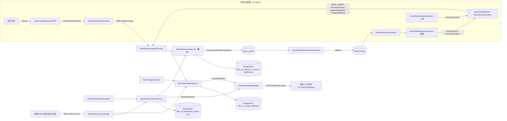
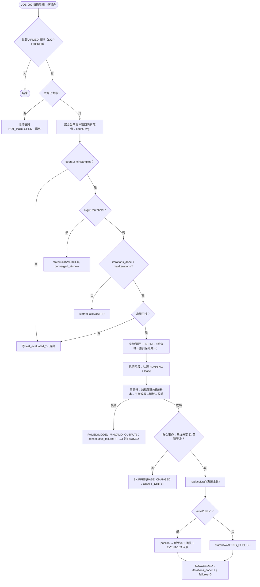
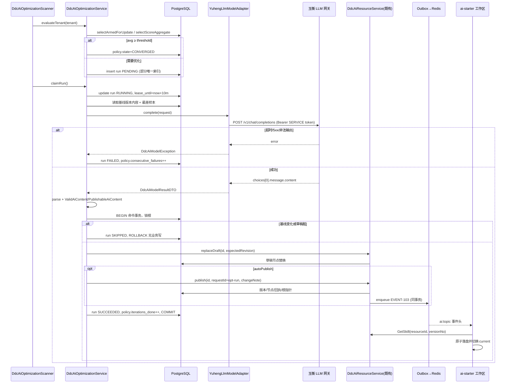
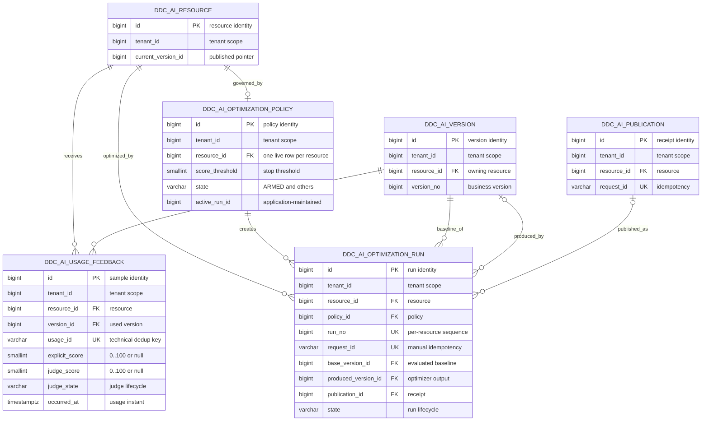

# 天枢 Prompt/Skill 使用反馈、自动优化闭环与下游 AI Starter

| Field | Value |
| --- | --- |
| Document | `2026-10-17-13-40-tianshu-ai-feedback-optimization-starter.md` |
| Template Version | `9` |
| Archetype Cleanup | `Not applicable` |
| Status | `Accepted` |
| Type | `Feature / Architecture` |
| Complexity | `Complex` |
| Complexity Drivers | 下游、天枢 Admin、玉衡 LLM 网关三方协作；新增 RPC 写操作与 Outbox 事件的多消费者契约；三张新表与 lifecycle 状态机；LLM 长调用与数据库事务分离、租约/幂等/并发；双向同步冲突；多租户后台作业 |
| Created | `2026-10-17 13:40 Asia/Shanghai` |
| Updated | `2026-10-17 15:03 Asia/Shanghai` |
| Owner | mario |
| Repository | Egon-COLA |
| Scope | `egon-cola-xingyuan/egon-cola-tianshu`（admin、starter、新 ai-starter、admin-web）与 `egon-cola-components/egon-cola-component-rpc/egon-cola-component-rpc-tianshu-adapter`；玉衡 LLM 网关仅作被调用方 |
| Change Surface | Admin 新增反馈/评分/优化三表、一个 DDL 版本、6 个 REST、4 个 RPC 方法、1 个 Outbox 事件、3 个后台作业、玉衡模型 Port+HTTP 适配、系统主体授权分支；base starter 新增两个 Port 与模型；RPC adapter 新增 proto 方法、3 个操作权限、客户端实现；新模块 `egon-cola-tianshu-ai-starter`（上报、落盘、订阅刷新、上传监听）；admin-web 新增“反馈与优化”页签 |
| Affected Chapters | §7, §8, §9, §10, §11, §12, §13, §14, §15, §16, §17, §18 |
| Source Requirement | 用户 2026-10-17：“prompt 和 skill 在线管理功能，可以增删改查；根据每次被使用后的输出结果，自动优化这个 prompt 和 skill，达到一定的评分阈值后不再自动优化；skill 还需要支持复杂 skill 的下发、自动上传更新和在线查看；给下游用，专门设计一个 starter”。同日四项确认：模型走玉衡 LLM 网关；优化产物按资源策略 autoPublish；“自动上传更新”上行、下行都要；复杂 skill 保持纯文本树并落盘 |
| Baseline Revision | `main@4ad87524a`；设计开始时工作树干净；本轮只新增本文件 |
| Amends | [天枢多租户组件迁移与 Prompt/Skill 版本管理](2026-09-21-17-18-tianshu-prompt-skill-management.md) §3（解除“客户端订阅/定时同步/内容缓存”非目标，仅限本稿 AI 发布事件与 Skill 工作区）、§7.3.2（starter 开关矩阵新增 ai-starter 三组开关）、§9.1（RPC 服务新增 4 个方法与 3 个操作权限）、§12（编辑页新增页签）；[天枢 Java/CQE 规范修订](2026-09-22-17-16-tianshu-java-cqe-standards-amendment.md) §5.3 “AI CRUD 不发无消费者 Event”条款（发布/回滚/推广改为经 Outbox 发布 EVENT-103，因本稿出现真实消费者）、§9.1（事件清单新增） |
| Supersedes | None |
| Depends On | [原 Spec](2026-09-21-17-18-tianshu-prompt-skill-management.md) §9.0.1（wire 与错误码）、§9.5（租户传输）、§11.2.12–§11.2.16（AI 五表）、§15（租户与 Redis 隔离）；[修订稿](2026-09-22-17-16-tianshu-java-cqe-standards-amendment.md) §10（class/record 与校验）、§11.0（lifecycle/live 唯一键）、§15（Outbox 接入参数）；[Outbox 与状态机集成](2026-09-24-12-00-outbox-statemachine-cqe-integration.md) §7（投递语义）；[玉衡 LLM 网关设计](2026-09-21-16-58-yuheng-llm-knowledge-wiki-design.md) §9（API-001 Chat Completions 与 SERVICE token） |
| Related Specs | [星垣完整接入设计](2026-10-11-10-26-xingyuan-native-full-integration.md)；[多租户 OAuth/OIDC 设计](2026-09-22-17-14-tianquan-multitenant-oauth-oidc-design.md) |
| Related Plans | [实施 Plan](../plan/2026-10-17-14-12-tianshu-ai-feedback-optimization-implementation.md) |

## 1. Summary

天枢已经按前置 Spec 交付了 Prompt/Skill 的多租户在线管理：草稿增删改查、不可变版本、发布/回滚/跨 namespace 推广、只读 RPC 读取、starter 开关与管理页面（提交 `step-3`…`step-24`）。本稿不重做这些能力，而是在其上补齐用户本轮提出的四件事：**使用反馈采集与自动评分**、**按策略的自动优化闭环**（平均分达到阈值后停止）、**复杂 Skill 的下发与双向自动同步**、以及**专供下游的 `egon-cola-tianshu-ai-starter`**。

设计路线：下游通过新 RPC `ReportUsage` 上报每次使用的输出摘录与可选分数；没有显式分数的样本由天枢后台作业经**玉衡 LLM 网关**做 LLM-as-judge 评分。每个资源可配置优化策略（阈值、最少样本、评估窗口、最大迭代、冷却、autoPublish、模型别名）。后台作业按租户评估当前发布版本的平均分：低于阈值且样本足够时创建优化运行，用玉衡模型基于最差样本改写内容，产物经既有内容校验后复用现有 `replaceDraft`/`publish` 写入新版本；平均分达到阈值进入 `CONVERGED` 停止，达到最大迭代进入 `EXHAUSTED`，连续失败进入 `PAUSED`，人工可重新启用。发布/回滚/推广在同一事务经 Outbox 投递 `EVENT-103` 到租户隔离的 Redis Topic；ai-starter 订阅并把已发布 Skill 树原子落盘到本地工作区（下行），同时监听本地创作目录把变更上传为新草稿并按配置发布（上行），冲突按远端修订号判定、永不自动合并。

本稿只产出设计文档：不写代码、不执行 DDL、不启动服务。新增三张 STANDARD_TENANT_ID 表、一个 MP 受管 DDL 版本、6 个 REST、4 个 RPC 方法、1 个 Outbox 事件、3 个后台作业、1 个模型 Port；天枢 Admin 不新增 Maven 依赖，玉衡调用复用 Spring `RestClient` 与 `IdpServiceOAuth2Client`。

## 2. Background and Current State

### 2.1 Business and user context

路径别名（均为真实仓库相对路径，仅用于缩短引用）：

| 缩写 | 实际路径 |
| --- | --- |
| T | `egon-cola-xingyuan/egon-cola-tianshu` |
| A | `T/egon-cola-tianshu-admin` |
| AJ | `A/src/main/java/top/egon/cola/component/tianshu/admin` |
| S | `T/egon-cola-tianshu-starter` |
| SJ | `S/src/main/java/top/egon/cola/component/tianshu` |
| N | `T/egon-cola-tianshu-ai-starter`（本稿新增） |
| NJ | `N/src/main/java/top/egon/cola/component/tianshu/ai` |
| W | `T/egon-cola-tianshu-admin-web` |
| R | `egon-cola-components/egon-cola-component-rpc/egon-cola-component-rpc-tianshu-adapter` |
| RJ | `R/src/main/java/top/egon/cola/component/rpc/tianshu` |
| Y | `egon-cola-xingyuan/egon-cola-yuheng/yuheng-llm-gateway` |
| MP | `egon-cola-components/egon-cola-component-common/egon-cola-component-common-mybatis-plus-sharding-jdbc-ext-spring-boot-starter/src/main/java/top/egon/cola/component/common/mybatis` |

用户所说的“增删改查”已经存在（API-001～API-011）。本稿把它们作为 Context-only 基线，并在同一控制器族上新增反馈与优化契约。仓库及父目录没有 `AGENTS.md`；遵循会话内用户规则与 Skill 参考。

### 2.2 Repository evidence

| Evidence ID | Classification | Exact path/symbol/decision/command | Observed fact | Design significance | Verification limit/freshness |
| --- | --- | --- | --- | --- | --- |
| EVD-001 | Static repository | `AJ/controller/ai/DdcAiResourceController.java`；`AJ/service/ai/DdcAiResourceService.java` | 11 个 REST（`/api/v1/tianshu/ai/resources` 族）与 `create/get/page/replaceDraft/delete/publish/rollback/promote/getVersion/getPublishedVersion/pageVersions/pagePublications` 全部存在 | 增删改查不重做；优化器复用 `replaceDraft`+`publish` | 当前源码；未运行 |
| EVD-002 | Static repository | `AJ/service/ai/impl/DdcAiResourceServiceImpl.java`（1116 行）：`ddcAiCommandTransactionTemplate`、`lockWritableResource`、`commandSha256`、`replayAfterPublicationConflict`、`executeWithLifecycleRetries` | 命令在具名 TransactionTemplate 内执行，根锁 FOR UPDATE，发布回执按 `(tenant_id, request_id)` 幂等 | 新作业把 LLM 调用放在事务外，发布阶段进入同一模板事务并沿用幂等规则 | 静态 |
| EVD-003 | Static repository | `AJ/service/ai/validation/DdcAiScopeValidator.java#requireNamespacePermission` | 两条授权分支：`Rbac3UserDetails`（SCOPE_TIANSHU_AI_READ/WRITE + `TIANSHU_AI_*` 权限）与 `DdcServicePrincipal`（仅允许 READ 且 `AI_READ`） | 需要新增系统主体分支与 RPC 写权限映射 | 静态 |
| EVD-004 | Static repository | `AJ/security/rpc/DdcRpcServerInterceptor.java#write`、`DdcRpcScopeExtractor.java#aiReadScope`、`RJ/security/DdcRpcOperation.java`、`DdcRpcOperationResolver.java` | `AI_READ(19)` 是唯一 AI 操作；写操作默认走 nonce 消费；AI 方法按 `fullMethodName` 映射 | 新增 `AI_REPORT/AI_WRITE/AI_PUBLISH` 并登记方法映射与 scope 提取 | 静态 |
| EVD-005 | Static repository | `R/src/main/proto/tianshu_ai_resource.proto`；`RJ/contract/DdcAiResourceRpc.java`；`RJ/client/DdcRpcClientFactory.java#promptClient/skillClient` | 一个 gRPC Service 两个方法；契约接口用 `@EgonRpcService`/`@EgonRpcMethod`；客户端经 factory 创建 handle | proto 加方法向后兼容；新 Port 的 RPC 实现同模式 | 静态；未编译 proto |
| EVD-006 | Static repository | `SJ/autoconfigure/DdcAiResourceAutoConfiguration.java`；`SJ/autoconfigure/properties/DdcAiResourceProperties.java`；`SJ/api/client/DdcPromptClient.java`、`DdcSkillClient.java` | `prompt.enabled`/`skill.enabled` 默认 false，缺 adapter 时启动失败；Port 在 base starter，实现在 adapter | ai-starter 作为组装 starter，不移动既有 Port | 静态 |
| EVD-007 | Static repository | `T/egon-cola-tianshu-http-registration-starter/pom.xml`（依赖 tianshu-starter、rpc-tianshu-adapter、shoubing-starter）；`egon-cola-xingyuan/pom.xml` 113–128 行 dependencyManagement | 已有“组装 starter”先例与父 POM 登记方式 | 新模块照此登记 | 静态 |
| EVD-008 | Static repository | `AJ/service/notification/DdcNotificationPublisher.java`、`DdcRegistryEventDeliveryHandler.java`；`AJ/config/DdcOutboxConfiguration.java` | Outbox 入队模式：`OutboxMessage.builder()...channel/destination/payload(DdcTenantMessageDTO)/header(tenantId,eventType)`；DeliveryHandler 校验 channel/schema/destination 正则并经 `ddcAdminRedissonClient` 发布 StringCodec Topic | EVENT-103 完全复用此模式 | 静态 |
| EVD-009 | Static repository | `SJ/redis/DdcRedisKeys.java#topic/registryTopic`；`SJ/listener/config/DdcConfigChangeListener.java`；`SJ/redis/DdcRedisTopicSubscription.java` | v4 键 `tianshu:v4:tenant:{tenantId}:{slotHash}:suffix`；订阅句柄与 MessageListener 模式 | 新增 `aiTopic` 与 ai-starter 订阅 | 静态 |
| EVD-010 | Static repository | `AJ/service/lease/DdcLeaseExpiryScanner.java`、`AJ/service/publish/PublishTimeoutScanner.java` | `@Scheduled` 作业按 `DdcTenantAdminProperties.getBindings()` 逐租户用 `DdcTenantContextExecutor.call` 执行，actor 为 `system:*` | 三个新作业照此逐租户执行 | 静态 |
| EVD-011 | Static repository | `A/src/main/resources/db/egon-mp/V20260922_001__tianshu_platform.sql`（`ddc_ai_resource_t0`…`ddc_ai_publication_t0`）、`V20260928_001__tianshu_instance_business_key.sql`、`repository-manifest.json`（family `tianshu`，两条已登记）；`MP/ddl/EgonColaDdlManifestBO.java` 白名单含 `tianshu` | AI 五表结构、技术八字段、lifecycle/live 唯一索引写法与 manifest 格式确定 | 新版本 `V20261017_001` 只新增，不改旧 SQL | 静态；非线上库 |
| EVD-012 | Static repository | `A/src/main/resources/egon-tianshu-persistence.yml`；`application.yml`、`application-local.yml`、`application-test.yml` | STRATEGY 风格、16 张 STANDARD_TENANT_ID 表 + 两张 SINGLE；`lifecycle.history-read-statements` 含一条 AI 语句；三 profile 键结构已对齐 | 新表登记进同一 yml；新配置键三 profile 同结构 | 静态 |
| EVD-013 | Static repository | `Y/src/main/java/top/egon/cola/component/yuheng/llm/proxy/controller/LlmApiController.java`（`/v1/chat/completions`、`/v1/models`）；`config/LlmGatewayProperties.java#Identity.resourceUri/serviceTokenAudience`；`config/LlmClientCredentialFilter.java` | 玉衡提供 OpenAI 兼容 Chat Completions，SERVICE token 由 Tianquan 过滤器验证，audience 由网关配置固定 | 天枢用 `IdpServiceOAuth2Client` 取 SERVICE token 调玉衡 | 静态；未发真实请求 |
| EVD-014 | Static repository | `SJ/autoconfigure/DdcAutoConfiguration.java#ddcInstanceService`（注入 `IdpServiceOAuth2Client`、`IdpStarterProperties`）；`IdpServiceTokenRequest(registrationId, appId, audience, tenantId, scopes)`；`yuheng-starter/.../GatewayReportHttpClient.java` 用 `RestClient`+`JdkClientHttpRequestFactory` | Admin 已具备 SERVICE token 能力与 RestClient 先例 | 模型适配不引新依赖 | 静态 |
| EVD-015 | Static repository | `egon-cola-components/pom.xml`（spring-ai-bom 1.1.8 仅供 agent-flow）；`A/pom.xml` 无 spring-ai | Admin 没有 ChatModel 依赖 | 用户已选玉衡通道，不引 Spring AI | 静态 |
| EVD-016 | Static repository | `W/src/App.tsx`（`ai/prompts`、`ai/skills`、`ai/resources/:id`）；`W/src/pages/AiResourceEditorPage.tsx`（Tabs：草稿编辑、版本与发布；Antd Tree + TextArea）；`W/src/api/ai.ts` | 在线查看/编辑已存在；页签式布局可扩展 | 新增第三页签而非新页面 | 静态；未开浏览器 |
| EVD-017 | Static repository | `RJ/autoconfigure/DdcRpcProperties.java#maxInboundMessageSize=4MiB`；`SJ/model/ai/validation/*`（256 节点、256KiB 文件、1MiB 整包） | 现有限额可容纳上传整树与下发 | 维持限额，作为 ai-starter 可调配置的上限校验 | 静态 |
| EVD-018 | User decision | 2026-10-17 四项回答 | 玉衡通道；策略 autoPublish；上行+下行；纯文本树落盘 | DEC-001～DEC-004 | 仅按明示范围使用 |
| EVD-019 | Static repository | `T/docs/tianshu-ai-migration-runbook.md` | Admin 不在启动时执行 DDL，初始化走显式 CLI；集成测试 opt-in | 新 DDL 版本按同一手册发布 | 静态 |

### 2.3 Problem statement and gap

现状只能人工编辑、发布、读取 Prompt/Skill；天枢不知道资源被使用后的效果，也没有任何回路把效果反馈回内容；Skill 只能被程序按需 RPC 读取为对象，不会以目录形式出现在下游文件系统，发布后也不会主动通知下游；下游本地改动不会回到天枢；`egon-cola-tianshu-starter` 是配置中心 SDK，不是面向 AI 场景的专用 starter。

目标行为：下游每次使用后上报结果；天枢对无分样本自动评分；策略驱动的优化器在平均分低于阈值时改写内容并按策略发布，达到阈值即停；发布事件推送到下游，下游工作区自动刷新；本地创作目录变更自动上传；管理页面可查看反馈、运行与策略；下游只需引入一个 starter。

### 2.4 Evidence and current-chain map

| Entry/trigger | Current call chain | Data read/written | External dependency | Consumers | Evidence |
| --- | --- | --- | --- | --- | --- |
| 管理员发布草稿 | AiVersionsPanel → `POST /api/v1/tianshu/ai/resources/{id}/publications` → `DdcAiResourceController#publish` → `DdcAiResourceServiceImpl#publishInTransaction` → 版本/节点/回执/根指针 | `ddc_ai_version`、`ddc_ai_version_node`、`ddc_ai_publication`、`ddc_ai_resource.current_version_id` | PostgreSQL | 管理员 | EVD-001/002 |
| 应用读取 Skill | `DdcSkillClient.get` → `RpcDdcSkillClient` → gRPC `GetSkill` → `DdcRpcServerInterceptor`（HMAC、AI_READ、namespace）→ `DdcAiResourceRpcProvider#getSkill` → `getPublishedVersion` | 只读版本与节点 | gRPC、PostgreSQL | 下游应用 | EVD-004/005/006 |
| 注册表变更通知 | `DdcNotificationPublisher#publish` → `TransactionalOutbox.enqueue` → Outbox worker → `DdcRegistryEventDeliveryHandler#deliver` → Redis Topic | `egon_outbox.egon_cola_outbox_message` | Redis | 注册订阅方 | EVD-008 |
| 后台租约扫描 | `@Scheduled DdcLeaseExpiryScanner#scanExpired` → 逐租户 `DdcTenantContextExecutor.call` → 事务内扫描 | `ddc_instance`、Redis 租约 | Redis、PostgreSQL | 无外部消费者 | EVD-010 |
| 玉衡模型调用 | 客户端 Bearer SERVICE token → `LlmClientCredentialFilter`/Tianquan 过滤器 → `LlmApiController#createLlmChatCompletion` → 协议 Strategy → 上游模型 | 玉衡模型目录 | 上游模型服务 | 企业内应用 | EVD-013 |

### 2.5 Archetype example cleanup

Cleanup disposition: Not applicable

Reason: 目标项目 `egon-cola-xingyuan/egon-cola-tianshu` 是星垣平台模块而非由 `egon-cola-archetypes` 生成的业务项目；其模块 POM 父级为 `egon-cola-tianshu`/`egon-cola-xingyuan-parent`（EVD-007），源码树为传统三层 `admin.controller/service/repository/dao/model`（EVD-001），仓库内没有该项目的 archetype 生成记录或示例域；本稿新增的 `egon-cola-tianshu-ai-starter` 是手写技术 starter，不由 archetype 生成，因此不存在待清理的样例链。

## 3. Goals and Non-goals

### 3.1 Goals

- 下游可按次上报 Prompt/Skill 使用结果（输出摘录、结果、可选分数），天枢按租户持久化并去重。
- 无显式分数的样本由天枢经玉衡 LLM 网关自动评分；评分与优化都可按资源策略关闭。
- 每个资源的优化策略定义阈值、最少样本数、评估窗口、最大迭代、冷却时间、autoPublish、模型别名；后台作业自动评估、创建并执行优化运行，产物经既有校验与发布链路成为新版本；平均分达到阈值后停止。
- 发布/回滚/推广事件经 Outbox 投递到租户隔离 Redis Topic；下游 ai-starter 订阅并把已发布 Skill 树原子落盘到本地工作区，并周期性对账兜底。
- 下游 ai-starter 监听本地创作目录，把变更上传为天枢草稿并可按配置发布；远端修订变化即冲突，不自动合并。
- 管理页面可查看并配置策略、查看运行历史与反馈样本、手动触发一次优化。
- 下游只引入 `egon-cola-tianshu-ai-starter`；所有新能力默认关闭。

### 3.2 Non-goals

- 不重做既有增删改查/版本/推广/只读 RPC/编辑页面；不改既有 11 个 REST 与 2 个 RPC 的 wire。
- 不引入二进制 Skill 节点、对象存储、ZIP 传输；不放宽 256 节点/256KiB/1MiB 上限（DEC-004）。
- 不在天枢内置模型、不引入 Spring AI/OpenAI SDK（DEC-001）；不实现 Prompt 的本地文件上传（上行只针对 Skill 目录）。
- 不做 A/B 实验、灰度流量分配、人工审核工作流、多目标跨 namespace 自动推广；优化只作用于资源自身的 scope。
- 不做跨租户聚合、跨租户模型配额；不改玉衡 LLM 网关代码。
- 不做自动合并：上行冲突只报告，不做三方合并。
- 本轮不写 Plan、不实现、不执行 DDL、不启动服务。

### 3.3 Change Surface and Design Depth

| Area/layer | Disposition | Exact repository evidence | Changed or preserved behavior/contract | Required Spec treatment | Chapter(s) |
| --- | --- | --- | --- | --- | --- |
| Admin 反馈/评分/优化业务链（Service、Repository、DAO、PO/BO/Command/Result、作业、模型 Port） | Affected | `AJ/service/ai`、`AJ/repository`、`AJ/dao`、`AJ/model`；EVD-001/002/010 | 新增 `DdcAiFeedbackService`、`DdcAiOptimizationService`、三表访问、两类 Strategy、三个作业、玉衡适配 | 逐类、逐事务、逐失败路径设计 | §7, §8, §10, §13, §14 |
| Admin REST（策略、运行、反馈） | Affected | `AJ/controller/ai/DdcAiResourceController.java`、`DdcAiExceptionAdvice.java`；EVD-001 | 新增 6 个操作于同一路径族；既有 11 个不变 | 逐操作 wire、OpenAPI、权限、错误 | §9, §12 |
| 天枢 RPC（proto、契约、Provider、安全） | Affected | `R/src/main/proto/tianshu_ai_resource.proto`、`RJ/contract`、`RJ/security`、`AJ/rpc/provider`、`AJ/security/rpc`；EVD-004/005 | 同一 Service 新增 4 个方法；3 个新操作权限；scope 提取与授权分支 | 逐方法契约、权限矩阵、状态映射 | §7, §9, §15 |
| Outbox 事件与 Redis Topic | Affected | `AJ/service/notification/*`、`AJ/config/DdcOutboxConfiguration.java`、`SJ/redis/DdcRedisKeys.java`；EVD-008/009 | 发布/回滚/推广入队 EVENT-103；新 Topic 与 DeliveryHandler | 事件信封、目的地、投递/重试/去重 | §7, §9, §15, §16 |
| 数据库 | Affected | `A/src/main/resources/db/egon-mp/*`、`egon-tianshu-persistence.yml`；EVD-011/012 | 新增三表、索引、一个 DDL 版本、manifest、表登记 | 逐表、逐索引、ER、事务 | §11, §16 |
| base starter（Port、模型、Redis 键） | Affected | `SJ/api/client`、`SJ/model/ai`、`SJ/redis/DdcRedisKeys.java`、`SJ/autoconfigure/DdcRedisAutoConfiguration.java`；EVD-006/009 | 新增 `DdcAiFeedbackClient`、`DdcAiSyncClient` 与模型；`aiTopic`；Redis 客户端创建条件增加 ai 订阅开关 | 文件级设计 | §8, §10 |
| RPC adapter 客户端 | Affected | `RJ/client/ai`、`RJ/client/DdcRpcClientFactory.java`、`RJ/autoconfigure/DdcRpcAutoConfiguration.java`；EVD-005 | 新增两个 Port 的 RPC 实现、proto 转换、条件装配 | 文件级设计与装配真值 | §8, §9, §14 |
| 新模块 `egon-cola-tianshu-ai-starter` | Affected | `T/pom.xml` modules、`egon-cola-xingyuan/pom.xml` dependencyManagement；EVD-007 | 上报队列、Skill 工作区落盘、发布订阅刷新、创作目录上传监听、属性与自动装配 | 模块树、Bean、开关真值、状态文件、冲突规则 | §7, §8, §10, §13, §14, §15, §16 |
| 管理前端 | Affected | `W/src/pages/AiResourceEditorPage.tsx`、`W/src/api/ai.ts`、`types.ts`；EVD-016 | 新增“反馈与优化”页签与两个面板 | 路由、组件、状态、字段映射 | §12, §14 |
| 配置与运维 | Affected | `A/src/main/resources/application*.yml`、`egon-tianshu-persistence.yml`；EVD-012/019 | 新增 `admin.ai.optimization.*` 与 ai-starter 键；凭据 allowed-operations 扩展 | 键矩阵、默认值、安全 | §15, §16 |
| 方案比较与风险 | Affected | 本稿新增决策面 | 玉衡 vs Spring AI、策略 vs 始终发布、双向同步冲突 | 显式比较与风险 | §17, §18 |
| 既有 AI REST/RPC/服务（API-001～011、RPC-001/002、`DdcAiResourceServiceImpl` 既有方法） | Context-only | `DdcAiResourceController.java`、`DdcAiResourceServiceImpl.java`、`DdcAiResourceRpcProvider.java` | wire、幂等、锁顺序、错误码保持；优化器只调用其公开方法 | 回归断言，不复制契约 | §9, §14 |
| 既有 YAML 配置/注册/租约业务与 Outbox 两条既有通知 | Unchanged | `DdcConfigService`、`DdcPublishService`、`DdcNotificationPublisher`、`DdcConfigDispatchDeliveryHandler` | 不触碰 | 一行记录 | §9 |
| 玉衡 LLM 网关 | Context-only | `Y/.../LlmApiController.java`、`LlmGatewayProperties.Identity` | 仅作被调用方；其协议、鉴权、配额不改 | 调用契约与失败语义 | §9, §15 |
| 授柄/鉴神身份平台 | Unchanged | `IdpServiceOAuth2Client`、`Rbac3UserDetails` | 复用 SERVICE token 与权限字符串 | 一行记录 | §15 |
| 二进制内容、对象存储、Git 同步 | Not applicable | DEC-004 | 不存在 | N/A | §12 |

## 4. Requirements and Acceptance Criteria

| ID | Atomic requirement | Priority | Observable acceptance criteria | Source |
| --- | --- | --- | --- | --- |
| REQ-001 | 既有 Prompt/Skill 增删改查、版本、发布、推广、只读 RPC 与编辑页面保持不变 | Must | API-001～011、RPC-001/002 的既有契约测试与 OpenAPI 断言不变；本稿新增代码不修改其 wire | “可以增删改查”（已存在，作为基线） |
| REQ-002 | 下游可按次上报使用结果 | Must | 通过 ai-starter `DdcAiUsageReporter.report` 产生的记录最终以 `(tenant_id, usage_id)` 唯一落库；重复上报返回已接受不重复计数；超限/越权被拒且不落库 | “根据每次被使用后的输出结果” |
| REQ-003 | 无显式分数的样本自动评分 | Must | 策略 `judgeEnabled=true` 时 `PENDING` 样本在作业周期内变为 `DONE` 并带 0..100 `judgeScore`；失败最多 3 次后 `FAILED`；显式分数优先 | 同上，“评分阈值”隐含评分来源；DEC-001 |
| REQ-004 | 策略驱动的自动优化闭环，达到阈值停止 | Must | 平均分低于阈值且样本数≥最少样本、迭代未满、冷却已过时创建并执行运行；产物成为新版本（autoPublish 决定是否发布）；平均分≥阈值时策略进入 `CONVERGED` 且不再创建运行 | “自动优化…达到一定的评分阈值后，不再自动优化”；DEC-002 |
| REQ-005 | 优化过程可追溯、可控 | Must | 每次运行记录基线版本、样本数、平均分、模型别名、提示/输出摘要哈希、产物版本、发布回执、错误码；草稿有未发布修改时跳过并标记 `DRAFT_DIRTY`；连续失败 3 次暂停 | “自动优化”隐含安全性；§5 决策 |
| REQ-006 | 复杂 Skill 下发：ai-starter 把已发布 Skill 树原子落盘 | Must | 配置的资源在启动后出现在 `{workspace.root}/{resourceKey}/versions/{versionNo}` 且 `current` 指向该版本；写入失败不留半包；路径穿越被拒 | “复杂 skill 的下发”；DEC-004 |
| REQ-007 | 下行自动更新 | Must | 发布/回滚/推广后下游在订阅周期内（或对账周期内）刷新 `current`；订阅不可用时对账仍收敛；钉住版本的资源不被自动切换 | “自动上传更新”下行（DEC-003） |
| REQ-008 | 上行自动上传 | Must | 创作目录内容哈希变化后，在轮询周期内以 `ReplaceSkillDraft` 形成新草稿；`autoPublish` 时随后 `PublishSkillDraft`；远端修订不等于本地基线时返回冲突并记录，不覆盖 | “自动上传更新”上行（DEC-003） |
| REQ-009 | 在线查看反馈与优化 | Must | 编辑页新增页签展示策略、评估快照、运行列表与详情、反馈样本分页；无权限时只读/隐藏 | “在线查看” |
| REQ-010 | 专用下游 starter | Must | 新模块 `egon-cola-tianshu-ai-starter` 可独立引入；三组开关缺省关闭时不注册新 Bean、不发起网络请求 | “专门设计一个 starter” |
| REQ-011 | 多租户隔离 | Must | 新表含 `tenant_id`；RPC 写入租户来自凭据绑定；作业逐注册租户执行并 finally 恢复；Topic 含 tenant | 前置 REQ-013 延续 |
| REQ-012 | 本轮只产出 Spec | Must | 仅新增本文件；无代码、DDL 执行、服务启动 | 技能范围 |
| REQ-013 | 模型通道为玉衡 LLM 网关且 Admin 不新增依赖 | Must | `A/pom.xml` 不新增坐标；模型调用经 `RestClient` + SERVICE token 到 `/v1/chat/completions` | DEC-001 |
| REQ-014 | 遵循 2026-09-22 Java/CQE 规范 | Must | §6.2 十行全 PASS；事件经 Outbox；class POJO；BaseConverter；具名 Bean | 用户规则 |

### 4.1 Scenario matrix

| Scenario | Actor/trigger | Preconditions | Main path | Alternative/failure path | Data/state change | Observable result | Requirements |
| --- | --- | --- | --- | --- | --- | --- | --- |
| 上报一次使用 | 下游应用调用 `report` | 凭据含 `AI_REPORT`，资源已发布 | 入队→批量 RPC→逐条落库 | 重复 usageId 返回 ACCEPTED_DUPLICATE；越权整批拒绝；单条校验失败逐条 REJECTED 其余落库；队列满丢弃并计数 | `ddc_ai_usage_feedback` 新行 | 回执含每条状态 | REQ-002/011 |
| 自动评分 | JOB-001 | 样本 `judge_state=PENDING`，策略 `judgeEnabled` | 认领→玉衡评分→写 DONE | 模型超时/非法 JSON→attempts++，3 次 FAILED；策略关闭评分→保持 PENDING 不计入 | `judge_score/judge_state` | 页面显示分数来源 | REQ-003 |
| 自动优化成功并发布 | JOB-002 | 策略 ARMED，样本≥min，avg<阈值，草稿干净，autoPublish=true | 创建运行→LLM 改写→校验→replaceDraft+publish→SUCCEEDED | 基线版本在执行期间被人工改变→SKIPPED(BASE_CHANGED)；LLM 输出不合法→FAILED(INVALID_OUTPUT) | 运行、新版本、回执、EVENT-103、策略 iterations++ | 版本列表出现新版本，changeNote 带 run 编号 | REQ-004/005 |
| 自动优化仅生成候选 | JOB-002 | autoPublish=false | 同上但只 replaceDraft | 人工发布后策略从 AWAITING_PUBLISH 回到 ARMED | 草稿更新、策略 AWAITING_PUBLISH | 页面提示“候选草稿待发布” | REQ-004 |
| 达到阈值停止 | JOB-002 | avg≥阈值 | 置 CONVERGED | 人工 rearm 后重新评估 | 策略 state/converged_at | 页面显示 CONVERGED | REQ-004 |
| 草稿有未发布修改 | JOB-002 | 草稿 hash≠当前版本 hash | 运行 SKIPPED(DRAFT_DIRTY) | 人工发布或丢弃草稿后下次评估继续 | 运行记录 | 页面显示跳过原因 | REQ-005 |
| 手动触发 | 管理员 | PUBLISH 权限，无活动运行 | 创建 MANUAL 运行→202 | 已有活动运行→409；同 Idempotency-Key 重放原运行 | 运行 PENDING | 轮询运行详情 | REQ-005/009 |
| 运行执行者崩溃 | 任一 Admin 实例 | RUNNING 且 lease 过期 | 另一实例标记 FAILED(LEASE_EXPIRED) | 不重放 LLM；冷却后由评估重新创建 | 运行 FAILED，policy.consecutive_failures++ | 可观察 | REQ-005 |
| 发布事件下行 | 管理员发布或优化器发布 | ai-starter 订阅开启 | Outbox→Redis→listener→GetSkill→原子落盘→切 current | Redis 离线→对账轮询 `GetVersionHead` 发现变化后拉取；钉住版本不切换 | 本地 versions/current | 应用读取新目录 | REQ-006/007 |
| 本地创作变更上行 | 开发者修改目录 | authoring 开启，凭据含 AI_WRITE | 哈希变化→ReplaceSkillDraft(expectedRevision=基线)→状态文件更新→可选发布 | 远端修订≠基线→409 冲突记录，不再重试直到人工 `pull`；校验失败→记录并保留本地 | 远端草稿/版本 | 状态文件含冲突标记与日志 | REQ-008 |
| 两租户同 key 资源 | 作业/RPC | tenant 不同 | 各租户独立评估、独立 Topic | 凭据租户与资源租户不一致→403 | 无跨租户写入 | 隔离可验证 | REQ-011 |
| 模型通道未配置 | 管理员开启策略 | `admin.ai.optimization.enabled=false` 或模型配置缺失 | REST 策略保存成功但评估/评分作业不运行并记录 WARN | 手动触发返回 503(56322) | 无 | 页面显示通道未启用 | REQ-013 |

### 4.2 Use-case analysis

#### 4.2.1 Actor inventory

| Actor ID | Actor/role | Goal and responsibility | Entry/channel | Permission/tenant context | Evidence |
| --- | --- | --- | --- | --- | --- |
| ACTOR-001 | 天枢管理员 | 配置策略、查看反馈/运行、手动触发、发布候选 | 管理 Web/REST | OIDC 用户，`TIANSHU_AI_READ/WRITE/PUBLISH` 权限与 namespace 粒度 | EVD-003/016 |
| ACTOR-002 | 下游应用（引入 ai-starter 的进程） | 上报使用结果、落盘并刷新 Skill、上传创作目录 | ai-starter → Direct RPC/Redis | HMAC 凭据绑定 tenant、biz/env/app、namespace 模式与 `AI_READ/AI_REPORT/AI_WRITE/AI_PUBLISH` | EVD-004/006 |
| ACTOR-003 | 天枢后台优化作业 | 评分、评估、执行优化、保留期清理 | `@Scheduled` 逐租户 | `system:ai-judge`/`system:ai-optimizer` 系统主体 | EVD-010 |
| ACTOR-004 | 玉衡 LLM 网关 | 为评分与改写提供模型调用 | HTTPS `/v1/chat/completions` | 天枢 SERVICE token，audience 为玉衡资源 URI | EVD-013/014 |
| ACTOR-005 | 下游 Skill 作者 | 在本地创作目录修改 Skill 文件 | 文件系统 | 以 ACTOR-002 的凭据上传 | DEC-003 |

#### 4.2.2 Use-case artifact

| ID | Use case/goal | Primary actor | Supporting actors/systems | Trigger | Preconditions | Main success outcome | Alternatives/failures | Postconditions | Requirements | Interfaces/pages | Tests |
| --- | --- | --- | --- | --- | --- | --- | --- | --- | --- | --- | --- |
| UC-001 | 上报一次使用结果 | ACTOR-002 | 天枢 Admin | 应用调用 `DdcAiUsageReporter.report` | 资源已发布；凭据含 AI_REPORT | 样本按 usageId 唯一落库并带回执 | 重复、越权、超限、队列满、网络失败重试 | 成功：样本存在且 judge_state 正确；失败：无落库且本地计数 | REQ-002/011 | RPC-003 | TEST-001～004 |
| UC-002 | 自动评分无分样本 | ACTOR-003 | ACTOR-004 | 作业周期 | 策略 judgeEnabled；通道已配置 | 样本获得 judgeScore | 模型失败、非法输出、通道关闭 | DONE/FAILED/PENDING 明确 | REQ-003/013 | JOB-001、INTERNAL-103 | TEST-005～007 |
| UC-003 | 按策略自动优化 | ACTOR-003 | ACTOR-004、天枢既有发布链 | 作业周期 | 策略 ARMED、样本足够、草稿干净 | 新版本（或候选草稿）生成，策略状态推进 | 基线变化、草稿脏、输出非法、租约过期、连续失败 | 运行有终态；策略状态与 iterations 一致 | REQ-004/005/013/014 | JOB-002、INTERNAL-103、EVENT-103 | TEST-008～015 |
| UC-004 | 配置与查看优化 | ACTOR-001 | 天枢 Admin | 打开“反馈与优化”页签 | TIANSHU_AI_READ（查看）/PUBLISH（修改） | 看到策略、评估快照、运行、反馈；保存策略 | 无权限、校验失败、并发修改（revision 冲突） | 策略持久化；状态按 rearm 规则 | REQ-009 | API-012/013/015/016/017 | TEST-016～019 |
| UC-005 | 手动触发一次优化 | ACTOR-001 | ACTOR-003 | 点击“立即优化” | PUBLISH 权限；无活动运行；资源已发布 | 运行 PENDING 并被作业执行 | 活动运行存在、通道关闭、幂等重放 | 运行可轮询 | REQ-005/009 | API-014/016 | TEST-020/021 |
| UC-006 | 下游落盘并自动刷新 Skill | ACTOR-002 | Redis、天枢 RPC | 启动/事件/对账 | workspace 开启；凭据 AI_READ | 本地 current 指向最新发布版本 | Redis 离线、拉取失败、磁盘失败、钉住版本 | 无半包；状态文件一致 | REQ-006/007/010 | EVENT-103、RPC-002、RPC-004 | TEST-022～025 |
| UC-007 | 本地变更自动上传 | ACTOR-005 | ACTOR-002、天枢 RPC | 文件变更 | authoring 开启；凭据 AI_WRITE（发布另需 AI_PUBLISH） | 远端草稿/版本更新 | 修订冲突、校验失败、超限 | 状态文件记录基线或冲突 | REQ-008/010 | RPC-005、RPC-006 | TEST-026～028 |

#### 4.2.3 UC-003 — 按策略自动优化

| Concern | Definition |
| --- | --- |
| Goal and value | 无需人工介入即可让低分 Prompt/Skill 改进，直到平均分达标 |
| Primary/supporting actors | ACTOR-003；ACTOR-004 提供模型；既有发布链提供版本与事件 |
| Trigger | JOB-002 每个扫描周期对每个注册租户执行 |
| Preconditions | `admin.ai.optimization.enabled=true`；策略 `enabled=true` 且 `state=ARMED`；资源已发布；无活动运行 |
| Success postconditions | 运行 `SUCCEEDED`；`autoPublish=true` 时资源当前版本指向产物且 EVENT-103 已入队；`autoPublish=false` 时草稿为候选且策略 `AWAITING_PUBLISH` |
| Failure postconditions | 运行 `FAILED/SKIPPED` 并带错误码；资源版本与草稿不变（SKIPPED）或草稿不变（FAILED）；策略 `consecutive_failures` 更新 |
| Requirements/contracts/tests | REQ-004/005/013/014；JOB-002、INTERNAL-103、EVENT-103；TEST-008～015 |

Main flow:

1. 作业以租户系统主体进入事务，认领一条 ARMED 策略并读取资源当前版本。
2. 聚合该版本在评估窗口内的有效分数（显式优先、否则评分）；样本不足则记录快照后退出。
3. 平均分≥阈值→`CONVERGED`；迭代满→`EXHAUSTED`；冷却未满→退出；否则创建 `PENDING` 运行并提交。
4. 执行阶段在事务外加载基线内容与最差样本，调用玉衡改写，解析并用既有内容校验器校验。
5. 在命令事务内校验基线未变、草稿干净，复用 `replaceDraft`（与 `publish`），写运行终态、策略计数与事件。

Alternative and failure flows:

| Branch | Entry condition | Behavior | State/postcondition | Actor-visible result | Recovery/next action |
| --- | --- | --- | --- | --- | --- |
| UC-003-A1 | 基线版本在执行期间变化 | 运行 `SKIPPED(BASE_CHANGED)`，不写草稿 | 策略保持 ARMED | 运行列表显示跳过 | 下次评估按新版本重新聚合 |
| UC-003-A2 | 草稿 hash≠当前版本 hash | `SKIPPED(DRAFT_DIRTY)` | 同上 | 页面提示先发布或丢弃草稿 | 人工处理后自动继续 |
| UC-003-A3 | 模型超时/5xx/非法输出 | `FAILED(MODEL_TIMEOUT/MODEL_ERROR/INVALID_OUTPUT)`；`consecutive_failures++` | 3 次→`PAUSED` | 页面显示失败与原因 | 人工 rearm |
| UC-003-A4 | 执行实例崩溃 | 其他实例在 lease 过期后标记 `FAILED(LEASE_EXPIRED)` | 同 A3 计数 | 可见 | 冷却后重建运行 |
| UC-003-A5 | 发布阶段 `publish` 冲突（人工同时发布） | 命令事务回滚，运行 `SKIPPED(PUBLISH_CONFLICT)` | 草稿不变 | 可见 | 下次评估 |

## 5. Constraints, Assumptions, and Decisions

### 5.1 Confirmed constraints

只写 Spec；不改既有 11 REST/2 RPC wire；V20260922_001、V20260928_001 及 manifest 已登记条目不动；Admin 不新增 Maven 依赖；所有新 POJO 用 class（不可变值对象除外）；事件必须经 Outbox；三 profile 配置键结构一致；新表 STANDARD_TENANT_ID、1×1 拓扑；不做二进制与自动合并。

### 5.2 Small-gap assumptions

| ID | Inference | Repository evidence | Why locally reversible | Impact if wrong |
| --- | --- | --- | --- | --- |
| ASM-001 | 新模块命名 `egon-cola-tianshu-ai-starter`，基包 `top.egon.cola.component.tianshu.ai` | 既有 `egon-cola-tianshu-http-registration-starter` 与基包 `...tianshu.http.registration` | 仅名称 | 改名即可 |
| ASM-002 | 显式分数优先于评分分数；有效分 = `COALESCE(explicit_score, judge_score)` | 用户“评分阈值”未指定来源；DEC-001 同意评分通道 | 聚合 SQL 一处 | 改聚合表达式 |
| ASM-003 | 首期容量：单条输入摘录≤8KiB、输出摘录≤32KiB、批量≤100 条、保留 30 天（软删除）、评估窗口默认 24h、阈值默认 80、最少样本默认 20、最大迭代默认 5、冷却默认 1h | 无线上数据；与既有 1MiB/4MiB 限额兼容 | 均为策略/配置默认值 | 调默认值 |
| ASM-004 | 评分与优化提示模板作为 Admin 资源文件（classpath）维护，不作为天枢 Prompt 资源自引用 | 避免递归依赖与首发缺内容 | 模板文件可替换 | 后续可迁移为资源 |
| ASM-005 | 玉衡模型别名由策略字段显式指定，不提供默认模型发现 | `LlmInvocationCommandDTO.model` 为 alias | 配置默认别名即可 | 增加 `/v1/models` 发现 |
| ASM-006 | 上行只上传 Skill 目录；Prompt 不做本地文件上传 | 用户原文“skill 还需要…自动上传更新” | 新增 Prompt 分支不影响本稿 | 后续扩展 |
| ASM-007 | 运行租约 10 分钟、模型读超时 120 秒、最大输出 8192 token、temperature 0.2 | 无运行数据；评分/改写为单轮非流式 | 配置键 | 调值 |

### 5.3 Resolved decisions

| ID | Decision | Decision owner | Evidence and rationale | Requirements |
| --- | --- | --- | --- | --- |
| DEC-001 | 评分与优化走玉衡 LLM 网关 `/v1/chat/completions`，SERVICE token；天枢只加模型 Port+HTTP 适配 | User（2026-10-17） | EVD-013/014/015；复用企业模型路由与审计，不引依赖 | REQ-003/004/013 |
| DEC-002 | 按资源策略 `autoPublish`：true 自动发布并继续循环；false 只生成候选草稿并进入 `AWAITING_PUBLISH`；avg≥阈值→`CONVERGED` | User | 安全默认 false；闭环仍可全自动 | REQ-004/005 |
| DEC-003 | 上行与下行都做：下行 Outbox→Redis 订阅+对账刷新落盘；上行目录监听上传；两者使用不同目录，冲突仅按远端修订判定 | User | 分离目录消除同目录双向冲突 | REQ-006/007/008 |
| DEC-004 | 纯文本树，限额不变，starter 原子落盘（版本目录 + current 指针） | User | 不改 schema 与 RPC 限额 | REQ-006 |
| DEC-005 | 新 RPC 方法追加在既有 `egon.tianshu.v1.DdcAiResourceService`，新增 `AI_REPORT(20)/AI_WRITE(21)/AI_PUBLISH(22)` | Spec 设计，随本稿审核 | proto 追加方法向后兼容；操作粒度与既有一致 | REQ-002/008/011 |
| DEC-006 | 后台作业对既有 Service 的调用通过新增“系统主体”授权分支（`DdcAiSystemActor` ThreadLocal，仅作业可绑定） | Spec 设计 | 复用既有校验/锁/幂等/事件，不复制写链 | REQ-004/014 |
| DEC-007 | 一资源同一时刻最多一个活动运行，由部分唯一索引 `WHERE state IN ('PENDING','RUNNING')` 保证 | Spec 设计 | 多 Admin 实例并发安全不依赖进程锁 | REQ-005 |
| DEC-008 | 发布事件只投递“头信息”（资源、版本、哈希），不投递正文；下游用既有 `GetSkill` 拉取 | Spec 设计 | Topic 负载小、权限在拉取时再验 | REQ-007 |

### 5.4 Open major decisions

None。四项主要业务决定已由用户于 2026-10-17 作出（DEC-001～DEC-004）；其余为设计内决定，随本稿整体审核。

## 6. Project Technology Context

| Concern | Current choice | Repository evidence | Constraint on design |
| --- | --- | --- | --- |
| Runtime | Java 21；Spring Boot 3.5.16；Lombok 1.18.46；MapStruct 1.6.3 | `egon-cola-xingyuan/pom.xml`、`T/pom.xml` | 不升级 |
| Persistence | MP 扩展 starter 5.4.1、`EgonModel`、STRATEGY 1×1、受管 DDL manifest | EVD-011/012 | 新表沿用技术八字段、lifecycle/live 唯一键、`V20261017_001` 单版本 |
| Messaging | `egon-cola-component-transactional-outbox-starter` + Redis Topic | EVD-008 | 事件只能经 Outbox |
| RPC | Direct gRPC、HMAC v2、`EgonRpcService` 契约、4MiB 消息上限 | EVD-004/005/017 | 追加方法、追加操作权限 |
| HTTP | Spring MVC、springdoc 2.8.x、OAS 3.1、`ResultRecord`/`PageResultRecord`、AI 专用 Advice | `A/src/main/resources/application.yml`、`DdcAiExceptionAdvice` | 新 REST 挂在同控制器族与 Advice |
| Identity | 授柄 OIDC/SERVICE token、鉴神 RBAC 权限字符串 | EVD-003/014 | 玉衡调用用 SERVICE token；管理权限沿用 `TIANSHU_AI_*` |
| Frontend | React 19、Ant Design、React Query、Vitest、Playwright | `W/package.json`、EVD-016 | 新页签复用 Tabs/Table/Form |
| Tests | JUnit/Spring Test/MockMvc、Testcontainers（opt-in Failsafe profile） | EVD-019、`A/src/test/.../integration/DdcAi*IT.java` | 新 IT 入同一 profile |

### 6.1 Java architecture profile and capability baseline

| Architecture profile | Archetype/template or base package | Exact evidence and verifier | Existing deviations | Design action |
| --- | --- | --- | --- | --- |
| Traditional Three-Layer | `top.egon.cola.component.tianshu.admin.{controller,service,service.*.impl,repository,repository.impl,dao,model.*}`；starter/adapter 为技术模块 | EVD-001/002；修订稿 §5.3 保留现有包；`DdcTestDependencyBoundaryTest`、`DdcPlatformBoundaryTest` | `service/ai/impl` 下已有 Strategy；`security`、`rpc/provider` 为技术包并委托 Service | 保留；新增类进入同一包族，不新建层 |

| Need | Spring/JDK candidate | Spring Boot Starter candidate | Egon-COLA/module candidate | Proven gap | Decision/dependency impact |
| --- | --- | --- | --- | --- | --- |
| 模型 HTTP 调用 | `RestClient`、`JdkClientHttpRequestFactory`、`java.net.http` | spring-boot-starter-web（已有） | `yuheng-starter` 的 `GatewayReportHttpClient` 写法 | 无需 Spring AI | 复用，无新依赖 |
| SERVICE token | 无 | 无 | `IdpServiceOAuth2Client`（shoubing-starter，Admin 已依赖） | 无 | 复用 |
| 可靠事件 | 无 | 无 | Outbox starter、`DdcNotificationPublisher` 模式 | 无 | 复用 |
| 后台作业与租户切换 | `@Scheduled`、`TransactionTemplate` | 无 | `DdcTenantContextExecutor`、`DdcTenantRegistry` | 无 | 复用 |
| 运行互斥/租约 | PostgreSQL 部分唯一索引、`FOR UPDATE SKIP LOCKED`（命名 XML） | 无 | MP 扩展命名 XML 与 Guard | 无 | 复用，无分布式锁 |
| 哈希/编码 | `MessageDigest`、`HexFormat`、`Base64` | 无 | `DdcAiContentStrategy.sha256Hex` | 无 | 复用 |
| 文件原子落盘 | `java.nio.file.Files`（临时目录、`ATOMIC_MOVE`、`FileChannel.force`） | 无 | 无 | 无 | JDK |
| 目录变更监听 | `WatchService` + 轮询哈希回退 | 无 | 无 | 无 | JDK |
| 校验/转换 | Jakarta Validation、MapStruct | validation starter | `ValidationUtils`、`BaseConverter`/`BaseForwardConverter`、既有 `ValidAiContent/PublishableAiContent` | 无 | 复用 |
| JSON 解析模型输出 | Boot Jackson（`ObjectMapper` 严格模式） | 无 | `jacksonObjectMapper` Bean | 无 | 复用 |

### 6.2 User-mandated Java rule compliance

| Literal rule | Affected? | Repository evidence | Exact design decision | Files/types/interfaces | Validation/test evidence | Status/blocker |
| --- | --- | --- | --- | --- | --- | --- |
| Rule 1 | Yes | §8/§10 清单；既有 `*PO/*BO/*DTO/*Command/*Query/*Result/*Converter` 惯例 | 新类型一律 `*PO/*BO/*DTO/*Command/*Query/*PageQuery/*Result/*Event/*Enum/*Strategy/*Service/*Repository/*Mapper/*Scanner/*Converter`；不出现 `Data/Info/Param/Bean` | `DdcAiUsageFeedbackPO`…`DdcAiOptimizationRunResult` 等 | 命名静态门禁 TEST-029 | PASS |
| Rule 2 | Yes | `DdcAiResourceService` 的 `@Validated`+group 模式；修订稿 §10.3 | HTTP→Controller `@Valid`；Controller→Service `@Validated` 组；Service→Repository `Insert/Update/Query/Delete` 组；RPC→Provider 手工 `ValidationUtils`；作业→Service 同 Service 组；模型输出→`DdcAiContentDTO` Save+Publish 组 | §10.3.1 | TEST-003/012/017 | PASS |
| Rule 3 | Yes | 修订稿 §10；`DdcAiPublishCommand` 等 class 写法 | 普通载体 class + `@Data/@NoArgsConstructor/@AllArgsConstructor/@Accessors(chain=true)/@Builder`；PO `@SuperBuilder`+`callSuper=true`；只有 `DdcAiUsageIdentity`、`DdcAiModelRequestDTO`（不可变值）用 record；PO↔BO `BaseConverter`，BO→Result `BaseForwardConverter` | §10 | TEST-029 编译/映射 | PASS |
| Rule 4 | Yes | `DdcAiResourceServiceImpl` 具名 Bean + `@RequiredArgsConstructor` + `@Qualifier`；`T/lombok.config` 含 Qualifier 传播 | 所有业务类 `@Slf4j`、显式 Bean 名、final 字段 + `@Qualifier`、`@RequiredArgsConstructor(onConstructor_ = @Autowired)` | §8.3 | TEST-029 装配 | PASS |
| Rule 5 | Yes | JDK/`commons-lang3` 已在 classpath | 仅 JDK、commons-lang3（`StringUtils`）、Guava（可不用）；不引 Tika、不加 Utils 类 | 哈希、路径、文件 | import 门禁 TEST-029 | PASS |
| Rule 6 | Yes | `DdcAiPublicationResult` 的 `@JsonFormat(STRING)`、`@JsonInclude(ALWAYS)`、严格 Jackson | 新 Result Long→字符串、Instant→UTC Z、枚举 `@JsonValue`；PO 枚举 `@EnumValue`；模型输出用严格 `ObjectMapper` 解析 | §9/§10 | TEST-017/018 OAS | PASS |
| Rule 7 | Yes | `application.yml/-local/-test`、`egon-tianshu-persistence.yml` | 新键 `egon.cola.component.tianshu.admin.ai.*` 三 profile 同结构；test 中 `enabled=false`；ai-starter 键在示例/测试配置中同结构 | §15.4 | TEST-030 键矩阵 | PASS |
| Rule 9 | Yes | 两种内容×两种任务（评分、改写）×运行状态机 | `DdcAiOptimizerStrategy`（Prompt/Skill 两实现）、`DdcAiModelPort` Adapter、运行状态 State 表驱动、`DdcAiJudgeStrategy` 单实现但接口化以便替换 | §13 | TEST-009/010 | PASS |
| Rule 10 | Yes | `EgonModel` Instant 审计；`DdcAiPublicationResult.createdAt` Instant | 新时间字段全部 `Instant`（UTC）、窗口/冷却/租约 `Duration`；§6.3 | §6.3/§11 | TEST-004/008 | PASS |
| Rule 11 | Yes | §6.1 | 传统三层保留；MP starter 持久化；lifecycle/live 唯一键；事件经 Outbox；CQE 分离 | §8 | 架构门禁 TEST-029 | PASS |

### 6.3 Time semantics and conversion contract

Time contract: Required

| Time ID | Fields/symbols | Semantics | Java/runtime type | Storage policy | Wire policy | Business zone source | Display zone source | Boundary / DST rules | Precision / Clock | Compatibility | Verification |
| --- | --- | --- | --- | --- | --- | --- | --- | --- | --- | --- | --- |
| TIME-001 | `ddc_ai_usage_feedback.occurred_at`、`DdcAiUsageReportDTO.occurredAt` | Occurred instant | `Instant` | UTC instant | UTC Z | Not applicable: 只做时间窗口的瞬时比较，不做日历计算 | 管理 Web 用浏览器本地显示且标注 UTC 原值 | 客户端提供 ISO 8601 带 Z 或 offset；服务端拒绝 `now+5m` 之后或 `now-7d` 之前的值（56321）；不做 DST 处理 | `timestamptz(6)` 微秒；客户端 `Clock.systemUTC()`，服务端 `ddcPublishClock` | 新字段，无旧契约 | TEST-004 |
| TIME-002 | `judged_at`、`last_evaluated_at`、`converged_at`、`started_at`、`finished_at`、`lease_until`、`window_start`、`window_end`、REST 中对应字段 | Occurred instant | `Instant` | UTC instant | UTC Z | Not applicable: 服务端瞬时记录，不做日历计算 | 管理 Web 浏览器本地显示 | 全部由服务端 `ddcPublishClock`（`Clock.systemUTC()`）生成；`lease_until` 为 `now + run-lease` | 微秒；单一注入 Clock | 新字段 | TEST-008/014 |
| TIME-003 | `evaluation_window_seconds`、`cooldown_seconds`、策略 REST `evaluationWindow`、`cooldown`；配置 `scan-interval`、`run-lease`、`model.read-timeout` | Duration | `Duration` | Duration | Duration | Not applicable: 经过时间，无时区 | Not applicable: 以 ISO-8601 Duration 字符串原样显示 | REST 用 ISO-8601 `PT24H` 形式，范围校验见 §9；库中存秒整数 | 秒；窗口计算 `now.minus(window)` | 新字段 | TEST-008/017 |

## 7. Architecture Design

### 7.0 Minimum-design baseline and element-necessity audit

| Proposed element | Change | Requirements | Existing/direct alternative | Concrete inadequacy of alternative | Added calls/state/coupling/failures/migration/operations | Verdict |
| --- | --- | --- | --- | --- | --- | --- |
| `ddc_ai_usage_feedback` 表 + RPC `ReportUsage` | New | REQ-002/003 | 复用 `ddc_operation_log` 或 `ddc_ai_publication` | 两者无版本/分数/摘录语义且承载审计不可清理；上报量级与保留策略不同 | 一表、一 RPC、保留作业 | Add |
| `ddc_ai_optimization_policy` 表 | New | REQ-004 | 在 `ddc_ai_resource` 加列 | 策略有独立启停/状态/版本与权限（PUBLISH），与资源草稿修订（WRITE）混在一行会让 CAS 语义互相干扰 | 一表、live 唯一键 | Add |
| `ddc_ai_optimization_run` 表 | New | REQ-005 | 只记日志 | 需要幂等、互斥、租约、可查询历史与产物追溯 | 一表、部分唯一索引 | Add |
| 玉衡模型 Port + HTTP 适配 | New | REQ-003/004/013 | 直接在 Service 里用 RestClient | 评分与改写两处调用、测试需替身、未来可换实现 | 一个接口一个实现 | Add |
| 系统主体授权分支 | Expand（`DdcAiScopeValidator`） | REQ-004/014 | 新写一条绕过校验的内部写链 | 复制 `replaceDraft/publish` 的锁、哈希、幂等、事件逻辑会漂移 | 一个 ThreadLocal 持有者 + 一处分支 | Add |
| EVENT-103 + `aiTopic` + DeliveryHandler | New | REQ-007 | 下游只靠对账轮询 | 轮询无法做到秒级更新且对大量资源成本线性增长；Outbox 已就位 | 一事件、一 handler、一 Topic | Add（对账仍保留为兜底） |
| RPC `GetVersionHead` | New | REQ-007 | 用 `GetSkill` 对账 | `GetSkill` 返回最多 1MiB 正文；对账只需 versionNo/hash | 一方法 | Add |
| RPC `ReplaceSkillDraft`/`PublishSkillDraft` | New | REQ-008 | 让下游调管理 REST | 下游是机器主体（HMAC），REST 是人工 OIDC 面；现有 REST 不接受 HMAC | 两方法、两操作权限 | Add |
| `egon-cola-tianshu-ai-starter` 模块 | New | REQ-010 | 把运行时塞进 base starter 或 adapter | base starter 不依赖 RPC/文件系统运行时；adapter 只做传输；用户明确要专用 starter | 一模块、三组开关 | Add |
| Prompt 本地文件上传 | 候选 | — | 无 | 用户未要求 | — | Remove |
| 内容缓存/本地 SQLite 状态库 | 候选 | — | 状态文件 JSON | 工作区只需少量指针状态 | — | Remove |
| 独立评分队列/消息中间件 | 候选 | — | 表 + 作业认领 | 评分量级可由表驱动；无 MQ | — | Remove |
| 自动合并上行冲突 | 候选 | — | 拒绝并报告 | 合并语义无法安全定义 | — | Remove |

| Path | Network calls | Client states | Server contracts/state | Failure and TOCTOU points | Additional user/business value |
| --- | --- | --- | --- | --- | --- |
| Direct baseline（无事件，仅轮询 `GetSkill`） | 每周期每资源 1 次 RPC（含正文） | 轮询中/成功/失败 | 无新服务端状态 | 正文每次传输；发布与拉取间隔为轮询周期 | 无 |
| Selected design（事件 + `GetVersionHead` 对账 + `GetSkill` 按需拉取） | 事件到达后 1 次 `GetSkill`；对账每周期每资源 1 次轻量 RPC | 订阅中/对账中/落盘中/冲突 | 一事件、一 Topic | 事件丢失由对账兜底；拉取时重新鉴权 | 秒级更新、流量线性但轻量 |
| 优化闭环 direct baseline（人工看分数再改） | 0 | — | 无 | 无自动 | 不满足 REQ-004 |
| 优化闭环 selected | 每次运行 1 次模型调用（评分另计） | 无（服务端作业） | 三表、作业、事件 | LLM 长调用在事务外；基线变化在事务内复核 | 满足 REQ-004/005 |

### 7.1 System Architecture Design

传统三层保持：Controller→Service 接口→`service.ai.impl`→Repository→Mapper。新增业务统一位于 `AJ/service/ai` 与 `AJ/service/ai/impl`，技术包 `security`/`rpc/provider`/`config` 只做绑定与委托。新模块 ai-starter 是组装 starter，依赖 base starter（Port/模型）与 adapter（传输），自身只持有运行时（队列、文件系统、订阅、监听）。

#### 7.1.1 Architecture Mermaid view



#### 7.1.2 Boundary and responsibility table

| Module/component | Capability and data owned | Inputs/outputs | Allowed dependencies | Forbidden responsibility | Requirements |
| --- | --- | --- | --- | --- | --- |
| `DdcAiFeedbackService`（Admin） | 样本落库、去重、分页、聚合、评分认领与写回、保留期清理 | RPC-003 批、JOB-001、API-017 | Repository、`DdcAiModelPort`、`DdcAiJudgeStrategy` | 不修改资源/版本 | REQ-002/003 |
| `DdcAiOptimizationService`（Admin） | 策略读写、评估、运行创建/认领/执行/终态、状态机 | API-012～016、JOB-002 | Repository、`DdcAiResourceService`（既有）、`DdcAiOptimizerStrategy`、`DdcAiModelPort` | 不直接写版本表（经既有 Service） | REQ-004/005 |
| `DdcAiResourceService`（既有，Context-only） | 草稿/版本/发布/推广 | 既有 | 既有 | 新增仅“发布类命令入队 EVENT-103” | REQ-001/007 |
| `DdcAiPublicationNotifier`（Admin） | 构造并入队 EVENT-103 | 发布回执 BO | Outbox、`DdcRedisKeys.aiTopic` | 不发布正文 | REQ-007 |
| `DdcAiPublicationDeliveryHandler`（Admin） | 校验信封并发布 Redis | Outbox 记录 | `ddcAdminRedissonClient` | 不改业务状态 | REQ-007 |
| `YuhengLlmModelAdapter`（Admin） | SERVICE token 获取/缓存、HTTP 调用、错误分类 | `DdcAiModelRequestDTO`→`DdcAiModelResultDTO` | `RestClient`、`IdpServiceOAuth2Client` | 不解析业务 JSON | REQ-013 |
| `DdcAiResourceRpcProvider`（既有扩展） | 新 4 方法委托 | proto | Feedback/Resource Service | 无业务逻辑 | REQ-002/007/008 |
| base starter Port/模型 | `DdcAiFeedbackClient`、`DdcAiSyncClient`、DTO/Result | Java API | 无 RPC | 无运行时 | REQ-010 |
| adapter RPC 客户端 | Port 的 gRPC 实现与 proto 转换 | Port 调用 | base starter、gRPC | 无文件系统 | REQ-010 |
| ai-starter | 上报队列、工作区落盘、订阅/对账、创作上传、状态文件 | 配置、Port | base starter、adapter、Redisson（可选） | 不实现传输、不持有凭据逻辑 | REQ-006/007/008/010 |
| 玉衡 LLM 网关（外部） | 模型路由与配额 | OpenAI Chat Completions | — | — | REQ-013 |

### 7.2 High-Level Design

关键用例是优化闭环：评估与执行分两阶段。评估阶段在短事务内按租户认领策略、聚合分数、决定状态并创建运行；执行阶段认领 `PENDING` 运行并加租约，在事务外完成模型调用与解析，再进入命令事务复核基线与草稿、复用既有写链、写终态。评分作业独立于优化作业，先行把无分样本补齐。下行同步以事件为快路径、对账为慢路径；上行同步以本地哈希变化为触发、远端修订号为冲突判据。

#### 7.2.1 Critical business/control flowchart



#### 7.2.2 High-level decision and quality matrix

| Concern/use case | Required behavior | Selected mechanism | Failure/degradation behavior | Trade-off | Verification | Requirements |
| --- | --- | --- | --- | --- | --- | --- |
| 上报幂等（UC-001） | 同一 usageId 只计一次 | `UNIQUE(tenant_id, usage_id)`，冲突映射为 `ACCEPTED_DUPLICATE` | 批内部分失败逐条回执 | 回执体稍大 | TEST-002 | REQ-002 |
| 运行互斥（UC-003/005） | 一资源一活动运行 | 部分唯一索引 + 策略行锁 | 第二次创建 409/作业跳过 | 无进程锁 | TEST-011/020 | REQ-005 |
| 长调用与事务分离 | LLM 调用不持有数据库事务 | 认领事务→事务外调用→命令事务 | 租约过期被他实例标记 FAILED | 需要租约字段 | TEST-013/014 | REQ-005 |
| 闭环停止 | avg≥阈值停止 | 状态机 CONVERGED/EXHAUSTED/PAUSED/AWAITING_PUBLISH | 人工 rearm | 多一个状态列 | TEST-008 | REQ-004 |
| 人工草稿不被覆盖 | 草稿脏即跳过 | 草稿 hash 与当前版本 hash 比较（既有 `preparePersistedDraft`） | SKIPPED(DRAFT_DIRTY) | 可能延迟优化 | TEST-012 | REQ-005 |
| 下行更新及时且收敛 | 事件秒级，丢事件可收敛 | Outbox→Redis + `GetVersionHead` 对账 | Redis 离线只剩对账 | 对账 RPC 成本 | TEST-022/023 | REQ-007 |
| 落盘原子性 | 无半包 | 临时目录写入+fsync+`ATOMIC_MOVE`，`current` 文件原子替换 | 失败保留旧 current | 双份磁盘 | TEST-024 | REQ-006 |
| 上行安全 | 不覆盖远端新版本 | `expectedRevision` CAS（既有 56303） | 冲突停止直到人工 pull | 无自动合并 | TEST-027 | REQ-008 |
| 租户隔离 | 全链路 tenant | 凭据绑定、MDC、Topic 含 tenant、作业逐租户 | 不匹配 403 | 无 | TEST-004/025 | REQ-011 |
| 模型通道安全 | 不泄露 token、输入输出不进日志 | SERVICE token 内存缓存、日志只记哈希与长度 | 401/403 归类 MODEL_AUTH | 排障靠 run 记录 | TEST-006 | REQ-013 |

### 7.3 Detailed Design

#### 7.3.1 Detailed component collaboration

| Step | Caller -> callee | Contract/symbol | Input/output mapping | State/data effect | Failure behavior | Requirements |
| --- | --- | --- | --- | --- | --- | --- |
| 1 | 业务代码 -> `DdcAiUsageReporter#report` | `DdcAiUsageReportDTO` | 校验、截断摘录、入有界队列 | 内存队列 | 队列满：丢弃 + 计数 + WARN | REQ-002 |
| 2 | 队列刷写 -> `DdcAiFeedbackClient#report` -> gRPC `ReportUsage` | RPC-003 | 批≤100 | 无本地状态 | 网络失败按退避重试 ≤3 次后丢弃 | REQ-002 |
| 3 | Provider -> `DdcAiFeedbackService#accept` | `DdcAiUsageReportBatchCommand` | 逐条校验、租户/scope 来自主体 | 插入样本（Insert 组） | 唯一冲突→DUPLICATE；越权→整批 403 | REQ-002/011 |
| 4 | JOB-001 -> `DdcAiFeedbackService#claimPendingForJudge` | 命名 XML `selectPendingForJudge ... FOR UPDATE SKIP LOCKED` | 批≤50 | `judge_state=JUDGING`, `judge_lease_until`, attempts++ | 无 | REQ-003 |
| 5 | JOB-001 -> `DdcAiJudgeStrategy#judge` -> `DdcAiModelPort#complete` | INTERNAL-103 | 模板+内容摘录+样本→分数 JSON | 无 | 超时/非法→FAILED attempt | REQ-003/013 |
| 6 | JOB-001 -> `DdcAiFeedbackService#completeJudge` | 版本化更新 | 写 `judge_score/judge_state/judged_at` | 更新 | 0 行（已被他实例改）→忽略 | REQ-003 |
| 7 | JOB-002 -> `DdcAiOptimizationService#evaluateTenant` | 命名 XML `selectArmedForUpdate` | 聚合 `selectScoreAggregate` | 策略快照/状态、运行 PENDING | 见 7.2.1 | REQ-004 |
| 8 | JOB-002 -> `DdcAiOptimizationService#claimRun` | `updateClaimRun`（CAS state=PENDING→RUNNING） | lease_owner/lease_until | 更新 | 0 行→他实例已认领 | REQ-005 |
| 9 | `DdcAiOptimizationService#executeRun` -> `DdcAiOptimizerStrategy#compose/parse` -> `DdcAiModelPort` | INTERNAL-103 | 基线内容+最差样本→新内容 DTO | 无 | FAILED 分类 | REQ-004/013 |
| 10 | `executeRun` -> 命令事务 -> `DdcAiResourceService#replaceDraft`/`publish` | 既有 Service；系统主体绑定 | `DdcAiDraftCommand(expectedRevision=当前 revision)`、`DdcAiPublishCommand(changeNote="ai-optimization run {runNo}")`、requestId=`opt-{tenantId}-{runId 左补零到 19 位}`（固定 ≥25 字符，满足 16..64 规则） | 草稿/版本/回执/EVENT-103 | 56303/56305→SKIPPED(PUBLISH_CONFLICT) | REQ-004/005 |
| 11 | `publish` -> `DdcAiPublicationNotifier#enqueue` | EVENT-103 | 回执 BO→事件 | Outbox 行（同事务） | 入队异常→事务回滚（与注册通知不同：发布事件是业务一致性的一部分） | REQ-007 |
| 12 | Outbox worker -> `DdcAiPublicationDeliveryHandler#deliver` | DeliveryHandler | 校验→Redis publish | 无 | 可重试失败按 Outbox 重试 | REQ-007 |
| 13 | ai-starter listener -> `DdcAiSkillWorkspaceService#refresh` | `DdcSkillClient#get`、`DdcAiSyncClient#getVersionHead` | 事件头→拉取→落盘 | 本地文件/状态 | 拉取失败保留旧 current，对账重试 | REQ-006/007 |
| 14 | ai-starter watcher -> `DdcAiSyncClient#replaceSkillDraft`/`publishSkillDraft` | RPC-005/006 | 目录→节点列表→命令 | 远端草稿/版本；本地状态文件 | 56303 冲突停止 | REQ-008 |

#### 7.3.2 Critical-path Mermaid swimlane



#### 7.3.3 Transactions, consistency, concurrency, and idempotency

| Concern/state change | Owner and boundary | Mechanism/isolation/lock | Concurrent or duplicate behavior | Commit/visibility point | Failure result | Requirements/tests |
| --- | --- | --- | --- | --- | --- | --- |
| 样本插入 | `DdcAiFeedbackService#accept`，`ddcAiCommandTransactionTemplate` 每批一事务 | READ_COMMITTED；`UNIQUE(tenant_id, usage_id)` | 重复 usageId 捕获唯一冲突→逐条 DUPLICATE；采用每条 savepoint（`TransactionTemplate` 嵌套 `PROPAGATION_NESTED` 不可用于 ShardingSphere LOCAL，故改为批内逐条独立事务） | 每条提交 | 单条失败不影响其他 | REQ-002 / TEST-002 |
| 评分认领 | `claimPendingForJudge` 短事务 | `FOR UPDATE SKIP LOCKED` 命名 XML；`judge_lease_until=now+5m` | 多实例各取不同样本；租约过期后可再次认领（attempts≤3） | 认领提交 | 模型调用失败写 FAILED/attempt | REQ-003 / TEST-005 |
| 评分写回 | `completeJudge` 短事务 | `updateById` 带 `version` CAS 与 `judge_state='JUDGING'` 条件 | 0 行视为被接管，丢弃结果 | 提交 | 无 | TEST-007 |
| 策略评估 | `evaluateTenant` 每策略一事务 | `selectArmedForUpdate`（`FOR UPDATE SKIP LOCKED`）+ 聚合查询 | 多实例跳过被锁策略 | 提交快照/状态/运行 | 运行插入唯一冲突→跳过（他实例已建） | REQ-004 / TEST-008/011 |
| 运行认领 | `claimRun` 短事务 | `UPDATE ... SET state='RUNNING', lease_owner, lease_until WHERE id AND state='PENDING' AND version=?` | 0 行→他实例认领 | 提交 | 无 | TEST-013 |
| 运行执行与发布 | `executeRun`：事务外模型调用；命令事务复用 `ddcAiCommandTransactionTemplate` | 根 `FOR UPDATE`（既有 `lockWritableResource`）；基线 `current_version_id==base_version_id` 与草稿干净在锁内复核 | 人工同时发布→既有 56303/56305→SKIPPED(PUBLISH_CONFLICT) | 草稿/版本/回执/运行终态/策略计数/Outbox 同一事务提交 | 任何写失败整体回滚，运行行在外层单独事务改为 FAILED | REQ-004/005 / TEST-012/015 |
| 运行幂等（手动） | API-014 | `UNIQUE(tenant_id, request_id) WHERE request_id IS NOT NULL`；请求摘要校验 | 同 key 同摘要重放；不同摘要 409(56305) | 创建提交 | 无 | TEST-020 |
| 发布请求幂等（优化器） | 既有 `publish` requestId=`opt-{tenantId}-{runId 左补零到 19 位}`，长度 25..43 字符 | 既有回执 UK | 运行重执行不会重复发布 | 既有 | 既有 | TEST-015 |
| 租约过期 | JOB-002 回收阶段 | `UPDATE run SET state='FAILED', error_code='LEASE_EXPIRED' WHERE state='RUNNING' AND lease_until<now AND version=?` | 原执行者晚到时发布阶段 CAS 失败（运行 version 不符）→其命令事务回滚 | 提交 | 无 | TEST-014 |
| 策略写（REST） | API-013 命令事务 | 策略行 `version` CAS（`expectedRevision`） | 并发修改 409(56303) | 提交 | 无 | TEST-017 |
| 保留期清理 | JOB-003 每批一事务 | 命名 XML 软删除 `deleted_at` 批≤1000 行 | 多实例各批互不冲突（按 id 排序 + SKIP LOCKED） | 提交 | 无 | TEST-004 |
| 落盘 | ai-starter 本地 | 临时目录→`ATOMIC_MOVE`；`current` 用临时文件 `ATOMIC_MOVE` 替换 | 同进程串行化（单线程执行器） | 文件系统 rename | 失败保留旧 current | TEST-024 |
| 上传 | ai-starter 本地 + RPC-005/006 | 状态文件记录 `baseRevision/contentSha256/lastUploadedSha256`；远端 CAS | 冲突→状态 CONFLICT；不重试 | 远端事务 | 本地保留 | TEST-027 |

#### 7.3.4 Failure semantics, recovery, and reconciliation

| Failure point | Detection | Immediate control flow | Data/transaction state | Retry and idempotency | Caller/frontend result | Recovery/reconciliation owner | Verification |
| --- | --- | --- | --- | --- | --- | --- | --- |
| 上报 RPC 网络失败 | gRPC UNAVAILABLE/DEADLINE | 批退避重试（1s,2s,4s）后丢弃并计数 | 服务端未写或已写（幂等） | usageId 幂等 | 应用不阻塞 | ai-starter 指标 `tianshu.ai.feedback.dropped` | TEST-001 |
| 上报越权 | 56307 PERMISSION_DENIED | 整批拒绝，不重试 | 无写 | 无 | 日志 WARN | 运维修凭据 | TEST-003 |
| 模型 401/403 | HTTP 状态 | `MODEL_AUTH` 永久失败；令牌缓存失效 | 运行 FAILED | 下一运行重新取 token | 页面显示 | 运维核对 audience/scopes | TEST-006 |
| 模型超时/5xx/429 | 超时异常/状态 | `MODEL_TIMEOUT`/`MODEL_ERROR`/`MODEL_RATE_LIMITED` | 运行 FAILED；评分 attempt++ | 不在同一运行内重试；冷却后新运行 | 页面显示 | 策略 PAUSED 后人工 rearm | TEST-006/013 |
| 模型输出非法 JSON/校验失败 | 解析异常/ConstraintViolation | `INVALID_OUTPUT` | 运行 FAILED | 同上 | 页面显示输出哈希与长度 | 调整 `optimizerInstruction` | TEST-010 |
| 执行实例崩溃 | lease_until 过期 | 他实例标记 `LEASE_EXPIRED` | 无业务写 | 新运行 | 页面显示 | JOB-002 回收阶段 | TEST-014 |
| 发布阶段冲突 | 56303/56305 | SKIPPED(PUBLISH_CONFLICT) | 草稿不变 | 无 | 页面显示 | 下次评估 | TEST-015 |
| Outbox 入队失败 | 异常 | 发布事务回滚（56313/56999） | 无业务写 | 人工重试发布 | 既有错误形状 | 既有 | TEST-015 |
| Redis 投递失败 | Redisson 异常 | Outbox 可重试失败 | 消息保留 | Outbox 重试策略 | 无 | Outbox 死信可见 | TEST-022 |
| 下游事件丢失 | 对账发现 head 不同 | 拉取并落盘 | 本地 | 对账周期 | 延迟更新 | ai-starter 对账 | TEST-023 |
| 落盘磁盘失败 | IOException | 保留旧 current；标记 `lastError` | 本地状态文件 | 下次事件/对账重试 | 应用继续用旧版本 | ai-starter | TEST-024 |
| 上行修订冲突 | 56303 | 状态 CONFLICT，停止上传该资源 | 远端不变 | 人工 `pull`（删除状态文件或调用 `resync`）后恢复 | 日志 ERROR + 指标 | 作者 | TEST-027 |
| 上行内容超限/校验失败 | 56301/56312 | 记录错误，保留本地，不重试直至内容变化 | 远端不变 | 哈希变化触发 | 日志 | 作者 | TEST-028 |

#### 7.3.5 Observability and operational boundaries

| Signal/runbook | Emitting owner and point | Fields/dimensions | Sensitive-data rule | Success/failure threshold | Alert/dashboard/operator action | Verification boundary |
| --- | --- | --- | --- | --- | --- | --- |
| `tianshu.ai.feedback.accepted`（counter） | `DdcAiFeedbackService#accept` | result=ACCEPTED/DUPLICATE/REJECTED | 不记摘录 | — | 看板 | 单元断言计数器 |
| `tianshu.ai.judge.runs`（counter/timer） | JOB-001 | result=DONE/FAILED，model=alias | 不记正文 | FAILED 比例>20%告警 | 运维检查玉衡 | 静态 |
| `tianshu.ai.optimization.runs`（counter/timer） | `executeRun` 终态 | state、error_code、kind | 不记正文；只记 prompt_sha256/output_sha256 与长度 | FAILED 连续 3 次→策略 PAUSED 事件日志 ERROR | 人工 rearm | 静态 |
| `tianshu.ai.optimization.policies`（gauge） | JOB-002 评估结束 | state | — | — | 看板 | 静态 |
| 日志 `AI_OPT_RUN` | 运行状态变更 | tenantId、resourceId、runId、state、errorCode、traceId | 无内容 | — | 排障 | 静态 |
| 日志 `AI_MODEL_CALL` | `YuhengLlmModelAdapter` | alias、status、latencyBucket、promptBytes、completionBytes | 无 token、无正文 | — | 排障 | 静态 |
| ai-starter `tianshu.ai.workspace.refresh`、`tianshu.ai.authoring.upload`（counter） | 工作区/上传 | result、resourceKey | 无正文 | CONFLICT 持续>1h告警 | 作者处理 | 静态 |
| Trace | 作业每次逻辑操作开新 `TraceContext`（沿既有 `TraceContext` 用法） | traceId 贯穿 RPC/HTTP | — | — | — | 静态 |
| 运行手册 | `T/docs/tianshu-ai-migration-runbook.md` 新增“优化通道配置、凭据权限扩展、冲突处理” | — | — | — | 运维 | 文档 |

#### 7.3.6 Conclusion evidence chain

| Conclusion | Repository/user evidence | Constraint or requirement | Design decision | Consequence and trade-off | Verification and acceptance evidence |
| --- | --- | --- | --- | --- | --- |
| 优化器复用既有发布链而非自建写链 | EVD-002（锁/哈希/幂等/回执全在 `DdcAiResourceServiceImpl`）；EVD-003（授权分支） | REQ-004/014；不改既有 wire | 新增系统主体授权分支，运行在命令事务内调用 `replaceDraft/publish` | 一处 ThreadLocal 与分支；避免复制 300 行写逻辑 | TEST-012/015 |
| LLM 调用必须在事务外且有租约 | EVD-002（statement timeout≤8s、锁等待 2s）；模型 120s 读超时 | 不能在事务内等待模型 | 认领事务→外部调用→命令事务；部分唯一索引+租约 | 多两列与回收逻辑 | TEST-013/014 |
| 事件走 Outbox，不直接发 Redis | 修订稿 §5.3/§7、EVD-008 | 用户规则 11“Event 必须经 Outbox” | EVENT-103 同事务入队 | 发布延迟≈Outbox 轮询 1s | TEST-022 |
| 下行与上行用不同目录 | DEC-003 | 两方向同目录会产生不可定义的合并 | workspace 与 authoring 分离 | 作者需手动把工作区版本复制到创作目录 | TEST-026 |
| 不引 Spring AI | EVD-013/015、DEC-001 | REQ-013 | `RestClient` + SERVICE token | 需自写协议 DTO（最小字段） | TEST-006 |

## 8. Package Structure and Code File Tree

### 8.1 Current relevant tree

```text
AJ/controller/ai/DdcAiResourceController.java          # 11 个既有 REST
AJ/controller/ai/DdcAiExceptionAdvice.java              # AI 专用错误映射
AJ/service/ai/DdcAiResourceService.java                 # 既有接口
AJ/service/ai/impl/DdcAiResourceServiceImpl.java        # 既有实现（命令事务、锁、幂等）
AJ/service/ai/impl/DdcAiContentStrategy.java            # 内容 Strategy（Prompt/Skill）
AJ/service/ai/validation/DdcAiScopeValidator.java       # 用户/RPC 两条授权分支
AJ/repository/DdcAi*Repository.java + impl/              # 五张 AI 表访问
AJ/dao/DdcAi*Mapper.java + A/src/main/resources/mybatis/mapper/tianshu/DdcAi*Mapper.xml
AJ/model/{po,bo,dto,command,query,vo,enums,convertor}/DdcAi*  # 既有载体
AJ/rpc/provider/DdcAiResourceRpcProvider.java           # GetPrompt/GetSkill
AJ/security/rpc/{DdcRpcServerInterceptor,DdcRpcScopeExtractor,DdcServicePrincipal}.java
AJ/service/notification/{DdcNotificationPublisher,DdcRegistryEventDeliveryHandler}.java
AJ/config/{DdcOutboxConfiguration,DdcAiTransactionConfiguration,DdcAiOpenApiConfiguration}.java
A/src/main/resources/db/egon-mp/{V20260922_001__tianshu_platform.sql,V20260928_001__tianshu_instance_business_key.sql,repository-manifest.json}
A/src/main/resources/{application.yml,application-local.yml,application-test.yml,egon-tianshu-persistence.yml}
SJ/api/client/{DdcPromptClient,DdcSkillClient}.java；SJ/model/ai/*；SJ/redis/DdcRedisKeys.java
SJ/autoconfigure/{DdcAiResourceAutoConfiguration,DdcRedisAutoConfiguration}.java
R/src/main/proto/tianshu_ai_resource.proto；RJ/contract/DdcAiResourceRpc.java；RJ/client/ai/*；RJ/security/{DdcRpcOperation,DdcRpcOperationResolver}.java；RJ/client/DdcRpcClientFactory.java；RJ/autoconfigure/DdcRpcAutoConfiguration.java
W/src/pages/{AiResourceEditorPage,AiVersionsPanel}.tsx；W/src/api/{ai.ts,types.ts}
T/pom.xml；egon-cola-xingyuan/pom.xml
```

### 8.2 Target tree

```text
A/src/main/java/top/egon/cola/component/tianshu/admin/
├── controller/ai/
│   ├── DdcAiResourceController.java                      # MODIFY：新增 6 个 operation（API-012..017）
│   └── DdcAiExceptionAdvice.java                         # MODIFY：新增 56320..56325 状态映射
├── service/ai/
│   ├── DdcAiFeedbackService.java                         # CREATE 接口
│   ├── DdcAiOptimizationService.java                     # CREATE 接口
│   ├── DdcAiModelPort.java                               # CREATE 模型端口（INTERNAL-103）
│   ├── impl/
│   │   ├── DdcAiFeedbackServiceImpl.java                 # CREATE
│   │   ├── DdcAiOptimizationServiceImpl.java             # CREATE（评估、认领、执行、状态机）
│   │   ├── DdcAiOptimizerStrategy.java                   # CREATE 接口（compose/parse）
│   │   ├── DdcPromptOptimizerStrategy.java               # CREATE
│   │   ├── DdcSkillOptimizerStrategy.java                # CREATE
│   │   ├── DdcAiJudgeStrategy.java                       # CREATE 接口
│   │   ├── DdcDefaultAiJudgeStrategy.java                # CREATE
│   │   ├── DdcAiOptimizationStateTransition.java         # CREATE 状态表（State 模式的转移表）
│   │   └── DdcAiPromptTemplateLoader.java                # CREATE classpath 模板读取
│   ├── model/
│   │   └── YuhengLlmModelAdapter.java                    # CREATE DdcAiModelPort 实现（RestClient）
│   ├── job/
│   │   ├── DdcAiJudgeScanner.java                        # CREATE JOB-001
│   │   ├── DdcAiOptimizationScanner.java                 # CREATE JOB-002
│   │   └── DdcAiFeedbackRetentionScanner.java            # CREATE JOB-003
│   ├── notification/
│   │   ├── DdcAiPublicationNotifier.java                 # CREATE 入队 EVENT-103
│   │   └── DdcAiPublicationDeliveryHandler.java          # CREATE Outbox→Redis
│   ├── validation/
│   │   ├── DdcAiScopeValidator.java                      # MODIFY：系统主体分支 + RPC 写权限映射 + Permission.REPORT
│   │   └── DdcAiSystemActor.java                         # CREATE ThreadLocal 持有者（仅作业可绑定）
│   └── impl/DdcAiResourceServiceImpl.java                # MODIFY：publish/rollback/promote 事务内调用 Notifier
├── repository/
│   ├── DdcAiUsageFeedbackRepository.java                 # CREATE
│   ├── DdcAiOptimizationPolicyRepository.java            # CREATE
│   ├── DdcAiOptimizationRunRepository.java               # CREATE
│   └── impl/{DdcAiUsageFeedbackRepositoryImpl,DdcAiOptimizationPolicyRepositoryImpl,DdcAiOptimizationRunRepositoryImpl}.java  # CREATE
├── dao/
│   ├── DdcAiUsageFeedbackMapper.java                     # CREATE
│   ├── DdcAiOptimizationPolicyMapper.java                # CREATE
│   └── DdcAiOptimizationRunMapper.java                   # CREATE
├── model/
│   ├── po/{DdcAiUsageFeedbackPO,DdcAiOptimizationPolicyPO,DdcAiOptimizationRunPO}.java            # CREATE
│   ├── bo/{DdcAiUsageFeedbackBO,DdcAiOptimizationPolicyBO,DdcAiOptimizationRunBO,DdcAiScoreAggregateBO}.java  # CREATE
│   ├── command/{DdcAiUsageReportCommand,DdcAiUsageReportBatchCommand,DdcAiOptimizationPolicyCommand,DdcAiOptimizationTriggerCommand,DdcAiSkillDraftUploadCommand,DdcAiSkillPublishCommand}.java  # CREATE
│   ├── query/{DdcAiUsageFeedbackPageQuery,DdcAiOptimizationRunPageQuery,DdcAiOptimizationRunQuery}.java  # CREATE
│   ├── vo/{DdcAiUsageReportReceiptResult,DdcAiUsageFeedbackResult,DdcAiOptimizationPolicyResult,DdcAiOptimizationRunResult,DdcAiVersionHeadResult,DdcAiRevisionResult}.java  # CREATE
│   ├── dto/{DdcAiModelRequestDTO,DdcAiModelResultDTO,DdcAiJudgeVerdictDTO}.java                   # CREATE（前两者为不可变 record）
│   ├── enums/{DdcAiOutcomePersistenceEnum,DdcAiJudgeStatePersistenceEnum,DdcAiPolicyStatePersistenceEnum,DdcAiRunStatePersistenceEnum,DdcAiRunTriggerPersistenceEnum,DdcAiRunErrorCodeEnum}.java  # CREATE
│   └── convertor/{DdcAiUsageFeedbackConverter,DdcAiOptimizationPolicyConverter,DdcAiOptimizationRunConverter,DdcAiUsageFeedbackResultConverter,DdcAiOptimizationPolicyResultConverter,DdcAiOptimizationRunResultConverter,DdcAiPublicationEventConverter}.java  # CREATE
├── rpc/provider/DdcAiResourceRpcProvider.java            # MODIFY：reportUsage/getVersionHead/replaceSkillDraft/publishSkillDraft
├── security/rpc/{DdcRpcServerInterceptor,DdcRpcScopeExtractor}.java   # MODIFY：新方法 scope 提取；namespace 检查覆盖四个 AI 操作；三个新操作为写操作
├── config/
│   ├── DdcAiOptimizationProperties.java                  # CREATE @ConfigurationProperties("egon.cola.component.tianshu.admin.ai")
│   ├── DdcAiOptimizationConfiguration.java               # CREATE RestClient、Clock、Strategy 注册 Map、线程池
│   └── DdcOutboxConfiguration.java                       # MODIFY：ai-publication 路由 DTO
A/src/main/resources/
├── db/egon-mp/V20261017_001__tianshu_ai_feedback_optimization.sql   # CREATE（DDL-201）
├── db/egon-mp/repository-manifest.json                   # MODIFY：追加 20261017_001
├── egon-tianshu-persistence.yml                          # MODIFY：三表 STANDARD_TENANT_ID 登记
├── application.yml / application-local.yml / application-test.yml  # MODIFY：admin.ai.* 键；runtime 凭据 allowed-operations 增 AI_REPORT
├── mybatis/mapper/tianshu/{DdcAiUsageFeedbackMapper,DdcAiOptimizationPolicyMapper,DdcAiOptimizationRunMapper}.xml  # CREATE
└── tianshu/ai/prompts/{judge-system.txt,optimize-prompt-system.txt,optimize-skill-system.txt}  # CREATE 模板
S/src/main/java/top/egon/cola/component/tianshu/
├── api/client/{DdcAiFeedbackClient,DdcAiSyncClient}.java                 # CREATE Port
├── model/ai/{DdcAiUsageReportDTO,DdcAiUsageReportBatchDTO,DdcAiUsageReportReceiptDTO,DdcAiVersionHeadDTO,DdcAiSkillDraftUploadDTO,DdcAiSkillPublishDTO,DdcAiRevisionDTO,DdcAiPublicationReceiptDTO,DdcAiOutcomeEnum,DdcAiUsageReportStatusEnum}.java  # CREATE
├── model/event/DdcAiPublicationEvent.java                 # CREATE（与 Admin 共用同一类型：Admin 复用此类）
├── redis/DdcRedisKeys.java                                # MODIFY：aiTopic(tenantId,bizCode,env,appCode)
└── autoconfigure/DdcRedisAutoConfiguration.java           # MODIFY：条件表达式增加 ai 订阅开关
R/src/main/proto/tianshu_ai_resource.proto                 # MODIFY：4 个新 rpc 与消息
RJ/contract/DdcAiResourceRpc.java                          # MODIFY：4 个新方法
RJ/client/ai/{RpcDdcAiFeedbackClient,RpcDdcAiSyncClient}.java；RJ/client/ai/DdcAiProtoConverter.java（MODIFY）  # CREATE/MODIFY
RJ/client/DdcRpcClientFactory.java                         # MODIFY：feedbackClient()/syncClient()
RJ/security/{DdcRpcOperation,DdcRpcOperationResolver}.java # MODIFY：AI_REPORT(20)/AI_WRITE(21)/AI_PUBLISH(22) 与方法映射
RJ/autoconfigure/DdcRpcAutoConfiguration.java              # MODIFY：条件装配两个新 Port
T/egon-cola-tianshu-ai-starter/                            # CREATE 模块
├── pom.xml
├── src/main/resources/META-INF/spring/org.springframework.boot.autoconfigure.AutoConfiguration.imports
└── src/main/java/top/egon/cola/component/tianshu/ai/
    ├── autoconfigure/DdcAiStarterAutoConfiguration.java
    ├── properties/{DdcAiStarterProperties,DdcAiFeedbackProperties,DdcAiWorkspaceProperties,DdcAiAuthoringProperties,DdcAiWatchedResourceDTO}.java
    ├── feedback/{DdcAiUsageReporter,DefaultDdcAiUsageReporter}.java
    ├── workspace/{DdcAiSkillWorkspace,DdcAiSkillWorkspaceService,DdcAiSkillWorkspaceStateDTO,DdcAiSkillMaterializer,DdcAiPublicationListener,DdcAiWorkspaceReconcileScheduler}.java
    └── authoring/{DdcAiSkillAuthoringWatcher,DdcAiSkillTreeReader,DdcAiAuthoringStateDTO}.java
T/pom.xml                                                  # MODIFY：modules 增加 ai-starter
egon-cola-xingyuan/pom.xml                                 # MODIFY：dependencyManagement 增加 egon-cola-tianshu-ai-starter
W/src/
├── api/ai.ts、api/types.ts                                 # MODIFY：6 个客户端函数与类型
└── pages/{AiResourceEditorPage.tsx(MODIFY 新页签),AiOptimizationPanel.tsx,AiFeedbackPanel.tsx,AiOptimizationPanel.test.tsx,AiFeedbackPanel.test.tsx}
T/docs/tianshu-ai-migration-runbook.md                     # MODIFY：优化通道、凭据、冲突处理章节
```

### 8.3 Package and file responsibilities

| Operation | Path/package | Symbols | Responsibility | Dependencies | Requirements |
| --- | --- | --- | --- | --- | --- |
| Create | `AJ/service/ai/DdcAiFeedbackService.java` | `accept(batch)`、`page(query)`、`claimPendingForJudge(limit)`、`completeJudge(id, verdict)`、`failJudge(id, code)`、`aggregate(resourceId, versionId, window)`、`expire(before, limit)` | 反馈用例接口（`@Validated` 分组） | 无 | REQ-002/003 |
| Create | `AJ/service/ai/impl/DdcAiFeedbackServiceImpl.java` | `@Service("ddcAiFeedbackService")` | 逐条事务落库、唯一冲突→DUPLICATE、认领/写回、聚合 | `ddcAiUsageFeedbackRepository`、`ddcAiResourceRepository`、`ddcAiCommandTransactionTemplate`、`ddcAiReadTransactionTemplate`、`simpleMeterRegistry` | REQ-002/003/011 |
| Create | `AJ/service/ai/DdcAiOptimizationService.java` | `getPolicy(idQuery)`、`replacePolicy(idQuery, command)`、`trigger(idQuery, requestId, command)`、`getRun(runQuery)`、`pageRuns(pageQuery)`、`evaluateTenant()`、`claimAndExecuteRuns(limit)`、`reclaimExpiredRuns()` | 优化用例接口 | 无 | REQ-004/005 |
| Create | `AJ/service/ai/impl/DdcAiOptimizationServiceImpl.java` | `@Service("ddcAiOptimizationService")` | 评估状态机、运行生命周期、系统主体绑定、复用既有 Service | `ddcAiOptimizationPolicyRepository`、`ddcAiOptimizationRunRepository`、`ddcAiFeedbackService`、`ddcAiResourceService`、`ddcAiVersionRepository`、`ddcAiVersionNodeRepository`、`ddcAiOptimizerStrategyRegistry`（Map）、`ddcAiModelPort`、`ddcAiOptimizationStateTransition`、`ddcAiScopeValidator`、两事务模板、`ddcPublishClock` | REQ-004/005/014 |
| Create | `AJ/service/ai/DdcAiModelPort.java` | `DdcAiModelResultDTO complete(DdcAiModelRequestDTO)` | 模型端口 | 无 | REQ-013 |
| Create | `AJ/service/ai/model/YuhengLlmModelAdapter.java` | `@Component("ddcAiModelPort")` | SERVICE token 获取与内存缓存（按 audience+scopes，提前 60s 刷新）、`POST {baseUrl}/v1/chat/completions`、非流式、错误分类 | `RestClient`（`ddcAiModelRestClient`）、`IdpServiceOAuth2Client`、`DdcAiOptimizationProperties`、`jacksonObjectMapper` | REQ-013 |
| Create | `AJ/service/ai/impl/DdcAiOptimizerStrategy.java` 及两实现 | `kind()`、`compose(base, samples, instruction)`、`parse(resultText)` | 按 kind 组装提示与解析输出为 `DdcAiContentDTO` | `DdcAiPromptTemplateLoader`、`jacksonObjectMapper` | REQ-004 |
| Create | `AJ/service/ai/impl/DdcAiJudgeStrategy.java`、`DdcDefaultAiJudgeStrategy.java` | `compose(versionExcerpt, sample)`、`parse(text)`→`DdcAiJudgeVerdictDTO` | 评分提示与严格 JSON 解析 | 同上 | REQ-003 |
| Create | `AJ/service/ai/impl/DdcAiOptimizationStateTransition.java` | `next(state, signal)` 表驱动 | 策略状态转移（ARMED/AWAITING_PUBLISH/CONVERGED/EXHAUSTED/PAUSED） | 无 | REQ-004 |
| Create | `AJ/service/ai/job/DdcAiJudgeScanner.java` | `@Scheduled scanJudge()` | 逐租户：认领→模型→写回 | `DdcTenantAdminProperties`、`DdcTenantRegistry`、`DdcTenantContextExecutor`、`DdcAiSystemActor`、`ddcAiFeedbackService`、`ddcAiJudgeStrategy`、`ddcAiModelPort` | REQ-003 |
| Create | `AJ/service/ai/job/DdcAiOptimizationScanner.java` | `@Scheduled scanOptimization()` | 逐租户：回收过期→评估→认领执行（并发≤max-concurrent-runs） | 同上 + `ddcAiOptimizationService`、`ddcAiOptimizationExecutor`（线程池） | REQ-004/005 |
| Create | `AJ/service/ai/job/DdcAiFeedbackRetentionScanner.java` | `@Scheduled scanRetention()` | 逐租户软删除超过保留期样本 | `ddcAiFeedbackService` | REQ-002 |
| Create | `AJ/service/ai/notification/DdcAiPublicationNotifier.java` | `@Component("ddcAiPublicationNotifier")` `enqueue(DdcAiPublicationBO, DdcAiResourceBO)` | 构造 EVENT-103 并 `TransactionalOutbox.enqueue`（当前事务） | `transactionalOutbox`、`ddcAiPublicationEventConverterImpl`、`jacksonObjectMapper`、`egonColaValidationUtils` | REQ-007 |
| Create | `AJ/service/ai/notification/DdcAiPublicationDeliveryHandler.java` | `@Component("ddcAiPublicationDeliveryHandler")` channel `tianshu.ai-publication` | 校验并发布 Redis | `ddcAdminRedissonClient`、`jacksonObjectMapper`、`egonColaValidationUtils` | REQ-007 |
| Modify | `AJ/service/ai/impl/DdcAiResourceServiceImpl.java` | `publishInTransaction`、`rollbackInTransaction`、`promoteInTransaction` 末尾调用 `ddcAiPublicationNotifier.enqueue` | 发布类命令产生事件 | `ddcAiPublicationNotifier` | REQ-007 |
| Modify | `AJ/service/ai/validation/DdcAiScopeValidator.java` | `Permission.REPORT`；RPC 分支 `permission→operation` 映射（READ→AI_READ、REPORT→AI_REPORT、WRITE→AI_WRITE、PUBLISH→AI_PUBLISH）；`DdcAiSystemActor.current()` 分支放行并校验 MDC tenant | 授权 | `DdcAiSystemActor` | REQ-004/011 |
| Create | `AJ/service/ai/validation/DdcAiSystemActor.java` | `record DdcAiSystemActor(Long tenantId, String actor)`；`bind()`/`current()`/`Scope` | 仅作业可绑定的 ThreadLocal | 无 | REQ-004 |
| Create | `AJ/repository/DdcAiUsageFeedbackRepository.java` + impl | `insert`、`findActiveById`、`pageByResource`、`claimPendingForJudge`、`updateJudge`、`aggregateScore`、`selectWorst`、`softDeleteExpired` | 反腐层；PO↔BO `BaseConverter` | `DdcAiUsageFeedbackMapper`、`egonColaIdentifierGenerator` | REQ-002/003 |
| Create | `AJ/repository/DdcAiOptimizationPolicyRepository.java` + impl | `findActiveByResourceId`、`findActiveForUpdateByResourceId`、`selectArmedForUpdate`、`insert`、`update`（version CAS） | 同上 | Mapper | REQ-004 |
| Create | `AJ/repository/DdcAiOptimizationRunRepository.java` + impl | `insert`、`findActiveById`、`findByTenantRequestId`、`claimPending`、`reclaimExpired`、`update`、`pageByResource`、`nextRunNo` | 同上 | Mapper | REQ-005 |
| Create | `AJ/dao/*Mapper.java` + XML | `EgonColaMapper` 子接口；XML 含 `selectActiveById/selectActiveByIds/deleteVersionedById` 三项与本稿命名查询 | SQL | MP | REQ-004 |
| Create | `AJ/model/po/*PO.java` | 三张表 PO，`@SuperBuilder`、`@EqualsAndHashCode(callSuper = true)`、`@EnumValue` 枚举 | 持久化 | `EgonModel` | REQ-014 |
| Create | `AJ/model/bo/*BO.java`、`DdcAiScoreAggregateBO` | 业务载体（含全部字段） | — | — | REQ-014 |
| Create | `AJ/model/command/*`、`query/*`、`vo/*`、`dto/*`、`event/*`、`enums/*`、`convertor/*` | 见 §10 | 边界载体与转换 | MapStruct | REQ-014 |
| Modify | `AJ/controller/ai/DdcAiResourceController.java` | 6 个新方法 | REST 入口 | `ddcAiOptimizationService`、`ddcAiFeedbackService` | REQ-009 |
| Modify | `AJ/controller/ai/DdcAiExceptionAdvice.java` | `httpStatus` 新增 56320/56321→400、56322→503、56323/56324→409、56325→404 | 错误映射 | — | REQ-009 |
| Modify | `AJ/rpc/provider/DdcAiResourceRpcProvider.java` | 4 新方法；`mapAiFailure` 新码 | RPC 入口 | `ddcAiFeedbackService`、`ddcAiResourceService` | REQ-002/007/008 |
| Modify | `AJ/security/rpc/DdcRpcScopeExtractor.java`、`DdcRpcServerInterceptor.java` | 四个新方法的 scope 提取（biz/env/app 来自凭据，namespace 来自请求；`ReportUsage` 批内 namespace 必须一致）；拦截器 namespace 检查从仅 `AI_READ` 扩展为 `AI_READ/AI_REPORT/AI_WRITE/AI_PUBLISH`；三个新操作落入既有写分支消费 nonce | 安全 | — | REQ-011 |
| Create | `AJ/config/DdcAiOptimizationProperties.java` | `enabled`、`scanInterval`、`runLease`、`maxConcurrentRuns`、`sampleLimit`、`judge{batchSize,maxAttempts,maxContextBytes}`、`model{baseUrl,resourceUri,registrationId,appId,scopes,connectTimeout,readTimeout,maxOutputTokens,temperature}`、`feedback{retention,maxInputExcerptBytes,maxOutputExcerptBytes,maxBatch,maxClockSkew}` | 配置 | — | REQ-013 |
| Create | `AJ/config/DdcAiOptimizationConfiguration.java` | `ddcAiModelRestClient`、`ddcAiOptimizerStrategyRegistry`（`Map<DdcAiKindEnum, DdcAiOptimizerStrategy>`）、`ddcAiOptimizationExecutor`（固定线程池 = maxConcurrentRuns）；作业 Bean 以 `@ConditionalOnProperty(admin.ai.optimization.enabled)` 装配 | 装配 | — | REQ-013 |
| Create | `A/src/main/resources/db/egon-mp/V20261017_001__tianshu_ai_feedback_optimization.sql` | 三表、索引、CHECK | DDL-201 | — | REQ-002/004/005 |
| Create | `SJ/api/client/DdcAiFeedbackClient.java`、`DdcAiSyncClient.java` | `report(DdcAiUsageReportBatchDTO)`；`getVersionHead(DdcAiResourceQuery)`、`replaceSkillDraft(DdcAiSkillDraftUploadDTO)`、`publishSkillDraft(DdcAiSkillPublishDTO)` | Port | base starter 模型 | REQ-010 |
| Modify | `SJ/redis/DdcRedisKeys.java` | `aiTopic(tenantId, bizCode, env, appCode)` → `buildKey(tenantId, configTag(...), "ai", "topic")` | 键 | — | REQ-007 |
| Modify | `SJ/autoconfigure/DdcRedisAutoConfiguration.java` | 条件表达式增加 `'${egon.cola.component.tianshu.ai.skill.workspace.subscription-enabled:false}'=='true'` | 装配 | — | REQ-007 |
| Create | `RJ/client/ai/RpcDdcAiFeedbackClient.java`、`RpcDdcAiSyncClient.java` | Port 的 gRPC 实现（scope 从 `DdcProperties` 派生，同 `RpcDdcPromptClient`） | 传输 | `DdcAiResourceRpc`、`DdcAiProtoConverter` | REQ-010 |
| Modify | `RJ/autoconfigure/DdcRpcAutoConfiguration.java` | `ddcAiFeedbackRpcClientHandle/ddcAiFeedbackRpcClient`（`tianshu.ai.feedback.enabled`）、`ddcAiSyncRpcClientHandle/ddcAiSyncRpcClient`（`workspace.enabled` 或 `authoring.enabled`） | 装配 | factory | REQ-010 |
| Create | `NJ/autoconfigure/DdcAiStarterAutoConfiguration.java` | `@AutoConfiguration(after = {DdcAiResourceAutoConfiguration, DdcRpcAutoConfiguration, DdcRedisAutoConfiguration})`；三组 `@ConditionalOnProperty` | 装配 | Port Bean | REQ-010 |
| Create | `NJ/feedback/DefaultDdcAiUsageReporter.java` | `@Component("ddcAiUsageReporter")`；有界 `ArrayBlockingQueue`、单线程刷写、批量、退避 | 上报运行时 | `ddcAiFeedbackRpcClient` | REQ-002 |
| Create | `NJ/workspace/DdcAiSkillWorkspaceService.java`、`DdcAiSkillMaterializer.java`、`DdcAiPublicationListener.java`、`DdcAiWorkspaceReconcileScheduler.java`、`DdcAiSkillWorkspace.java`（应用 API：`Path locate(resourceKey)`、`Optional<Long> currentVersionNo(resourceKey)`） | 落盘、订阅、对账 | `ddcSkillClient`、`ddcAiSyncRpcClient`、`ddcRedissonClient`（可选） | REQ-006/007 |
| Create | `NJ/authoring/DdcAiSkillAuthoringWatcher.java`、`DdcAiSkillTreeReader.java` | 轮询/WatchService、读树（忽略 `.tianshu-*` 与隐藏文件）、路径与大小校验、上传 | 上行 | `ddcAiSyncRpcClient` | REQ-008 |
| Create | `W/src/pages/AiOptimizationPanel.tsx`、`AiFeedbackPanel.tsx` | 策略表单、评估卡片、运行表格/抽屉、反馈表格 | 页面 | `api/ai.ts` | REQ-009 |

## 9. Interface Definitions

### 9.0 API protocol and documentation governance

| Concern | Decision/evidence |
| --- | --- |
| Protocol selection | 管理端继续 REST（`DdcAiResourceController` 同路径族，EVD-001）；机器端继续 Direct gRPC（EVD-005）；事件经 Outbox→Redis（EVD-008）；不新增 GraphQL |
| CQE application level | L1：Query（策略/运行/反馈读取、`GetVersionHead`）与 Command（策略替换、触发运行、上报、上传、发布）分开输入与事务，共享数据库；Event 仅 EVENT-103；不加读模型或总线 |
| REST source of truth | code-first：Controller mappings、Bean Validation、Jackson、`io.swagger.v3.oas.annotations` 注解；`/v3/api-docs/tianshu` 生成并由 `DdcAiOpenApiContractTest` 断言 |
| GraphQL source of truth | N/A；仓库天枢无 GraphQL 入口（EVD-001） |
| Springdoc/OpenAPI compatibility | 根 POM springdoc 2.8.x + Boot 3.5.16，`springdoc.api-docs.version: OPENAPI_3_1`，group `tianshu` 匹配 `/api/v1/tianshu/**`（`A/src/main/resources/application.yml`） |
| Legacy Swagger/Springfox status | 不存在；新代码仅 `io.swagger.v3.oas.annotations.*` |
| Security and documentation exposure | 新操作 `@SecurityRequirement(name = "tianshuBearerAuth")`；SecurityFilterChain 已把 `/api/v1/tianshu/ai/**` 设为 `authenticated`，细粒度权限在 Service（EVD-003）；文档默认关闭 `TIANSHU_HTTP_OPENAPI_ENABLED=false` |
| Contract publication and drift gate | 扩展 `A/src/test/java/.../controller/DdcAiOpenApiContractTest.java`：MockMvc 读取 `/v3/api-docs/tianshu`，断言 6 个新 `operationId`、参数、required、响应码、security scheme；无静态 OAS 副本 |

#### 9.0.1 共用 wire 与输入规则

沿用原 Spec §9.0.1：`ResultRecord`/`PageResultRecord` 七字段与八字段信封、`success=true,code=10000,status="SUCCESS"`；Long ID 与修订号在 JSON 为十进制字符串；时间为 ISO 8601 UTC `Z`；`@JsonInclude(ALWAYS)`；未知字段 400(56301)；`X-Egon-Tianshu-Tenant` 头校验与 403 `TIANSHU_ADMIN_TENANT_MISMATCH`；`Cache-Control: no-store`；AI 请求体上限 8MiB。Duration 字段在 JSON 为 ISO-8601 字符串（`PT24H`）。分页 `pageNo≥1`、`pageSize 1..100`、固定排序 `id DESC`。

新增业务码（均沿 AI Advice 七字段形状）：56320 `TIANSHU_AI_FEEDBACK_INVALID`(400)、56321 `TIANSHU_AI_FEEDBACK_SKEW`(400)、56322 `TIANSHU_AI_OPTIMIZATION_DISABLED`(503)、56323 `TIANSHU_AI_RUN_ACTIVE`(409)、56324 `TIANSHU_AI_POLICY_STATE`(409)、56325 `TIANSHU_AI_RUN_NOT_FOUND`(404)。既有 56301/56302/56303/56305/56306/56307/56312/56313/56999 语义不变。

权限：策略读取、运行分页/详情、反馈分页四个只读操作需 `TIANSHU_AI_READ`（`DdcAiScopeValidator.assertCanRead`）；策略替换与手动触发两个命令需 `TIANSHU_AI_PUBLISH`（`assertCanPublish`，因策略可导致自动发布）。RPC：`ReportUsage` 需凭据 `AI_REPORT`，`GetVersionHead` 需 `AI_READ`，`ReplaceSkillDraft` 需 `AI_WRITE`，`PublishSkillDraft` 需 `AI_PUBLISH`；四者均要求 `clientType=SDK`、凭据 biz/env/app 与请求 scope 一致、namespace 匹配 `namespacePatterns`。

### 9.1 Interface Inventory

| ID | Change/necessity verdict | Name/purpose | Kind | API style/CQE role | Consumer | Owner | Method + URL / GraphQL field / symbol / topic | Operation ID/schema source | Input | Output | Auth/tenant | Error model | Idempotency/version | Requirements |
| --- | --- | --- | --- | --- | --- | --- | --- | --- | --- | --- | --- | --- | --- | --- |
| API-012 | New/Add | 读取优化策略与评估快照 | HTTP | REST Query | AiOptimizationPanel | DdcAiResourceController#getOptimizationPolicy→DdcAiOptimizationService.getPolicy | GET /api/v1/tianshu/ai/resources/{id}/optimization-policy | getAiOptimizationPolicy | DdcAiIdQuery | ResultRecord | 可信tenant；TIANSHU_AI_READ | §9.0.1 | 只读 | REQ-009 |
| API-013 | New/Add | 完整替换优化策略 | HTTP | REST Command | AiOptimizationPanel | DdcAiResourceController#replaceOptimizationPolicy→DdcAiOptimizationService.replacePolicy | PUT /api/v1/tianshu/ai/resources/{id}/optimization-policy | replaceAiOptimizationPolicy | DdcAiOptimizationPolicyCommand | ResultRecord | 可信tenant；TIANSHU_AI_PUBLISH | §9.0.1 | expectedRevision CAS | REQ-004/009 |
| API-014 | New/Add | 手动触发一次优化运行 | HTTP | REST Command | AiOptimizationPanel | DdcAiResourceController#triggerOptimizationRun→DdcAiOptimizationService.trigger | POST /api/v1/tianshu/ai/resources/{id}/optimization-runs | triggerAiOptimizationRun | DdcAiOptimizationTriggerCommand | ResultRecord(202) | 可信tenant；TIANSHU_AI_PUBLISH | §9.0.1 | Idempotency-Key | REQ-005/009 |
| API-015 | New/Add | 分页浏览优化运行 | HTTP | REST Query | AiOptimizationPanel | DdcAiResourceController#pageOptimizationRuns→DdcAiOptimizationService.pageRuns | GET /api/v1/tianshu/ai/resources/{id}/optimization-runs | pageAiOptimizationRuns | DdcAiOptimizationRunPageQuery | PageResultRecord | 可信tenant；TIANSHU_AI_READ | §9.0.1 | 只读 | REQ-009 |
| API-016 | New/Add | 读取单个运行（轮询） | HTTP | REST Query | AiOptimizationPanel | DdcAiResourceController#getOptimizationRun→DdcAiOptimizationService.getRun | GET /api/v1/tianshu/ai/resources/{id}/optimization-runs/{runId} | getAiOptimizationRun | DdcAiOptimizationRunQuery | ResultRecord | 可信tenant；TIANSHU_AI_READ | §9.0.1 | 只读 | REQ-005/009 |
| API-017 | New/Add | 分页浏览使用反馈 | HTTP | REST Query | AiFeedbackPanel | DdcAiResourceController#pageUsageFeedback→DdcAiFeedbackService.page | GET /api/v1/tianshu/ai/resources/{id}/usage-feedback | pageAiUsageFeedback | DdcAiUsageFeedbackPageQuery | PageResultRecord | 可信tenant；TIANSHU_AI_READ | §9.0.1 | 只读 | REQ-009 |
| RPC-003 | New/Add | 批量上报使用结果 | RPC | Command | ai-starter `RpcDdcAiFeedbackClient` | DdcAiResourceRpcProvider#reportUsage | `egon.tianshu.v1.DdcAiResourceService/ReportUsage` | `tianshu_ai_resource.proto` | AiUsageReportBatch | AiUsageReportReceipt | HMAC v2＋tenant＋scope；AI_REPORT | gRPC status＋trailer | usage_id 唯一 | REQ-002/011 |
| RPC-004 | New/Add | 读取资源发布头（无正文） | RPC | Query | ai-starter 对账 | DdcAiResourceRpcProvider#getVersionHead | `egon.tianshu.v1.DdcAiResourceService/GetVersionHead` | `tianshu_ai_resource.proto` | AiResourceQuery | AiVersionHead | HMAC v2；AI_READ | gRPC status | 只读 | REQ-007 |
| RPC-005 | New/Add | 上传整树替换 Skill 草稿 | RPC | Command | ai-starter `RpcDdcAiSyncClient` | DdcAiResourceRpcProvider#replaceSkillDraft | `egon.tianshu.v1.DdcAiResourceService/ReplaceSkillDraft` | `tianshu_ai_resource.proto` | AiSkillDraftUpload | AiRevisionResult | HMAC v2；AI_WRITE | gRPC status | expected_revision CAS | REQ-008 |
| RPC-006 | New/Add | 发布已上传草稿 | RPC | Command | ai-starter `RpcDdcAiSyncClient` | DdcAiResourceRpcProvider#publishSkillDraft | `egon.tianshu.v1.DdcAiResourceService/PublishSkillDraft` | `tianshu_ai_resource.proto` | AiSkillPublishRequest | AiPublicationReceipt | HMAC v2；AI_PUBLISH | gRPC status | request_id 幂等 | REQ-008 |
| EVENT-103 | New/Add | AI 发布事实通知 | Event | Event | ai-starter `DdcAiPublicationListener` | DdcAiPublicationNotifier→Outbox→DdcAiPublicationDeliveryHandler | channel `tianshu.ai-publication`；destination `DdcRedisKeys.aiTopic` | `DdcTenantMessageDTO<DdcAiPublicationEvent>` schema `1` | 发布回执 BO | Redis 消息 | tenant 在键与头 | Outbox permanent/retryable | eventId=`ai-pub-{publicationId}` | REQ-007 |
| JOB-001 | New/Add | 自动评分作业 | Job | Command | 无外部 | DdcAiJudgeScanner#scanJudge | `@Scheduled fixedDelayString=${egon.cola.component.tianshu.admin.ai.judge.scan-interval:30s}` | 代码 | 无 | 无 | 系统主体逐租户 | 日志/指标 | 认领租约 | REQ-003 |
| JOB-002 | New/Add | 优化评估与执行作业 | Job | Command | 无外部 | DdcAiOptimizationScanner#scanOptimization | `@Scheduled fixedDelayString=${egon.cola.component.tianshu.admin.ai.optimization.scan-interval:60s}` | 代码 | 无 | 无 | 系统主体逐租户 | 日志/指标 | 部分唯一索引＋租约 | REQ-004/005 |
| JOB-003 | New/Add | 反馈保留期清理 | Job | Command | 无外部 | DdcAiFeedbackRetentionScanner#scanRetention | `@Scheduled fixedDelayString=${egon.cola.component.tianshu.admin.ai.feedback.retention-scan-interval:1h}` | 代码 | 无 | 无 | 系统主体逐租户 | 日志 | 批量软删除可重入 | REQ-002 |
| INTERNAL-103 | New/Add | 模型补全端口 | Internal | Command | Judge/Optimizer Strategy | DdcAiModelPort#complete→YuhengLlmModelAdapter | `DdcAiModelPort.complete(DdcAiModelRequestDTO)` | Java 接口 | DdcAiModelRequestDTO | DdcAiModelResultDTO | SERVICE token（天枢身份） | `DdcAiModelException(code)` | 无（调用方不重试） | REQ-013 |

### 9.2 Per-interface Detailed Contracts

#### 9.2.1 API-012 — 读取优化策略与评估快照

##### Necessity and interaction-cost decision

| Concern | Decision |
| --- | --- |
| Change classification | New |
| Independent consumer goal | 管理员查看资源当前策略、状态、最近评估（样本数/平均分/待评分数）以决定是否启用或 rearm |
| Parameter ownership and derivation | `id` 来自当前编辑页路由；tenant 来自可信上下文；评估快照由服务端读表计算 |
| Direct/no-new-interface alternative | 并入 API-003 `getAiResource`：会把策略/聚合查询加到每次打开编辑页，且策略权限（PUBLISH）与资源读取（READ）不同 |
| Caller use of result | 展示与表单初值；`revision` 用于 API-013 CAS |
| Round trips and failure points | 1 次 RTT；无 TOCTOU（API-013 再次 CAS） |
| Verdict | Add（REQ-009） |

##### API style and CQE semantics

| Concern | Decision/evidence |
| --- | --- |
| Protocol style | REST Query |
| CQE role | 只读；无业务写、无事件 |
| Resource/task semantics | `optimization-policy` 是资源的单例子资源；不存在时返回默认（未持久化）策略且 `revision="0"`、`persisted=false` |
| Read/write and side effects | 读策略行、聚合窗口分数、统计 PENDING 评分数；不写 |
| Consistency and idempotency | `ddcAiReadTransactionTemplate` READ_COMMITTED 单事务内三次读取；幂等 |
| Why this style | 子资源读取是最直接的 REST 表达；策略状态与评估快照是同一展示单元 |

##### Identity and purpose

| Concern | Definition |
| --- | --- |
| Purpose/owner/consumer | 读取策略与评估；`DdcAiResourceController#getOptimizationPolicy`；AiOptimizationPanel |
| Protocol and endpoint | `HTTP GET /api/v1/tianshu/ai/resources/{id}/optimization-policy` |
| Content type/version | 响应 `application/json`；无 body |
| Auth/permission/tenant | Bearer（OIDC BFF）；`X-Egon-Tianshu-Tenant`；`assertCanRead` |
| Timeout/retry/rate limit | 前端 10s AbortController；GET 网络失败重试 1 次 |
| Idempotency/concurrency | 只读 |

##### Request parameters

| Name | Location | Type/format | Required/null | Default | Validation/range/enum | Meaning | Example | Source |
| --- | --- | --- | --- | --- | --- | --- | --- | --- |
| `id` | Path | string | Required | None | `^[1-9][0-9]{0,18}$`，≤Long.MAX | 资源 ID | `1234567890123456789` | 路由 |
| `X-Egon-Tianshu-Tenant` | Header | string | Required | None | 同 §9.0.1 | 预期身份租户 | `42` | bootstrap |

Body：None

##### Success response

HTTP `200 OK`。

```jsonc
{
  "success": true, // 固定 true
  "code": 10000, // 成功码
  "status": "SUCCESS", // 成功状态
  "message": "OK", // 说明文本
  "data": { // 策略与评估
    "resourceId": "1234567890123456789", // 资源 ID 十进制字符串
    "persisted": true, // false 表示尚未保存过策略，返回默认值
    "revision": "3", // 策略行修订号；未持久化为 "0"
    "enabled": true, // 策略是否参与自动评估
    "scoreThreshold": 80, // 停止阈值 1..100
    "minSamples": 20, // 评估所需最少有效样本
    "evaluationWindow": "PT24H", // 评估窗口 ISO-8601 Duration
    "maxIterations": 5, // 最大成功迭代次数
    "cooldown": "PT1H", // 两次运行之间最短间隔
    "autoPublish": false, // 优化产物是否自动发布
    "judgeEnabled": true, // 是否对无显式分数样本自动评分
    "optimizerModelAlias": "qwen-plus", // 改写模型别名（玉衡 alias）
    "judgeModelAlias": "qwen-turbo", // 评分模型别名
    "optimizerInstruction": "保持输出为 JSON", // 附加改写指令，可为空串
    "state": "ARMED", // ARMED, AWAITING_PUBLISH, CONVERGED, EXHAUSTED, PAUSED
    "iterationsDone": 1, // 已成功迭代次数
    "consecutiveFailures": 0, // 连续失败次数
    "activeRunId": null, // 活动运行 ID，无则 null
    "convergedAt": null, // 达标时间 UTC，未达标 null
    "evaluation": { // 最近评估快照
      "evaluatedAt": "2026-10-17T05:00:00.000000Z", // 最近评估时间；未评估为 null
      "versionId": "9876543210987654321", // 被评估版本 ID；无则 null
      "versionNo": "4", // 被评估版本号；无则 null
      "sampleCount": 25, // 窗口内有效样本数
      "averageScore": "71.50", // 平均分两位小数字符串；无样本为 null
      "pendingJudgeCount": 3 // 当前 PENDING 评分样本数（实时统计）
    }
  },
  "traceId": "7fd3c950", // 链路 ID
  "timestamp": 1760677200000 // 毫秒时间戳
}
```

| Field path | Type/format | Required/null/default | Validation/enum/precision | Meaning and source | Frontend use |
| --- | --- | --- | --- | --- | --- |
| `data.state` | string enum | Required | 五值 | `ddc_ai_optimization_policy.state` | 状态标签与可用操作 |
| `data.evaluation.averageScore` | decimal string | Nullable | scale 2 | 服务端聚合 `AVG(COALESCE(explicit_score, judge_score))` | 展示 |
| `data.revision` | string | Required | `^(0\|[1-9][0-9]{0,18})$` | 策略 `version` | API-013 `expectedRevision` |

##### Error responses

| Condition | HTTP/protocol status | Business code | Response shape | Retryable | Frontend handling |
| --- | --- | --- | --- | --- | --- |
| `id` 非法 | 400 | 56301 | 七字段 | No | 提示 |
| 资源不存在/跨租户 | 404 | 56302 | 七字段 | No | 返回列表 |
| 无 READ 权限 | 403 | 56307 | 七字段 | No | 隐藏页签 |
| 租户头不匹配 | 403 | `TIANSHU_ADMIN_TENANT_MISMATCH` 两字段 | 两字段 | No | 重新 bootstrap |
| 数据库超时 | 503 | 56313 | 七字段 | Yes | 重试按钮 |

```jsonc
{
  "success": false, // 失败
  "code": 56302, // 业务码
  "status": "TIANSHU_AI_NOT_FOUND", // 稳定状态串
  "message": "AI resource not found", // 安全说明
  "data": null, // 无载荷
  "traceId": "7fd3c950", // 链路 ID
  "timestamp": 1760677200000 // 毫秒
}
```

##### Interface logic for frontend and consumers

1. 前置：已 bootstrap、携带租户头；`id` 来自路由。
2. 校验顺序：路径格式→租户头→资源存在且同租户→`assertCanRead`。
3. 读策略行（无则构造默认且 `persisted=false`）；读资源 `current_version_id`。
4. 在只读事务内执行聚合与 PENDING 计数（版本为 null 时快照字段为 null）。
5. 无副作用、无事件；记录 `tianshu.ai.commands{operation=policy-get}` 计数。
6. 并发：只读；超时按 56313。
7. 前端：页签打开时加载，Loading 骨架；成功后填充表单与状态卡；失败显示错误并提供重试；每 15s 自动刷新快照（仅当策略 enabled）。

##### Documentation contract

| Concern | Decision/evidence |
| --- | --- |
| Documentation authority | code-first：Controller mapping + `DdcAiOptimizationPolicyResult` Jackson/`@Schema` |
| REST OpenAPI operation / GraphQL SDL operation | operationId `getAiOptimizationPolicy`，`GET /api/v1/tianshu/ai/resources/{id}/optimization-policy` |
| Annotation/mapping ownership | `DdcAiResourceController#getOptimizationPolicy` 持有 `@Operation`、`@ApiResponses`、`@SecurityRequirement` |
| Generated schema elements | path 参数 `id`（pattern）、200 `ResultRecordDdcAiOptimizationPolicyResult`、400/403/404/503 七字段 schema、`tianshuBearerAuth` |
| Compatibility and drift proof | `DdcAiOpenApiContractTest` 断言 operationId、参数 pattern、响应码集合与 schema 字段（含 `evaluation` 子对象） |

| Target | Required annotation/configuration | Exact values/source | Generated OAS effect | Verification |
| --- | --- | --- | --- | --- |
| `DdcAiResourceController#getOptimizationPolicy` | `@Operation(operationId="getAiOptimizationPolicy", summary="读取优化策略与评估快照", security=@SecurityRequirement(name="tianshuBearerAuth"))`、`@ApiResponses`（200/400/403/404/503） | 本节 | 一个 GET operation | TEST-018 |
| `DdcAiOptimizationPolicyResult` | `@Schema(type="string", pattern=...)` 于 Long 字符串字段；`@JsonFormat(STRING)`；Duration 字段 `@Schema(type="string", format="duration", example="PT24H")` | §10 | component schema | TEST-018 |

##### Compatibility and verification

新增端点，无既有消费者；不改变 API-003。契约测试 TEST-018 断言 OAS；控制器测试 TEST-016 覆盖默认策略（`persisted=false`）、持久化策略、无权限 403、跨租户 404、快照字段 null 语义；前端 Vitest 用 fixture 校验表单初值与状态标签映射（TEST-019）。

#### 9.2.2 API-013 — 完整替换优化策略

##### Necessity and interaction-cost decision

| Concern | Decision |
| --- | --- |
| Change classification | New |
| Independent consumer goal | 管理员启用/修改/暂停策略并可 rearm |
| Parameter ownership and derivation | 策略字段由管理员输入；tenant/actor/状态推进由服务端；`state` 不可直接设置，只能通过 `rearm` 或 `enabled` 影响 |
| Direct/no-new-interface alternative | 用 API-004 `replaceAiDraft` 携带策略：会把 PUBLISH 级权限混入 WRITE 操作且修订号语义冲突 |
| Caller use of result | 刷新表单与状态 |
| Round trips and failure points | 1 次 RTT；`expectedRevision` CAS 防并发覆盖 |
| Verdict | Add（REQ-004/009） |

##### API style and CQE semantics

| Concern | Decision/evidence |
| --- | --- |
| Protocol style | REST Command |
| CQE role | 替换型 Command：创建或完整替换策略行，可重置状态 |
| Resource/task semantics | `PUT` 完整替换单例子资源；首次 `PUT` 创建（`expectedRevision="0"`）；幂等（同输入同修订重复 PUT 返回 409 因修订已变——见错误表，故前端不自动重试） |
| Read/write and side effects | 写策略行；`rearm=true` 时 `state=ARMED, iterations_done=0, consecutive_failures=0`；`enabled=false` 不改状态；不发事件 |
| Consistency and idempotency | 命令事务内 `findActiveForUpdateByResourceId` 根锁 + `version` CAS；活动运行存在时允许修改参数但拒绝 `rearm`（56323） |
| Why this style | 策略是完整小对象，整体替换比 PATCH 语义清晰 |

##### Identity and purpose

| Concern | Definition |
| --- | --- |
| Purpose/owner/consumer | 保存策略；`DdcAiResourceController#replaceOptimizationPolicy`；AiOptimizationPanel |
| Protocol and endpoint | `HTTP PUT /api/v1/tianshu/ai/resources/{id}/optimization-policy` |
| Content type/version | 请求/响应 `application/json` |
| Auth/permission/tenant | Bearer；租户头；`assertCanPublish` |
| Timeout/retry/rate limit | 10s；不自动重试 |
| Idempotency/concurrency | `expectedRevision` CAS |

##### Request parameters

| Name | Location | Type/format | Required/null | Default | Validation/range/enum | Meaning | Example | Source |
| --- | --- | --- | --- | --- | --- | --- | --- | --- |
| `id` | Path | string | Required | None | `^[1-9][0-9]{0,18}$` | 资源 ID | `1234567890123456789` | 路由 |
| `X-Egon-Tianshu-Tenant` | Header | string | Required | None | §9.0.1 | 预期租户 | `42` | bootstrap |
| `expectedRevision` | Body | string | Required | None | `^(0\|[1-9][0-9]{0,18})$`；未持久化时必须 `"0"` | CAS 修订 | `"3"` | API-012 |
| `enabled` | Body | boolean | Required | None | — | 参与自动评估 | `true` | 表单 |
| `scoreThreshold` | Body | integer | Required | None | 1..100 | 阈值 | `80` | 表单 |
| `minSamples` | Body | integer | Required | None | 1..100000 | 最少样本 | `20` | 表单 |
| `evaluationWindow` | Body | string | Required | None | ISO-8601 Duration，`PT5M`..`P30D` | 评估窗口 | `"PT24H"` | 表单 |
| `maxIterations` | Body | integer | Required | None | 1..50 | 最大迭代 | `5` | 表单 |
| `cooldown` | Body | string | Required | None | ISO-8601 Duration，`PT1M`..`P7D` | 冷却 | `"PT1H"` | 表单 |
| `autoPublish` | Body | boolean | Required | None | — | 自动发布 | `false` | 表单 |
| `judgeEnabled` | Body | boolean | Required | None | — | 自动评分 | `true` | 表单 |
| `optimizerModelAlias` | Body | string | Required | None | `^[a-z0-9][a-z0-9-]{0,63}$` | 改写模型 | `"qwen-plus"` | 表单 |
| `judgeModelAlias` | Body | string | Required | None | 同上 | 评分模型 | `"qwen-turbo"` | 表单 |
| `optimizerInstruction` | Body | string | Required（可空串） | None | ≤4096 字符，无控制字符（LF 除外） | 附加指令 | `""` | 表单 |
| `rearm` | Body | boolean | Required | None | — | 重置为 ARMED 并清零计数 | `false` | 表单按钮 |

```jsonc
{
  "expectedRevision": "3", // Required. 当前策略修订；首次保存为 "0"
  "enabled": true, // Required. 是否参与自动评估
  "scoreThreshold": 80, // Required. 1..100
  "minSamples": 20, // Required. 1..100000
  "evaluationWindow": "PT24H", // Required. PT5M..P30D
  "maxIterations": 5, // Required. 1..50
  "cooldown": "PT1H", // Required. PT1M..P7D
  "autoPublish": false, // Required. 产物是否自动发布
  "judgeEnabled": true, // Required. 是否自动评分
  "optimizerModelAlias": "qwen-plus", // Required. 玉衡模型别名
  "judgeModelAlias": "qwen-turbo", // Required. 玉衡模型别名
  "optimizerInstruction": "", // Required. 附加指令，可为空串，≤4096
  "rearm": false // Required. true 时重置状态与计数
}
```

##### Success response

HTTP `200 OK`；body 与 API-012 相同结构（`data` 为保存后的策略，`evaluation` 为保存前快照）。

```jsonc
{
  "success": true, // 固定 true
  "code": 10000, // 成功码
  "status": "SUCCESS", // 成功状态
  "message": "OK", // 说明
  "data": { // 保存后的策略
    "resourceId": "1234567890123456789", // 资源 ID
    "persisted": true, // 保存后恒为 true
    "revision": "4", // 新修订号
    "enabled": true, // 同请求
    "scoreThreshold": 80, // 同请求
    "minSamples": 20, // 同请求
    "evaluationWindow": "PT24H", // 同请求
    "maxIterations": 5, // 同请求
    "cooldown": "PT1H", // 同请求
    "autoPublish": false, // 同请求
    "judgeEnabled": true, // 同请求
    "optimizerModelAlias": "qwen-plus", // 同请求
    "judgeModelAlias": "qwen-turbo", // 同请求
    "optimizerInstruction": "", // 同请求
    "state": "ARMED", // rearm 后为 ARMED；否则保持
    "iterationsDone": 0, // rearm 后为 0
    "consecutiveFailures": 0, // rearm 后为 0
    "activeRunId": null, // 活动运行
    "convergedAt": null, // rearm 后清空
    "evaluation": { // 保存前快照
      "evaluatedAt": null, // 未评估
      "versionId": null, // 无
      "versionNo": null, // 无
      "sampleCount": 0, // 0
      "averageScore": null, // 无
      "pendingJudgeCount": 0 // 0
    }
  },
  "traceId": "7fd3c950", // 链路 ID
  "timestamp": 1760677200000 // 毫秒
}
```

##### Error responses

| Condition | HTTP/protocol status | Business code | Response shape | Retryable | Frontend handling |
| --- | --- | --- | --- | --- | --- |
| 字段校验失败/未知字段/Duration 越界 | 400 | 56301 | 七字段 | No | 字段高亮 |
| 资源不存在 | 404 | 56302 | 七字段 | No | 返回列表 |
| 无 PUBLISH 权限 | 403 | 56307 | 七字段 | No | 表单只读 |
| `expectedRevision` 不匹配 | 409 | 56303 | 七字段 | No（刷新后重试） | 提示“已被修改”，重新加载 |
| `rearm=true` 但存在活动运行 | 409 | 56323 | 七字段 | No | 提示等待运行结束 |
| 启用策略但 `admin.ai.optimization.enabled=false` | 200 但 `message="OPTIMIZATION_CHANNEL_DISABLED"` | 10000 | 七字段 | — | 显示警告横幅（保存成功但不会运行） |
| 数据库超时 | 503 | 56313 | 七字段 | Yes | 重试 |

```jsonc
{
  "success": false, // 失败
  "code": 56303, // 修订冲突
  "status": "TIANSHU_AI_REVISION_CONFLICT", // 稳定状态串
  "message": "AI optimization policy revision conflict", // 安全说明
  "data": null, // 无
  "traceId": "7fd3c950", // 链路 ID
  "timestamp": 1760677200000 // 毫秒
}
```

##### Interface logic for frontend and consumers

1. 前置：API-012 已加载，表单持有 `revision`。
2. 校验顺序：JSON 严格解析→Bean Validation（Duration 范围由 `@ValidDurationRange` 自定义约束）→租户头→资源存在→`assertCanPublish`。
3. 命令事务：锁资源根（`findActiveForUpdateById`）；读策略行 FOR UPDATE；CAS `version==expectedRevision`（无行时要求 "0" 并插入）；`rearm` 且 `active_run_id` 非空→56323。
4. 写入字段；`rearm` 时状态与计数重置；`enabled=false` 不改状态。
5. 副作用：无事件；审计由 `update_user_id` 承担；指标 `policy-replace`。
6. 并发：同资源两次保存一个成功一个 409；响应丢失后用户重新加载 API-012 对比。
7. 前端：保存按钮防重复；成功后用响应替换表单与状态；409 时重新加载并提示；通道关闭时显示横幅。

##### Documentation contract

| Concern | Decision/evidence |
| --- | --- |
| Documentation authority | code-first：Controller + `DdcAiOptimizationPolicyCommand`/`Result` |
| REST OpenAPI operation / GraphQL SDL operation | operationId `replaceAiOptimizationPolicy`，`PUT /api/v1/tianshu/ai/resources/{id}/optimization-policy` |
| Annotation/mapping ownership | `DdcAiResourceController#replaceOptimizationPolicy` 持有 `@Operation`、OpenAPI `@RequestBody(required=true)`、`@ApiResponses` |
| Generated schema elements | requestBody schema（required 全字段、pattern、min/max）、200/400/403/404/409/503 |
| Compatibility and drift proof | TEST-018 断言 requestBody required 列表与 409 响应存在 |

| Target | Required annotation/configuration | Exact values/source | Generated OAS effect | Verification |
| --- | --- | --- | --- | --- |
| `DdcAiResourceController#replaceOptimizationPolicy` | `@Operation(operationId="replaceAiOptimizationPolicy", ...)`、`@ApiResponses`（200/400/403/404/409/503） | 本节 | 一个 PUT operation | TEST-018 |
| `DdcAiOptimizationPolicyCommand` | Bean Validation + `@Schema` on Duration/alias 字段 | 请求表 | requestBody component | TEST-018 |

##### Compatibility and verification

新增端点。控制器测试 TEST-017 覆盖首次创建（"0"）、修订冲突、rearm 与活动运行冲突、Duration 边界、通道关闭横幅消息；服务测试覆盖状态重置矩阵；OAS 断言 TEST-018；前端表单校验与 409 处理 TEST-019。

#### 9.2.3 API-014 — 手动触发一次优化运行

##### Necessity and interaction-cost decision

| Concern | Decision |
| --- | --- |
| Change classification | New |
| Independent consumer goal | 管理员不等待作业条件（样本数/阈值/冷却）立即尝试一次优化 |
| Parameter ownership and derivation | 资源与策略由路由与库决定；模型别名取策略；样本窗口取策略；`note` 由用户输入 |
| Direct/no-new-interface alternative | 让作业条件可被策略字段放宽：无法表达“现在就跑一次” |
| Caller use of result | 得到 `runId` 后轮询 API-016 |
| Round trips and failure points | 1 次创建 + 轮询；`Idempotency-Key` 处理响应丢失 |
| Verdict | Add（REQ-005/009） |

##### API style and CQE semantics

| Concern | Decision/evidence |
| --- | --- |
| Protocol style | REST Command |
| CQE role | 任务型 Command：创建 `PENDING` 运行并交由作业执行 |
| Resource/task semantics | `POST` 到 `optimization-runs` 集合创建子资源；`202 Accepted` + `Location` 指向 API-016 |
| Read/write and side effects | 写运行行、策略 `active_run_id`；执行阶段异步产生版本/事件 |
| Consistency and idempotency | 命令事务：策略行锁；部分唯一索引保证单活动运行；`(tenant_id, request_id)` 唯一 + 请求摘要 |
| Why this style | 异步长任务用 202 + 状态资源是 RFC 9110 一致做法 |

##### Identity and purpose

| Concern | Definition |
| --- | --- |
| Purpose/owner/consumer | 手动触发；`DdcAiResourceController#triggerOptimizationRun`；AiOptimizationPanel |
| Protocol and endpoint | `HTTP POST /api/v1/tianshu/ai/resources/{id}/optimization-runs` |
| Content type/version | `application/json` |
| Auth/permission/tenant | Bearer；租户头；`assertCanPublish` |
| Timeout/retry/rate limit | 10s；仅网络故障用同 key 重试 |
| Idempotency/concurrency | `Idempotency-Key` 16..64 `[A-Za-z0-9_-]`；摘要域 `tianshu-ai-command-v1` 含 actor/resourceId/note |

##### Request parameters

| Name | Location | Type/format | Required/null | Default | Validation/range/enum | Meaning | Example | Source |
| --- | --- | --- | --- | --- | --- | --- | --- | --- |
| `id` | Path | string | Required | None | `^[1-9][0-9]{0,18}$` | 资源 ID | `1234567890123456789` | 路由 |
| `Idempotency-Key` | Header | string | Required | None | `^[A-Za-z0-9_-]{16,64}$` | 幂等键 | `01JAX0M7Q9K2R5T8V1W4X7Y0ZA` | 前端每次点击生成 |
| `X-Egon-Tianshu-Tenant` | Header | string | Required | None | §9.0.1 | 预期租户 | `42` | bootstrap |
| `note` | Body | string | Required（可空串） | None | ≤512 字符 | 运行备注，写入产物 changeNote 后缀 | `"手动验证新提示"` | 表单 |

```jsonc
{
  "note": "手动验证新提示" // Required. ≤512 字符，可为空串
}
```

##### Success response

HTTP `202 Accepted`；`Location: /api/v1/tianshu/ai/resources/{id}/optimization-runs/{runId}`。

```jsonc
{
  "success": true, // 固定 true
  "code": 10000, // 成功码
  "status": "SUCCESS", // 成功状态
  "message": "ACCEPTED", // 已受理
  "data": { // 运行记录（与 API-016 同结构）
    "id": "5555555555555555555", // 运行 ID
    "resourceId": "1234567890123456789", // 资源 ID
    "policyId": "4444444444444444444", // 策略 ID
    "runNo": "7", // 资源内运行序号
    "iterationNo": 2, // 策略迭代序号（iterations_done+1）
    "trigger": "MANUAL", // SCHEDULED 或 MANUAL
    "state": "PENDING", // PENDING, RUNNING, SUCCEEDED, FAILED, SKIPPED
    "baseVersionId": "9876543210987654321", // 评估基线版本 ID
    "baseVersionNo": "4", // 基线版本号
    "sampleCount": 12, // 创建时窗口样本数（手动可低于 minSamples）
    "averageScore": "66.00", // 创建时平均分；无样本为 null
    "thresholdSnapshot": 80, // 创建时阈值
    "windowStart": "2026-10-16T05:00:00.000000Z", // 窗口起
    "windowEnd": "2026-10-17T05:00:00.000000Z", // 窗口止
    "modelAlias": "qwen-plus", // 改写模型
    "promptSha256": null, // 提示摘要；执行后填
    "outputSha256": null, // 输出摘要；执行后填
    "promptTokens": null, // 模型报告的提示 token
    "completionTokens": null, // 模型报告的补全 token
    "producedVersionId": null, // 产物版本 ID（autoPublish 时）
    "producedVersionNo": null, // 产物版本号
    "publicationId": null, // 发布回执 ID
    "autoPublished": false, // 是否自动发布
    "errorCode": null, // 失败/跳过原因码
    "errorMessage": null, // 安全说明
    "requestId": "01JAX0M7Q9K2R5T8V1W4X7Y0ZA", // 幂等键
    "note": "手动验证新提示", // 备注
    "startedAt": null, // 执行开始
    "finishedAt": null, // 终态时间
    "createdAt": "2026-10-17T05:30:00.000000Z", // 创建时间
    "createdBy": "user:1001" // 创建者（审计串）
  },
  "traceId": "7fd3c950", // 链路 ID
  "timestamp": 1760677200000 // 毫秒
}
```

##### Error responses

| Condition | HTTP/protocol status | Business code | Response shape | Retryable | Frontend handling |
| --- | --- | --- | --- | --- | --- |
| 缺少/非法 `Idempotency-Key` 或 body | 400 | 56301 | 七字段 | No | 提示 |
| 资源不存在 | 404 | 56302 | 七字段 | No | 返回列表 |
| 资源未发布 | 404 | 56306 | 七字段 | No | 提示先发布 |
| 无 PUBLISH 权限 | 403 | 56307 | 七字段 | No | 隐藏按钮 |
| 无策略行 | 409 | 56324 | 七字段 | No | 提示先保存策略 |
| 已有活动运行 | 409 | 56323 | 七字段 | No | 展示活动运行 |
| 同 key 不同摘要 | 409 | 56305 | 七字段 | No | 新操作用新 key |
| 通道关闭 | 503 | 56322 | 七字段 | No | 横幅 |
| 数据库超时 | 503 | 56313 | 七字段 | Yes（同 key） | 重试 |

```jsonc
{
  "success": false, // 失败
  "code": 56323, // 活动运行存在
  "status": "TIANSHU_AI_RUN_ACTIVE", // 稳定状态串
  "message": "An optimization run is already active", // 安全说明
  "data": null, // 无
  "traceId": "7fd3c950", // 链路 ID
  "timestamp": 1760677200000 // 毫秒
}
```

##### Interface logic for frontend and consumers

1. 前置：策略已保存；资源已发布；前端生成一次性幂等键。
2. 校验顺序：header/body→租户头→资源存在→`assertCanPublish`→通道启用（56322）。
3. 命令事务：按 `(tenant, requestId)` 查既有运行，存在且摘要相同→返回原运行（202）；不同→56305；锁策略行；`active_run_id` 非空→56323；读资源当前版本（无→56306）；聚合窗口快照；插入运行 `PENDING, trigger=MANUAL, run_no=next`；更新 `active_run_id`。
4. 写入在一个事务；插入唯一冲突（并发）→回滚后按 requestId 复核，否则 56323。
5. 副作用：无事件；执行由 JOB-002 下一周期认领。
6. 响应丢失：同 key 重试返回原运行；不同 key 会得到 56323。
7. 前端：按钮 Loading→202 后进入运行列表并每 3s 轮询 API-016 直到终态（最长 15 分钟后停止轮询并提示手动刷新）。

##### Documentation contract

| Concern | Decision/evidence |
| --- | --- |
| Documentation authority | code-first |
| REST OpenAPI operation / GraphQL SDL operation | operationId `triggerAiOptimizationRun`，`POST /api/v1/tianshu/ai/resources/{id}/optimization-runs` |
| Annotation/mapping ownership | `DdcAiResourceController#triggerOptimizationRun` 持有 `@Operation`、`@Parameter(name="Idempotency-Key")`、`@ApiResponses`（202 含 `Location` header） |
| Generated schema elements | header 参数、requestBody、202 `ResultRecordDdcAiOptimizationRunResult` 与 `Location` header、400/403/404/409/503 |
| Compatibility and drift proof | TEST-018 断言 202 响应与 `Location` header 文档存在 |

| Target | Required annotation/configuration | Exact values/source | Generated OAS effect | Verification |
| --- | --- | --- | --- | --- |
| `DdcAiResourceController#triggerOptimizationRun` | `@Operation(operationId="triggerAiOptimizationRun", ...)`、`@ApiResponse(responseCode="202", headers=@Header(name="Location", ...))` | 本节 | 一个 POST operation | TEST-018 |
| `DdcAiOptimizationTriggerCommand` | `@Size(max=512)` + `@Schema` | 请求表 | requestBody | TEST-018 |

##### Compatibility and verification

新增端点。控制器与服务测试 TEST-020 覆盖幂等重放、摘要冲突、活动运行冲突、未发布、通道关闭；并发测试 TEST-011 用两线程同时触发只允许一个成功；前端轮询停止条件 TEST-019。

#### 9.2.4 API-015 — 分页浏览优化运行

##### Necessity and interaction-cost decision

| Concern | Decision |
| --- | --- |
| Change classification | New |
| Independent consumer goal | 管理员审计一个资源的优化历史（状态、分数、产物、错误） |
| Parameter ownership and derivation | `id` 来自路由；分页由用户；tenant 服务端 |
| Direct/no-new-interface alternative | 复用 API-011 `pageAiPublications`：回执无运行状态、样本统计与失败原因 |
| Caller use of result | 表格展示与跳转到版本 |
| Round trips and failure points | 1 次 RTT | 
| Verdict | Add（REQ-009） |

##### API style and CQE semantics

| Concern | Decision/evidence |
| --- | --- |
| Protocol style | REST Query |
| CQE role | 只读分页 |
| Resource/task semantics | `optimization-runs` 集合读取，`id DESC` 固定排序 |
| Read/write and side effects | 只读 |
| Consistency and idempotency | 只读事务；页间新插入只影响后续页 |
| Why this style | 与既有 API-006/011 分页一致 |

##### Identity and purpose

| Concern | Definition |
| --- | --- |
| Purpose/owner/consumer | 运行历史；`DdcAiResourceController#pageOptimizationRuns`；AiOptimizationPanel |
| Protocol and endpoint | `HTTP GET /api/v1/tianshu/ai/resources/{id}/optimization-runs` |
| Content type/version | `application/json` |
| Auth/permission/tenant | Bearer；租户头；`assertCanRead` |
| Timeout/retry/rate limit | 10s；GET 重试 1 次 |
| Idempotency/concurrency | 只读 |

##### Request parameters

| Name | Location | Type/format | Required/null | Default | Validation/range/enum | Meaning | Example | Source |
| --- | --- | --- | --- | --- | --- | --- | --- | --- |
| `id` | Path | string | Required | None | `^[1-9][0-9]{0,18}$` | 资源 ID | `1234567890123456789` | 路由 |
| `state` | Query | string | Optional | None | `PENDING,RUNNING,SUCCEEDED,FAILED,SKIPPED` | 状态过滤 | `FAILED` | 筛选 |
| `pageNo` | Query | integer | Optional | 1 | ≥1 | 页码 | `1` | 分页 |
| `pageSize` | Query | integer | Optional | 20 | 1..100 | 页大小 | `20` | 分页 |
| `X-Egon-Tianshu-Tenant` | Header | string | Required | None | §9.0.1 | 预期租户 | `42` | bootstrap |

Body：None

##### Success response

HTTP `200 OK`。

```jsonc
{
  "success": true, // 固定 true
  "code": 10000, // 成功码
  "status": "SUCCESS", // 成功状态
  "message": "OK", // 说明
  "records": [ // 运行记录数组，空页为 []
    {
      "id": "5555555555555555555", // 运行 ID
      "resourceId": "1234567890123456789", // 资源 ID
      "policyId": "4444444444444444444", // 策略 ID
      "runNo": "7", // 运行序号
      "iterationNo": 2, // 迭代序号
      "trigger": "SCHEDULED", // 触发方式
      "state": "SUCCEEDED", // 状态
      "baseVersionId": "9876543210987654321", // 基线版本 ID
      "baseVersionNo": "4", // 基线版本号
      "sampleCount": 25, // 样本数
      "averageScore": "71.50", // 平均分
      "thresholdSnapshot": 80, // 阈值快照
      "windowStart": "2026-10-16T05:00:00.000000Z", // 窗口起
      "windowEnd": "2026-10-17T05:00:00.000000Z", // 窗口止
      "modelAlias": "qwen-plus", // 模型别名
      "promptSha256": "3a7bd3e2360a3d29eea436fcfb7e44c735d117c42d1c1835420b6b9942dd4f1b", // 提示摘要
      "outputSha256": "9f86d081884c7d659a2feaa0c55ad015a3bf4f1b2b0b822cd15d6c15b0f00a08", // 输出摘要
      "promptTokens": 3120, // 提示 token
      "completionTokens": 880, // 补全 token
      "producedVersionId": "9876543210987654322", // 产物版本 ID
      "producedVersionNo": "5", // 产物版本号
      "publicationId": "7777777777777777777", // 发布回执
      "autoPublished": true, // 自动发布
      "errorCode": null, // 无错误
      "errorMessage": null, // 无
      "requestId": null, // 调度运行无幂等键
      "note": "", // 备注
      "startedAt": "2026-10-17T05:01:00.000000Z", // 开始
      "finishedAt": "2026-10-17T05:01:42.000000Z", // 结束
      "createdAt": "2026-10-17T05:00:30.000000Z", // 创建
      "createdBy": "system:ai-optimizer" // 创建者
    }
  ],
  "page": { // 分页元数据
    "total": 7, // 总数
    "pageNo": 1, // 当前页
    "pageSize": 20, // 页大小
    "pages": 1, // 总页数
    "hasNext": false, // 是否有下一页
    "hasPrevious": false // 是否有上一页
  },
  "traceId": "7fd3c950", // 链路 ID
  "timestamp": 1760677200000 // 毫秒
}
```

##### Error responses

| Condition | HTTP/protocol status | Business code | Response shape | Retryable | Frontend handling |
| --- | --- | --- | --- | --- | --- |
| 参数非法 | 400 | 56301 | 七字段 | No | 提示 |
| 资源不存在 | 404 | 56302 | 七字段 | No | 返回列表 |
| 无 READ 权限 | 403 | 56307 | 七字段 | No | 隐藏 |
| 数据库超时 | 503 | 56313 | 七字段 | Yes | 重试 |

```jsonc
{
  "success": false, // 失败
  "code": 56301, // 校验失败
  "status": "TIANSHU_AI_VALIDATION_ERROR", // 稳定状态串
  "message": "Invalid AI request", // 安全说明
  "data": null, // 无
  "traceId": "7fd3c950", // 链路 ID
  "timestamp": 1760677200000 // 毫秒
}
```

##### Interface logic for frontend and consumers

1. 前置：编辑页打开“反馈与优化”页签。
2. 校验：路径/查询参数→租户头→资源存在→`assertCanRead`。
3. 只读事务：`pageByResource(resourceId, state, pageQuery)`，排序 `id DESC`。
4. 无写；索引 `ix_ai_run_page`。
5. 无副作用。
6. 并发：新运行出现在首页，前端轮询时以 `id` 为 key 合并。
7. 前端：表格 + 状态筛选；活动运行存在时每 3s 刷新首页；点击行打开抽屉（API-016）。

##### Documentation contract

| Concern | Decision/evidence |
| --- | --- |
| Documentation authority | code-first |
| REST OpenAPI operation / GraphQL SDL operation | operationId `pageAiOptimizationRuns`，`GET /api/v1/tianshu/ai/resources/{id}/optimization-runs` |
| Annotation/mapping ownership | `DdcAiResourceController#pageOptimizationRuns` 持有 `@Operation`、`@Parameter`（state/pageNo/pageSize）、`@ApiResponses` |
| Generated schema elements | query 参数 enum 与范围、200 `PageResultRecordDdcAiOptimizationRunResult`、错误响应 |
| Compatibility and drift proof | TEST-018 |

| Target | Required annotation/configuration | Exact values/source | Generated OAS effect | Verification |
| --- | --- | --- | --- | --- |
| `DdcAiResourceController#pageOptimizationRuns` | `@Operation(operationId="pageAiOptimizationRuns", ...)`、`@Parameter` ×3 | 本节 | 一个 GET operation | TEST-018 |
| `DdcAiOptimizationRunResult` | `@Schema` pattern/format | §10 | component | TEST-018 |

##### Compatibility and verification

新增端点；分页语义与既有一致。控制器测试 TEST-016 覆盖状态过滤、空页、越界 pageSize；OAS TEST-018；前端表格与轮询 TEST-019。

#### 9.2.5 API-016 — 读取单个运行

##### Necessity and interaction-cost decision

| Concern | Decision |
| --- | --- |
| Change classification | New |
| Independent consumer goal | 202 后轮询终态；抽屉查看详情 |
| Parameter ownership and derivation | `id`、`runId` 来自路由/列表 |
| Direct/no-new-interface alternative | 用 API-015 过滤：分页无法按 ID 精确取且 202 的 `Location` 需要状态资源 |
| Caller use of result | 终态判定与跳转产物版本 |
| Round trips and failure points | 轮询每 3s 一次 | 
| Verdict | Add（REQ-005/009） |

##### API style and CQE semantics

| Concern | Decision/evidence |
| --- | --- |
| Protocol style | REST Query |
| CQE role | 只读 |
| Resource/task semantics | 单个子资源读取 |
| Read/write and side effects | 只读 |
| Consistency and idempotency | 只读；READ_COMMITTED |
| Why this style | 202 任务的标准状态资源 |

##### Identity and purpose

| Concern | Definition |
| --- | --- |
| Purpose/owner/consumer | 运行详情；`DdcAiResourceController#getOptimizationRun`；AiOptimizationPanel |
| Protocol and endpoint | `HTTP GET /api/v1/tianshu/ai/resources/{id}/optimization-runs/{runId}` |
| Content type/version | `application/json` |
| Auth/permission/tenant | Bearer；租户头；`assertCanRead` |
| Timeout/retry/rate limit | 10s |
| Idempotency/concurrency | 只读 |

##### Request parameters

| Name | Location | Type/format | Required/null | Default | Validation/range/enum | Meaning | Example | Source |
| --- | --- | --- | --- | --- | --- | --- | --- | --- |
| `id` | Path | string | Required | None | `^[1-9][0-9]{0,18}$` | 资源 ID | `1234567890123456789` | 路由 |
| `runId` | Path | string | Required | None | `^[1-9][0-9]{0,18}$`；必须属于 `id` | 运行 ID | `5555555555555555555` | 列表/Location |
| `X-Egon-Tianshu-Tenant` | Header | string | Required | None | §9.0.1 | 预期租户 | `42` | bootstrap |

Body：None

##### Success response

HTTP `200 OK`；`data` 与 API-014 的 `data` 结构完全相同。

```jsonc
{
  "success": true, // 固定 true
  "code": 10000, // 成功码
  "status": "SUCCESS", // 成功状态
  "message": "OK", // 说明
  "data": { // 运行记录
    "id": "5555555555555555555", // 运行 ID
    "resourceId": "1234567890123456789", // 资源 ID
    "policyId": "4444444444444444444", // 策略 ID
    "runNo": "7", // 序号
    "iterationNo": 2, // 迭代序号
    "trigger": "MANUAL", // 触发
    "state": "FAILED", // 状态
    "baseVersionId": "9876543210987654321", // 基线
    "baseVersionNo": "4", // 基线号
    "sampleCount": 12, // 样本数
    "averageScore": "66.00", // 平均分
    "thresholdSnapshot": 80, // 阈值
    "windowStart": "2026-10-16T05:00:00.000000Z", // 窗口起
    "windowEnd": "2026-10-17T05:00:00.000000Z", // 窗口止
    "modelAlias": "qwen-plus", // 模型
    "promptSha256": "3a7bd3e2360a3d29eea436fcfb7e44c735d117c42d1c1835420b6b9942dd4f1b", // 提示摘要
    "outputSha256": null, // 失败无输出
    "promptTokens": null, // 无
    "completionTokens": null, // 无
    "producedVersionId": null, // 无
    "producedVersionNo": null, // 无
    "publicationId": null, // 无
    "autoPublished": false, // 否
    "errorCode": "MODEL_TIMEOUT", // 失败码：MODEL_AUTH, MODEL_TIMEOUT, MODEL_ERROR, MODEL_RATE_LIMITED, INVALID_OUTPUT, BASE_CHANGED, DRAFT_DIRTY, PUBLISH_CONFLICT, LEASE_EXPIRED, NOT_PUBLISHED
    "errorMessage": "Model call exceeded 120s", // 安全说明，不含正文
    "requestId": "01JAX0M7Q9K2R5T8V1W4X7Y0ZA", // 幂等键
    "note": "手动验证新提示", // 备注
    "startedAt": "2026-10-17T05:31:00.000000Z", // 开始
    "finishedAt": "2026-10-17T05:33:00.000000Z", // 结束
    "createdAt": "2026-10-17T05:30:00.000000Z", // 创建
    "createdBy": "user:1001" // 创建者
  },
  "traceId": "7fd3c950", // 链路 ID
  "timestamp": 1760677200000 // 毫秒
}
```

##### Error responses

| Condition | HTTP/protocol status | Business code | Response shape | Retryable | Frontend handling |
| --- | --- | --- | --- | --- | --- |
| 参数非法 | 400 | 56301 | 七字段 | No | 提示 |
| 资源不存在 | 404 | 56302 | 七字段 | No | 返回列表 |
| 运行不存在或不属于该资源/租户 | 404 | 56325 | 七字段 | No | 停止轮询并刷新列表 |
| 无 READ 权限 | 403 | 56307 | 七字段 | No | 隐藏 |
| 数据库超时 | 503 | 56313 | 七字段 | Yes | 继续轮询 |

```jsonc
{
  "success": false, // 失败
  "code": 56325, // 运行不存在
  "status": "TIANSHU_AI_RUN_NOT_FOUND", // 稳定状态串
  "message": "AI optimization run not found", // 安全说明
  "data": null, // 无
  "traceId": "7fd3c950", // 链路 ID
  "timestamp": 1760677200000 // 毫秒
}
```

##### Interface logic for frontend and consumers

1. 前置：拥有 `runId`。
2. 校验：路径→租户头→资源存在→`assertCanRead`→运行存在且 `resource_id` 匹配。
3. 只读事务读取运行行与产物版本号（JOIN `ddc_ai_version` 取 `version_no`）。
4. 无写。
5. 无副作用。
6. 并发：执行中读取到的中间状态以 `state` 为准。
7. 前端：每 3s 轮询直到 `SUCCEEDED/FAILED/SKIPPED`；终态后刷新 API-012 与版本列表；失败显示 `errorCode` 的中文映射。

##### Documentation contract

| Concern | Decision/evidence |
| --- | --- |
| Documentation authority | code-first |
| REST OpenAPI operation / GraphQL SDL operation | operationId `getAiOptimizationRun`，`GET /api/v1/tianshu/ai/resources/{id}/optimization-runs/{runId}` |
| Annotation/mapping ownership | `DdcAiResourceController#getOptimizationRun` |
| Generated schema elements | 两个 path 参数、200、400/403/404/503 |
| Compatibility and drift proof | TEST-018 |

| Target | Required annotation/configuration | Exact values/source | Generated OAS effect | Verification |
| --- | --- | --- | --- | --- |
| `DdcAiResourceController#getOptimizationRun` | `@Operation(operationId="getAiOptimizationRun", ...)` | 本节 | 一个 GET operation | TEST-018 |
| `DdcAiOptimizationRunResult.errorCode` | `@Schema(allowableValues=...)` | 枚举 | component enum | TEST-018 |

##### Compatibility and verification

新增端点。控制器测试 TEST-016 覆盖跨资源 runId（404 56325）、跨租户（404）、各状态序列化；OAS TEST-018；前端轮询终态 TEST-019。

#### 9.2.6 API-017 — 分页浏览使用反馈

##### Necessity and interaction-cost decision

| Concern | Decision |
| --- | --- |
| Change classification | New |
| Independent consumer goal | 管理员查看样本（结果、分数来源、摘录）以判断评分合理性与优化依据 |
| Parameter ownership and derivation | `id`、过滤、分页来自用户；tenant 服务端 |
| Direct/no-new-interface alternative | 并入 API-015：运行与样本是不同实体与量级 |
| Caller use of result | 表格展示 |
| Round trips and failure points | 1 次 RTT | 
| Verdict | Add（REQ-009） |

##### API style and CQE semantics

| Concern | Decision/evidence |
| --- | --- |
| Protocol style | REST Query |
| CQE role | 只读分页 |
| Resource/task semantics | `usage-feedback` 集合 |
| Read/write and side effects | 只读 |
| Consistency and idempotency | 只读 |
| Why this style | 与既有分页一致 |

##### Identity and purpose

| Concern | Definition |
| --- | --- |
| Purpose/owner/consumer | 反馈样本；`DdcAiResourceController#pageUsageFeedback`；AiFeedbackPanel |
| Protocol and endpoint | `HTTP GET /api/v1/tianshu/ai/resources/{id}/usage-feedback` |
| Content type/version | `application/json` |
| Auth/permission/tenant | Bearer；租户头；`assertCanRead` |
| Timeout/retry/rate limit | 10s |
| Idempotency/concurrency | 只读 |

##### Request parameters

| Name | Location | Type/format | Required/null | Default | Validation/range/enum | Meaning | Example | Source |
| --- | --- | --- | --- | --- | --- | --- | --- | --- |
| `id` | Path | string | Required | None | `^[1-9][0-9]{0,18}$` | 资源 ID | `1234567890123456789` | 路由 |
| `versionNo` | Query | string | Optional | None | `^[1-9][0-9]{0,18}$` | 只看某版本 | `4` | 筛选 |
| `outcome` | Query | string | Optional | None | `SUCCESS,FAILURE,UNKNOWN` | 结果过滤 | `FAILURE` | 筛选 |
| `scoreSource` | Query | string | Optional | None | `EXPLICIT,JUDGE,NONE` | 分数来源 | `JUDGE` | 筛选 |
| `maxScore` | Query | integer | Optional | None | 0..100 | 有效分≤该值 | `60` | 筛选 |
| `pageNo` | Query | integer | Optional | 1 | ≥1 | 页码 | `1` | 分页 |
| `pageSize` | Query | integer | Optional | 20 | 1..100 | 页大小 | `20` | 分页 |
| `X-Egon-Tianshu-Tenant` | Header | string | Required | None | §9.0.1 | 预期租户 | `42` | bootstrap |

Body：None

##### Success response

HTTP `200 OK`。

```jsonc
{
  "success": true, // 固定 true
  "code": 10000, // 成功码
  "status": "SUCCESS", // 成功状态
  "message": "OK", // 说明
  "records": [ // 样本数组
    {
      "id": "6666666666666666666", // 样本 ID
      "resourceId": "1234567890123456789", // 资源 ID
      "versionId": "9876543210987654321", // 使用的版本 ID
      "versionNo": "4", // 版本号
      "usageId": "01JAX0M7Q9K2R5T8V1W4X7Y0ZB", // 下游幂等键
      "reporterCredentialId": "runtime", // 上报凭据 ID
      "bizCode": "xingyuan", // 上报方 biz
      "env": "dev", // 上报方 env
      "appCode": "order-service", // 上报方 app
      "outcome": "FAILURE", // SUCCESS, FAILURE, UNKNOWN
      "explicitScore": null, // 下游显式分数；无则 null
      "judgeScore": 42, // 评分分数；无则 null
      "effectiveScore": 42, // COALESCE(explicit, judge)；无则 null
      "scoreSource": "JUDGE", // EXPLICIT, JUDGE, NONE
      "judgeState": "DONE", // NOT_REQUIRED, PENDING, JUDGING, DONE, FAILED
      "judgeAttempts": 1, // 评分尝试次数
      "judgeError": null, // 最近评分错误码
      "inputExcerpt": "用户问题：如何退款？", // 输入摘录（≤8KiB，已截断）
      "outputExcerpt": "抱歉我无法处理。", // 输出摘录（≤32KiB，已截断）
      "latencyMs": 1830, // 下游报告的耗时；无则 null
      "occurredAt": "2026-10-17T04:58:12.345000Z", // 发生时间 UTC
      "traceId": "a1b2c3d4", // 下游链路 ID；无则 null
      "judgedAt": "2026-10-17T05:00:10.000000Z", // 评分时间；无则 null
      "createdAt": "2026-10-17T04:58:13.000000Z" // 落库时间
    }
  ],
  "page": { // 分页元数据
    "total": 120, // 总数
    "pageNo": 1, // 当前页
    "pageSize": 20, // 页大小
    "pages": 6, // 总页数
    "hasNext": true, // 有下一页
    "hasPrevious": false // 无上一页
  },
  "traceId": "7fd3c950", // 链路 ID
  "timestamp": 1760677200000 // 毫秒
}
```

##### Error responses

| Condition | HTTP/protocol status | Business code | Response shape | Retryable | Frontend handling |
| --- | --- | --- | --- | --- | --- |
| 参数非法 | 400 | 56301 | 七字段 | No | 提示 |
| 资源不存在 | 404 | 56302 | 七字段 | No | 返回列表 |
| 无 READ 权限 | 403 | 56307 | 七字段 | No | 隐藏 |
| 数据库超时 | 503 | 56313 | 七字段 | Yes | 重试 |

```jsonc
{
  "success": false, // 失败
  "code": 56307, // 权限不足
  "status": "TIANSHU_AI_SCOPE_FORBIDDEN", // 稳定状态串
  "message": "AI permission is required for the requested namespace", // 安全说明
  "data": null, // 无
  "traceId": "7fd3c950", // 链路 ID
  "timestamp": 1760677200000 // 毫秒
}
```

##### Interface logic for frontend and consumers

1. 前置：页签打开。
2. 校验：参数→租户头→资源存在→`assertCanRead`。
3. 只读事务：`pageByResource(resourceId, filters, pageQuery)`，`versionNo` 先解析为 `version_id`；排序 `occurred_at DESC, id DESC`。
4. 无写；索引 `ix_ai_feedback_resource_version_time`。
5. 无副作用；摘录原样返回（已在落库时截断并剔除 U+0000）。
6. 并发：新样本进入首页。
7. 前端：表格 + 筛选；摘录折叠显示，点击展开；分数来源用标签区分。

##### Documentation contract

| Concern | Decision/evidence |
| --- | --- |
| Documentation authority | code-first |
| REST OpenAPI operation / GraphQL SDL operation | operationId `pageAiUsageFeedback`，`GET /api/v1/tianshu/ai/resources/{id}/usage-feedback` |
| Annotation/mapping ownership | `DdcAiResourceController#pageUsageFeedback` |
| Generated schema elements | 6 个 query 参数、200 `PageResultRecordDdcAiUsageFeedbackResult`、错误响应 |
| Compatibility and drift proof | TEST-018 |

| Target | Required annotation/configuration | Exact values/source | Generated OAS effect | Verification |
| --- | --- | --- | --- | --- |
| `DdcAiResourceController#pageUsageFeedback` | `@Operation(operationId="pageAiUsageFeedback", ...)`、`@Parameter` ×6 | 本节 | 一个 GET operation | TEST-018 |
| `DdcAiUsageFeedbackResult` | `@Schema` 枚举与 pattern | §10 | component | TEST-018 |

##### Compatibility and verification

新增端点。控制器测试 TEST-016 覆盖筛选组合、`versionNo` 不存在返回空页、摘录截断后长度；OAS TEST-018；前端表格 TEST-019。

#### 9.2.7 RPC-003 — 批量上报使用结果

##### Necessity and interaction-cost decision

| Concern | Decision |
| --- | --- |
| Change classification | New |
| Independent consumer goal | 下游把每次使用的结果交给天枢，形成评分与优化依据 |
| Parameter ownership and derivation | biz/env/app 与 tenant 来自凭据主体，请求不携带；resourceId/versionId 来自下游读取结果；usageId 由下游生成 |
| Direct/no-new-interface alternative | 让下游写管理 REST：机器主体无 OIDC；复用 `PublishAck`：语义不同 |
| Caller use of result | 逐条状态用于本地指标；不转发 |
| Round trips and failure points | 每批 1 次；网络失败退避重试，usageId 幂等 |
| Verdict | Add（REQ-002） |

##### Identity and purpose

| Concern | Definition |
| --- | --- |
| Purpose/owner/consumer | 上报；`DdcAiResourceRpcProvider#reportUsage`；`RpcDdcAiFeedbackClient` |
| Protocol and endpoint | gRPC unary `egon.tianshu.v1.DdcAiResourceService/ReportUsage`，`@EgonRpcMethod(name="ReportUsage", idempotent=false)` |
| Content type/version | protobuf；proto 追加消息，向后兼容 |
| Auth/permission/tenant | HMAC v2 签名；凭据 `clientType=SDK`、`allowedOperations` 含 `AI_REPORT`；租户来自凭据绑定；namespace 匹配 `namespacePatterns` |
| Timeout/retry/rate limit | deadline 10s（`DdcRpcProperties.defaultTimeout`）；客户端退避重试 3 次；批≤100 条、单请求≤4MiB |
| Idempotency/concurrency | `(tenant_id, usage_id)` 唯一；重复→`AI_USAGE_REPORT_ACCEPTED_DUPLICATE`；写操作消费 nonce |

##### Request parameters

proto（追加到 `tianshu_ai_resource.proto`）：

```text
rpc ReportUsage(AiUsageReportBatch) returns (AiUsageReportReceipt);

message AiUsageReportBatch { repeated AiUsageReport reports = 1; }   // 1..100 条
message AiUsageReport {
  string usage_id = 1;            // ^[A-Za-z0-9_-]{16,64}$，下游唯一
  string namespace_code = 2;      // 资源 namespace，用于权限匹配
  string resource_key = 3;        // 资源 key
  string resource_id = 4;         // 正 Long 十进制
  string version_id = 5;          // 正 Long 十进制，使用的版本
  int64 version_no = 6;           // >0
  AiOutcome outcome = 7;          // AI_OUTCOME_SUCCESS / AI_OUTCOME_FAILURE / AI_OUTCOME_UNKNOWN
  optional int32 explicit_score = 8;   // 0..100
  optional string input_excerpt = 9;   // UTF-8 ≤8192 字节，服务端再截断
  optional string output_excerpt = 10; // UTF-8 ≤32768 字节
  optional int32 latency_ms = 11;      // ≥0
  string occurred_at = 12;        // RFC 3339 UTC，如 2026-10-17T04:58:12.345Z
  optional string trace_id = 13;  // ≤64
}
enum AiOutcome { AI_OUTCOME_UNSPECIFIED = 0; AI_OUTCOME_SUCCESS = 1; AI_OUTCOME_FAILURE = 2; AI_OUTCOME_UNKNOWN = 3; }
```

| Name | Location | Type/format | Required/null | Default | Validation/range/enum | Meaning | Example | Source |
| --- | --- | --- | --- | --- | --- | --- | --- | --- |
| `reports` | Body | repeated | Required | None | 1..100 | 批 | — | 队列 |
| `usage_id` | Body | string | Required | None | 16..64 URL-safe | 幂等键 | `01JAX...ZB` | 下游生成 |
| `namespace_code`、`resource_key`、`resource_id`、`version_id`、`version_no` | Body | string/int64 | Required | None | 同 `AiResourceQuery`；`version_id` 必须属于 `resource_id` | 资源与版本身份 | — | 读取结果 |
| `outcome` | Body | enum | Required | None | 非 UNSPECIFIED | 结果 | `AI_OUTCOME_FAILURE` | 业务 |
| `explicit_score` | Body | int32 | Optional | None | 0..100 | 显式分 | `30` | 业务 |
| `input_excerpt`、`output_excerpt` | Body | string | Optional | None | 字节上限；拒绝 U+0000 | 摘录 | — | 业务 |
| `latency_ms` | Body | int32 | Optional | None | ≥0 | 耗时 | `1830` | 业务 |
| `occurred_at` | Body | string | Required | None | RFC 3339；`[now-7d, now+5m]` | 发生时间 | — | 下游 Clock |
| `trace_id` | Body | string | Optional | None | ≤64 | 链路 | — | TraceContext |

##### Success response

gRPC `OK`，`AiUsageReportReceipt { repeated AiUsageReportItemReceipt items = 1; }`，`AiUsageReportItemReceipt { string usage_id = 1; AiUsageReportStatus status = 2; optional string reason = 3; }`，`enum AiUsageReportStatus { AI_USAGE_REPORT_STATUS_UNSPECIFIED = 0; AI_USAGE_REPORT_ACCEPTED = 1; AI_USAGE_REPORT_ACCEPTED_DUPLICATE = 2; AI_USAGE_REPORT_REJECTED = 3; }`。`items` 与请求同序同长；`reason` 仅 REJECTED 时为稳定码（`INVALID_FIELD`、`RESOURCE_NOT_FOUND`、`VERSION_MISMATCH`、`CLOCK_SKEW`、`EXCERPT_TOO_LARGE`）。

##### Error responses

| Condition | HTTP/protocol status | Business code | Response shape | Retryable | Frontend handling |
| --- | --- | --- | --- | --- | --- |
| 签名/时间戳/nonce 失败 | `UNAUTHENTICATED` | 既有 `TIANSHU_RPC_*` trailer | trailer | No | 客户端记录并丢弃 |
| 凭据无 `AI_REPORT` 或 scope/namespace 不匹配 | `PERMISSION_DENIED` | `TIANSHU_AI_SCOPE_FORBIDDEN`(56307) | trailer | No | 整批丢弃 |
| 批为空或 >100、消息 >4MiB | `INVALID_ARGUMENT` | `TIANSHU_AI_FEEDBACK_INVALID`(56320) | trailer | No | 丢弃 |
| 租户上下文丢失 | `UNAVAILABLE` | 56310 | trailer | Yes | 退避重试 |
| 数据库超时 | `UNAVAILABLE` | 56313 | trailer | Yes | 退避重试 |
| 其他 | `INTERNAL` | 56999 | trailer | No | 丢弃 |

单条级失败不抛 gRPC 错误，只在 `items[].status=REJECTED`。

##### Interface logic for frontend and consumers

1. 拦截器完成 HMAC、`AI_REPORT`、clientType、scope 校验并绑定 `DdcServicePrincipal` 与 MDC tenant。
2. Provider 校验批大小；逐条 `ValidationUtils` 校验字段、时间窗口、摘录字节。
3. 逐条：解析 `resource_id/version_id`；`DdcAiScopeValidator` 以 `Permission.REPORT` 校验 namespace 与 biz/env/app；资源存在且 `version_id` 属于资源（`findByResourceIdAndVersionNo` 并比对 id）。
4. 每条独立事务 `insert`；唯一冲突→`ACCEPTED_DUPLICATE`；`judge_state` = `explicit_score` 有值 ? `NOT_REQUIRED` : `PENDING`；摘录截断到上限并剔除 U+0000。
5. 指标 `tianshu.ai.feedback.accepted{result}`；不记录摘录。
6. 批内条目顺序处理，任何单条失败不影响其他；响应丢失后客户端整批重试，重复变 DUPLICATE。
7. 客户端：有界队列（默认 10000）、批 100、刷写间隔 2s、退避 1s/2s/4s；超限丢弃并计数；不阻塞业务线程。

##### Compatibility and verification

新方法与新 `allowed-operations` 值；旧凭据默认不含 `AI_REPORT`，必须显式配置。测试：Provider 单测 TEST-001（成功/重复/拒绝混合批）、TEST-002（唯一冲突映射）、TEST-003（权限矩阵）、TEST-004（时间窗口与租户隔离，PG IT）；客户端 `RpcDdcAiFeedbackClient` 转换测试；ai-starter 队列测试 TEST-001。

#### 9.2.8 RPC-004 — 读取资源发布头

##### Necessity and interaction-cost decision

| Concern | Decision |
| --- | --- |
| Change classification | New |
| Independent consumer goal | 下游对账：判断本地 current 是否落后，而不传输正文 |
| Parameter ownership and derivation | 同 `GetSkill` 的 `AiResourceQuery`（不带 version_no） |
| Direct/no-new-interface alternative | 用 `GetSkill`：每周期每资源传输最多 1MiB |
| Caller use of result | 比较 `version_no/content_sha256`，不同则调用 `GetSkill` |
| Round trips and failure points | 每周期每资源 1 次轻量 RPC；头与后续拉取之间版本可能再变，拉取按 `version_no` 固定 |
| Verdict | Add（REQ-007） |

##### Identity and purpose

| Concern | Definition |
| --- | --- |
| Purpose/owner/consumer | 发布头；`DdcAiResourceRpcProvider#getVersionHead`；`RpcDdcAiSyncClient` |
| Protocol and endpoint | gRPC unary `egon.tianshu.v1.DdcAiResourceService/GetVersionHead`，`idempotent=true` |
| Content type/version | protobuf |
| Auth/permission/tenant | HMAC v2；`AI_READ`；同 `GetSkill` 的 scope/namespace 规则 |
| Timeout/retry/rate limit | deadline 10s；客户端对账失败下周期再试 |
| Idempotency/concurrency | 只读；`AI_READ` 不消费 nonce（沿既有 Query 规则） |

##### Request parameters

复用 `AiResourceQuery`（§9.0 既有）：`biz_code/namespace_code/env/app_code/resource_key/resource_id` 必填，`version_no` 必须缺省（有值→`INVALID_ARGUMENT`）。

| Name | Location | Type/format | Required/null | Default | Validation/range/enum | Meaning | Example | Source |
| --- | --- | --- | --- | --- | --- | --- | --- | --- |
| `AiResourceQuery` | Body | message | Required | None | 同 RPC-001；`version_no` 不得设置 | 资源定位 | — | 配置 |

##### Success response

gRPC `OK`，`AiVersionHead { string resource_id = 1; string resource_key = 2; optional string version_id = 3; optional int64 version_no = 4; optional string content_sha256 = 5; string resource_revision = 6; bool published = 7; }`。`published=false` 时三个 optional 字段缺省；`resource_revision` 为资源行当前修订号（十进制字符串），供上传方校准基线。

##### Error responses

| Condition | HTTP/protocol status | Business code | Response shape | Retryable | Frontend handling |
| --- | --- | --- | --- | --- | --- |
| 鉴权失败 | `UNAUTHENTICATED` | 既有 | trailer | No | 记录 |
| 权限/namespace 不匹配 | `PERMISSION_DENIED` | 56307 | trailer | No | 记录并停止该资源对账 |
| 资源不存在/跨租户 | `NOT_FOUND` | 56302 | trailer | No | 记录 |
| `version_no` 被设置 | `INVALID_ARGUMENT` | 56301 | trailer | No | 配置错误 |
| 数据库超时 | `UNAVAILABLE` | 56313 | trailer | Yes | 下周期 |

##### Interface logic for frontend and consumers

1. 拦截器鉴权（同 GetSkill）。
2. Provider 校验 `version_no` 缺省。
3. 只读事务：`findActiveById` + 当前版本头（`current_version_id` → `ddc_ai_version` 的 `version_no/content_sha256`）。
4. 无写。
5. 无副作用。
6. 并发：返回快照；下游用 `version_no` 固定拉取。
7. 客户端：对账调度器每 `reconcile-interval`（默认 60s）对每个监视资源调用一次；`published=false` 时不动本地 current。

##### Compatibility and verification

新方法。Provider 单测覆盖已发布/未发布/软删除根（404）；客户端转换测试；ai-starter 对账测试 TEST-023。

#### 9.2.9 RPC-005 — 上传整树替换 Skill 草稿

##### Necessity and interaction-cost decision

| Concern | Decision |
| --- | --- |
| Change classification | New |
| Independent consumer goal | 下游把本地创作目录作为草稿上传 |
| Parameter ownership and derivation | 树与 displayName/description 来自本地；`expected_revision` 来自状态文件（上次 pull/upload 回执）；tenant/scope 来自凭据 |
| Direct/no-new-interface alternative | 管理 REST API-004：机器主体无法调用 |
| Caller use of result | 更新状态文件 `baseRevision/lastUploadedSha256` |
| Round trips and failure points | 1 次；CAS 冲突 56303 | 
| Verdict | Add（REQ-008） |

##### Identity and purpose

| Concern | Definition |
| --- | --- |
| Purpose/owner/consumer | 上传草稿；`DdcAiResourceRpcProvider#replaceSkillDraft`；`RpcDdcAiSyncClient` |
| Protocol and endpoint | gRPC unary `egon.tianshu.v1.DdcAiResourceService/ReplaceSkillDraft`，`idempotent=false` |
| Content type/version | protobuf；≤4MiB |
| Auth/permission/tenant | HMAC v2；`AI_WRITE`；scope/namespace 规则 |
| Timeout/retry/rate limit | deadline 30s（上传专用，客户端 `callOptions` 覆盖）；不自动重试（CAS 保证安全，重试会 409） |
| Idempotency/concurrency | `expected_revision` CAS；写操作消费 nonce |

##### Request parameters

```text
rpc ReplaceSkillDraft(AiSkillDraftUpload) returns (AiRevisionResult);
message AiSkillDraftUpload {
  string namespace_code = 1;   // 必填
  string resource_key = 2;     // 必填
  string resource_id = 3;      // 正 Long 十进制，必填（资源须已存在且 kind=SKILL）
  string expected_revision = 4;// 非负 Long 十进制
  string display_name = 5;     // 1..128
  string description = 6;      // 0..2048
  repeated AiNode files = 7;   // 完整树：含根 path="" DIRECTORY，节点规则同 DdcAiNodeDTO
}
```

| Name | Location | Type/format | Required/null | Default | Validation/range/enum | Meaning | Example | Source |
| --- | --- | --- | --- | --- | --- | --- | --- | --- |
| 身份五字段 | Body | string | Required | None | 同 RPC-001 | 资源 | — | 配置 |
| `expected_revision` | Body | string | Required | None | `^(0\|[1-9][0-9]{0,18})$` | CAS | `"12"` | 状态文件 |
| `display_name`/`description` | Body | string | Required | None | 既有规则 | 元数据 | — | 本地 `SKILL.md` 首行或配置 |
| `files` | Body | repeated AiNode | Required | None | 1..257 节点、既有路径/大小规则 | 树 | — | 目录读取 |

##### Success response

gRPC `OK`，`AiRevisionResult { string resource_id = 1; string resource_revision = 2; string draft_sha256 = 3; bool draft_matches_current = 4; }`。`draft_sha256` 为服务端按原 Spec §7.3.5 规则计算的整包摘要；`draft_matches_current` 表示草稿与当前发布版本内容一致。

##### Error responses

| Condition | HTTP/protocol status | Business code | Response shape | Retryable | Frontend handling |
| --- | --- | --- | --- | --- | --- |
| 鉴权失败 | `UNAUTHENTICATED` | 既有 | trailer | No | 记录 |
| 无 `AI_WRITE`/scope 不匹配 | `PERMISSION_DENIED` | 56307 | trailer | No | 记录，停止该资源上传 |
| 资源不存在/kind 不是 SKILL | `NOT_FOUND`/`INVALID_ARGUMENT` | 56302/56308 | trailer | No | 记录 |
| 树校验失败 | `INVALID_ARGUMENT` | 56301 | trailer | No | 记录，等待内容变化 |
| 超限 | `RESOURCE_EXHAUSTED` | 56312 | trailer | No | 记录 |
| 修订冲突 | `ABORTED` | 56303 | trailer | No | 状态置 CONFLICT |
| 数据库超时 | `UNAVAILABLE` | 56313 | trailer | Yes（同 expected_revision） | 下周期 |

##### Interface logic for frontend and consumers

1. 拦截器鉴权；`DdcRpcScopeExtractor` 从请求取 namespace，scope 取凭据。
2. Provider 转换为 `DdcAiDraftCommand`（`DdcAiContentDTO(promptText=null, nodes=files)`）。
3. `DdcAiScopeValidator` 以 `Permission.WRITE`→`AI_WRITE` 校验。
4. 调用既有 `DdcAiResourceService#replaceDraft`（命令事务、根锁、CAS、节点软删除替换）。
5. 无事件（草稿不发事件）；审计 actor `service:{credentialId}`。
6. 冲突 56303 直接映射 `ABORTED`；响应丢失后重试同 `expected_revision` 会 409，客户端以状态 CONFLICT 处理并提示 `pull`。
7. 客户端：上传前本地校验路径/大小/节点数；成功后写状态文件；`autoPublish` 时继续 RPC-006。

##### Compatibility and verification

新方法；复用既有 `replaceDraft` 保证与 API-004 语义一致。Provider 单测覆盖 kind 校验、CAS 冲突映射；ai-starter 上传测试 TEST-026/027/028。

#### 9.2.10 RPC-006 — 发布已上传草稿

##### Necessity and interaction-cost decision

| Concern | Decision |
| --- | --- |
| Change classification | New |
| Independent consumer goal | 下游在上传后按配置自动发布 |
| Parameter ownership and derivation | `request_id` 由客户端生成（状态文件持久化以便重试）；`expected_revision` 来自 RPC-005 回执 |
| Direct/no-new-interface alternative | 让 RPC-005 带 `publish=true`：会把两个不同权限（WRITE/PUBLISH）合并在一个操作，且发布幂等键语义不同 |
| Caller use of result | 更新状态文件 `baseRevision/currentVersionNo` |
| Round trips and failure points | 1 次；幂等键处理响应丢失 |
| Verdict | Add（REQ-008） |

##### Identity and purpose

| Concern | Definition |
| --- | --- |
| Purpose/owner/consumer | 发布；`DdcAiResourceRpcProvider#publishSkillDraft`；`RpcDdcAiSyncClient` |
| Protocol and endpoint | gRPC unary `egon.tianshu.v1.DdcAiResourceService/PublishSkillDraft`，`idempotent=false` |
| Content type/version | protobuf |
| Auth/permission/tenant | HMAC v2；`AI_PUBLISH` |
| Timeout/retry/rate limit | deadline 30s；网络失败同 `request_id` 重试 |
| Idempotency/concurrency | `(tenant_id, request_id)` 既有回执唯一；消费 nonce |

##### Request parameters

```text
rpc PublishSkillDraft(AiSkillPublishRequest) returns (AiPublicationReceipt);
message AiSkillPublishRequest {
  string namespace_code = 1; string resource_key = 2; string resource_id = 3;
  string expected_revision = 4;   // RPC-005 回执的 resource_revision
  string request_id = 5;          // ^[A-Za-z0-9_-]{16,64}$
  string change_note = 6;         // ≤512
}
```

| Name | Location | Type/format | Required/null | Default | Validation/range/enum | Meaning | Example | Source |
| --- | --- | --- | --- | --- | --- | --- | --- | --- |
| 身份三字段 | Body | string | Required | None | 同上 | 资源 | — | 配置 |
| `expected_revision` | Body | string | Required | None | 非负 Long | CAS | `"13"` | RPC-005 回执 |
| `request_id` | Body | string | Required | None | 16..64 | 幂等 | — | 状态文件 |
| `change_note` | Body | string | Required（可空） | None | ≤512 | 说明 | `"authoring upload"` | 配置 |

##### Success response

gRPC `OK`，`AiPublicationReceipt { string publication_id = 1; string resource_id = 2; string target_version_id = 3; int64 target_version_no = 4; string resource_revision = 5; string content_sha256 = 6; }`。

##### Error responses

| Condition | HTTP/protocol status | Business code | Response shape | Retryable | Frontend handling |
| --- | --- | --- | --- | --- | --- |
| 鉴权失败 | `UNAUTHENTICATED` | 既有 | trailer | No | 记录 |
| 无 `AI_PUBLISH` | `PERMISSION_DENIED` | 56307 | trailer | No | 记录 |
| 草稿不可发布（无 FILE 节点） | `INVALID_ARGUMENT` | 56301 | trailer | No | 记录 |
| 修订冲突 | `ABORTED` | 56303 | trailer | No | CONFLICT |
| 幂等键载荷不一致 | `ALREADY_EXISTS` | 56305 | trailer | No | 新键 |
| 版本计数耗尽 | `ABORTED` | 56314 | trailer | No | 记录 |
| 数据库超时 | `UNAVAILABLE` | 56313 | trailer | Yes（同 request_id） | 重试 |

##### Interface logic for frontend and consumers

1. 鉴权与 scope 校验（`Permission.PUBLISH`→`AI_PUBLISH`）。
2. 转换为 `DdcAiPublishCommand(expectedRevision, changeNote)`。
3. 调用既有 `publish`（事务、回执幂等、版本分配、EVENT-103 入队）。
4. 回执映射为 proto。
5. 事件由既有链路投递到下游（包括上传方自己，若其同时启用工作区）。
6. 同 `request_id` 重放返回原回执。
7. 客户端：状态文件先写 `pendingPublishRequestId` 再调用，成功后清除并记录 `currentVersionNo`。

##### Compatibility and verification

新方法；复用既有发布语义。Provider 单测覆盖幂等重放与冲突；ai-starter 测试 TEST-026 覆盖“上传后自动发布”；事件接收由 TEST-022 覆盖。

#### 9.2.11 EVENT-103 — AI 发布事实通知

##### Necessity and interaction-cost decision

| Concern | Decision |
| --- | --- |
| Change classification | New |
| Independent consumer goal | 下游工作区在发布后秒级刷新；管理侧无需轮询 |
| Parameter ownership and derivation | 事件字段全部来自已提交的发布回执与资源行 |
| Direct/no-new-interface alternative | 仅对账轮询：延迟=周期，且大量资源轮询成本高 |
| Caller use of result | 触发按 `version_no` 的拉取；不直接使用正文 |
| Round trips and failure points | Outbox 轮询 1s + Redis 发布；丢失由对账兜底 |
| Verdict | Add（REQ-007） |

##### Identity and purpose

| Concern | Definition |
| --- | --- |
| Purpose/owner/consumer | 发布事实；生产者 `DdcAiPublicationNotifier`（在 `publish/rollback/promote` 命令事务内）；投递 `DdcAiPublicationDeliveryHandler`；消费者 ai-starter `DdcAiPublicationListener` |
| Protocol and endpoint | Outbox `channel="tianshu.ai-publication"`，`destination=DdcRedisKeys.aiTopic(tenantId, bizCode, env, appCode)` 即 `tianshu:v4:tenant:{tenantId}:{slotHash}:ai:topic`；Redis Pub/Sub StringCodec |
| Content type/version | `application/json`；`schemaVersion="1"`；headers `tenantId`、`eventType=TIANSHU_AI_PUBLICATION` |
| Auth/permission/tenant | Redis ACL 按租户键前缀（原 Spec §15）；下游只能订阅自己租户的 Topic |
| Timeout/retry/rate limit | Outbox 既有重试（10 次、指数退避、死信） |
| Idempotency/concurrency | `messageId=idempotencyKey=eventId="ai-pub-{publicationId}"`；消费者以 `(resourceId, versionNo)` 幂等 |

##### Request parameters

信封 `DdcTenantMessageDTO<DdcAiPublicationEvent>`：

```jsonc
{
  "tenantId": "42", // 租户 ID，与头、键一致
  "payload": { // DdcAiPublicationEvent
    "eventId": "ai-pub-7777777777777777777", // 事件 ID
    "tenantId": "42", // 租户
    "resourceId": "1234567890123456789", // 资源
    "kind": "SKILL", // PROMPT 或 SKILL
    "bizCode": "xingyuan", // 四维 scope
    "namespaceCode": "default", // 四维 scope
    "env": "dev", // 四维 scope
    "appCode": "order-service", // 四维 scope
    "resourceKey": "refund-assistant", // 资源 key
    "operation": "PUBLISH", // PUBLISH, ROLLBACK, PROMOTE（目标资源视角）
    "versionId": "9876543210987654322", // 生效版本 ID
    "versionNo": "5", // 生效版本号
    "contentSha256": "9f86d081884c7d659a2feaa0c55ad015a3bf4f1b2b0b822cd15d6c15b0f00a08", // 版本摘要
    "resourceRevision": "14", // 发布后资源修订
    "actor": "system:ai-optimizer", // 发布者审计串
    "occurredAt": "2026-10-17T05:01:42.000000Z" // 回执时间
  }
}
```

| Name | Location | Type/format | Required/null | Default | Validation/range/enum | Meaning | Example | Source |
| --- | --- | --- | --- | --- | --- | --- | --- | --- |
| 上述全部字段 | payload | 见注释 | Required | None | Jakarta 约束（正 Long 字符串、枚举、sha256 正则、UTC Z） | 发布事实头 | — | 回执 BO + 资源 BO |

##### Success response

Outbox 行状态 `SUCCEEDED`；Redis `publish` 返回订阅者数（不作为成功条件）。

##### Error responses

| Condition | HTTP/protocol status | Business code | Response shape | Retryable | Frontend handling |
| --- | --- | --- | --- | --- | --- |
| 信封/头/目的地不一致 | Outbox permanent failure | `TIANSHU_AI_PUBLICATION_INVALID` | DeliveryResult | No | 死信可见 |
| Redis 发布异常 | Outbox retryable failure | `TIANSHU_AI_PUBLICATION_RETRY` | DeliveryResult | Yes | 重试 |
| 入队失败（事务内） | 发布命令 503/500 | 56313/56999 | 既有七字段 | 人工重试发布 | 既有 |

##### Interface logic for frontend and consumers

1. 生产：`publishInTransaction/rollbackInTransaction/promoteInTransaction` 得到回执后调用 `ddcAiPublicationNotifier.enqueue(publication, resource)`；`promote` 以目标资源构造。
2. 转换 `DdcAiPublicationEventConverter`（BaseForwardConverter）；`ValidationUtils.validate`。
3. `TransactionalOutbox.enqueue` 加入当前命令事务；异常向上抛出使发布回滚。
4. 投递：`DdcAiPublicationDeliveryHandler` 校验 channel/contentType/schemaVersion/destination 正则 `^tianshu:v4:tenant:[1-9][0-9]*:\{[a-f0-9]{64}}:ai:topic$`、头 tenant 与 payload tenant 一致、`messageId==eventId`，然后 `redissonClient.getTopic(destination, StringCodec).publish(payload)`。
5. 无业务写。
6. 重复投递：消费者按 `(resourceId, versionNo)` 与本地状态比较，已是该版本则忽略。
7. 消费者：`DdcAiPublicationListener` 校验 tenant 与订阅租户一致、`resourceId` 在监视列表、`kind=SKILL`→提交刷新任务；PROMPT 事件仅记录（本稿不落盘 Prompt）。

##### Compatibility and verification

既有 Outbox 消费者不受影响（不同 channel）。测试：Notifier/Handler 单测 TEST-022（信封校验、目的地、重复）、发布集成 TEST-015（事务内入队与回滚）、ai-starter listener 测试 TEST-022。

#### 9.2.12 JOB-001 — 自动评分作业

##### Necessity and interaction-cost decision

| Concern | Decision |
| --- | --- |
| Change classification | New |
| Independent consumer goal | 把无显式分数的样本变为可聚合分数 |
| Parameter ownership and derivation | 批大小、尝试上限、上下文字节来自配置；模型别名来自策略 |
| Direct/no-new-interface alternative | 在上报时同步评分：会把模型延迟放进 RPC 路径 |
| Caller use of result | 聚合 |
| Round trips and failure points | 每样本 1 次模型调用 | 
| Verdict | Add（REQ-003） |

##### Identity and purpose

| Concern | Definition |
| --- | --- |
| Purpose/owner/consumer | `DdcAiJudgeScanner#scanJudge`，`@Scheduled(fixedDelayString="${egon.cola.component.tianshu.admin.ai.judge.scan-interval:30s}")`；Bean 仅在 `admin.ai.optimization.enabled=true` 时装配 |
| Protocol and endpoint | 进程内调度；逐 `DdcTenantAdminProperties.getBindings()` 租户经 `DdcTenantContextExecutor.call` + `DdcAiSystemActor.bind("system:ai-judge")` |
| Content type/version | — |
| Auth/permission/tenant | 系统主体；MDC tenant |
| Timeout/retry/rate limit | 每租户每周期最多 `judge.batch-size`（50）条；模型调用串行（避免配额冲击） |
| Idempotency/concurrency | 认领 `FOR UPDATE SKIP LOCKED` + `judge_lease_until`；写回 CAS |

##### Request parameters

无外部输入；读取配置 `judge{batch-size, max-attempts, max-context-bytes, lease}` 与策略 `judge_enabled/judge_model_alias`。

##### Success response

每条样本 `judge_state=DONE, judge_score, judged_at`；日志 `AI_JUDGE tenantId resourceId sampleId score`（无正文）。

##### Error responses

| Condition | HTTP/protocol status | Business code | Response shape | Retryable | Frontend handling |
| --- | --- | --- | --- | --- | --- |
| 模型失败/非法输出 | — | `judge_error=MODEL_*/INVALID_OUTPUT` | 行更新 | attempts<3 时下周期 | 页面显示 |
| attempts 达上限 | — | `judge_state=FAILED` | 行更新 | No | 页面显示 |
| 策略 judgeEnabled=false | — | 跳过（保持 PENDING） | 无 | — | 页面显示待评分 |
| 租户绑定变化 | — | 日志 ERROR，跳过该租户 | 无 | 下周期 | — |

##### Interface logic for frontend and consumers

1. 逐租户绑定上下文；查询 `judge_enabled=true` 策略的资源集合。
2. 认领：`claimPendingForJudge(resourceIds, limit)`（`judge_state='PENDING' OR (judge_state='JUDGING' AND judge_lease_until<now)`，attempts<max）→置 `JUDGING`、`attempts+1`、`lease_until=now+5m`，提交。
3. 事务外：加载版本摘录（Prompt 正文截断到 `max-context-bytes`；Skill 取根下 `SKILL.md` 或首个 FILE 截断）+ 样本输入/输出摘录→`DdcAiJudgeStrategy.compose`→`DdcAiModelPort.complete`→`parse` 得 `DdcAiJudgeVerdictDTO(score 0..100, rationale≤512)`。
4. 写回：`completeJudge`（CAS `judge_state='JUDGING' AND version=?`）。
5. 指标 `tianshu.ai.judge.runs{result}`。
6. 失败：`failJudge(code)`；attempts≥max→FAILED。
7. 无前端交互；页面通过 API-017 查看。

##### Compatibility and verification

新作业，默认关闭。测试 TEST-005（认领/租约/CAS）、TEST-006（模型错误分类，MockRestServiceServer）、TEST-007（写回被接管时丢弃）。

#### 9.2.13 JOB-002 — 优化评估与执行作业

##### Necessity and interaction-cost decision

| Concern | Decision |
| --- | --- |
| Change classification | New |
| Independent consumer goal | 实现 REQ-004 的闭环 |
| Parameter ownership and derivation | 阈值等来自策略；扫描周期/租约/并发来自配置 |
| Direct/no-new-interface alternative | 由上报触发评估：会把评估耦合到 RPC 路径且难以控制并发 |
| Caller use of result | 运行与版本 |
| Round trips and failure points | 每运行 1 次模型调用 |
| Verdict | Add（REQ-004/005） |

##### Identity and purpose

| Concern | Definition |
| --- | --- |
| Purpose/owner/consumer | `DdcAiOptimizationScanner#scanOptimization`，`@Scheduled(fixedDelayString="${egon.cola.component.tianshu.admin.ai.optimization.scan-interval:60s}")` |
| Protocol and endpoint | 进程内；逐租户；三阶段：`reclaimExpiredRuns`→`evaluateTenant`→`claimAndExecuteRuns(maxConcurrentRuns)` |
| Content type/version | — |
| Auth/permission/tenant | 系统主体 `system:ai-optimizer` |
| Timeout/retry/rate limit | 执行阶段提交到 `ddcAiOptimizationExecutor`（固定线程池，大小=`max-concurrent-runs`，默认 2）；每运行模型 120s |
| Idempotency/concurrency | 策略 `FOR UPDATE SKIP LOCKED`；运行部分唯一索引；认领 CAS；发布 requestId `opt-{tenantId}-{runId}` |

##### Request parameters

无外部输入；配置 `optimization{scan-interval, run-lease, max-concurrent-runs, sample-limit}`。

##### Success response

运行终态与策略状态推进；日志 `AI_OPT_RUN`；指标 `tianshu.ai.optimization.runs{state,error_code}`。

##### Error responses

| Condition | HTTP/protocol status | Business code | Response shape | Retryable | Frontend handling |
| --- | --- | --- | --- | --- | --- |
| 见 §7.3.4 的运行错误码 | — | `error_code` | 行更新 | 按状态机 | API-015/016 |

##### Interface logic for frontend and consumers

1. 回收：`reclaimExpiredRuns`（RUNNING 且 lease 过期→FAILED LEASE_EXPIRED；策略 `consecutive_failures++`、`active_run_id=null`）。
2. 评估：按 §7.2.1 流程逐策略执行；`AWAITING_PUBLISH` 策略检查资源 `current_version_id != last_run.base_version_id` 则回 ARMED。
3. 认领与执行：`claimPending` 后在执行器线程绑定租户与系统主体，加载基线（版本 + 节点）与 `selectWorst(resourceId, versionId, window, sampleLimit)`。
4. `DdcAiOptimizerStrategy.compose` → `DdcAiModelPort.complete` → `parse` → `ValidationUtils.validate(content, Save, Publish)`。
5. 命令事务：锁根；`current_version_id==base_version_id` 否则 SKIPPED(BASE_CHANGED)；草稿 hash==版本 hash 否则 SKIPPED(DRAFT_DIRTY)；`replaceDraft`；autoPublish→`publish`（changeNote=`ai-optimization run {runNo}: {note}`）；运行 SUCCEEDED；策略计数/状态（autoPublish=false→AWAITING_PUBLISH）；提交。
6. 任一失败：运行 FAILED/SKIPPED 在独立事务写入；`consecutive_failures` 规则；日志。
7. 无前端交互；页面通过 API-012/015/016 观察。

##### Compatibility and verification

新作业，默认关闭。测试 TEST-008（状态机矩阵）、TEST-009（Prompt 策略 compose/parse）、TEST-010（Skill 策略 compose/parse 与非法输出）、TEST-011（并发唯一运行）、TEST-012（DRAFT_DIRTY/BASE_CHANGED）、TEST-013（认领 CAS）、TEST-014（租约回收）、TEST-015（发布与事件集成，PG IT）。

#### 9.2.14 JOB-003 — 反馈保留期清理

##### Necessity and interaction-cost decision

| Concern | Decision |
| --- | --- |
| Change classification | New |
| Independent consumer goal | 控制样本表增长 |
| Parameter ownership and derivation | `feedback.retention`（默认 30d）配置 |
| Direct/no-new-interface alternative | 不清理：无界增长 |
| Caller use of result | 无 |
| Round trips and failure points | 无网络 |
| Verdict | Add（REQ-002） |

##### Identity and purpose

| Concern | Definition |
| --- | --- |
| Purpose/owner/consumer | `DdcAiFeedbackRetentionScanner#scanRetention`，`@Scheduled(fixedDelayString="${egon.cola.component.tianshu.admin.ai.feedback.retention-scan-interval:1h}")` |
| Protocol and endpoint | 进程内；逐租户 |
| Content type/version | — |
| Auth/permission/tenant | 系统主体 `system:ai-feedback-retention` |
| Timeout/retry/rate limit | 每批 1000 行，每租户每周期最多 20 批 |
| Idempotency/concurrency | 软删除可重入；`SKIP LOCKED` |

##### Request parameters

无外部输入。读取配置 `egon.cola.component.tianshu.admin.ai.feedback.retention`（Duration，默认 `30d`，允许 `1d`..`365d`）、`feedback.retention-scan-interval`（默认 `1h`）；批大小固定 1000 行、每租户每周期最多 20 批，不作为配置暴露。

##### Success response

超期样本（`occurred_at < now - retention` 且 `deleted_at IS NULL`）的 `deleted_at` 被置为组件标准 UTC 时间戳；返回本周期软删除总行数；日志 `AI_FEEDBACK_RETENTION tenantId deletedRows batches` 不含任何样本内容。

##### Error responses

| Condition | HTTP/protocol status | Business code | Response shape | Retryable | Frontend handling |
| --- | --- | --- | --- | --- | --- |
| 数据库失败 | — | 日志 ERROR | 无 | 下周期 | 无 |

##### Interface logic for frontend and consumers

1. 逐租户绑定。
2. `softDeleteExpired(before=now-retention, limit=1000)` 命名 XML：`UPDATE ... SET deleted_at = (CURRENT_TIMESTAMP AT TIME ZONE 'UTC') WHERE id IN (SELECT id ... WHERE tenant_id=? AND deleted_at IS NULL AND occurred_at < ? ORDER BY id LIMIT 1000 FOR UPDATE SKIP LOCKED)`。
3. 循环直到 0 行或 20 批。
4. 无事件。
5. 已软删除样本不参与聚合/评分/分页。
6. 物理清理为运维 SQL（手册记录），不在应用内。
7. 无前端。

##### Compatibility and verification

新作业，默认随 `admin.ai.optimization.enabled` 装配；不影响既有表与作业。测试 TEST-004（PG Failsafe）覆盖边界时间（恰好等于保留期不删、早于保留期删除）、批次上限 20×1000 后停止、软删除行不再参与聚合与分页、两实例并发清理无死锁（`SKIP LOCKED`）。物理清理 SQL 记录在运维手册，不在应用内执行。

#### 9.2.15 INTERNAL-103 — 模型补全端口

##### Necessity and interaction-cost decision

| Concern | Decision |
| --- | --- |
| Change classification | New |
| Independent consumer goal | 评分与改写共用一个可替换的模型调用边界 |
| Parameter ownership and derivation | alias/提示/上限由 Strategy 组装；认证由适配器 |
| Direct/no-new-interface alternative | 在两个 Strategy 里各自调 RestClient：重复认证与错误分类 |
| Caller use of result | 解析文本 |
| Round trips and failure points | 1 次 HTTPS；token 取得失败归 MODEL_AUTH |
| Verdict | Add（REQ-013） |

##### Identity and purpose

| Concern | Definition |
| --- | --- |
| Purpose/owner/consumer | `DdcAiModelPort#complete(DdcAiModelRequestDTO)`；实现 `YuhengLlmModelAdapter`（Bean `ddcAiModelPort`）；消费者 `DdcDefaultAiJudgeStrategy`、两个 Optimizer Strategy |
| Protocol and endpoint | 适配器 `POST {model.base-url}/v1/chat/completions`，`Authorization: Bearer {SERVICE token}`，`stream=false` |
| Content type/version | OpenAI Chat Completions JSON（`model`、`messages[system,user]`、`temperature`、`max_tokens`） |
| Auth/permission/tenant | `IdpServiceOAuth2Client.authorize(new IdpServiceTokenRequest(model.registration-id, model.app-id, URI(model.resource-uri), null, model.scopes))`；token 按请求键缓存，过期前 60s 刷新；401/403 时 `invalidate` 并归 MODEL_AUTH |
| Timeout/retry/rate limit | connect 3s、read 120s；不重试；429 归 MODEL_RATE_LIMITED |
| Idempotency/concurrency | 无；调用方不重试 |

##### Request parameters

`record DdcAiModelRequestDTO(String modelAlias, String systemPrompt, String userPrompt, int maxOutputTokens, double temperature, String purpose)`：alias 匹配 `^[a-z0-9][a-z0-9-]{0,63}$`；提示非空；`maxOutputTokens` 1..32768；`purpose` ∈ `JUDGE/OPTIMIZE` 仅用于日志维度。请求体字段：`model`、`messages`、`temperature`、`max_tokens`、`stream=false`；不发送 §9.0.1 玉衡禁止的自证字段。

##### Success response

`record DdcAiModelResultDTO(String text, Integer promptTokens, Integer completionTokens, String model, String finishReason)`：`text=choices[0].message.content`（必须非空）；`finishReason=length` 时视为 `INVALID_OUTPUT`（调用方决定）。

##### Error responses

| Condition | HTTP/protocol status | Business code | Response shape | Retryable | Frontend handling |
| --- | --- | --- | --- | --- | --- |
| token 获取失败/401/403 | — | `DdcAiModelException(MODEL_AUTH)` | 异常 | No | 运行 FAILED |
| 408/读超时 | — | `MODEL_TIMEOUT` | 异常 | No | FAILED |
| 429 | — | `MODEL_RATE_LIMITED` | 异常 | No | FAILED |
| 5xx/连接失败 | — | `MODEL_ERROR` | 异常 | No | FAILED |
| 4xx 其他/响应非 JSON/无 choices | — | `MODEL_ERROR` | 异常 | No | FAILED |

##### Interface logic for frontend and consumers

1. 构造请求 JSON（Jackson）。
2. 取 token（缓存命中则复用）。
3. `RestClient.post()...retrieve().body(String)`；按状态分类。
4. 严格解析响应取 `content/usage`。
5. 日志 `AI_MODEL_CALL alias status latencyBucket promptBytes completionBytes`，不记正文与 token。
6. 异常统一为 `DdcAiModelException(code)`。
7. 无前端。

##### Compatibility and verification

玉衡协议不变。测试 TEST-006 用 `MockRestServiceServer` 覆盖成功、401 使缓存失效、429、超时、非 JSON；token 请求参数断言。

#### 9.2.16 既有接口边界记录（Context-only / Unchanged）

既有 API-001～API-011 与 RPC-001/RPC-002 为 Context-only：路由、wire、错误码、幂等与锁顺序不变；本稿只在 `publishInTransaction/rollbackInTransaction/promoteInTransaction` 末尾追加 EVENT-103 入队（入队失败使发布回滚）。回归由既有 `DdcAiResourceControllerTest`、`DdcAiOpenApiContractTest`、`DdcAiResourceRpcProviderTest` 加 TEST-015 断言。既有 EVENT-101/102 与 INTERNAL-101/102 为 Unchanged：不触碰，不复述其契约。

### 9.3 OpenAPI 3 and springdoc annotation plan

| Target | Required annotation/configuration | Exact values/source | Generated OAS effect | Verification |
| --- | --- | --- | --- | --- |
| `AJ/config/DdcAiOpenApiConfiguration.java`（既有） | 既有 `@SecurityScheme(name="tianshuBearerAuth")` 与 group `tianshu` 保持 | `A/src/main/resources/application.yml` springdoc 段 | 新操作归入同一 group 与 scheme | TEST-018 |
| `DdcAiResourceController#getOptimizationPolicy` | `@Operation(operationId="getAiOptimizationPolicy", summary="读取优化策略与评估快照", security=@SecurityRequirement(name="tianshuBearerAuth"))`、`@Parameter(name="id", in=PATH, schema pattern)`、`@ApiResponses` 200/400/403/404/503 | §9.2.1 | GET path item | TEST-018 |
| `DdcAiResourceController#replaceOptimizationPolicy` | `@Operation(operationId="replaceAiOptimizationPolicy")`、OpenAPI `@RequestBody(required=true)`、`@ApiResponses` 200/400/403/404/409/503 | §9.2.2 | PUT path item 与 requestBody schema | TEST-018 |
| `DdcAiResourceController#triggerOptimizationRun` | `@Operation(operationId="triggerAiOptimizationRun")`、`@Parameter(name="Idempotency-Key", in=HEADER, required=true)`、`@ApiResponse(responseCode="202", headers=@Header(name="Location"))`、400/403/404/409/503 | §9.2.3 | POST path item | TEST-018 |
| `DdcAiResourceController#pageOptimizationRuns` | `@Operation(operationId="pageAiOptimizationRuns")`、`@Parameter` state/pageNo/pageSize、200/400/403/404/503 | §9.2.4 | GET path item | TEST-018 |
| `DdcAiResourceController#getOptimizationRun` | `@Operation(operationId="getAiOptimizationRun")`、两个 `@Parameter(in=PATH)`、200/400/403/404/503 | §9.2.5 | GET path item | TEST-018 |
| `DdcAiResourceController#pageUsageFeedback` | `@Operation(operationId="pageAiUsageFeedback")`、6 个 `@Parameter`、200/400/403/404/503 | §9.2.6 | GET path item | TEST-018 |
| `DdcAiOptimizationPolicyCommand`、`DdcAiOptimizationTriggerCommand` | Bean Validation 为运行时权威；`@Schema(description, example, pattern, format="duration")` 仅补充 wire 语义；`@JsonCreator(PROPERTIES)` + `@JsonProperty(required=true)` 沿既有 Command 写法 | §10 | requestBody component | TEST-017/018 |
| `DdcAiOptimizationPolicyResult`、`DdcAiOptimizationRunResult`、`DdcAiUsageFeedbackResult` | Long 字段 `@JsonFormat(STRING)`+`@Schema(type="string", pattern)`；Instant `@Schema(format="date-time")`；枚举 `@Schema(allowableValues)` | §10 | response components | TEST-018 |

Spring Boot 3.5.16 + springdoc 2.8.x（根 POM 管理）、MVC、OAS 3.1；无 Springfox；文档开关 `TIANSHU_HTTP_OPENAPI_ENABLED` 三 profile 同键；Security 路径规则不变（`/api/v1/tianshu/ai/**` authenticated）。

### 9.4 API contract generation and blocking gate

| Gate ID | Applicability | Status | Evidence | Finding | Required action/exception |
| --- | --- | --- | --- | --- | --- |
| API-GATE-001 | Applicable | PASS | §7.0 审计与 §9.2.x 必要性表；6 个 REST 各有独立消费者目标；无预取转发（策略 `revision` 用于 CAS 而非转发参数） | 每个操作原子且必要 | None |
| API-GATE-002 | Applicable | PASS | §9.0 L1 CQE；Query/Command 明确；API-014 为 202 任务型 Command | 最小充分 | None |
| API-GATE-003 | Applicable | PASS | 资源化 URI、GET 无 body、PUT 完整替换、POST 202+Location、分页/排序/空页定义、错误码表 | REST 语义一致 | None |
| API-GATE-004 | Not applicable | N/A | 仓库天枢无 GraphQL（EVD-001） | 无 GraphQL | None |
| API-GATE-005 | Applicable | PASS | Bean Validation 与 `@Schema` 一致；Long 字符串、Duration ISO、Instant Z；严格 Jackson | wire 与运行时一致 | None |
| API-GATE-006 | Applicable | PASS | 权限 READ/PUBLISH、租户头、错误不泄露正文/他租户存在性、文档默认关闭、摘录大小上限 | 安全规则显式 | None |
| API-GATE-007 | Applicable | PASS | §9.3 注解归属 Controller；springdoc 2.8.x；无 Springfox | 文档生成归属明确 | None |
| API-GATE-008 | Applicable | PASS | `DdcAiOpenApiContractTest` 扩展：读取 `/v3/api-docs/tianshu` 并断言 6 个 operationId、参数、响应、security（TEST-018） | 漂移门禁可执行 | None |
| API-GATE-009 | Applicable | PASS | §9 字段与 §10 载体、§11 列、§12 页面、§14 测试逐字段对照（§20.3） | 一致 | None |

## 10. POJO and Data Model Design

### 10.1 POJO role classification and class necessity

| Object/path | Selected role | Owner/boundary and consumers | Why a distinct class is necessary or reuse is safe | Mapping owner | Requirements |
| --- | --- | --- | --- | --- | --- |
| `AJ/model/po/DdcAiUsageFeedbackPO` | PO | Repository 内部；`ddc_ai_usage_feedback` | 新表 | `DdcAiUsageFeedbackConverter`（BaseConverter PO↔BO） | REQ-002 |
| `AJ/model/po/DdcAiOptimizationPolicyPO` | PO | 同上；`ddc_ai_optimization_policy` | 新表 | `DdcAiOptimizationPolicyConverter` | REQ-004 |
| `AJ/model/po/DdcAiOptimizationRunPO` | PO | 同上；`ddc_ai_optimization_run` | 新表 | `DdcAiOptimizationRunConverter` | REQ-005 |
| `AJ/model/bo/DdcAiUsageFeedbackBO`、`DdcAiOptimizationPolicyBO`、`DdcAiOptimizationRunBO` | BO | Service↔Repository | 含全部技术/业务字段，Service 不见 PO | 上述 BaseConverter | REQ-014 |
| `AJ/model/bo/DdcAiScoreAggregateBO` | BO | Repository→Service 聚合结果 `(sampleCount, averageScore, pendingJudgeCount, windowStart, windowEnd)` | 非表映射的计算结果 | 无（Mapper resultMap） | REQ-004 |
| `AJ/model/command/DdcAiUsageReportCommand`、`DdcAiUsageReportBatchCommand` | Command | Provider→Service | 机器上报写意图；批内 `@Valid List<@Valid ...>` | 无 | REQ-002 |
| `AJ/model/command/DdcAiOptimizationPolicyCommand` | Command | Controller→Service | 策略替换意图，含 `expectedRevision/rearm` | 无（Service 显式组装 BO 字段，经 MapStruct `toTarget(command, existingBo)` 更新映射） | REQ-004 |
| `AJ/model/command/DdcAiOptimizationTriggerCommand` | Command | Controller→Service | `note` | 无 | REQ-005 |
| `AJ/model/command/DdcAiSkillDraftUploadCommand`、`DdcAiSkillPublishCommand` | Command | Provider→Service（转换为既有 `DdcAiDraftCommand`/`DdcAiPublishCommand`） | RPC 入参与既有 REST Command 字段集不同（含身份五字段） | `DdcAiProtoConverter` 扩展方法 + MapStruct 到既有 Command | REQ-008 |
| `AJ/model/query/DdcAiUsageFeedbackPageQuery`、`DdcAiOptimizationRunPageQuery`、`DdcAiOptimizationRunQuery` | PageQuery/Query | Controller→Service | 过滤字段集不同 | 无 | REQ-009 |
| `AJ/model/vo/DdcAiOptimizationPolicyResult`（含嵌套 `DdcAiOptimizationEvaluationDTO`）、`DdcAiOptimizationRunResult`、`DdcAiUsageFeedbackResult`、`DdcAiUsageReportReceiptResult`、`DdcAiVersionHeadResult`、`DdcAiRevisionResult` | Result | Service→Controller/Provider | 外部投影（Long→String、Instant、枚举名） | `*ResultConverter`（BaseForwardConverter BO→Result） | REQ-009 |
| `AJ/model/dto/DdcAiModelRequestDTO`、`DdcAiModelResultDTO` | DTO（不可变 record） | Strategy↔ModelPort | 值语义、不可变、无生命周期 | 无 | REQ-013 |
| `AJ/model/dto/DdcAiJudgeVerdictDTO` | DTO | JudgeStrategy→Service | 解析结果 `(score, rationale)`；class（可能扩展字段） | 无 | REQ-003 |
| `SJ/model/event/DdcAiPublicationEvent` | Event | Notifier→Handler→starter listener | 已发生事实；放 base starter 供 Admin 与 ai-starter 共用（Admin 依赖 base starter，EVD-007） | `DdcAiPublicationEventConverter`（BaseForwardConverter 回执BO+资源BO→Event，MapStruct 多源） | REQ-007 |
| `SJ/model/ai/DdcAiUsageReportDTO`、`DdcAiUsageReportBatchDTO`、`DdcAiUsageReportReceiptDTO`、`DdcAiVersionHeadDTO`、`DdcAiSkillDraftUploadDTO`、`DdcAiSkillPublishDTO`、`DdcAiRevisionDTO`、`DdcAiPublicationReceiptDTO` | DTO | 下游应用/ai-starter→Port→adapter | SDK 传输载体，无 MP 依赖 | adapter `DdcAiProtoConverter` 扩展 | REQ-010 |
| `SJ/model/ai/DdcAiOutcomeEnum`、`DdcAiUsageReportStatusEnum` | Enum | SDK | `@JsonValue` | adapter 枚举映射 | REQ-010 |
| `AJ/model/enums/DdcAiOutcomePersistenceEnum`、`DdcAiJudgeStatePersistenceEnum`、`DdcAiPolicyStatePersistenceEnum`、`DdcAiRunStatePersistenceEnum`、`DdcAiRunTriggerPersistenceEnum`、`DdcAiRunErrorCodeEnum` | Enum | PO | `@EnumValue` 字符串码 + `EgonEnum` 整数 code/message；与 SDK 枚举分离沿修订稿 §10 | `DdcAiEnumConverter` 扩展 | REQ-014 |
| `NJ/properties/*`、`NJ/workspace/DdcAiSkillWorkspaceStateDTO`、`NJ/authoring/DdcAiAuthoringStateDTO` | ConfigurationProperties/DTO | ai-starter 内部 | 配置与状态文件（Jackson） | 无 | REQ-010 |
| 既有 `DdcAiResourceBO/VersionBO/PublicationBO/DraftCommand/PublishCommand/ContentDTO/NodeDTO` | Context-only | 既有 | 复用，不改字段 | 既有 | REQ-001 |

### 10.2 Persistence objects, ORM entities, and business data objects

| Model | Kind | Ownership/lifecycle | Validation and state rules | Persistence | Requirements |
| --- | --- | --- | --- | --- | --- |
| `DdcAiUsageFeedbackPO extends EgonModel<DdcAiUsageFeedbackPO>` | PO | 一次上报创建；评分更新 `judge_*`；保留期软删除；不恢复 | Insert 组：usageId/resourceId/versionId/outcome/occurredAt 非空；分数 0..100；摘录字节上限由 Service 截断后校验 | `ddc_ai_usage_feedback` | REQ-002 |
| `DdcAiOptimizationPolicyPO extends EgonModel` | PO | 首次 PUT 创建；更新；资源删除时随根保留（软删除由资源删除级联在 Service 内执行） | 范围校验同 API-013；`state` 枚举 | `ddc_ai_optimization_policy` | REQ-004 |
| `DdcAiOptimizationRunPO extends EgonModel` | PO | 创建 PENDING→RUNNING→终态；不删除 | 状态枚举；`run_no>0`；终态必有 `finished_at` | `ddc_ai_optimization_run` | REQ-005 |

### 10.3 Field design

| Model.field | Type | Required/null/default | Validation and semantics | Source/mapping | Requirements |
| --- | --- | --- | --- | --- | --- |
| `DdcAiUsageFeedbackBO.usageId` | `String` | Required | `^[A-Za-z0-9_-]{16,64}$` | RPC-003 | REQ-002 |
| `DdcAiUsageFeedbackBO.resourceId/versionId` | `Long` | Required | 正数；版本属于资源 | RPC-003 | REQ-002 |
| `DdcAiUsageFeedbackBO.outcome` | `DdcAiOutcomePersistenceEnum` | Required | SUCCESS/FAILURE/UNKNOWN | RPC-003 | REQ-002 |
| `DdcAiUsageFeedbackBO.explicitScore/judgeScore` | `Short` | Nullable | 0..100 | RPC-003 / JOB-001 | REQ-002/003 |
| `DdcAiUsageFeedbackBO.judgeState` | `DdcAiJudgeStatePersistenceEnum` | Required | NOT_REQUIRED/PENDING/JUDGING/DONE/FAILED | Service | REQ-003 |
| `DdcAiUsageFeedbackBO.judgeAttempts` | `Short` | Required, default 0 | 0..10（配置上限默认 3） | JOB-001 | REQ-003 |
| `DdcAiUsageFeedbackBO.judgeLeaseUntil/judgedAt` | `Instant` | Nullable | UTC | JOB-001 | REQ-003 |
| `DdcAiUsageFeedbackBO.judgeError` | `String` | Nullable | ≤64 稳定码 | JOB-001 | REQ-003 |
| `DdcAiUsageFeedbackBO.inputExcerpt/outputExcerpt` | `String` | Nullable | 字节上限 8192/32768，无 U+0000 | RPC-003（Service 截断） | REQ-002 |
| `DdcAiUsageFeedbackBO.latencyMs` | `Integer` | Nullable | ≥0 | RPC-003 | REQ-002 |
| `DdcAiUsageFeedbackBO.occurredAt` | `Instant` | Required | 窗口校验 | RPC-003 | REQ-002 |
| `DdcAiUsageFeedbackBO.reporterCredentialId/bizCode/envCode/appCode` | `String` | Required | 来自主体 | 拦截器主体 | REQ-011 |
| `DdcAiUsageFeedbackBO.traceId` | `String` | Nullable | ≤64 | RPC-003 | REQ-002 |
| `DdcAiOptimizationPolicyBO.resourceId` | `Long` | Required | 正数；live 唯一 | 路由 | REQ-004 |
| `DdcAiOptimizationPolicyBO.enabled/autoPublish/judgeEnabled` | `Boolean` | Required | — | API-013 | REQ-004 |
| `DdcAiOptimizationPolicyBO.scoreThreshold` | `Short` | Required | 1..100 | API-013 | REQ-004 |
| `DdcAiOptimizationPolicyBO.minSamples` | `Integer` | Required | 1..100000 | API-013 | REQ-004 |
| `DdcAiOptimizationPolicyBO.evaluationWindow/cooldown` | `Duration` | Required | 范围见 API-013；PO 存秒 `Integer`（Converter 显式映射） | API-013 | REQ-004 |
| `DdcAiOptimizationPolicyBO.maxIterations` | `Short` | Required | 1..50 | API-013 | REQ-004 |
| `DdcAiOptimizationPolicyBO.optimizerModelAlias/judgeModelAlias` | `String` | Required | alias 正则 | API-013 | REQ-004 |
| `DdcAiOptimizationPolicyBO.optimizerInstruction` | `String` | Required, default "" | ≤4096 | API-013 | REQ-004 |
| `DdcAiOptimizationPolicyBO.state` | `DdcAiPolicyStatePersistenceEnum` | Required, default ARMED | ARMED/AWAITING_PUBLISH/CONVERGED/EXHAUSTED/PAUSED | Service | REQ-004 |
| `DdcAiOptimizationPolicyBO.iterationsDone/consecutiveFailures` | `Short` | Required, default 0 | ≥0 | Service | REQ-004 |
| `DdcAiOptimizationPolicyBO.lastEvaluatedAt/convergedAt` | `Instant` | Nullable | UTC | Service | REQ-004 |
| `DdcAiOptimizationPolicyBO.lastEvaluatedVersionId/activeRunId` | `Long` | Nullable | 正数 | Service | REQ-004 |
| `DdcAiOptimizationPolicyBO.lastAverageScore` | `BigDecimal` | Nullable | scale 2 | Service | REQ-004 |
| `DdcAiOptimizationPolicyBO.lastSampleCount` | `Integer` | Nullable | ≥0 | Service | REQ-004 |
| `DdcAiOptimizationRunBO.resourceId/policyId/baseVersionId` | `Long` | Required | 正数 | Service | REQ-005 |
| `DdcAiOptimizationRunBO.runNo` | `Long` | Required | >0，资源内唯一 | Service `nextRunNo` | REQ-005 |
| `DdcAiOptimizationRunBO.iterationNo` | `Short` | Required | >0 | Service | REQ-005 |
| `DdcAiOptimizationRunBO.trigger` | `DdcAiRunTriggerPersistenceEnum` | Required | SCHEDULED/MANUAL | Service | REQ-005 |
| `DdcAiOptimizationRunBO.requestId` | `String` | Nullable | 16..64；MANUAL 必填 | API-014 | REQ-005 |
| `DdcAiOptimizationRunBO.requestSha256` | `String` | Nullable | 64 hex；与 requestId 同在 | Service | REQ-005 |
| `DdcAiOptimizationRunBO.state` | `DdcAiRunStatePersistenceEnum` | Required | PENDING/RUNNING/SUCCEEDED/FAILED/SKIPPED | Service | REQ-005 |
| `DdcAiOptimizationRunBO.sampleCount` | `Integer` | Required | ≥0 | 聚合 | REQ-005 |
| `DdcAiOptimizationRunBO.averageScore` | `BigDecimal` | Nullable | scale 2 | 聚合 | REQ-005 |
| `DdcAiOptimizationRunBO.thresholdSnapshot` | `Short` | Required | 1..100 | 策略 | REQ-005 |
| `DdcAiOptimizationRunBO.windowStart/windowEnd` | `Instant` | Required | start<end | 聚合 | REQ-005 |
| `DdcAiOptimizationRunBO.modelAlias` | `String` | Required | alias 正则 | 策略 | REQ-005 |
| `DdcAiOptimizationRunBO.promptSha256/outputSha256` | `String` | Nullable | 64 hex | 执行 | REQ-005 |
| `DdcAiOptimizationRunBO.promptTokens/completionTokens` | `Integer` | Nullable | ≥0 | 模型 | REQ-005 |
| `DdcAiOptimizationRunBO.producedVersionId/publicationId` | `Long` | Nullable | 正数 | 发布 | REQ-005 |
| `DdcAiOptimizationRunBO.autoPublished` | `Boolean` | Required, default false | — | 执行 | REQ-005 |
| `DdcAiOptimizationRunBO.errorCode` | `DdcAiRunErrorCodeEnum` | Nullable | 10 值 | 执行 | REQ-005 |
| `DdcAiOptimizationRunBO.errorMessage` | `String` | Nullable | ≤512，无正文 | 执行 | REQ-005 |
| `DdcAiOptimizationRunBO.note` | `String` | Required, default "" | ≤512 | API-014 | REQ-005 |
| `DdcAiOptimizationRunBO.leaseOwner/leaseUntil` | `String`/`Instant` | Nullable | owner=Admin instanceId | 认领 | REQ-005 |
| `DdcAiOptimizationRunBO.startedAt/finishedAt` | `Instant` | Nullable | 终态必有 finishedAt | 执行 | REQ-005 |
| `DdcAiPublicationEvent.*` | 见 §9.2.11 | Required | Jakarta 约束 | 回执+资源 | REQ-007 |

#### 10.3.1 Representation, construction, and validation

| Type | Record / class / immutable class | Lombok annotations or compact constructor | Validation annotations/groups | Normalization | Framework/ORM reason | Tests |
| --- | --- | --- | --- | --- | --- | --- |
| 三个 PO | class | `@Data @NoArgsConstructor @AllArgsConstructor @Accessors(chain=true) @SuperBuilder @EqualsAndHashCode(callSuper=true)` | `EgonColaModelValidationGroups.Insert/Update/Persisted` 按 DDL NOT NULL/长度/范围 | 无 | MP `EgonModel` | TEST-029 |
| 三个 BO、`DdcAiScoreAggregateBO`、`DdcAiJudgeVerdictDTO` | class | `@Data @NoArgsConstructor @AllArgsConstructor @Accessors(chain=true) @Builder` | 同 PO 业务约束 | 无 | 可变载体 | TEST-029 |
| Command/Query/Result/SDK DTO | class | 同上 `@Builder`；`@JsonCreator(PROPERTIES)` 静态工厂 + `@JsonProperty(required=true)`（Command） | Jakarta 原生 + `@ValidDurationRange`（自定义，min/max ISO） | Duration 字符串解析在 Jackson 边界（`Duration` 类型 + `@JsonFormat(shape=STRING)`） | 既有 Command 写法 | TEST-017 |
| `DdcAiModelRequestDTO`、`DdcAiModelResultDTO` | record | compact constructor 校验非空与范围 | 原生约束 | trim alias | 不可变值 | TEST-006 |
| `DdcAiPublicationEvent` | class | `@Data...@Builder` + `@JsonInclude(ALWAYS)` | `@NotNull/@Pattern` | 无 | Jackson 信封 | TEST-022 |
| `DdcAiSystemActor` | record | `(Long tenantId, String actor)`；`bind()` 返回 `Scope` | 正数/非空 | 无 | 不可变身份 | TEST-012 |
| 枚举 | enum | `@EnumValue` 字符串 + `EgonEnum` | 未知值反序列化 400 | 无 | MP/Jackson | TEST-029 |

### 10.4 Object flow and mapping relationships

| Source → Target | Converter（Bean 名） | Contract | Notes |
| --- | --- | --- | --- |
| `DdcAiUsageFeedbackPO` ↔ `DdcAiUsageFeedbackBO` | `DdcAiUsageFeedbackConverter`（`ddcAiUsageFeedbackConverterImpl`） | `BaseConverter` | 枚举经 `DdcAiEnumConverter` |
| `DdcAiOptimizationPolicyPO` ↔ `BO` | `DdcAiOptimizationPolicyConverter` | `BaseConverter` | `evaluationWindowSeconds:Integer` ↔ `Duration`（`@Mapping(expression)`） |
| `DdcAiOptimizationRunPO` ↔ `BO` | `DdcAiOptimizationRunConverter` | `BaseConverter` | 枚举映射 |
| `BO` → `*Result` | `DdcAiUsageFeedbackResultConverter`、`DdcAiOptimizationPolicyResultConverter`、`DdcAiOptimizationRunResultConverter` | `BaseForwardConverter` | Long→String、`effectiveScore`/`scoreSource` 派生方法、评估 DTO 组装 |
| `DdcAiPublicationBO + DdcAiResourceBO` → `DdcAiPublicationEvent` | `DdcAiPublicationEventConverter` | `BaseForwardConverter`（MapStruct 多源 `toTarget(publication, resource, versionNo, contentSha256)`） | `eventId` 派生 |
| proto ↔ SDK DTO | `DdcAiProtoConverter` 扩展 | `BaseForwardConverter` 既有 + 新方法 | adapter |
| `DdcAiSkillDraftUploadCommand` → `DdcAiDraftCommand`、`DdcAiSkillPublishCommand` → `DdcAiPublishCommand` | `DdcAiSyncCommandConverter`（`BaseForwardConverter`） | 不可逆 | Provider 内 |
| `DdcAiOptimizationPolicyCommand` → `DdcAiOptimizationPolicyBO` | `DdcAiOptimizationPolicyConverter#apply(command, @MappingTarget bo)` | MapStruct 更新映射 | `state/iterations` 由 Service 决定，`ignore` |

数据跨越 RPC/SDK DTO → Command → BO → PO 四层；每层边界都有上表的具名 Converter，无手工 set/get 链。

### 10.5 Reuse, inheritance, and composition decisions

PO 继承 `EgonModel` 仅为既有技术八字段；无其他继承。Service 实现通过组合注入 Repository、Strategy、Port、事务模板；`DdcAiOptimizationServiceImpl` 依赖既有 `DdcAiResourceService` 接口而非其实现。Strategy 通过 `Map<DdcAiKindEnum, DdcAiOptimizerStrategy>` 具名 Bean `ddcAiOptimizerStrategyRegistry` 注册，与既有 `ddcAiContentStrategyRegistry` 一致。

### 10.6 State transitions and lifecycle

策略 `state`（表驱动 `DdcAiOptimizationStateTransition`）：

| From | Signal | Guard | To | Side effect |
| --- | --- | --- | --- | --- |
| ARMED | EVALUATED_ABOVE_THRESHOLD | count≥min | CONVERGED | `converged_at=now` |
| ARMED | ITERATIONS_EXHAUSTED | iterations_done≥max | EXHAUSTED | — |
| ARMED | RUN_SUCCEEDED_PUBLISHED | — | ARMED | `iterations_done++`, failures=0 |
| ARMED | RUN_SUCCEEDED_DRAFT | autoPublish=false | AWAITING_PUBLISH | `iterations_done++` |
| ARMED | RUN_FAILED | failures+1<3 | ARMED | `consecutive_failures++` |
| ARMED | RUN_FAILED | failures+1≥3 | PAUSED | `consecutive_failures++` |
| ARMED | RUN_SKIPPED | — | ARMED | 不计失败 |
| AWAITING_PUBLISH | VERSION_CHANGED | `current_version_id≠last_run.base_version_id` | ARMED | — |
| 任意 | REARM | 无活动运行 | ARMED | `iterations_done=0, consecutive_failures=0, converged_at=null` |

运行 `state`：`PENDING→RUNNING`（认领）；`RUNNING→SUCCEEDED/FAILED/SKIPPED`（执行）；`RUNNING→FAILED(LEASE_EXPIRED)`（回收）；终态不可变。反馈 `judge_state`：`PENDING→JUDGING→DONE/FAILED`；`JUDGING→PENDING` 仅通过租约过期再次认领（attempts<3）。

### 10.7 Relational model consistency

三个 PO 的字段与 §11 列一一对应；`resource_id`、`version_id`、`policy_id`、`base_version_id`、`produced_version_id`、`publication_id` 均为数据库 FK（带 `tenant_id`）；`active_run_id` 与 `last_evaluated_version_id` 为应用维护（避免循环 FK）。`usage_id` 为永久技术去重键，不含 `deleted_at`；`(tenant_id, resource_id)` 策略业务键为 lifecycle+live 两索引。ER 图见 §11.3。

## 11. Database Design

### 11.0 Effective rules

PostgreSQL；STRATEGY、`STANDARD_TENANT_ID`、1×1 拓扑（物理 `public.{logical}_t0`）；技术八字段与既有 AI 表一致（EVD-011）；新 SQL `A/src/main/resources/db/egon-mp/V20261017_001__tianshu_ai_feedback_optimization.sql`（DDL-201）与 manifest 追加 `{"version":"20261017_001","path":"db/egon-mp/V20261017_001__tianshu_ai_feedback_optimization.sql","sha256":"实施时按文件字节计算"}`；已登记两条不动。`egon-tianshu-persistence.yml` 的 `tables` 追加三表 `{ type: STANDARD_TENANT_ID }`。所有 FK `ON DELETE RESTRICT`、不可延迟；软删除行不参与 live 索引。本稿不声称线上库状态。

### 11.1 Table Inventory

| Table | Existing/new | Purpose and owner | Read/write paths | Change | DDL script | Requirements |
| --- | --- | --- | --- | --- | --- | --- |
| ddc_ai_usage_feedback | New | 使用反馈样本；天枢 `DdcAiFeedbackService` | `DdcAiUsageFeedbackRepository → DdcAiUsageFeedbackMapper.xml` | Create | DDL-201 | REQ-002/003/011 |
| ddc_ai_optimization_policy | New | 每资源优化策略与状态；`DdcAiOptimizationService` | `DdcAiOptimizationPolicyRepository → DdcAiOptimizationPolicyMapper.xml` | Create | DDL-201 | REQ-004 |
| ddc_ai_optimization_run | New | 优化运行历史与互斥；`DdcAiOptimizationService` | `DdcAiOptimizationRunRepository → DdcAiOptimizationRunMapper.xml` | Create | DDL-201 | REQ-005 |

既有 `ddc_ai_resource`、`ddc_ai_version`、`ddc_ai_publication` 为只读邻居（FK 目标），结构不变。

### 11.2 Per-table Detailed Design

#### 11.2.1 ddc_ai_usage_feedback

##### Purpose, ownership, and lifecycle

逻辑表 `ddc_ai_usage_feedback`（物理 `public.ddc_ai_usage_feedback_t0`）。天枢 Admin `DdcAiFeedbackService` 唯一写者；读者为评分作业、优化聚合、API-017。生命周期：上报创建→评分更新→保留期软删除（默认 30 天）→物理清理为运维操作。`STANDARD_TENANT_ID`，分片键 `tenant_id`，系统拓扑 1 库 × 1 表。预计量级与下游调用量同阶（每次使用一行），按保留期滚动；摘录为敏感业务数据，日志不记录，页面仅 READ 权限可见。静态设计，未验证线上。

##### Complete column design

| Column | Native type | Length/precision | Null | Default | Generated | PK/FK/unique/check | Meaning | Source/mapping | Example |
| --- | --- | --- | --- | --- | --- | --- | --- | --- | --- |
| `id` | `bigint` | 64 | No | None | `snowflakeIdGenerator` | PK；`CHECK (id > 0)` | 样本 ID | `EgonModel.id` | `6666666666666666666` |
| `tenant_id` | `bigint` | 64 | No | None | MDC fill | `CHECK (tenant_id > 0)`；`UNIQUE(tenant_id,id)` | 租户 | fill | `42` |
| `create_user_id` | `varchar(512)` | 512 | No | None | fill | — | 创建者审计串 | fill | `service:runtime` |
| `create_time` | `timestamptz(6)` | 微秒 | No | None | fill | — | 落库时间 | fill | — |
| `update_user_id` | `varchar(512)` | 512 | No | None | fill | — | 更新者 | fill | `system:ai-judge` |
| `update_time` | `timestamptz(6)` | 微秒 | No | None | fill | — | 更新时间 | fill | — |
| `deleted_at` | `timestamp(6) without time zone` | 微秒 | Yes | NULL | `@TableLogic` | — | 软删除（Legacy UTC 组件约定） | `EgonModel.deletedAt` | NULL |
| `version` | `bigint` | 64 | No | 0 | MP 乐观锁 | `CHECK (version >= 0)` | 行版本 | `EgonModel.version` | `1` |
| `resource_id` | `bigint` | 64 | No | None | 请求 | FK `(tenant_id, resource_id) → ddc_ai_resource_t0(tenant_id, id)` | 资源 | `resourceId` | — |
| `version_id` | `bigint` | 64 | No | None | 请求 | FK `(tenant_id, resource_id, version_id) → ddc_ai_version_t0(tenant_id, resource_id, id)` | 使用的版本 | `versionId` | — |
| `usage_id` | `varchar(64)` | 64 | No | None | 下游 | `UNIQUE(tenant_id, usage_id)`；`CHECK (usage_id ~ '^[A-Za-z0-9_-]{16,64}$')` | 幂等键（永久技术身份） | `usageId` | — |
| `reporter_credential_id` | `varchar(128)` | 128 | No | None | 主体 | — | 上报凭据 | 主体 | `runtime` |
| `biz_code` | `varchar(128)` | 128 | No | None | 主体 | — | 上报方 biz | 主体 | `xingyuan` |
| `env_code` | `varchar(32)` | 32 | No | None | 主体 | — | 上报方 env | 主体 | `dev` |
| `app_code` | `varchar(128)` | 128 | No | None | 主体 | — | 上报方 app | 主体 | `order-service` |
| `outcome` | `varchar(16)` | 16 | No | None | 请求 | `CHECK (outcome IN ('SUCCESS','FAILURE','UNKNOWN'))` | 结果 | `outcome` | `FAILURE` |
| `explicit_score` | `smallint` | — | Yes | NULL | 请求 | `CHECK (explicit_score BETWEEN 0 AND 100)` | 显式分 | `explicitScore` | NULL |
| `judge_score` | `smallint` | — | Yes | NULL | JOB-001 | `CHECK (judge_score BETWEEN 0 AND 100)` | 评分分 | `judgeScore` | `42` |
| `judge_state` | `varchar(16)` | 16 | No | None | Service | `CHECK (judge_state IN ('NOT_REQUIRED','PENDING','JUDGING','DONE','FAILED'))`；`CHECK ((judge_state='DONE') = (judge_score IS NOT NULL))` | 评分状态 | `judgeState` | `DONE` |
| `judge_attempts` | `smallint` | — | No | 0 | JOB-001 | `CHECK (judge_attempts BETWEEN 0 AND 10)` | 尝试次数（上限由配置 `judge.max-attempts` 1..10 控制） | `judgeAttempts` | `1` |
| `judge_lease_until` | `timestamptz(6)` | 微秒 | Yes | NULL | JOB-001 | — | 认领租约 | `judgeLeaseUntil` | — |
| `judged_at` | `timestamptz(6)` | 微秒 | Yes | NULL | JOB-001 | — | 评分时间 | `judgedAt` | — |
| `judge_error` | `varchar(64)` | 64 | Yes | NULL | JOB-001 | — | 最近错误码 | `judgeError` | `MODEL_TIMEOUT` |
| `input_excerpt` | `text` | ≤8192 字节 | Yes | NULL | 请求（截断） | `CHECK (input_excerpt IS NULL OR octet_length(input_excerpt) <= 8192)` | 输入摘录 | `inputExcerpt` | — |
| `output_excerpt` | `text` | ≤32768 字节 | Yes | NULL | 请求（截断） | `CHECK (output_excerpt IS NULL OR octet_length(output_excerpt) <= 32768)` | 输出摘录 | `outputExcerpt` | — |
| `latency_ms` | `integer` | — | Yes | NULL | 请求 | `CHECK (latency_ms >= 0)` | 耗时 | `latencyMs` | `1830` |
| `occurred_at` | `timestamptz(6)` | 微秒 | No | None | 请求 | — | 发生时间 | `occurredAt` | — |
| `trace_id` | `varchar(64)` | 64 | Yes | NULL | 请求 | — | 链路 | `traceId` | — |

NULL 语义：`explicit_score/judge_score` NULL 表示无分；有效分 `COALESCE(explicit_score, judge_score)` 为 NULL 的行不参与聚合。`deleted_at` 为组件 Legacy UTC 约定（`timestamp without time zone`，UTC 值）。

##### Keys, relationships, and constraints

| Key/relationship | Definition | Business rule | Delete/update behavior | Enforcement and evidence |
| --- | --- | --- | --- | --- |
| PK | `pk_ai_usage_feedback(id)` | 稳定身份 | 不变 | DB |
| 租户身份 | `uk_ai_usage_feedback_tenant_id(tenant_id, id)` | 支撑带租户 FK | 不变 | DB |
| 技术去重键 | `uk_ai_usage_feedback_usage(tenant_id, usage_id)` | 同租户 usageId 永久唯一；软删除后不复用（修订稿 §11.0 永久技术身份例外） | RESTRICT | DB |
| 资源 | `fk_ai_usage_feedback_resource(tenant_id, resource_id)` | 样本属于资源 | RESTRICT（资源软删除时样本保留） | DB |
| 版本 | `fk_ai_usage_feedback_version(tenant_id, resource_id, version_id)` | 版本属于资源 | RESTRICT | DB |

##### Index inventory and per-index justification

| Index | Type/unique | Ordered columns/expressions | Predicate/include | Query and operation | Cardinality/selectivity | Sort/coverage role | Write/storage cost | Decision |
| --- | --- | --- | --- | --- | --- | --- | --- | --- |
| `pk_ai_usage_feedback` | btree unique | `(id)` | — | 按 ID 读/更新 | 唯一 | 查找 | 必需 | Add |
| `uk_ai_usage_feedback_tenant_id` | btree unique | `(tenant_id, id)` | — | FK 目标/租户守卫 | 唯一 | 查找 | 一次校验 | Add |
| `uk_ai_usage_feedback_usage` | btree unique | `(tenant_id, usage_id)` | — | 插入去重、重复判定 | 唯一 | 查找 | 一次校验 | Add |
| `ix_ai_usage_feedback_version_time` | btree | `(tenant_id, resource_id, version_id, occurred_at DESC, id DESC)` | `WHERE deleted_at IS NULL` | 聚合 `selectScoreAggregate`（等值三列 + 范围 occurred_at）、`selectWorst`、API-017 分页 | 资源/版本中等选择性，时间范围高 | 排序覆盖分页 | 每插入一次 | Add |
| `ix_ai_usage_feedback_judge_pending` | btree | `(tenant_id, resource_id, occurred_at)` | `WHERE deleted_at IS NULL AND judge_state IN ('PENDING','JUDGING')` | JOB-001 `claimPendingForJudge` | 待评分行占比小，部分索引小 | 查找 | 仅待评分行 | Add |
| `ix_ai_usage_feedback_retention` | btree | `(tenant_id, occurred_at, id)` | `WHERE deleted_at IS NULL` | JOB-003 `softDeleteExpired` | 时间范围 | 范围+排序 | 每插入一次 | Add |

```sql
-- selectScoreAggregate（文档形状；实际在 Mapper XML）
SELECT COUNT(*) AS sample_count,
       ROUND(AVG(COALESCE(explicit_score, judge_score))::numeric, 2) AS average_score,
       COUNT(*) FILTER (WHERE judge_state IN ('PENDING','JUDGING')) AS pending_judge_count
FROM ddc_ai_usage_feedback
WHERE tenant_id = #{tenantId} AND resource_id = #{resourceId} AND version_id = #{versionId}
  AND deleted_at IS NULL AND occurred_at >= #{windowStart} AND occurred_at < #{windowEnd}
  AND COALESCE(explicit_score, judge_score) IS NOT NULL;
```

##### Access patterns and SQL shape

| Operation | Caller | Predicate/join/order | Expected rows | Index/constraint | Lock/isolation | Failure/idempotency |
| --- | --- | --- | --- | --- | --- | --- |
| insert | `DdcAiFeedbackService#accept` | 单行 | 1 | `uk_ai_usage_feedback_usage` | 每条独立事务 | 唯一冲突→DUPLICATE |
| claimPendingForJudge | JOB-001 | `tenant_id=? AND resource_id IN (...) AND judge_state='PENDING' OR (judge_state='JUDGING' AND judge_lease_until<?)` `ORDER BY occurred_at LIMIT ? FOR UPDATE SKIP LOCKED` 后 UPDATE | ≤50 | `ix_ai_usage_feedback_judge_pending` | 短事务 | 可重入 |
| updateJudge | JOB-001 | `id=? AND tenant_id=? AND judge_state='JUDGING' AND version=?` | 0..1 | PK | CAS | 0 行忽略 |
| selectScoreAggregate | JOB-002/API-012 | 见上 | 1 | `ix_ai_usage_feedback_version_time` | 只读 | — |
| selectWorst | JOB-002 | 同过滤，`ORDER BY COALESCE(...) ASC, occurred_at DESC LIMIT sampleLimit` | ≤20 | 同上 | 只读 | — |
| pageByResource | API-017 | `tenant_id, resource_id [, version_id, outcome, scoreSource, maxScore]`，`ORDER BY occurred_at DESC, id DESC` | 页 | 同上 | 只读 | — |
| softDeleteExpired | JOB-003 | `occurred_at < ? ORDER BY id LIMIT 1000 FOR UPDATE SKIP LOCKED` | ≤1000 | `ix_ai_usage_feedback_retention` | 短事务 | 可重入 |

##### Migration and historical-data handling

DDL-201 在空表上创建，无历史数据；按手册 `validate`→`initialize`；manifest 追加后 runner 只执行新版本；回滚边界：未切换前可删除空表并撤销 manifest 条目（前向修复优先）。

##### Transaction, consistency, and recovery

写者为 Service 事务；无缓存；无事件；评分与清理可重入；不参与 Outbox。

#### 11.2.2 ddc_ai_optimization_policy

##### Purpose, ownership, and lifecycle

逻辑表 `ddc_ai_optimization_policy`（物理 `public.ddc_ai_optimization_policy_t0`）。写者 `DdcAiOptimizationService`（REST 替换、作业状态推进）；读者作业与 API-012。生命周期：首次 PUT 创建；资源软删除时 Service 同事务软删除策略；`STANDARD_TENANT_ID`，1×1。量级 ≤ 资源数。静态设计。

##### Complete column design

| Column | Native type | Length/precision | Null | Default | Generated | PK/FK/unique/check | Meaning | Source/mapping | Example |
| --- | --- | --- | --- | --- | --- | --- | --- | --- | --- |
| 技术八字段 | 同 11.2.1 | — | — | — | — | PK `pk_ai_optimization_policy`；`UNIQUE(tenant_id,id)` | — | `EgonModel` | — |
| `resource_id` | `bigint` | 64 | No | None | 路由 | FK `(tenant_id, resource_id) → ddc_ai_resource_t0(tenant_id, id)`；lifecycle/live 唯一 | 资源 | `resourceId` | — |
| `enabled` | `boolean` | — | No | false | 请求 | — | 参与评估 | `enabled` | `true` |
| `score_threshold` | `smallint` | — | No | 80 | 请求 | `CHECK (score_threshold BETWEEN 1 AND 100)` | 阈值 | `scoreThreshold` | `80` |
| `min_samples` | `integer` | — | No | 20 | 请求 | `CHECK (min_samples BETWEEN 1 AND 100000)` | 最少样本 | `minSamples` | `20` |
| `evaluation_window_seconds` | `integer` | — | No | 86400 | 请求 | `CHECK (evaluation_window_seconds BETWEEN 300 AND 2592000)` | 窗口 | `evaluationWindow` | `86400` |
| `max_iterations` | `smallint` | — | No | 5 | 请求 | `CHECK (max_iterations BETWEEN 1 AND 50)` | 最大迭代 | `maxIterations` | `5` |
| `cooldown_seconds` | `integer` | — | No | 3600 | 请求 | `CHECK (cooldown_seconds BETWEEN 60 AND 604800)` | 冷却 | `cooldown` | `3600` |
| `auto_publish` | `boolean` | — | No | false | 请求 | — | 自动发布 | `autoPublish` | `false` |
| `judge_enabled` | `boolean` | — | No | true | 请求 | — | 自动评分 | `judgeEnabled` | `true` |
| `optimizer_model_alias` | `varchar(64)` | 64 | No | None | 请求 | `CHECK (optimizer_model_alias ~ '^[a-z0-9][a-z0-9-]{0,63}$')` | 改写模型 | — | `qwen-plus` |
| `judge_model_alias` | `varchar(64)` | 64 | No | None | 请求 | 同上 | 评分模型 | — | `qwen-turbo` |
| `optimizer_instruction` | `varchar(4096)` | 4096 | No | '' | 请求 | — | 附加指令 | — | `''` |
| `state` | `varchar(24)` | 24 | No | 'ARMED' | Service | `CHECK (state IN ('ARMED','AWAITING_PUBLISH','CONVERGED','EXHAUSTED','PAUSED'))` | 状态 | `state` | `ARMED` |
| `iterations_done` | `smallint` | — | No | 0 | Service | `CHECK (iterations_done >= 0)` | 成功迭代数 | — | `1` |
| `consecutive_failures` | `smallint` | — | No | 0 | Service | `CHECK (consecutive_failures >= 0)` | 连续失败 | — | `0` |
| `last_evaluated_at` | `timestamptz(6)` | 微秒 | Yes | NULL | 作业 | — | 最近评估 | — | — |
| `last_evaluated_version_id` | `bigint` | 64 | Yes | NULL | 作业 | 应用维护 | 评估版本 | — | — |
| `last_average_score` | `numeric(5,2)` | 5,2 | Yes | NULL | 作业 | `CHECK (last_average_score BETWEEN 0 AND 100)` | 平均分 | — | `71.50` |
| `last_sample_count` | `integer` | — | Yes | NULL | 作业 | `CHECK (last_sample_count >= 0)` | 样本数 | — | `25` |
| `active_run_id` | `bigint` | 64 | Yes | NULL | Service | 应用维护（避免循环 FK） | 活动运行 | — | — |
| `converged_at` | `timestamptz(6)` | 微秒 | Yes | NULL | 作业 | `CHECK ((state='CONVERGED') = (converged_at IS NOT NULL))` | 达标时间 | — | — |

##### Keys, relationships, and constraints

| Key/relationship | Definition | Business rule | Delete/update behavior | Enforcement and evidence |
| --- | --- | --- | --- | --- |
| PK/租户身份 | 同上 | — | — | DB |
| 业务键 lifecycle | `uk_ai_optimization_policy_lifecycle(tenant_id, resource_id, deleted_at)` | 一资源一策略（含历史） | — | DB |
| 业务键 live | `uk_ai_optimization_policy_live(tenant_id, resource_id) WHERE deleted_at IS NULL` | 有效行唯一 | — | DB |
| 资源 | `fk_ai_optimization_policy_resource` | 策略属于资源 | RESTRICT | DB |
| 活动运行 | `active_run_id` | 指向 PENDING/RUNNING 运行 | 运行终态时 Service 置 NULL | 应用 |

##### Index inventory and per-index justification

| Index | Type/unique | Ordered columns/expressions | Predicate/include | Query and operation | Cardinality/selectivity | Sort/coverage role | Write/storage cost | Decision |
| --- | --- | --- | --- | --- | --- | --- | --- | --- |
| `pk_ai_optimization_policy` | btree unique | `(id)` | — | 按 ID | 唯一 | 查找 | 必需 | Add |
| `uk_ai_optimization_policy_tenant_id` | btree unique | `(tenant_id, id)` | — | FK 目标 | 唯一 | 查找 | 必需 | Add |
| `uk_ai_optimization_policy_lifecycle` | btree unique | `(tenant_id, resource_id, deleted_at)` | — | 组合生命周期键 | 唯一 | 查找 | 一次校验 | Add |
| `uk_ai_optimization_policy_live` | btree unique | `(tenant_id, resource_id)` | `WHERE deleted_at IS NULL` | `findActiveByResourceId`、API-012/013 | 唯一 | 查找 | 小 | Add |
| `ix_ai_optimization_policy_scan` | btree | `(tenant_id, state, last_evaluated_at)` | `WHERE deleted_at IS NULL AND enabled` | JOB-002 `selectArmedForUpdate`（`state IN ('ARMED','AWAITING_PUBLISH')` 按 `last_evaluated_at NULLS FIRST`） | 状态低基数、租户内行少 | 排序 | 小 | Add |

##### Access patterns and SQL shape

| Operation | Caller | Predicate/join/order | Expected rows | Index/constraint | Lock/isolation | Failure/idempotency |
| --- | --- | --- | --- | --- | --- | --- |
| findActiveByResourceId | API-012 | `tenant_id, resource_id, deleted_at IS NULL` | 0..1 | live UK | 只读 | — |
| findActiveForUpdateByResourceId | API-013/014、执行阶段 | 同上 `FOR UPDATE` | 0..1 | live UK | 命令事务 | — |
| selectArmedForUpdate | JOB-002 | `tenant_id=? AND enabled AND state IN ('ARMED','AWAITING_PUBLISH') AND active_run_id IS NULL AND deleted_at IS NULL ORDER BY last_evaluated_at NULLS FIRST LIMIT ? FOR UPDATE SKIP LOCKED` | ≤批 | scan 索引 | 短事务 | 可重入 |
| insert/update | API-013/作业 | version CAS | 1 | — | 命令事务 | 0 行→56303 |

##### Migration and historical-data handling

DDL-201 在空表上创建本表及其五个索引与 CHECK；无历史数据、无回填；manifest 追加后按手册 `validate`→`initialize` 执行，`ddl_history` 登记 `20261017_001`；未切换前回滚为删除空表并撤销 manifest 条目，切换后采用前向修复版本，不修改已应用 SQL。

##### Transaction, consistency, and recovery

策略行是运行互斥与状态机的权威；`active_run_id` 与运行表部分唯一索引双重保证；回收作业修复崩溃遗留的 `active_run_id`。

#### 11.2.3 ddc_ai_optimization_run

##### Purpose, ownership, and lifecycle

逻辑表 `ddc_ai_optimization_run`（物理 `public.ddc_ai_optimization_run_t0`）。写者 `DdcAiOptimizationService`；读者 API-015/016、回收作业。创建后只更新状态/结果字段；终态不可变；不删除（审计）。`STANDARD_TENANT_ID`，1×1。量级 ≤ 策略 × 迭代。

##### Complete column design

| Column | Native type | Length/precision | Null | Default | Generated | PK/FK/unique/check | Meaning | Source/mapping | Example |
| --- | --- | --- | --- | --- | --- | --- | --- | --- | --- |
| 技术八字段 | 同 11.2.1 | — | — | — | — | PK `pk_ai_optimization_run`；`UNIQUE(tenant_id,id)` | — | `EgonModel` | — |
| `resource_id` | `bigint` | 64 | No | None | Service | FK `(tenant_id, resource_id) → ddc_ai_resource_t0(tenant_id, id)` | 资源 | — | — |
| `policy_id` | `bigint` | 64 | No | None | Service | FK `(tenant_id, policy_id) → ddc_ai_optimization_policy_t0(tenant_id, id)` | 策略 | — | — |
| `run_no` | `bigint` | 64 | No | None | `nextRunNo` | `UNIQUE(tenant_id, resource_id, run_no)`；`CHECK (run_no > 0)` | 资源内序号 | — | `7` |
| `iteration_no` | `smallint` | — | No | None | Service | `CHECK (iteration_no > 0)` | 迭代序号 | — | `2` |
| `trigger` | `varchar(16)` | 16 | No | None | Service | `CHECK (trigger IN ('SCHEDULED','MANUAL'))` | 触发 | — | `MANUAL` |
| `request_id` | `varchar(64)` | 64 | Yes | NULL | API-014 | `CHECK (request_id ~ '^[A-Za-z0-9_-]{16,64}$')`；部分唯一 | 幂等键 | — | — |
| `request_sha256` | `char(64)` | 64 | Yes | NULL | Service | `CHECK ((request_id IS NULL) = (request_sha256 IS NULL))` | 请求摘要 | — | — |
| `state` | `varchar(16)` | 16 | No | 'PENDING' | Service | `CHECK (state IN ('PENDING','RUNNING','SUCCEEDED','FAILED','SKIPPED'))` | 状态 | — | — |
| `base_version_id` | `bigint` | 64 | No | None | Service | FK `(tenant_id, resource_id, base_version_id) → ddc_ai_version_t0(tenant_id, resource_id, id)` | 基线 | — | — |
| `sample_count` | `integer` | — | No | None | 聚合 | `CHECK (sample_count >= 0)` | 样本数 | — | — |
| `average_score` | `numeric(5,2)` | 5,2 | Yes | NULL | 聚合 | `CHECK (average_score BETWEEN 0 AND 100)` | 平均分 | — | — |
| `threshold_snapshot` | `smallint` | — | No | None | 策略 | `CHECK (threshold_snapshot BETWEEN 1 AND 100)` | 阈值 | — | — |
| `window_start` | `timestamptz(6)` | 微秒 | No | None | 聚合 | `CHECK (window_start < window_end)` | 窗口起 | — | — |
| `window_end` | `timestamptz(6)` | 微秒 | No | None | 聚合 | — | 窗口止 | — | — |
| `model_alias` | `varchar(64)` | 64 | No | None | 策略 | alias CHECK | 模型 | — | — |
| `prompt_sha256` | `char(64)` | 64 | Yes | NULL | 执行 | hex CHECK | 提示摘要 | — | — |
| `output_sha256` | `char(64)` | 64 | Yes | NULL | 执行 | hex CHECK | 输出摘要 | — | — |
| `prompt_tokens` | `integer` | — | Yes | NULL | 模型 | `CHECK (prompt_tokens >= 0)` | token | — | — |
| `completion_tokens` | `integer` | — | Yes | NULL | 模型 | `CHECK (completion_tokens >= 0)` | token | — | — |
| `produced_version_id` | `bigint` | 64 | Yes | NULL | 发布 | FK `(tenant_id, resource_id, produced_version_id) → ddc_ai_version_t0(tenant_id, resource_id, id)` | 产物版本 | — | — |
| `publication_id` | `bigint` | 64 | Yes | NULL | 发布 | FK `(tenant_id, publication_id) → ddc_ai_publication_t0(tenant_id, id)` | 回执 | — | — |
| `auto_published` | `boolean` | — | No | false | 执行 | `CHECK (NOT auto_published OR publication_id IS NOT NULL)` | 自动发布 | — | — |
| `error_code` | `varchar(32)` | 32 | Yes | NULL | 执行 | `CHECK (error_code IS NULL OR error_code IN ('MODEL_AUTH','MODEL_TIMEOUT','MODEL_ERROR','MODEL_RATE_LIMITED','INVALID_OUTPUT','BASE_CHANGED','DRAFT_DIRTY','PUBLISH_CONFLICT','LEASE_EXPIRED','NOT_PUBLISHED'))`；`CHECK ((state IN ('FAILED','SKIPPED')) = (error_code IS NOT NULL))` | 错误码 | — | — |
| `error_message` | `varchar(512)` | 512 | Yes | NULL | 执行 | — | 安全说明 | — | — |
| `note` | `varchar(512)` | 512 | No | '' | API-014 | — | 备注 | — | — |
| `lease_owner` | `varchar(128)` | 128 | Yes | NULL | 认领 | — | 执行实例 | — | — |
| `lease_until` | `timestamptz(6)` | 微秒 | Yes | NULL | 认领 | `CHECK ((state='RUNNING') = (lease_until IS NOT NULL))` | 租约 | — | — |
| `started_at` | `timestamptz(6)` | 微秒 | Yes | NULL | 认领 | — | 开始 | — | — |
| `finished_at` | `timestamptz(6)` | 微秒 | Yes | NULL | 终态 | `CHECK ((state IN ('SUCCEEDED','FAILED','SKIPPED')) = (finished_at IS NOT NULL))` | 结束 | — | — |

##### Keys, relationships, and constraints

| Key/relationship | Definition | Business rule | Delete/update behavior | Enforcement and evidence |
| --- | --- | --- | --- | --- |
| PK/租户身份 | 同上 | — | — | DB |
| 序号 | `uk_ai_optimization_run_no(tenant_id, resource_id, run_no)` | 永久技术身份 | — | DB |
| 幂等 | `uk_ai_optimization_run_request(tenant_id, request_id) WHERE request_id IS NOT NULL` | 手动触发幂等 | — | DB |
| 单活动运行 | `uk_ai_optimization_run_active(tenant_id, resource_id) WHERE state IN ('PENDING','RUNNING') AND deleted_at IS NULL` | 一资源一活动运行（DEC-007） | — | DB |
| 资源/策略/版本/回执 FK | 见列表 | 追溯 | RESTRICT | DB |

##### Index inventory and per-index justification

| Index | Type/unique | Ordered columns/expressions | Predicate/include | Query and operation | Cardinality/selectivity | Sort/coverage role | Write/storage cost | Decision |
| --- | --- | --- | --- | --- | --- | --- | --- | --- |
| `pk_ai_optimization_run` | btree unique | `(id)` | — | 按 ID | 唯一 | 查找 | 必需 | Add |
| `uk_ai_optimization_run_tenant_id` | btree unique | `(tenant_id, id)` | — | 租户守卫 | 唯一 | 查找 | 必需 | Add |
| `uk_ai_optimization_run_no` | btree unique | `(tenant_id, resource_id, run_no)` | — | `nextRunNo`（MAX）、序号唯一 | 唯一 | 查找 | 小 | Add |
| `uk_ai_optimization_run_request` | btree unique | `(tenant_id, request_id)` | `WHERE request_id IS NOT NULL` | API-014 幂等查找 | 唯一 | 查找 | 仅手动 | Add |
| `uk_ai_optimization_run_active` | btree unique | `(tenant_id, resource_id)` | `WHERE state IN ('PENDING','RUNNING') AND deleted_at IS NULL` | 互斥 | ≤1 行/资源 | 约束 | 极小 | Add |
| `ix_ai_optimization_run_claim` | btree | `(tenant_id, state, lease_until)` | `WHERE state IN ('PENDING','RUNNING') AND deleted_at IS NULL` | `claimPending`、`reclaimExpired` | 活动行少 | 查找 | 极小 | Add |
| `ix_ai_optimization_run_page` | btree | `(tenant_id, resource_id, id DESC)` | `WHERE deleted_at IS NULL` | API-015 分页（可选 state 过滤） | 资源内有序 | 排序覆盖 | 每插入一次 | Add |

##### Access patterns and SQL shape

| Operation | Caller | Predicate/join/order | Expected rows | Index/constraint | Lock/isolation | Failure/idempotency |
| --- | --- | --- | --- | --- | --- | --- |
| insert | 评估/API-014 | 单行 | 1 | active 部分唯一、request 唯一 | 命令事务 | 冲突→跳过/复核 |
| claimPending | JOB-002 | `state='PENDING' ... ORDER BY id LIMIT ? FOR UPDATE SKIP LOCKED` 后 `UPDATE ... state='RUNNING', lease_*` | ≤并发数 | claim 索引 | 短事务 | 可重入 |
| reclaimExpired | JOB-002 | `state='RUNNING' AND lease_until < ?` | 少 | claim 索引 | 短事务 | 可重入 |
| update（终态） | 执行 | `id=? AND tenant_id=? AND state='RUNNING' AND version=?` | 0..1 | PK | CAS | 0 行→放弃写入（被回收） |
| findByTenantRequestId | API-014 | `tenant_id, request_id` | 0..1 | request UK | 只读 | — |
| pageByResource | API-015 | `tenant_id, resource_id [, state]` `ORDER BY id DESC` | 页 | page 索引 | 只读 | — |
| findActiveById | API-016 | `tenant_id, id`（JOIN `ddc_ai_version` 取 `version_no`） | 0..1 | PK | 只读 | — |

##### Migration and historical-data handling

DDL-201 在空表上创建本表及其七个索引、四个 FK 与状态/租约/终态一致性 CHECK；无历史数据、无回填；与策略表同一 SQL 版本、同一事务目标（同一 PRIMARY/schema）提交；回滚与前向修复规则同 11.2.1。

##### Transaction, consistency, and recovery

运行终态写入与业务写入同事务（SUCCEEDED/SKIPPED）；FAILED 在独立事务；回收作业处理崩溃；`error_message` 不含正文。

### 11.3 Entity-relationship diagram

Relational model change: Yes

| ER entity | Physical table | Scope/change | Authoritative owner | Notes |
| --- | --- | --- | --- | --- |
| `DDC_AI_RESOURCE` | `public.ddc_ai_resource_t0` | Read-only neighbor | 天枢 | 既有 |
| `DDC_AI_VERSION` | `public.ddc_ai_version_t0` | Read-only neighbor | 天枢 | 既有 |
| `DDC_AI_PUBLICATION` | `public.ddc_ai_publication_t0` | Read-only neighbor | 天枢 | 既有 |
| `DDC_AI_USAGE_FEEDBACK` | `public.ddc_ai_usage_feedback_t0` | New | 天枢 | 技术去重键 usage_id |
| `DDC_AI_OPTIMIZATION_POLICY` | `public.ddc_ai_optimization_policy_t0` | New | 天枢 | lifecycle/live 唯一 |
| `DDC_AI_OPTIMIZATION_RUN` | `public.ddc_ai_optimization_run_t0` | New | 天枢 | 部分唯一活动运行 |



关系均为数据库 FK（含 `tenant_id`，RESTRICT）；`DDC_AI_OPTIMIZATION_POLICY.active_run_id` 为应用维护引用，不画 FK；`produced_version_id/publication_id` 可空（SKIPPED/FAILED/未发布）。

## 12. Frontend Page Design

### 12.1 Route, navigation, permission, and page ownership

| Page | Route/deep link | Navigation entry | Owner | Permission/tenant guard | Unauthorized/missing behavior | Requirements |
| --- | --- | --- | --- | --- | --- | --- |
| AiResourceEditorPage 新页签“反馈与优化” | `/ai/resources/:id?tab=optimization`（既有路由 + 查询参数记忆页签） | 编辑页 Tabs 第三项 | `W/src/pages/AiResourceEditorPage.tsx` | bootstrap `permissions` 含 `TIANSHU_AI_READ`（或 `:*`/`:{namespacePublicId}`）显示页签；含 `TIANSHU_AI_PUBLISH` 启用编辑/触发按钮；服务端权威 | 无 READ：页签不渲染；403 返回：显示拒绝态；404：跳回列表 | REQ-009 |

### 12.2 Layout and component tree

```text
AiResourceEditorPage（既有）
└── Tabs
    ├── 草稿编辑（既有）
    ├── 版本与发布（既有 AiVersionsPanel）
    └── 反馈与优化（新）
        ├── AiOptimizationPanel.tsx
        │   ├── PolicyStatusCard        # state 标签、evaluation 快照、CONVERGED/PAUSED 提示、通道关闭横幅、rearm 按钮
        │   ├── PolicyForm (Antd Form)  # 12 个字段；保存按钮（PUBLISH 权限）
        │   ├── TriggerRunButton        # “立即优化”（PUBLISH 权限）
        │   ├── RunsTable (Antd Table)  # 分页、state 筛选、活动运行时 3s 轮询
        │   └── RunDetailDrawer         # API-016 轮询；errorCode 中文映射；产物版本链接到“版本与发布”
        └── AiFeedbackPanel.tsx
            ├── FeedbackFilters         # versionNo/outcome/scoreSource/maxScore
            └── FeedbackTable           # 摘录折叠展开；分数来源标签
```

组件状态由 React Query 持有（queryKey 沿 `createDdcTenantQueryKey`，新增 `ai/policy/{id}`、`ai/runs/{id}/{params}`、`ai/run/{id}/{runId}`、`ai/feedback/{id}/{params}`）；表单本地 state；对话框由面板拥有。

### 12.3 User flows, forms, and validation

| Flow/action | Preconditions | Ordered interaction | Client validation | Server outcome | Success behavior | Failure/recovery behavior | Contract |
| --- | --- | --- | --- | --- | --- | --- | --- |
| 打开页签 | READ | 切换 Tab→并行请求策略/运行/反馈 | — | 200 | 渲染三块 | 403 拒绝态；404 返回列表 | API-012/015/017 |
| 保存策略 | PUBLISH；表单有效 | 编辑→保存→PUT | 阈值 1..100、样本 1..100000、Duration 选择器（预设 PT5M..P30D）、别名正则、指令 ≤4096 | 200/400/409/503 | 用响应刷新表单与状态；通道关闭时横幅 | 409 重新加载并提示；400 字段高亮 | API-013 |
| rearm | PUBLISH；无活动运行 | 点击“重新启用”→确认→PUT(rearm=true) | — | 200/409(56323) | 状态回 ARMED | 提示等待运行结束 | API-013 |
| 立即优化 | PUBLISH；已发布；无活动运行 | 点击→确认→POST（生成幂等键） | — | 202/409/503 | 打开运行抽屉并轮询 | 409 展示活动运行；503 横幅 | API-014/016 |
| 查看运行 | READ | 点击行 | — | 200/404 | 抽屉展示；终态后刷新策略 | 404 刷新列表 | API-016 |
| 浏览反馈 | READ | 筛选/翻页 | 范围校验 | 200 | 表格 | 400 提示 | API-017 |

字段映射：表单字段名与 API-013 请求字段一一同名；`evaluationWindow/cooldown` 使用 Duration 下拉（`PT5M, PT1H, PT6H, PT24H, P7D, P30D` 与自定义输入校验 ISO-8601）。

### 12.4 UI state and API/data mapping

| Page/component | Route/entry | User action | API/contract | State/error behavior | Permission | Requirements |
| --- | --- | --- | --- | --- | --- | --- |
| PolicyStatusCard | 页签 | 查看/rearm | API-012/013 | `persisted=false` 显示“未配置”；`state` 标签色 | READ/PUBLISH | REQ-009 |
| PolicyForm | 页签 | 保存 | API-013 | dirty 提示；409 重载 | PUBLISH | REQ-009 |
| RunsTable | 页签 | 筛选/翻页/点击 | API-015 | 活动运行轮询 | READ | REQ-009 |
| RunDetailDrawer | 行点击/202 | 轮询 | API-016 | 终态停止；15 分钟上限 | READ | REQ-009 |
| FeedbackTable | 页签 | 筛选/翻页/展开 | API-017 | 摘录折叠 | READ | REQ-009 |

| UI state | Entry condition | Visible components/copy | Enabled actions | Data/cache state | Exit transition | Test |
| --- | --- | --- | --- | --- | --- | --- |
| Loading | 请求中 | 骨架 | 无 | 查询 pending | 成功/失败 | TEST-019 |
| Empty（未配置策略） | `persisted=false` | “尚未配置优化策略”+默认值表单 | 保存（PUBLISH） | 策略默认 | 保存后 Populated | TEST-019 |
| Populated | 200 | 三块 | 按权限 | 缓存 | — | TEST-019 |
| ChannelDisabled | API-013 message=`OPTIMIZATION_CHANNEL_DISABLED` 或 API-014 503 | 横幅“优化通道未启用” | 保存可用，触发禁用 | — | 配置后刷新 | TEST-019 |
| ActiveRun | `activeRunId` 非空 | 运行进度标签 | rearm/触发禁用 | 轮询 | 终态 | TEST-019 |
| Conflict | 409 | 提示并重载 | 重试 | 失效缓存 | Populated | TEST-019 |
| Denied | 403 | 拒绝态 | 无 | — | — | TEST-019 |

### 12.5 Accessibility, responsiveness, and interaction safety

表单控件带 label 与 aria-describedby 错误提示；Tab 键顺序为表单→保存→触发→表格；破坏性/高影响操作（rearm、立即优化、autoPublish 打开）二次确认；保存与触发按钮 pending 期间禁用防重复；抽屉 Esc 关闭并恢复焦点；窄屏下三块纵向堆叠，表格横向滚动；摘录长文本折叠并可复制；未保存表单切换页签时提示。组件测试覆盖状态与权限分支，键盘/对比度为人工验收项。

## 13. Design Patterns and Architecture Principles

### 13.1 Selected patterns

| Pattern/principle | Concrete variation point or problem | Placement | Why direct code is insufficient | Repository alignment |
| --- | --- | --- | --- | --- |
| Strategy | Prompt 与 Skill 的改写提示组装与输出解析不同（单文本 vs 文件树 JSON） | `DdcAiOptimizerStrategy` + 两实现，`Map` 注册 | if/else 会在两处（compose/parse）重复分支并随 kind 增长 | 既有 `DdcAiContentStrategy` 注册方式 |
| Strategy（单实现接口化） | 评分提示/解析可替换（不同模板或判分规则） | `DdcAiJudgeStrategy` + 默认实现 | 测试替身与后续替换 | 同上 |
| Adapter（Port） | 模型通道可替换、测试可替身 | `DdcAiModelPort` + `YuhengLlmModelAdapter` | 两处直接 RestClient 会重复认证/错误分类 | 既有 Port/Adapter 分层（starter Port + RPC adapter） |
| State（表驱动） | 策略 5 态 × 9 信号 | `DdcAiOptimizationStateTransition` | 分散 switch 难验证 | Outbox 技术状态表的同类做法 |
| Template Method（既有作业骨架） | 三个作业“逐租户绑定→执行→恢复” | 复用 `DdcTenantContextExecutor` 调用骨架，不建基类 | — | `DdcLeaseExpiryScanner` 写法 |
| 组合 | Service 依赖 Repository/Strategy/Port/既有 Service | `DdcAiOptimizationServiceImpl` | — | 既有 |

### 13.2 Rejected patterns and simpler alternative

- 不为运行执行建 Chain of Responsibility：步骤固定且线性，方法顺序即可。
- 不建 Factory 创建 Strategy：Spring `Map` 注入已是注册表。
- 不引入 Spring Statemachine 业务适配：策略状态机无需持久化 Machine，表驱动转移足够。
- 不建 `BaseScanner` 抽象类：三个作业各自组合执行器，避免继承耦合。
- 不为上传/落盘建事件总线：单进程串行执行器足够。

### 13.3 Architecture principles

依赖方向：Controller/Provider/Job → Service 接口 → `service.ai.impl` → Repository → Mapper；Strategy/Port 位于 impl 包并只被 Service 使用；`security`/`config` 不含业务流程。信息隐藏：PO 不出 Repository；模型协议 JSON 不出 Adapter；状态机转移只在一个类。单一职责：Feedback 与 Optimization 两个 Service 边界按数据所有权划分。YAGNI：无批量推广、无 A/B、无自动合并。可测试性：Port/Strategy/Clock 可注入替身；SQL 行为由 PG IT 覆盖。

## 14. Test Design

### 14.1 Unit tests

Service 层用 Mockito 替身 Repository/Port/Clock；Strategy 纯函数测试；状态机表测试；Adapter 用 `MockRestServiceServer`；ai-starter 用临时目录与假 Port；前端 Vitest + Testing Library。

### 14.2 Integration, contract, persistence, component, and end-to-end tests

Admin：MockMvc 控制器/OpenAPI 契约测试（默认 profile `test`，`admin.ai.optimization.enabled=false` 时作业不装配，服务 Bean 仍装配以供契约测试）；PostgreSQL/Outbox IT 进入既有 `tianshu-ai-persistence-it` Failsafe profile（EVD-019）；RPC Provider 测试沿 `DdcAiResourceRpcProviderTest`；ai-starter 自动装配测试用 `ApplicationContextRunner`；Playwright 新增一条页签冒烟。

### 14.3 Test cases and data

| ID | Level | Target | Scenario/input | Expected assertion | Test double/data | Tool/path | Requirements |
| --- | --- | --- | --- | --- | --- | --- | --- |
| TEST-001 | Unit | `DefaultDdcAiUsageReporter`、`DdcAiResourceRpcProvider#reportUsage` | 入队、批量刷写、退避、队列满；混合批 ACCEPTED/DUPLICATE/REJECTED | 回执同序；丢弃计数 | 假 `DdcAiFeedbackClient`；Mockito Service | JUnit，`N/src/test`、`A/src/test/.../rpc/provider` | REQ-002 |
| TEST-002 | Unit | `DdcAiFeedbackServiceImpl#accept` | 重复 usageId 唯一冲突 | 映射 DUPLICATE，不抛出 | Repository 抛 `DataIntegrityViolationException` | JUnit | REQ-002 |
| TEST-003 | Unit | `DdcAiScopeValidator` | RPC 主体 READ/REPORT/WRITE/PUBLISH 与 allowedOperations 矩阵；系统主体分支；用户分支不变 | 允许/拒绝矩阵 | 构造主体 | JUnit | REQ-002/008/011 |
| TEST-004 | IT | 反馈持久化 | 时间窗口拒绝、租户隔离、保留期软删除批次 | 行数与 deleted_at | PG Failsafe | `DdcAiFeedbackPersistenceIT` | REQ-002/011 |
| TEST-005 | IT | `claimPendingForJudge` | 两并发认领互不重叠；租约过期再次认领 | 无重复 | PG Failsafe | 同上 | REQ-003 |
| TEST-006 | Unit | `YuhengLlmModelAdapter` | 成功、401 失效缓存、429、超时、非 JSON；token 请求参数 | 错误码分类；无 token 日志 | `MockRestServiceServer`、假 `IdpServiceOAuth2Client` | JUnit | REQ-013 |
| TEST-007 | Unit | `DdcAiFeedbackServiceImpl#completeJudge` | CAS 0 行 | 忽略不抛 | Mockito | JUnit | REQ-003 |
| TEST-008 | Unit | `DdcAiOptimizationServiceImpl#evaluateTenant` + `DdcAiOptimizationStateTransition` | 样本不足/达标/迭代满/冷却/创建运行/AWAITING_PUBLISH 回 ARMED | 状态与运行创建矩阵；时间用固定 Clock | Mockito | JUnit | REQ-004 |
| TEST-009 | Unit | `DdcPromptOptimizerStrategy` | compose 含基线、指令、最差样本；parse 严格 JSON | 得到合法 `DdcAiContentDTO` | 固定模板 | JUnit | REQ-004 |
| TEST-010 | Unit | `DdcSkillOptimizerStrategy` | parse 树 JSON；非法路径/超限/缺根→拒绝 | 校验失败分类 INVALID_OUTPUT | 固定模板 | JUnit | REQ-004 |
| TEST-011 | IT | 运行互斥 | 两线程同时评估/触发同一资源 | 仅一条 PENDING；另一条 409 或跳过 | PG Failsafe | `DdcAiOptimizationConcurrencyIT` | REQ-005 |
| TEST-012 | Unit | `executeRun` | DRAFT_DIRTY、BASE_CHANGED 跳过；系统主体绑定与恢复 | SKIPPED 码；MDC 恢复 | Mockito | JUnit | REQ-005 |
| TEST-013 | Unit | `claimRun` | CAS 失败 | 不执行模型 | Mockito | JUnit | REQ-005 |
| TEST-014 | Unit | `reclaimExpiredRuns` | 过期租约 | FAILED(LEASE_EXPIRED)，策略计数 | Mockito + Clock | JUnit | REQ-005 |
| TEST-015 | IT | 执行阶段 + 既有发布 + Outbox | autoPublish 成功：新版本、回执、`egon_cola_outbox_message` 一行、运行 SUCCEEDED；入队失败回滚 | 同事务可见性 | PG Failsafe（Outbox 同库） | `DdcAiOptimizationPublishIT` | REQ-004/005/007 |
| TEST-016 | Integration | 控制器 API-012/015/016/017 | 默认策略、筛选、跨资源 runId、权限 | 状态码与 body | MockMvc | `DdcAiOptimizationControllerTest` | REQ-009 |
| TEST-017 | Integration | 控制器 API-013 | 首次创建、409、rearm 冲突、Duration 边界、通道关闭 message | 状态码与 body | MockMvc | 同上 | REQ-004/009 |
| TEST-018 | Contract | OpenAPI | 6 个 operationId、参数、响应、security | 生成文档断言 | MockMvc `/v3/api-docs/tianshu` | `DdcAiOpenApiContractTest` 扩展 | REQ-009 |
| TEST-019 | Component | `AiOptimizationPanel`、`AiFeedbackPanel` | 状态矩阵、权限、409、轮询终止 | 渲染与调用 | MSW/fixture | Vitest | REQ-009 |
| TEST-020 | Integration | API-014 | 幂等重放、摘要冲突、活动运行、未发布、通道关闭 | 202/409/404/503 | MockMvc | 同 TEST-016 文件 | REQ-005 |
| TEST-021 | Unit | 控制器参数绑定 | Idempotency-Key 缺失/非法 | 400 | MockMvc | 同上 | REQ-005 |
| TEST-022 | Unit | `DdcAiPublicationNotifier`、`DdcAiPublicationDeliveryHandler`、`DdcAiPublicationListener` | 信封/目的地/重复/租户不匹配 | 入队内容；permanent/retryable；listener 过滤 | 假 Outbox/Redisson | JUnit | REQ-007 |
| TEST-023 | Unit | `DdcAiWorkspaceReconcileScheduler` | head 不同→拉取；相同→无操作；钉住版本不切换 | 调用次数 | 假 Port | JUnit | REQ-007 |
| TEST-024 | Unit | `DdcAiSkillMaterializer` | 原子落盘、失败保留旧 current、路径穿越拒绝 | 目录结构 | 临时目录 | JUnit | REQ-006 |
| TEST-025 | Unit | `DdcAiStarterAutoConfiguration` | 三组开关真值；缺 Port 失败；租户不匹配事件丢弃 | Bean 存在性 | `ApplicationContextRunner` | JUnit | REQ-010/011 |
| TEST-026 | Unit | `DdcAiSkillAuthoringWatcher` | 哈希变化→上传→可选发布；状态文件更新 | 调用序列 | 临时目录、假 Port | JUnit | REQ-008 |
| TEST-027 | Unit | `DdcAiSkillAuthoringWatcher` | 56303 冲突→CONFLICT，不再重试；`resync` 后恢复 | 状态 | 假 Port 抛异常 | JUnit | REQ-008 |
| TEST-028 | Unit | `DdcAiSkillTreeReader` | 隐藏文件忽略、超限拒绝、非 UTF-8 拒绝 | 校验结果 | 临时目录 | JUnit | REQ-008 |
| TEST-029 | Static | 命名/Lombok/Bean/import 门禁 | 新类型后缀、`@Slf4j`、具名 Bean、`@Qualifier`、无禁用工具库 | 扫描通过 | 既有 `DdcTestDependencyBoundaryTest` 风格 ArchUnit/反射 | `A/src/test`、`N/src/test` | REQ-014 |
| TEST-030 | Static | 配置键矩阵 | 三 profile `admin.ai.*` 键集合一致；ai-starter 元数据 | 集合相等 | YAML 解析 | JUnit | REQ-014 |

## 15. Non-functional and Cross-cutting Design

### 15.1 Security and tenancy

- REST：权限沿 `TIANSHU_AI_READ/PUBLISH` 与 namespace 粒度；策略修改与触发需 PUBLISH（可能自动发布）。
- RPC：新增 `AI_REPORT/AI_WRITE/AI_PUBLISH`；凭据 `allowed-operations` 默认运行时凭据只追加 `AI_REPORT`，写/发布由部署显式授予；`namespacePatterns` 继续生效；写操作消费 nonce。
- 系统主体：`DdcAiSystemActor` 只能由作业在 `DdcTenantContextExecutor` 绑定后设置，并在 finally 清除；`DdcAiScopeValidator` 校验 MDC tenant 与主体 tenant 一致。
- 模型通道：SERVICE token 仅内存；日志不记 token/正文；玉衡 audience 固定配置；摘录可能含业务数据，天枢不向模型发送超过 `max-context-bytes` 的内容，且页面仅 READ 可见。
- Redis：Topic 沿 v4 租户前缀与 ACL；ai-starter 只订阅自身租户。
- 下游文件系统：落盘目录由配置指定，拒绝 `..`、绝对路径、符号链接逃逸；文件权限 0640/目录 0750。

### 15.2 Performance and capacity

评分与改写为串行/有界并发（`max-concurrent-runs` 默认 2、评分批 50）；聚合查询走部分索引；反馈表按保留期滚动；事件只传头。对账 RPC 轻量（无正文）。

### 15.3 Observability and audit

见 §7.3.5；审计 actor 串：`user:*`、`service:{credentialId}`、`system:ai-judge`、`system:ai-optimizer`、`system:ai-feedback-retention`。

### 15.4 Configuration key parity

| Key（前缀 `egon.cola.component.tianshu.admin.ai`） | application.yml | application-local.yml | application-test.yml | Default |
| --- | --- | --- | --- | --- |
| `optimization.enabled` | `${TIANSHU_AI_OPTIMIZATION_ENABLED:false}` | `false` | `false` | false |
| `optimization.scan-interval` | `60s` | `60s` | `60s` | 60s |
| `optimization.run-lease` | `10m` | `10m` | `10m` | 10m |
| `optimization.max-concurrent-runs` | `2` | `1` | `1` | 2 |
| `optimization.sample-limit` | `20` | `20` | `20` | 20 |
| `judge.scan-interval` / `judge.batch-size` / `judge.max-attempts` / `judge.max-context-bytes` / `judge.lease` | `30s`/`50`/`3`/`16384`/`5m` | 同键 | 同键 | 同值 |
| `model.base-url` | `${TIANSHU_AI_MODEL_BASE_URL:}` | 同键（本地值） | `http://127.0.0.1:1` | 空 |
| `model.resource-uri` / `model.registration-id` / `model.app-id` / `model.scopes` | 环境变量占位 | 同键 | 占位值 | 空 |
| `model.connect-timeout` / `model.read-timeout` / `model.max-output-tokens` / `model.temperature` | `3s`/`120s`/`8192`/`0.2` | 同键 | 同键 | 同值 |
| `feedback.retention` / `feedback.retention-scan-interval` / `feedback.max-batch` / `feedback.max-clock-skew` / `feedback.max-input-excerpt-bytes` / `feedback.max-output-excerpt-bytes` | `30d`/`1h`/`100`/`5m`/`8192`/`32768` | 同键 | 同键 | 同值 |

ai-starter 键（前缀 `egon.cola.component.tianshu.ai`）：`feedback.{enabled=false,queue-capacity=10000,batch-size=100,flush-interval=2s,max-attempts=3}`；`skill.workspace.{enabled=false,root,subscription-enabled=false,reconcile-interval=60s,resources[]{namespaceCode,resourceKey,resourceId,pinnedVersionNo}}`；`skill.authoring.{enabled=false,root,poll-interval=5s,debounce=2s,resources[]{namespaceCode,resourceKey,resourceId,directory,autoPublish=false,changeNote}}`。启用 `feedback` 需 `prompt.enabled` 或 `skill.enabled` 任一为 true（否则无读取也无可上报版本，启动失败并提示）。配置元数据由 `spring-boot-configuration-processor` 生成。

### 15.5 Operations

`T/docs/tianshu-ai-migration-runbook.md` 新增：DDL-201 初始化；玉衡 audience/scopes 与 SERVICE client 登记；凭据 `allowed-operations` 扩展；策略 PAUSED/冲突处理；物理清理 SQL。

## 16. Compatibility, Migration, Rollout, and Rollback

- 保持不变：API-001～011、RPC-001/002 的 wire；既有五表结构；既有 Outbox 两条通知；base starter 既有 Port；`DdcRpcOperation` 既有序号。
- proto 追加方法/消息向后兼容：旧客户端不调用新方法；旧服务端收到新方法返回 `UNIMPLEMENTED`，ai-starter 把该状态归为“服务端未升级”并记录 WARN、禁用对应功能直到重启。
- DDL-201 为唯一新版本；manifest 追加；按手册 `validate`→`initialize`；表为空无回填；`ddl_history` 新行。
- 发布顺序：Admin（含 DDL）→ adapter/ai-starter（下游按需）；Admin 先于下游启用 `AI_REPORT` 凭据。
- 配置：`admin.ai.optimization.enabled` 默认 false，先部署后开启；策略默认 `autoPublish=false`。
- 回滚：应用回滚后新表保留（不影响旧代码）；Outbox 中未投递的 `tianshu.ai-publication` 消息在旧版本无 handler 时按 Outbox 既有未知 channel 处理（保持 PENDING 直至升级）；ai-starter 回滚只需移除依赖。
- 下游兼容：`egon-cola-tianshu-ai-starter` 为新依赖；未引入者无任何变化。

## 17. Alternatives and Decisions

| Option | New elements and interactions | Advantages | Disadvantages/risks | Repository fit | Decision and rationale |
| --- | --- | --- | --- | --- | --- |
| A — 玉衡 LLM 网关 + RestClient（基线） | 1 Port、1 Adapter | 无新依赖；复用企业路由/配额/审计 | 需自写最小协议 DTO | EVD-013/014 | Selected（DEC-001） |
| B — Spring AI ChatModel | 新依赖 + 模型凭据 | 现成客户端 | 依赖审批、凭据管理、与玉衡重复 | EVD-015 | Rejected |
| C — 仅 SPI 不内置 | 1 接口 | 最小 | 开箱不可用 | — | Rejected（用户选 A） |
| 产物始终自动发布 | — | 全自动 | 不安全默认 | — | Rejected（DEC-002） |
| 产物只生成草稿 | — | 安全 | 无法闭环 | — | Rejected |
| 按策略 autoPublish | 1 列 + AWAITING_PUBLISH 态 | 两者兼得 | 多一态 | — | Selected |
| 下行仅轮询 | 0 事件 | 简单 | 延迟/成本 | — | Rejected，保留为兜底 |
| 下行事件 + 对账 | 1 事件、1 handler、1 Topic | 秒级且收敛 | Outbox 依赖 | EVD-008 | Selected |
| 上行同目录双向同步 | 合并逻辑 | 一个目录 | 冲突不可定义 | — | Rejected |
| 上行/下行分目录 | 两组配置 | 冲突只按修订号 | 作者需复制 | — | Selected（DEC-003） |
| 二进制 Skill | 新列/对象存储 | 更通用 | schema/传输大改 | — | Rejected（DEC-004） |

## 18. Risks and Open Questions

| ID | Risk/question | Probability | Impact | Mitigation or decision owner | Status |
| --- | --- | --- | --- | --- | --- |
| RISK-201 | 玉衡模型输出不稳定导致 INVALID_OUTPUT 频繁 | Medium | 策略频繁 PAUSED | 严格 JSON 输出指令、`finishReason=length` 判定、`optimizerInstruction` 可调；指标告警 | Designed |
| RISK-202 | 评分成本随上报量线性增长 | Medium | 玉衡配额 | `judgeEnabled` 可关、批大小与串行限流、显式分数优先 | Designed |
| RISK-203 | 摘录含敏感业务数据进入模型与页面 | Medium | 合规 | 下游控制上报内容；上限截断；页面 READ 权限；日志不记正文 | Designed |
| RISK-204 | 同一资源多 Admin 实例同时评估 | Low | 重复运行 | `SKIP LOCKED` + 部分唯一索引（TEST-011） | Designed |
| RISK-205 | 自动发布的版本质量倒退 | Medium | 线上效果 | 默认 `autoPublish=false`；既有回滚；运行可追溯 | Designed |
| RISK-206 | 上行冲突长期停滞 | Low | 作者变更丢失感知 | CONFLICT 指标告警；`resync` 流程 | Designed |
| RISK-207 | Redis 订阅条件改动影响既有装配 | Low | 启动差异 | 条件表达式仅增加 OR 分支，默认 false；TEST-025 | Designed |
| RISK-208 | 真实 PG/Outbox/玉衡 运行未验证 | Known | 实施期发现偏差 | IT 入 Failsafe profile；玉衡联调为实施验收项 | Runtime proof required |

## 19. Traceability Matrix

| Requirement | Use case | Affected area/chapter | Context-only or unchanged boundary | Interface/model/database/frontend | Tests | Acceptance evidence |
| --- | --- | --- | --- | --- | --- | --- |
| REQ-001 | UC-004、UC-006、UC-007（复用） | §9（EVENT-103 入队点） | API-001～011、RPC-001/002 wire 不变 | 既有 | TEST-015/018 | §4 行 1 |
| REQ-002 | UC-001 | §7, §8, §9, §10, §11, §14 | — | RPC-003、`ddc_ai_usage_feedback`、JOB-003 | TEST-001～004 | §4 行 2 |
| REQ-003 | UC-002 | §7, §8, §9, §10, §11, §13, §14 | 玉衡协议不变 | JOB-001、INTERNAL-103 | TEST-005～007 | §4 行 3 |
| REQ-004 | UC-003、UC-004 | §7, §8, §9, §10, §11, §13, §14 | 既有发布链 | JOB-002、API-012/013、策略表 | TEST-008～010/015/017 | §4 行 4 |
| REQ-005 | UC-003、UC-005 | §7, §8, §9, §10, §11, §14 | — | API-014/015/016、运行表 | TEST-011～015/020/021 | §4 行 5 |
| REQ-006 | UC-006 | §7, §8, §10, §13, §14, §15 | RPC-002 不变 | ai-starter workspace | TEST-024/025 | §4 行 6 |
| REQ-007 | UC-006 | §7, §8, §9, §15, §16 | Outbox 既有两通知不变 | EVENT-103、RPC-004、`aiTopic` | TEST-015/022/023 | §4 行 7 |
| REQ-008 | UC-007 | §7, §8, §9, §10, §14 | 既有 `replaceDraft/publish` | RPC-005/006、authoring | TEST-026～028 | §4 行 8 |
| REQ-009 | UC-004、UC-005 | §9, §12, §14 | 既有页签 | API-012～017、两个面板 | TEST-016～021 | §4 行 9 |
| REQ-010 | UC-001、UC-006、UC-007 | §7, §8, §14, §15, §16 | base starter 既有 Port 不变 | 新模块、两个 Port | TEST-025 | §4 行 10 |
| REQ-011 | UC-001、UC-002、UC-003、UC-006 | §7, §9, §11, §15 | 授柄/鉴神不变 | 租户列/Topic/主体 | TEST-003/004/025 | §4 行 11 |
| REQ-012 | — | 全文 | — | 仅本文件 | 验证器 | §5.1 |
| REQ-013 | UC-002、UC-003 | §7, §8, §9, §15, §17 | 玉衡不改 | INTERNAL-103、`model.*` 键 | TEST-006/030 | §4 行 13 |
| REQ-014 | 全部 | §6.2, §8, §10, §13 | — | class/Converter/Bean/Outbox | TEST-029/030 | §6.2 |

## 20. Review and Acceptance

### 20.1 Original-request fidelity

用户四项需求逐一映射：增删改查→REQ-001（已存在，作为基线并保持）；按使用结果自动优化、达阈值停止→REQ-002～005；复杂 skill 下发、自动上传更新、在线查看→REQ-006～009；专用 starter→REQ-010。四项追加决定（玉衡、autoPublish、双向、纯文本）→DEC-001～004。未弱化任何“必须”。

### 20.2 Repository and technical fidelity

路径、类名、既有方法、proto、DDL、配置键均来自 2026-10-17 `main@4ad87524a` 静态核对（EVD-001～019）；未编译、未启动、未连库。玉衡调用与 Outbox 投递为设计，不声称运行验证。§2.5 Not applicable 的理由为非 archetype 生成项目。

### 20.3 Cross-section consistency

- §9 字段 ↔ §10 载体 ↔ §11 列：策略 14 个可配置/状态字段、运行 30 列、反馈 20 列在三处一致；Duration 在 wire 为 ISO 字符串、BO 为 `Duration`、列为秒整数（Converter 显式映射）。
- 状态机 §10.6 ↔ 流程图 §7.2.1 ↔ 错误码 §9.2.5 ↔ 列 CHECK §11.2.3 一致。
- 事件 §9.2.11 字段 ↔ `DdcAiPublicationEvent` ↔ listener 过滤一致。
- §3.3 Affected 行章节并集 = Header `Affected Chapters`（§7～§18）。
- 复杂度深度：§2.4 五行、§4.1 十二行、§7.2.2 十行、§7.3.6 五行；§7 两个 flowchart 与一个 sequenceDiagram。
- 15 个接口 ID 在 §9.1 与 §9.2 一一对应；3 张表在 §11.1、§11.2、§11.3 一一对应。

### 20.4 Relationship and effective-design review

本稿 Amends 原 Spec §3/§7.3.2/§9.1/§12 与修订稿 §5.3/§9.1 的具体条款，其余条款继续有效；Depends On 所引章节均为现行权威；不回写前置文档正文。用户于 2026-10-17 审核通过，状态更新为 `Accepted`；批准设计不等于实现、数据库、Outbox、Redis、玉衡或浏览器运行已验证。

### 20.5 Blocking Manual Check

| Check ID | Applicability | Status | Evidence | Finding | Required action/exception |
| --- | --- | --- | --- | --- | --- |
| MC-ARCH-001 | Applicable | PASS | §6.1、§8：传统三层保留；starter/adapter/ai-starter 为技术模块；CQE 真实链路（Outbox） | 单一既有 profile，无新层 | None |
| MC-REUSE-001 | Applicable | PASS | §6.1 复用账本：RestClient、IdpServiceOAuth2Client、Outbox、TenantContextExecutor、MP 命名 XML、BaseConverter、既有 Service | 全部复用，无重复能力 | None |
| MC-DEP-001 | Applicable | PASS | §6.1、§16：Admin/base starter/adapter 无新坐标；ai-starter 仅依赖既有内部模块与 Boot/Redisson（经 base starter） | 无新第三方依赖 | None |
| MC-NAME-001 | Applicable | PASS | §8/§10 清单全部带语义后缀 | 无 Data/Info/Param/Bean | None |
| MC-VALID-001 | Applicable | PASS | §6.2 Rule 2、§10.3.1：六类边界各有注解/分组/`ValidationUtils`；自定义 `@ValidDurationRange` | 每个交接点有校验与测试 | None |
| MC-MODEL-001 | Applicable | PASS | §10.3.1：class 基线、PO SuperBuilder、仅两个不可变 record；§11 lifecycle/live 键与永久技术键区分 | 符合 2026-09-22 合同 | None |
| MC-CONVERT-001 | Applicable | PASS | §10.4：所有跨层映射有具名 MapStruct Converter，继承 BaseConverter/BaseForwardConverter | 无手工复制 | None |
| MC-LOG-001 | Applicable | PASS | §7.3.5、§8.3：业务类 `@Slf4j`，日志只记 ID/码/哈希 | 无正文/令牌泄露 | None |
| MC-BEAN-001 | Applicable | PASS | §8.3 具名 Bean；`@RequiredArgsConstructor(onConstructor_ = @Autowired)` + `@Qualifier`；`T/lombok.config` 传播 | 装配规则一致 | None |
| MC-UTIL-001 | Applicable | PASS | §6.2 Rule 5：JDK、commons-lang3；无 Tika/新 Utils | 符合 | None |
| MC-JSON-001 | Applicable | PASS | §9.0.1、§10.3.1：Jackson 唯一；Long 字符串、Instant Z、Duration ISO、枚举 `@JsonValue`/`@EnumValue` | 一致 | None |
| MC-TIME-001 | Applicable | PASS | §6.3 三行：Instant UTC 存储/传输、Duration 秒存储、客户端时间窗口校验、Clock 注入；TEST-004/008/014/017 | 无日历计算与时区依赖 | None |
| MC-CONFIG-001 | Applicable | PASS | §15.4 键矩阵三 profile 同结构；`@ConfigurationProperties` 两处 | 一致 | None |
| MC-PATTERN-001 | Applicable | PASS | §13.1：Strategy×2、Adapter、表驱动 State；简单逻辑直写 | 复杂变异点均有模式 | None |
| MC-SCOPE-001 | Applicable | PASS | §3.3：既有 REST/RPC Context-only，只追加事件入队；未重构旧代码 | 范围受控 | None |
| MC-TEST-001 | Applicable | PASS | §14 三十条用例覆盖变更行为与边界回归；OAS 漂移门禁；IT 入 Failsafe | 可执行 | None |
| MC-BLOCKER-001 | Applicable | PASS | §9.4 九项 API-GATE、上述 16 项 | 无未决项 | None |

### 20.6 Final verdict

**PASS — Ready for user review**

设计完成，待用户审核；不代表实现、数据库、Outbox、Redis、玉衡或浏览器运行已验证。实施须另行写 Plan 并经审核。
