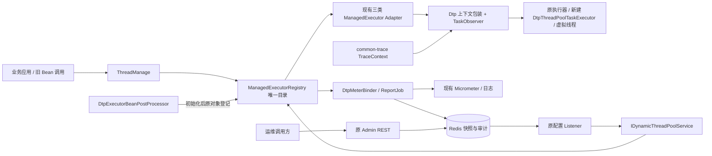
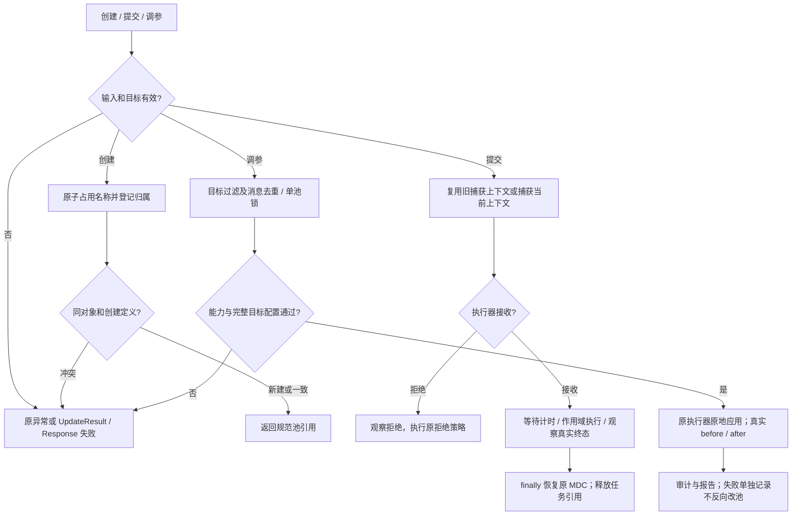
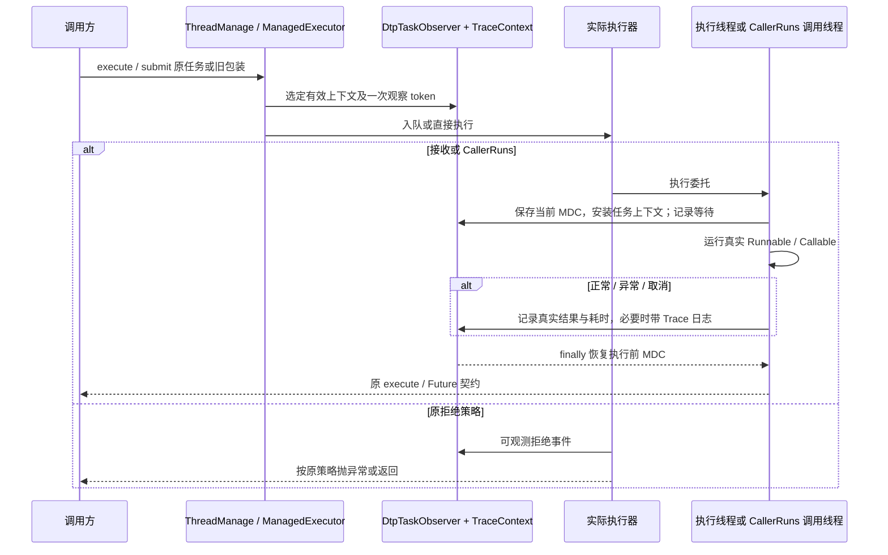

# 动态线程池 ThreadManage 统一管理与 MDC 可观测性增强方案

| Field | Value |
| --- | --- |
| Document | `2026-10-20-20-53-dtp-thread-manage-observability.md` |
| Template Version | `9` |
| Archetype Cleanup | `Not applicable` |
| Status | `Implemented` |
| Type | Feature |
| Complexity | Complex |
| Complexity Drivers | 异步上下文、Future 与拒绝策略、执行器生命周期、运行时调参并发、Redis 异步管理及兼容 |
| Created | 2026-10-20 20:53 Asia/Shanghai |
| Updated | 2026-10-20 22:50 Asia/Shanghai |
| Owner | mario |
| Repository | Egon-COLA |
| Scope | egon-cola-component-dynamic-thread-pool 的 starter、admin、test 与组件文档 |
| Change Surface | ThreadManage、注册与关闭、任务观察、队列调容、调参监听、指标、配置及相关测试；当前仅交付设计 |
| Affected Chapters | §7, §8, §9, §10, §13, §14, §15, §16, §17, §18 |
| Source Requirement | 对照 Downloads/luren-master/lesson009；改为 threadmanage 管理，结合 MDC 做 trace-id 监控，兼容 Runnable，保留并补强监控和动态扩缩容；先给方案 |
| Baseline Revision | main / 75c31c241；2026-10-20 工作区已有其他改动，DTP 目录无已有 diff |
| Amends | [迁移设计](../../superpowers/specs/2026-07-06-components-dynamic-thread-pool-migration-design.md#dynamic-thread-pool-component) 的 Dynamic Thread Pool Component 与 [Design Patterns](../../superpowers/specs/2026-07-06-components-dynamic-thread-pool-migration-design.md#design-patterns) 中本次扩展点；保留三模块及依赖边界 |
| Supersedes | None |
| Depends On | None |
| Related Specs | [公共契约收敛](2026-09-20-12-18-archetype-component-contract-convergence.md)，保留既有枚举、Response 和异常契约 |
| Related Plans | [实施计划](../plan/2026-10-20-21-57-dtp-thread-manage-implementation.md) |

## 1. Summary

建议在现有治理内核上增加 Spring Bean `ThreadManage`，统一按名称创建、获取和调整线程池。`ManagedExecutorRegistry` 仍是应用内唯一注册事实来源；已有三类 `ManagedExecutor` adapter、Redis、Micrometer、common-trace 继续复用。新建平台线程池使用可调容量队列与完整任务观察；已有原始 Bean 按原类型接入，不做全局代理替换。

原有 `Runnable`、`Callable`、`Supplier`、`DtpRunnable`、`DtpCallable`、`DtpSupplier`、`DtpContextAwareExecutorService`、`DtpTaskDecorator`、`DtpThreads` 和 `TraceRoute*` 用法保留。默认让新管理入口负责提交时的上下文捕获；显式旧包装类仍保留构造/包装时捕获的语义。任务日志关联 traceId，线程池指标采用低基数维度。

本次是待评审方案，没有实现、运行应用或提交代码。§5.4 列出可具体审核的依赖增补；用户尚未授权这些增补，因此文档不宣称已经满足实施准入。

## 2. Background and Current State

### 2.1 Business and user context

lesson009 实际类名是 `ThreadPoolManager`。本方案将用户所说的 threadmanage 落为 Egon 的 `ThreadManage`，借鉴其管理入口、命名创建、信息查询和可调队列，不要求与教学项目的包名、静态 API 或 Controller 路由一致。

下文路径约定：`DTP=egon-cola-components/egon-cola-component-dynamic-thread-pool`；`S=DTP/egon-cola-component-dynamic-thread-pool-starter`；`A=DTP/egon-cola-component-dynamic-thread-pool-admin`；`T=DTP/egon-cola-component-dynamic-thread-pool-test`；`J=S/src/main/java/top/egon/cola/component/dtp`；`AJ=A/src/main/java/top/egon/cola/component/dtp/admin`。约定只缩短文档，不代表新增目录。

### 2.2 Repository evidence

| Evidence ID | Classification | Exact path/symbol/decision/command | Observed fact | Design significance | Verification limit/freshness |
| --- | --- | --- | --- | --- | --- |
| EVD-001 | Static repository | `/Users/mario/Downloads/luren-master/lesson009/src/main/java/com/itsoku/lesson009/comm/ThreadPoolManager.java` | 静态 map、computeIfAbsent、Spring executor 子类、按名称创建和调整 | 借鉴统一入口；不照搬无限容量默认值和全局锁 | 2026-10-20 源码读取，未启动 |
| EVD-002 | Static repository | lesson009 同包 `ResizeLinkedBlockingQueue#setCapacity` | 拒绝非正数与低于现有元素数的容量；扩容未通知 notFull 等待者 | 缩容规则可参考；唤醒逻辑需要补齐 | 未作教学队列的完整正确性审计 |
| EVD-003 | Static repository | `J/config/DynamicThreadPoolAutoConfig#managedExecutorRegistry` | 通过三个 Bean map 一次性发现执行器 | 复用三类 adapter；动态创建需要补充注册生命周期 | 不证明实时注册 |
| EVD-004 | Static repository | `J/executor/ManagedExecutorRegistry` | 不可变 map；同名 put 覆盖；提供 get/list | 扩展现有注册表，避免建立第二套目录 | 无运行时并发验证 |
| EVD-005 | Static repository | `J/context/*.java` 与 common-trace 的 `TraceContext`、`thread/TraceRoute*.java` | 完整 MDC 捕获、Scope 恢复、任务包装已经存在 | 不重新实现 MDC 传递；保持旧捕获时点 | 不代表原始 Bean 自动受增强 |
| EVD-006 | Static repository | `J/executor/adapter/*.java`、`support/ThreadPoolResizeSupport.java` | 支持 core/max/keepAlive，缺少队列调容；Spring adapter 存在配置字段和底层执行器同步检查点 | 统一验证与调整顺序，检查真实底层生效 | 不直接断言尚未实测的 Spring 方法故障 |
| EVD-007 | Static repository | `J/metrics/DtpMeterBinder`、`domain/model/entity/ExecutorSnapshot` | 基础 Gauge、虚拟线程计数已存在；平台 rejectedTasks 未填充，null 被转换成 0；无等待/执行 Timer | 增加任务观察与指标可用性，避免把未知当真实零值 | 现有指标数值未在线检查 |
| EVD-008 | Static repository | `AJ/trigger/DynamicThreadPoolController`、`J/trigger/listener/ThreadPoolConfigAdjustListener` | HTTP 发布后返回 Boolean；listener 依 payload 调参并写审计；尚无 messageId 去重及 envelope/payload 一致性检查 | 保持异步契约，补目标过滤、去重与审计失败边界 | Redis 未连接验证 |
| EVD-009 | Static repository | `J/domain/model/entity/ExecutorUpdateCommand#version` | 已有 version 字段，当前 service/adapter 未实现版本比较 | 不把字段存在当作乐观锁已生效 | 本轮不新增全局版本系统 |
| EVD-010 | Static repository | `DTP/README.zh-CN.md`、starter/admin POM、`egon-cola-components/lombok.config` | 文档明确不代理原 Bean；starter 依赖 Trace Core；Qualifier 可复制；Validation provider、springdoc 未在 DTP 直接声明 | 保持依赖边界；新增能力明确提出依赖评审 | 未执行 dependency:tree，不声称实际 classpath 完整缺失 |

### 2.3 Problem statement and gap

现有系统已经具备执行器治理内核，主要缺口是缺少业务友好的创建入口、动态注册和明确的资源归属；任务级监控不完整，旧原始 Bean 的直接调用可以绕过适配器。教学项目有可调队列，但不能覆盖 Egon 的虚拟线程、分布式下发、Trace 和指标契约。

### 2.4 Evidence and current-chain map

| Entry/trigger | Current call chain | Data read/written | External dependency | Consumers | Evidence |
| --- | --- | --- | --- | --- | --- |
| Spring 启动 | AutoConfig → 三类 Bean map → adapter → Registry | 本地固定注册表 | Spring | Service、MeterBinder、report job | EVD-003/004 |
| 提交任务 | Registry.get → ManagedExecutor → Dtp 包装 → 原执行器 | 线程、队列、MDC | 无网络 | 业务应用 | EVD-005 |
| 直接调用原 Bean | 业务 Bean → 原 executor | 原线程池；可能无 MDC 增强 | 无网络 | 旧业务 | EVD-010 |
| Admin 调容 | Controller → Redis Topic → Listener → Service → adapter → audit/snapshot | 本地池参数、Redis 快照与审计 | Redis | 运维调用方 | EVD-006/008 |
| 指标/上报 | MeterBinder / report job → snapshot | Gauge、Redis TTL 快照 | 可选 Micrometer、Redis | 监控系统与 Admin | EVD-007 |

### 2.5 Archetype example cleanup

Cleanup disposition: Not applicable

Reason: 本次修改已有基础设施组件，不是在生成的业务项目内交付首个业务功能。T 是组件自身的验证样例模块，有明确测试用途；不删除其样例，不清理其他业务项目。

## 3. Goals and Non-goals

### 3.1 Goals

统一管理入口；旧 API 与执行语义兼容；完整 MDC 恢复；补齐可证明的任务指标与 Trace 日志；安全动态调整平台线程、可调队列和虚拟线程并发限制；保持 Redis 与 Micrometer 的现有管理链路。

### 3.2 Non-goals

不迁移其他组件业务，不重排模块/包，不加入线程池第三方治理框架，不建 UI/数据库，不修改 Flyway 或其他历史 SQL。不把 traceId 设为指标标签，不自动清队列/中断慢任务，不将动态调参扩展为默认自主扩缩容策略。不声称 MDC 等同于已导出完整分布式 span。

### 3.3 Change Surface and Design Depth

| Area/layer | Disposition | Exact repository evidence | Changed or preserved behavior/contract | Required Spec treatment | Chapter(s) |
| --- | --- | --- | --- | --- | --- |
| 入口、注册、资源归属 | Affected | J/config、executor/ManagedExecutorRegistry | 添加 ThreadManage、动态注册与关闭归属 | 完整设计 | §7, §8, §9, §10, §13, §14, §15, §16, §17, §18 |
| 任务观察与 MDC 组合 | Affected | J/context、executor/adapter、virtual | 复用 Trace，观察执行、异常、拒绝、等待及取消 | 完整设计 | §7, §8, §9, §10, §13, §14, §15, §16, §17, §18 |
| 调参、队列、Redis 与指标 | Affected | J/executor/support、trigger、metrics；AJ/trigger | 扩展 queueCapacity、串行变更、去重和告警 | 完整设计 | §7, §8, §9, §10, §13, §14, §15, §16, §17, §18 |
| common-trace | Context-only | TraceContext、TraceRouteRunnable/Callable/Supplier | 原 MDC key、Scope、W3C 与捕获时点不变 | 兼容证据与回归 | §14, §16 |
| Admin 查询、virtual-limit、manifest 与 Response | Unchanged | AJ/trigger、manifest、types/Response | 路由、信封、枚举字符串、既有字段形状保留 | 不重新设计协议；回归现有契约 | §14, §16 |
| 数据库与前端 | Not applicable | DTP 三模块无关系表/前端源码 | 本次不引入持久化或 UI | N/A | §11, §12 |

## 4. Requirements and Acceptance Criteria

| ID | Atomic requirement | Priority | Observable acceptance criteria | Source |
| --- | --- | --- | --- | --- |
| REQ-001 | 使用 ThreadManage 统一命名创建和取得线程池 | Must | 并发同名同定义只创建一份；不同对象/定义冲突不覆盖；运行期新池纳入现有治理 | threadmanage 管理 |
| REQ-002 | 原任务和原执行器接入方式兼容 | Must | Runnable/Callable/Supplier、全部 Dtp 包装与原 Bean 注入可继续编译；Future/异常/取消/拒绝策略保持既有语义 | 原有 runnable 保留，兼容 |
| REQ-003 | MDC 关联 Trace 并恢复执行前上下文 | Must | 正常、异常、CallerRuns、嵌套与复用线程均无串号；旧预包装任务保留原捕获时点 | mdc、trace-id |
| REQ-004 | 保留基础监控并增加任务级观察 | Must | 基础指标不删除；新增成功/失败/取消/拒绝与等待/执行耗时；异常、慢任务日志带 traceId；不支持的统计有明确能力标识 | 监控补强 |
| REQ-005 | 安全保留并增强动态扩缩容 | Must | core/max/keepAlive/核心超时、可调队列容量与虚拟并发可调整；校验失败无参数部分变更；不丢已有任务 | 动态扩缩容保留并补强 |
| REQ-006 | 保留 Redis 管理并增强下发诊断 | Must | envelope 与 payload 校验、非目标过滤、重复消息不重复应用；HTTP 发布与实际生效可区分；审计失败不伪装执行回滚 | 管理和监控补强 |
| REQ-007 | 控制改动范围、生命周期和运行验证边界 | Must | 单一注册事实来源，按归属关闭；不启动应用/浏览器；无数据库、UI 或无关文件变更 | 本轮指令与 AGENTS |

### 4.1 Scenario matrix

| Scenario | Actor/trigger | Preconditions | Main path | Alternative/failure path | Data/state change | Observable result | Requirements |
| --- | --- | --- | --- | --- | --- | --- | --- |
| 新建或同名并发创建 | 业务配置 | ThreadManage 可用 | 名称原子注册 | 不同定义/不同对象拒绝，不覆盖旧池 | 至多一个池 | 同一池引用 | REQ-001/007 |
| 普通及旧预包装任务 | 业务提交 | 平台/Spring/虚拟池 | 执行业务并恢复 MDC | 异常重抛或保存在 Future；不吞异常 | 一次任务终态 | 日志 Trace 正确 | REQ-002/003/004 |
| 饱和与 CallerRuns | 业务提交 | 队列满或虚拟并发满 | 依原策略处理 | 调用者执行后恢复其 MDC；自定义静默丢弃不编造结果 | 拒绝事件可独立计数 | 拒绝不等同失败 | REQ-002/004 |
| 调容与缩队列 | 运维/本地命令 | 目标匹配 | 验证全目标 → 单池锁更新 | 容量低于当时 backlog、队列不支持则整体拒绝 | 无清队列或重建 | before/after 与实际参数一致 | REQ-005 |
| 同名池同时变更 | 多个管理调用 | 同一注册项 | 按取得单池锁次序串行 | 不承诺跨发布者全局顺序；version 字段不能当已有 CAS | 一次完整配置序列 | 可审计每次结果 | REQ-005/006 |
| Redis 重复/非目标消息 | Redis 订阅 | 同应用多个实例 | 先目标过滤，再校验和去重 | 冲突 messageId 拒绝；其他实例安静忽略 | 每目标最多应用一次/去重窗口内 | 不产生其他实例的失败审计 | REQ-006 |
| 调参成功但写审计失败 | Redis 故障 | 本地配置已生效 | 保留真实配置，记录失败及指标 | 不自动反向调参；下一轮报告恢复快照 | 本地成功/远端记录不完整 | 明确结果不一致窗口 | REQ-006 |
| 关闭与任务并发提交 | Spring 关闭 | 池已有注册 | 禁止新建，按归属关闭 | 外部池由外部拥有者关闭；已有池按原策略拒绝新任务 | 有限等待/归属明确 | 无重复关闭或遗留自建线程 | REQ-007 |

### 4.2 Use-case analysis

ACTOR-001 是接入组件的业务开发者/业务应用；ACTOR-002 是使用已有 Admin API 的运维调用方；ACTOR-003 是采集 Micrometer 与日志的监控系统。证据分别为 lesson009 配置与 T、AJ/trigger、J/metrics 与 report job。

| ID | Use case/goal | Primary actor | Supporting actors/systems | Trigger | Preconditions | Main success outcome | Alternatives/failures | Postconditions | Requirements | Interfaces/pages | Tests |
| --- | --- | --- | --- | --- | --- | --- | --- | --- | --- | --- | --- |
| UC-001 | 统一创建并提交业务任务 | ACTOR-001 | Spring、执行器 | 定义线程池/提交任务 | 参数合法、生命周期开放 | 同名唯一，结果与 Trace 正确 | 重名冲突、拒绝、异常、取消 | 成功/失败不污染调用者上下文 | REQ-001/002/003/007 | INTERNAL-001/002 | TEST-001/002/003/004 |
| UC-002 | 调整目标池并确认生效 | ACTOR-002 | Redis、目标应用 | 原 Admin 调参或本地调参 | 参数合法、目标存在且能力匹配 | 配置生效，可通过快照/审计确认 | 无目标、参数错误、重复、发布丢失、审计失败 | 配置有真实 before/after；未知状态不伪称成功 | REQ-005/006 | API-001、INTERNAL-003、MESSAGE-001 | TEST-006/007/008/009 |
| UC-003 | 根据池压力与 traceId 定位任务问题 | ACTOR-003 | 日志平台、MeterRegistry | 指标抓取/告警调查 | 对应能力已启用 | 定位池与异常/慢任务 Trace | 未增强旧池明确部分统计；日志限流 | 无高基数标签或任务载荷泄露 | REQ-003/004/006 | 原监控、日志接口 | TEST-004/005/010 |

## 5. Constraints, Assumptions, and Decisions

### 5.1 Confirmed constraints

保留 starter/admin/test 及包结构；保留既有 API、枚举、Response 和配置前缀；不自动代理替换原 Bean；不动其他已有改动。动态调参只更新现存执行器，不销毁重建。新建与接管线程池不应因为任务监控而新增远端调用。

### 5.2 Small-gap assumptions

| ID | Inference | Repository evidence | Why locally reversible | Impact if wrong |
| --- | --- | --- | --- | --- |
| ASM-001 | Spring Bean 名为 threadManage，Java 类型名为 ThreadManage | 用户用词，现有按 Bean 名治理 | 内部新增命名，可在实施前调整 | 调用示例改名，无历史迁移 |
| ASM-002 | 新池创建必须显式给出 core/max/queue，不继承教学项目无限默认值 | lesson009 的 Integer.MAX_VALUE 默认；现有 T 显式配池 | 仅新增 API 的安全缺省 | 可在评审时调整创建命令 |

### 5.3 Resolved decisions

| ID | Decision | Decision owner | Evidence and rationale | Requirements |
| --- | --- | --- | --- | --- |
| DEC-001 | 本轮仅给方案，不实现 | User | 原请求“先给我方案”，继续消息未扩大到实现 | REQ-007 |
| DEC-002 | 旧 Runnable 等 API 必须保留 | User | 原请求明确要求兼容 | REQ-002 |
| DEC-003 | 保留现有组件结构，新增能力使用组合与原有扩展点 | User/本方案建议 | AGENTS 最小改动与项目风格；迁移设计三模块边界 | REQ-001/007 |

### 5.4 Open major decisions

以下为具体实施评审项，不在本次文档任务内修改或下载依赖：

| ID | Question and options | Recommendation, not decision | Impact | Owner | Status |
| --- | --- | --- | --- | --- | --- |
| DEC-004 | 补齐执行校验能力：复核 resolved tree 后，如无 provider，是否在 S 引入 org.springframework.boot:spring-boot-starter-validation | 建议加入，版本继承 Boot 3.5.16；A/T 由 S 传递，不重复声明 | 增加 Hibernate Validator/EL 运行依赖，使注解与本地/Redis 入口校验真实执行 | User | Approved |
| DEC-005 | A 的变更 API 是否补 org.springdoc:springdoc-openapi-starter-webmvc-api:${springdoc.version}，以及转换所需 org.mapstruct:mapstruct-processor:${mapstruct.version} 编译处理器 | 建议纳入，仓库 property 分别为 2.8.17、1.6.3；只生成 API 文档，不引 UI | API 文档及生成转换的构建依赖；生产文档默认关闭；不增加独立工具/服务 | User | Approved |

本方案的功能设计完整可评审；依赖尚未批准，故实施准入为阻断状态。若不采用这些增补，需要相应调整校验/生成契约方案，不能假装 BOM 属性或 Jakarta API 已提供运行能力。

## 6. Project Technology Context

Java 21（components POM），Spring Boot 3.5.16（root POM），Spring MVC（A），JUnit 5/AssertJ/Mockito（现有 starter-test），Redisson、可选 Micrometer、common-trace（S POM）。只有设计文档验证在本轮运行，不执行依赖下载、应用启动或 Redis 测试。

### 6.1 Java architecture profile and capability baseline

本组件是既有基础设施扩展结构，使用 `config/domain/executor/context/registry/trigger/metrics` 与独立 Admin；不是从 light/service/web 生成的业务项目。依据用户“严格保持现有结构”的直接指令和既有迁移设计保留它，不强套业务三层或新增 Archetype COLA 模块。依赖保持 A→S、T→S；S→common-core/trace，禁止反向依赖。业务项目的两类架构选型在此不触发结构迁移。

| Need | Spring/JDK candidate | Spring Boot Starter candidate | Egon-COLA/module candidate | Proven gap | Decision/dependency impact |
| --- | --- | --- | --- | --- | --- |
| MDC | MDC/TaskDecorator | 不强制 HTTP starter | TraceContext/Scope、Dtp 包装 | 管理入口未统一 | 复用，不改 common-trace |
| 三类执行器 | ExecutorService、Spring executor、虚拟线程 | 已有 | ManagedExecutor 与三个 adapter | 缺创建入口与增量注册 | 扩展当前 Registry，不加第二份目录 |
| 运行期队列容量 | JDK BlockingQueue 固定容量实现 | Spring setQueueCapacity 不能让普通已创建队列换结构 | 未找到本仓库可调队列 | 新建池需要可调容量 | 小型 JDK 队列实现；不复制教学项目整份 JDK 衍生源码 |
| 指标与日志 | LongAdder、nanoTime、LongConsumer | 已有日志 | DtpMeterBinder | 无任务 Timer、部分 counter 未观测 | 条件绑定 Micrometer，S 核心不硬链接可选 MeterRegistry |
| 参数校验/转换/API 文档 | Jakarta API、已有 BaseForwardConverter | Validation/现有 MVC | common-core 有 API、MapStruct，无已确认 DTP provider/处理器 | 需要真实执行校验与生成契约 | DEC-004/005 具体评审 |

### 6.2 User-mandated Java rule compliance

| Literal rule | Affected? | Repository evidence | Exact design decision | Files/types/interfaces | Validation/test evidence | Status/blocker |
| --- | --- | --- | --- | --- | --- | --- |
| Rule 1 | Yes | 旧类是公开契约，用户要求兼容 | 新载体 ThreadPoolCreateCommand；ThreadManage 按用户命名；旧 Request/Snapshot/包装类不为改后缀破坏兼容 | §8/§10 | TEST-001/011 | PASS |
| Rule 2 | Yes | common-core 仅确认 Jakarta API | create、resize、service、Redis 均调用同组校验；状态能力由 adapter 校验；无电话数据 | §9/§10 | TEST-006/009/011 | PASS：已批准 DEC-004 |
| Rule 3 | Yes | 当前旧载体保留 setter 二进制签名 | 新 Command 使用 class、Data/NoArgs/AllArgs/Accessors/Builder；旧类不改现有 setter 返回类型；新转换继承 BaseForwardConverter | §10、ResizeExecutorConverter | TEST-011/012 | PASS：已批准 DEC-005 |
| Rule 4 | Yes | components/lombok.config 复制 Qualifier | 受改行为类用 Slf4j；显式 Bean 名；final + Qualifier + RequiredArgsConstructor(onConstructor_ = Autowired) | §8 行为类 | TEST-011 | PASS |
| Rule 5 | Yes | S 已有 JDK、Commons、Guava | 队列/锁/时间使用 JDK；有限去重复用 Guava；不造 Utils 库 | queue、listener | TEST-007/009 | PASS |
| Rule 6 | Yes | 现有 Jackson codec/Response | 保持原 JSON、枚举名与信封；可选 queueCapacity 缺失/null 表示不变；无新增 Fastjson 用法 | Command、Request、API-001 | TEST-008/012 | PASS |
| Rule 7 | Yes | A/T 各有 base/dev/test/prod YAML | 新键八个文件均保持结构一致；值可不同 | §10 配置矩阵 | TEST-010 | PASS |
| Rule 9 | Yes | 已有 Adapter/Decorator | 扩展原 Adapter 与任务 Decorator，ThreadManage 使用 Facade；不加策略工厂层 | §13 | TEST-002/004/006 | PASS |
| Rule 10 | Yes | 快照/审计已用 Instant | 新耗时使用 Duration 与单调 nanoTime；Instant 用于事件时间 | §6.3 | TEST-010/012 | PASS |
| Rule 11 | Yes | 已有组件结构/迁移设计 | 用户明确保持现有结构优先；只做当前基础设施扩展，无业务三层/DDD 迁移、无关系持久化/新业务事件 | §6.1/§8 | 静态依赖与文件范围核对 | PASS |

### 6.3 Time semantics and conversion contract

Time contract: Required

| Time ID | Fields/symbols | Semantics | Java/runtime type | Storage policy | Wire policy | Business zone source | Display zone source | Boundary / DST rules | Precision / Clock | Compatibility | Verification |
| --- | --- | --- | --- | --- | --- | --- | --- | --- | --- | --- | --- |
| TIME-001 | 排队/执行耗时、slow-task-threshold、queue-wait-threshold、冷却期 | Duration | Duration；nanoTime 差值为内部纳秒 long | Not persisted | Duration | Not applicable: 相对耗时 | Not applicable: 无 UI | 不依赖时区/DST；差值不作为时间戳 | nanoTime 单调差值；Micrometer 秒 | 既有 keepAliveSeconds 保持秒制 | TEST-004/010 |
| TIME-002 | DtpAuditEvent.createdAt、snapshot.reportTime、message.timestamp | Occurred instant | Instant | UTC instant | UTC Z | Not applicable: 事件瞬间 | Not applicable: 本次无显示层 | 不更改 JVM 默认区；事件日期键继续 UTC | Instant.now；JSON 保持 Z，允许小数秒 | 原 Redis codec 及 UTC 日期键不变 | TEST-009/012 |

## 7. Architecture Design

### 7.0 Minimum-design baseline and element-necessity audit

直接复用现有 Registry/adapter，只加工具入口仍无法覆盖工厂池生命周期、动态注册及队列调容；因此只增加这些必要能力，不另建线程池框架。

| Proposed element | Change | Requirements | Existing/direct alternative | Concrete inadequacy of alternative | Added calls/state/coupling/failures/migration/operations | Verdict |
| --- | --- | --- | --- | --- | --- | --- |
| ThreadManage | New | REQ-001/007 | 业务手工 new executor 再 Registry.get | 无创建、唯一性和资源归属入口 | 一个 Bean，无网络跳转 | Add |
| Registry、三个 adapter、Service | Expand | REQ-001/005 | 第二套 static map | 双注册事实、重复发现/关闭 | 原注册表增加并发/生命周期状态 | Keep |
| DtpThreadPoolTaskExecutor、ResizableCapacityBlockingQueue | New | REQ-004/005 | 普通 Spring executor 与固定队列 | 不能在真实队列上调容量，原 Bean 无完整观察 | 框架扩展子类、小型队列与并发测试 | Add |
| DtpExecutorBeanPostProcessor | New | REQ-001/007 | AutoConfig 注入全部 map | 工厂 Bean 依赖 manager 时容易形成 eager 创建循环；无法增量纳管 | 初始化后登记，不替换 Bean | Add |
| DtpTaskObserver、DtpObservedFutureTask | New | REQ-003/004 | 外层 Runnable try/catch | Future 会存储异常，取消与嵌套容易重复计数 | 每逻辑任务一个有限寿命观察状态 | Add |
| Dtp 包装、metrics、report、listener | Expand | REQ-002/003/004/006 | 重写 common-trace、增加后台调度器 | 已有扩展点足够 | 复用原上报周期和 MDC | Keep |
| ThreadPoolCreateCommand、queueCapacity、ResizeExecutorConverter | New/Expand | REQ-001/005 | 一串重复参数、手工映射 | 创建参数含交叉约束，HTTP/内部边界需同一映射 | 一类创建命令和一类生成转换 | Add |
| Validation、springdoc API、processor | New if approved | REQ-005/006 | 只有 API/版本属性 | 不证明 provider 与文档生成可用 | §5.4 的依赖成本与准入 | Add：待批准 |
| 新 REST 管理入口、任务明细库、Trace SDK、自动伸缩策略 | None | REQ-007 | 现有 API/日志/指标 | 本轮没有独立新增消费目标 | 避免新状态、依赖和 UI | Remove |

| Path | Network calls | Client states | Server contracts/state | Failure and TOCTOU points | Additional user/business value |
| --- | --- | --- | --- | --- | --- |
| 原提交 | 0 | 无 | 原 executor/adapter | 原拒绝与任务失败 | 执行任务 |
| 新管理提交 | 0 | 无 | 同 Registry + 任务局部状态 | 保留原拒绝语义 | 自动上下文与任务观察 |
| 原/新远端调容 | 1 HTTP；原 Redis publish/consume | 已发布、待确认、失败 | 同 Topic/审计/快照；可选 queueCapacity | 查询之后 backlog 变化须在应用时重校验 | 不增加前置查询和状态 API |

### 7.1 System Architecture Design



Registry 拥有名称→原对象/适配器、创建定义、生命周期归属和单池更新锁；ThreadManage 仅编排，无独立 map。实际配置以进程内执行器为准，Redis snapshot 是 TTL 副本。MDC 和任务统计均在本进程处理，业务提交不访问 Redis。

### 7.2 High-Level Design



#### 7.2.2 High-level decision and quality matrix

| Concern/use case | Required behavior | Selected mechanism | Failure/degradation behavior | Trade-off | Verification | Requirements |
| --- | --- | --- | --- | --- | --- | --- |
| 兼容与上下文 | 无串号、Future 语义一致 | TraceContext.Scope、原包装保留、单次观察 | 原 Bean 直接调用未增强则明确能力不足 | 不用全局代理自动接管一切 | TEST-002/003/004 | REQ-002/003 |
| 计数与性能 | 一次逻辑任务一次结果；热路径无网络 | JDK 原子量、nanoTime、条件 Timer、限频日志 | 监控回调失败不改变业务结果，但记录限频故障 | 不承诺未经压测的固定开销 SLO | TEST-004/005 | REQ-004 |
| 调容正确性 | 不清任务、不半套非法配置 | 单池锁、完整预校验、可调队列锁、正确 setter 次序 | 不支持能力整体失败；异常后如实报告实际配置 | 执行中任务不停止，线程退休渐进 | TEST-006/007 | REQ-005 |
| Redis 可用性 | 运行中监控故障不拖累任务 | 复用独立报告路径，隔离单池失败 | 未持久化的 publish 可丢；明确重新查询/人工重发 | 不引入可靠命令队列 | TEST-009 | REQ-006 |
| 资源与恢复 | 重名不覆盖、归属单一 | Registry 原子登记、关闭状态门禁 | 创建失败回收已分配资源；外部池不擅自关闭 | 初始 Bean 名必须与管理名一致或显式映射 | TEST-001/002 | REQ-001/007 |

### 7.3 Detailed Design

#### 7.3.1 Detailed component collaboration

1. `ThreadManage.newThreadPool(ThreadPoolCreateCommand)` 原子创建 Spring 平台线程池；core/max/queue 必填，不套用无限默认值。返回 `ThreadPoolTaskExecutor`，实际为 Dtp 子类，允许原类型注入、`@Async` 指定及直接 execute/submit。创建完成即登记，后续正常 Bean 初始化只补归属，不能二次初始化或覆盖同一池。
2. 新池由 Manager 创建但后被 Spring Bean 正式托管时，归属转交 Spring；非 Bean 工厂池由 Manager 关闭；外部已存在 Bean 归 Spring。Registry 内存储同一原对象身份、规范名称和归属，不按类型重复注册。已关闭名称不隐式创建新对象。新工厂池默认优雅 shutdown、拒绝新任务，关闭流程最多等待30秒后记录未终止状态，不自动强杀/中断旧任务；这不是保证线程在30秒内退出。已有 Bean 的关闭策略保持其原配置。
3. `DtpExecutorBeanPostProcessor` 在初始化后识别现有三类 executor，返回原对象。Registry 先独立创建为空表，BPP 不依赖 ThreadManage 或全量 Bean map；使用延迟 provider 获取登记协作者。避免 manager→registry→全部业务池→manager 的循环与提前初始化。
4. `ThreadManage.executor(name)` 返回现有 `ManagedExecutor`。旧 `Registry.get/list` 与构造入口保留；同名同原对象登记幂等，不同对象显式冲突。外部原池直接调用保持现状；通过 facade/adapter 提交可获上下文增强。原始未增强路径不得被文档描述为完整任务监控。
5. 观察复用 Dtp 包装和新池提交边界；`DtpObservedFutureTask` 及任务观察 token 区分逻辑任务与 Future/Decorator 外壳。submit 的异常从真实 Callable/Runnable 委托或已结束 Future 获得，禁止调用可能阻塞的未完成 get。invokeAll/invokeAny 与虚拟池覆盖路径需要单独防重复；不将外壳正常返回当作业务成功。
6. 普通任务在每次提交时捕获 TraceContext；ThreadManage 新建池在完全没有 traceId 的后台任务提交上，使用现有 TraceContext.root 创建任务根上下文并保留其他 MDC，不写回提交线程；已有 traceId（包括历史自定义格式）则原样传递。旧预包装 Dtp/TraceRoute 任务保留原捕获时点，不覆盖其上下文，包括显式捕获的空上下文；旧独立包装 API 与接管旧池不新增自动根上下文行为。Dtp 包装可在组件内保存/提供只读捕获快照，供观察器在实际委托边界记录日志；不反射拆 FutureTask，不改 common-trace。旧自定义 TraceRoute 子类的业务日志维持原语义，观察器不能声称看见其不公开的内部上下文。
7. 同一次任务的异常、取消、拒绝、成功分别定义：异常按原 execute/Future 通路传播；cancel 不等于 failed；拒绝是触发拒绝处理的一次事件，CallerRuns 后仍可成功。现有 completedTaskCount 保持各执行器已有含义，新 `dtp.task.*` 统一业务终态口径，不能重解释旧 Gauge。
8. 通过组件创建的新池完整观测拒绝回调；对外接管池不擅自替换已有拒绝处理器/TaskDecorator。只可观察抛出的拒绝与实际执行边界，静默自定义丢弃等无法完整推断时标为部分能力。Discard/DiscardOldest 的历史 Future 行为不被“修复”成新的终态契约。新池默认 AbortPolicy，可显式指定原生策略。

#### 7.3.2 Critical-path Mermaid swimlane



#### 7.3.3 Transactions, consistency, concurrency, and idempotency

| Concern/state change | Owner and boundary | Mechanism/isolation/lock | Concurrent or duplicate behavior | Commit/visibility point | Failure result | Requirements/tests |
| --- | --- | --- | --- | --- | --- | --- |
| 创建与同名注册 | Registry/单进程 | 原子名称登记，创建失败清理 | 同定义/同对象幂等；不同对象冲突 | 成功登记后可查询与绑定指标 | 无泄漏、旧对象不被覆盖 | REQ-001 / TEST-001 |
| 平台/虚拟调参 | 原 adapter、每注册项 | 单池更新锁；完整目标验证；队列改容时附队列锁 | 到达锁的次序串行；不锁所有池 | setter 完成后 before/after | 非法/不支持参数变更前失败 | REQ-005 / TEST-006/007 |
| 消息重复 | Listener、目标进程 | Guava 有界缓存，key=app/instance/executor/messageId；10 分钟、上限 10000 | 同 ID 同 payload 返回已有结果；不同 payload 拒绝；与应用变更同一临界区 | 应用完成后保存结果 | 不承诺跨重启 exactly-once | REQ-006 / TEST-009 |
| 审计与快照 | RedisRegistry | 原 key/TTL；非本地参数事务的一部分 | 相同 messageId 在窗口内不重复应用 | Redis 写入可见 | 审计失败不撤销实际配置 | REQ-006 / TEST-009 |

调参先合成目标配置，再验证名称/身份、类型、范围、core≤max、keepAlive 与核心超时组合和队列能力；之后再更新。扩容先 max 后 core；需要把 max 降到旧 core 以下时先 core 后 max。Spring 配置 getter 与真实 ThreadPoolExecutor 参数保持一致，不能只改配置字段。虚拟线程继续只调 concurrencyLimit，缩容不打断正在运行任务，后续接收受新上限约束。

可调队列采用 JDK `AbstractQueue + BlockingQueue`、`ReentrantLock + notEmpty/notFull` 与队列存储，避免复制教学项目的大段 JDK 衍生实现。实现 offer/put/take/poll、定时和中断、remove/clear/drainTo/iterator 契约。扩容通知等待生产者；缩容在队列锁内拒绝小于当前 size 的容量，与完整调参预校验协调，保证这种拒绝不会在 core/max 已改后才发生。容量不低于 size 时 remainingCapacity 非负；不迁移任务、不替换运行中的队列。capacity=0 仅在创建时选 SynchronousQueue，运行时禁止与有缓冲队列互换。已有固定队列可查指标、可调线程数，队列改容返回明确不支持。

正常验证失败保证无参数部分变更。JDK setter/线程创建出现不可预期运行故障时，尽力恢复旧配置并读取真实 after；若恢复也失败，保留实际状态、记录单独错误，禁止伪称事务原子回滚。用户直接调用原执行器 setter 不受本组件锁约束，这一兼容入口不具备统一并发控制保证。

`ExecutorUpdateCommand.version` 本轮保留原语义，不新增未获请求的持久化版本服务；单池串行和 messageId 去重不能宣称实现跨发布者全局顺序、丢消息恢复或跨重启 CAS。

#### 7.3.4 Failure semantics, recovery, and reconciliation

| Failure point | Detection | Immediate control flow | Data/transaction state | Retry and idempotency | Caller/frontend result | Recovery/reconciliation owner | Verification |
| --- | --- | --- | --- | --- | --- | --- | --- |
| 创建冲突/初始化失败 | 名称与对象核对/异常 | 关闭本次新资源，不动旧池 | 原表保留 | 修正配置，不自动换池 | JDK 参数/状态异常 | 接入开发者 | TEST-001/002 |
| 任务异常/监控回调异常 | 真实委托/观察边界 | 原异常继续传播；监控失败独立限频记录 | 原任务结果不变 | 不自动重跑业务 | 原 Future/execute | 业务与组件各自负责 | TEST-004 |
| Redis 发布失败或响应未知 | publish 异常/超时 | 原 Response 失败；不能断言没生效 | 可能未发布或结果未知 | 不自动生成新 messageId 重试；先查询快照/审计 | 未确认，非已生效 | 运维调用方 | TEST-008/009 |
| 非目标/身份不一致 | envelope/payload/本实例比对 | 非目标忽略；伪造或不一致拒绝 | 不改池 | 不重试错误目标 | 带身份的限频警告 | Admin/运维 | TEST-009 |
| 审计失败、某池报告失败 | Redis/单池快照异常 | 已生效状态保留；报告继续其他池 | 真实本地与投影暂时不一致 | 下一报告周期恢复快照；不承诺持久审计补偿 | 明确告警/计数 | 运维核对 | TEST-009/010 |
| 进程重启或订阅中断 | 进程/Redis状态 | 原创建配置重建 | 去重缓存丢失，发布命令可丢 | 查询后人工重发目标配置 | 不声称持久配置中心 | 运维 | 手工部署验收 |

#### 7.3.5 Observability and operational boundaries

保留 `dtp.executor.*` 全部现有指标名称和标签；新增 `dtp.task.submitted/succeeded/failed/cancelled/rejected` Counter、`dtp.task.queue.wait` 与 `dtp.task.execution` Timer，以及 `dtp.executor.queue.capacity`、`dtp.executor.queue.resizable`、`dtp.executor.observation.complete` Gauge。能力不足的池保持原快照 nullable 语义并令 complete=0，不能将原 binder 的 null→0 解释为已观测到零拒绝。新旧计数名称不混用。

标签只用现有 appName/instanceId/executorName/executorKind/virtual 和固定结果分类。traceId、taskId、业务订单号不作为 meter 标签。单次任务异常、拒绝和达到阈值的慢等待/慢执行日志携带 traceId、requestId、池身份、等待/执行耗时、结果和安全异常摘要；不记录 Runnable/Callable.toString、参数载荷、完整 MDC 或用户敏感信息。正常成功默认不逐条打 INFO。

新池动态登记时绑定指标；同原对象不重复绑定，关闭/释放时解除组件自己绑定的 meter，不能删除其他 binder 的 meter。核心观察代码不硬引用 Micrometer，只有条件配置与 DtpMeterBinder 依赖其类；无 MeterRegistry 时保留日志/原子统计，启动不受可选类缺失影响。

慢执行默认阈值 30s、慢排队 5s，仅诊断不杀任务；Timer 的直方图默认关闭、由使用者选择。原 report job 上可选压力告警：默认关闭，启用后队列使用率≥0.8 连续三个采样或观察到拒绝增量告警，同池冷却 60s；SynchronousQueue 不使用队列占比。只观察到完成时的慢任务，不声称已经实现运行中任务堆栈/超时中断监控。Redis 运行期异常不加入业务执行路径；默认启动时 Redis 的既有连接要求保持，未新增离线启动承诺。

#### 7.3.6 Conclusion evidence chain

| Conclusion | Repository/user evidence | Constraint or requirement | Design decision | Consequence and trade-off | Verification and acceptance evidence |
| --- | --- | --- | --- | --- | --- |
| 新入口复用唯一 Registry | EVD-003/004，用户要求兼容 | REQ-001/002/007 | Facade + 增量原对象登记，不新建 static map | 旧接口继续用；增加归属与生命周期并发状态 | TEST-001/002，单一实例与关闭次数断言 |
| Trace 与任务观察组合 | EVD-005/007 | REQ-003/004 | 复用 Scope，真实任务终态观察；低基数指标 | 不误报 Future 成功，不把 traceId 写入 meter；旧裸池能力可能部分 | TEST-003/004/005 |
| 队列调容只用于支持能力的实际队列 | EVD-001/002/006 | REQ-005 | 新池可调队列；旧固定队列不替换，完整预校验 | 无队列搬迁/丢任务；缩容低于 backlog 拒绝 | TEST-006/007 |
| 异步成功需要确认 | EVD-008/009 | REQ-006 | 保留发布 Boolean，既有快照/审计确认；局部去重 | 不伪造可靠命令或全局版本保证 | TEST-008/009 |

## 8. Package Structure and Code File Tree

当前为 `DTP/{starter,admin,test}`（实际模块全名见 §2.1），S 的 `config/context/domain/executor/metrics/registry/trigger` 和 A 的 `trigger/manifest/types`。目标保留这些包；下列路径均相对已定义的 J/AJ/S/A/T，测试同包位于对应 `src/test/java`。

| Operation | Path/package | Symbols | Responsibility | Dependencies | Requirements |
| --- | --- | --- | --- | --- | --- |
| Create | J/executor/ThreadManage.java | ThreadManage | 命名创建、取得 adapter、委托调参、关闭归属 | Registry、Service、Observer | REQ-001/007 |
| Create | J/domain/model/entity/ThreadPoolCreateCommand.java | ThreadPoolCreateCommand | 创建参数与组校验 | Jakarta、Duration、JDK factory/handler | REQ-001/005 |
| Create | J/executor/managed/DtpThreadPoolTaskExecutor.java | DtpThreadPoolTaskExecutor | 新池的幂等初始化、真实可调队列、所有提交边界 | Spring、现有 context | REQ-002/003/004/005 |
| Create | J/executor/support/ResizableCapacityBlockingQueue.java | ResizableCapacityBlockingQueue | 运行期容量和完整 BlockingQueue 契约 | JDK | REQ-005 |
| Create | J/context/DtpTaskObserver.java | DtpTaskObserver | 每池计数、一次任务 token、有效上下文、日志/耗时回调 | TraceContext、JDK、Slf4j | REQ-003/004 |
| Create | J/context/DtpObservedFutureTask.java | DtpObservedFutureTask | 受控 submit/invoke 的真实终态、取消观察 | FutureTask、Observer | REQ-002/004 |
| Create | J/config/DtpExecutorBeanPostProcessor.java | DtpExecutorBeanPostProcessor | 初始化后登记同一个 Bean，不替换类型 | Spring、Registry | REQ-001/007 |
| Modify | J/config/DynamicThreadPoolAutoConfig.java | Bean 组装 | 不再 eager 注入所有池；声明 threadManage、observer、BPP；保留旧服务名 dynamicThreadPollService | 现有依赖 | REQ-001/007 |
| Modify | J/config/DynamicThreadPoolAutoProperties.java | observation 配置 | 阈值/告警配置与验证 | Duration | REQ-004 |
| Modify | J/executor/ManagedExecutorRegistry.java、ManagedExecutor.java | 注册与能力 | 原 get/list、构造保留；新能力方法用 default 避免破坏外部实现 | JDK | REQ-001/002/005 |
| Modify | J/executor/adapter/ThreadPoolExecutorManagedExecutor.java、ThreadPoolTaskExecutorManagedExecutor.java、BoundedVirtualThreadManagedExecutor.java；J/executor/support/ThreadPoolResizeSupport.java | update、snapshot | 统一更新锁/目标验证；平台/Spring 参数同步，队列支持按能力识别 | Registry、原执行器 | REQ-004/005 |
| Modify | J/context/DtpContextAwareExecutorService.java、DtpTaskDecorator.java、DtpRunnable.java、DtpCallable.java、DtpSupplier.java | 原 API 保留 | 执行观察组合、旧上下文优先、invoke 与包装防重复 | common-trace 不改 | REQ-002/003/004 |
| Modify if needed | J/executor/virtual/BoundedVirtualThreadExecutor.java | 观察接点 | 复用已有 MetricsFutureTask/执行终态；避免计数双重装饰 | 原 Semaphore、context | REQ-002/004/005 |
| Modify | J/domain/model/entity/ExecutorUpdateCommand.java | queueCapacity | 增加可选容量；保留其余字段和 setter 签名 | Jakarta、Jackson | REQ-005 |
| Modify | J/metrics/DtpMeterBinder.java；J/trigger/job/ThreadPoolDataReportJob.java | 增量绑定/压力诊断 | 维持原指标，单池隔离，复用报告周期 | 可选 Micrometer | REQ-004/006 |
| Modify | J/trigger/listener/ThreadPoolConfigAdjustListener.java | 目标过滤/去重 | envelope 一致性、局部幂等、审计失败诊断 | 现有 Guava/RedisRegistry | REQ-006 |
| Modify | AJ/trigger/DynamicThreadPoolController.java；AJ/trigger/model/ResizeExecutorRequest.java | resize | 可选 queueCapacity；原路由/Response/Boolean 不改 | 原 MVC、Trace | REQ-005/006 |
| Create | AJ/trigger/converter/ResizeExecutorConverter.java | BaseForwardConverter 子类型 | Request→Command；路径身份与 operator 显式绑定，禁止 body 覆盖路径 | common-core、MapStruct | REQ-005 |
| Modify if approved | S/pom.xml、A/pom.xml | §5.4 依赖/处理器 | 仅具体批准的增补，版本复用；不改聚合/导出边界 | DEC-004/005 | REQ-005/006 |
| Modify | A、T 的 src/main/resources/application{,-dev,-test,-prod}.yml | 新配置 | 全环境结构一致，A 文档默认关闭于生产 | 原配置 | REQ-004/007 |
| Modify | T/src/main/java/top/egon/cola/component/dtp/test/config/ThreadPoolConfig.java；DTP/README.md、README.zh-CN.md | 推荐新入口与旧入口对照 | 同一组件样例验证，不迁移其他项目 | 原三模块 | REQ-001/002/007 |
| Create/Modify | 上述生产类同包的 *Test；原 context/adapter/virtual/metrics/config/listener/controller 测试 | §14 各测试 | 行为、并发、兼容和依赖准入验证 | 现有 JUnit/AssertJ/Mockito | REQ-001..007 |

`DtpThreads`、common-trace 和 `ExecutorSnapshot` 的公共字段结构保持原样。平台快照已有 submittedTasks/failedTasks/rejectedTasks 等 nullable 槽位，只有能准确观察时填充；任务新口径主要用新增指标表达。可调队列容量从同一受锁快照中的 queueSize + remainingCapacity 得出，不增加 HTTP 快照字段。DtpTaskObserver 的不可变任务标识/配置元数据可用私有 record，含计数器和可变终态的观察状态使用普通私有 class；都不外泄为公共 DTO。

## 9. Interface Definitions

### 9.0 API protocol and documentation governance

| Concern | Decision/evidence |
| --- | --- |
| Protocol selection | 原 Admin REST resize 扩展可选字段，保持现有运维调用目标，不新增 GraphQL 或管理路由 |
| CQE application level | L0/L1：原 Command/Query、同 Redis；配置下发是技术命令，不新增业务 Event/outbox |
| REST source of truth | Code-first：原 Controller、Request、Jackson、校验与 OpenAPI 3 注解；Response 字段为 code/info/traceId/data |
| GraphQL source of truth | N/A：DTP 没有 GraphQL schema/resolver，本轮不引入 |
| Springdoc/OpenAPI compatibility | Spring MVC / Boot 3.5.16；提议 webmvc-api 2.8.17，OAS 3.0；DEC-005 尚未批准 |
| Legacy Swagger/Springfox status | DTP POM 未发现 Springfox；不引 Swagger 2，不造假文档接口 |
| Security and documentation exposure | 延续当前 Admin 的部署访问边界，未发现该 Controller 内置 RBAC，不虚构认证 scheme；docs 生产默认关闭，网络/网关限制属现有部署责任 |
| Contract publication and drift gate | A 新 DynamicThreadPoolOpenApiTest 用 MockMvc 与 Redis mock 获取生成文档，Jackson 断言 route/operationId/Request/Response；不启动真实 server |

### 9.1 Interface Inventory

| ID | Change/necessity verdict | Name/purpose | Kind | API style/CQE role | Consumer | Owner | Method + URL / GraphQL field / symbol / topic | Operation ID/schema source | Input | Output | Auth/tenant | Error model | Idempotency/version | Requirements |
| --- | --- | --- | --- | --- | --- | --- | --- | --- | --- | --- | --- | --- | --- | --- |
| API-001 | Modify/Keep | 原平台池调容 | HTTP | REST Command | 运维 | A | POST /api/v1/dtp/apps/{appName}/instances/{instanceId}/executors/{executorName}/resize | resizeDtpExecutor | 原 Request 加可选 queueCapacity | 原 Response Boolean | 原部署边界、目标实例校验 | 原 code 信封 | 异步发布，不承诺 exactly-once | REQ-005/006 |
| INTERNAL-001 | New/Add | 命名创建池 | Java | Command | 应用配置 | S | ThreadManage.newThreadPool(ThreadPoolCreateCommand) | ThreadManage | 创建命令 | ThreadPoolTaskExecutor | 同进程配置 | JDK 参数/状态异常 | 名称+创建定义 | REQ-001/007 |
| INTERNAL-002 | New/Add | 取得统一提交入口 | Java | Query | 业务应用 | S | ThreadManage.executor(String) | ManagedExecutor | 池名称 | ManagedExecutor | 同进程调用 | JDK 参数异常 | 无创建副作用 | REQ-001/002/003 |
| INTERNAL-003 | New/Add | 本地统一调参 | Java | Command | 应用/内部管理 | S | ThreadManage.changeThreadPool(ExecutorUpdateCommand) | IDynamicThreadPoolService | 原更新命令 | UpdateResult | 完整目标身份 | 现有失败结果 | 单池串行 | REQ-005 |
| MESSAGE-001 | Modify/Keep | 原配置下发 payload 扩展 | Redis | Command | 原 Listener | S/A | DTP:CHANGE_TOPIC:{appName} | DtpConfigChangeMessage | 原消息与可选 queueCapacity | 原审计/快照 | Redis 部署边界、完整身份 | 拒绝/忽略/审计失败 | 原 messageId 有限窗口去重 | REQ-005/006 |

### 9.2 Per-interface Detailed Contracts

#### 9.2.1 API-001 — 原平台线程池调容

##### Necessity and interaction-cost decision

| Concern | Decision |
| --- | --- |
| Change classification | Modify；原 resize 新增可选 queueCapacity |
| Independent consumer goal | 运维对已选实例的池调整配置，不增加仅为传参的前置接口 |
| Parameter ownership and derivation | 路径给目标身份，body 给目标参数；messageId/时间/Trace 由服务端形成 |
| Direct/no-new-interface alternative | 扩展现有 resize 足够，无需 ThreadManage HTTP Controller |
| Caller use of result | Boolean 仅说明发布成功；通过既有审计与快照确认生效 |
| Round trips and failure points | 保持一次命令 HTTP；原 Redis 异步链路和可选确认查询 |
| Verdict | Keep，REQ-005/006；旧请求缺少新字段时语义完全不变 |

##### API style and CQE semantics

| Concern | Decision/evidence |
| --- | --- |
| Protocol style | REST Command，沿用现有资源子动作 |
| CQE role | 运维调整配置的技术 Command，查询仍只读 |
| Resource/task semantics | POST 到原目标 executor 的 resize，不改路由为新的通用方法调用 |
| Read/write and side effects | 发布 Redis 技术命令；目标应用修改池并记录原审计/快照 |
| Consistency and idempotency | HTTP 保持既有 200/Boolean 发布语义；重复 ID 的消费局部去重，非持久投递 |
| Why this style | 原 API 是真实运维接入点；改成新协议/同步等待会破坏兼容并扩大范围 |

##### Identity and purpose

| Concern | Definition |
| --- | --- |
| Purpose/owner/consumer | A 为运维发布平台/Spring 线程池调容请求 |
| Protocol and endpoint | HTTP POST /api/v1/dtp/apps/{appName}/instances/{instanceId}/executors/{executorName}/resize；应用内无额外 context-path 证据 |
| Content type/version | application/json；路径 v1，原 JSON 字段不改名 |
| Auth/permission/tenant | 原部署边界，无新 RBAC；app/instance/executor 必须与消费端对象匹配，不能把 MDC 当权限凭据 |
| Timeout/retry/rate limit | 不新增等待应用生效的超时或限流协议；未知结果先查审计/快照，不自动反复 publish |
| Idempotency/concurrency | 每次调用由原服务端生成 messageId；同一次消息去重窗口内幂等，不同请求按目标单池锁串行 |

##### Request parameters

| Name | Location | Type/format | Required/null | Default | Validation/range/enum | Meaning | Example | Source |
| --- | --- | --- | --- | --- | --- | --- | --- | --- |
| appName/instanceId/executorName | Path | string | 各必填非空 | 无 | 保持原名称字符兼容；拒绝空白身份 | 目标完整身份 | app-1 / app-1-8081 / emailPool | 已选资源路径 |
| traceparent/tracestate/x-egon-request-id | Header | 原 Trace 协议 | 可选 | 原 Trace starter | 复用原解析，不接收完整 MDC | 命令链路关联 | 合法 W3C traceparent | 调用链/服务端 |
| executorKind | Body | string enum | 必填 | 无 | PLATFORM_THREAD_POOL 或 SPRING_THREAD_POOL_TASK_EXECUTOR | 池种类 | SPRING_THREAD_POOL_TASK_EXECUTOR | 原请求 |
| corePoolSize/maximumPoolSize | Body | integer | 两者必填 | 无 | 正整数且 core≤max | 目标线程数 | 8 / 16 | 运维输入 |
| keepAliveSeconds | Body | long 秒 | 可缺省/null | 保持当前值 | ≥0；Spring adapter ≤Integer.MAX_VALUE；目标 allowCore=true 时最终值>0 | 线程保活 | 60 | 运维输入/当前配置 |
| allowCoreThreadTimeOut | Body | boolean | 可缺省/null | 保持当前值 | 结合最终 keepAlive 验证 | 核心线程超时 | false | 运维输入/当前配置 |
| queueCapacity | Body | integer | 新增，可缺省/null | 不调整队列 | >0；实际队列支持；不小于应用时的队列 size | 目标实际队列容量 | 1000 | 运维输入 |
| operator | Body | string | 保持原可选性 | 原逻辑 | 不升级为可信认证身份；安全日志不回显敏感输入 | 原审计标签 | ops | 原请求 |

Query/Cookie/Multipart: None。未知字段、枚举反序列化和 malformed JSON 保持既有 Jackson/MVC 行为，不新增与原消费者冲突的全局 ObjectMapper 策略。

```jsonc
{
  "executorKind": "SPRING_THREAD_POOL_TASK_EXECUTOR", // 必填，保持原枚举字符串线值。
  "corePoolSize": 8, // 必填，正整数且不大于 maximumPoolSize。
  "maximumPoolSize": 16, // 必填，正整数。
  "keepAliveSeconds": 60, // 可选，秒；缺失/null 保持当前值。
  "allowCoreThreadTimeOut": false, // 可选；缺失/null 保持当前值。
  "operator": "ops", // 原可选审计标签，不是认证凭据。
  "queueCapacity": 1000 // 新增可选；实际队列支持时才可生效，不能低于实时积压。
}
```

##### Success response

保持原 HTTP 200、application/json、原响应头及原信封；不增加 Location、202 或确认字段。此处成功仅指 publish 调用成功，不能解释成已经执行。

```jsonc
{
  "code": "0000", // 原调用成功 String code。
  "info": "调用成功", // 原信息字段名和值。
  "traceId": "0123456789abcdef0123456789abcdef", // 当前请求 Trace，用于关联审计/日志。
  "data": true // 原 Boolean，仅表示发布请求完成。
}
```

##### Error responses

| Condition | HTTP/protocol status | Business code | Response shape | Retryable | Frontend handling |
| --- | --- | --- | --- | --- | --- |
| 可在 Admin 确定的字段/交叉约束错误 | 原 200 | 0002 | 原 code/info/traceId/data=false | 修正后 | 保留输入，显示安全原因 |
| 发布失败或结果未知 | 原 200 | 0001 | 原失败信封、data=false | 不自动重发 | 用 Trace 核对原快照/审计 |
| malformed JSON/错误枚举/类型 | 原 MVC 400 | 原 MVC 错误，不捏造信封 code | 原框架错误形状 | 修正后 | 原客户端错误处理 |
| 无目标、不支持队列、实时 backlog 冲突 | HTTP 仍可能已返回 200/0000 | 原异步审计 success=false、errorMessage | 不新增 HTTP 同步错误形状 | 核实/修正后 | 查看审计和实际快照 |

```jsonc
{
  "code": "0002", // 原非法参数 code。
  "info": "queueCapacity must be positive", // 可安全展示的具体原因。
  "traceId": "0123456789abcdef0123456789abcdef", // 当前请求 Trace。
  "data": false // 未通过当前发布入口校验。
}
```

Non-JSON error: 认证/网络网关可能在到达本应用前拒绝；本组件未提供其响应证据，故不新增/承诺认证信封。框架 JSON 绑定错误继续交给现有 MVC 处理，TEST-008 固定其当前行为，不为此增加全局异常格式迁移。

##### Interface logic for frontend and consumers

1. 调用方已选择目标资源，沿用现有部署访问控制，不新增取上下文接口。
2. Admin 绑定原 Request，应用同组字段/交叉约束；目标实例的实时能力和 backlog 必须在应用时再检查。
3. converter 将 body 参数与路径身份形成更新命令，禁止 body 替换目标；保留既有 operator 和 Trace 来源。
4. 原 Redis Topic 发布，不开启数据库事务；不等待目标处理后再返回。
5. Listener 先过滤身份，再验证消息和 payload、去重、单池执行，继续原审计与快照。
6. 发布超时可能结果未知；重复 HTTP 会生成新的 ID，故不能自动视为同一意图；本轮不新增客户端幂等键协议。
7. 原消费者将 true 显示为“已发布/待确认”，通过已有快照/审计按请求 Trace 与目标核对；本仓库没有 UI，不新增页面或后台轮询进程。

##### Documentation contract

| Concern | Decision/evidence |
| --- | --- |
| Documentation authority | Code-first，以原 Controller/Request/Response 为准，注解与字段校验一致 |
| REST OpenAPI operation / GraphQL SDL operation | operationId=resizeDtpExecutor；tag=Dynamic thread pool；OAS 3.0；无 GraphQL |
| Annotation/mapping ownership | @Operation/@ApiResponses 直接放原 mapped 方法；@Schema 放原 Request；不创建纯注解接口或包装子类 |
| Generated schema elements | Generated OAS effect：三个 required path 参数；body 的原 required 项；queueCapacity 可选、nullable、minimum=1；ResponseBoolean 包含 code/info/traceId/data；200 与框架 400 分别描述 |
| Compatibility and drift proof | DynamicThreadPoolOpenApiTest 用 MockMvc 获取实际 /v3/api-docs，Jackson 解析断言 schema 与原 JSON fixtures；DEC-005 批准后才实施生成 |

##### Compatibility and verification

旧 URL、HTTP 状态、Response String code、info、Boolean、executorKind name、缺失 queueCapacity 的旧请求全部保留；不通过链式 Lombok setter 改掉旧载体 setter 的返回类型。新 capacity 命令只发送给已升级的目标实例，不能假设旧 codec/应用会执行新字段。TEST-008/012 覆盖旧请求、成功/失败 JSON、框架绑定错误、可选新字段与完整应用行为；文档测试未执行前不宣称生成 OpenAPI 通过。

#### 9.2.2 INTERNAL-001 — 命名创建池

##### Necessity and interaction-cost decision

| Concern | Decision |
| --- | --- |
| Change classification | New Java 工厂方法 |
| Independent consumer goal | 应用配置创建有明确名称与治理能力的池 |
| Parameter ownership and derivation | 应用给创建参数；app/instance 从现有配置解析 |
| Direct/no-new-interface alternative | 原手工 new 无统一唯一性、归属和可调队列 |
| Caller use of result | 返回值作为原类型 Bean 或直接执行器 |
| Round trips and failure points | 零网络；仅本地初始化、冲突和关闭竞争 |
| Verdict | Add，REQ-001/007，不增加 HTTP 工厂 |

##### Identity and purpose

`ThreadPoolTaskExecutor ThreadManage.newThreadPool(ThreadPoolCreateCommand command)`，owner=S；业务配置可声明为同名 Bean。非静态 Spring Bean 按 ApplicationContext 隔离，不共享跨应用 static map。

##### Request parameters

命令非 null；executorName 非空；core/max/queue 明确给出，core/max>0 且 core≤max，queue≥0。keepAlive 是 Duration，默认60s、非负且整秒，核心超时开启要求>0；threadFactory、rejectedExecutionHandler 可选，默认名称工厂/AbortPolicy。Bean 名与 executorName 一致，别名必须映射同一原对象。

##### Success response

返回已初始化且登记完成的 ThreadPoolTaskExecutor，同名同对象/同创建定义返回同一规范引用。运行时调整不会改写原创建定义；不会因再次执行工厂方法恢复原尺寸。创建定义在 Registry 内保留不可变副本，不持有可被调用方改写的 Command。

##### Error responses

参数错误用 IllegalArgumentException，生命周期关闭/名称冲突用 IllegalStateException；初始化异常保留原 cause，移除本次未完成登记并关闭已分配资源，不影响旧注册项。

##### Interface logic for frontend and consumers

校验创建组→进入 Registry 原子创建→配置队列/线程工厂/拒绝处理→幂等初始化→绑定观察→登记；任一步失败清理。Spring 再次 lifecycle 初始化不得创建第二份 executor；BPP 确认同对象后转交关闭归属。

##### Compatibility and verification

这是新增入口，原手工 Bean 创建继续工作，不要求全部迁移到工厂。TEST-001/002 验证并发创建、冲突无覆盖、Context 隔离、初始化一次、关闭归属和失败清理，不用启动业务应用。

#### 9.2.3 INTERNAL-002 — 取得统一任务入口

##### Necessity and interaction-cost decision

| Concern | Decision |
| --- | --- |
| Change classification | New facade 查询 |
| Independent consumer goal | 业务获得同名可执行对象并继续使用 ExecutorService |
| Parameter ownership and derivation | 业务知道其池名；Registry 提供同进程实例 |
| Direct/no-new-interface alternative | 原 Registry.get 保留；facade 封装其命名取得，无新增目录 |
| Caller use of result | 执行任务，直接传给 CompletableFuture 的显式 executor 参数 |
| Round trips and failure points | 零网络，不隐式创建默认池，不退回 commonPool |
| Verdict | Add，REQ-001/002/003，职责只是统一入口 |

##### Identity and purpose

`ManagedExecutor ThreadManage.executor(String executorName)` 返回既有 Adapter 实现；支持 execute、submit、invokeAll、invokeAny 及原生命周期契约，不发 HTTP/Redis 查询。

##### Request parameters

名称必填非空、大小写敏感，使用注册时的规范名称或明确同对象别名。找不到池不能拼写容错后创建另一份；返回的对象来自当前应用上下文而非全局池。

##### Success response

返回同一规范 ManagedExecutor，其业务提交复用 Dtp 包装与可用的任务观察；CompletableFuture.runAsync/supplyAsync 需要显式传它，未指定 executor 的 commonPool 不在治理边界内。

##### Error responses

非法/不存在名称使用 IllegalArgumentException；提交遇到已关闭/饱和池继续原 ExecutorService/拒绝处理契约。不能以日志吞掉任务异常，也不能改写 Future.get 的 ExecutionException/cancel 规则。

##### Interface logic for frontend and consumers

查询 Registry→返回已有对象；提交时按 §7.3.1 处理普通任务与旧包装，完整覆盖 Future 和 bulk 方法；日志使用可证明的有效上下文，能力不足的旧裸池不冒称完整观测。

##### Compatibility and verification

原 Registry.get Optional、list 集合、DtpContextAwareExecutorService 构造方法和包装类静态 wrap 保留，不改变原 Bean 类型、name、Qualifier。TEST-002/003/004 覆盖普通/旧包装、bulk、嵌套、CallerRuns 与关闭后的原拒绝行为。

#### 9.2.4 INTERNAL-003 — 本地统一调参

##### Necessity and interaction-cost decision

| Concern | Decision |
| --- | --- |
| Change classification | New facade 委托方法 |
| Independent consumer goal | 同进程使用与远端管理相同的参数规则 |
| Parameter ownership and derivation | 应用传原 ExecutorUpdateCommand；Service 比对实际完整身份 |
| Direct/no-new-interface alternative | IDynamicThreadPoolService.updateExecutor 原方法保留，facade 不复制规则 |
| Caller use of result | 阅读实际 before/after 与失败原因，不只拿发布回执 |
| Round trips and failure points | 零网络；不隐式写 Redis，避免本地业务路径增加远程故障 |
| Verdict | Add，REQ-005，与原 Service 共享一个执行入口 |

##### Identity and purpose

`UpdateResult ThreadManage.changeThreadPool(ExecutorUpdateCommand command)` 直接委托 `IDynamicThreadPoolService.updateExecutor`，区别于 Admin 的异步 Boolean，结果为当前进程的应用结果。

##### Request parameters

保留原完整 appName/instanceId/executorName/executorKind；core/max 同时给出或同时缺省；平台参数与 virtual concurrencyLimit 不能混用。queueCapacity 可选/null 不变；目标参数在锁内结合当前配置验证。原 version 字段保留但不伪称开启 CAS。

##### Success response

保留现有 UpdateResult 的 success/message/before/after；成功后 after 必须来自实际执行器。配置完整相同也可返回成功，但不创建新池或丢弃已排任务。

##### Error responses

原 Service 的身份/不存在目标失败仍返回 UpdateResult.success=false；新参数/能力错误统一同形式。不可预期 setter 故障如实给 after；不能自动转成成功或隐藏恢复失败。

##### Interface logic for frontend and consumers

按原 Service 完整身份校验→Registry 中唯一对象→单池锁→完整目标验证→能力适配器原地更新→实际快照。没有新数据库/网络事务，调用方根据真实结果处理；不自动重试调参。

##### Compatibility and verification

旧 updateExecutor 方法、Bean 名 dynamicThreadPollService、UpdateResult 及其 setter/字段保留。TEST-006/007 覆盖旧成对线程参数、keepAlive/allowCore 组合、非法参数不部分更新、队列能力与虚拟线程缩容不中断。

#### 9.2.5 MESSAGE-001 — 原 Redis 调参技术命令

##### Necessity and interaction-cost decision

| Concern | Decision |
| --- | --- |
| Change classification | Modify 原 payload 增加可选 queueCapacity |
| Independent consumer goal | 将已发布的目标配置应用到指定进程 |
| Parameter ownership and derivation | envelope 由 Admin 形成，payload 使用同一路径身份；只转标准 Trace header |
| Direct/no-new-interface alternative | 复用现有 Topic/Listener，无新消息通道或持久队列 |
| Caller use of result | 原审计和快照证明真实应用结果 |
| Round trips and failure points | 维持现有 publish/consume/报告；去重仅本地有界状态 |
| Verdict | Keep，REQ-005/006，不升级为未实现的可靠事件总线 |

##### Identity and purpose

Topic=`DTP:CHANGE_TOPIC:{appName}`，载体仍为 DtpConfigChangeMessage。保留 messageId、traceparent、tracestate、requestId、appName、instanceId、executorName、executorKind、payload、operator、timestamp。payload 仍为 ExecutorUpdateCommand，唯一新字段为可选 queueCapacity。

##### Request parameters

envelope/payload 均非空且身份逐项一致；messageId 必须非空用于去重；timestamp 为原 Instant；目标实例不匹配先忽略。只经 TraceContext.fromHeaders 读取标准头，不将任意远端 MDC 或 operator 当可信租户/权限。

##### Success response

无 RPC 同步响应，继续原 DtpAuditEvent 与 ExecutorSnapshot。成功审计包含真实 before/after、success、traceId；eventId 可用原 messageId 标识该目标的这次结果，维持 String 字段形状；快照报告成功与否独立观察。

##### Error responses

非目标实例忽略；目标消息非法或身份不一致不得应用；可识别目标的配置失败按原审计 success=false。应用成功但审计/快照写失败单独告警，不能改写应用结果。同 messageId 不同 payload 为冲突，不覆盖缓存结果或再应用。

##### Interface logic for frontend and consumers

先过滤目标→校验 envelope/payload→单池锁下检查去重→复用 Service 应用→保存去重结果→写原审计和快照。缓存 10 分钟/10000 条，空闲后淘汰，不额外建调度器。报告重试只在原下一周期，不自动重发业务配置。

##### Compatibility and verification

Redis key/topic、codec 类名、枚举 name、标准 Trace header 不变；queueCapacity 缺失时旧消息可处理。先部署新 starter 到目标，再启用新参数；新命令不发给未升级实例。没有持久投递、离线重放或重启后去重保证。TEST-009 使用 Redis mock 验证目标过滤、重复、冲突、审计失败及 MDC 恢复；真实跨进程验收由用户启动后完成。

### 9.3 OpenAPI 3 and springdoc annotation plan

| Target | Required annotation/configuration | Exact values/source | Generated OAS effect | Verification |
| --- | --- | --- | --- | --- |
| 原 resize 方法 | @Operation、@ApiResponses | operationId resizeDtpExecutor，tag Dynamic thread pool，原 HTTP 200 与绑定 400 | 真实 Command 与异步发布语义、原 ResponseBoolean | TEST-012 |
| ResizeExecutorRequest | @Schema + 原/新增校验 | queueCapacity 可选 nullable/minimum1；枚举保留 name | 文档字段约束与 Jackson 一致 | TEST-008/012 |
| A 配置 | springdoc.api-docs.enabled、springdoc.api-docs.version | /v3/api-docs，openapi_3_0；生产默认 false；不引 UI | 条件生成且无虚构安全 scheme | TEST-010/012 |

### 9.4 API contract generation and blocking gate

生成验证采用 A 的 `DynamicThreadPoolOpenApiTest`，MockMvc/非监听端口测试上下文、mock Redis，解析真实生成文档，断言操作唯一、path/body/Boolean wrapper/错误描述/枚举线值/新字段可选及旧 fixtures 一致；不手写一份假 OAS 作为通过证据。依赖批准前不能执行或宣称此测试已通过。

| Gate ID | Applicability | Status | Evidence | Finding | Required action/exception |
| --- | --- | --- | --- | --- | --- |
| API-GATE-001 | Applicable | PASS | §9.1 及原 Controller | 只改原 resize，无新传参预查接口 | None |
| API-GATE-002 | Applicable | PASS | §9.0、API-001 | REST Command 与最小 CQE 的职责明确 | None |
| API-GATE-003 | Applicable | PASS | §9.2.1 与原 Response | 保留原 200/Boolean，明确发布/生效差异 | None |
| API-GATE-004 | Not applicable | N/A | DTP 三模块源码与 POM | 没有 GraphQL schema/resolver，未引入该协议 | None |
| API-GATE-005 | Applicable | PASS | §9/§10 字段/JSON/组校验设计 | provider 与生成器的实施准入待批准 | DEC-004/005 |
| API-GATE-006 | Applicable | PASS | §9.0/§9.2.1/§15 | 保留部署边界、不虚构 RBAC；生产 docs 关闭，无任务载荷 | None |
| API-GATE-007 | Applicable | PASS | §9.3、root POM 的版本属性 | 注解所有权明确，webmvc-api 未批准 | DEC-005 |
| API-GATE-008 | Applicable | PASS | §14 TEST-012 的具体测试设计 | 命令/断言明确，依赖准入尚未满足 | DEC-005 |
| API-GATE-009 | Applicable | PASS | §9/§10/§16 的参数和兼容核对 | queueCapacity 仅原 Request/Command 新增，快照形状不增 | None |

## 10. POJO and Data Model Design

新 `ThreadPoolCreateCommand` 是同进程创建意图，不对外 JSON；字段为 executorName:String、corePoolSize/maximumPoolSize/queueCapacity:Integer（必填）、keepAlive:Duration（默认60s）、allowCoreThreadTimeOut:Boolean（默认false）、threadFactory:ThreadFactory、rejectedExecutionHandler:RejectedExecutionHandler（可选）。新 class 用 Data/NoArgsConstructor/AllArgsConstructor/Accessors(chain=true)/Builder；Builder.Default 保持缺省值；无父类时不使用 callSuper=true。创建后 Registry 保存不可变规范定义，不能存活引用调用者的可变命令。

原 `ExecutorUpdateCommand` 与 `ResizeExecutorRequest` 只增加 nullable Integer queueCapacity；保留原构造与 setter 的 void 返回签名。输入字段用原 Java/Jackson 名，无新持久化枚举。组分别为 Create、PlatformResize、VirtualLimit；采用原生字段约束与类内 @AssertTrue（@JsonIgnore）表达同组交叉关系，运行时目标/队列能力在 adapter 锁内校验。Spring 管理入口用 Valid/Validated，直接 new、Redis listener 入口用共用 ValidationUtils 调同组元数据；provider 准入见 DEC-004。

新增 `ResizeExecutorConverter extends BaseForwardConverter<ResizeExecutorRequest, ExecutorUpdateCommand>`，使用 MapStruct、componentModel=spring，显式 Bean 名 resizeExecutorConverter；生成普通参数映射，路径 app/instance/executor 作为显式附加参数，敏感/派生字段不从 body 取，未映射目标用编译错误核对。core/max/keepAlive/allowCore/operator/queueCapacity 原值映射；无 JSON roundtrip/反射复制。processor 待 DEC-005 批准。

`ExecutorSnapshot`、`UpdateResult`、`DtpAuditEvent`、`Response`、`ExecutorKind` 的公共字段/枚举编码不新增或重命名；原始完整形状由现有测试固定，补充值来自同一原对象的实际数据。Observer 私有状态不作为 API carrier，不给所有数据机械创建 DTO/BO/VO。

新增配置均在 `egon.cola.component.dtp.observation` 下：enabled=true、slow-task-threshold=30s、queue-wait-threshold=5s、alarm.enabled=false、alarm.queue-usage-threshold=0.8、alarm.consecutive-samples=3、alarm.cooldown=60s；Duration>0，使用率(0,1]，采样次数≥1。原 report.interval/Redis 属性和值不改。

| Key set | A base | A dev | A test | A prod | T base | T dev | T test | T prod |
| --- | --- | --- | --- | --- | --- | --- | --- | --- |
| observation 全部上述键 | 同结构 | 同结构 | 同结构 | 同结构 | 同结构 | 同结构 | 同结构 | 同结构 |
| springdoc.api-docs.enabled/version | false/OAS3.0 | true/OAS3.0 | true/OAS3.0 | false/OAS3.0 | N/A：不引 springdoc | N/A | N/A | N/A |

A 本身排除 DTP 自动配置，observation 键用于组件文档/配置结构一致性，不意味着在 Admin 内创建业务线程池。S 没有应用 profile YAML，由属性默认值兼容旧使用方。完整 password 不能出现在 Properties.toString/新增日志里；本次新增配置不携带密钥。

## 11. Database Design

N/A：组件通过已有 Redis 保存运行快照和技术审计，无关系表、PO/DAO/Mapper、Flyway 或受管 DDL 变更。现有 Redis keys/TTL 保持不变：快照90秒、审计30天、UTC 日期键；新增去重是进程内有限缓存，不能当数据库持久化。

Relational model change: No — DTP 当前三模块中没有本次需要修改的关系模型；不绘制 ER 图或增加 SQL。

## 12. Frontend Page Design

N/A：组件目录没有 UI；既有 manifest 用于外部发现，路由/权限清单保持。§9 消费者语义只说明既有调用方如何理解异步结果，不授权修改外部前端或创建页面。

## 13. Design Patterns and Architecture Principles

| Pattern/principle | Concrete variation point or problem | Placement | Why direct code is insufficient | Repository alignment |
| --- | --- | --- | --- | --- |
| Facade | 命名创建、取池、管理入口分散 | ThreadManage | 业务重复组装注册、上下文和归属易绕过治理 | 调用已有 Registry/Service，不建立新内核 |
| Adapter | 平台、Spring、虚拟线程的调参与监控能力不同 | 现有三类 ManagedExecutor adapter | facade 大量 instanceof 分发会复制现有差异 | 直接沿用当前 ManagedExecutor 扩展点 |
| Decorator / FutureTask 扩展 | 任务上下文和观察横切，submit/bulk 与普通 execute 结果不同 | 原 Dtp 包装、Observer、ObservedFutureTask | 单层外部 try/catch 无法可靠观察 Future，业务逐处包装易漏 | 保留原 TraceRoute 模板，不改其 final run/call/get |

不另加抽象工厂、策略注册中心、Command Bus、第二套注册表或继承型业务 BaseService。新 Spring executor 子类是框架 createQueue/提交边界的必要扩展，不是业务继承复用；其他协作者使用组合。选择这些模式针对已有三种执行器与任务结果路径，扩展只落在原 adapter/装饰边界。

## 14. Test Design

以下为实施后的验证设计，不表示已经执行。单元/测试 Context 可创建有限线程并在 finally 关闭，不启动应用、Redis、Web server 或浏览器。

| ID | Level | Target | Scenario/input | Expected assertion | Test double/data | Tool/path | Requirements |
| --- | --- | --- | --- | --- | --- | --- | --- |
| TEST-001 | Unit | ThreadManage/Registry | 并发同名、不同定义、重复原对象、初始化失败 | 单一引用，无覆盖/泄漏，关闭门禁 | Latch/原子计数；无 sleep 碰运气 | S/executor/ThreadManageTest、ManagedExecutorRegistryTest | REQ-001/007 |
| TEST-002 | Context/contract | AutoConfig/BPP/旧 API | @Bean factory→manager、三种池、同对象别名、不同 Context、关闭 | 无循环/提前创建；原类型、Qualifier、初始化/关闭各一次；旧 API 可编译 | ApplicationContextRunner，mock Redis | S/config/DynamicThreadPoolAutoConfigTest、DtpExecutorBeanPostProcessorTest | REQ-001/002/007 |
| TEST-003 | Unit | Trace/Dtp wrappers | 普通提交、预构造包装、复用 Runnable、嵌套、CallerRuns、虚拟线程、新池无上游 Trace 的后台任务 | 原 traceId/外部 MDC 正确；旧空上下文不继承上次任务；新池普通后台任务有独立根 Trace 且不污染提交线程；退出恢复原值 | 单线程复用/Scope | 原 DtpContextPropagationTest、adapter/virtual 测试 | REQ-002/003 |
| TEST-004 | Unit | Observer/Future | execute、submit 三重载、invokeAll/Any、CompletableFuture 显式池、失败/超时/取消 | Future 不误报成功；一次观察；cancel 与 failed 分离；异常不吞；监控故障不改变结果 | 可控 Latch、Future、日志捕获 | S/context/DtpTaskObserverTest、DtpObservedFutureTaskTest | REQ-002/003/004 |
| TEST-005 | Unit | MeterBinder/拒绝策略 | Abort/CallerRuns/Discard/DiscardOldest/自定义；MeterRegistry 缺失；运行期新池 | 原策略语义不变；完整/部分能力可见；无 traceId 标签；无重复 meter；条件类无硬链接 | SimpleMeterRegistry、过滤 classloader | S/metrics/DtpMeterBinderTest、config/DtpDependencyBoundaryTest | REQ-002/004 |
| TEST-006 | Unit | 三 adapter/ResizeSupport | 跨旧 core 的增减 max、keepAlive/核心超时所有组合、无效/混合命令、同池并发 | 底层及 Spring getter 一致；非法配置零变更；不同池不共锁；虚拟缩容不中断 | 有界任务/Latch | 原 adapter/support/virtual 测试 | REQ-005 |
| TEST-007 | Unit/concurrency | 可调队列 | 扩容唤醒 put、定时 offer、低于 backlog 缩容、remove/iterator/clear/drainTo、shutdownNow/purge、中断 | 不丢/不重/不挂起；remaining≥0；非法缩容先失败；零缓冲不换型；完整调参无半套 | 固定序列/并发生产消费、测试 deadline | S/executor/support/ResizableCapacityBlockingQueueTest | REQ-002/005 |
| TEST-008 | MVC contract | Controller | 原请求/新容量/空字段/负数/错误枚举/malformed JSON/publish 失败 | 原 HTTP/信封/枚举与布尔线值；Trace 保留；新字段映射且不伪称生效 | MockMvc、Redis mock、原 fixtures | A/trigger/DynamicThreadPoolControllerTest | REQ-005/006 |
| TEST-009 | Unit | Listener/Registry/report | 非目标、身份冲突、重复/并发 ID、同 ID 异 payload、去重淘汰、审计失败后快照 | 正确池仅应用一次；真实 before/after；无跨实例失败审计；finally 恢复 MDC | Guava 可控时间/Redis mock | 原 listener、registry、job 测试 | REQ-003/005/006 |
| TEST-010 | Static/context | 配置/告警 | base/dev/test/prod 键对比、非法 Duration、无 MeterRegistry、压力阈值/连续数/冷却 | 结构一致；生产 docs 关闭；禁用默认不告警；有界限频，无异常影响提交 | 配置加载、可控时钟/采样 | 原 Properties/ResourceConfiguration 测试 | REQ-004/007 |
| TEST-011 | Compile/reflection | 公共构造/Bean/模型 | 原 setter 方法描述符、旧构造与 wrap、Autowired/Qualifier、原 enum code | 二进制兼容；命名 Bean 与构造注解正确；组校验正负样例真实触发 | 反射/Validator | 原 RemainingComponentContractTest 与新增契约断言 | REQ-001/002/007 |
| TEST-012 | Generated contract | converter/JSON/OpenAPI | 生成转换、新旧 JSON/UTC Z、生成 /v3/api-docs | 无漏映射；路径身份权威；OAS 字段/方法/operationId/nullable 与 wire 一致 | MockMvc、Jackson、Redis mock | A/trigger/converter/ResizeExecutorConverterTest、DynamicThreadPoolOpenApiTest | REQ-005/006 |

实施期最小模块验证命令（使用仓库 mvnw；不使用 clean 清用户文件）：

```bash
./mvnw -B -ntp -pl :egon-cola-component-dynamic-thread-pool-starter -am test
./mvnw -B -ntp -pl :egon-cola-component-dynamic-thread-pool-admin -am test
./mvnw -B -ntp -pl :egon-cola-component-dynamic-thread-pool-test -am test
```

若 reactor 范围过大，实施计划以当前可解析模块和测试选择限定；环境/既有构建错误与本次失败须区分。真实 Redis 跨进程投递、在线采集/告警、重启/长时间压测均留待用户自行启动后的运行验收，不以 mock 测试代替。

## 15. Non-functional and Cross-cutting Design

监控无网络热路径、无无限任务保留、无 traceId 标签；任务/异常引用在结束后释放；告警状态按注册池数有界，去重缓存有 TTL 与数量上限。新工厂必须显式给池尺寸和队列，避免教程默认 Integer.MAX_VALUE 导致容量无界。

安全沿用现有 Admin/Redis 部署访问边界；不把完整 MDC、租户上下文、安全身份通过 Redis 技术消息扩散，不通过 ThreadLocal 假装传播数据库事务/SecurityContext。已有 Redis 默认多态 codec 的安全强化需要单独兼容评审，本轮不暗中更改编码协议；队列、任务对象与密码不进入新日志。

基础 gauges 与 report/job 继续存在；监控失败不能静默，需限频记录独立错误。动态扩缩容仍是显式命令驱动；告警只是诊断，不根据瞬间压力自动改线程数，不默默改变业务吞吐/下游并发约束。

## 16. Compatibility, Migration, Rollout, and Rollback

采用增量接入：升级 starter 后现有 Bean、原适配器和 Dtp/TraceRoute API 继续可用；新建池优先使用 ThreadManage，旧池按需逐个迁移。保留原 Spring Bean name/Qualifier、服务 typo 名 dynamicThreadPollService、原 Java 包/公开签名、枚举 name/编码、Response.code/info/traceId/data、Redis key/topic 与快照形状。

先升级目标 starter，再升级 Admin 并使用 queueCapacity；没有新字段的旧请求继续使用原线程调参语义。明确旧实例不能执行新队列命令，不通过 HTTP 发布成功推定旧节点支持。支持队列与完整任务观察需要新池类型，不能热替换外接固定队列来假装兼容。

回滚前停止发送新字段并保存所需运行参数；按原发布流程恢复旧 jar。运行期变更不承诺跨重启持久保留，创建配置仍是重启基线。无 SQL/数据回滚；新 JVM 内的 queue subtype 不跨版本序列化存储。任务取消、中断、拒绝策略和资源关闭的兼容由 §14 钉住。

## 17. Alternatives and Decisions

| Option | New elements and interactions | Advantages | Disadvantages/risks | Repository fit | Decision and rationale |
| --- | --- | --- | --- | --- | --- |
| A：保留 Registry，只加最薄查找 facade | 一类入口，零新增网络 | 改动最少 | 无统一创建/资源归属/可调队列与任务监控，不能满足完整需求 | 高 | 不足，作为复用基线 |
| B：本方案在原内核增加必要入口和扩展 | §8 文件，无新服务/数据库 | 满足管理、Trace、监控、调容并保留旧调用 | 需认真验证队列/Future/生命周期，部分旧裸池监控仍有边界 | 高 | 推荐，复杂性对应具体缺口 |
| C：照搬 lesson009 static map 与实现 | 第二注册表、静态生命周期、教学队列 | 接口表面直接 | 与现有三 adapter/Redis 冲突；默认无限配置；Context/关闭/唤醒需补 | 低 | 不选；只取其命名管理与可调队列思路 |
| D：全局替换 Bean 或引入独立线程池框架 | 代理/依赖/配置迁移 | 可覆盖更多自动接管场景 | 具体类型注入、用户 decorator/拒绝策略、生命周期兼容风险；本轮没有必要 | 低 | 不选，违背最小变更与兼容边界 |

## 18. Risks and Open Questions

| ID | Risk/question | Probability | Impact | Mitigation or decision owner | Status |
| --- | --- | --- | --- | --- | --- |
| RISK-001 | provider、springdoc API 与 processor 增补尚未批准 | High | 实施校验/文档/生成转换准入阻断 | DEC-004/005，由用户评审具体引入清单 | Open |
| RISK-002 | 队列、Future、Spring lifecycle 的并发细节 | Medium | 丢计数、取消误报、重复创建或唤醒遗漏 | TEST-001..007；不复制教学实现后仅测 happy path | Open：实施验证 |
| RISK-003 | 旧裸池/自定义拒绝策略无法无侵入完整观察 | High | 指标误认为完整统计 | capability 明示，原 Bean 不替换；新池入口给完整能力 | 已设计边界 |
| RISK-004 | Redis publish 非持久、审计与本地变更非原子 | High | 发布成功但未生效，生效但无审计，重启丢状态 | §7.3.4、原快照/审计核对，不承诺可靠投递 | 已设计边界 |
| RISK-005 | 新旧 starter/codec 混合部署 | Medium | 新容量字段不执行或反序列化失败 | starter 优先升级；只向升级目标发新字段；TEST-008/012 | Open：部署验证 |
| RISK-006 | 性能预算尚未压测 | Medium | 监控开销、Timer 分布与日志量 | 默认无全量日志/直方图；有限状态；运行压测由用户启动 | Open：运行验证 |

## 19. Traceability Matrix

| Requirement | Use case | Affected area/chapter | Context-only or unchanged boundary | Interface/model/database/frontend | Tests | Acceptance evidence |
| --- | --- | --- | --- | --- | --- | --- |
| REQ-001 | UC-001 | §7/§8 管理/注册 | 原 Registry API 与模块边界 | INTERNAL-001/002、CreateCommand | TEST-001/002/011 | §4 名称唯一/无循环/同原对象 |
| REQ-002 | UC-001 | §7/§8/§13 包装/Future | 原 Bean 类型、TraceRoute、公开签名 | 原任务接口及 ManagedExecutor | TEST-002/003/004/005/011 | §4 旧路径/Future/拒绝兼容 |
| REQ-003 | UC-001/003 | §7/§15 上下文/日志 | common-trace 与标准 Trace header | INTERNAL-002、原 Dtp 包装 | TEST-003/004/009 | §4 无串号、旧捕获时点 |
| REQ-004 | UC-003 | §7/§8/§10/§15 指标/告警 | 原 Gauge 名与 API 快照字段 | Observer、MeterBinder、properties | TEST-004/005/010 | §4 可用能力/真实终态/无高基数 |
| REQ-005 | UC-002 | §7/§9/§10 更新/队列 | 原 virtual-limit、enum、Response | API-001、INTERNAL-003、MESSAGE-001、queueCapacity | TEST-006/007/008/012 | §4 无任务丢失/无非法半更新 |
| REQ-006 | UC-002/003 | §7/§9/§15 异步诊断 | 原 Redis topic/keys/审计字段 | API-001、MESSAGE-001 | TEST-008/009/010/012 | §4 目标过滤/去重/真实结果 |
| REQ-007 | UC-001/002/003 | §7/§8/§16 范围/归属 | SQL/UI/其他工作区改动 | 文档与未来 scoped 文件 | TEST-001/002/010/011 | 本轮只有 Spec；实施不得自动启动 |

## 20. Review and Acceptance

原请求已逐项映射 §4 与 §19；lesson009 是设计参考而非替换目标。当前仓库证据均为静态阅读；没有将已有测试源码或本方案的测试设计描述成已运行证据。只新增本设计文档，不生成 Plan 或 Java 文件，不启动程序。

规范要求与用户“保持原结构/公开兼容”的冲突，按用户直接指令保留基础设施组件结构与旧类型/方法名，避免为套模板改 API。复杂逻辑采用原 Adapter/Decorator 与新增 Facade；数据库/UI 不扩展。前置文档仅作指定章节补充关系，未修改旧文档正文。

### 20.5 Blocking Manual Check

以下 PASS 仅为设计审查结论，测试命令均为后续实施验收设计。

| Check ID | Applicability | Status | Evidence | Finding | Required action/exception |
| --- | --- | --- | --- | --- | --- |
| MC-ARCH-001 | Applicable | PASS | §6.1、原迁移设计与用户保持现有结构指令 | 既有组件扩展，不创建业务架构混合层 | None |
| MC-REUSE-001 | Applicable | PASS | §2.2/§6.1/§7.0 | Registry、三 adapter、Trace、metrics、Redis 与 common 均已核对 | None |
| MC-DEP-001 | Applicable | PASS | §5.4、S/A POM | 三项具体依赖能力待批准；没有改 POM/下载 | DEC-004/005 |
| MC-NAME-001 | Applicable | PASS | §8/§10，用户兼容要求 | 新 Command 命名；ThreadManage 按用户意图；旧类不破坏改名 | None |
| MC-VALID-001 | Applicable | PASS | §9/§10、API-GATE-005 | 组/入口/错误已设计，真实 provider 尚未准入 | DEC-004 |
| MC-MODEL-001 | Applicable | PASS | §10 | 新普通 class/不可变内部状态、旧 setter 兼容 | None |
| MC-CONVERT-001 | Applicable | PASS | §10、ResizeExecutorConverter | 复用 BaseForwardConverter；处理器增补待批 | DEC-005 |
| MC-LOG-001 | Applicable | PASS | §7.3.5/§15 | Slf4j、Trace/池身份、限频且无业务载荷 | None |
| MC-BEAN-001 | Applicable | PASS | §6.2 Rule4、components/lombok.config、TEST-011 | 稳定 Bean 名、final/Qualifier/Autowired 构造规范已设计 | None |
| MC-UTIL-001 | Applicable | PASS | §6.1/§7.3 | JDK 队列锁与现有 Guava，不加工具库 | None |
| MC-JSON-001 | Applicable | PASS | §9/§10、API-GATE-009 | 原 Response/enum/codec 形状；新增可选字段，Jackson | None |
| MC-TIME-001 | Applicable | PASS | §6.3、TEST-010/012 | Duration/单调耗时、Instant UTC Z、无展示层/数据库新映射 | None |
| MC-CONFIG-001 | Applicable | PASS | §10 profile 矩阵、TEST-010 | A/T 的新键完整、生产 docs 默认关闭 | None |
| MC-PATTERN-001 | Applicable | PASS | §13 | 复用 Adapter/Decorator，Facade 只解决统一入口 | None |
| MC-SCOPE-001 | Applicable | PASS | §3.3/§8/§16，DTP 基线无 diff | 当前仅 Spec；无无关代码、SQL 或 UI 变更 | None |
| MC-TEST-001 | Applicable | PASS | §14、API-GATE-008 对应的后续依赖限制 | 测试/MockMvc/并发/配置/兼容验证范围已明确；无运行通过宣称 | None |
| MC-BLOCKER-001 | Applicable | PASS | §5.4、API-GATE-005/007/008 与本表 | 设计可评审，实施依赖准入未批准 | 用户评审 DEC-004/005 |

### 20.6 Final verdict

PASS — Ready for user review

阻断仅指实施前的依赖准入（DEC-004/005），不表示本次“先给方案”的文档交付未完成。本次不得据此自动修改依赖或开始实现。

### 执行授权记录

2026-10-20 21:57 Asia/Shanghai：用户明确批准本方案、Validation、springdoc API 和 MapStruct 处理器增补，并要求立即实施、兼容原用法、完成编译测试且不启动项目。此前文中的“仅方案/依赖待批”是原设计评审历史，实施准入现已解除；实现顺序与结果记录在 Related Plans。

### 实施交付与验证记录

2026-10-20 22:50 Asia/Shanghai：已完成授权范围内的代码、配置、文档与测试。最终命令：

```bash
./mvnw -B -ntp -f egon-cola-components/pom.xml -pl :egon-cola-component-dynamic-thread-pool-starter,:egon-cola-component-dynamic-thread-pool-admin,:egon-cola-component-dynamic-thread-pool-test -am package
```

进程退出码0，BUILD SUCCESS（/tmp/egon-dtp-delivery-package.log）。DTP starter 107项、admin 34项、样例模块实际执行4项，共145项执行成功，失败0、错误0。样例模块另有17项依赖真实运行环境的原有用例跳过，未启动应用、真实Redis、Web监听端口或浏览器；MockMvc仅创建隔离测试Context。已构建starter/admin/test jar；未提交target、测试日志或生成mapper源码。

兼容核对：原任务接口/包装、旧构造、Registry插入顺序/不可修改集合、Bean别名、enum/Response、旧setter的void描述符、旧自动配置工厂签名均有编译或回归证据。queueCapacity缺失时不向Redis输出新字段，已用实际codec mapper验证。

实施澄清：MapStruct API在common-core中仅为test作用域，因此在获准的MapStruct能力内给admin补了同版本编译API与processor；生成converter采用AnnotateWith建立命名Spring Bean，不增加中间层。原样例配置保留以兼容无starter/无Redis的轻量Context；推荐工厂使用方式在中英文README与工厂Bean测试中给出。Admin OpenAPI测试使用独立控制台日志配置，避免生成应用data目录。原Spring映射未指定produces，生成OAS保留其通配媒体类型；运行JSON形状由MockMvc验证，不为文档收紧既有内容协商。

观测边界：JDK CompletableFuture.AsynchronousCompletionTask不公开stage结果；已回归验证仅记录提交/耗时并标记观察不完整，绝不把内部Runnable返回冒称业务成功。完整业务终态可使用受控ExecutorService.submit。该边界不改变任何Future/stage异常与取消语义。
