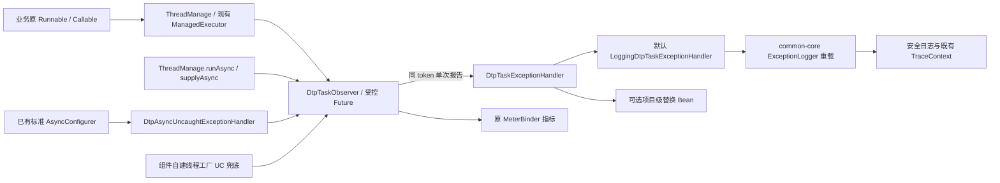
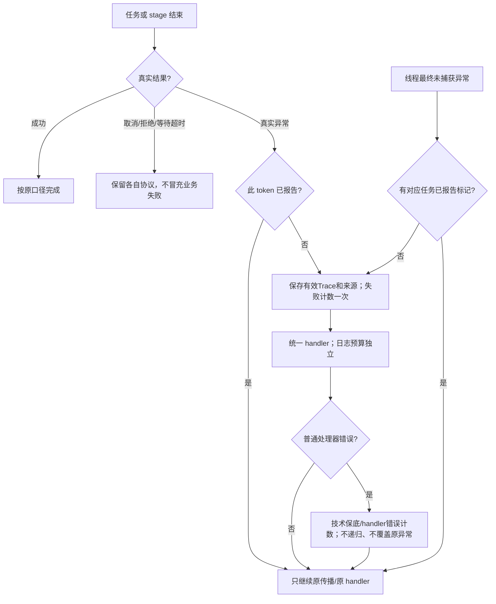
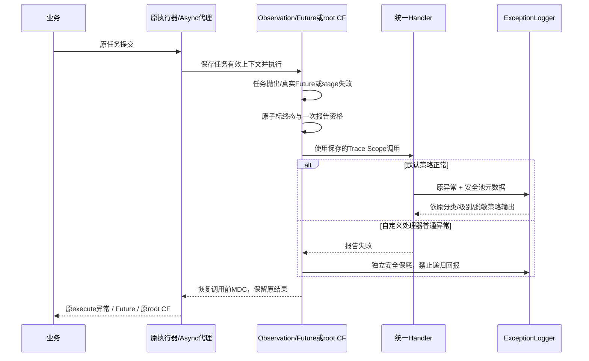

# 线程任务异常统一处理：融合 lesson099 与 ThreadManage 的组件层方案

| Field | Value |
| --- | --- |
| Document | `2026-10-21-09-38-dtp-unified-task-exception-handling.md` |
| Template Version | `9` |
| Archetype Cleanup | `Not applicable` |
| Status | `Superseded` |
| Type | Feature |
| Complexity | Complex |
| Complexity Drivers | execute/Future/CompletableFuture/Async 多种异常通路、MDC 生命周期、线程终止兜底、通知去重与配置兼容 |
| Created | 2026-10-21 09:38 Asia/Shanghai |
| Updated | 2026-10-21 12:57 Asia/Shanghai |
| Owner | mario |
| Repository | Egon-COLA |
| Scope | common-core ExceptionLogger、动态线程池 starter、六个标准源工程的异步配置委托及对应测试/文档 |
| Change Surface | 增加统一任务异常 SPI/默认实现，连接现有观察点、线程工厂、Async 和受控 CompletableFuture；保留监控与调容 |
| Affected Chapters | §7, §8, §9, §10, §13, §14, §15, §16, §17, §18 |
| Source Requirement | 对照 Downloads/luren-master/lesson099 的 thread 异常处理，融合到 component 框架层，业务简单使用；先给方案 |
| Baseline Revision | main / 4ef1cf380；2026-10-21 检查工作区干净 |
| Amends | [ThreadManage 方案](2026-10-20-20-53-dtp-thread-manage-observability.md) §7.3.1、§7.3.5、§9、§14、§16 及末尾 CompletableFuture 观测边界；其他治理/兼容要求继续有效 |
| Supersedes | None |
| Depends On | [ThreadManage 方案](2026-10-20-20-53-dtp-thread-manage-observability.md) §4、§6、§7 的注册/上下文/终态与动态调容基础 |
| Related Specs | [完整方案](2026-10-21-10-10-dtp-context-and-exception-management.md) §1–§20替代本草案，已批准实施 |
| Related Plans | None |

## 1. Summary

建议在现有 ThreadManage 中补齐统一任务异常出口：业务正常提交 Runnable/Callable，组件负责捕获、保持 MDC、按真实终态计数、默认记录安全异常日志和调用可选扩展处理器。复用 common-core 的 `ExceptionLogger`，保留异常分类、业务异常级别、原错误码和脱敏堆栈，避免另外建立一套日志规范。

lesson099 的 `UncaughtExceptionHandler` 放在线程工厂作为最后兜底；主要异常处理仍在现有任务边界完成，覆盖 Future 保存异常、CallerRuns、虚拟线程。增加受控 CompletableFuture 便捷入口与 Spring `@Async` 桥接，避免业务为记录异常重复写包装和回调。原异常仍按原 execute/Future/stage 协议传播，默认不重试、不补偿、不返回伪成功。

本轮只交付待评审方案，不改 Java/POM，不运行 lesson099，不启动应用、Redis 或浏览器；不生成实施 Plan，不提交代码。以下推荐设计待用户确认后实施。

## 2. Background and Current State

### 2.1 需求与路径约定

`DTP=egon-cola-components/egon-cola-component-dynamic-thread-pool`；`S=DTP/egon-cola-component-dynamic-thread-pool-starter`；`J=S/src/main/java/top/egon/cola/component/dtp`；`C=egon-cola-components/egon-cola-component-common/egon-cola-component-common-core`；`CJ=C/src/main/java/top/egon/cola/component/common/core`；`P=egon-cola-archetypes/source-projects`。这里只缩短路径，不增加目录或层。

### 2.2 Repository evidence

| Evidence ID | Classification | Exact path/symbol/decision/command | Observed fact | Design significance | Verification limit/freshness |
| --- | --- | --- | --- | --- | --- |
| EVD-001 | Static repository | `/Users/mario/Downloads/luren-master/lesson099/src/test/java/com/itsoku/lesson099/ThreadTest.java#test1..test4` | 展示普通 Thread、逐任务 try/catch、单线程 handler、ThreadFactory 统一 handler；最后使用 execute | 借鉴组件工厂统一装配，不能据此宣称 submit 也被 uncaught handler 覆盖 | 本轮只读源码，没有运行测试 |
| EVD-002 | Static repository | `J/context/DtpTaskObserver#Observation.finish/#diagnostic` | 已识别失败/取消/拒绝，但默认只记录异常类名；慢等待、慢执行、失败共用 lastLog/alarm.cooldown | 新增统一报告出口，独立异常日志预算，保留原计数 | 当前 main / 4ef1cf380 |
| EVD-003 | Static repository | `J/context/DtpObservedFutureTask#done` | Future 结束后读取真实结果；done 时原 ACTIVE/执行 MDC 作用域可能已经关闭 | 继续复用存储的有效 TraceContext，不能直接读取此时线程 MDC | 没有本轮运行证据 |
| EVD-004 | Static repository | `J/executor/managed/DtpThreadPoolTaskExecutor`、`J/executor/virtual/BoundedVirtualThreadExecutor` | 组件创建线程/虚拟线程，已有装饰/终态/信号量通路；尚无组件统一 uncaught 策略 | 自建工厂增加兜底，不能替换外接池已有线程工厂 | 外接原 Bean 保留原类型 |
| EVD-005 | Static repository | `CJ/exception/ExceptionLogger.java` | 已按异常分类/级别记录 code/status/retryable/Trace；系统异常保留脱敏堆栈，业务异常依既有策略处理 | 必须复用，避免重复脱敏/分类基础设施 | 本轮已读实际实现 |
| EVD-006 | Static repository | `P/egon-cola-source-{light,service,web}` 与三个 open 版本的 `AsyncConfiguration` | 六处均实现 AsyncConfigurer，已有 handler 调 ExceptionLogger；open 还负责默认 executor/decorator | 原配置仅改为可选委托，不再创建第二个 Configurer，不强制 native 引入 DTP | 已核对当前六处源码，未运行生成应用 |
| EVD-007 | Static repository | 本机 Spring 6.2.17 sources JAR 中 AsyncExecutionInterceptor、AsyncExecutionAspectSupport、AbstractAsyncConfiguration | void 异常经 AsyncUncaughtExceptionHandler 处理后 Callable 可正常返回；Configurer 多于一个会失败 | 需要显式失败信号桥接；不能只看底层 Future 的成功值或无条件再注册配置器 | 来自已安装版本源码，不按 Spring 7 推断 |
| EVD-008 | Static repository | `J/context/DtpTaskObserverTest#opaqueCompletableFutureResultsAreNeverMistakenForBusinessSuccess` | 直接 JDK CompletableFuture 内部任务隐藏 stage 结果，当前明确标记部分观测 | 新受控入口观察真实 root stage；旧 JDK 路径保留边界 |
| EVD-009 | Static repository | `egon-cola-archetypes/README.md`、三个 open 源工程 lombok.config | source-projects 是生产者，.generated 是派生目录；当前只确认复制 Qualifier，未复制 Lazy | 只改生产者；open 转 Lombok 构造时必须复制 Lazy，保留懒加载 executor |

### 2.3 技术语义依据

JDK 文档说明 uncaught handler 在异常导致线程终止时执行；FutureTask 会保存任务异常，单靠 afterExecute 的 Throwable 或 uncaught handler 不能完整观察 submit。采用任务边界与 Future 终态主处理、线程 handler 兜底。[JDK ThreadPoolExecutor](https://docs.oracle.com/en/java/javase/21/docs/api/java.base/java/util/concurrent/ThreadPoolExecutor.html)、[UncaughtExceptionHandler](https://docs.oracle.com/en/java/javase/21/docs/api/java.base/java/lang/Thread.UncaughtExceptionHandler.html)。

Spring 对 `@Async void` 提供独立异常 handler；本仓库已经配置，必须组合现有配置。CompletableFuture 的 whenComplete 可以观察结果，但返回新的 dependent stage，因此框架应保留原 root 返回对象，隔离报告回调的错误。[Spring 6.2 异步异常](https://docs.spring.io/spring-framework/reference/6.2/integration/scheduling.html)、[JDK CompletableFuture](https://docs.oracle.com/en/java/javase/21/docs/api/java.base/java/util/concurrent/CompletableFuture.html)。

### 2.4 Evidence and current-chain map

| Entry/trigger | Current call chain | Data read/written | External dependency | Consumers | Evidence |
| --- | --- | --- | --- | --- | --- |
| execute | ManagedExecutor/新池 → Observation.call → FAILED → diagnostic → 原异常继续抛出 | 池计数/MDC/限频日志 | 无网络 | 业务应用 | EVD-002/004 |
| submit/bulk | 受控 Future → done → 真实结果 → Observation.fail | 原 Future 结果和池计数 | 无网络 | 原 Future.get 调用方 | EVD-003 |
| Spring void 异步 | Async interceptor → 现有 AsyncConfigurer handler → ExceptionLogger → 返回 null | 已有日志；池包装可能看到正常返回 | Spring AOP | 标准生成应用 | EVD-006/007 |
| JDK CompletableFuture | opaque Runnable → stage 内存结果 → 原观察器标记部分能力 | 提交/耗时，无可靠业务终态 | JDK | 业务 stage 调用方 | EVD-008 |

### 2.5 Archetype example cleanup

Cleanup disposition: Not applicable

Reason: 修改基础设施组件与维护中的 archetype 生产者异步配置，未在生成业务项目交付首个业务功能；不清理示例业务、SQL 或现有应用。维护 source-projects 属技能清理规则的排除场景。

## 3. Goals and Non-goals

### 3.1 Goals

框架默认完成异常记录与 Trace 关联；Future 不 get 也不漏记录；void 异步不误报成功；新受控 root CompletableFuture 不误报成功；组件内同一逻辑任务只报告一次；日志/处理器故障不覆盖原结果；保持旧任务入口、监控和动态调容。

### 3.2 Non-goals

不接管 JVM 全局默认 handler，不拦截任意裸 new Thread/commonPool，不替换外接池线程工厂。不自动开启 @EnableAsync，不改业务重试/事务/补偿，不恢复为 null/成功值，不让取消、拒绝或调用方等待超时冒充业务执行失败。不建立异常数据库、消息总线、UI 或新的治理框架。

只更新六个标准生产者配置；不批量修改已有生成应用，不手改 .generated。原 DtpThreads 静态 API 继续原行为；需要应用级统一策略的业务优先使用 ThreadManage。

### 3.3 Change Surface and Design Depth

| Area/layer | Disposition | Exact repository evidence | Changed or preserved behavior/contract | Required Spec treatment | Chapter(s) |
| --- | --- | --- | --- | --- | --- |
| 任务异常出口/日志 | Affected | J/context；CJ/exception/ExceptionLogger | 默认处理器、真实终态通知、安全上下文字段 | 完整设计 | §7, §8, §9, §10, §13, §14, §15, §16, §17, §18 |
| 工厂兜底/CF/Async 桥接 | Affected | 新池、virtual、ThreadManage、六处 AsyncConfiguration | 原接口保留，新增 root CF 入口与可选委托 | 完整设计 | §7, §8, §9, §10, §13, §14, §15, §16, §17, §18 |
| 属性/指标/测试/文档 | Affected | J/config/metrics；DTP A/T 八个 profile | 独立错误日志限频、报告器错误计数和使用说明 | 完整设计 | §7, §8, §9, §10, §13, §14, §15, §16, §17, §18 |
| TraceContext/common-trace | Context-only | capture/open/Scope | 复用当前捕获恢复及旧预包装时点，不改共享实现 | 兼容证据与回归 | §14, §16 |
| 调容/队列/Redis/Admin REST | Unchanged | 原 ResizeSupport、Registry、Listener、Controller | 当前调容参数、Topic、消息去重、响应和旧字段形状不变 | 边界与回归，不重新设计 HTTP | §14, §16 |
| 数据库/前端 | Not applicable | 现有组件不含本次所需关系表或 UI | 不增加这些资源 | N/A | §11, §12 |

## 4. Requirements and Acceptance Criteria

| ID | Atomic requirement | Priority | Observable acceptance criteria | Source |
| --- | --- | --- | --- | --- |
| REQ-001 | 异常处理由 component 默认提供 | Must | 业务直接 execute/submit 即有统一日志/回调，无需每处包装或 get 才记录 | 框架层做掉，业务简单 |
| REQ-002 | 按真实异步结果处理异常 | Must | execute、Future、虚拟、void Async、受控 root CF 不漏报/误报；取消、拒绝、等待超时单独处理 | 融合线程异常处理 |
| REQ-003 | MDC/Trace 与同任务去重正确 | Must | done/回调在线程切换或 MDC 恢复后仍关联原任务；组件内同 token 只报告一次 | 与已有 Trace 管理融合 |
| REQ-004 | 默认复用安全异常日志 | Must | 分类/级别/code/脱敏堆栈来自 ExceptionLogger；池/来源信息可见；慢任务不消耗错误日志预算 | component 复用与监控补强 |
| REQ-005 | 原协议和现有配置兼容 | Must | Future/CF 原结果、原拒绝策略/用户 handler、Bean 类型、已有 AsyncConfigurer/默认池均保留 | 先前兼容约束继续有效 |
| REQ-006 | 提供小型扩展点并隔离其故障 | Must | 一个应用级可替换 handler；其普通异常不覆盖原任务结果、不递归通知、不回投故障池 | 业务可简单使用并按需扩展 |
| REQ-007 | 有界实现、验证且不扩展运行范围 | Must | 无新依赖/服务/数据库，旧监控/调容不退化；本轮仅方案，后续离线编译/隔离测试 | 本轮先给方案及已有 AGENTS |

### 4.1 Scenario matrix

| Scenario | Actor/trigger | Preconditions | Main path | Alternative/failure path | Data/state change | Observable result | Requirements |
| --- | --- | --- | --- | --- | --- | --- | --- |
| 普通执行抛错 | 业务 execute | 组件观察入口 | 记录终态→通知→原异常抛出 | Worker 终止时兜底不二次通知 | FAILED 一次 | Trace 和原异常保留 | REQ-001/002/003 |
| submit 不读取 Future | 业务 submit | 任务失败 | done 读取已结束结果→统一处理 | get/join 以后仍按原协议失败 | FAILED/回调一次 | 无需 get 才打日志 | REQ-001/002/005 |
| 取消与超时 | 业务取消/等待 | 可运行或排队 | 依实际 Future/stage 终态判断 | get(timeout) 超时不代表任务失败；取消后的中断不再报业务失败 | 只记正确终态 | 无假失败/假成功 | REQ-002/005 |
| CallerRuns 异常 | 饱和策略 | 调用者执行 | 同一观察出口→异常继续传播 | 不依赖 uncaught，因为调用者可捕获 | 拒绝事件与真实失败分别记录 | 调用者 MDC 恢复 | REQ-002/003/005 |
| 旧 handler 已配置 | 用户线程工厂 | 自建工厂可组合 | 组件兜底与原 handler 按策略组合 | 原 handler 自行输出日志不由组件删除 | 组件通知去重 | 原 handler 仍执行 | REQ-003/005 |
| @Async void 失败 | 标准异步代理 | 框架 handler 已委托 | 在有效 task token 上标失败，再由组件统一报告 | 无 token 只能诊断，不能伪造完整池计数 | 外层返回 null 不记成功 | 只有一个 AsyncConfigurer | REQ-002/005 |
| root CF 失败/取消 | 新便捷入口 | 已管理 executor | 真实 root 完成回调与同 token 合并 | CallerRuns 导致同步完成也可正确附加回调 | 单次终态 | 返回原 root，结果不被监控改写 | REQ-002/003/005 |
| 日志风暴/处理器故障 | 多任务失败 | 同池/自定义 SPI | 指标与通知不被日志限频丢弃 | 处理器失败走独立保底，不递归为业务失败 | 有界计数/限频 | 原 Future 结果不变 | REQ-004/006/007 |
| 独立 Worker 故障 | 工厂 worker 异常 | 无有效任务快照 | 明确 UNCAUGHT、池/线程身份 | Trace 不可得就标记未知，不取其他任务 MDC | 技术诊断，非伪造任务失败 | 不污染业务统计 | REQ-003/004 |

### 4.2 Use-case analysis

ACTOR-001：提交异步任务的业务应用；ACTOR-002：查看异常/Trace/指标的维护者；ACTOR-003：按需配置应用级策略的框架接入者。证据来自 ThreadManage、现有监控/Logger、六处标准 AsyncConfigurer。

| ID | Use case/goal | Primary actor | Supporting actors/systems | Trigger | Preconditions | Main success outcome | Alternatives/failures | Postconditions | Requirements | Interfaces/pages | Tests |
| --- | --- | --- | --- | --- | --- | --- | --- | --- | --- | --- | --- |
| UC-001 | 简单提交并自动记录失败 | ACTOR-001 | JDK/Spring | 提交或异步代理调用 | 执行器/标准配置已接入 | 默认捕获、Trace、日志与计数 | 取消、拒绝、旧裸入口能力不足 | 原结果/传播保留 | REQ-001/002/003/005 | INTERNAL-003/004/005/006、原 execute/submit | TEST-001..006 |
| UC-002 | 通过安全日志定位任务 | ACTOR-002 | ExceptionLogger/指标 | 排障 | 异常真实可观测 | 池/来源/Trace/脱敏堆栈同事件可见 | 日志限频、无 Trace、回调错误 | 记录真实能力与抑制次数 | REQ-003/004/007 | INTERNAL-001/002 | TEST-007/008/009 |
| UC-003 | 替换项目级异常策略 | ACTOR-003 | Spring Bean | 提供可选 named handler | 同步、线程安全、非递归策略 | 不改业务调用代码即可扩展 | Bean 不存在用默认；普通异常被隔离 | 没有第二套执行器或 Configurer | REQ-005/006 | INTERNAL-001 | TEST-009/010/011 |

## 5. Constraints, Assumptions, and Decisions

继续保留当前组件包、旧构造/方法、原始 Bean 类型、旧包装捕获时点、默认线程池选择、三类 adapter、监控和动态调容。新设计使用本仓库现有 JDK/Spring/SLF4J/common/Guava 能力，不新增依赖，不修改任何旧 SQL。

推荐将六个标准 source-projects 的 AsyncConfiguration 纳入本次框架范围：只做可选 handler 委托，不改变线程池选择，不把 DTP 依赖加到 native 项目；旧已生成业务项目不批量改动。此范围是本方案明确呈现的建议，未获本轮实施授权，也未产生任何代码改动。

ASM-001：类型名使用 `DtpTaskExceptionHandler`、`DtpTaskFailureBO`，与现有 Dtp 前缀/技术 BO 角色一致，可在评审阶段改名。ASM-002：异常日志独立预算建议默认1秒，与压力告警/慢任务预算分开；只影响新统一日志策略，不改变终态计数。

无必须引入外部依赖或无法兼容的未决技术阻断。当前状态为 Review，等待用户对完整建议范围的评审；不把待评审建议写成已获批准的生产行为。

## 6. Project Technology Context

Java21、Boot3.5.16、已安装 Spring6.2.17 源码已核对；DTP 已依赖 common-core/common-trace、Spring AOP/Validation、SLF4J，可选 Micrometer。common-core 的 ExceptionLogger 保持纯 Jar，不依赖 Spring 或 DTP。只增加向下依赖的调用，不引反向依赖。

### 6.1 Java architecture profile and capability baseline

S 保留已有基础设施组件结构，依据用户明确的 component 层要求及前置方案，不强套业务三层。六个生产者分别保留现有 exact light/service/web native/open 模块与包，未创造混合架构；open 的默认 applicationTaskExecutor 与 DtpTaskDecorator 保留。更新生产者后由已有 generate_archetypes.sh 派生打包输入，不手改生成工程。

| Need | Spring/JDK candidate | Spring Boot Starter candidate | Egon-COLA/module candidate | Proven gap | Decision/dependency impact |
| --- | --- | --- | --- | --- | --- |
| 安全异常日志 | SLF4J/Throwable | 已有 | ExceptionLogger | 当前 Observer 未复用，缺池上下文重载 | 复用，仅新增兼容重载 |
| 真实终态 | FutureTask/whenComplete | 已有 | Observer/ObservedFutureTask | 缺统一 handler；CF opaque 无结果 | 扩展同 token，不重新建 Future 框架 |
| Worker 兜底 | ThreadFactory/UC handler | 已有 | 新池/virtual 工厂 | 尚无组件兜底 | 自建工厂组合，外接不改 |
| void Async | AsyncUncaughtExceptionHandler | 已有 AOP | 六个 AsyncConfigurer | 日志已统一基础分类，但无任务失败桥接 | 可选委托；不重复注册配置器 |
| 新增库/持久层 | 无 | 无 | 当前依赖足够 | 无 | 不修改 POM/BOM、无新模块 |

### 6.2 User-mandated Java rule compliance

| Literal rule | Affected? | Repository evidence | Exact design decision | Files/types/interfaces | Validation/test evidence | Status/blocker |
| --- | --- | --- | --- | --- | --- | --- |
| Rule 1 | Yes | 现有 Dtp 类型及 Common Logger | 新载体 FailureBO；Handler/Configurer 行为命名，保留旧名 | §8/§10 | TEST-010/013 | PASS |
| Rule 2 | Yes | S ValidationUtils 与 provider 已有 | BO 原生约束、handler入口通用校验；静态日志技术参数用既有 JDK guard/安全化，不引 provider 到 common | §9/§10 | TEST-008/009/010 | PASS |
| Rule 3 | Yes | CreateCommand/new properties 的 class 基线 | 新 BO/class 使用 Data/NoArgs/AllArgs/Accessors/Builder；Throwable 等排除 ToString；私有可变状态不使用 record | FailureBO、新配置 | TEST-010/013 | PASS |
| Rule 4 | Yes | 当前命名 Bean/Qualifier 复制 | Slf4j、显式名字、final+Qualifier、RequiredArgsConstructor(onConstructor_=Autowired)；open 的 Lazy 也复制 | §8 行为类与 source 配置 | TEST-010/011 | PASS |
| Rule 5 | Yes | JDK、现有 Guava 等能力 | 不造 Utils 或线程池框架；不重新实现脱敏 | Handler/Observer | POM/导入检查 | PASS |
| Rule 6 | Yes | 原 Jackson/枚举/Response | BO 只在本机调用，原 Throwable 不序列化；HTTP/Redis字段无变化 | BO、ExceptionLogger | TEST-008/013 | PASS |
| Rule 7 | Yes | DTP A/T 八个 profile | 新异常配置结构相同，源工程使用组件默认值、不增加可选 DTP 依赖 | §10 配置矩阵 | TEST-010/011 | PASS |
| Rule 9 | Yes | 原 Adapter/Decorator 与真实策略变化 | 单一 Handler Strategy，Default 实现、现有装饰/观察点组合；无工厂层级 | §13 | TEST-001..011 | PASS |
| Rule 10 | Yes | 原 Instant/Duration/nanoTime | observedAt=Instant；间隔=Duration；耗时/限频单调时钟 | §6.3 | TEST-007/010 | PASS |
| Rule 11 | Yes | 既有组件、六个 exact 源树 | 保留当前结构/依赖方向；无业务事件/MQ/关系持久化变更 | §6.1/§8 | 编译、生产者派生检查 | PASS |

### 6.3 Time semantics and conversion contract

Time contract: Required

| Time ID | Fields/symbols | Semantics | Java/runtime type | Storage policy | Wire policy | Business zone source | Display zone source | Boundary / DST rules | Precision / Clock | Compatibility | Verification |
| --- | --- | --- | --- | --- | --- | --- | --- | --- | --- | --- | --- |
| TIME-001 | FailureBO.observedAt | Occurred instant | Instant | Not persisted | Internal | Not applicable: 技术观察瞬间 | Not applicable: 无 UI | 日志使用 UTC Z 文本；不是业务发生时间或数据库字段 | Instant.now，保留小数秒 | 不改原审计/HTTP时间 | TEST-007/008 |
| TIME-002 | exception.logInterval、原等待/执行耗时 | Duration | Duration/nanoTime差值 | Not persisted | Internal | Not applicable: 相对时间 | Not applicable: 无 UI | 不用系统日历限频，不受 DST 影响 | 单调纳秒差，Duration范围验证 | 原 report/alarm 配置保留 | TEST-007/010 |

## 7. Architecture Design

### 7.0 Minimum-design baseline and element-necessity audit

| Proposed element | Change | Requirements | Existing/direct alternative | Concrete inadequacy of alternative | Added calls/state/coupling/failures/migration/operations | Verdict |
| --- | --- | --- | --- | --- | --- | --- |
| Observer 原地增加出口 | Expand | REQ-001/002/003 | 业务逐任务 try/catch | 重复、漏 Future、Trace 不一致 | 单次同步报告，无网络 | Keep |
| Handler + FailureBO + 默认 Logger 实现 | New | REQ-001/004/006 | Observer 写死所有业务日志策略 | 无项目级替换/故障隔离边界 | 一个 SPI、一种上下文、一个默认 Bean | Add |
| ExceptionLogger 上下文重载 | Expand | REQ-004/005 | DTP 自建脱敏器或额外打一行日志 | 既有分类/脱敏应复用，同事件需要池字段 | 一兼容重载；不改原方法 | Add |
| 自建工厂 handler 组合 | Expand | REQ-001/003/005 | JVM global handler / 强改所有 Bean | 会改变不归组件拥有的线程行为 | 每线程短生命期通知槽，不建全局 Throwable 缓存 | Add |
| 两个受控 root CF 方法 | New | REQ-002 | 直接 JDK opaque 任务 | 不公开真实 stage 结果，不能可靠计数/报告 | 复用同 token/计时，返回原 root | Add |
| Async 桥接与六处生产者委托 | New/Expand | REQ-002/005 | 第二个 AsyncConfigurer / 继续每项目写策略 | 第二个配置器会冲突；原 void 异常可能被看作成功 | 一个桥接 Bean、可退让配置器、可选 provider | Add |
| 业务事件/异常表/自动重试/反射拆 JDK 任务 | None | REQ-007 | 原技术日志/计数足够 | 无现时业务需求支持复杂度 | 避免新状态与新失败面 | Remove |

| Path | Network calls | Client states | Server contracts/state | Failure and TOCTOU points | Additional user/business value |
| --- | --- | --- | --- | --- | --- |
| 原 execute/submit | 0 | 原 Future/异常 | 原 task token/MDC/计数 | 类名诊断/共用限频 | 现有任务执行 |
| 统一异常出口后 | 0 | 原协议不变 | 同 token + 小型 handler上下文/独立限频 | handler故障明确隔离 | 不写日志包装也可排障 |
| 新 root CF 入口 | 0 | 原 root CF | 已知 root/token/完成回调 | 同步完成/取消/外部complete | 不需要用户另写异常观察回调 |

### 7.1 System Architecture Design



报告对象属于观察器/单应用上下文，不使用 JVM 全局可变 handler/全局 Throwable set。SPI 是技术回调，不是领域事件投递，默认不调用远端服务。ThreadManageRegistry 继续唯一拥有池目录，handler 不再创建线程池或调参。

### 7.2 High-Level Design



#### 7.2.2 High-level decision and quality matrix

| Concern/use case | Required behavior | Selected mechanism | Failure/degradation behavior | Trade-off | Verification | Requirements |
| --- | --- | --- | --- | --- | --- | --- |
| 可观察性 | 无 get 也记录真实任务失败 | done/原装饰边界/CF root完成/Async桥 | 裸线程与旧opaque路径保留能力边界 | 不假装全JVM自动发现 | TEST-001/003/005 | REQ-001/002 |
| 正确性 | 单token终态和通知各一次 | 当前CAS加独立通知状态，拒绝/取消分离 | 嵌套不同任务各自计算，不按 Throwable 全局去重 | 同一异常对象用于两任务仍是两任务 | TEST-002/006/009 | REQ-002/003 |
| 兼容性 | 不吞、不转换、不重试 | 原 Throwable/Future/root返回值继续 | 用户handler照常委托，外接池不改factory | 用户/系统自行日志可能另有输出 | TEST-001/004/011 | REQ-005 |
| 可靠诊断 | 首次系统错误不被慢日志挤掉 | 错误/业务异常/慢诊断分别限频；报告不丢，日志有抑制数 | 默认logger故障走安全保底 | 不保证资源耗尽时所有日志可达 | TEST-007/009 | REQ-004/006 |
| 简单接入 | 默认可用，标准源工程不复制策略 | named handler + Optional provider | 自定义Configurer不覆盖，需要一次委托接入 | 不强制新依赖到 native | TEST-010/011 | REQ-001/005/007 |

### 7.3 Detailed Design

#### 7.3.1 统一出口与日志复用

新增 `DtpTaskExceptionHandler#handle(DtpTaskFailureBO)`，默认 Bean 名 `dtpTaskExceptionHandler`，默认实现 `LoggingDtpTaskExceptionHandler`。项目需要定制时提供相同名字、相同接口的 Bean；组件按名字退让，避免“按类型退让却按名字注入”导致缺 Bean。handler 通过延迟 provider 获得，防止自定义策略依赖 ThreadManage 时形成 eager 初始化循环。

现有 Observation 在真实失败上决定 FAILED 与通知资格。默认日志调用 ExceptionLogger 新增带安全 metadata 的重载，原 `log(Logger,Throwable)` 行为保持不变。额外键只承载 app/instance/executor/kind、failureId、source、线程/方法身份、observedAt 和抑制次数；保留既有 code/category/status/level/Trace 的权威性，禁止 metadata 覆盖它们。仍由公共 Logger 处理 Completion/ExecutionException 分类、业务级别与脱敏堆栈；不另外造异常类、不修改原 Throwable。

`observation.enabled=false` 只影响统计，新的 `exception-handling.enabled` 独立控制报告，避免关闭耗时监控后连错误日志都消失。报告回调每次真实失败都会进入；日志限频只影响默认 Logger 输出。首次系统异常、业务异常与慢诊断分别预算，默认错误窗口1秒；抑制数在后续同类日志中给出，计数不丢。

已进入统一报告的 failed/wrapped-failure 不再额外输出同类 WARN，避免把 INFO 业务异常升级或重复记录。旧 opaque 通路不能确认 root 时保留原有有限诊断/能力标识，不借此宣称已观察全部 stage。拒绝、慢等待与慢执行继续保留原诊断语义。

#### 7.3.2 Critical-path Mermaid swimlane



#### 7.3.3 execute、Future、虚拟与线程兜底

execute 在原观察边界捕获后先报告、再继续抛原异常；不得变成 catch/log/return。submit 继续从已结束 Future 读取真实 cause，业务不调用 get 也会报告；未完成 Future 禁止为了探测而阻塞 get。取消以 Future 实际状态为准，取消引起的 InterruptedException 不再计 FAILED；调用方 get(timeout) 超时并非任务失败。虚拟线程沿用已有终态/信号量路径，只连接同一出口，不双计数或泄漏许可。

自建平台/虚拟线程工厂组合专属 uncaught handler；不设置 Thread.setDefaultUncaughtExceptionHandler，不替换外接 Bean 的 factory 或 handler。任务边界是主处理点，uncaught 只是兜底。原显式 handler/ThreadGroup/default 委托仍执行；组件只能保证自己的报告去重，不能删除用户/系统自行输出的日志。

MDC 在进入 uncaught 时可能已经恢复，不能此时重新 capture 冒充任务上下文。自建 worker 包装保存线程私有的最后逃逸失败记录，连接 task token、原异常身份、有效 Trace 和是否已报告；正常任务/Future 完成即清理，线程终止 handler finally 清理。该记录是每线程短生命期槽，不是 JVM 全局 Throwable 缓存。只对当前注册上下文及对应 token 去重，不把同一个 Throwable 在不同逻辑任务中的失败合并。

无有效任务记录的 worker 故障明确标识 UNCAUGHT/unknown Trace，只记录已知池和线程信息，不使用其他请求 MDC，不虚造 task.failed 次数。JVM 致命 Error 不降级成业务成功或自动重试；诊断只能尽力，不改变原执行器对异常/线程终止的语义。

#### 7.3.4 受控 CompletableFuture

新增 `ThreadManage.runAsync(String,Runnable)` 和 `supplyAsync(String,Supplier<T>)`；框架内部观察原 root.whenComplete 并返回原 root，不把 dependent stage 当返回值，不用 exceptionally 返回 null。沿用 Java cancel/complete/get/join 语义，取消不自动中断业务线程。调度拒绝仍同步抛原拒绝异常，不生成伪失败 Future 掩盖原契约。

复用当前观察 token：内部 Executor 包装给 opaque Runnable 携带同一观察状态，ManagedExecutor/原装饰器识别后不再创建第二 token；等待/执行计时与真实 root 完成分别负责。原 DtpSupplier/DtpRunnable 预包装上下文优先；同步 CallerRuns 在 root 返回前完成时，完成回调仍用保存的任务上下文处理。不得因 stage 封装返回正常而记 succeeded，也不得把 root 异常与内部包装重复计失败。

新池已有 `AsyncTaskExecutor.submitCompletable(Runnable/Callable)` 签名保留，由同一内部 bridge 实现，以覆盖 Spring 返回 CF 的异步方法；checked callable 异常保持其原完成协议。没有组件观察能力的第三方 ManagedExecutor 对新增便捷功能明确返回不支持，原 execute/submit 继续可用。

任意直接调用 JDK supplyAsync/第三方 stage 仍不自动读取隐藏结果；root helper 不会自动观察用户后来追加的全部 thenApply/thenCompose 节点。后续链路恢复/补偿依旧属于业务返回链，不能宣传为全 stage 自动接管。本轮不增加反射、JDK内部访问或全局 stage 注册缓存。

#### 7.3.5 Spring Async 与标准生产者

提供 `DtpAsyncUncaughtExceptionHandler` Bean，名字 `dtpAsyncUncaughtExceptionHandler`。在有效 Observation 内先原子标记实际失败，再进入统一 handler，避免 Spring void 方法吞下异常后外层 Future 返回 null 被计成功；没有有效 token 时只报告明确的诊断能力，不伪造完整池统计。不得记录 Object...params 的实参。

在应用已启用 Async 且没有 AsyncConfigurer 时，可由小型 DtpAsyncConfigurer 返回该 handler；getAsyncExecutor 保持 null，沿用 Spring 原 executor 解析，不自动 @EnableAsync。存在用户配置时组件退让，不注册第二个 Configurer，不覆盖用户自定义 handler。

六处标准 AsyncConfiguration 只将 getAsyncUncaughtExceptionHandler 改为 qualified ObjectProvider 可选委托：有 `dtpAsyncUncaughtExceptionHandler` 就返回它；没有则保留现有 ExceptionLogger lambda。native 不引入 DTP 编译依赖，open 的 applicationTaskExecutor/Decorator/懒加载保持。open 使用 Lombok 构造时补 Lazy 复制，连同 Qualifier 由 Context/反射测试验证。自定义或旧已生成项目只需在已有配置中一次委托，不要求每个业务方法重写异常策略。

标准生产者只统一异常出口，不把原 default applicationTaskExecutor 替换为新池。完整任务终态统计仍要求走 ThreadManage 入口/新池；对外接默认池，没有有效 token 的 void 异常可统一记录，但不能宣称池计数完整，返回 Future/CF 的旧裸路径也不因改了 void handler 就自动全部可观测。旧构造兼容重载保留（native 无参、open 的原 Executor 入参），只有新的 DI 构造标 Autowired，缺 provider 时仍走原 fallback。

#### 7.3.6 Conclusion evidence chain

| Conclusion | Repository/user evidence | Constraint or requirement | Design decision | Consequence and trade-off | Verification and acceptance evidence |
| --- | --- | --- | --- | --- | --- |
| 不只照搬 uncaught | EVD-001/003/007 | REQ-001/002 | 真实终态主处理，工厂 handler 兜底 | submit/Async覆盖明确，不靠线程死亡才记录 | TEST-001..006 |
| 复用公共日志 | EVD-002/005 | REQ-004/007 | 既有 Logger 加安全上下文重载 | 保留分类/脱敏，少一个基础设施实现 | TEST-007/008 |
| 组合原 Async 配置 | EVD-006/007/009 | REQ-001/005 | 可选委托与自动退让，不创建第二配置器 | 标准项目简单接入；自定义配置仍自主 | TEST-010/011 |

## 8. Package Structure and Code File Tree

保留当前 J 的 context/executor/config/metrics 包，新增专用 `exception` 小包，common-core 仍是基础 Jar，不改变模块方向。

| Operation | Path/package | Symbols | Responsibility | Dependencies | Requirements |
| --- | --- | --- | --- | --- | --- |
| Modify | CJ/exception/ExceptionLogger.java | log(Logger,Throwable,Map) | 兼容重载、安全元数据；不重写分类/脱敏 | 原 SLF4J/JDK/common-trace | REQ-004/005 |
| Create | J/exception/DtpTaskExceptionHandler.java | handle(FailureBO) | 唯一应用级策略 SPI | 本模块 BO | REQ-001/006 |
| Create | J/exception/LoggingDtpTaskExceptionHandler.java | 默认实现 | 复用 ExceptionLogger，尊重日志资格/抑制数 | common-core | REQ-004/006 |
| Create | J/exception/DtpTaskFailureBO.java | 技术处理上下文 | §10 字段/约束，非序列化事件 | JDK/Validation/Lombok | REQ-003/004/006 |
| Create | J/exception/DtpAsyncUncaughtExceptionHandler.java | Spring handler | void失败信号与原任务去重/Trace | 已有 Spring AOP | REQ-002/005 |
| Create | J/config/DtpAsyncConfigurer.java | getAsyncUncaughtExceptionHandler | 有条件、可退让的标准配置 | 已有 Spring Async | REQ-002/005 |
| Modify | J/context/DtpTaskObserver.java、DtpObservedFutureTask.java | finish/fail/通知状态、内部CF桥 | 中央报告、取消竞态、MDC快照/限频分离 | 新SPI/原Trace | REQ-001/002/003/006 |
| Modify | J/executor/ThreadManage.java、ManagedExecutorRegistry.java、ManagedExecutor.java | 两个CF便捷入口、默认能力 | 延迟策略注入，同一目录/token，旧签名保留 | 原adapter/registry | REQ-001/002/005 |
| Modify | J/executor/managed/DtpThreadPoolTaskExecutor.java | factory/submitCompletable | 自建worker兜底、原CF签名受控 | 原ThreadFactory/观察器 | REQ-002/003/005 |
| Modify | J/executor/virtual/BoundedVirtualThreadExecutor.java；J/executor/adapter 三现有类 | 异常接点 | 接同出口、不改并发许可/旧Bean | 原三adapter | REQ-002/005 |
| Modify | J/config/DynamicThreadPoolAutoConfig.java、DynamicThreadPoolAutoProperties.java | named Beans/配置 | 默认策略、可选Async、旧构造兼容 | 原依赖，无新POM | REQ-001/005/007 |
| Modify | J/metrics/DtpMeterBinder.java | 技术错误计数 | 保留原指标；新增处理器失败/未捕获诊断计数 | 可选Micrometer | REQ-004/006 |
| Modify | DTP A/T 的 src/main/resources/application{,-dev,-test,-prod}.yml；README.md/README.zh-CN.md | 新异常配置/用法 | 相同键结构、入口与能力边界 | 原资源 | REQ-001/007 |
| Modify | 以下六处 AsyncConfiguration.java | 可选provider委托 | 同一个Configurer，原默认池不变 | 只依赖已有Spring接口 | REQ-002/005 |
| Modify | P/egon-cola-source-{light,service,web}-open/lombok.config | copyableAnnotations Lazy | 保留构造参数@Lazy | 现有Lombok，无版本变化 | REQ-005 |
| Create/Modify | 上述同模块同包的测试，见§14 | 回归与新契约 | 实施时精确列入Plan；当前不写测试代码 | 已有JUnit/Mockito/ContextRunner | REQ-001..007 |

六个实际生产者路径：

```text
egon-cola-archetypes/source-projects/
├── egon-cola-source-light/src/main/java/top/egon/cola/archetype/source/light/start/config/async/AsyncConfiguration.java
├── egon-cola-source-light-open/src/main/java/top/egon/cola/archetype/source/lightopen/start/config/async/AsyncConfiguration.java
├── egon-cola-source-service/egon-cola-source-service-starter/src/main/java/top/egon/cola/archetype/source/service/starter/config/async/AsyncConfiguration.java
├── egon-cola-source-service-open/egon-cola-source-service-open-starter/src/main/java/top/egon/cola/archetype/source/serviceopen/starter/config/async/AsyncConfiguration.java
├── egon-cola-source-web/egon-cola-source-web-starter/src/main/java/top/egon/cola/archetype/source/web/starter/config/async/AsyncConfiguration.java
└── egon-cola-source-web-open/egon-cola-source-web-open-starter/src/main/java/top/egon/cola/archetype/source/webopen/starter/config/async/AsyncConfiguration.java
```

私有 worker 失败槽与 completion carrier 放在相应现有工厂/Observer 内，含可变状态使用私有 class，正常结束/线程终止释放。无需新公开线程管理器、事件 DTO 链或 Throwable 永久缓存。

## 9. Interface Definitions

HTTP/RPC/Redis协议不变，本章只定义 Java 技术契约。common logger 的原重载、AsyncConfigurer/Spring/JDK原接口保持，新增实现由下列原子操作与 §7 的映射约束。

### 9.1 Interface Inventory

| ID | Change/necessity verdict | Name/purpose | Kind | Consumer | Owner | Exact symbol | Input/output | Requirements |
| --- | --- | --- | --- | --- | --- | --- | --- | --- |
| INTERNAL-001 | New/Add | 统一处理策略 | Java | Observer/桥接 | S | DtpTaskExceptionHandler.handle(DtpTaskFailureBO) | BO → void，无业务结果 | REQ-001/006 |
| INTERNAL-002 | New/Add | 带上下文的公共日志 | Java | 默认DTP策略 | C | ExceptionLogger.log(Logger,Throwable,Map<String,String>) | 异常/安全字段 → 日志 | REQ-004/005 |
| INTERNAL-003 | New/Add | 无返回值root异步 | Java | 业务 | S | ThreadManage.runAsync(String,Runnable) | 名称/任务 → CompletableFuture<Void> | REQ-001/002 |
| INTERNAL-004 | New/Add | 有返回值root异步 | Java | 业务 | S | ThreadManage.supplyAsync(String,Supplier<T>) | 名称/委托 → CompletableFuture<T> | REQ-001/002 |
| INTERNAL-005 | New/Add | Spring void桥接 | Java | Spring Async | S | DtpAsyncUncaughtExceptionHandler.handleUncaughtException(Throwable,Method,Object...) | Spring错误 → 统一报告 | REQ-002/005 |
| INTERNAL-006 | New/Add | 自建worker最终兜底 | Java | JDK线程终止 | S | Thread.UncaughtExceptionHandler.uncaughtException(Thread,Throwable) 的组件组合实现 | 线程/错误 → 保底及原handler | REQ-001/003/005 |

### 9.2 Per-interface Detailed Contracts

#### 9.2.1 INTERNAL-001 — 统一策略

##### Necessity and interaction-cost decision

| Concern | Decision |
| --- | --- |
| Change classification | 新增纯Java SPI |
| Independent consumer goal | 一个应用级策略覆盖所有已知任务失败 |
| Parameter ownership and derivation | 失败上下文由任务观察器生成，不来自HTTP或业务参数 |
| Direct/no-new-interface alternative | Observer写死不能满足可替换的项目处理需求 |
| Caller use of result | 无返回值，不能改业务执行结果 |
| Round trips and failure points | 默认零网络；普通回调错误隔离 |
| Verdict | Add，REQ-001/006；只保留一个策略接口 |

##### Identity and purpose

`void handle(DtpTaskFailureBO failure)`，默认 Bean `dtpTaskExceptionHandler`；按名字提供替换，不注册多个有歧义的策略。调用线程可能是任务线程、done/CF回调线程或CallerRuns线程，要求实现线程安全、快速，不同步回投同故障池。

##### Request parameters

非null BO/cause/source/failureId/observedAt；其余可用性见§10。入口调用既有 ValidationUtils 验证技术 BO；不可用/不合格元数据走安全保底，不向原任务抛校验错误。Throwable 仅只读检查，不改其 message/stack/cause/suppressed。

##### Success response

无业务返回值，结束表示处理器本次同步调用完成，不代表业务恢复或远端告警送达。原任务失败/计数/Future结果不变；是否输出默认日志由独立资格和公共异常级别决定。

##### Error responses

普通策略异常由报告边界隔离，增加技术错误计数并限频保底，不能添加到原 Throwable 造成语义变更。禁止递归把处理器错误作为同一个业务失败再次通知；致命Error不能被翻译成成功或自动重试。

##### Interface logic for frontend and consumers

真实终态CAS→一次通知资格→恢复有效Trace Scope→验证BO→调用策略→恢复调用前MDC。自定义策略获得每个真实失败，不因默认日志限频丢通知；不能以通知次数推导跨进程可靠事件。

##### Compatibility and verification

旧构造提供默认策略或转接新重载；Spring默认装配延迟provider。TEST-001/002/007/009/010证明一次回调、配置关闭、替换Bean、回调故障和并发可见性，不影响原异常对象/协议。

#### 9.2.2 INTERNAL-002 — 公共安全日志重载

##### Necessity and interaction-cost decision

| Concern | Decision |
| --- | --- |
| Change classification | 新增重载，原两参数方法不变 |
| Independent consumer goal | 同一结构化异常事件同时携带池/任务身份 |
| Parameter ownership and derivation | logger/cause由原调用者提供，metadata为组件限定安全字段 |
| Direct/no-new-interface alternative | 自建脱敏或额外拼接异常日志会复制规则/拆散上下文 |
| Caller use of result | 日志用于排障，无业务返回值 |
| Round trips and failure points | 原SLF4J路径；新元数据失效不丢原异常日志 |
| Verdict | Add，REQ-004/005；不新建公共报告框架 |

##### Identity and purpose

`static void log(Logger logger, Throwable failure, Map<String,String> metadata)`；common-core仍不依赖DTP/Spring，保留原分类、业务级别、脱敏cause和Trace处理。旧两参数重载输出字段/行为不变。

##### Request parameters

logger/failure按原Objects.requireNonNull契约；metadata缺省/null视为空，最多16项；键使用短ASCII标识，值剔除控制字符并限制128字符，无效项省略或记unknown。已有 code/status/category/level/Trace 等保留字段不可覆盖；不接受任务实参或任意完整MDC。

##### Success response

输出单一结构化异常事件，保留原异常分类、alertRequired、业务level和安全堆栈；新增字段不会改变原错误码/JSON协议。无持久化或发送成功承诺，不能拿日志写入当业务事务。

##### Error responses

旧输入错误仍按原契约；metadata异常不能使已有合法异常丢记录。日志后端普通异常由DTP调用边界保底，common不反向调用DTP，也不启动新线程或重试网络。

##### Interface logic for frontend and consumers

沿用原unwrap/分类/级别/安全Trace/脱敏cause流程；在原事件builder内添加受约束metadata；保留原字段的权威性。只处理日志投影，不创建转换实体、异常包装器或新结果信封。

##### Compatibility and verification

TEST-008对比旧两参数事件字段/级别/脱敏行为；新字段正负样例、保留字段冲突、Throwable环和原异常不被修改均断言。所有旧ExceptionLogger调用方保持可编译，无新依赖。

#### 9.2.3 INTERNAL-003 — runAsync

##### Necessity and interaction-cost decision

| Concern | Decision |
| --- | --- |
| Change classification | ThreadManage新增便捷入口 |
| Independent consumer goal | Runnable异步结果真实可观测且业务不重复附加日志回调 |
| Parameter ownership and derivation | 业务给已知池名/任务；框架负责token/上下文/root回调 |
| Direct/no-new-interface alternative | 原JDK opaque任务隐藏root结果，不能从其Runnable推断失败 |
| Caller use of result | 获取/组合原root CompletableFuture<Void> |
| Round trips and failure points | 零网络，保持executor拒绝和CF协议 |
| Verdict | Add，REQ-001/002，不增加复杂任务DSL |

##### Identity and purpose

`CompletableFuture<Void> runAsync(String executorName,Runnable task)`，只在已知组件观测能力的ManagedExecutor上调度，返回root本身。原executor(name).execute/submit与直接JDK调用仍可使用。

##### Request parameters

池名非空且已注册，task非null；未注册用原命名取得契约异常，不悄悄创建池或使用commonPool。无completion能力的自定义ManagedExecutor对新增功能明确不支持，旧方法不受影响。

##### Success response

返回原CompletableFuture<Void>；正常为null，失败保留原stage异常，取消保留JDK语义。内部观察不通过恢复为null消除异常，也不返回whenComplete产生的dependent stage。

##### Error responses

参数/能力错误在提交前失败；执行器拒绝仍同步抛原异常。任务失败经统一出口并异常完成root；取消不发业务失败通知；用户get超时不修改任务结果。

##### Interface logic for frontend and consumers

取得原池→创建一次观察状态→用同token包装调度→保存真实root→附加内部完成观察→返回同一root。同步CallerRuns也从保存上下文报告；只有框架自带观察回调做异常记录，业务保留自己的恢复逻辑。

##### Compatibility and verification

新增方法不改旧任务API；TEST-005覆盖正常、抛错、无get、同步完成、取消竞态、拒绝、根对象和指标单次性。用户后加的独立stage不在此root自动观察范围，文档必须说明。

#### 9.2.4 INTERNAL-004 — supplyAsync

##### Necessity and interaction-cost decision

| Concern | Decision |
| --- | --- |
| Change classification | ThreadManage新增有返回值便捷入口 |
| Independent consumer goal | 简单Supplier结果异步返回并自动处理失败 |
| Parameter ownership and derivation | 业务给pool/Supplier；框架识别旧DtpSupplier捕获上下文 |
| Direct/no-new-interface alternative | 不能要求所有业务重复whenComplete和日志策略 |
| Caller use of result | 原root结果、get/join与业务组合 |
| Round trips and failure points | 无网络/新池，复用runAsync内部bridge |
| Verdict | Add，REQ-001/002；不另造任务模型或Promise实现 |

##### Identity and purpose

`<T> CompletableFuture<T> supplyAsync(String executorName,Supplier<T> supplier)`。内部共用完成观察机制；Spring原submitCompletable(Callable)可调用同一内部能力，避免checked异常被改写成普通返回。

##### Request parameters

沿用runAsync池名/能力规则；supplier非null。返回null是合法业务结果，不能据此判断失败；显式旧DtpSupplier的构造捕获时点优先，不被当前提交上下文覆盖。

##### Success response

root保留Supplier原值/异常和Java CompletableFuture取消语义；ExceptionLogger只对报告视图归类unwrap，不改get/join暴露的协议包装或原cause对象。

##### Error responses

同runAsync的提交前/拒绝规则；Supplier异常只完成原root并触发一次报告。处理器普通异常被隔离，不替换原值、异常或取消状态；不添加隐藏重试/补偿。

##### Interface logic for frontend and consumers

共用内部root桥接，将原Supplier作为已知业务委托，外部opaque调度与真实stage终态分别计时/判定。报告时使用保存Trace Scope，原调用者和工作线程MDC均在结束后恢复。

##### Compatibility and verification

TEST-005/006验证合法null值、异常、预包装、CallerRuns、stage取消和Java默认行为。直接JDK API保持前置方案的部分观测边界，既有测试仍保留而非删除后声称全覆盖。

#### 9.2.5 INTERNAL-005 — Async void 桥接

##### Necessity and interaction-cost decision

| Concern | Decision |
| --- | --- |
| Change classification | 已有Spring SPI的组件实现 |
| Independent consumer goal | 无返回值异步方法失败也走统一策略，外层不误报成功 |
| Parameter ownership and derivation | Spring提供Throwable/Method；实参不记录不转发 |
| Direct/no-new-interface alternative | 仅看包装Future返回null无法识别void失败 |
| Caller use of result | 无业务返回，向同token发真实失败信号 |
| Round trips and failure points | 本地handler，无第二个AsyncConfigurer |
| Verdict | Add，REQ-002/005；现有标准配置一次委托 |

##### Identity and purpose

`void handleUncaughtException(Throwable ex,Method method,Object...params)`，Bean `dtpAsyncUncaughtExceptionHandler`。默认Configurer仅在已启用Async且没有现有Configurer时参与；标准生产者使用qualified provider可选委托。

##### Request parameters

ex非null；method仅提取安全的类/方法身份，params不进入FailureBO/日志。有效Observation决定池与Trace；没有token不猜测pool/tenant，也不创建虚假任务终态。

##### Success response

返回void，符合Spring原协议；同token被标记FAILED且通知一次，外层Future随后正常返回也不能将其改为成功。没有上下文只记明确来源的诊断，不能谎称池统计完整。

##### Error responses

桥接内部普通异常走统一安全保底，不改变原void协议；不能因一个自定义handler故障阻止原日志或递归回调。用户自定义AsyncConfigurer不被覆盖，未委托时不承诺接管它的错误通路。

##### Interface logic for frontend and consumers

寻找当前有效任务token→保存方法身份→标记真实失败→报告。既有Configurer返回该Bean或原ExceptionLogger fallback；默认executor解析、@Async指定池与Decorator保持原样。

##### Compatibility and verification

TEST-003/011使用真实异步代理的有限Context测试，不启动Web/Redis；分别验证标准六配置、有/无DTP、已有自定义Configurer、void/Future/CF返回值、禁用Async和不记录参数。

#### 9.2.6 INTERNAL-006 — worker兜底

##### Necessity and interaction-cost decision

| Concern | Decision |
| --- | --- |
| Change classification | 组件自建ThreadFactory组合的UC实现 |
| Independent consumer goal | 任务观察之外的线程终止异常仍有安全诊断 |
| Parameter ownership and derivation | JDK给线程与原Throwable；优先用短生命期失败槽 |
| Direct/no-new-interface alternative | 全局默认handler或任意池factory替换破坏所有权 |
| Caller use of result | 无业务恢复，仅最后报告与原handler委托 |
| Round trips and failure points | 无网络/全局缓存；最终finally释放记录 |
| Verdict | Add，REQ-001/003/005；只兜底不替代主通路 |

##### Identity and purpose

组件实现 `Thread.UncaughtExceptionHandler#uncaughtException(Thread,Throwable)`；使用平台/虚拟线程工厂组合，保留用户线程名称、优先级、daemon属性及已有handler。

##### Request parameters

使用JDK参数，不能从任意现存MDC推断请求。对应任务记录需与实际逃逸异常/所有者匹配；同一token已报告就不再次通知。无记录保留unknown Trace，标识技术来源。

##### Success response

组件报告至多一次，再按组合策略执行原handler；线程仍按JDK规则终止/由原线程池决定后续worker行为。不得以异常处理器返回成功误导业务任务已恢复。

##### Error responses

普通报告错误受保底约束；用户原handler仍在独立finally委托。JVM忽略uncaught回调自身异常的事实不作为组件吞业务异常的理由；不以重新启动任务补偿失败。

##### Interface logic for frontend and consumers

比较短生命期槽→必要时用保存Trace调用统一出口→委托原handler→清理槽。CallerRuns不依赖此路径，Future正常存储的异常不制造线程终止事件；外接池不被自动修改。

##### Compatibility and verification

TEST-004/006验证原handler次数、线程属性、Future不触发UC、无Trace不串号、嵌套不同任务不合并；有限线程join/finally关闭，不设置JVM全局handler，不需要运行项目。

## 10. POJO and Data Model Design

`DtpTaskFailureBO` 是本机技术处理上下文，不是HTTP DTO/领域事件。字段：failureId:String（首次报告时产生且去重保持）、appName/instanceId/executorName:String（无法确认时明确unknown）、executorKind:现有ExecutorKind、source:String（EXECUTE/SUBMIT/COMPLETABLE_FUTURE/ASYNC_VOID/UNCAUGHT 固定集合）、traceId/requestId:String（可缺失，兼容旧格式）、threadName:String、methodName:String（可缺失）、observedAt:Instant、cause:Throwable、logEligible:boolean、suppressedCount:long。

新BO使用class及Lombok完整普通载体基线，cause排除ToString，不序列化Throwable/完整MDC。字段用NotNull/NotBlank/Pattern/PositiveOrZero等既有Validation注解；自定义策略遵守只读约定，框架的终态/去重状态不依赖可被策略修改的BO。无跨层持久化转换；字段由运行上下文构造，Logger metadata是日志投影，不增加DTO/BO/VO转换链或新mapper。

新增 `egon.cola.component.dtp.exception-handling` 属性：enabled=true、log-interval=1s、uncaught-enabled=true、async-void-enabled=true。Duration必须正且纳秒可表示；新Properties嵌套类型使用普通class/Lombok/Valid；不新增原Throwable明文消息开关。用户关闭报告不改变原任务执行/失败结果与已有计数；关闭async桥接时标准配置回到原handler。

| Key set | A base | A dev | A test | A prod | T base | T dev | T test | T prod |
| --- | --- | --- | --- | --- | --- | --- | --- | --- |
| exception-handling全部四键 | 同结构 | 同结构 | 同结构 | 同结构 | 同结构 | 同结构 | 同结构 | 同结构 |

六个标准源工程不强制增加可选DTP键/POM，未使用DTP时provider fallback与旧行为一致。新增处理器故障/uncaught技术计数只用现有池标签，原task.failed按真实任务终态计一次，不能把报告失败再次计入业务失败或将traceId加成指标标签。

新增低基数 Counter 的名字为 `dtp.task.exception.reporter.failures`（报告策略的普通故障次数）和 `dtp.executor.uncaught`（组件工厂 UC 回调次数，即使主通路已报告也不额外增加 task.failed）。有对应池时绑定到现有池标签；无任务/池身份的异步诊断不为猜测的 pool 分配指标，只安全记录已知信息。

## 11. Database Design

N/A：本次是技术日志、回调和内存观察状态，没有关系表、DAO/Mapper、数据修复、SQL或迁移。原Redis技术管理协议/快照/审计TTL不变；不把本地handler宣传为持久事件投递。

Relational model change: No — 没有新增/修改关系模型或持久化边界，不绘制ER图。

## 12. Frontend Page Design

N/A：当前DTP组件没有本次要修改的UI；Admin REST、manifest及外部前端消费协议保持，不增加异常查看页面或管理路由。

## 13. Design Patterns and Architecture Principles

保留现有Adapter、任务Decorator与ThreadManage Facade。新增一个 `DtpTaskExceptionHandler` Strategy，变化轴是默认框架日志与项目特定诊断策略；默认实现为安全Logger委托，按显式名字替换。Observer仍负责终态/去重，不让策略决定成功与失败；技术回调不承担事务/重试/业务补偿。

线程工厂组合是Decorator：保留原ThreadFactory及handler，组件只加兜底；不建立AbstractFactory/多级Manager或HandlerRegistry。Async桥接适配Spring现有SPI，六个生产者以可选provider连接同一Bean。Common Logger重载向下复用，common不得依赖DTP。

## 14. Test Design

以下全部是实施后的计划，不是本轮已执行证据。测试使用有限线程、JUnit/ContextRunner/真实Spring代理，Redis用mock，不启动应用/数据库/浏览器。

| ID | Level | Target | Scenario/input | Expected assertion | Test double/data | Tool/path | Requirements |
| --- | --- | --- | --- | --- | --- | --- | --- |
| TEST-001 | Unit | 原execute/submit/handler | Runnable/Callable抛RuntimeException、无get、正常null值 | 原异常/结果保留、默认报告真实失败一次 | 有限池/Latch | S/context/DtpTaskExceptionHandlingTest | REQ-001/002/005 |
| TEST-002 | Unit/concurrency | Future与通知CAS | 排队取消、运行取消/中断、get超时、invokeAny输家、并发done | 不误计失败/成功，不双通知，不改变cancel/get行为 | Latch/原Future | 原Observer/Future/virtual测试扩展 | REQ-002/003/005 |
| TEST-003 | Context | Async桥接 | void失败，Future/CF失败，指定pool，已有配置 | void外壳返回null不记成功；只有一个Configurer；真实cause/Trace正确 | 真实Async代理/无网络 | S/exception/DtpAsyncExceptionHandlingTest | REQ-002/003/005 |
| TEST-004 | Unit | ThreadFactory/UC | execute逃逸、已有handler、自定义factory、worker自身故障 | 原handler仍调用、属性保留、兜底不重复；unknown不串Trace | 有限平台/虚拟线程 | S/executor/DtpUncaughtExceptionHandlingTest | REQ-001/003/005 |
| TEST-005 | Unit | 新runAsync/supplyAsync及submitCompletable | root失败、无get、CallerRuns同步完成、取消、合法null、拒绝 | 原root/协议、单token/计时、真实终态、无dependent污染 | 有限池/真实JDK CF | S/executor/ThreadManageCompletableFutureTest | REQ-001/002/005 |
| TEST-006 | Unit | Trace/嵌套/去重 | 旧预包装、异线程回调、done时MDC已恢复、同Throwable两任务 | 使用保存快照；不同任务不合并；finally恢复 | TraceContext/双Context | 原DtpContextPropagationTest及新回归 | REQ-003/005 |
| TEST-007 | Unit | 日志预算/指标 | 慢等待先发生、系统/业务错误、错误风暴、监控关闭报告开启 | 第一次系统错误可见，计数/通知不丢，抑制数有界 | 可控单调时钟/日志捕获 | S/exception/DtpExceptionLoggingTest | REQ-004/007 |
| TEST-008 | Unit/contract | ExceptionLogger新旧重载 | 分类/level/code、安全metadata、保留字段冲突、cause环/原消息 | 旧行为不变、堆栈脱敏、无实参/MDC泄露，不改原Throwable | 现有ListAppender | C/common/exception/ExceptionLoggerContextTest与原分类测试 | REQ-004/005 |
| TEST-009 | Unit | 策略故障/递归 | 自定义handler抛普通异常/回投CallerRuns、logger后端故障 | 原结果不变、独立保底/技术计数、无递归报告 | failing handler/appender | S/exception/DtpExceptionHandlerIsolationTest | REQ-006/007 |
| TEST-010 | Static/context | Bean/配置/依赖 | 默认与替换handler、八profile键、Duration负例、无Micrometer、组件禁用 | 命名/Qualifier、默认和退让正确，无新增依赖或启动循环 | ContextRunner/过滤类加载器 | 原AutoConfig/Properties/Boundary测试扩展 | REQ-005/006/007 |
| TEST-011 | Producer/context | 六个AsyncConfiguration | 有/无DTP handler、native无DTP依赖、open默认池懒加载、用户Configurer | provider委托/fallback，Lazy与Qualifier复制，原池名/类型保持 | 六源工程/派生verifier | 各源工程config/async兼容测试 | REQ-001/005/007 |
| TEST-012 | Regression | 既有监控/队列/Redis调参 | 原145项对应模块用例与新增用例 | 原协议、动态队列、单池锁/消息去重不退化 | 原mock/有限池 | 三DTP模块package | REQ-005/007 |
| TEST-013 | Compile/contract | 公共签名/产物 | 旧构造/方法、Logger旧重载、原helper、.generated生产者一致性 | 源码/二进制描述符不破坏；未手改派生文件 | 编译/反射/生成器check | 原契约测试与脚手架派生检查 | REQ-005/007 |

实施验证复用既有命令，先focused选择，再必要的模块/生产者验证：

```bash
./mvnw -B -ntp -f egon-cola-components/pom.xml -pl :egon-cola-component-dynamic-thread-pool-starter,:egon-cola-component-dynamic-thread-pool-admin,:egon-cola-component-dynamic-thread-pool-test -am package
./scripts/generate_archetypes.sh generate
./scripts/generate_archetypes.sh check
```

source-projects对应六族编译/Context测试和必要的generated-archetypes verifier由实施Plan按实际reactor列出精确选择，不在设计阶段假造已经可用的测试选择器。默认跳过的真实Redis/运行环境用例继续明确报告，不自动启服务来强行变绿。

## 15. Non-functional and Cross-cutting Design

失败报告与计时均不访问远端存储，默认handler只写安全日志；慢诊断不挤占错误预算，所有指标不增加traceId等高基数标签。任务完成/线程终止释放失败记录和Throwable引用，不保留永久任务/错误索引；完整MDC快照只在原任务生命周期内使用。

策略是可信扩展点，需线程安全、只读查看异常、尽快返回；框架隔离普通策略故障并防止同步递归，不默默将异常通知重新投回故障线程池。框架不承诺资源耗尽后仍保证日志送达。默认不自动重试或调用MQ/邮件/HTTP；后续告警投递属于独立明确配置和所有权。

## 16. Compatibility, Migration, Rollout, and Rollback

兼容保留 Runnable/Callable/Supplier、Dtp/TraceRoute/Threads、原Registry/Bean、原handler/factory、Future/cancel/get/join、默认executor选择与原调容协议。新增统一报告改变的是可观测性，不能改变任务协议。ExceptionLogger旧方法不变；受控CF入口是新增，旧JDK路径仍保持其已说明的能力边界。

先交付common-core兼容重载与S组件，再验证六个source生产者可选委托；native不强制依赖DTP。新生成项目继承框架接入；旧/自定义AsyncConfigurer仅一次委托，不批量覆盖用户已有代码。没有handler Bean时保留旧ExceptionLogger fallback。回滚恢复旧组件/producer版本，无SQL或历史数据操作。

## 17. Alternatives and Decisions

| Option | New elements and interactions | Advantages | Disadvantages/risks | Repository fit | Decision and rationale |
| --- | --- | --- | --- | --- | --- |
| A：只装UncaughtExceptionHandler | 工厂handler | 最贴近lesson099 | Future/void Async/CF会漏，MDC可能已恢复 | 部分 | 不足，只作为兜底 |
| B：本方案复用观察器和公共日志 | 一SPI/BO/默认策略、必要桥接 | 业务简单，原语义和公共规范保留 | 需要验证去重、取消、配置组合 | 高 | 推荐；每个扩展均对应已证实的缺口 |
| C：全局handler/代理所有executor/反射拆CF | 全JVM副作用与内部访问 | 表面零接入 | 所有权/兼容/升级风险，无法诚实保证所有stage | 低 | 不采用 |
| D：业务每处try/catch/whenComplete | 无框架扩展 | 自由 | 重复策略、漏Future/Trace，违背用户目标 | 低 | 不作为默认方案；只保留业务自身补偿 |

## 18. Risks and Open Questions

| ID | Risk/question | Probability | Impact | Mitigation or decision owner | Status |
| --- | --- | --- | --- | --- | --- |
| RISK-001 | 自定义/旧生成AsyncConfigurer未委托 | High | 不会自动走新桥接，void观测不完整 | 标准生产者接入；旧应用一次委托，绝不强改 | 已明确边界 |
| RISK-002 | 原handler自行输出日志 | Medium | 用户/系统可能另有日志 | 组件内一次通知，保留用户handler，不能宣称全系统去重 | 已明确边界 |
| RISK-003 | CF衍生节点/第三方opaque任务隐藏结果 | High | root不能代表所有后续stage | 仅承诺受控root；保留旧能力标识 | 已明确边界 |
| RISK-004 | 回调/取消/MDC与失败槽生命周期并发 | Medium | 误计或串号 | TEST-002/004/005/006/009 | 待实施验证 |
| RISK-005 | 源工程懒加载与Configurer早期初始化 | Medium | 循环或默认池变化 | optional provider、Lazy复制、六族Context/派生检查 | 待实施验证 |

当前没有外部依赖增补或技术不可解阻断；默认日志间隔、六源工程委托范围均为明确推荐，整体待用户评审。本轮不将其写入运行配置。

## 19. Traceability Matrix

| Requirement | Use case | Affected area/chapter | Context-only or unchanged boundary | Interface/model/database/frontend | Tests | Acceptance evidence |
| --- | --- | --- | --- | --- | --- | --- |
| REQ-001 | UC-001/003 | §7/§8 默认出口/入口 | 原任务API/执行器 | INTERNAL-001/003/004/006 | TEST-001/004/005/010/011 | 业务普通提交即可诊断 |
| REQ-002 | UC-001 | §7/§9 真实终态/桥接 | 原Future/取消/拒绝 | INTERNAL-003/004/005/006 | TEST-001..006 | 不漏报、不伪成功 |
| REQ-003 | UC-001/002 | §7/§10 有效Trace/通知状态 | common-trace不改 | FailureBO、同token | TEST-002/004/006 | 异线程回调不串号、不重复 |
| REQ-004 | UC-002 | §7/§9/§10 安全日志/限频 | 原分类/级别/code | INTERNAL-001/002 | TEST-007/008 | 一事件含安全上下文/脱敏堆栈 |
| REQ-005 | UC-001/003 | §7/§8/§16 配置/签名兼容 | 原REST/Redis/队列/标准池 | 原契约与新增内部Java方法 | TEST-001..006/011/012/013 | 原协议与调容不退化 |
| REQ-006 | UC-003 | §7/§9 策略故障隔离 | 无业务重试/事件引入 | INTERNAL-001 | TEST-009/010 | 不覆盖结果、不递归 |
| REQ-007 | UC-001/002/003 | §8/§14/§15 范围/验证 | SQL/UI/运行启动保持排除 | 文档与未来限定代码 | TEST-007/010..013 | 本轮仅Spec；后续离线验证 |

## 20. Review and Acceptance

本方案逐项覆盖用户“融合lesson099、component层处理、业务简单、先给方案”；以当前main和实际Spring6.2.17源码确认差异，复用公共日志，不把教学execute演示推广成所有异步机制自动可用。不新增依赖，保留既有治理与接口；六源工程委托明确列入建议范围，没有修改任何现有业务项目。

本轮只读取代码/规范/官方资料并新建设计文档；未运行Java测试、未重新编译、未启动项目。原145项验证仅是前置交付历史，不是本方案已实现或已测试的证据。前置Spec不改正文，本文件只按元数据列出的章节提出修订。

### 20.5 Blocking Manual Check

PASS仅代表设计审查，所有实施测试均在§14，尚未执行。

| Check ID | Applicability | Status | Evidence | Finding | Required action/exception |
| --- | --- | --- | --- | --- | --- |
| MC-ARCH-001 | Applicable | PASS | §6.1/§8 当前组件与六exact源工程 | 既有结构/依赖方向保留，不造新层 | None |
| MC-REUSE-001 | Applicable | PASS | EVD-002..009、§6.1/§7.0 | 复用Logger/Trace/Observer/SpringSPI | None |
| MC-DEP-001 | Applicable | PASS | 现有S/C及source POM | 不新增依赖/模块/版本 | None |
| MC-NAME-001 | Applicable | PASS | §8/§10 类型与职责 | 一个BO、一个策略、必要实现，无类膨胀 | None |
| MC-VALID-001 | Applicable | PASS | §9/§10 技术输入与配置校验 | 复用S provider，Common技术日志保留JDK guard不增加Spring | None |
| MC-MODEL-001 | Applicable | PASS | §10/§8 | 普通BO基线、私有可变状态class、原公开类型兼容 | None |
| MC-CONVERT-001 | Not applicable | N/A | 无DTO/PO/VO跨层转换或新mapper | 运行上下文构造/日志投影不形成实体转换链 | None |
| MC-LOG-001 | Applicable | PASS | §7.3.1/§9.2.2、实际ExceptionLogger | 原分类/级别/安全堆栈复用，SlF4j且不记录实参 | None |
| MC-BEAN-001 | Applicable | PASS | §8/§9 Bean名字/构造/Qualifier/Lazy | 默认与替换、provider及退让规则明确 | None |
| MC-UTIL-001 | Applicable | PASS | §6/§7 | JDK及已有组件，无重复Utils | None |
| MC-JSON-001 | Applicable | PASS | §10/§16 | 原HTTP/Redis不变，Throwable不序列化 | None |
| MC-TIME-001 | Applicable | PASS | §6.3/TEST-007/010 | Instant观察时点、Duration/nanoTime限频 | None |
| MC-CONFIG-001 | Applicable | PASS | §10 八profile矩阵/TEST-010/011 | 新键一致，native DTP仍可选 | None |
| MC-PATTERN-001 | Applicable | PASS | §13及现有Adapter/Decorator | 单SPI对应真实策略变化，状态仍由Observer拥有 | None |
| MC-SCOPE-001 | Applicable | PASS | §3.3/§8/§16、当前git基线 | 只提出框架范围，不改业务/SQL/UI或派生目录 | None |
| MC-TEST-001 | Applicable | PASS | §14 | 分清已读源码、计划测试与运行证据 | None |
| MC-BLOCKER-001 | Applicable | PASS | §5/§18与本表 | 无技术阻断；整体待用户评审而非已接受 | None |

### 20.6 Final verdict

PASS — Ready for user review
