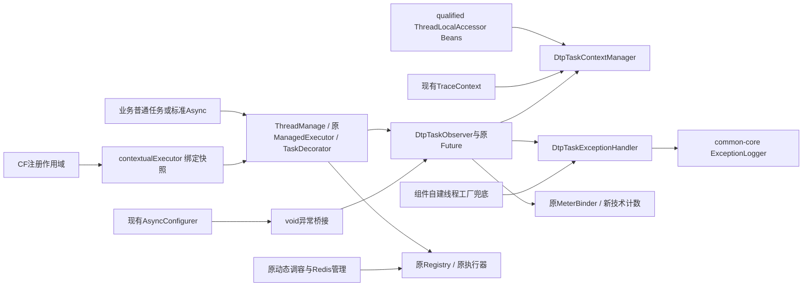
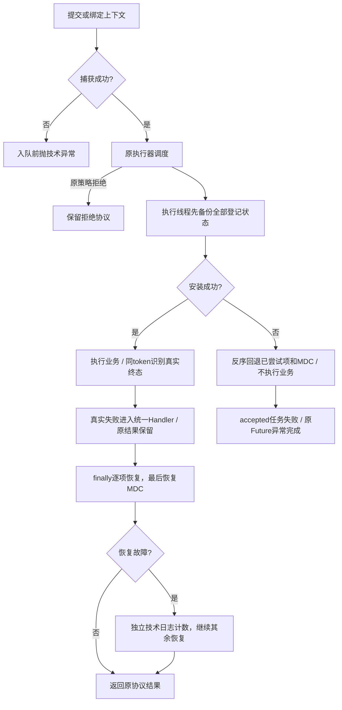
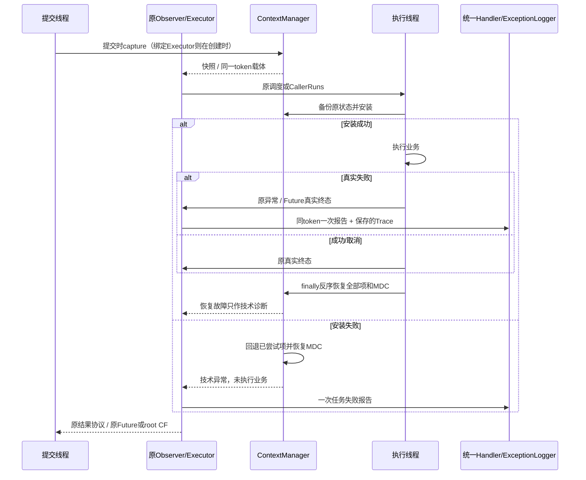

# 动态线程池完整方案：线程切换上下文、统一异常处理、监控与动态调容

| Field | Value |
| --- | --- |
| Document | `2026-10-21-10-10-dtp-context-and-exception-management.md` |
| Template Version | `9` |
| Archetype Cleanup | `Not applicable` |
| Status | `Implemented` |
| Type | Feature |
| Complexity | Complex |
| Complexity Drivers | 线程复用/嵌套/CallerRuns、上下文快照与恢复、Future真实终态、CF注册与执行时点、Spring装配和旧API兼容 |
| Created | 2026-10-21 10:10 Asia/Shanghai |
| Updated | 2026-10-21 13:00 Asia/Shanghai |
| Owner | mario |
| Repository | Egon-COLA |
| Scope | DTP starter、common-core异常日志、六个标准源工程的异步配置，以及对应测试/资源/文档 |
| Change Surface | 统一任务上下文生命周期，连接原观察器及异常策略，补受控CF入口、绑定上下文Executor和标准Async接入 |
| Affected Chapters | §7, §8, §9, §10, §13, §14, §15, §16, §17, §18 |
| Source Requirement | 参考lesson018/lesson026在线程切换时由框架传递上下文，融合lesson099异常处理，业务简单使用，先给完整方案 |
| Baseline Revision | main / 4ef1cf380bdab501cbe03a6b58cb499d7f836c3b；本轮开始仅前一份异常方案为未跟踪文件 |
| Amends | [已实现ThreadManage方案](2026-10-20-20-53-dtp-thread-manage-observability.md) §7.3.1、§7.3.5、§9、§14、§16的上下文/异常扩展；其注册、队列、调容、Redis治理继续有效 |
| Supersedes | [待评审异常方案](2026-10-21-09-38-dtp-unified-task-exception-handling.md) §1–§20全部建议，合并到本完整方案；此关系表示评审替代，不表示已批准/实施 |
| Depends On | [已实现ThreadManage方案](2026-10-20-20-53-dtp-thread-manage-observability.md) §4、§6、§7的兼容、注册、真实终态和安全调容基础 |
| Related Specs | None |
| Related Plans | [实施计划](../plan/2026-10-21-10-56-dtp-context-exception-implementation.md) |

## 1. Summary

在现有ThreadManage上统一“提交捕获 → 执行前备份 → 安装任务上下文 → 执行业务 → 识别真实终态/处理异常 → finally恢复”的生命周期。默认延续完整MDC/TraceContext传递；自定义ThreadLocal复用Micrometer的ThreadLocalAccessor标准扩展点，一次登记后在组件托管入口自动处理，不要求业务逐任务包装、复制MDC或写异常日志。

沿用现有装饰器/观察器和一个应用级异常Handler策略，复用common-core的ExceptionLogger。新增两个受控root CompletableFuture入口与一个绑定当前上下文的Executor入口，明确注册时点、取消、拒绝、嵌套及异常去重。原Runnable/Callable/Supplier、Dtp/TraceRoute包装、Bean类型、监控、队列和动态扩缩容保留。

本文件先交付Review设计，随后用户明确批准整体实施及context-propagation依赖。现已按关联Plan完成组件/源配置改造和隔离编译测试；实际证据见末尾Implementation delivery。未启动项目或外部基础设施。

## 2. Background and Current State

### 2.1 需求与路径约定

`DTP=egon-cola-components/egon-cola-component-dynamic-thread-pool`；`S=DTP/egon-cola-component-dynamic-thread-pool-starter`；`J=S/src/main/java/top/egon/cola/component/dtp`；`T=S/src/test/java/top/egon/cola/component/dtp`。

`C=egon-cola-components/egon-cola-component-common/egon-cola-component-common-core`；`CJ=C/src/main/java/top/egon/cola/component/common/core`；`CT=egon-cola-components/egon-cola-component-common/egon-cola-component-common-trace`；`CTS=egon-cola-components/egon-cola-component-common/egon-cola-component-common-trace-spring-boot-starter`；`P=egon-cola-archetypes/source-projects`。以下缩写只缩短路径。

### 2.2 Repository evidence

| Evidence ID | Classification | Exact path/symbol/decision/command | Observed fact | Design significance | Verification limit/freshness |
| --- | --- | --- | --- | --- | --- |
| EVD-001 | Static repository | /Users/mario/Downloads/luren-master/lesson018/src/test/java/ThreadLocalTest.java | 展示ThreadLocal不继承、ITL在线程池复用旧值、TTL包装任务池；TTL依赖2.14.3 | 必须按任务捕获，参考语义，不复制Boot2/Java8依赖 | 只读，未运行示例 |
| EVD-002 | Static repository | /Users/mario/Downloads/luren-master/lesson026/src/test/java/MyThreadPoolExecutor.java；Lesson026Test.java | 在包装构造时getContext，执行时setContext；缺少finally恢复/remove、空值和部分失败协议 | 采用捕获/安装思想，补齐恢复和异常/嵌套语义 | 只读，未运行示例 |
| EVD-003 | Static repository | /Users/mario/Downloads/luren-master/lesson099/src/test/java/com/itsoku/lesson099/ThreadTest.java | ThreadFactory装配UncaughtExceptionHandler，示例使用execute | 作为拥有线程的最后兜底；submit需真实终态 | 同一任务此前已核对 |
| EVD-004 | Static repository | CT/.../trace/TraceContext.java#capture/open/Scope.close；thread/TraceRouteRunnable.java | MDC全量防御复制、Scope恢复已有；旧包装在构造时捕获Trace | 默认能力复用，保留旧捕获时点，不重写W3C协议 | 当前main源码 |
| EVD-005 | Static repository | J/context/DtpTaskObserver.java；DtpObservedFutureTask.java | 已有单任务token、ACTIVE、真实Future终态；只管理Trace，异常/慢任务共用日志预算 | 原地扩展，不创建第二套任务计数 |
| EVD-006 | Static repository | J/context/DtpTaskDecorator.java；DtpContextAwareExecutorService.java；executor/managed/DtpThreadPoolTaskExecutor.java | 装饰器只有无参Trace包装；adapter/新池已有统一入口 | 扩展装饰器和观察边界，旧构造保留 |
| EVD-007 | Static repository | CTS/pom.xml；TraceAutoConfiguration.java；TraceThreadLocalAccessor.java | 已使用可选context-propagation和标准Accessor；现有Accessor构造时注册全局Registry | 复用标准SPI；DTP不扫描全局Registry，不依赖Web Starter/全局实例 |
| EVD-008 | Static dependency source | 本机context-propagation/1.1.4 sources：ThreadLocalAccessor、DefaultContextSnapshot、ContextSnapshotFactory | 标准SPI有get/set/clear/restore；默认Scope在某个restore抛错时中断遍历，install未提供整组回滚 | 小型组件编排保证逐项恢复/部分安装回退；不用第二个自定义SPI |
| EVD-009 | Static repository | 六处P/.../config/async/AsyncConfiguration.java；三个open的lombok.config | 都已有AsyncConfigurer；open拥有DtpTaskDecorator/customizer和Lazy默认executor | 可选委托，不再注册第二个Configurer；维护生产者 |
| EVD-010 | Static dependency source | Boot3.5.16 TaskExecutorConfigurations；Spring6.2.19 AsyncExecutionAspectSupport | Boot builder使用getIfUnique选择TaskDecorator；void异步异常经handler后可返回null | 缺省装饰器需早于Boot builder；void需失败桥接 |
| EVD-011 | Static repository | common-mybatis-plus-sharding-jdbc-ext.../business/EgonColaTenantIdProvider、EgonColaMdcUserIdProvider | 当前tenant/user provider从MDC读取身份 | 完整MDC传递保留既有身份来源，不新增权限推导或租户默认值 |
| EVD-012 | Static repository | bytecode/api/executor/ContextCarrier；runtime/context/ContextSnapshot | 字节码组件已有独立Carrier/Scope，依赖属于agent执行体系 | 不把DTP绑到bytecode，不改agent/全局插桩 |
| EVD-013 | Static repository | pom.xml；components/pom.xml；Boot3.5.16 BOM；Micrometer1.15.12 BOM | Java21；Boot3.5.16管理Spring6.2.19、context-propagation1.1.4 | 按当前管理版本设计，不升级；旧草案所读6.2.17不是本轮版本依据 |

### 2.3 Problem statement and gap

当前MDC已具备捕获恢复基础，缺口是统一管理额外ThreadLocal、明确每类任务捕获时点、异常出口，以及默认Spring异步接入。ITL在线程创建时继承，不等于线程池每次执行任务时重新取父线程值。[JDK21 ITL](https://docs.oracle.com/en/java/javase/21/docs/api/java.base/java/lang/InheritableThreadLocal.html)。

标准Accessor可以显式声明可传递状态及清理方法；框架不反射扫描ThreadLocalMap、不自动复制事务或Servlet对象。[Micrometer1.1.4用法](https://docs.micrometer.io/context-propagation/reference/1.1/usage.html)。CF非Async阶段可能在完成线程执行，无显式Executor的Async阶段通常走commonPool，因此必须说明后续阶段的上下文来源。[JDK21 CF](https://docs.oracle.com/en/java/javase/21/docs/api/java.base/java/util/concurrent/CompletableFuture.html)。

### 2.4 Evidence and current-chain map

| Entry/trigger | Current call chain | Data read/written | External dependency | Consumers | Evidence |
| --- | --- | --- | --- | --- | --- |
| 原普通任务 | ThreadManage/adapter → Observer/装饰器 → 原执行器 | MDC、task token、计数 | 无网络 | 业务 | EVD-004/005/006 |
| 旧预包装 | Dtp.wrap/TraceRoute构造 → 入队 → 保存的Trace.open | 构造时MDC | 无网络 | 旧业务 | EVD-004 |
| Spring Async | 原Configurer → 默认/指定executor → 包装Callable → handler/Future | 部分Trace/错误日志 | Spring | 六种生产者/旧项目 | EVD-009/010 |
| CF后续阶段 | 注册函数 → 将来由完成线程调用Executor.execute | 完成线程MDC可能为空/不同 | JDK | 异步链 | EVD-005、JDK CF |
| 自定义ThreadLocal | 业务holder → 切换到复用线程 | 未注册状态不传递 | 无 | 需上下文的业务 | EVD-001/002 |

### 2.5 Archetype example cleanup

Cleanup disposition: Not applicable

Reason: 本次维护基础设施组件和archetype生产者异步配置，不实施生成业务项目的首个业务功能。`egon-cola-archetypes/README.md`明确source-projects是生产者，示例代码不删除，不手改.generated，不动历史SQL。

## 3. Goals and Non-goals

### 3.1 Goals

任务携带提交时的正确上下文；线程复用/空上下文/异常/嵌套/CallerRuns可恢复；自定义ThreadLocal一次接入；真实失败统一日志和Trace关联；保留原协议、监控和安全调容；业务保持普通任务/标准Async写法。

### 3.2 Non-goals

不透明接管任意new Thread、commonPool、parallelStream、用户任意CF后续节点或第三方内部线程。现有DtpThreads和无参静态包装继续Trace语义，不通过静态Spring容器把额外上下文扩散到全JVM。

不跨线程传事务、连接、Session、RequestAttributes、HttpServletRequest/Response、缓存事务buffer、锁、ThreadLocalRandom、框架ACTIVE/submitting标记。MDC里的tenant/user仅延续当前可信入口设置的身份；不自动传播SecurityContext/凭据，不改变原授权机制。

本方案不改变Reactor全局Hooks/Context策略，不把修复整个WebFlux桥接纳入Executor需求；DTP读取“调用提交点可见”的上下文。现有TraceWebFilter的跨signal Scope及自动桥接是否开启不作为本方案已解决能力；Reactive异步应用须继续使用Reactor Context并单独验证，不能推导本方案接管了任意publishOn。

不新增UI、数据库、MQ事件、自动重试/补偿/自主伸缩策略。前置方案已实现的人工/配置驱动动态扩缩容继续保留。

### 3.3 Change Surface and Design Depth

| Area/layer | Disposition | Exact repository evidence | Changed or preserved behavior/contract | Required Spec treatment | Chapter(s) |
| --- | --- | --- | --- | --- | --- |
| DTP上下文/Observer/adapter/新池 | Affected | J/context、executor、config | 标准Accessor编排、完整生命周期、绑定上下文Executor及受控CF | 完整详细设计 | §7, §8, §9, §10, §13, §14, §15, §16, §17, §18 |
| 异常策略/common日志重载/线程兜底 | Affected | J/context；CJ/exception/ExceptionLogger | 统一失败出口、独立日志预算、保留异常协议 | 完整详细设计 | §7, §8, §9, §10, §13, §14, §15, §16, §17, §18 |
| Spring/六处源工程/属性指标测试 | Affected | P六处Async；J/config/metrics；A/T资源 | 缺省装饰器、可选handler委托、profile一致、可证明的能力说明 | 完整详细设计 | §7, §8, §9, §10, §13, §14, §15, §16, §17, §18 |
| common-trace/trace-starter/MP/bytecode | Context-only | EVD-004/007/011/012 | 共享实现、身份解析、Reactor及agent行为保持；不迁移公共SPI | 边界证据及回归 | §14, §16 |
| 注册/队列/调容/Redis/Admin HTTP | Unchanged | ManagedExecutorRegistry、ResizeSupport、Listener、现有Controller | 单目录/原Bean、并发安全调参、消息wire及返回保持 | 引用现有契约和最小回归 | §14, §16 |
| 数据库/前端 | Not applicable | 本次组件需求没有表或页面变化 | 无DDL/CRUD/前端目标 | N/A | §11, §12 |

## 4. Requirements and Acceptance Criteria

| ID | Atomic requirement | Priority | Observable acceptance criteria | Source |
| --- | --- | --- | --- | --- |
| REQ-001 | 上下文生命周期由框架处理 | Must | 裸Runnable/Callable在托管入口逐次捕获；普通/异常/嵌套/CallerRuns执行后恢复 | lesson018/026、框架层 |
| REQ-002 | 默认MDC/Trace和旧捕获时点兼容 | Must | MDC全量快照、tenant/user延续；旧Dtp/TraceRoute捕获时点和空Trace不改 | 原有MDC/兼容要求 |
| REQ-003 | 标准扩展点支持自定义ThreadLocal | Must | 一次声明Accessor Bean即可传递；无值时清空本任务可见值，结束恢复；未登记的不处理 | lesson026任意context思想 |
| REQ-004 | 安装失败/清理失败有明确边界 | Must | 安装失败不执行业务并回退已安装项；清理尝试全部、MDC独立恢复，技术失败可诊断 | 线程切换正确性 |
| REQ-005 | 任务异常在组件统一处理 | Must | execute/Future/virtual/void Async/受控root CF真实失败各一次报告，无get也记录 | lesson099方案延续 |
| REQ-006 | CF后续切换上下文时点明确 | Must | 绑定Executor在创建时捕获，外部线程完成上游也用绑定上下文；每次提交是独立任务token | 完整线程切换方案 |
| REQ-007 | 标准Spring异步接入简单且不覆盖用户配置 | Must | 缺省Boot池装饰器自动接入；六处Configurer可选委托；保留自定义池/装饰器/handler | 业务简单 |
| REQ-008 | 原执行、监控和调容兼容 | Must | 原API/Bean/拒绝/取消/虚拟许可/指标/Redis wire保留；调容回归无丢任务 | 既有兼容、监控、扩缩容 |
| REQ-009 | 最小安全依赖和有界诊断 | Must | 复用Trace/ExceptionLogger/标准SPI；无全局TL扫描/事务复制/高基数metric | component复用及数据隔离 |
| REQ-010 | 本轮完整设计，后续隔离验证 | Must | 单份完整方案包含接口/文件/错误/测试；仅文档校验，不运行项目 | 给我完整的方案 |

### 4.1 Scenario matrix

| Scenario | Actor/trigger | Preconditions | Main path | Alternative/failure path | Data/state change | Observable result | Requirements |
| --- | --- | --- | --- | --- | --- | --- | --- |
| 同池A/B复用 | 两请求提交同Runnable对象 | 单worker | 每次提交独立快照 | worker带旧值则被当前快照覆盖 | 本任务隔离、随后恢复 | A只看A，B只看B | REQ-001/002/003 |
| 无上下文任务 | 后台任务 | worker可能有遗留值 | MDC安装当前快照；已登记空值remove | 新池按原规则创建Trace根；旧池不新增根 | 无借用上个请求身份 | 空tenant/user保持空/原校验失败 | REQ-001/002/009 |
| 提交后父线程改值 | 排队/延迟执行 | 已捕获 | 使用提交时值 | 可变对象必须由Accessor返回不可变副本 | 不回读父线程 | 不受后续修改影响 | REQ-001/003 |
| 跨池与CallerRuns嵌套 | A池任务再提交B池 | 同线程/不同线程都可能 | B捕获A可见值 | B改值/抛错后还原A，再还原调用线程 | 栈式Scope，token独立 | 不清掉外层上下文 | REQ-001/002/005 |
| 捕获/安装局部失败 | 自定义Accessor故障 | 注册合法 | 捕获在入队前失败；安装在任务开始失败 | 回退包含抛错项在内的已尝试项，后续业务不调用 | 捕获失败无入队；安装失败技术终态 | 明确异常、无隐式重试 | REQ-003/004 |
| 恢复部分失败 | 自定义Accessor恢复抛错 | 业务已执行 | 继续恢复其余Accessor及MDC | 单独技术告警；保留业务结果/原异常 | 不把清理错误替换任务结果 | 错误适配器风险可见 | REQ-004/005 |
| Future失败/取消/等待超时 | submit/get/cancel | 真实终态可得 | done辨别失败/取消 | get(timeout)超时不判任务失败；运行中取消仍等执行finally清理 | 原Future协议 | 计数准确，无许可泄漏 | REQ-005/008 |
| CF外部完成 | 请求A注册后由无上下文线程B complete | 使用绑定Executor | 执行stage时安装A快照 | 普通executor只保证其execute调用时捕获，不承诺注册上下文 | 各阶段提交独立 | Trace/TL属于A | REQ-006 |
| Async void抛错 | 真实Spring代理 | handler已委托 | 在同token标失败后原Spring流程返回 | 无token仅记录诊断，不假造完整池计数 | FAILED一次 | 无伪成功、无第二Configurer | REQ-005/007 |
| 旧包装/用户decorator | 既有业务 | 原包装构造更早 | 保留原Trace；额外TL按托管提交点捕获 | 自定义decorator存在时不静默替换 | 原Bean类型/工厂保留 | 明确能力与一次配置组合方法 | REQ-002/007/008 |
| 日志/handler故障与风暴 | 并发失败任务 | 策略可替换 | 计数和回调逐失败执行 | 默认日志独立限频；handler错不递归 | 原业务失败不变 | 安全堆栈与抑制数可见 | REQ-005/009 |
| 动态缩扩容中执行 | 管理者变更 | 原治理入口 | 在原池原队列原对象更新 | 缩容低于积压整次拒绝 | 无清队列/无重建 | 上下文与调参互不改变协议 | REQ-008 |

### 4.2 Use-case analysis

ACTOR-001为提交异步任务的业务开发者/应用；ACTOR-002为一次配置自定义上下文或异常策略的接入者；ACTOR-003为通过日志和池指标排障/调容的维护者。依据EVD-001..012及ThreadManage现有入口。

| ID | Use case/goal | Primary actor | Supporting actors/systems | Trigger | Preconditions | Main success outcome | Alternatives/failures | Postconditions | Requirements | Interfaces/pages | Tests |
| --- | --- | --- | --- | --- | --- | --- | --- | --- | --- | --- | --- |
| UC-001 | 普通提交即可得到正确上下文和异常记录 | ACTOR-001 | JDK/Spring、现有Observer | execute/submit/Async调用 | 执行器已托管/装饰 | 业务可读正确上下文，失败自动记录 | 取消/拒绝/安装失败/旧路径部分能力 | 原结果、各线程恢复 | REQ-001/002/004/005/007/008 | 原任务入口、INTERNAL-001..005/007..008 | TEST-001..010/014..018 |
| UC-002 | 一次接入自定义ThreadLocal | ACTOR-002 | 标准Accessor、Spring | 注册qualified Bean | 值可安全复制、无资源状态 | 各托管任务自动传递 | 重复key/缺清理/可变别名/适配器故障 | 仅本应用本注册集生效 | REQ-003/004/009 | INTERNAL-007/008、标准Accessor | TEST-004..008/017/019 |
| UC-003 | 构造稳定上下文的CF异步链 | ACTOR-001 | JDK阶段/绑定Executor | 当前请求创建异步链 | 在正确请求作用域绑定 | 外部完成/切池仍使用绑定值 | 任意非Async/无executor阶段为边界 | 原阶段结果不变、每次执行恢复 | REQ-002/005/006/008 | INTERNAL-003/004/009 | TEST-011..013 |
| UC-004 | 根据真实失败和池压力排障调容 | ACTOR-003 | ExceptionLogger/MeterBinder/原Redis治理 | 异常日志、告警或管理变更 | 对应能力启用 | Trace/池身份清晰，调容保留任务 | 限频/报告器故障/不支持队列变更 | 不造高基数标签、不重试业务 | REQ-005/008/009/010 | INTERNAL-001/002/006、原管理API | TEST-009/010/018/020..023 |

## 5. Constraints, Assumptions, and Decisions

约束来自本轮AGENTS和前置批准：只在component及必要源工程配置内扩展；原接口和用户工作保留；不启服务、不使用GUI；设计轮无代码提交；获批实施后按AGENTS只作一次聚焦提交。框架基础设施保持现有包/模块，不迁移业务架构。

推荐只增加一条依赖声明：S直接依赖`io.micrometer:context-propagation`，版本由现有Boot/Micrometer BOM管理（当前1.1.4），不升级、不新增TTL/Agent。它在CTS及Micrometer core中均为optional，不能假定会传递给DTP使用者。此依赖在设计轮明确列为待评审项，现已获得用户本轮精确批准并完成引入/依赖图验证；未将其他依赖授权扩展到本任务。

本方案先经整体评审，再由用户明确授权实施及依赖引入；当前交付证据见Implementation delivery。普通命名未引入额外审批。

| ID | Inference | Repository evidence | Why locally reversible | Impact if wrong |
| --- | --- | --- | --- | --- |
| ASM-001 | 自定义上下文使用qualifier `dtpContextAccessor` 显式登记 | 现有命名Bean/Qualifier约定，标准Accessor已存在 | 新增局部接入名，无历史使用者 | 调整新文档/接入配置 |
| ASM-002 | 默认异常日志间隔1秒，额外TL传递默认开启 | 上一草案和原Trace默认传递 | 新增配置、有明确兼容退路 | 可在评审调整默认值 |
| ASM-003 | CF后续链提供绑定Executor，保留JDK阶段类型 | 现有ThreadManage目录、JDK CF时点 | 仅新增便捷方法，旧入口不变 | 调整新增方法名，不替换CF类 |

## 6. Project Technology Context

Java21、Boot3.5.16、Spring6.2.19、Micrometer context-propagation1.1.4由本轮当前POM/BOM及对应本机源码核对。旧草案引用的Spring6.2.17语义重新与6.2.19源码校对，不引入版本升级。实施前仍需用dependency:tree确认实际解析图。

### 6.1 Java architecture profile and capability baseline

遵循已批准基础设施组件架构和六种精确archetype profile：S仍使用context/executor/config/metrics及新增exception小包，不强套biz三层；源工程分别保持Light、Service、Web及其现有Open变体，不加层、不移动模块。用户明确在component层处理，本轮不迁移任一业务结构。

| Need | Spring/JDK candidate | Spring Boot Starter candidate | Egon-COLA/module candidate | Proven gap | Decision/dependency impact |
| --- | --- | --- | --- | --- | --- |
| 默认Trace/MDC | MDC、Scope | 已有trace starter按需使用 | TraceContext/TraceRoute | 足够；需统一接入点 | 直接复用，CT/CTS不改 |
| 扩展TL协议 | ThreadLocalAccessor/ContextSnapshotFactory | Spring ContextPropagatingTaskDecorator | CTS现有Accessor | 默认factory不保证坏Accessor整组回退/继续清理；全局注册会跨应用 | 复用标准SPI，DTP内小型安全编排；一条直接依赖声明 |
| 对比现有Carrier | JDK作用域编排 | 无需新Starter | bytecode ContextCarrier/Scope | 依赖属agent；其错误合成规则也不等同本任务原异常保留 | 不反向依赖bytecode，不造第二个SPI |
| 默认Async接入 | TaskDecorator/CompositeTaskDecorator | Boot builder/原AsyncConfigurer | DtpTaskDecorator、六处生产者 | 缺完整TL委托；不能替换用户decorator | 缺省Bean自动接入，已有配置显式组合 |
| 异常与终态 | FutureTask、CF完成 | Spring Async handler | Observer/ExceptionLogger | 缺统一出口，opaque CF不公开结果 | 一个策略、复用原token和Logger |
| 治理 | 原执行器/队列 | 现有DTP | Registry/ResizeSupport/Redis | 无新缺口 | 保留，聚焦回归 |

### 6.2 User-mandated Java rule compliance

| Literal rule | Affected? | Repository evidence | Exact design decision | Files/types/interfaces | Validation/test evidence | Status/blocker |
| --- | --- | --- | --- | --- | --- | --- |
| Rule 1 | Yes | 原Dtp类型/技术BO | 新快照/失败载体用BO；Manager/Handler/Exception行为角色明确 | §8/§10 | TEST-017/023 | PASS |
| Rule 2 | Yes | ValidationUtils、现有Create/Update分组 | 任务参数沿原约束；新BO约束、手工非代理入口调用相同Validation；SPI key用局部技术guard | §9/§10 | TEST-007/017/023 | PASS |
| Rule 3 | Yes | 原class/Lombok基线 | BO用class/Data/NoArgs/AllArgs/Accessors/Builder；私有运行状态class；不把Object快照伪装成不可变record | BO/配置/Scope | TEST-004/017 | PASS |
| Rule 4 | Yes | 原命名Bean/Qualifier、lombok.config | Slf4j、显式Bean名、final+Qualifier、RequiredArgsConstructor(onConstructor_=Autowired)；保留旧构造 | §8行为类/六处生产者 | TEST-015..017 | PASS |
| Rule 5 | Yes | JDK、现有公共日志 | 仅标准JDK编排，Micrometer属已有框架协议；不加工具库/重复Utils | Manager/Logger | 依赖/导入检查 | PASS |
| Rule 6 | Yes | 原Jackson/Redis | 内存快照/cause不作JSON；原HTTP/Redis字段保持 | BO、Logger | TEST-020/023 | PASS |
| Rule 7 | Yes | A/T八个profile | 新配置键逐profile同结构，源工程用组件默认 | §10.4 | TEST-017/020 | PASS |
| Rule 9 | Yes | 原Decorator/Observer/Adapter | 标准Accessor策略+组合、原任务装饰/观察、单异常策略 | §13 | TEST-001..019 | PASS |
| Rule 10 | Yes | 原Instant/Duration/nanoTime | 瞬间用Instant；阈值Duration；耗时用nanoTime差值 | §6.3 | TEST-021 | PASS |
| Rule 11 | Yes | 现有component和六种精确源树 | 不加层/模块、无新持久化/业务事件 | §6.1/§8 | TEST-016/023 | PASS |

### 6.3 Time semantics and conversion contract

Time contract: Required

| Time ID | Fields/symbols | Semantics | Java/runtime type | Storage policy | Wire policy | Business zone source | Display zone source | Boundary / DST rules | Precision / Clock | Compatibility | Verification |
| --- | --- | --- | --- | --- | --- | --- | --- | --- | --- | --- | --- |
| TIME-001 | FailureBO.observedAt | Occurred instant | Instant | Not persisted | Internal | Not applicable: 技术观察瞬间 | Not applicable: 无UI | 诊断文本ISO UTC Z；不是业务发生时间 | Instant.now，保留小数秒 | 不改既有审计时间 | TEST-021 |
| TIME-002 | logInterval/等待/执行/Context耗时 | Duration | Duration/long纳秒差 | Not persisted | Internal | Not applicable: 单调相对时间 | Not applicable: 无UI | 日历/DST不参与阈值 | nanoTime差值；Duration正值/转换范围校验 | 原report/alarm阈值不改 | TEST-017/021 |

## 7. Architecture Design

### 7.0 Minimum-design baseline and element-necessity audit

直接方案只复用TraceContext可解决MDC，无法传递lesson026要求的额外ThreadLocal；直接采用全局ContextSnapshot会引入未声明状态并且缺坏Accessor部分失败保证。推荐保留Trace默认主通道，复用标准Accessor，增加一个组件内生命周期编排者。

| Proposed element | Change | Requirements | Existing/direct alternative | Concrete inadequacy of alternative | Added calls/state/coupling/failures/migration/operations | Verdict |
| --- | --- | --- | --- | --- | --- | --- |
| DtpTaskContextManager、TaskContextBO及内部Scope | New | REQ-001..004 | 原TraceContext/标准factory | 多个TL、空值、部分安装和逐项恢复需统一；Trace公共库不应依赖DTP | 每任务O(n)，无网络；一个私有Scope实现 | Add |
| 标准ThreadLocalAccessor | Reuse | REQ-003/009 | 自建ThreadLocalContext/ContextCarrier SPI | 仓库已有标准协议足够，不需要第二个 | 仅直接声明已有库；不使用全局Registry | Keep |
| Observer/Decorator原位接入 | Expand | REQ-001/002/008 | 每业务包装 | 漏入口、重复计数、捕获时点不一致 | 复用原token/未来对象 | Keep |
| 单Handler/FailureBO/默认Logger重载 | New/Expand | REQ-005/009 | Observer写死日志、单UC handler | 缺替换能力、Future/void真实失败、既有安全堆栈 | 同步快速回调，独立限频；原Logger方法保留 | Add |
| 两个root CF方法+绑定Executor | New | REQ-005/006 | 仅传普通Executor/继承CF覆盖所有方法 | 触发时点不等于注册时点；全方法覆盖过大且难兼容 | 一个绑定快照/链，原CF仍返回 | Add |
| 缺省Decorator+原Configurer可选委托 | Expand | REQ-007 | 改所有Bean/第二Configurer | 破坏类型/选择/用户配置；Spring只允许单Configurer | 原构建链、延迟Provider、测试装配时序 | Add |
| 新管理平台/TL反射/TTL Agent/业务重试 | None | REQ-008/009 | 当前治理及标准扩展已够 | 无当前需求支持额外全局状态 | 不新增全局运行时、表或服务 | Remove |

| Path | Network calls | Client states | Server contracts/state | Failure and TOCTOU points | Additional user/business value |
| --- | --- | --- | --- | --- | --- |
| 原提交路径 | 0 | 原Future/异常 | 原token/MDC | 顶层Trace足够，额外TL缺失 | 原任务执行 |
| 推荐完整路径 | 0 | 原结果协议 | 本任务快照/本线程Scope/同token | Accessor故障显式处理；零额外远程调用 | 业务不逐任务复制/清理/记错 |

### 7.1 System Architecture Design



| Module/component | Capability and data owned | Inputs/outputs | Allowed dependencies | Forbidden responsibility | Requirements |
| --- | --- | --- | --- | --- | --- |
| Registry | 唯一目录、原对象/adapter、生命周期 | 名称/执行器 | 原治理服务、Observer | 第二份池目录、复制业务身份 | REQ-008 |
| ContextManager | 应用内登记集、任务快照、线程Scope | Trace和标准Accessor | common-trace/JDK/标准SPI | 全局TL扫描、网络、事务/权限推导 | REQ-001..004/009 |
| Observer | 单逻辑任务真实终态/计时/报告资格 | 现有任务或已知root | ContextManager、Handler、原指标 | 用包装返回值猜测CF结果 | REQ-005/008 |
| Handler/Logger | 默认诊断与可替换策略 | 安全FailureBO | common-core | 业务重试/补偿、创建池、改Throwable | REQ-005/009 |
| 原Async配置 | 原executor选择和可选委托 | Spring handler/Decorator | 原Spring接口；open既有DTP | 第二个Configurer、替换任意池Bean | REQ-007 |

### 7.2 High-Level Design



#### 7.2.2 High-level decision and quality matrix

| Concern/use case | Required behavior | Selected mechanism | Failure/degradation behavior | Trade-off | Verification | Requirements |
| --- | --- | --- | --- | --- | --- | --- |
| 正确性/隔离 | 每任务看到自己的值，空值清除，嵌套还原 | 每次捕获、Scope反序恢复 | 安装失败阻止业务；坏restore不阻断其他恢复 | 无法替损坏Accessor保证自身状态 | TEST-001..008 | REQ-001..004 |
| 兼容 | 原包装/Bean/Future协议保留 | 同token和原adapter；旧构造默认Trace模式 | 旧裸入口能力仍如实说明 | 不做全JVM透明拦截 | TEST-010/014..018 | REQ-002/008 |
| 可观察性 | 原结果+Trace+脱敏错误，日志预算独立 | 保存有效Trace、统一Handler | 非fatal reporter故障隔离，技术诊断独立 | 不承诺内存耗尽时可达 | TEST-009/020 | REQ-005/009 |
| 性能/容量 | 无远程调用，无全局每任务锁 | 固定登记表、O(n)捕获/Scope | 快照仅随排队/执行/绑定对象持有 | 开销随上下文数量/大小增大，需测量 | TEST-019 | REQ-003/009 |
| 业务接入 | 普通任务不加包装，标准Async可用 | 缺省Decorator、源工程委托 | 自定义配置冲突明确一次组合方式 | 不覆盖已有用户配置 | TEST-015/016 | REQ-007 |

### 7.3 Detailed Design

#### 7.3.1 默认内容、登记集与复制语义

默认TraceContext为MDC唯一拥有者：复制整个Map<String,String>，保留traceId/spanId/requestId、已有其他MDC字段，包括当前tenant/user；不额外记录整张MDC。普通任务无trace时仍仅对ThreadManage新建池沿用原建根规则，旧池/旧包装不新增根。此次不自动创建child span，不宣称产生已导出的分布式span。

自定义ThreadLocal以`@Bean("业务自己的稳定名字") @Qualifier("dtpContextAccessor")`提供`ThreadLocalAccessor<T>`，不新造ThreadLocal基类，不要求把现有holder改为TTL。组件收集qualified provider的orderedStream，构建应用本地固定登记集，不扫描ContextRegistry全局单例，不自动加载所有ServiceLoader扩展。重复key、空key、保留key启动配置校验失败；保留TraceContext.class及MDC适配器key，避免两份策略写同一MDC。没有登记的普通TL/ITL不处理。

key只允许稳定非空String或Class；String最长128字符、不含控制字符，禁止通过key编码请求/租户值。Accessor必须只访问自己声明的holder，不写MDC、事务或其他Accessor状态，方法线程安全、无网络；getValue无副作用，返回null表示缺失，非空值必须是不可变对象/快照或安全防御副本。框架无法通用深拷贝任意业务对象，不使用反射/JSON拷贝。

读取快照时发生在提交线程：Trace和各Accessor取值后只读保存，独立容器不与父线程共享可变集合；自定义值的深层不可变性由Accessor负责。任务内修改只作用当前线程，不回写父线程。旧Dtp/TraceRoute包装的Trace仍按构造时点；新增自定义TL按托管提交点捕获，不虚构历史TL值。

#### 7.3.2 安装、空值、恢复与部分失败

ContextManager只负责执行状态，不重建线程池。先读取执行线程全部登记Accessor的旧值和原MDC，再改变任何值；备份失败则不安装、不执行业务。打开Trace Scope后按登记顺序安装本任务值，缺失调用Accessor.setValue()，要求其实际remove，禁止留下上一个任务值。恢复时反序调用restore(previousValue)或restore()，最后独立关闭Trace Scope。Scope仅在安装线程关闭、只关闭一次，不跨线程共享Scope。

安装某项抛错时，尝试回退所有已经尝试的项（包括可能改了一半才抛错的项），继续其他回退并恢复MDC；构造DtpContextPropagationException，业务delegate完全不调用。提交前capture失败同步抛出且不入队；已接受任务安装失败按任务技术失败经原execute/Future协议传播、统一报告一次。

清理发生在业务返回/抛错后：即使一个restore失败，也尝试剩余项和MDC。清理故障单独安全日志/技术计数，不把已成功业务改成伪业务失败，不覆盖原异常、不addSuppressed到业务Throwable、不重复调用业务失败Handler。错误Accessor若连自身restore都失败，框架无法保证该holder被修复；诊断明确，后续任务仍必须先安装成功才执行业务，不以“无上下文继续”降级。CallerRuns下尤其需要通过测试暴露用户Accessor恢复缺陷，不能宣称框架能修复任意第三方holder。

采用标准ThreadLocalAccessor读写/恢复协议，组件只编排组装和异常边界。未直接套默认ContextSnapshotFactory的原因有源码依据：其多项install无整组rollback，close某项错误会提前退出。此次不另起一套传播库，不建立第二个通用SPI/全局Registry。

#### 7.3.3 任务边界、嵌套、旧包装和终态

所有托管adapter、DtpContextAwareExecutorService、ThreadManage新池及组件虚拟执行器都连接同一ContextManager/Observer；execute、submit各重载、invokeAll/invokeAny沿原Future取消/完成机制工作。捕获发生在每次逻辑提交，重复使用同一个裸Runnable也重新捕获；内部装饰转发同一个token不再捕获/计数；业务嵌套提交则是新逻辑任务，不能用“ACTIVE非空”来跳过。

上下文载体与任务token分开：同一绑定快照可执行多个逻辑任务，每个任务仍有自己的终态/等待/执行计时。用户旧预包装Trace优先级保持；不反射读TraceRoute私有context。能在实际包装委托边界发现的有效Trace仍由现有effectiveContext保存；未知旧子类不能冒称已发现其内部上下文。

Future.done读取实际结果后报告；运行中取消不允许由cancel调用线程提前关闭worker的Scope，清理只在实际执行栈finally发生。虚拟线程沿原permit机制释放，不将取消、拒绝、get(timeout)超时当业务执行失败。新上下文管理独立于observation.enabled；关统计不关传递。

#### 7.3.4 统一异常、日志与线程兜底

新增单SPI`DtpTaskExceptionHandler.handle(DtpTaskFailureBO)`，默认Bean `dtpTaskExceptionHandler`，默认实现LoggingDtpTaskExceptionHandler。按精确名字退让/注入，通过延迟Provider解环。Handler同步、线程安全、快速；默认只记录日志。业务可提供同名策略，负责自己的告警接入，不要求逐任务catch。

默认复用ExceptionLogger新增兼容重载`log(Logger,Throwable,Map<String,String>)`。保留原分类/级别/code/status和脱敏堆栈；metadata不得覆盖公共字段，只允许限定池/任务/来源/线程身份等字段。不吞/替换原Throwable，不重试、不补偿、不返回null伪成功。失败报告用保存的有效Trace Scope，不能读取完成/uncaught线程当时的MDC冒充请求；诊断不复活事务/权限对象，不要求为日志重新执行全部自定义Accessor。

真实终态与通知各有一次资格；按task token去重，不按Throwable全局去重。observation.enabled控制统计，exception-handling.enabled独立控制报告；自定义handler每个真实失败都调用，限频只限制默认日志。系统异常、业务异常和慢诊断分别预算，默认异常日志1秒窗口、后续带suppressedCount；旧失败WARN在统一出口已接管时移除，防止重复/擅自提升级别。普通Handler异常隔离并安全保底，不回投故障池、不递归。

仅对组件拥有的平台/虚拟线程工厂组合UncaughtExceptionHandler，保留原factory属性和原handler委托，不使用JVM全局setDefaultUncaughtExceptionHandler。每worker短生命期保存最后逃逸失败的token/Trace/异常身份/已报告标志，正常完成或uncaught finally清除；不保留全局Throwable集合。无任务证据的worker故障Trace未知、只记技术诊断，不伪造task.failed。用户原handler自行输出日志仍保留。

#### 7.3.5 CF root与后续阶段的线程切换

新增`ThreadManage.runAsync(String,Runnable)`和`supplyAsync(String,Supplier<T>)`，框架掌握真实root完成，并返回原root对象；whenComplete仅用于观察，不把其返回的dependent stage替换root，不用exceptionally(null)。内部载体沿用同一个token，避免opaque任务被当成功或双计数。新池已有AsyncTaskExecutor.submitCompletable(Runnable/Callable)连接同一bridge，原签名和checked异常完成语义保留。原拒绝策略照常执行，抛拒绝仍按原同步契约；静默丢弃/CallerRuns在shutdown时不执行的局限仍如实记录。

新增`Executor ThreadManage.contextualExecutor(String executorName)`：调用该方法时冻结当前Trace和已登记TL，返回请求/异步链局部Executor视图。此后JDK在任何完成线程调用它的execute，都使用绑定快照；每次调用仍提交新逻辑任务、走原池拒绝/调容/生命周期。绑定时无Trace的新池只创建一个绑定根供同一链复用，不写回调用线程；无Trace旧池/显式空旧包装继续原语义。绑定Executor不作为单例Bean、不跨请求缓存，不持有Servlet/事务资源，调用方不再引用后可回收。

普通ThreadManage.executor捕获的是Executor.execute实际调用点，不能保证CF函数注册点。业务需要固定原请求上下文时，在请求内创建一次contextualExecutor，并在thenApplyAsync/thenComposeAsync/handleAsync/whenCompleteAsync显式传入它。非Async函数在哪个线程运行由JDK决定；本方案不覆盖全部CF方法，也不替换标准CF类型。

绑定Executor保证上下文与原任务调度，不因此获得隐藏dependent stage的真实结果：root helper自动记录其掌握的root失败；业务追加的JDK stage仍由该stage返回异常，必须保留/观察最终结果。原opaque通路继续标记部分终态观测，不能宣传全链失败已自动接管。外部complete/取消提前终结root时，按真实stage终态与实际执行finally分开，取消不自动中断业务。

#### 7.3.6 Conclusion evidence chain

| Conclusion | Repository/user evidence | Constraint or requirement | Design decision | Consequence and trade-off | Verification and acceptance evidence |
| --- | --- | --- | --- | --- | --- |
| 按任务捕获并栈式恢复 | EVD-001/002/004 | REQ-001..004 | 每提交快照、空值清理、反序Scope | 避免线程复用串值，不能替坏Accessor深拷贝 | TEST-001..008 |
| 复用标准SPI但不读全局注册 | EVD-007/008/012 | REQ-003/009 | qualified标准Accessor+本地安全编排 | 一条直接依赖、无第二SPI、无未声明身份转移 | TEST-004/007/017/019 |
| CF绑定注册上下文 | JDK CF、EVD-005 | REQ-006 | 请求局部Executor固定快照 | 业务每链一次绑定，后续阶段异常边界透明 | TEST-011..013 |
| 异常主处理在任务真实终态 | EVD-003/005/010 | REQ-005/008 | Observer/Future/root/void桥 + UC兜底 | 不中断原协议，旧裸路径不冒称全量 | TEST-009/010/014/015 |
| 默认Async组合原配置 | EVD-006/009/010 | REQ-007/008 | 缺省Decorator及已有Configurer委托 | 不改池选择，用户自定义需一次组合 | TEST-015/016 |

#### 7.3.7 Spring默认装配与生产者

增加独立`DtpTaskContextAutoConfiguration`，在Boot的TaskExecutionAutoConfiguration之前提供`dtpTaskDecorator`，仅`@ConditionalOnMissingBean(TaskDecorator.class)`时创建。Boot builder已有getIfUnique选择逻辑，默认池因而获得完整上下文；保持原pool名称、参数、虚拟开关和AsyncConfigurer选择，不注册第二个默认executor、不替换任意原Bean。装饰器持有qualified延迟ContextManager Provider，避免为了创建Boot builder而提前创建池/Redis/所有Accessor Bean；实际decorate时取得固定登记集。

已有用户TaskDecorator时组件退让，不把其覆盖成DTP版本；需要完整TL传播时一次使用Spring CompositeTaskDecorator组合（用户decorator内层、DTP外层），或使用ThreadManage托管入口。必须测试正反序作用域；如果用户decorator自行写MDC，其日志上下文仍按原约定，不承诺消除冲突。

标准三个open源工程已有DtpTaskDecorator Bean/customizer，改为延迟委托完整ContextManager，保留无参构造的旧Trace行为和现有Bean名。三个native不新增DTP编译依赖，安装DTP后缺省Bean可由Boot builder采用；没有DTP时完全沿原配置。

新增`dtpAsyncUncaughtExceptionHandler`：有效token下先标失败，防止Spring void捕获后返回null被记成功；无token仅诊断。六处现有AsyncConfigurer用qualified可选Provider委托，有组件就用桥接，没有则原ExceptionLogger。仅在已@EnableAsync且完全没有Configurer时提供退让的DtpAsyncConfigurer，getAsyncExecutor默认返回null；实施核对Boot3.5.16源码后，对既有force模式保持其明确的applicationTaskExecutor选择，不自动开启Async。已有用户Configurer/旧生成项目需一次明确委托，不能由第二Configurer覆盖。

完整终态指标仍以ThreadManage/新池为准。默认Boot池获得上下文Decorator不代表它已经具备真实CF/Future全量业务指标；无token的void桥接也不造完整计数。新池作为@Bean返回原ThreadPoolTaskExecutor子类型，可直接供`@Async("业务池名")`选择。

#### 7.3.8 Critical-path Mermaid swimlane



#### 7.3.9 Consistency and failure semantics

快照为单任务/绑定视图只读输入，Scope为单执行线程所有；任务结果以Future/stage原子终态为准，通知资格归Observer。同快照不等于同token，不通过全局ACTIVE传递身份。上下文传播不转移数据库事务，业务异步方法需要时在执行线程按原Spring代理开启自己的事务；本方案不改业务事务代码。

| Failure point | Detection | Immediate control flow | Data/transaction state | Retry and idempotency | Caller/frontend result | Recovery/reconciliation owner | Verification |
| --- | --- | --- | --- | --- | --- | --- | --- |
| capture/备份失败 | Accessor异常 | 入队前失败/执行前停止 | 未执行业务 | 无自动重试 | 技术异常/原Future失败 | Accessor维护者 | TEST-007 |
| 局部install失败 | 异常及尝试列表 | 回退全部尝试项、关Trace | 未执行业务，rollback可能自身失败 | 无自动重试 | 原任务失败，说明技术来源 | 框架诊断+Accessor修复 | TEST-007/008 |
| 业务失败 | execute/Future/已知root | 原协议继续，通知一次 | 业务事务按原规则 | 框架不补偿 | 原异常 | 业务恢复、日志排障 | TEST-009/010 |
| restore失败 | 每项恢复边界 | 尝试所有其余项，MDC最后独立恢复 | 业务可能已完成，不改业务结果 | 不重放业务 | 原结果 + 技术诊断 | Accessor维护者 | TEST-008 |
| Handler失败 | 报告边界 | 非递归安全保底 | 原失败已确定 | 不回投故障池 | 原结果不变 | 策略维护者 | TEST-020 |
| 池关闭/拒绝 | 原执行器策略 | 保留原策略、不多接收 | 未执行或CallerRuns | 无自动重投 | 原拒绝/原静默策略边界 | 原池生命周期拥有者 | TEST-010/018 |

## 8. Package Structure and Code File Tree

当前相关树为`J/{context,executor,config,metrics}`、`CJ/exception`及六种源工程的`config/async`。目标继续这些包，仅新增`J/exception`，没有新Maven模块。

```text
egon-cola-components/
├── egon-cola-component-common/egon-cola-component-common-core/
│   ├── src/main/java/top/egon/cola/component/common/core/exception/ExceptionLogger.java [Modify]
│   └── src/test/java/top/egon/cola/component/common/exception/ExceptionClassificationTest.java [Modify]
└── egon-cola-component-dynamic-thread-pool/
    ├── egon-cola-component-dynamic-thread-pool-starter/
    │   ├── pom.xml [Modify：声明已有context-propagation]
    │   ├── src/main/resources/META-INF/spring/org.springframework.boot.autoconfigure.AutoConfiguration.imports [Modify]
    │   └── src/main/java/top/egon/cola/component/dtp/
    │       ├── context/
    │       │   ├── DtpTaskContextManager.java [Create]
    │       │   ├── DtpTaskContextBO.java [Create]
    │       │   ├── DtpTaskObserver.java [Modify]
    │       │   ├── DtpObservedFutureTask.java [Modify]
    │       │   ├── DtpTaskDecorator.java [Modify]
    │       │   └── DtpContextAwareExecutorService.java [Modify]
    │       ├── exception/
    │       │   ├── DtpContextPropagationException.java [Create]
    │       │   ├── DtpTaskExceptionHandler.java [Create]
    │       │   ├── DtpTaskFailureBO.java [Create]
    │       │   ├── LoggingDtpTaskExceptionHandler.java [Create]
    │       │   └── DtpAsyncUncaughtExceptionHandler.java [Create]
    │       ├── config/
    │       │   ├── DtpTaskContextAutoConfiguration.java [Create]
    │       │   ├── DtpAsyncConfigurer.java [Create]
    │       │   ├── DynamicThreadPoolAutoConfig.java [Modify]
    │       │   └── DynamicThreadPoolAutoProperties.java [Modify]
    │       ├── executor/
    │       │   ├── ThreadManage.java [Modify]
    │       │   ├── ManagedExecutorRegistry.java [Modify]
    │       │   ├── managed/DtpThreadPoolTaskExecutor.java [Modify]
    │       │   ├── virtual/BoundedVirtualThreadExecutor.java [Modify]
    │       │   └── adapter/ [Modify：下表三处原类]
    │       └── metrics/DtpMeterBinder.java [Modify]
    ├── egon-cola-component-dynamic-thread-pool-admin/src/main/resources/ [Modify：四profile]
    └── egon-cola-component-dynamic-thread-pool-test/src/main/resources/ [Modify：四profile]
```

| Operation | Path/package | Symbols | Responsibility | Dependencies | Requirements |
| --- | --- | --- | --- | --- | --- |
| Create | J/context/DtpTaskContextManager.java | capture/open；内部Scope/Carrier/AccessorValueBO | 应用登记集、快照与逐项恢复；绑定载体，不自建SPI | JDK/Trace/标准Accessor | REQ-001..004/006/009 |
| Create | J/context/DtpTaskContextBO.java | 技术快照 | Trace+登记值，不可由业务随意构造后安装，不序列化 | Lombok/Trace | REQ-002/003/004 |
| Modify | J/context/DtpTaskObserver.java；DtpObservedFutureTask.java；DtpContextAwareExecutorService.java | 逻辑提交/终态 | 接同Manager/Handler；保留取消/bulk/旧构造 | 同模块 | REQ-001/002/005/008 |
| Modify | J/context/DtpTaskDecorator.java | 无参及新增延迟委托构造 | 缺省Spring任务上下文，旧无参保留Trace | Spring/Manager Provider | REQ-002/007 |
| Create | J/exception/DtpContextPropagationException.java | phase/accessorKey | 安装/捕获技术错误边界，只存稳定身份，不存值 | JDK | REQ-004/009 |
| Create | J/exception/DtpTaskExceptionHandler.java；LoggingDtpTaskExceptionHandler.java；DtpTaskFailureBO.java | 唯一失败策略/默认Logger/BO | 同token一次报告及默认安全日志 | common-core/Validation | REQ-005/009 |
| Create | J/exception/DtpAsyncUncaughtExceptionHandler.java；J/config/DtpAsyncConfigurer.java | void桥、退让配置 | 同token失败信号和可选Spring入口 | 原Spring AOP | REQ-005/007 |
| Modify | J/executor/ThreadManage.java；ManagedExecutorRegistry.java | root方法、绑定视图、旧taskObserver能力入口 | 延迟策略/上下文接入，唯一目录；复用ManagedExecutor.taskObserver()原默认null判断未知能力 | 原registry/adapter | REQ-005/006/008 |
| Modify | J/executor/adapter/ThreadPoolExecutorManagedExecutor.java；ThreadPoolTaskExecutorManagedExecutor.java；BoundedVirtualThreadManagedExecutor.java | 原三adapter | Manager通路与root bridge，不改delegate类型 | 原执行器 | REQ-001/005/008 |
| Modify | J/executor/managed/DtpThreadPoolTaskExecutor.java；executor/virtual/BoundedVirtualThreadExecutor.java | factory/submitCompletable/实际执行边界 | UC组合、受控root、permit与取消清理 | 原观察器 | REQ-001/004/005/008 |
| Create/Modify | J/config/DtpTaskContextAutoConfiguration.java；DynamicThreadPoolAutoConfig.java；DynamicThreadPoolAutoProperties.java；S/.../AutoConfiguration.imports | 命名Bean/配置/顺序 | 缺省Decorator早于Boot，延迟Manager及条件装配 | 原Spring Boot | REQ-003/007/009 |
| Modify | CJ/exception/ExceptionLogger.java；C/src/test/java/top/egon/cola/component/common/exception/ExceptionClassificationTest.java | 兼容metadata重载 | 一个安全事件、原分类/脱敏不变 | 原SLF4J/JDK | REQ-005/009 |
| Modify | J/metrics/DtpMeterBinder.java | 原指标+技术错误计数 | 仅真实可证明维度，不改旧指标名 | 可选Micrometer core | REQ-005/008/009 |
| Modify | S/pom.xml | context-propagation直接依赖 | 既有版本管理，普通传递依赖；非optional以供默认能力可用 | 现有Boot BOM | REQ-003/009 |
| Modify | DTP/README.md；README.zh-CN.md；A/T八个profile | 完整入口/限制/新配置 | 使用说明及结构一致 | 原资源 | REQ-007/008/010 |
| Modify | 下列六处AsyncConfiguration.java；三个open的lombok.config | 可选handler/完整Decorator、Lazy复制 | 保留executor选择、Bean名和旧构造 | 原Spring；open原DTP | REQ-002/007/008 |
| Create/Modify | §14精确测试路径 | 并发/终态/Bean兼容 | 实施时只在所属模块增加必要测试 | 原JUnit5/Mockito/ContextRunner | REQ-001..010 |

六个生产者实际路径如下，`P/`为其共同前缀：

```text
egon-cola-source-light/src/main/java/top/egon/cola/archetype/source/light/start/config/async/AsyncConfiguration.java
egon-cola-source-light-open/src/main/java/top/egon/cola/archetype/source/lightopen/start/config/async/AsyncConfiguration.java
egon-cola-source-service/egon-cola-source-service-starter/src/main/java/top/egon/cola/archetype/source/service/starter/config/async/AsyncConfiguration.java
egon-cola-source-service-open/egon-cola-source-service-open-starter/src/main/java/top/egon/cola/archetype/source/serviceopen/starter/config/async/AsyncConfiguration.java
egon-cola-source-web/egon-cola-source-web-starter/src/main/java/top/egon/cola/archetype/source/web/starter/config/async/AsyncConfiguration.java
egon-cola-source-web-open/egon-cola-source-web-open-starter/src/main/java/top/egon/cola/archetype/source/webopen/starter/config/async/AsyncConfiguration.java
```

内部Carrier/worker逃逸槽/Scope及注册值以私有class放在负责生命周期的Manager/Observer/工厂中，避免公开额外管理器。DtpRunnable/Callable/Supplier的公共wrap、TraceRoute及DtpThreads维持原行为；需要同token转发时沿现有内部观察接口扩展，不改共享Trace基类。

## 9. Interface Definitions

本章只列新增Java契约；HTTP/RPC/Redis契约不变，无新API-GATE适用面。原execute/submit/bulk签名保持，扩展上下文语义详见§7.3.1..3，原治理接口依前置已实现方案。

### 9.1 Interface Inventory

| ID | Change/necessity verdict | Name/purpose | Kind | Consumer | Owner | Exact symbol | Input/output | Requirements |
| --- | --- | --- | --- | --- | --- | --- | --- | --- |
| INTERNAL-001 | New/Add | 应用级任务失败策略 | Java | Observer/桥接 | S | DtpTaskExceptionHandler.handle(DtpTaskFailureBO) | 失败BO→void | REQ-005/009 |
| INTERNAL-002 | New/Add | 安全日志兼容重载 | Java | 默认Handler/技术诊断 | C | ExceptionLogger.log(Logger,Throwable,Map<String,String>) | Throwable/限定字段→日志 | REQ-005/009 |
| INTERNAL-003 | New/Add | 无返回root异步 | Java | 业务 | S | ThreadManage.runAsync(String,Runnable) | 名称/任务→CompletableFuture<Void> | REQ-005/006/008 |
| INTERNAL-004 | New/Add | 有返回root异步 | Java | 业务 | S | ThreadManage.supplyAsync(String,Supplier<T>) | 名称/任务→CompletableFuture<T> | REQ-005/006/008 |
| INTERNAL-005 | New/Add | void异步失败桥接 | Java | Spring | S | DtpAsyncUncaughtExceptionHandler.handleUncaughtException(Throwable,Method,Object...) | Spring失败→报告 | REQ-005/007 |
| INTERNAL-006 | New/Add | 自建线程最后兜底 | Java | JDK线程终止 | S | Thread.UncaughtExceptionHandler.uncaughtException(Thread,Throwable)的组件组合实现 | 线程/错误→诊断及原handler | REQ-005/008 |
| INTERNAL-007 | New/Add | 捕获本任务上下文 | Java | Observer/Decorator/绑定视图 | S | DtpTaskContextManager.capture() | 当前登记状态→DtpTaskContextBO | REQ-001..004 |
| INTERNAL-008 | New/Add | 安装及作用域恢复 | Java | 任务执行边界 | S | DtpTaskContextManager.open(DtpTaskContextBO) | 快照→内部Scope | REQ-001..004 |
| INTERNAL-009 | New/Add | 绑定当前上下文Executor | Java | CF链创建者 | S | ThreadManage.contextualExecutor(String) | 名称→Executor局部视图 | REQ-002/006/008 |

Micrometer ThreadLocalAccessor的getValue/setValue/restore属于第三方已有协议，按1.1.4源码复用，不改签名、不增加自定义替代接口。项目需实现key/getValue/setValue(T)/setValue()；restore(T)/restore()默认委托可复用，也可按原holder协议覆盖，缺失真实remove不视为合格接入。

### 9.2 Per-interface Detailed Contracts

#### 9.2.1 INTERNAL-001 — 统一失败策略

##### Necessity and interaction-cost decision

| Concern | Decision |
| --- | --- |
| Change classification | New；标准SPI自身保持Existing，未重复定义 |
| Independent consumer goal | 项目一次替换失败策略，所有已知真实失败统一报告 |
| Parameter ownership and derivation | 失败BO由Observer/真实终态产生，不由业务请求提供 |
| Direct/no-new-interface alternative | Observer写死策略无法集中替换告警处理 |
| Caller use of result | 无业务返回值，调用完成不代表业务恢复 |
| Round trips and failure points | 一个同步回调，默认零网络；策略故障隔离 |
| Verdict | Add，REQ-005/009 |

New/Add，服务于项目一次替换策略（REQ-005）。写死Observer无法集中扩展告警；一个纯Java接口、一个默认Bean，零默认网络调用，无独立事件总线。

##### Identity and purpose

`void handle(DtpTaskFailureBO failure)`；Bean名`dtpTaskExceptionHandler`，按名字退让。可能在worker、done/CF完成、CallerRuns线程调用；策略必须线程安全、快速，不阻塞回投同故障池。

##### Request parameters

非null FailureBO/cause/source/failureId/observedAt；已知池/Trace可用性见§10。框架用原ValidationUtils验证同一Jakarta约束；元数据不合格走安全保底，不向任务抛校验错误。Throwable只读，不改message/cause/stack/suppressed；不传实参或全MDC。

##### Success response

void仅说明本次同步策略执行完成，不代表业务恢复、告警已远程送达或事务成功。每真实失败通知一次，不受默认日志限频过滤。

##### Error responses

非fatal策略错误由报告边界隔离、独立计数与保底；不替换原失败、不递归通知、不重试业务。致命VM错误仅尽力诊断，不能宣称进程继续健康。

##### Interface logic for frontend and consumers

真实终态→同token报告CAS→保存Trace Scope→BO校验→策略→恢复回调线程MDC。无真实池身份时只诊断，不能创造池任务统计。无UI/持久化/事务副作用。

##### Compatibility and verification

旧Observer/Registry构造保留默认策略兼容重载；Spring用延迟Provider。TEST-009/010/015/018/020覆盖原异常、同Throwable不同任务、替换Bean、报告器故障及配置关闭。

#### 9.2.2 INTERNAL-002 — 安全metadata日志

##### Necessity and interaction-cost decision

| Concern | Decision |
| --- | --- |
| Change classification | New；标准SPI自身保持Existing，未重复定义 |
| Independent consumer goal | 同一公共安全异常事件附带池和任务身份 |
| Parameter ownership and derivation | 原cause与白名单技术metadata来自组件，公共分类/Trace仍归Logger |
| Direct/no-new-interface alternative | 第二行日志或另写脱敏器会重复和漂移 |
| Caller use of result | 产生日志，无下一业务请求转发 |
| Round trips and failure points | 零新增业务调用或网络；日志故障由报告边界隔离 |
| Verdict | Add兼容重载，REQ-005/009 |

New/Add兼容重载（REQ-005/009）。同一异常事件需要池/来源身份，重复日志或DTP自建脱敏器增加错误面。默认零网络，不影响原两参数方法。

##### Identity and purpose

`static void log(Logger logger, Throwable throwable, Map<String,String> metadata)`，common-core保持纯Jar；由既有ExceptionLogger决定分类、级别、脱敏堆栈及Trace权威字段。

##### Request parameters

logger/throwable沿原方法协议。metadata为可空技术Map，默认空；最多16键、key最长64、value最长128字符，去控制字符；白名单仅池/任务/来源/线程/方法/观察时间/抑制数/技术phase等。拒绝覆盖category/code/status/level/traceId/requestId等公共字段，不从Map反序列化对象。

##### Success response

沿原日志级别输出一个结构化事件；系统异常保留公共脱敏堆栈，业务异常依既有规则，不擅自统一升为ERROR。旧两参数调用字面行为保持。

##### Error responses

不合格额外字段丢弃，不影响公共核心错误字段。Logger自身故障由任务报告边界隔离；不尝试输出原始敏感message作保底，不在common引入Spring Validator Provider。

##### Interface logic for frontend and consumers

安全化额外metadata→公共原异常解包/分类→附加白名单字段→按原策略输出。只处理技术日志投影，不建立BO/DTO转换链，无UI响应。

##### Compatibility and verification

保留原签名与已有CommonException/BusinessException规则。TEST-020/021/023及C内原ExceptionClassificationTest验证循环cause、suppressed边界、元数据覆盖、脱敏和时间格式。

#### 9.2.3 INTERNAL-003 — runAsync

##### Necessity and interaction-cost decision

| Concern | Decision |
| --- | --- |
| Change classification | New；标准SPI自身保持Existing，未重复定义 |
| Independent consumer goal | 业务直接提交无返回值异步root并获得真实失败诊断 |
| Parameter ownership and derivation | 池名由业务选择，Trace/TL来自提交点，结果由root所有 |
| Direct/no-new-interface alternative | 直接JDK opaque任务未公开真实结果 |
| Caller use of result | 返回原root供cancel/get/join及业务返回链使用 |
| Round trips and failure points | 复用一次原调度；capture/拒绝按原同步边界 |
| Verdict | Add，REQ-005/006/008 |

New/Add（REQ-005/006），root必须由框架掌握才能可靠报告真实结果；opaque内部Runnable不公开结果。复用原池和token，无新CF子类、无网络。

##### Identity and purpose

`CompletableFuture<Void> runAsync(String executorName, Runnable task)`；ThreadManage通过原Registry找池，不创建另一目录。

##### Request parameters

名称非null/非blank，保留executor(String)的精确查找/别名行为，不偷偷trim重命名；task非null。不接受调用者提交trace/tenant参数，上下文来自当前提交点或旧包装。按§7.3.3保留旧捕获优先级。

##### Success response

返回原root，任务正常结束完成null，原get/join/cancel/complete协议保持。创建根Trace只沿新池既有规则，不写回父线程。

##### Error responses

不存在池沿原IllegalArgumentException；capture失败同步技术异常；抛拒绝策略原同步异常；真实任务/安装失败root异常完成。取消、外部complete及静默拒绝按§7.3.5原契约，不返回伪成功、不隐式重试。

##### Interface logic for frontend and consumers

验证/找池→捕获一次→同token root bridge→原调度→真实root完成报告→执行栈finally恢复。done与执行结束分离，CallerRuns同步完成同样正确；业务恢复回调属于自己的返回链。

##### Compatibility and verification

不改原execute/submit或ManagedExecutor接口。复用原taskObserver()默认null判定未知能力，调用新增root helper时明确UnsupportedOperationException；原第三方实现可继续使用旧API。TEST-009..014/018验证身份、取消、拒绝及无双计数。

#### 9.2.4 INTERNAL-004 — supplyAsync

##### Necessity and interaction-cost decision

| Concern | Decision |
| --- | --- |
| Change classification | New；标准SPI自身保持Existing，未重复定义 |
| Independent consumer goal | 业务直接提交有返回值异步root并保留标准Supplier |
| Parameter ownership and derivation | 池名/Supplier由业务提供；框架派生上下文，T由业务产生 |
| Direct/no-new-interface alternative | 逐业务附whenComplete重复策略且可能改变返回链 |
| Caller use of result | 使用原root结果/业务链，不经过DTO中转 |
| Round trips and failure points | 与runAsync共享bridge；零新增网络或池 |
| Verdict | Add，REQ-005/006/008 |

New/Add（REQ-005/006），有返回值root与runAsync共享内部bridge，业务使用标准Supplier，避免每处自行附加错误观察器。

##### Identity and purpose

`<T> CompletableFuture<T> supplyAsync(String executorName, Supplier<T> task)`；原ThreadManage所属池执行，内部不阻塞get。

##### Request parameters

名称规则同INTERNAL-003，Supplier非null，返回T可为null。若为旧DtpSupplier/TraceRouteSupplier，保留其Trace捕获语义；额外TL按托管提交点捕获。

##### Success response

原root完成为Supplier原返回对象，允许null，无包装DTO/序列化转换；返回原root，不返回whenComplete的dependent对象。

##### Error responses

参数/不存在池/捕获/拒绝同步语义及取消同INTERNAL-003；Supplier原失败作为root原因，未被Handler覆盖。错误记录需要真实root，不推断所有后来追加stage。

##### Interface logic for frontend and consumers

解析池与任务→快照和token→同一bridge运行Supplier→真实root一次终态→默认策略→实际finally恢复。保留子阶段由调用者指定executor和检查最终结果的职责。

##### Compatibility and verification

原Supplier/DtpSupplier类不改；不升级标准CF。TEST-011..014验证root对象/异常身份、空返回值、外部complete、取消和旧包装。

#### 9.2.5 INTERNAL-005 — Spring void桥接

##### Necessity and interaction-cost decision

| Concern | Decision |
| --- | --- |
| Change classification | New；标准SPI自身保持Existing，未重复定义 |
| Independent consumer goal | Spring void任务异常统一记录且不被误记成功 |
| Parameter ownership and derivation | Spring提供cause/Method，Observer拥有task token，实参不进入日志 |
| Direct/no-new-interface alternative | 单看Callable正常返回或注册第二Configurer均不满足 |
| Caller use of result | void仅桥接，未转变业务结果 |
| Round trips and failure points | 一次本地可选handler委托；无token只诊断 |
| Verdict | Add，REQ-005/007 |

New/Add（REQ-005/007）：Spring已捕获void异常，仅看外层Callable返回值会误记成功。使用Spring原SPI，一个可选Bean，不新增Configurer冲突。

##### Identity and purpose

实现`void handleUncaughtException(Throwable ex, Method method, Object... params)`；Bean `dtpAsyncUncaughtExceptionHandler`，由已有Configurer委托。

##### Request parameters

Spring提供非null异常/方法；框架只提取稳定class#method，不遍历/输出params内容。活动token若无则能力未知，不从线程名/MDC编造池。

##### Success response

有token时先标原失败一次，交统一Handler；无token时只作明确诊断。正常返回不表示业务恢复；外层void包装正常返回也不得再记成功。

##### Error responses

异常策略故障按INTERNAL-001隔离。无需业务抛第二次错误，不覆盖Spring原Future方法的异常传播；自定义Configurer不委托时组件不强占。

##### Interface logic for frontend and consumers

现有Configurer可选Provider→桥接→同token失败→统一策略；缺组件沿原ExceptionLogger。Native无DTP编译依赖，Open默认池/Decorator保持。

##### Compatibility and verification

原native无参/open Executor构造兼容；新DI构造唯一@Autowired且保留Lazy/Qualifier。TEST-015/016用真实异步代理和无DTP场景验证，不能只直接调用handler假定接入。

#### 9.2.6 INTERNAL-006 — worker兜底

##### Necessity and interaction-cost decision

| Concern | Decision |
| --- | --- |
| Change classification | New；标准SPI自身保持Existing，未重复定义 |
| Independent consumer goal | 自建worker最终逃逸故障得到组件兜底 |
| Parameter ownership and derivation | 线程/Throwable由JDK提供，匹配任务证据归worker槽 |
| Direct/no-new-interface alternative | JVM全局handler影响外部线程；任务观察主路径仍必需 |
| Caller use of result | 原handler仍执行、线程仍按原协议终止 |
| Round trips and failure points | 仅组件工厂一层组合；无全局Throwable缓存 |
| Verdict | Add，REQ-005/008 |

New/Add（REQ-005/008），覆盖组件自建线程最后逃逸故障。任务真实终态仍主处理；不用JVM全局handler或全局Throwable集合。

##### Identity and purpose

组合`void uncaughtException(Thread thread, Throwable failure)`；只作用组件创建/拥有的工厂，保留factory原属性、原显式handler/ThreadGroup委托。

##### Request parameters

线程/异常由JDK给出；任务身份仅取该worker逃逸槽中匹配当前异常的token/Trace，不重新捕获已恢复MDC。无证据时Trace为空，保留池/线程技术身份。

##### Success response

组件尚未报告的真实失败至多一次；已报告只计技术uncaught事件并继续原handler。无task token不增加伪task.failed，线程仍按JDK终止。

##### Error responses

组件诊断非fatal故障安全保底；原handler仍必须委托。无法保证用户自带handler不会自行重复输出，不修改其日志/Throwable或吞掉原线程终止。

##### Interface logic for frontend and consumers

读取匹配槽→检查通知资格→报告或技术诊断→委托原handler→finally释放槽。正常/Future完成清槽，同一Throwable跨不同任务仍分别报告。

##### Compatibility and verification

外接池不改factory/default handler；DtpThreads静态方法保持旧语义。TEST-018验证工厂线程名/属性/原handler调用、无串Trace、无重复计数、槽释放。

#### 9.2.7 INTERNAL-007 — 捕获上下文

##### Necessity and interaction-cost decision

| Concern | Decision |
| --- | --- |
| Change classification | New；标准SPI自身保持Existing，未重复定义 |
| Independent consumer goal | 托管提交入口每次得到当前任务的正确快照 |
| Parameter ownership and derivation | Trace与qualified Accessor当前值来自提交线程 |
| Direct/no-new-interface alternative | 仅TraceContext不能管理额外ThreadLocal/缺失语义 |
| Caller use of result | 只用于本任务/绑定视图的执行安装 |
| Round trips and failure points | 每项一次本地读取；捕获失败不入队，无网络 |
| Verdict | Add，REQ-001..004 |

New/Add（REQ-001..004），统一所有提交入口，减少漏捕获/双捕获；默认Trace已够的旧构造保留Trace-only路径。零网络、每登记项一次读。

##### Identity and purpose

`DtpTaskContextBO DtpTaskContextManager.capture()`，框架内部使用；其所有者是当前应用上下文，不存入全局singleton。

##### Request parameters

无业务参数；输入来自当前Trace和已验证登记集。额外TL总开关关闭时只捕获原Trace；已知旧包装的Trace选择由Observer在同一捕获边界组合，不能覆写构造时点。

##### Success response

返回独立只读使用的快照BO，含Trace和每个登记项“存在/缺失”及安全值；缺失不能省略安装清理动作。外部不得持有可修改Map影响快照。

##### Error responses

Accessor.getValue非fatal失败抛DtpContextPropagationException(phase=CAPTURE，稳定key/cause)，不入队、不修改提交线程上下文、不计已接收任务。安全诊断不输出value。

##### Interface logic for frontend and consumers

校验固定登记→按当前捕获策略取Trace→顺序读取额外值→独立容器→交本逻辑提交；不可变/复制协议由Accessor满足，组件不尝试通用深克隆。

##### Compatibility and verification

旧直接构造Registry/Observer可用默认Trace-only Manager；Spring统一注入增强Manager。TEST-001/003/004/007/017验证复用同Runnable、捕获后修改、空值和直接构造。

#### 9.2.8 INTERNAL-008 — 安装和恢复作用域

##### Necessity and interaction-cost decision

| Concern | Decision |
| --- | --- |
| Change classification | New；标准SPI自身保持Existing，未重复定义 |
| Independent consumer goal | 在执行线程可靠安装及恢复一组声明状态 |
| Parameter ownership and derivation | 快照归同Manager，执行前旧值归当前线程 |
| Direct/no-new-interface alternative | 直接默认Scope对坏Accessor无整组回退/继续清理保证 |
| Caller use of result | Scope只用于同执行栈finally，无业务手工管理要求 |
| Round trips and failure points | O(n)本地编排，部分失败须回退；不访问外部资源 |
| Verdict | Add，REQ-001..004 |

New/Add（REQ-001/004），Trace Scope之外需要额外TL的组合与坏适配器回退；不直接复制默认ContextSnapshot完整库。一个内部执行Scope，不对业务暴露手工管理要求。

##### Identity and purpose

`DtpTaskContextManager.Scope open(DtpTaskContextBO snapshot)`；Scope.close不声明checked异常、线程内幂等关闭，不能拿到另一线程关闭。Scope是行为对象，不是跨线程值对象。

##### Request parameters

快照非null且必须属于本Manager的登记版本/身份；字段数量/key匹配固定登记，原生约束及内部guard校验。业务无法自行注入任意Accessor/事务对象绕过登记。

##### Success response

调用返回时本线程已安装全部当前任务状态；关闭后逐项恢复执行前值。缺失用setValue()清除，恢复按restore/restore()协议；MDC由Trace唯一管理。

##### Error responses

备份/安装失败中止业务并回退所有已尝试项。close遇到非fatalrestore故障继续其余项、独立技术诊断，不覆盖原业务结果；不可修复holder明确受限。跨线程误用在改变状态前拒绝，不“清理”错误线程。

##### Interface logic for frontend and consumers

先备份全体→Trace Scope→逐项安装并先标记attempted→业务→反序恢复全部→独立Trace.close→清除Scope临时引用；失败机制严格按§7.3.2，不在cancel回调线程关闭worker Scope。

##### Compatibility and verification

未登记TL不访问，不改既有事务/安全context策略。TEST-002/005..008/010/014证明空值、嵌套、CallerRuns、局部失败、取消和虚拟线程。

#### 9.2.9 INTERNAL-009 — 绑定当前上下文Executor

##### Necessity and interaction-cost decision

| Concern | Decision |
| --- | --- |
| Change classification | New；标准SPI自身保持Existing，未重复定义 |
| Independent consumer goal | CF链在外部完成线程调度时仍使用注册作用域上下文 |
| Parameter ownership and derivation | 名称由业务选择，框架在绑定方法调用点派生快照 |
| Direct/no-new-interface alternative | 普通Executor实际execute点可能已变成另一个完成线程 |
| Caller use of result | 局部Executor被多个Async stage直接使用，非fetch后转发参数 |
| Round trips and failure points | 一个快照视图/链，每次原池独立提交；关闭/拒绝仍有原边界 |
| Verdict | Add，REQ-002/006/008 |

New/Add（REQ-006）：CF注册函数与将来调度线程不同，只在execute捕获可能取错上下文。一个局部视图优于覆盖全部CF方法；无新线程池/网络。

##### Identity and purpose

`Executor ThreadManage.contextualExecutor(String executorName)`，返回当前调用作用域的固定快照Executor，面向一条请求异步链。

##### Request parameters

名称与executor(String)同规则，调用者必须在需要绑定的请求/任务上下文内调用；不可注册为跨请求单例。所有Trace/TL从当前上下文派生，不接受HTTP身份覆盖参数。

##### Success response

绑定一次；每次execute都把自己的新task token和同一只读快照送入原执行器。底层池仍可通过ThreadManage动态调整，视图没有shutdown所有权、不持有创建线程对象。

##### Error responses

绑定时找不到池/捕获失败同步抛错；外部ManagedExecutor.taskObserver()为null时新增绑定方法明确UnsupportedOperationException，不影响原API。执行时原池已关闭/拒绝按原策略。显式携带上下文的旧包装Trace仍优先，绑定视图不暗改旧包装；日志/计数仅按实际可证明能力。

##### Interface logic for frontend and consumers

解析原池→当前快照→创建局部Executor→JDK任意完成线程调用execute→用绑定快照提交独立任务→执行后恢复完成/worker线程原状态。返回root/追加stage由标准JDK负责，视图本身不读取隐藏stage结果。

##### Compatibility and verification

原executor(String)仍按每次实际提交捕获，不变成隐式绑定。TEST-011..013/018验证外部线程complete、跨池、顺序执行、同快照不同token、关闭/扩容及原包装。

## 10. POJO and Data Model Design

### 10.1 POJO role classification and class necessity

| Object/path | Selected role | Owner/boundary and consumers | Why a distinct class is necessary or reuse is safe | Mapping owner | Requirements |
| --- | --- | --- | --- | --- | --- |
| J/context/DtpTaskContextBO | 本机技术BO | Manager→Observer/Decorator/Carrier | Trace与登记值同一快照；与失败日志生命周期不同，不能用FailureBO承载任意上下文 | 同模块构造，无跨业务层映射 | REQ-001..004/006 |
| Manager.AccessorValueBO | 私有技术BO | 单个登记值、内部集合 | 需保留Accessor身份/缺失/值；不新增公开DTO或SPI | 同模块构造 | REQ-003/004 |
| J/exception/DtpTaskFailureBO | 失败诊断BO | Observer→Handler | 限定安全元数据、原Throwable、报告资格；禁止携带任意TL值 | 同模块构造，日志为技术Map投影 | REQ-005/009 |
| Scope/Carrier/逃逸槽/Observation | 私有运行行为/状态class | 线程或单任务 | 有状态机/释放责任，非不可变值对象，不用record | 不映射 | REQ-001/004/005 |
| 新配置嵌套class | ConfigurationProperties | 配置绑定 | 沿既有属性class，非DTO/持久化 | Boot绑定 | REQ-003/007/009 |

BO使用class配套@Data/@NoArgsConstructor/@AllArgsConstructor/@Accessors(chain=true)/@Builder，根class无无意义callSuper。可变容器只接受防御复制，内部发布后只读使用；value/Accessor/Throwable等排除toString及不安全equals遍历，不承诺任意Object深层不可变。BO不作为JSON/HTTP/事件，不引入record“不可变”假象。

### 10.2 Field design

| Model.field | Type | Required/null/default | Validation and semantics | Source/mapping | Requirements |
| --- | --- | --- | --- | --- | --- |
| TaskContextBO.traceContext | TraceContext | @NotNull | MDC唯一快照，旧包装优先级由捕获边界决定 | 原capture/旧context | REQ-002 |
| TaskContextBO.registrationIdentity | Object | @NotNull | 仅Manager内部身份引用，不序列化；禁止跨Manager安装 | 固定登记集 | REQ-003/004 |
| TaskContextBO.values | List<AccessorValueBO> | @NotNull/@Valid | 固定登记顺序/防御复制；缺失项也有一项，不动态添加 | Accessor捕获 | REQ-003/004 |
| AccessorValueBO.accessor | ThreadLocalAccessor<?> | @NotNull | 已验证登记，不由业务传入 | Manager固定集合 | REQ-003 |
| AccessorValueBO.present/value | boolean/Object | 缺失false/value=null | 非空值只读或防御副本；不记录/序列化 | getValue结果 | REQ-003/009 |
| FailureBO.failureId | String | @NotBlank | 框架单次失败身份，不作metric标签 | 本地生成 | REQ-005 |
| FailureBO.appName/instanceId/executorName | String | 池已知时非空 | 现有目录身份；无池诊断允许未知，不虚造池 | Observer/工厂 | REQ-005/008 |
| FailureBO.executorKind | 原ExecutorKind | 可空 | 未知不猜测 | Registry能力 | REQ-005 |
| FailureBO.source | String | @NotBlank | 固定EXECUTE/SUBMIT/COMPLETABLE_FUTURE/ASYNC_VOID/UNCAUGHT；不采用任意用户输入 | 框架边界 | REQ-005 |
| FailureBO.traceId/requestId | String | 可空 | 兼容历史自定义Trace格式；来自有效MDC，不用于授权 | 保存的Trace | REQ-002/005 |
| FailureBO.threadName/methodName | String | thread已知；method可空 | 稳定技术身份、日志安全化，无实参 | 执行线程/Spring Method | REQ-005/009 |
| FailureBO.observedAt | Instant | @NotNull | 技术观察瞬间 | TIME-001 | REQ-005 |
| FailureBO.cause | Throwable | @NotNull | 原失败只读，不序列化、不toString泄露 | 真实终态 | REQ-005/008 |
| FailureBO.logEligible/suppressedCount | boolean/long | false/0，@Min(0) | 只限制默认日志，不抑制通知/计数 | 独立预算 | REQ-005/009 |
| PropagationException.phase/accessorKey | String/String | phase必有、key可未知 | 固定CAPTURE/BACKUP/INSTALL；cause走安全日志；不含value | Manager边界 | REQ-004/009 |

Validation：失败BO用独立Report分组复用原Jakarta约束，报告边界手工调用既有ValidationUtils；快照为内部构造，边界验证@NotNull/@Valid及登记身份，基础技术key约束在注册时验证一次。配置使用@Validated嵌套@Valid/原生约束。Getter/setter等JDK/SPI协议不为校验再包业务Service代理，不增加自定义框架层。

### 10.3 Object flow, state and mapping

`提交线程 → TaskContextBO → 内部Carrier/Observation → 执行Scope → 原任务`；发生失败才生成`FailureBO → Handler → 安全日志`。诊断不把values拷进FailureBO；无持久化/前端/跨服务角色变换，因此不需要新增Converter。后续若确有业务对象映射，必须用既有MapStruct/BaseConverter，不能用JSON/BeanUtils拷贝。

Scope状态为NEW→OPENING→OPEN→CLOSING→CLOSED；安装失败OPENING→ROLLING_BACK→CLOSED。Scope不跨线程，关闭幂等；原task token独立维护真实Future终态和单次通知。取消完成不等于实际执行已退出，快照/permit/Scope按原runner生命周期释放；不建立长期任务/异常全局缓存。

关系模型：N/A，本次没有关系表或持久化Entity。

### 10.4 Configuration and Bean contract

新增键位于`egon.cola.component.dtp`：

```yaml
context-propagation:
  custom-thread-locals-enabled: true
exception-handling:
  enabled: true
  log-interval: 1s
  uncaught-enabled: true
  async-void-enabled: true
```

额外TL开关关闭只恢复旧Trace-only能力，不关闭已有MDC/Trace；异常报告与observation.enabled独立。logInterval为正Duration并验证toNanos范围。开关在启动绑定，不在本次Redis调容消息增加新字段，不宣传运行期动态切换这些策略。

| Resource group | application.yml | application-dev.yml | application-test.yml | application-prod.yml | New key set |
| --- | --- | --- | --- | --- | --- |
| DTP/egon-cola-component-dynamic-thread-pool-admin/src/main/resources | 同键 | 同键 | 同键 | 同键 | 上述5个键 |
| DTP/egon-cola-component-dynamic-thread-pool-test/src/main/resources | 同键 | 同键 | 同键 | 同键 | 上述5个键 |
| 六个source-projects | 使用组件默认 | 使用组件默认 | 使用组件默认 | 使用组件默认 | 不强加可选DTP配置/依赖；仅接可选provider |

稳定Bean为`dtpTaskContextManager`、`dtpTaskDecorator`、`dtpTaskExceptionHandler`、`dtpAsyncUncaughtExceptionHandler`、`dtpAsyncConfigurer`。自定义Accessor通过`dtpContextAccessor`限定；注入集合使用同限定的ObjectProvider显式登记，不按所有Accessor类型盲扫。行为Bean采用Slf4j、final+Qualifier、RequiredArgsConstructor(onConstructor_=Autowired)；旧构造保留兼容重载，新DI构造唯一@Autowired。三个open的lombok.config补复制Lazy，同时验证Qualifier；不改其他Lombok版本或全局规则。

## 11. Database Design

N/A：本次只维护进程内线程上下文/日志。Redis治理沿原Topic/snapshot/audit，不新增表或SQL，不动任何Flyway、受管DDL和历史checksum；MP身份解析只作兼容证据。

## 12. Frontend Page Design

N/A：本次没有新增/修改页面。Admin现有HTTP管理契约保持，无前端目标；不以线程异常需求建设管理UI。

## 13. Design Patterns and Architecture Principles

| Pattern/principle | Concrete variation point or problem | Placement | Why direct code is insufficient | Repository alignment |
| --- | --- | --- | --- | --- |
| Decorator | 原任务不感知上下文/诊断、不能改变Bean类型 | 原DtpTaskDecorator、adapter、内部Carrier | 逐业务catch/set/remove会遗漏、重复 | 已有Dtp/TraceRoute装饰机制 |
| Strategy + Composite | 不同ThreadLocal的读取/安装/清理协议 | 标准ThreadLocalAccessor、ContextManager固定登记集 | 一个写死MDC策略不能覆盖自定义holder；不另造SPI | CTS已用Micrometer协议、bytecode已有组合语义可参考 |
| Observer | 同任务真实终态、计时与一次通知 | 原Observation/ObservedFutureTask、已知root | 单线程UC无法识别Future业务失败 | 已有task token/CAS/recordTimings |
| Strategy | 项目可替换错误处理、公共默认日志 | 一个DtpTaskExceptionHandler、默认Logging实现 | 统一日志与项目告警有实际变化点 | 原公共ExceptionLogger分类不变 |
| Composition | 多个Scope恢复与Handler故障隔离 | Manager/Observer | 业务继承BaseThreadPool会扩大耦合 | 复用既有执行器/registry，无新层 |

不引入CF子类覆盖全部stage、不复制TTL、不新增线程治理框架/任务总线。Registry仍唯一目录；ContextManager只管状态安装；Handler只管诊断。技术回调不是业务Event，不需要Outbox/MQ；真实业务事件依原项目协议，本方案不改变投递。

## 14. Test Design

本章为实施后的验收设计，本轮未执行Java编译/测试。并发用例使用CountDownLatch/Barrier和有界等待，复用单worker稳定重现；不依靠Thread.sleep制造偶然时序，不访问真实Redis/数据库。每个测试自己的执行器在finally关闭，不启动Spring Boot服务。

### 14.1 Unit and isolated component cases

| ID | Level | Target | Scenario/input | Expected assertion | Test double/data | Tool/path | Requirements |
| --- | --- | --- | --- | --- | --- | --- | --- |
| TEST-001 | Unit | 托管任务捕获 | 同一裸Runnable重复提交A/B/C，单worker预启动/延迟创建两种 | 每次读取自己的MDC/TL，submitted/终态无双计数 | 三个不可变身份、Barrier | T/context/DtpContextPropagationTest.java；executor/ThreadManageTest.java | REQ-001/002/003 |
| TEST-002 | Unit | 空值及恢复 | worker原值、父线程空值、任务内改值、完全无Trace后台 | 本任务不借旧值，关闭后恢复worker/Caller原值；建根只沿新池 | 单worker/CallerRuns | T/context/DtpTaskContextManagerTest.java [Create] | REQ-001/002/004 |
| TEST-003 | Unit | 普通快照/旧包装 | 提交后改父值、旧Dtp/TraceRoute构造早于提交、显式空Trace | 普通捕获提交点；旧Trace时点不变；追加TL只承诺提交点 | 可控队列、原包装 | T/context/DtpContextPropagationTest.java | REQ-001/002 |
| TEST-004 | Unit | Accessor复制协议 | Map防御复制、自定义不可变值/null、未登记ITL | 正确副本与缺失处理；未登记不读写；不声称通用深拷贝 | 两个holder及访问计数 | T/context/DtpTaskContextManagerTest.java | REQ-003/009 |
| TEST-005 | Unit | 嵌套/跨池/CallerRuns | 外层A切B池、饱和回调调用线程，内层改值/抛错 | 内层恢复外层、外层恢复父线程；两逻辑提交各有token | 双池/饱和队列 | T/context/DtpContextPropagationTest.java | REQ-001/002/004/008 |
| TEST-006 | Unit | 异常finally | Runnable/Callable异常和Error，随后同worker执行下一请求 | 原异常对象保留；MDC/TL不串；finally真实执行 | 原Throwable、单worker | T/context/DtpTaskContextManagerTest.java；DtpTaskObserverTest.java | REQ-001/004/005 |
| TEST-007 | Unit | 局部capture/backup/install失败 | 第2项读取失败；第2项先改holder后抛错 | capture不入队；backup不安装；install回退含抛错项，业务调用0次 | 可控故障Accessor | T/context/DtpTaskContextManagerTest.java | REQ-003/004 |
| TEST-008 | Unit | restore多故障 | 一项restore失败，另一项和Trace仍需恢复；正常/业务失败两种结果 | 尝试所有项；原结果/异常不被替换、不addSuppressed，技术诊断可见 | 顺序记录器、故障Accessor | T/context/DtpTaskContextManagerTest.java | REQ-004/005/009 |
| TEST-009 | Unit | 统一失败与Future | execute、submit全部重载、同Throwable用于两任务，不先get | 真实失败各一次回调；Future get原因仍原对象；Trace正确 | Handler计数Latch | T/context/DtpTaskExceptionHandlingTest.java [Create] | REQ-005/008 |
| TEST-010 | Unit | 取消/等待/批量/拒绝 | 排队取消、运行中cancel、get(timeout)、invokeAll/Any、Abort/CallerRuns/静默策略 | 不伪造失败/成功；Scope仅runner退出恢复；原策略边界明确 | 原策略、有界任务 | T/context/DtpTaskObserverTest.java；executor/adapter原测试 | REQ-004/005/008 |
| TEST-011 | Unit | 两个root helper | 返回null/值/原错误、即时CallerRuns、外部complete/cancel | 原root对象/协议、真实stage终态、同token不双计数 | 可控Executor/Handler | T/executor/ThreadManageCompletableFutureTest.java [Create] | REQ-005/006/008 |
| TEST-012 | Unit | CF注册与外部完成 | 请求A绑定视图，上游由上下文B/空上下文线程complete，再跨池 | 受控Async阶段始终看绑定A；执行后B/worker值恢复；每次提交独立token | CompletableFuture手工完成 | T/executor/ThreadManageCompletableFutureTest.java | REQ-002/006 |
| TEST-013 | Unit | CF边界与旧包装 | 普通executor、非Async、未指定executor、显式旧DtpSupplier | 不宣称注册点捕获/隐藏stage结果；绑定视图保留旧Trace优先级 | JDK标准CF、旧包装 | T/executor/ThreadManageCompletableFutureTest.java | REQ-002/006/008 |
| TEST-014 | Unit | 虚拟线程 | permit饱和、嵌套、失败/取消清理、root CF | 真正执行栈恢复、许可不泄漏、原限制更新/拒绝保留 | 有界虚拟执行器 | T/executor/virtual/BoundedVirtualThreadExecutorTest.java | REQ-001/004/005/008 |
| TEST-015 | Component | Spring Async代理 | void/Future/CF；指定新池、缺省Boot池；同类自调用边界 | 通过真实代理验证Trace/TL、void不伪成功；原池无token不造全量指标；自调用仍按Spring协议 | isolated context、有限池 | T/config/DtpAsyncIntegrationTest.java [Create] | REQ-005/007/008 |
| TEST-016 | Component | Boot装饰器及六种源配置 | 无用户Decorator、已有用户Decorator、多Bean、source open自带Decorator、无DTP classpath | 默认Bean早于Boot builder且唯一；原Bean名/选择/Qualifier/Lazy/旧构造保留；缺DTP原fallback | ApplicationContextRunner/FilteredClassLoader | T/config/DtpTaskContextAutoConfigurationTest.java [Create]；六个源工程已有time/ApplicationExceptionClassificationTest.java [Modify] | REQ-002/007/008 |
| TEST-017 | Unit/Component | 注册/配置/Bean标准 | 重复/保留/空key、缺remove实现、跨Manager快照、Duration非法、配置开关/Provider循环 | 明确拒绝/安全技术失败，Bean不会提前创建线程池；关监控仍传播/报告 | 故障Bean、反射验证构造注解 | T/config/DynamicThreadPoolAutoPropertiesTest.java；DtpTaskContextAutoConfigurationTest.java | REQ-003/004/007/009 |
| TEST-018 | Unit | UC组合/生命周期 | 默认/自定义factory、原handler、同token逃逸、无任务worker错、关闭后绑定视图提交 | 原handler照常、Trace不串、单次报告/计数；不改外接factory/Bean类型 | 原handler记录器 | T/context/DtpTaskExceptionHandlingTest.java；executor/ThreadManageTest.java | REQ-005/006/008 |
| TEST-019 | Unit/Bounded stress | 并发/容量 | 两请求同时提交、多个Accessor、空登记集、有限队列/多次绑定 | 无共享可变Scope/全局每任务锁；不新增远程调用；快照不进入长期全局表 | 有界数据量、计数器 | T/context/DtpTaskContextManagerTest.java | REQ-001/003/009 |
| TEST-020 | Unit/Component | 默认日志与策略错误 | 业务/系统不同级别、慢诊断先发生、并发风暴、Handler/Logger抛错 | 独立预算/抑制数、通知不丢、不递归、不泄密、不覆盖公共字段/原结果 | ListAppender/可控Handler | C/src/test/java/top/egon/cola/component/common/exception/ExceptionClassificationTest.java；T/context/DtpTaskExceptionHandlingTest.java | REQ-005/009 |
| TEST-021 | Unit | 时间语义 | Instant UTC Z、Duration正值及溢出、不同默认时区观察 | 同一观察瞬间保持，阈值不受日历/DST影响；原审计不改 | Clock/纯格式断言 | 同TEST-020/017所属测试 | REQ-005/009 |
| TEST-022 | Regression | 原调容/队列/Redis管理 | 队列扩容唤醒、积压下缩容拒绝、core/max并发更新、虚拟limit、旧wire | 原完整校验/单池更新/消息去重保留，不丢任务/不重建池 | 原JUnit/Mockito、无Redis服务 | T/executor/support原3个测试；domain/DynamicThreadPoolServiceTest.java；trigger/listener/ThreadPoolConfigAdjustListenerTest.java | REQ-008 |
| TEST-023 | Static/Build | API/依赖/生成输入 | 老构造/方法、原始Bean/默认选择、MDC key、外部ManagedExecutor实现、受管版本及源代码生成 | 无无关API/模块/SQL变化，实际物理包与类型匹配；依赖不升级 | 旧调用编译fixture、原生成脚本 | DtpDependencyBoundaryTest.java；mvn package；archetype generate/check | REQ-002/007/008/009/010 |

Scope跨线程误用/重复close、report开关组合、上下文/失败回调重入属于TEST-008/017的必须断言。测试用临时Map/字符串验证副本，不使用真实用户/凭据。业务参数不进入日志；test-only Handler记录Throwable身份和元数据，不代表真实告警送达。

### 14.2 Build and verification boundary

实现后先跑相关context/Async/Logger测试，再编译打包受影响模块。以下为计划命令，本轮未执行：

```bash
./mvnw -B -ntp -f egon-cola-components/pom.xml -pl :egon-cola-component-dynamic-thread-pool-starter -am dependency:tree -Dincludes=io.micrometer:context-propagation,org.springframework:spring-core
./mvnw -B -ntp -f egon-cola-components/pom.xml -pl :egon-cola-component-common-core,:egon-cola-component-dynamic-thread-pool-starter,:egon-cola-component-dynamic-thread-pool-admin,:egon-cola-component-dynamic-thread-pool-test -am package
./scripts/generate_archetypes.sh generate
./scripts/generate_archetypes.sh check
```

六种生产者验证复用已有各项目Maven/架构检查入口，具体限定测试选择由后续Plan核对实际POM，不能为了“通过”跳过受影响Async装配用例。已有包验证中的环境依赖测试仍如实记录skip；真实Redis、多进程日志采集/告警、业务数据库和实际应用运行验收由用户后续启动完成。无自动浏览器、server或容器。

## 15. Non-functional and Cross-cutting Design

上下文可信来源不变：MDC的tenant/user来自现有服务器入口，DTP不新增默认tenant、不从HTTP body导入身份。自定义Accessor是应用显式信任扩展，任意Mutable对象/凭据/SecurityContext/资源状态不自动携带；不可把传播成功当作鉴权通过。原MP tenant guard继续拒绝缺失/不匹配身份，本方案不修改它。

快照内不保留Thread/Servlet/数据库对象，无反射访问JDK内部，无JVM全局应用单例。开销O(n)，n为显式登记数；默认无额外Accessor仅Trace路径。队列/虚拟许可仍按既有限制控制，绑定Executor会持有请求快照，必须请求/链局部使用，不作单例缓存；不新增JMH依赖或未经测量的性能承诺。

| Signal/runbook | Emitting owner and point | Fields/dimensions | Sensitive-data rule | Success/failure threshold | Alert/dashboard/operator action | Verification boundary |
| --- | --- | --- | --- | --- | --- | --- |
| 原task指标/计时/压力 | 原Observer/MeterBinder | 原app/instance/executor/kind | 不加Trace/TL值标签 | 沿原阈值 | 原队列/活跃/拒绝诊断和调容 | TEST-009..019/022 |
| dtp.context.propagation.failures | Manager捕获/备份/安装/恢复故障 | 固定phase=CAPTURE/BACKUP/INSTALL/RESTORE；仅池身份确知才按原池维度关联 | 不把动态key、Trace、用户ID作tag | 任一大于0需查Accessor | 维护者定位有限key/phase，修复扩展；不重放业务 | TEST-007/008/017 |
| dtp.task.exception.reporter.failures | Handler非fatal失败 | 原池低基数维度 | 不记业务实参 | 大于0表示诊断不可靠 | 修复项目策略，不递归投递 | TEST-020 |
| dtp.executor.uncaught | 自建工厂handler | 原池/线程类型维度 | 无Trace标签；线程名只在日志 | 增长需查worker终止 | 区分已记录任务和无任务故障 | TEST-018 |
| 任务异常日志 | 默认Handler→ExceptionLogger | 池/来源/失败ID/有效Trace/脱敏堆栈/抑制数 | 无全MDC、TL值、实参、原始敏感message | 例外级别沿公共分类；异常日志默认1秒独立窗口 | 通过Trace定位业务任务，不据日志推断重试已发生 | TEST-020/021 |
| 上下文技术日志 | Manager故障边界 | 固定phase/安全key/已知池/当前有效Trace | 无上下文值，key受长度/控制字符约束 | restore故障不静默 | 扩展维护者处理坏Accessor，不宣称通用自动修复 | TEST-007/008 |

未知池的Spring裸Decorator只输出技术日志，不伪造任务/池计数。即使没有Micrometer core/MeterRegistry仍正常传递上下文、报告异常；context-propagation与metrics是不同能力，不能因关闭观测停止传递。

## 16. Compatibility, Migration, Rollout, and Rollback

| Surface | Preserved invariant | New behavior / rollout | Verification |
| --- | --- | --- | --- |
| 原任务API | Runnable/Callable/Supplier、Dtp/TraceRoute.wrap、bulk/旧构造、原Future异常 | 额外TL仅在显式登记且托管边界生效；旧静态无参包装Trace-only保留 | TEST-001..014/023 |
| 原池Bean/线程工厂 | 原对象类型/Bean名、默认池选择、关闭所有权、原handler | 自建工厂组合UC；外接不强改；缺省Boot builder仅在没有用户Decorator时接DTP | TEST-015..018 |
| 原MDC/身份/Trace wire | 原全Map快照、历史Trace字符串、W3C header、MP解析 | 不默认创建child span、不传播事务；额外TL与Trace时点明确 | TEST-002/003/013/023 |
| 原指标/调容/Redis/HTTP | 名称、参数、队列/permit、消息字段/去重、返回类型 | 仅增加技术计数/配置，无协议新字段，无自主伸缩 | TEST-018/022/023 |
| 原Async配置/生成应用 | 单Configurer、原fallback、懒加载/Qualifier | 只更新六处生产者，旧已生成应用按文档一次接入；无DTP仍可用 | TEST-015/016 |
| 三方ManagedExecutor | 原接口/实现/原方法不变 | 沿taskObserver()原默认null识别，调用新root/绑定helper才明确UnsupportedOperationException | TEST-011/023 |
| 依赖 | Boot/BOM原版本不升级 | 新增一条已有受管库直接依赖，不依赖optional传递偶然可见 | dependency:tree、TEST-023 |

推广以单应用组件版本更新为单位，不做跨服务协议切换。额外TL关闭可回到原Trace-only能力；exception-handling关闭可停止新增策略报告，但不能宣称这是旧版本的全部行为。完整回退使用上一组件版本/本任务一个聚焦提交的revert；没有数据库迁移/业务数据回滚。不得自动删除用户Accessor、覆盖自定义Decorator或修改已生成业务项目。

## 17. Alternatives and Decisions

| Option | New elements and interactions | Advantages | Disadvantages/risks | Repository fit | Decision and rationale |
| --- | --- | --- | --- | --- | --- |
| A：只增强当前MDC/原包装 | 不增依赖，只补异常出口 | 最小、原能力清晰 | 无法覆盖lesson026自定义TL、多项空值/失败恢复 | 当前基线 | 不足REQ-003，仅作兼容退路 |
| B：TTL包装整个执行器/Agent | TTL及包装/插桩；可能改业务holder | 示例直接、适配TTL场景 | 已有Trace/Micrometer/bytecode体系会出现第二套；普通TL仍需登记/改造，重复包装和全局影响需治理 | lesson018可参考，当前无TTL依赖 | 不作为本方案默认；保留其按任务捕获思想 |
| C：直接标准ContextSnapshotFactory/ContextPropagatingTaskDecorator | 已有标准库、默认快照/Scope | 代码最少、正常路径成熟 | 源码未给多项install/restore故障所需保证；默认全局accessor集合可能含非本次批准状态 | 可作为简单受控场景工具 | 不直接作为整组安全边界，复用其Accessor协议 |
| D：标准Accessor+现有Trace Scope+组件小型编排 | 一条直接依赖、一个ContextManager/BO、原Observer扩展 | 不造新SPI，明确空值/部分失败/原异常/隔离边界 | 承担小型组装逻辑及相应故障测试 | 和现有组件包/策略/装饰/观察一致 | 推荐，满足REQ-001..009 |
| E：全部CF子类/全部池Bean代理/全局TL扫描 | 大量重写或反射全局状态 | 表面使用入口少 | CF阶段方法独立实现、Bean类型/权限/兼容风险高，不能通用复制资源 | 不符合最小变更/旧API要求 | 不采用 |

无额外RPC/REST选择器、异常持久化或告警服务；本次不存在独立消费目标支持这些元素。

## 18. Risks and Open Questions

| ID | Risk/question | Probability | Impact | Mitigation or decision owner | Status |
| --- | --- | --- | --- | --- | --- |
| RISK-001 | 自定义Accessor返回可变共享引用或恢复自身失败 | Medium | 该holder可能竞态/无法还原，CallerRuns影响调用线程 | 明确SPI复制/清理契约、故障测试/诊断；扩展维护者修复，不承诺通用修复 | 已定义限制 |
| RISK-002 | 已有Decorator/Configurer被误认为框架自动全面接管 | Medium | 漏上下文/误宣称完整计数 | 条件退让、一次组合文档、真实代理/Boot装配测试 | 已定义接入边界 |
| RISK-003 | 绑定Executor被缓存成单例 | Medium | 旧请求身份被长期持有和重放 | 明确请求局部，示例放方法内，测试不同绑定互不串值 | 已定义使用约束 |
| RISK-004 | 用户追加CF stage隐藏异常或不指定受控executor | Medium | 该stage上下文/结果不在承诺范围 | root与后续stage能力分开，使用绑定Executor、保留最终结果处理；不宣传全链自动捕获 | 已定义边界 |
| RISK-005 | 新直接依赖未经本次方案确认即加入 | Low | 违反依赖授权边界 | 本轮仅文档；实施前用户整体批准本方案中的精确依赖，不借旧授权 | 已精确批准、引入且构建/依赖图通过 |
| RISK-006 | 现有Reactor TraceWebFilter跨signal作用域、全局Accessor生命周期 | Medium | Reactive线程切换仍需专门验证 | 不修改CTS、不启全局Hooks，不把Executor验收当作Reactor已修复；后续独立需求处理 | 本次Context-only边界 |
| RISK-007 | 本机既有测试/依赖缓存与当前BOM版本不同 | Low | 错用6.2.17等旧结论 | 当前BOM和6.2.19源码重新核对，实施时dependency:tree和编译fixture确认 | 依赖图、编译/隔离测试已通过；未运行应用 |

设计轮没有未决技术分歧；上述依赖和接入策略随后由用户明确批准。当前状态Implemented，实际非运行验收证据见末尾。

## 19. Traceability Matrix

| Requirement | Use case | Affected area/chapter | Context-only or unchanged boundary | Interface/model/database/frontend | Tests | Acceptance evidence |
| --- | --- | --- | --- | --- | --- | --- |
| REQ-001 | UC-001 | ContextManager/Observer §7..10/13..16 | 原调度/Trace | INTERNAL-007/008；TaskContextBO | TEST-001..008/014 | 每提交/嵌套/复用恢复 |
| REQ-002 | UC-001/003 | 捕获策略/旧包装兼容 §7..10/14/16 | common-trace和MDC身份解析不改 | 原API、TaskContextBO | TEST-002/003/012/013/023 | 旧时点与Trace/MDC原值 |
| REQ-003 | UC-002 | 标准Accessor登记与快照 §7..10/13..17 | 无全局Registry/bytecode变更 | INTERNAL-007/008、AccessorValueBO | TEST-004/007/017/019 | 一次登记、空值/副本 |
| REQ-004 | UC-001/002 | Scope/技术故障 §7..10/14/15 | 业务事务不迁移 | INTERNAL-008、PropagationException | TEST-005..008/010/014 | 回退/清理/结果边界 |
| REQ-005 | UC-001/003/004 | 真实终态/Handler/Logger §7..10/13..18 | 原Future/Throwable/公共分类 | INTERNAL-001..006、FailureBO | TEST-009..011/014/015/018/020 | 单次报告、真实失败 |
| REQ-006 | UC-003 | CF helper/绑定视图 §7..10/14..18 | 标准JDK stage协议 | INTERNAL-003/004/009 | TEST-011..013/018 | 外部完成也取绑定值 |
| REQ-007 | UC-001/002 | 条件装配/六生产者 §7..10/14/16/18 | 原Bean/默认选择/无DTP应用 | INTERNAL-005、Spring原SPI | TEST-015..017/023 | 真代理、无第二Configurer |
| REQ-008 | UC-001/003/004 | 所有必要接入/兼容 §7..10/14..18 | 原调容/队列/Redis/Admin | 原治理API不变 | TEST-010/014/018/022/023 | 不丢任务、旧实现仍编译 |
| REQ-009 | UC-002/004 | SPI/依赖/诊断 §7..10/13..18 | CT/CTS/MP/bytecode保留 | 标准Accessor、INTERNAL-002 | TEST-004/007/008/017/019..023 | 无敏感值、高基数或全局传播 |
| REQ-010 | UC-004 | 本完整文档及验收 §14/16/18/20 | 无应用/服务启动 | 当前Spec | 文档严格校验/TEST-023设计 | 文档Review与运行证据分开 |

## 20. Review and Acceptance

### 20.1 Original-request fidelity

lesson018的TL/ITL/TTL对比、lesson026任务包装思想均进入明确生命周期；lesson099异常出口完整纳入；业务普通Runnable等用法、MDC、监控/调容保留。自定义holder一次接入与CF注册时点明确，不把框架传递宣传为全JVM无边界接管。

### 20.2 Repository and technical fidelity

已核对main/4ef1cf380、示例源码、TraceContext、Observer/包装/adapter、六种Async配置、Common Logger测试、Boot3.5.16/Spring6.2.19和Micrometer1.1.4源码/版本。默认标准SPI与自定义最小编排的取舍有局部失败源码证据；未基于名称推定示例或修改业务/SQL。

### 20.3 Cross-section consistency

所有9个新增Java契约各有完整参数/结果/错误/逻辑/兼容设计。Scope线程生命周期与Future终态分开，取消不跨线程关闭；ContextBO不能用于日志，FailureBO不携带任意TL；绑定快照可复用而token不可复用；上下文、异常、指标开关独立。变更面与Header均为§7..10、§13..18，无新HTTP/数据库/前端设计。

### 20.4 Relationship and effective-design review

前置已实现Spec仍负责原目录/旧API/队列/动态调参/Redis治理。本Spec合并替代上一份未批准异常草案，明确扩大为上下文+异常完整推荐方案；不改任何已批准前文，不把上一草案描述为已完成实现。

### 20.5 Blocking Manual Check

本表PASS表示已逐条核对“本轮设计和证据”，不表示Java实现/运行测试通过。依赖变更是本方案中具体建议，尚未引入；其实际引入/依赖验证由用户明确批准本完整方案后的实施门禁约束。

| Check ID | Applicability | Status | Evidence | Finding | Required action/exception |
| --- | --- | --- | --- | --- | --- |
| MC-ARCH-001 | Applicable | PASS | §6.1/§8；用户component要求、原Spec与六种精确生产者 | 沿现有组件与原profile，不混合加层 | None |
| MC-REUSE-001 | Applicable | PASS | EVD-004..012、§6.1/§7.0 | Trace/ExceptionLogger/标准Accessor/原装饰器和Observer均已比较 | None |
| MC-DEP-001 | Applicable | PASS | §5/§6.1/§16；Boot/Micrometer BOM、两个optional来源 | 唯一建议直接依赖和版本影响已明确，本轮无引入 | 实施前整体方案批准及dependency:tree，不把旧授权扩展 |
| MC-NAME-001 | Applicable | PASS | §8/§10 | BO/Manager/Handler/Exception角色明确，标准第三方命名不改 | None |
| MC-VALID-001 | Applicable | PASS | §9参数、§10约束、TEST-007/017/023 | 原生约束/Report分组/内部技术guard、非代理手工触发已分别设计 | None |
| MC-MODEL-001 | Applicable | PASS | §10.1..3 | 普通BO class完整Lombok基线，容器防御复制，不用伪不可变record | None |
| MC-CONVERT-001 | Not applicable | N/A | §10.3对象流只有组件技术快照/诊断，未跨业务角色或持久化投影 | 无新增Converter，未使用反射/JSON映射 | None |
| MC-LOG-001 | Applicable | PASS | §7.3.4/§9.2.2/§15；ExceptionLogger | Slf4j、公共分类/脱敏复用，严禁TL/参数泄露，独立预算 | None |
| MC-BEAN-001 | Applicable | PASS | §7.3.7/§10.4、TEST-016/017 | 显式Bean名/final+Qualifier/Lombok@Autowired、Lazy传播/旧构造覆盖 | None |
| MC-UTIL-001 | Applicable | PASS | §5/§6.1/§17 | JDK编排与已有组件，标准Micrometer是框架协议，无工具库/重复Utils | None |
| MC-JSON-001 | Applicable | PASS | §9.2.2/§10/§11/§16 | 内存对象不序列化，原Jackson/Redis wire保持 | None |
| MC-TIME-001 | Applicable | PASS | §6.3 TIME-001/002、TEST-021 | Instant UTC Z/Duration与单调计时，不改业务日期/存储 | None |
| MC-CONFIG-001 | Applicable | PASS | §10.4八profile矩阵、TEST-017/020/023 | 5个新键结构相同，typed配置及开关语义明确 | None |
| MC-PATTERN-001 | Applicable | PASS | §7.0/§13 | 实际变化点使用标准策略/组合、既有装饰/观察，无额外工厂层级 | None |
| MC-SCOPE-001 | Applicable | PASS | §3.3/§8/§11/§12/§18 | 仅必要component及源配置，不改CTS/MP/agent/SQL或用户应用 | None |
| MC-TEST-001 | Applicable | PASS | §14 TEST-001..023、计划构建命令 | 设计覆盖线程复用/部分失败/真实代理/旧API/调容，不声称已执行 | None |
| MC-BLOCKER-001 | Applicable | PASS | §5/§18/本表逐项核对 | 技术推荐完整，所有实施批准/运行验证边界明示，无隐藏例外 | None |

### 20.6 Final verdict

PASS — Ready for user review

设计轮验证了Spec结构/链接/追踪和文档范围；随后在用户批准下按关联Plan完成Java编译/隔离测试。仍未启动项目，并遵守每逻辑任务至多一个聚焦提交。

## Implementation authorization

2026-10-21 10:56 Asia/Shanghai：用户明确批准本完整方案、context-propagation依赖和直接实施，要求兼容/编译/测试、不启动项目。原“本轮仅设计”描述保留为设计轮历史；后续实现以本授权及关联Plan记录为准。

## Implementation delivery

交付时间：2026-10-21 12:57 Asia/Shanghai。批准依赖为BOM管理的context-propagation1.1.4；基于4ef1cf380完成一个逻辑任务、一个聚焦提交。完整命令、用例和最终审计见[关联Plan](../plan/2026-10-21-10-56-dtp-context-exception-implementation.md)末尾。

最终组件及相关公共模块共执行310例：293通过、17个环境依赖用例跳过、0失败/错误；六种源工程各3例，共18通过。实际验证合计311通过、17跳过。完整install含编译/打包；另有archetype generate/check、三类边界静态检查和Spec/Plan严格校验。

实施澄清：
- 自定义技术异常复用CommonException/ResultCode.SYSTEM_ERROR，原治理测试改为严格单项库存，未引入第二套错误体系。
- 普通Spring配置选择保留；Boot force模式按其现有显式applicationTaskExecutor选择。
- 只有TaskDecorator可访问的第三方Future在安装失败时取消并技术诊断；受控root/组件虚拟Future使用原技术原因异常完成。隐藏CF root无法合法改写，不宣称保证其完成；业务使用受控helper获得完整终态。
- JDK21 CF载体同时是ForkJoinTask/Future，其状态不代表业务root，已增加回归避免误记取消/成功/失败。
- 虚拟原始submit的安装失败和取消交错均释放许可，保留真实Future结果；CallerRuns及并发Scope恢复已验证。

未运行应用/Redis/数据库/浏览器/部署/真实告警投递；上述范围由用户后续运行验收。没有SQL、公共治理wire或未授权依赖变更。
